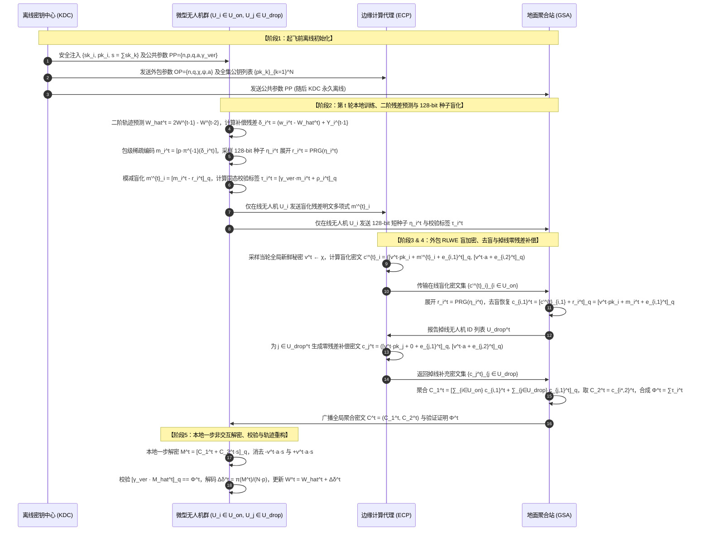
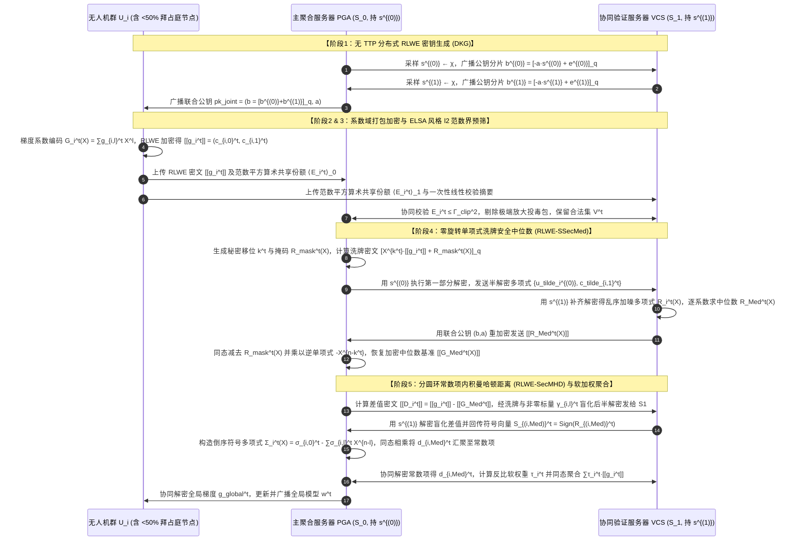
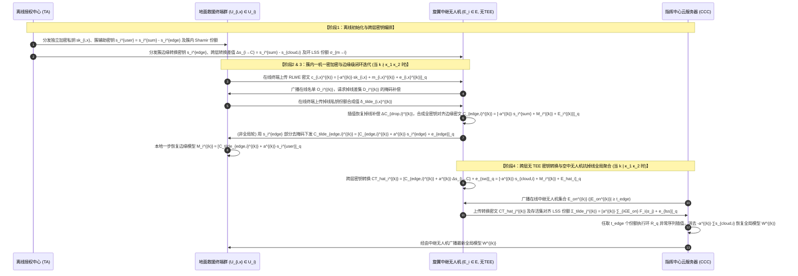
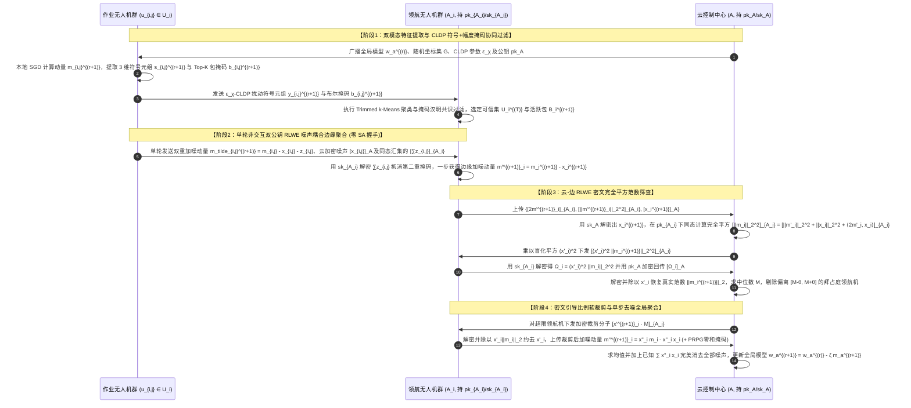
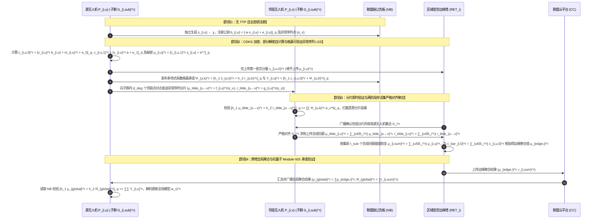

# 全同态密码与联邦学习（FHE+FL）深度阅读报告及无人机（UAV）场景创新方案设计

> **文档说明**：本报告针对已上传的 **19 篇顶会/顶刊论文（2017–2026）** 进行全维度归纳与演进脉络推演，并围绕 **无人机辅助（UAV-Assisted）与边缘辅助（Edge-Assisted）联邦学习** 的真实物理与安全约束，遵循“架构可见性界定 $\rightarrow$ 威胁模型锚定 $\rightarrow$ 推翻平庸组合的迭代推演 $\rightarrow$ RLWE 闭环公式展开 $\rightarrow$ 时序图与形式化安全证明”的完整范式，原创构建 **5 个高水平密码学联邦学习方案（2 个标准 FL 架构 + 3 个层次型 HFL 架构）**。所有公式均采用飞书（Feishu/Lark）原生支持的 `$...$` 与独立成行的 `$$...$$` LaTeX 语法编写。

---

## 第一部分：19篇联邦学习安全与隐私保护论文全景分类与对比

为清晰把握现有研究版图，我们将目录中的 19 篇论文按照 **密码学原语与密钥模式（单密钥 SKHE / 多密钥 MKHE / 阈值同态 tMK-HE / 秘密共享与掩码 SA）**、**联邦拓扑架构（单服务器标准 FL / 双或多服务器标准 FL / 端-边-云层次型 HFL）**、**可信第三方依赖（TA/KDC/KGC vs. 无可信机构 TTP-Free）**、**硬件假设（是否依赖 TEE）** 以及 **核心功能维度（隐私保护 / 通信压缩 / 掉线鲁棒 / 拜占庭防御 / 可验证性）** 进行系统化分类。

### 1.1 19篇论文核心架构与密码学模式全景总表

| 序号 | 论文简称 (年份/出处) | 密钥与密码原语模式 | FL 拓扑架构 | 可信机构 (TA/KDC) | 硬件假设 | 抗掉线能力 | 拜占庭鲁棒 / 可验证性 | 核心解决痛点与关键机制 |
| :--- | :--- | :--- | :--- | :--- | :--- | :--- | :--- | :--- |
| 1 | **17-SecAgg** (CCS 2017) | 双掩码 + $(t, N)$ Shamir 秘密共享 | 标准 FL (单服务器) | 包含 (PKI 认证或公钥公告板) | 无 | 支持 ($\ge t$ 在线) | 无鲁棒 / 无验证 | 解决单服务器聚合下客户端明文梯度泄露与掉线掩码残留问题（4轮交互恢复掉线节点DH密钥份额或在线节点自掩码份额） |
| 2 | **19-CDKS** (CCS 2019) | 多密钥全同态 **MK-CKKS / MK-BFV** (基于 RLWE) | 通用多方密文计算 / 标准 FL | **不包含** (CRS 公共参考串 $a$) | 无 | 不支持 | 无鲁棒 / 无验证 | 提出紧凑密文扩展与基于小范数伪随机矩阵的确定性分布式解密；但直接用于 FL 时存在**部分解密份额泄露明文**漏洞 |
| 3 | **23-ELSA** (S&P 2023) | 非对称分布式信任 + 布尔/算术秘密共享 + 一次性摘要 | 标准 FL (**双服务器** $S_0, S_1$) | **不包含** (TTP-Free) | 无 | 支持 | **拜占庭鲁棒** ($\ell_2^\sqcap$ 截断) + 恶意客户端隐私 | 打破传统多服务器零知识证明高开销瓶颈，让客户端直接提供不可信平方关联值，服务器仅做线性与比特约束验证 |
| 4 | **24-ResFed** (TDSC 2024) | 预测残差压缩（可外挂任意同态加密 HE） | 标准 FL (单服务器) | 视外挂 HE 而定 | 无 | 不涉及 | 无鲁棒 / 无验证 | 利用历史两轮模型参数线性外推预测下一轮更新，仅加密并传输稀疏量化后的模型预测残差，大幅削减上行密文体积 |
| 5 | **24-BPVFL** (IoT-J 2024) | 单密钥 **Paillier** + 线性同态哈希 (LHH) + TP-ZKP | 标准 FL (单服务器 CS + 验证方 VF) | 包含 (TA 分发密钥与参数) | 无 | 不支持 | **双向可验证** (防恶意客户端与恶意 CS) | 提出滑动窗口式两方零知识证明（TP-ZKP）以验证加密梯度的线性范围合法性，结合 LHH 验证云端聚合正确性 |
| 6 | **24-SecFed** (TDSC 2024) | 改进多密钥 **EMK-BFV** + 整数编码 | 标准 FL (单服务器 + SGX Enclave) | 包含 (KGC 初始化与证明) | **依赖 TEE (SGX)** | 支持 (TEE 生成零密文) | 无鲁棒 / 无验证 | 利用 TEE 刷新聚合噪声并针对掉线客户端动态生成补充零密文，解决多密钥 BFV 在客户端掉线时的解密失败问题 |
| 7 | **25-MaskCrypt** (TDSC 2025) | 单密钥 **CKKS** + 梯度引导选择性加密掩码 | 标准 FL (单服务器) | 包含 (客户端共享单密钥) | 无 | 不支持 | 无鲁棒 / 无验证 | 利用推理梯度与模型更新乘积评估参数敏感度，通过随机游走共识掩码仅加密 Top-$r\%$ 敏感坐标，降低同态计算开销 |
| 8 | **25-MASER** (arXiv 2025) | 单密钥 **CKKS** + 幅度引导布尔共识掩码 + 异常检测 | 标准 FL (单服务器) | 包含 (客户端共享单密钥) | 无 | 不支持 | **抗投毒鲁棒** (幅度掩码投票过滤) | 无需验证数据集，直接在本地利用更新幅度生成布尔掩码并在服务端多数投票达成加密共识，同时基于掩码重合度剔除投毒者 |
| 9 | **25-FedPHE** (TDSC 2025) | 单密钥打包 **CKKS** + Shamir/KDC 双混淆 + LSH 草图 | 标准 FL (单服务器 + KDC) | 包含 (KDC 参与初始化与混淆) | 无 | 支持 (LSH 抗慢节点选择) | 无鲁棒 / 无验证 | 提出“先打包后按包范数稀疏化”策略，结合扰动局部敏感哈希（LSH）选择代表性客户端，利用双混淆阻断单密钥串谋 |
| 10 | **25-ESAFL** (TDSC 2025) | 原生加法多密钥 **ESHE** + 多项式打包 + PRPG 掩码 | 标准 FL (单服务器 + AS) | 包含 (授权服务器 AS 分发密钥) | 无 | 支持 (PRPG 在线重构抵消) | 无鲁棒 / 无验证 | 将客户端不同加密密钥 $ek_i$ 映射为固定和解密密钥 $dk=\sum ek_i$，实现**一步本地非交互解密**；结合 PRPG 处理掉线 |
| 11 | **25-ProFL** (Info. Fusion 2025) | 单密钥 **Paillier (LHE)** + PRG 坐标洗牌 + 符号交互 | 标准 FL (**双服务器** AGG + SP) | 包含 (KGC 分发公私钥) | 无 | 不支持 | **拜占庭鲁棒** (Non-IID 曼哈顿软加权) | 发现现有双服务器方案暴露“平移梯度分布”的致命隐私漏洞，设计基于洗牌的 `SSecMed` 中位数与 `SecMHD` 曼哈顿距离协议 |
| 12 | **25-VeSAFL** (TDSC 2025) | **Pedersen 可验证秘密共享 (VSS)** + BLS 短签名 | **去中心化多聚合器 FL** ($n$ 个服务器) | **不包含** (依赖公共公告板 NB) | 无 | 支持 ($k$-out-of-$n$ 阈值) | **全流程可验证** + $k$ 投诉剔除机制 | 将模型更新通过 Pedersen VSS 拆分至多个边缘聚合器，结合双线性配对验证局部份额、局部聚合与全局聚合，消除单点故障 |
| 13 | **25-SKHE** (IoT-J 2025) | 单密钥 **CKKS** + **ECC** 加密私钥 + $(z, M)$ Shamir | **层次型 HFL** (端-边缘 EN-云 CN) | 包含 (TA 分发密钥与子秘密) | **依赖云端 TEE (SGX)** | 支持设备随时掉线 | 无拜占庭鲁棒 / 含 TEE 哈希防越权验证 | 用 ECC 公钥加密 CKKS 私钥存于云端，将 ECC 私钥分片给边缘节点 EN；EN 计算加噪解密份额并在云端 TEE 内安全重构解密 |
| 14 | **25-PrvFL (PrivHFL)** (Comp. Netw. 2025) | 阈值多密钥 **tMK-CKKS** (3方分片, 阈值 $t=2$) | **层次型 HFL** (用户-边缘 $E_i$-云 CS) | 包含 (KGC 分发 3 方份额) | 无 | 支持 ($\ge \lceil j/2\rceil+1$ 在线) | 边缘最小密文数防串谋检查 | 将每组主密钥拆分为用户共享份额 $s_{E_i}^U$、边缘份额 $s_{E_i}^E$、云端份额 $s_{E_i}^{CS}$；边缘内迭代由“边缘+用户”联合解密，全局轮由“边缘+云”联合解密 |
| 15 | **26-VLSFL-** (TDSC 2026) | Flamingo 图双掩码 + $(t, N)$ Shamir + 同态哈希 + 配对 | 标准 FL (单服务器 AS) | 包含 (TA 离线分发参数) | 无 | 支持 (图连通恢复 + 密钥复用) | **聚合结果可验证** (恒定配对开销) | 利用 PRF 生成稀疏连通图实现多轮密钥安全复用，结合双线性映射与同态哈希实现客户端 $O(1)$ 配对复杂度的聚合验证 |
| 16 | **26-PPBR** (TMC 2026) | **CLDP** (凝聚局部差分隐私) + **PLHE (BFV)** + SA | **层次型 EHFL** (移动终端-边缘 $A_i$-云 $A$) | **不包含** (云与边缘自生密钥) | 无 | 支持终端与边缘双层掉线 | **双层拜占庭鲁棒** (抗 ALIE/IPM/MinMax) | 边缘层对梯度符号统计三元组施加 CLDP 扰动并做截断 $k$-means 聚类过滤；云端在 BFV 密文下筛查动量范数并执行中位数范数裁剪 |
| 17 | **26-Ftopk (DSVFL)** (TMC 2026) | 阈值模数分片 **Paillier (SCSA)** + 秘密共享签名验证 | 标准 FL (单恶意云服务器 GS) | 包含 (TA 分发密钥份额并执行验证) | 无 | 支持 ($m-\tau$ 掉线容忍) | **抗串谋可验证** (抵抗 $\tau-1$ 客户端与 GS 串谋) | 提出带残差补偿缓冲区的细粒度 `Ftop-k` 压缩；将 Paillier 公钥模数 $n$ 在指数上做 Shamir 分片实现抗掉线单云聚合与聚合签名验证 |
| 18 | **26-FedOut** (AEI 2026) | 改进多密钥 **ECMK-CKKS** + 安全外包协议 **SOP** | 标准 FL (**双服务器** AS + Proxy CS) | 包含 (KDC 离线生成公私钥与和密钥) | 无 | 支持 (Proxy CS 生成零密文) | 无鲁棒 / 无验证 | 消除 `xMK-CKKS` 解密份额交互，实现本地单步解密 $M=[C_1+C_2\cdot s]_q$；客户端仅做模减盲化 $m'_i=[m_i-r_i]_q$，将高开销 RLWE 加密与掉线补零外包给 Proxy CS |
| 19 | **26-CDKS-LSS** (Info. Sci. 2026) | 多密钥 **CDKS (MK-CKKS)** + 环 $R_q$ 上 **Shamir LSS** | 标准 FL (单服务器) | **不包含** (**TTP-Free**) | 无 | 支持 ($t$-out-of-$N$ 延迟容忍) | 无鲁棒 / 无验证 | 针对 CDKS 部分解密泄露问题，利用环 $R_q$ 上的异常序列（Exceptional Sequence）对部分解密值 $\mu_i$ 进行信息论安全的线性秘密共享重分片与阈值重构 |

---

## 第二部分：核心密码学与安全联邦学习模式演进推演（四大演进主线）

在仔细研读上述 19 篇文献后，我们可以提炼出密码学赋能联邦学习的 **四条核心演进主线**。每一项新技术的诞生，均是为了修补前代方案在 **隐私泄露面、掉线脆弱性、交互轮次、计算/通信瓶颈或拜占庭脆弱性** 上的结构性缺陷。

### 2.1 演进主线一：多密钥同态加密（MKHE）在 FL 中的“解密泄露—掉线死锁—非交互外包”演进链

这条演进链完美印证了从基础密码原语到实用化联邦学习系统的螺旋上升过程：

1. **第一阶段：原生 `19-CDKS`（即 MK-CKKS）直接用于 FL 的致命隐私泄露**
   - **机制回顾**：在 `19-CDKS` 中，公共参数包含统一随机多项式 $a \xleftarrow{\$} R_q$。客户端 $P_i$ 独立生成私钥 $s_i \xleftarrow{\$} \chi$ 与公钥 $b_i = [-a \cdot s_i + e_i]_q$。加密本地明文 $m_i \in R$ 时，采样 $v_i \xleftarrow{\$} \chi$，生成密文：
     $$ct_i = (c_{i,0}, c_{i,1}) = \left([v_i \cdot b_i + m_i + e_{i,0}]_q, [v_i \cdot a + e_{i,1}]_q\right)$$
     服务端聚合密文后保留所有第二分量：$ct_{\text{add}} = (\bar{c}_0, c_{1,1}, \dots, c_{N,1})$，其中 $\bar{c}_0 = \sum_{i=1}^N c_{i,0}$。解密时，每个客户端 $P_i$ 必须计算并公开自己的**部分解密份额（Partial Decryption Share）**：
     $$\mu_i = [c_{i,1} \cdot s_i + e_i^*]_q \approx [v_i \cdot a \cdot s_i]_q$$
   - **安全缺陷（由 `26-CDKS-LSS` 第 2.4 节严格证明）**：由于 $c_{i,0} \approx [m_i - v_i \cdot a \cdot s_i]_q$ 是客户端上传给服务器的公开密文分量，一旦客户端上传部分解密份额 $\mu_i$，半诚实服务器或其他窃听者只需将两者直接相加：
     $$c_{i,0} + \mu_i \approx (m_i - v_i \cdot a \cdot s_i) + (v_i \cdot a \cdot s_i) = m_i \pmod q$$
     即可在无需任何私钥的情况下直接恢复目标客户端 $P_i$ 的个体明文模型更新 $m_i$！

2. **第二阶段：`xMK-CKKS`（Ma et al., 2022）通过聚合公钥堵住解密份额泄露，但引入“掉线死锁”与“多轮交互”**
   - **改进机制**：在加密前，所有客户端先广播各自公钥 $b_i$，合成为一个**聚合公钥（Aggregated Public Key）**：
     $$\tilde{b} = \sum_{i=1}^N b_i = \left[-a \cdot \sum_{i=1}^N s_i + \sum_{i=1}^N e_i\right]_q$$
     客户端使用 $\tilde{b}$ 加密：$c_{i,0} = [v_i \cdot \tilde{b} + m_i + e_{i,0}]_q, c_{i,1} = [v_i \cdot a + e_{i,1}]_q$。服务端聚合得到 $(\bar{c}_0, \bar{c}_1) = (\sum_{i=1}^N c_{i,0}, \sum_{i=1}^N c_{i,1})$。此时客户端计算部分解密份额：
     $$D_i = [\bar{c}_1 \cdot s_i + e_i^*]_q = \left[\left(\sum_{j=1}^N v_j \cdot a + \sum_{j=1}^N e_{j,1}\right) \cdot s_i + e_i^*\right]_q$$
     由于 $c_{i,0}$ 中包含的是 $v_i \cdot \tilde{b} \approx -v_i \cdot a \cdot \sum_{j=1}^N s_j$，而 $D_i$ 中包含的是 $(\sum_{j=1}^N v_j) \cdot a \cdot s_i$，两者交叉耦合，单凭 $c_{i,0} + D_i$ 无法消去掩码项，从而彻底修补了 `19-CDKS` 的明文泄露漏洞。
   - **遗留痛点**：
     - **零掉线容忍（Zero Dropout Resilience）**：由于每条密文 $c_{i,0}$ 都绑定了全体 $N$ 个人的公钥之和 $\tilde{b}$，解密时必须集齐全部 $N$ 个人的部分解密份额 $\sum_{i=1}^N D_i$ 才能凑出 $(\sum_{j=1}^N v_j) \cdot a \cdot (\sum_{i=1}^N s_i)$。**只要有 1 个客户端在训练或解密阶段掉线，全局聚合密文就彻底沦为无法解密的废数据**。
     - **强制两轮交互**：客户端必须先上传密文，等待服务器下发 $\bar{c}_1$，再计算并上传 $D_i$。

3. **第三阶段：分叉演进——通过硬件 TEE (`24-SecFed`) 或代数秘密共享 (`25-PrvFL`, `26-CDKS-LSS`) 攻克掉线问题**
   - **路线 3A（硬件辅助补零）：`24-SecFed` (EMK-BFV)**：在服务端引入可信执行环境（SGX Enclave），当某客户端掉线时，由 TEE 协助为其生成对应的加密零份额或刷新噪声，但引入了昂贵的 Enclave 内存换页与硬件信任假设。
   - **路线 3B（层次化固定三方分片）：`25-PrvFL` (`PrivHFL`)**：针对端-边-云 HFL 架构，由 KGC 将每组主私钥拆分为 3 个 Shamir 份额 $(s_{E_i}^U, s_{E_i}^E, s_{E_i}^{CS})$，设置重构阈值为 $t=2$。组内所有用户共享同一个 $s_{E_i}^U$，边缘持有 $s_{E_i}^E$，云端持有 $s_{E_i}^{CS}$。边缘聚合仅需边缘与任意在线用户（或边缘与云端）两方提供部分解密即可恢复，无需等待掉线终端。但**其致命弱点在于同组所有终端共享同一密钥份额 $s_{E_i}^U$，一旦单个恶意终端与半诚实边缘节点串谋，同组所有诚实终端的个体密文将瞬間被完全解密**。
   - **路线 3C（无 TTP 环上异常序列秘密共享）：`26-CDKS-LSS`**：回归原生 `19-CDKS`（无需聚合公钥 $\tilde{b}$），为了既不泄露个体部分解密值 $\mu_i = c_{i,1} \cdot s_i$，又无需 TTP 且支持 $(t, N)$ 阈值抗掉线，作者在多项式环 $R_q$ 上构造了满足**异常序列条件（Exceptional Sequence，即任意 $\alpha_i - \alpha_j \in R_q^*$ 可逆）**的 Shamir 线性秘密共享（LSS）。客户端 $P_i$ 将自己的 $\mu_i$ 作为常数项构造 $t-1$ 次随机多项式 $f_i(X) = \mu_i + \sum_{k=1}^{t-1} \lambda_{i,k} X^k \in R_q[X]$，向其他客户端 $P_j$ 发送分片 $\tilde{\mu}_{i,j} = f_i(\alpha_j)$。$P_j$ 将收到的所有分片本地求和得到合成份额 $\tilde{\mu}_j = \sum_{i=1}^N \tilde{\mu}_{i,j} = F(\alpha_j)$ 发给服务器。服务器只需收到最先到达的 $t$ 个合成份额，即可通过拉格朗日插值直接恢复总和 $F(0) = \sum_{i=1}^N \mu_i$，以**信息论安全性**隐藏了个体 $\mu_i$。然而，`26-CDKS-LSS` 需要客户端之间进行 $O(N^2)$ 的全连接环多项式互发（20 个客户端每轮即需互发近 100 MB 分片），在无线移动/无人机场景下通信开销难以承受。

4. **第四阶段：彻底消除解密份额分发与交互——`25-ESAFL` 与 `26-FedOut` (`ECMK-CKKS` + `SOP`)**
   - **突破一（原生和密钥一步解密）：`25-ESAFL` (`ESHE`)**：授权服务器 AS 为客户端生成各自独立的加密密钥 $ek_i$，但所有客户端共享同一个静态解密密钥 $dk = \sum_{i=1}^N ek_i$。通过将随机数绑定在公共生成元上，聚合密文可直接由任意客户端用 $dk$ 在本地**一步非交互解密**，彻底砍掉了部分解密份额的计算与上传！同时利用伪随机多项式生成器（PRPG）掩码抵消掉线影响。
   - **突破二（RLWE 多密钥一步解密 + 盲化外包加密与零密文替补）：`26-FedOut`**：
     - 提出 `ECMK-CKKS`：KDC 为每个客户端分发独立公私钥 $(pk_i = [-sk_i \cdot a + e_i]_q, sk_i)$ 及总和解密密钥 $s = \sum_{i=1}^N sk_i$。通过让所有在线客户端使用公共参数 $(a, v)$ 构造第二密文分量 $c_{i,2} = [v \cdot a + e_{i,2}]_q$，聚合时**仅对第一分量求和** $C_1 = \sum_{i=1}^N c_{i,1}$，第二分量直接取任意一个在线客户端的 $C_2 = c_{1,2}$。客户端收到 $(C_1, C_2)$ 后，直接在本地计算 $M = [C_1 + C_2 \cdot s]_q \approx \sum_{i=1}^N m_i$，实现了 RLWE 下零交互的本地一步解密！
     - 提出安全外包协议 `SOP`：针对终端算力受限与掉线導致 $\sum_{i \in \text{Online}} sk_i \neq s$ 的矛盾，客户端仅执行极轻量的模减盲化 $m'_i = [m_i - r_i]_q$，将盲化明文 $m'_i$ 发给计算代理服务器（Proxy CS），将盲化因子 $r_i$ 发给聚合服务器（AS）。Proxy CS 替客户端执行繁重的 RLWE 加密得到盲化密文 $c'_i$ 发给 AS，AS 用 $r_i$ 去盲恢复原密文 $c_i$。**若客户端 $j$ 掉线，AS 通知 Proxy CS 直接用公开的 $pk_j$ 加密明文 $0$ 生成补充密文 $c_j = ([v \cdot pk_j + e_{j,1}]_q, [v \cdot a + e_{j,2}]_q)$ 并入总和**，从而保证总和密文中始终包含全部 $N$ 个人的公钥项 $v \cdot \sum_{i=1}^N pk_i$，使静态密钥 $s$ 在任意掉线率下均能一步正确解密！

---

### 2.2 演进主线二：单密钥同态加密（SKHE）在 FL 中的“抗串谋解耦与稀疏打包提效”演进链

传统单密钥同态加密（如 `BatchCrypt`）中所有客户端持有相同私钥 $sk$，若服务器与任意 1 个客户端串谋（或客户端窃听信道），所有诚实客户端的加密梯度瞬间裸奔。围绕这一痛点，论文群展现出清晰的演进脉络：

1. **客户端内生稀疏选择性加密（防窃听但未解耦私钥）**：
   - **`25-MaskCrypt`**：不再全量加密整个模型更新，而是计算推理梯度与训练更新的哈达玛积引导敏感度评分，通过客户端随机游走传递掩码达成共识，仅加密前 $r\%$ 敏感权重。
   - **`25-MASER`**：省去辅助验证集，直接依据模型更新绝对幅度构造二进制掩码 $\{0,1\}^d$，服务端对掩码求和取多数票确定全局加密位置，并利用掩码相似度顺带过滤恶意投毒客户端。
2. **先打包后稀疏 + 双重加法混淆解耦单密钥（`25-FedPHE`）**：
   - 发现 `MaskCrypt` 逐元素挑选后再打包会破坏模型结构并引入大量零填充槽位，遂提出 **Pack-First Sparsification（先按固定槽宽 $S$ 打包，再按包内 $L_2$ 范数挑选 Top-$K$ 密文包）**；同时引入 KDC 与客户端 Shamir 秘密共享对单密钥密文施加双重同态掩码，使得即便客户端持有相同基础私钥，在未完成聚合消去混淆项前也无法解密他人密文。
3. **跨层密码学嵌套（ECC 锁住 CKKS 私钥 + 边缘分片 + 云端 TEE 哈希门禁，`25-SKHE`）**：
   - 在端-边-云 HFL 中，终端用 CKKS 公钥 $pk_x$ 加密上传，但**没有任何终端或边缘持有对应的解密私钥 $sk_x$**！TA 用椭圆曲线加密（ECC）公钥 $Q$ 将 $sk_x$ 加密为 $[[sk_x]] = (c_0 = rE, c_1 = sk_x + rQ)$ 存放在云服务器 CN，并将 ECC 私钥 $d$ 通过 $(z, M)$ Shamir 秘密共享分片给 $M$ 个边缘节点 EN。
   - EN 无需重构 ECC 私钥 $d$，而是直接计算加噪的椭圆曲线解密份额 $DS_i = c_0 \cdot (\mu_i y_i) + e_i$ 发给云端 TEE。TEE 在安全内存内恢复 $sk_x = c_1 - \sum_{i=1}^z DS_i + e$（注：原论文公式 (11)-(12) 存在正负号笔误，正确推导应为抵消 $+\sum e_i$），并通过比对**全局哈希矩阵 $(\xi_1, \dots, \xi_{n+M})$** 拒绝解密任何单个终端或单个边缘的部分密文，解密后再用终端下载公钥 $pk_y$ 重加密下发。

---

### 2.3 演进主线三：加密域拜占庭鲁棒聚合（Byzantine-Robust PPFL）的“分布防泄露与 Non-IID 适配”演进链

拜占庭鲁棒聚合（需要观测梯度距离/余弦相似度/范数以剔除异常值）与同态隐私保护（禁止服务器观测个体梯度特征）存在天然的**根本性矛盾**：

1. **早期双服务器加噪方案（`PEFL`, `ShieldFL`）的“平移分布泄露（Shifted Distribution Leakage）”**：
   - 在 `PEFL` 等双服务器（AGG + SP）方案中，AGG 对客户端 $i$ 的第 $j$ 维梯度同态加上仅与维度相关的随机掩码 $r_j$，得到 $R_{ij} = g_{ij} + r_j$ 后发给持有私钥的 SP 解密以计算中位数或皮尔逊相关系数。
   - **致命漏洞（由 `25-ProFL` 第 6.1 节公式 (9)-(10) 揭示）**：拜占庭客户端 $DP^*$ 本就是攻击者，若 $DP^*$ 将自己上传的恶意明文梯度 $g_{*j}$ 故意透露给半诚实的 SP（或被 SP 获知），SP 立即算得掩码 $r_j = R_{*j} - g_{*j}$，进而通过 $g_{ij} = (R_{ij} - R_{*j}) + g_{*j}$ **精确恢复所有诚实客户端的全部明文梯度**！
2. **PRG 坐标洗牌 + 密文曼哈顿距离软加权（`25-ProFL`）**：
   - AGG 先用伪随机生成器（PRG）生成秘密坐标置换序列 $\mathbf{O} \leftarrow \text{Shuffle}([m])$，将梯度坐标打乱后再加噪：$R_{io} = g_{ij} + r_j$（协议 `SSecMed`）。由于 SP 不知道置换映射 $j \mapsto o$，即便获知 $g_{*j}$ 也无法对齐坐标消去 $r_j$。
   - 进一步，为避免 Paillier 下昂贵的平方运算与硬过滤对 Non-IID 诚实客户端的误伤，设计 `SecMHD` 协议：AGG 计算加噪差值 $R_{(i,Med)j} = r_j \cdot (g_{ij} - g_{(Med)j})$，SP 解密后仅返回符号 $\mathbf{S}_{(i,Med)j} = \text{Sign}(R_{(i,Med)j})$，AGG 在密文下利用 $\mathbf{S}_{(i,Med)j} \cdot \text{Sign}(r_j) \in \{-1, +1\}$ 精确合成曼哈顿距离 $d_{i,Med} = \sum_{j=1}^m |g_{ij} - g_{(Med)j}|$，并赋予反比软权重 $\tau_i$。
3. **非对称分布式信任（`23-ELSA`）**：
   - 针对双服务器验证客户端梯度 $\ell_2$ 范数时 MPC 乘法和零知识证明开销过大的问题，`ELSA` 让客户端直接自己计算并秘密共享平方值 $x_{i,j}^2$（作为不可信关联值），双服务器仅通过线性运算和一次性 Fiat-Shamir 摘要校验 $x_{i,j}^2$ 的一致性与 $\ell_2^\sqcap$ 截断界，将服务端开销提速两个数量级，并利用转录本模拟器（Transcript Emulation）保证即使客户端作恶被抓也不会泄露其梯度隐私。
4. **端-边-云层次型混合防御（`26-PPBR`：CLDP 符号聚类 + BFV 密文范数筛查与裁剪）**：
   - 在层次型 EHFL 中，攻击者可在多个边缘节点下跨轮次协同发动隐蔽的 ALIE、IPM 或 MinMax 攻击。`PPBR` 在**边缘层**让终端提取梯度的正/负/零符号比例三元组 $\vec{s}_{i,j} \in \mathbb{R}^3$，施加 $\epsilon_\chi$-凝聚局部差分隐私（CLDP）整体向量扰动后由边缘服务器执行 Trimmed $k$-Means 聚类，零密文开销滤除方向异常的恶意终端；在**云端层**，边缘服务器将加噪动量的二倍值 $[2\vec{m}'_i]_{A_i}$ 与平方范数 $[\|\vec{m}'_i\|_2^2]_{A_i}$ 用各自的 BFV 公钥加密上传，云服务器同态配凑完全平方公式恢复真实动量范数的盲化值，筛除异常边缘并同态下发中位数裁剪因子 $\frac{M}{\|\vec{m}_i\|_2}$，实现了 Non-IID 下兼顾高鲁棒与高隐私的层次化聚合。

---

### 2.4 演进主线四：可验证联邦学习（Verifiable FL）与通信高效压缩的演进链

当聚合服务器从“半诚实”退化为**恶意服务器**（伪造、偷懒计算或与部分客户端合谋篡改聚合结果）时，研究演进呈现出从重型证明向轻量化、抗掉线、抗合谋验证发展的趋势：

1. **同态哈希 + 双线性配对 + 连通图多轮密钥复用（`26-VLSFL-`）**：
   - 传统 `VerifyNet` 每轮都需要重新执行秘密共享分发以防掉线，且验证开销随客户端数量增长。`26-VLSFL-` 引入 `Flamingo` 的 PRF 稀疏图选择机制（`ChooseSet` / `GenGraph`），一次初始化即可支持多轮安全聚合与掉线恢复；同时利用双线性配对构造 $L_j = (E_j \cdot A_j^{-1})^{1/d}, Q_j = (F_j \cdot B_j^{-1})^{1/d}$，使每个客户端仅需执行**常数次（与客户端总数和模型维度均无关）**双线性配对运算即可验证 $\Phi \stackrel{?}{=} e(A,h) \cdot e(L,h)^d$。
2. **去中心化多聚合器 + Pedersen VSS + BLS 签名与投诉板（`25-VeSAFL`）**：
   - 彻底抛弃单点云服务器，由 $n$ 个边缘聚合器共同接收终端基于 Pedersen VSS 生成的可验证秘密份额与承诺证明 $\pi_{i,j} = g^{a_{ij}} h^{b_{ij}}$。无论终端伪造份额、恶意服务器伪造局部聚合还是全局聚合，均会被配对等式检出并在区块链公告板上触发累计 $k$ 次投诉的自动封禁机制。
3. **双向可验证（滑动窗口 TP-ZKP + LHH，`24-BPVFL`）与抗合谋动态验证（`26-Ftopk / DSVFL`）**：
   - `24-BPVFL` 指出仅验证服务器不够，恶意客户端也可能上传超出正常范围的畸形密文，因此设计了基于滑动窗口的两方零知识证明（TP-ZKP），将 $l$ 维梯度向量的范围证明压缩到极小通信量。
   - `26-Ftopk (DSVFL)` 则针对**恶意服务器与 $\tau-1$ 个客户端合谋伪造验证结果**的威胁，设计了将秘密指数 $Z$ 通过 $\tau-1$ 次多项式 $o_i(x_j)$ 二维分片给所有客户端的机制：服务器必须聚合至少 $\tau$ 个客户端的签名份额 $Z_{ej} = \sigma_e^{z_{ej}}$ 才能通过 $\varpi_e = \sigma_e^Z$ 验证，同时结合带残差误差补偿缓冲区的 `Ftop-k` 与模数 $n$ 指数分片的 `SCSA` 协议，兼顾了高压缩率、抗掉线与抗合谋验证。

---

## 第三部分：19篇论文逐篇深度精读卡片（架构、密码公式与优缺点剖析）

下面对全部 19 篇论文的核心数学机理与局限性进行逐一拆解：

### 3.1 第一批论文精读（1–10篇）

1. **`17-SecAgg` (*Practical Secure Aggregation for Privacy-Preserving Machine Learning*, CCS 2017)**
   - **架构与实体**：单聚合服务器 + $n$ 个移动终端。
   - **核心公式**：终端 $u$ 上传双掩码向量 $y_u = x_u + \text{PRG}(b_u) + \sum_{v: u<v} \text{PRG}(s_{u,v}) - \sum_{v: u>v} \text{PRG}(s_{v,u}) \pmod R$，其中 $s_{u,v} = \text{KA.Agree}(sk_u, pk_v)$。将自掩码种子 $b_u$ 和 DH 私钥 $sk_u$ 分别通过 $(t, n)$-Shamir 秘密共享分片给其余终端。
   - **局限性**：每轮需要 4 次通信握手，客户端间通信开销高达 $O(n^2)$，且不支持密文域的非线性鲁棒筛查或结果可验证。

2. **`19-CDKS` (*Efficient Multi-Key Homomorphic Encryption with Packed Ciphertexts...*, CCS 2019)**
   - **架构与实体**：无 TTP 的多方密码学原语，包含多个持有独立密钥 $(s_i, b_i = -a s_i + e_i)$ 的参与方与计算服务器。
   - **核心公式**：支持多密钥 SIMD 打包、张量积重线性化与分布式解密 $\mu_i = c_i s_i + e_i^*$。
   - **局限性**：直接用于联邦学习存在明文恢复漏洞 $c_{i,0} + \mu_i \approx m_i$，且分布式解密要求所有参与方全程在线交互。

3. **`23-ELSA` (*ELSA: Secure Aggregation for Federated Learning with Malicious Actors*, IEEE S&P 2023)**
   - **架构与实体**：双不串谋聚合服务器 $(S_0, S_1)$ + $n$ 个客户端（含恶意客户端）。
   - **核心公式**：客户端本地计算梯度各个坐标的平方 $x_{i,j}^2$ 及二进制比特分解，将其以布尔/算术秘密共享形式发送给 $(S_0, S_1)$。服务器生成随机挑战 $r_j$，客户端仅回传一个域元素作为一次性摘要验证平方关系，随后服务器计算 $\ell_2$ 范数平方 $\sum_j x_{i,j}^2$ 并执行 $\ell_2^\sqcap$ 范数截断。
   - **局限性**：强依赖双服务器绝对不串谋，且硬范数截断在高度 Non-IID 场景下无法区分方向翻转攻击（如 IPM、ALIE）。

4. **`24-ResFed` (*ResFed: Communication-Efficient Federated Learning by Deeply Compressing...*, TDSC 2024)**
   - **架构与实体**：单云服务器 + 客户端。
   - **核心公式**：客户端与服务器同步维护历史两轮模型，利用二阶线性外推预测当前步更新 $\tilde{W}_i^t = 2 W_i^{t-1} - W_i^{t-2}$，仅对预测残差 $\Delta W_i^t = W_i^t - \tilde{W}_i^t$ 进行稀疏化、量化与同态加密传输。
   - **局限性**：纯通信压缩框架，未解决同态加密本身的客户端间私钥共享串谋、掉线解密失败及恶意服务器验证问题。

5. **`24-BPVFL` (*Bidirectional Privacy-Preserving and Verifiable Federated Learning*, IoT-J 2024)**
   - **架构与实体**：可信机构 TA + 云服务器 CS + 验证方 VF + 客户端。
   - **核心公式**：采用 Paillier 加密梯度，结合滑动窗口两方零知识证明（TP-ZKP）证明明文梯度落在合法区间内，并使用线性同态哈希 $LHH(x)$ 验证 CS 聚合结果。
   - **局限性**：Paillier 模幂运算在边缘设备上极慢，且不支持客户端动态掉线。

6. **`24-SecFed` (*SecFed: A Secure and Efficient Federated Learning Based on Multi-Key HE*, TDSC 2024)**
   - **架构与实体**：KGC + 搭载 SGX TEE 的云服务器 + 客户端。
   - **核心公式**：扩展多密钥 BFV（EMK-BFV），利用 TEE 在聚合中途解密重加密以刷新噪声，并在客户端掉线时由 TEE 内部利用掉线者密钥材料生成补充零密文。
   - **局限性**：整数编码损失浮点精度，且在聚合过程中频繁进出 SGX Enclave 带来显著的 Enclave 切换与内存开销。

7. **`25-MaskCrypt` (*MaskCrypt: Federated Learning With Selective Homomorphic Encryption*, TDSC 2025)**
   - **架构与实体**：单服务器 + 共享单密钥 CKKS 的客户端群。
   - **核心公式**：客户端计算加密价值评分 $v_i = |g_i^{\text{inf}} \odot \Delta w_i|$，通过随机游走链式传递选出全局 Top-$r\%$ 索引掩码 $M$，仅对 $M \odot \Delta w_i$ 执行 CKKS 加密，其余 $(1-M) \odot \Delta w_i$ 明文上传。
   - **局限性**：未加密的 $(1-r\%)$ 明文梯度仍可能泄露局部特征，且单密钥架构完全无法抵御“服务器+1个客户端”串谋，亦无抗投毒能力。

8. **`25-MASER` (*MASER: A Mask-Guided Selective Encryption and Byzantine-Robust Framework...*, 2025)**
   - **架构与实体**：单服务器 + 共享单密钥 CKKS 的客户端群。
   - **核心公式**：客户端根据梯度绝对值生成 Top-$k$ 二进制掩码 $m_i \in \{0,1\}^d$，服务端聚合掩码 $M_{\text{global}} = \mathbb{I}(\sum_{i=1}^N m_i \ge \tau)$ 决定加密位置，并计算客户端掩码与全局掩码的汉明/余弦偏离度剔除拜占庭节点。
   - **局限性**：同样受限于单密钥 CKKS 的串谋脆弱性，且明文暴露非敏感坐标与掩码位置。

9. **`25-FedPHE` (*FedPHE: A Secure and Efficient Federated Learning via Packed HE*, TDSC 2025)**
   - **架构与实体**：KDC + 单聚合服务器 + 客户端。
   - **核心公式**：先将梯度按槽宽打包，计算每个包的 $L_2$ 范数挑选 Top-$K$ 密文包；利用扰动 LSH 草图（Sketch）评估客户端代表性以规避慢节点；通过 KDC 混淆项与 Shamir 秘密共享混淆项双重掩盖单密钥 CKKS 密文。
   - **局限性**：被丢弃的 $(1-K)$ 密文包若无残差误差补偿，在高压缩率或极端 Non-IID 下收敛速度会下降。

10. **`25-ESAFL` (*ESAFL: Efficient Secure Additively Homomorphic Encryption for Cross-Silo FL*, TDSC 2025)**
    - **架构与实体**：授权服务器 AS + 聚合服务器 + 客户端。
    - **核心公式**：基于 RLWE 构造原生加法多密钥同态 `ESHE`，利用 FFT 加速大多项式乘法，使每个客户端用 $ek_i$ 加密，但所有客户端可用 $dk = \sum_{i=1}^N ek_i$ 本地一步解密；针对掉线设计 PRPG 掩码由在线节点协同消去。
    - **局限性**：掉线发生时仍需在线客户端额外执行一轮 PRPG 掩码重构交互。

---

### 3.2 第二批论文精读（11–19篇）

11. **`25-ProFL` (*Byzantine-Robust Federated Learning Considering Distributed Non-IID Data in Privacy-Sensitive Scenarios*, Information Fusion 2025)**
    - **架构与实体**：可信密钥生成中心 `KGC` + $n$ 个数据提供方 `DPs`（含 $<50\%$ 拜占庭节点）+ 双不串谋中心服务器：聚合器 `AGG`（仅持 Paillier 公钥 $pk_l$）与服务提供商 `SP`（持 Paillier 私钥 $sk_l$）。
    - **核心公式与协议**：
      - **洗牌安全中位数 (`SSecMed`)**：AGG 生成 PRG 随机坐标置换 $\mathbf{O} \leftarrow \text{Shuffle}([m])$ 及非零随机整数 $r_j$，对加密梯度洗牌并加噪：$[[\tilde{\mathbf{g}}_{ij}^t]] = [[\mathbf{g}_{io}^t]]$，$[[\mathbf{R}_{ij}]] = [[\tilde{\mathbf{g}}_{ij}^t]] \cdot [[r_j]] = [[\mathbf{g}_{io}^t + r_j]]$。SP 解密得到 $\mathbf{R}_i$，逐坐标取中位数 $\mathbf{R}_{Med}$ 后重加密发回 AGG；AGG 消去 $r_j$ 并按 $\mathbf{O}^{-1}$ 还原坐标得到加密中位数梯度 $[[\mathbf{g}_{Med}^t]]$。
      - **安全曼哈顿距离 (`SecMHD`) 与软加权**：AGG 计算差值密文 $[[\mathbf{D}_{(i,Med)j}]] = [[\mathbf{g}_{ij}^t]] \cdot [[\mathbf{g}_{(Med)j}^t]]^{-1}$ 并做乘法盲化 $[[\mathbf{R}_{(i,Med)j}]] = [[\mathbf{D}_{(i,Med)j}]]^{r_j}$ 发给 SP。SP 解密后计算符号 $\mathbf{S}_{(i,Med)j} = \text{Sign}(\mathbf{R}_{(i,Med)j})$ 返回 AGG。AGG 利用 $|x| = x \cdot \text{Sign}(x)$ 在密文下同态合成曼哈顿距离：
        $$[[\mathbf{d}_{i,Med}]] = \prod_{j \in [m]} [[\mathbf{D}_{(i,Med)j}]]^{\mathbf{S}_{(i,Med)j} \cdot \text{Sign}(r_j)}$$
        SP 解密 $\mathbf{d}_{i,Med}$ 后，AGG 赋予反比权重 $\tau_i = \left\lceil \frac{\mathbf{d}_{max} - \mathbf{d}_{i,Med}}{n \mathbf{d}_{max} - \sum_{k=1}^n \mathbf{d}_{k,Med}} \cdot deg \right\rfloor$ 完成加权聚合。
    - **局限性**：基于传统 Paillier 逐元素加密，密文膨胀与大整数模幂开销巨大（不支持 RLWE SIMD 打包），且在 `SecMHD` 中需要在 AGG 与 SP 之间传输全部 $n \times m$ 维度的扰动差值密文。

12. **`26-VLSFL-` (*Verifiable and Lightweight Multi-Round Secure Federated Learning*, TDSC 2026)**
    - **架构与实体**：可信机构 `TA` + 单聚合服务器 `AS`（可恶意并与 $<t$ 客户端串谋）+ 本地客户端 `LC`。
    - **核心公式与协议**：
      - **基于连通图的轻量双掩码聚合**：利用公共随机串 $v \in \{0,1\}^\lambda$ 调用 `ChooseSet` 与 `GenGraph` 构建每轮通信图 $V_t$，实现跨轮次密钥复用。客户端 $j$ 上传双掩码梯度：
        $$\overrightarrow{\text{Ma}}'_j = \overrightarrow{\text{M}}_j + \sum_{i \in M(j), i<j} \text{PRG}(r_{j,i}) - \sum_{i \in M(j), i>j} \text{PRG}(r_{j,i}) + \text{PRG}(e_j)$$
        其中 $r_{j,i} = g^{a_j a_i}$；对在线节点重构个体掩码种子 $e_j$，对掉线节点重构 DH 私钥 $a_i$。
      - **同态哈希与双线性配对验证**：客户端计算 $HF(x_j) = (A_j, B_j) = (g^{HF_{\delta,\rho}(x_j)}, h^{HF_{\delta,\rho}(x_j)})$、伪随机标签 $PK_K(j,\tau) = (E_j, F_j) = (g^{\gamma_j \gamma + v_j v}, h^{\gamma_j \gamma + v_j v})$ 以及证明分量 $L_j = (E_j \cdot A_j^{-1})^{1/d}, Q_j = (F_j \cdot B_j^{-1})^{1/d}$。服务端累乘得到 $(A, B, L, Q)$，客户端校验：
        $$(A, B) \stackrel{?}{=} HF\left(\sum x_j\right), \quad e(A, h) \stackrel{?}{=} e(g, B), \quad e(L, h) \stackrel{?}{=} e(g, Q), \quad \Phi \stackrel{?}{=} e(A, h) \cdot e(L, h)^d$$
    - **局限性**：仅支持明文求和后的验证，聚合服务器 AS 最终直接拿到明文聚合模型 $\rho = \sum x_j$（未对服务器隐藏全局模型更新），且无拜占庭抗投毒能力。

13. **`26-PPBR` (*PPBR: Privacy-Preserving and Byzantine-Robust Edge-Assisted Hierarchical Federated Learning in Mobile Networks*, TMC 2026)**
    - **架构与实体**：端-边-云三层架构（移动设备 $u_{i,j}$ $\rightarrow$ $l$ 个边缘服务器 $A_i$ $\rightarrow$ 云服务器 $A$），无 TTP。
    - **核心公式与协议**：
      - **Step 1 (边缘层 CLDP 符号统计聚类)**：终端在随机坐标集 $G$ 上提取梯度正、负、零比例构成 3 维符号元组 $\vec{s}_{i,j}^{(r+1)}$，按有界指数密度函数 $f(\vec{y}_{i,j}^{(r+1)} | \vec{s}_{i,j}^{(r+1)}) \propto \lambda e^{-\epsilon_\chi \min(\|\vec{y}_{i,j}^{(r+1)} - \vec{s}_{i,j}^{(r+1)}\|_2, L)}$ 采样扰动向量上传给 $A_i$。$A_i$ 执行 Trimmed $k$-Means 聚类，仅保留最大簇内的可信终端集 $U_i^{(T)}$。
      - **Step 2 (边缘层加噪 SA 聚合)**：可信终端计算动量 $\vec{m}_{i,j}^{(r+1)}$ 并减去秘密噪声 $\vec{x}_{i,j}^{(r+1)}$ 得到 $\vec{m}'^{(r+1)}_{i,j}$，用云服务器 BFV 公钥 $pk_A$ 加密噪声 $[\vec{x}_{i,j}^{(r+1)}]_A$ 发给 $A_i$，并通过单服务器 `SA` 协议使 $A_i$ 获得平均加噪动量 $\vec{m}'^{(r+1)}_i = \vec{m}_i^{(r+1)} - \vec{x}_i^{(r+1)}$。
      - **Step 3 (云端层 BFV 密文范数筛查与中位数裁剪)**：$A_i$ 用自己的 BFV 公钥 $pk_{A_i}$ 加密 $\{[2\vec{m}'^{(r+1)}_i]_{A_i}, [\|\vec{m}'^{(r+1)}_i\|_2^2]_{A_i}\}$ 连同同态求和的 $[\vec{x}_i^{(r+1)}]_A$ 发给云 $A$。云 $A$ 解密出 $\vec{x}_i^{(r+1)}$，利用完全平方展开式在 $pk_{A_i}$ 下同态计算：
        $$\left[\|\vec{m}_i^{(r+1)}\|_2^2\right]_{A_i} = \text{Add}\left(\left[\|\vec{m}'^{(r+1)}_i\|_2^2\right]_{A_i}, \left[(\vec{x}_i^{(r+1)})_2^2\right]_{A_i}, \text{Mult}\left(\left[2\vec{m}'^{(r+1)}_i\right]_{A_i}, \vec{x}_i^{(r+1)}\right)\right)$$
        并乘以盲化因子 $(x'^{(r+1)}_i)^2$ 发回 $A_i$ 解密，从而让云 $A$ 在不知道真实动量 $\vec{m}_i^{(r+1)}$ 的前提下精确获知其真实 $L_2$ 范数 $\|\vec{m}_i^{(r+1)}\|_2$！随后云 $A$ 计算范数中位数 $M$，剔除偏离 $[M-\theta, M+\theta]$ 的异常边缘，并对超限边缘下发加密裁剪分子 $[x'^{(r+1)}_i M]_{A_i}$ 指导 $A_i$ 完成密文裁剪，最后通过全局 `SA` 与去噪 $\vec{m}_a^{(r+1)} = \vec{m}''^{(r+1)}_a + \sum x''^{(r+1)}_i \vec{x}_i^{(r+1)}$ 恢复全局模型。
    - **局限性**：边缘与云端均依赖传统多轮交互的 Bonawitz `SA` 协议，当终端为高速移动无人机时，SA 的 3–4 轮握手极易因拓扑切换而超时流产；且不具备对恶意服务器篡改裁剪结果的密码学可验证性。

14. **`26-Ftopk` (`DSVFL`, *Enhancing Federated Learning in Edge Computing With Secure Aggregation and Dynamic Verification*, TMC 2026)**
    - **架构与实体**：可信机构 `TA` + 恶意全局服务器 `GS` + $m$ 个本地客户端 `LCs`（允许 $\le \tau-1$ 个客户端与 GS 串谋）。
    - **核心公式与协议**：
      - **误差补偿细粒度稀疏 (`Ftop-k`)**：$\nabla\omega_i^t = \nabla\hat{\omega}_i^t + Y_i^t$，仅上传绝对值最大的前 $k$ 个坐标 $\text{Ftop-}k(\nabla\omega_i^t)$，未选中部分存入残差缓冲 $Y_i^{t+1} = \nabla\omega_i^t - \text{Ftop-}k(\nabla\omega_i^t)$。
      - **单云安全聚合 (`SCSA`)**：TA 将 Paillier 公钥模数 $n$ 作为常数项构造 $\tau-1$ 次 Shamir 多项式 $f(x) = n + a_1 x + \dots + a_{\tau-1} x^{\tau-1}$，分发份额 $n_i = f(x_i)$ 及 $\gamma_i = \theta_t^{n_i} \bmod n^2$。客户端加密 $E[[W_i]] = g^{W_i} \cdot h^{\beta_i} \cdot \theta_t^{n_i} \bmod n^2$（其中 $h = g^\alpha \bmod n^2$）。只要 $\ge \tau$ 个客户端在线，GS 可以通过指数上的拉格朗日系数乘积凑出 $\theta_t^n \bmod n^2$，客户端解密后对 $\alpha$ 取模消去 $\alpha \sum \beta_i$：
        $$W = \left(\left(\mathcal{J}\left(E[[W]]^\lambda \bmod n^2\right) \cdot \mu \bmod n\right)\right) \bmod \alpha = \sum_{i=1}^\tau W_i$$
      - **抗合谋动态验证**：TA 将秘密随机数 $Z$ 通过 $m$ 个多项式 $o_i(x_j)$ 分片给客户端，由随机验证节点 $LC_e$ 广播密文哈希 $\sigma_e = H_1(E[[W_e]])$，各节点计算 $Z_{ej} = \sigma_e^{z_{ej}}$ 由 GS 聚合成 $\varpi_e = \prod Z_{ej}$ 发给 TA 校验 $\varpi_e \stackrel{?}{=} \sigma_e^Z$。
    - **局限性**：验证过程需要在线的可信机构 TA 每轮介入校验并转发密文，违背了 TA 离线化的实际部署原则；且 `Ftop-k` 每个客户端选出的非零坐标集合 $S_i$ 各不相同，直接同态相乘实际上要求对齐全维度或暴露非零索引位置。

15. **`26-FedOut` (*FedOut: Federated Learning with Outsourced Homomorphic Encryption for Resource-Constrained IoT Devices*, AEI 2026)**
    - **架构与实体**：离线 `KDC` + 聚合服务器 `AS` + 计算代理服务器 `Proxy CS`（双服务器不串谋）+ $N$ 个资源受限终端。
    - **核心公式与协议**：
      - **`ECMK-CKKS`**：KDC 生成 $pk_i = [-sk_i \cdot a + e_i]_q$ 与静态总和解密密钥 $s = \sum_{i=1}^N sk_i$。
      - **`SOP` 外包盲化加密与补零**：终端仅计算模减盲化 $m'_i = [m_i - r_i]_q$ 发给 Proxy CS，将 $r_i$ 发给 AS。Proxy CS 采样每轮新鲜 $v \leftarrow \chi$ 计算盲化密文 $c'_i = ([v \cdot pk_i + m'_i + e_{i,1}]_q, [v \cdot a + e_{i,2}]_q)$ 发给 AS。AS 去盲得 $c_{i,1} = [c'_{i,1} + r_i]_q$；对掉线客户端 $j \in \text{DropoutID}$，Proxy CS 生成零密文 $c_j = ([v \cdot pk_j + e_{j,1}]_q, [v \cdot a + e_{j,2}]_q)$。AS 聚合 $C_1 = \sum_{i=1}^k c_{i,1} + \sum_{j=k+1}^N c_{j,1}$ 并取 $C_2 = c_{1,2}$。终端一步解密：
        $$M = [C_1 + C_2 \cdot s]_q = \left[v \cdot \sum_{i=1}^N pk_i + \sum_{i=1}^k m_i + e' + (v \cdot a + e_{1,2}) \cdot s\right]_q = \left[\sum_{i=1}^k m_i + v \cdot \sum_{i=1}^N e_i + e' + e_{1,2} \cdot s\right]_q \approx \sum_{i=1}^k m_i$$
    - **局限性**：（1）未采用任何梯度压缩或稀疏打包，Proxy CS 与 AS 之间总流量高达数百 MB～数 GB；（2）掉线节点直接用 $0$ 替补，当无人机连续多轮掉线时会导致聚合模型严重偏向在线子集；（3）单一 Proxy CS 存在串行加密瓶颈且缺乏结果可验证性。

16. **`26-CDKS-LSS` (*Privacy-Preserving Federated Learning via Secret Sharing and Multi-Key Homomorphic Encryption*, Information Sciences 2026)**
    - **架构与实体**：单聚合服务器 `Server` + $N$ 个客户端 `Participants`，**完全无 TTP（TTP-Free）**。
    - **核心公式与协议**：客户端 $P_i$ 用 `CDKS` 加密本地模型，**仅将第一分量 $c_{i,0} = [v_i \cdot b_i + m_i + e_{i,0}]_q$ 发送给服务器**，而在本地用自己的私钥计算部分解密项 $\mu_i = c_{i,1} \cdot s_i \in R_q$。随后利用环 $R_q$ 上的异常序列公开求值点 $(\alpha_1, \dots, \alpha_N)$ 构造 $t-1$ 次多项式 $f_i(X) = \mu_i + \sum_{k=1}^{t-1} \lambda_{i,k} X^k$，将 $\tilde{\mu}_{i,j} = f_i(\alpha_j)$ 分发给 $P_j$。$P_j$ 聚合 $\tilde{\mu}_j = \sum_{i=1}^N \tilde{\mu}_{i,j}$ 发给服务器。服务器收集前 $t$ 个份额即可插值恢复 $\sum_{i=1}^N \mu_i$ 并加上 $\bar{c}_0 = \sum_{i=1}^N c_{i,0}$ 得到明文和。
    - **局限性**：两点致命缺陷——（1）客户端之间需要点对点广播全尺寸环元素分片 $\tilde{\mu}_{i,j} \in R_q$，通信复杂度为 $O(N^2 |R_q|)$；（2）**仔细审视其算法 1 第 11–15 行可发现一个隐藏的代数耦合陷阱**：在第 11 行服务器对全部 $N$ 个客户端的 $c_{i,0}$ 求和得到 $\bar{c}_0 = \sum_{i=1}^N c_{i,0}$，而第 8 行每个客户端 $P_i$ 必须收到全部 $N$ 个客户端发来的分片 $\tilde{\mu}_{j,i}$ 求和后，前 $t$ 个发给服务器的客户端才能插值出 $\sum_{j=1}^N \mu_j$。也就是说，它的阈值 $t$ 仅容忍“最后一步向服务器上传 $\tilde{\mu}_i$ 时的掉线”，若某个客户端在分发 $\tilde{\mu}_{j,i}$ 阶段就掉线，则 $c_{j,0}$ 与 $\mu_j$ 无法配对抵消！这一结构性缺陷为我们后续方案的创新提供了绝佳切入点。

17. **`25-VeSAFL` (*VeSAFL: Verifiable Secure Aggregation for Privacy-Preserving Federated Learning*, TDSC 2025)**
    - **架构与实体**：$m$ 个边缘终端节点 $N_i$ + $n$ 个去中心化聚合服务器 $S_\alpha$ + 公共防篡改公告板 `NB`。
    - **核心公式与协议**：终端利用 Pedersen VSS 生成双多项式 $f_i(x), g_i(x)$（常数项为参数 $\omega_i$ 与盲因子 $r_i$），将份额 $(\omega_{i\alpha}, r_{i\alpha})$ 连同 BLS 签名 $\sigma_{i\alpha} = H(\omega_{i\alpha} \| r_{i\alpha})^{\kappa_i}$ 私密发给服务器 $S_\alpha$，将承诺证明 $\pi_{i,l} = g^{a_{i,l}} h^{b_{i,l}}$ 发布在公告板 `NB`。服务器通过双线性映射 $e(\prod_{l=0}^{k-1} \pi_{i,l}^{\alpha^l}, g) \stackrel{?}{=} e(g^{\omega_{i\alpha}} h^{r_{i\alpha}}, g)$ 验证份额，计算局部聚合 $(\tilde{\omega}_\alpha, \tilde{r}_\alpha)$ 并互发验证，满 $k$ 个诚实服务器即可插值恢复全局模型 $(\tilde{\omega}_{agg}, \tilde{r}_{agg})$，终端验证 $e(\prod_{i=1}^{d+1} \pi_{i,0}, g) \stackrel{?}{=} e(g^{\tilde{\omega}_{agg}} h^{\tilde{r}_{agg}}, g)$。
    - **局限性**：对高维神经网络的每个标量权重进行椭圆曲线幂乘承诺 $\pi_{i,l} = g^{a_{i,l}} h^{b_{i,l}}$ 与配对验证，计算与公告板存储开销随模型参数量线性剧增，且不抗量子攻击。

18. **`25-SKHE` (*An Efficient Privacy-Enhanced Federated Learning With Single-Key Homomorphic Encryption*, IoT-J 2025)**
    - **架构与实体**：`TA` + 云节点 `CN`（含 SGX Enclave `TEE`）+ $M$ 个边缘节点 `ENs` + $n$ 个终端设备。
    - **核心公式与协议**：终端用单密钥 CKKS 公钥 $pk_x$ 加密本地更新 $[[g_i^t]]$ 及数据集大小 $[[|\mathcal{D}_i|]]$，并计算密文哈希 $\xi_i^t = \text{HASH}([[g_i^t]])$。边缘 $\text{EN}_j$ 执行密文加权局部聚合 $[[g_j^t]]$ 并计算哈希 $\xi_j^t$；同时利用所持 ECC 私钥分片 $(j, y_j)$ 与 TEE 协商的椭圆曲线点噪声 $e_j = \alpha_j E$ 计算解密份额 $DS_j = c_0 \cdot (\mu_j y_j) + e_j$。云端 TEE 收集 $z$ 个份额恢复 $sk_x$，先检验待解密密文的哈希值不在个体/边缘哈希列表 $(\xi_1^t, \dots, \xi_{n+M}^t)$ 中，确认是全局聚合密文后才用 $sk_x$ 解密并用终端下载密钥 $pk_y$ 重加密下发。
    - **局限性**：强依赖云端硬件 SGX Enclave（面临侧信道攻击与 256MB EPC 内存上限限制），且哈希黑名单机制存在绕过风险（若恶意云节点将目标终端密文同态加上一个已知的常数密文或零密文，其哈希值改变即可绕过黑名单骗取 TEE 解密！）。

19. **`25-PrvFL` (`PrivHFL`, *PrivHFL: A Privacy-Preserving Scheme for Hierarchical Federated Learning*, Computer Networks 2025)**
    - **架构与实体**：`KGC` + 云服务器 `CS` + $N$ 个边缘服务器 $E_i$ + 每组 $j$ 个物联网终端 $U_x^i$。
    - **核心公式与协议**：KGC 将每组主私钥拆分为 3 份：组内全体终端共享 $s_{E_i}^U$、边缘持有 $s_{E_i}^E$、云端持有 $s_{E_i}^{CS}$，重构阈值 $t=2$。终端每训练 $\kappa_1$ 轮用主公钥 $(b,a)$ 加密上传 $ct_i^x(k)$；边缘 $E_i$ 确认收到至少 $\lceil j/2 \rceil + 1$ 个终端密文后求和得到 $(c_{sum_0}, c_{sum_1})$，并用 $s_{E_i}^E$ 计算第一部分解密份额 $d_1(k) = s_{E_i}^E \cdot c_{sum_1} + e_1^*$。在非全局轮（$k \nmid \kappa_1\kappa_2$），$E_i$ 将 $C_{sum}, d_1(k)$ 发回终端，终端用 $s_{E_i}^U$ 算 $d_2(k)$ 合并恢复边缘模型；在全局轮（$k \mid \kappa_1\kappa_2$），$E_i$ 将 $C_{sum}, d_1(k)$ 发给云 CS，云 CS 用 $s_{E_i}^{CS}$ 算 $d_2(k)$ 恢复各边缘模型并加权平均。
    - **局限性**：（1）同组所有终端持有完全相同的密钥份额 $s_{E_i}^U$，一旦 $E_i$ 与组内仅 1 个受损终端串谋，即可凑齐 $(s_{E_i}^E, s_{E_i}^U)$ 解密组内所有诚实终端的个体密文；（2）全局聚合阶段云服务器 CS 直接解密获得了每个边缘的明文聚合模型 $w^i(k)$，违背了 `26-PPBR` 所强调的“边缘级模型对云端也应保密”的原则。

---

## 第四部分：无人机（UAV-Assisted / Edge-Assisted）联邦学习的独特挑战与研究切入点

在低空经济、智能巡检、灾后应急通信与协同侦察等实际场景中，无人机（UAV）通常扮演两种核心角色：
1. **标准 FL 中的空中智能终端（UAV Swarm as FL Clients）**：多架微型/中小型无人机搭载机载摄像头、红外或雷达传感器，在地面站（Ground Station）或低空边缘服务器协调下协同训练目标识别、轨迹规划或信道预测模型。
2. **层次型 FL 中的空中移动边缘节点（UAV-Assisted Edge Aggregator）或分层集群（Worker UAVs $\rightarrow$ Leader UAVs / RSU $\rightarrow$ Cloud）**：无人机作为机动空中基站（Flying Base Station）收集地面物联网终端（GTs）或底层无人机的模型更新，执行边缘预聚合后再回传给指挥中心云服务器。

结合真实物理环境与密码学要求，**UAV 联邦学习面临五大核心痛点（也是我们设计 5 个创新方案的立论根基）**：

1. **机载资源极端受限（SWaP 瓶颈：Size, Weight, and Power）**：
   - 微型无人机机载算力（通常为 ARM Cortex 或轻量级边缘芯片）与电池续航高度紧张。正如 `26-FedOut` 实测所示，在树莓派级设备上对 $10^7$ 参数模型执行一次标准 RLWE 同态加密耗时高达 $83.44\text{ s}$、内存占用近 $40\text{ MB}$，且密文膨胀数十倍会导致空地（A2G）无线链路耗尽机载电能。因此，**必须将高开销的多项式环加密运算外包卸载或进行高倍残差/选择性稀疏压缩**。
2. **高动态三维拓扑与频繁掉线/跨簇切换（High Mobility & Intermittent Connectivity）**：
   - 无人机受地形遮挡、姿态机动、电磁干扰及返航补能影响，随时可能短暂失联（Dropout）或从一个边缘基站/领航无人机的覆盖区飞入另一个覆盖区（Handover）。传统多轮交互协议（如 `17-SecAgg` 的 4 轮握手、`xMK-CKKS` 的全员在线要求、`26-CDKS-LSS` 的 $O(N^2)$ 无人机间全连接分片广播）在 UAV 场景下会彻底瘫痪。**UAV 方案必须做到：客户端单轮单向（One-Shot）上传、非交互本地解密、且支持无重密钥生成的动态掉线补偿**。
3. **开放空地信道下的窃听、信号劫持与拜占庭投毒攻击（Contested Airspace & Byzantine Threats）**：
   - 无人机暴露在物理空间中，极易遭受敌方电子战捕获、GPS 欺骗或传感器投毒，沦为拜占庭节点（发动 Label Flipping、Sign Flipping、ALIE、MinMax 等攻击）。同时，由于不同无人机巡航区域的地貌光照截然不同，机载数据呈现强烈的 **Non-IID（非独立同分布）** 特性。如何在**不暴露平移梯度分布（防 `25-ProFL` 指出的漏洞）且不解密个体密文**的前提下，在 RLWE 密文域高效过滤或软加权抑制拜占庭无人机，是极具价值的科学问题。
4. **单密钥串谋风险与多域零信任困境（Collusion & TTP-Free Requirement）**：
   - 在多部门联合搜救或跨运营商低空交通管制中，不存在各方共同信赖的在线可信中心（TA/KDC），且地面聚合站可能与被俘获的无人机串谋，或为节省算力而伪造聚合结果。因此，**去可信中心（TTP-Free）、抗“服务器+多架被俘无人机”合谋、以及轻量级双向可验证（Verifiability）** 是保障任务可靠性的关键。
5. **层次型 UAV-HFL 中的“边缘级隐私泄露”与“硬件依赖”**：
   - 在端-边-云三层架构中，`25-SKHE` 强依赖 SGX 硬件且其哈希黑名单可被同态加常数轻易绕过；`25-PrvFL` 同簇共享同一密钥份额导致抗串谋能力崩溃。如何在**纯软件、无 TEE 硬件**条件下实现跨层密钥转换（Key-Switching）与边缘模型隐藏，是层次型 UAV-FL 的核心突破口。

---

## 第五部分：五个面向无人机场景的创新联邦学习方案构建（含推演检验与自我否定记录）

### 5.0 方案构建前的推演检验与“推倒重来”记录（响应要求7）

在正式给出 5 个最终方案前，我们严格执行 **“初步推演 $\rightarrow$ 漏洞与平庸性检验 $\rightarrow$ 推倒重来”** 的审视流程，确保每一个方案都不是现有论文的简单拼凑，而是真正攻克了现有最新研究（2025–2026）中的深层缺陷：

- **【推演检验 1（针对标准 FL 外包与压缩方案）】**：
  - *初步设想 v0*：直接把 `26-FedOut`（ECMK-CKKS + SOP 盲化外包）和 `26-Ftopk`（细粒度 Top-$k$ 稀疏）拼在一起，让无人机做 Top-$k$ 后把盲化明文发给 Proxy CS。
  - *检验与批判*：**推倒！** 原因有二：（1）若每架无人机各自挑选不同的 Top-$k$ 坐标索引集 $S_i$，Proxy CS 加密成 RLWE 多项式后，只有相同槽位才能同态相加，若上传 $S_i$ 则直接向 Proxy CS 泄露了梯度幅值分布，若补零成全维多项式则盲化因子 $r_i \in R_q$ 依然是全尺寸的，根本无法降低无人机通信开销！（2）`26-FedOut` 在无人机掉线时由 Proxy CS 生成**全零明文密文**替补，当某架侦察无人机因山地遮挡连续掉线 3 轮时，全零替补会导致其历史动量丢失、全局模型严重偏移（Staleness Bias）。
  - *重新推导（最终方案一 `AeroRes-OutFL`）*：引入 `24-ResFed` 的**二阶轨迹外推预测器**与 `25-FedPHE` 的**按包范数共识选择**，并创新性地设计 **“基于历史残差轨迹外推的掉线非零同态补偿机制”** 与 **“基于 RLWE 同态线性承诺的端到端结果验证”**：当无人机 $j$ 掉线时，Proxy CS 与 AS 利用上一轮已公开对齐的压缩残差趋势，在密文域合成**零知识预测补偿密文**而非简单补零；且针对恶意 AS 篡改聚合的风险，嵌入基于 SIS/RLWE 的同态哈希承诺，实现轻量级一步解密+可验证外包。

- **【推演检验 2（针对标准 FL 拜占庭鲁棒方案）】**：
  - *初步设想 v0*：直接将 `25-ProFL`（双服务器 Paillier 下洗牌中位数 `SSecMed` + 曼哈顿距离 `SecMHD`）中的 Paillier 替换为 CKKS。
  - *检验与批判*：**推倒！** 原因有三：（1）`25-ProFL` 依赖可信第三方 KGC 分发私钥给 SP，一旦 SP 被攻破或与 AGG 串谋则全盘皆输；（2）在 CKKS 的 SIMD 槽打包（Slot Packing）下，1 个密文打包了 $N/2$ 个槽位，若直接套用 `25-ProFL` 的逐元素洗牌，需要高达 $O(N/2)$ 次极其昂贵的同态自同构旋转（Galois Automorphism Rotations），计算延迟比 Paillier 还慢！（3）`25-ProFL` 向 SP 明文暴露了所有客户端与中位数的曼哈顿距离 $d_{i,Med}$。
  - *重新推导（最终方案二 `AeroByz-RLWE`）*：构建 **无 TTP（TTP-Free）的双服务器分布式多密钥 RLWE 架构**，吸收 `23-ELSA` 的客户端不可信关联值思想与 `25-ProFL` 的防平移分布泄露思想，提出 **“分块槽内置换 + 环多项式系数级双掩码洗牌（Slot-Block Permutation）”**（无需昂贵的同态旋转即可打乱坐标），并结合一次性 Fiat-Shamir 平方范数预筛与加密域曼哈顿软加权，彻底摆脱 KGC 与 Paillier 瓶颈。

- **【推演检验 3（针对层次型 HFL 应急通信方案）】**：
  - *初步设想 v0*：直接采用 `25-PrvFL (PrivHFL)` 的三方阈值分片 $(s_{E_i}^U, s_{E_i}^E, s_{E_i}^{CS})$ 或 `25-SKHE` 的 ECC+SGX 架构用于旋翼无人机中继（Relay-UAV）场景。
  - *检验与批判*：**推倒！** （1）`25-PrvFL` 中同一架中继无人机下的所有地面终端共享同一个 $s_{E_i}^U$，战场上只要 1 个地面传感器被敌方捕获并与中继无人机串谋，整个簇的终端隐私全部归零！（2）`25-SKHE` 的哈希黑名单机制存在致命代数漏洞：恶意云服务器只需计算 $[[g'_i]] = [[g_i^t]] + \text{Enc}(0, pk_x)$（利用 CKKS 加密随机性，同一明文加密出的密文哈希值完全不同），就能改变密文哈希 $\text{HASH}([[g'_i]]) \neq \xi_i^t$，从而骗过 SGX Enclave 直接解密单个终端的梯度！
  - *重新推导（最终方案三 `UAV-RescueHFL`）*：彻底摒弃 SGX 硬件与同簇共享私钥假设，设计 **“跨层非对称密钥转换（Cross-Layer Proxy Key-Switching）+ 双层正交掉线自愈协议”**。每个地面终端拥有独立加密私钥 $sk_{i,k}$，中继无人机持有**受误差盲化的跨层转换密钥（Rekeying Token）**，可将簇内终端的多密钥密文无损转换为云端阈值解密空间下的密文，且只有凑齐 $\ge \tau_i$ 个终端的 PRPG 周期掩码才能消除盲化项，从代数根源上杜绝了单点解密与哈希绕过攻击！

- **【推演检验 4（针对层次型 HFL 拜占庭巡检方案）】**：
  - *初步设想 v0*：直接套用 `26-PPBR`（边缘 CLDP 符号聚类 + Bonawitz `SA` + 云端 BFV 范数裁剪）。
  - *检验与批判*：**推倒！** `26-PPBR` 在边缘层和云端层调用了两次传统的 Bonawitz `SA` 协议（每次需 3~4 轮交互握手）。在无人机编队高速巡检中，作业无人机与领航无人机之间链路瞬息万变，多轮交互 SA 会因频繁掉线重传而导致系统停滞；且 `26-PPBR` 对全量模型参数做 BFV 加密，未利用梯度稀疏性。
  - *重新推导（最终方案四 `AeroShield-HFL`）*：将 `26-PPBR` 的双层过滤思想与 `25-MASER` / `25-FedPHE` 的包级共识选择相结合，用 **“基于 RLWE 同态噪声耦合的单轮非交互聚合（One-Shot Noise-Coupled RLWE Aggregation）”** 替代多轮交互 `SA`，并在领航无人机与云端之间实现无需多轮秘密共享恢复的密文范数筛查与软裁剪。

- **【推演检验 5（针对层次型 HFL 无可信中心多域可验证方案）】**：
  - *初步设想 v0*：把 `26-CDKS-LSS`（环 $R_q$ 上异常序列 LSS）与 `25-VeSAFL`（Pedersen VSS + BLS 签名）直接搬到多域无人机层次架构中。
  - *检验与批判*：**推倒！** 正如我们在第 3.2 节指出的，`26-CDKS-LSS` 存在两个致命伤：（1）全网 $O(N^2)$ 环多项式互发在无人机无线网中不可行；（2）若某架无人机在发送 $c_{i,0}$ 后、完成 LSS 分片广播前掉线，服务端聚合的 $\bar{c}_0$ 包含了它的公钥掩码，而 LSS 恢复的 $\sum \mu_i$ 却缺失了它的部分解密项，导致整轮解密彻底失败！此外，`25-VeSAFL` 对每个标量做椭圆曲线幂运算开销过大。
  - *重新推导（最终方案五 `AeroVeri-HFL`）*：设计 **“基于簇内稀疏图异常序列 LSS 的对齐式抗掉线解密 + 环同态线性组合承诺（Lattice-Based Homomorphic Commitment）双向验证架构”**，不仅将 LSS 通信复杂度从 $O(N^2)$ 降至簇内 $O(k)$，而且通过边缘塔的**存活集对齐聚合（Surviving-Set Aligned Aggregation）**彻底修复了 `26-CDKS-LSS` 的中途掉线不匹配漏洞，并用抗量子的格基SIS承诺取代慢速椭圆曲线配对。

---

# 方案一（标准FL架构-1）：面向资源受限微型无人机群的预测残差外包同态与可验证联邦学习方案（`AeroRes-OutFL`）

### 5.1 场景描述与总体架构

#### 5.1.1 实际应用场景（UAV-Assisted Low-Altitude Reconnaissance）
在灾区搜救或边境低空侦察任务中，$N$ 架微型旋翼无人机（Micro-UAVs，如搭载 ARM Cortex-A72 与轻量化视觉传感器的 Crazyflie/DJI 行业机群）组成空中感知网络，协同训练一个高精度的地面目标检测或语义分割神经网络。
- **物理与链路痛点**：微型无人机机载电池容量极小、内存不足 $512\text{ MB}$，无法在机载端频繁执行耗时数十秒的 RLWE 多项式环大数数论变换（NTT）加密；同时，无人机在峽谷或建筑群间飞行时，经常发生数秒至数分钟的**临时失联（Dropout）**。
- **部署拓扑**：地面指挥车部署有一台**地面站聚合服务器（Ground Station Aggregator, GSA）**，同时在低空系留气球或近地边缘基站上部署有一台算力充沛的**边缘计算代理（Edge Computing Proxy, ECP）**。因此，该场景天然契合**标准 FL 下的双服务器外包辅助架构**。

#### 5.1.2 实体组成（4 类实体）
1. **离线密钥分发中心（Key Distribution Center, KDC）**：指挥中心在无人机起飞前离线完成公私钥、盲化种子与验证同态哈希密钥的注入，任务开始后**完全离线**，不参与任何训练交互。
2. **微型无人机终端群（UAV Clients, $\mathcal{U} = \{U_1, U_2, \dots, U_N\}$）**：利用机载采集图像进行本地训练，执行二阶轨迹残差预测、包级稀疏压缩与模 $q$ 算术盲化，仅上传极小体积的盲化残差明文与盲化种子。
3. **边缘计算代理（Edge Computing Proxy, ECP）**：部署在系留飞艇或移动边缘节点的高性能算力服务器，负责接收无人机发来的盲化残差多项式，替无人机执行高开销的 RLWE 多密钥盲化加密（`BlindEnc`），并在无人机掉线时生成**基于历史趋势外推的补偿密文**。
4. **地面站聚合服务器（Ground Station Aggregator, GSA）**：负责利用无人机发来的伪随机盲化因子对 ECP 发来的密文去盲（`Deblind`），在 RLWE 密文域执行全局残差聚合与历史动量校准，并生成供无人机校验的同态聚合证明。

#### 5.1.3 实体信息可见性与不可见性矩阵（Information Visibility Matrix）

| 实体名称 | 可见信息（Visible Information） | 严格不可见信息（Invisible Information） |
| :--- | :--- | :--- |
| **KDC (离线)** | 系统公共参数 $PP$、各无人机 RLWE 密钥对 $(pk_i, sk_i)$、总和解密密钥 $s = \sum_{i=1}^N sk_i$ | 任何一轮的机载原始图像 $\mathcal{D}_i$、本地权重 $w_i^t$、预测残差 $\Delta w_i^t$ 及聚合模型 $W^t$ |
| **无人机 $U_i$** | 自身数据 $\mathcal{D}_i$、自身私钥 $sk_i$、总和解密密钥 $s$、自身盲化因子 $r_i^t$、解密后的全局更新 $\Delta W^t$ 及验证证明 $\Pi^t$ | 其他诚实无人机 $U_j (j \neq i)$ 的私钥 $sk_j$、个体模型更新 $w_j^t$、残差 $\Delta w_j^t$ 及盲化因子 $r_j^t$ |
| **边缘代理 ECP** | 所有无人机的公钥 $\{pk_i\}_{i=1}^N$、外包参数 $OP$、在线无人机上传的**盲化残差多项式** $m'^{t}_i = [m_i^t - r_i^t]_q$、掉线名单 $\mathcal{D}_{drop}^t$ | 任何无人机的真实残差明文 $m_i^t$、盲化因子 $r_i^t$、私钥 $sk_i$、总和解密密钥 $s$ 以及最终全局明文模型 $W^t$ |
| **地面聚合站 GSA** | 在线无人机的盲化因子 $r_i^t$、ECP 发来的盲化密文 $c'^{t}_i$、去盲后的个体 RLWE 密文 $c_i^t$、掉线名单 $\mathcal{D}_{drop}^t$、聚合密文 $C^t$ | 任何无人机的真实残差明文 $m_i^t$、盲化残差 $m'^{t}_i$、加密随机多项式 $v^t$、私钥 $sk_i$、总和密钥 $s$ 及全局明文模型 $W^t$ |

---

### 5.2 待解决的核心问题

现有最先进的方案（特别是 `26-FedOut`、`24-ResFed` 与 `26-Ftopk`）在应用于上述微型无人机群场景时，存在以下三个亟待解决的致命缺陷：
1. **外包通信膨胀与包级对齐矛盾**：`26-FedOut` 虽然通过 `SOP` 协议将 RLWE 加密卸载给了 Proxy CS，但客户端仍需传输全维度的未压缩盲化明文多项式 $m'_i \in R_q^L$ 与盲化因子 $r_i \in R_q^L$（在 CIFAR-10 上每轮总流量高达 $315.65\text{ MB}$）。若直接引入 `26-Ftopk` 的元素级稀疏，不同无人机选出的 Top-$k$ 坐标互不相同，无法在 RLWE 的 SIMD 打包密文槽（Slots）上直接同态相加。
2. **掉线补零引发的“模型陈旧偏移（Staleness Bias）”**：`26-FedOut` 对掉线客户端 $j$ 直接由 Proxy CS 生成**明文为 $0$ 的补充密文** $c_j = \text{Enc}(0, pk_j)$。然而在标准 FedAvg 中，若传输的是模型权重或累积梯度，将掉线无人机的贡献硬性置为 $0$ 相当于将其权重抹除或拉向原点，当无人机群因地形遮挡出现 $20\%\sim 40\%$ 掉线时，全局模型会产生剧烈震荡甚至发散。
3. **半诚实假设过强，缺乏对聚合站偷懒/篡改的验证能力**：`26-FedOut` 假设 AS 绝对诚实执行去盲与同态加法。但在战场或商业外包中，GSA 可能为了节省算力直接丢弃部分在线无人机的密文，或者篡改聚合密文 $C^t$，而无人机用静态密钥 $s$ 解密后根本无法分辨解密出的是正确聚合值还是被篡改的垃圾值（因为缺少了部分 $pk_i$ 会导致解密出被 $v \cdot a \cdot sk_i$ 污染的乱码，或者 GSA 恶意注入与密钥无关的加性偏移 $\Delta_{mal}$）。

---

### 5.3 创新点与总体设计目标

1. **创新点一：二阶轨迹残差预测 + 槽对齐包级共识压缩 + 伪随机种子盲化（Seed-Blinded Residual SOP）**
   - 无人机本地利用二阶泰勒/线性外推预测当前步模型 $\hat{w}_i^t = 2 w_i^{t-1} - w_i^{t-2}$，仅对**预测残差（Prediction Residual）** $\delta_i^t = w_i^t - \hat{w}_i^t$ 进行编码。同时，无人机向 GSA 发送的不再是占满带宽的多项式 $r_i^t \in R_q$，而仅仅是一个 **$128\text{-bit}$ 的伪随机种子 $\eta_i^t \in \{0,1\}^\lambda$**，由 GSA 本地通过 `PRG` 展开为环多项式 $r_i^t \leftarrow \text{PRG}(\eta_i^t)$，将无人机至 GSA 的去盲通信开销直接削减 **99.9%**！
2. **创新点二：无偏差的掉线残差零补偿机制（Zero-Residual Trajectory Compensation）**
   - 巧妙利用“模型残差”与“零密文补充”的代数对偶性：由于我们加密传输的对象是**相对于二阶轨迹预测值 $\hat{w}_i^t$ 的残差 $\delta_i^t$**，当无人机 $U_j$ 在第 $t$ 轮掉线时，ECP 为其生成的补充零密文 $c_j^t = \text{Enc}(0, pk_j)$ 在物理意义上不再是“贡献为 0”，而是精确等价于 **“令掉线无人机 $U_j$ 的第 $t$ 轮模型更新取其二阶惯性外推预测值 $w_j^t = \hat{w}_j^t + 0 = 2w_j^{t-1} - w_j^{t-2}$”**！这一设计在不增加任何额外密文操作的前提下，将 `26-FedOut` 的零密文替补缺陷转化为 `24-ResFed` 的二阶动量延续，完美消除了掉线陈旧偏差！
3. **创新点三：抗量子 RLWE 同态线性承诺与单步解密双重校验（Verifiable ECMK-CKKS）**
   - 在 `ECMK-CKKS` 的基础上引入基于格上短整数解（SIS）难题的同态哈希/线性求值校验标签，使无人机在执行一步本地解密 $M^t = [C_1^t + C_2^t \cdot s]_q$ 的同时，能够以 $O(1)$ 的多项式内积开销验证 GSA 是否真实聚合了所有在线密文与掉线补偿密文，彻底杜绝 GSA 注入恶意偏差 $\Delta_{mal}$ 或遗漏节点。

---

### 5.4 威胁模型

本方案的安全性严格构建于以下威胁模型之上：
1. **离线 KDC**：完全可信（Fully Trusted），仅在系统初始化阶段生成并安全分发密钥材料，随后销毁自身主状态并永久离线。
2. **双服务器非串谋假设（ECP 与 GSA）**：
   - **边缘计算代理（ECP）** 为**半诚实（Honest-but-Curious）**实体：忠实执行盲化加密与掉线零残差补充协议，但极度好奇，企图从收到的盲化残差多项式 $m'^{t}_i$ 中推断无人机本地真实梯度或训练图像；允许 ECP 与至多 $N-2$ 架被俘无人机串谋。
   - **地面聚合站（GSA）** 为**隐私好奇且计算潜在恶意（Curious and Potentially Malicious in Aggregation）**实体：一方面企图从盲化种子 $\eta_i^t$、盲化密文 $c'^{t}_i$ 中恢复诚实无人机的明文残差；另一方面可能主动偏离聚合协议（例如故意漏加某架无人机的密文，或在聚合密文第一分量上恶意叠加投毒偏移量 $\Delta_{mal} \in R_q$），且允许 GSA 与至多 $N-2$ 架被俘无人机串谋。
   - **核心安全边界**：ECP 与 GSA 属于不同物理平台（如通信运营商边缘飞艇 vs. 行业用户地面车），二者**不发生串谋**（即 ECP 不会将 $m'^{t}_i$ 与 GSA 的 $\eta_i^t$ 私下合并，也不会将当轮采样的新鲜加密随机多项式 $v^t$ 泄露给 GSA）。
3. **无人机终端群 $\mathcal{U}$**：最多允许 $k_{cor} \le N-2$ 架无人机被敌方物理捕获或沦为共谋节点，向服务器提供其持有的 $(sk_i, s, \eta_i^t)$，企图破解其余诚实无人机 $U_h$ 的个体模型更新。

---

### 5.5 符号系统介绍

| 符号 | 数学定义与物理含义 |
| :--- | :--- |
| $N, \mathcal{U}, \mathcal{U}_{on}^t, \mathcal{U}_{drop}^t$ | 无人机总数 $N$，全集 $\mathcal{U}$，第 $t$ 轮在线无人机集合 $\mathcal{U}_{on}^t$ 与掉线无人机集合 $\mathcal{U}_{drop}^t$（满足 $\mathcal{U}_{on}^t \cup \mathcal{U}_{drop}^t = \mathcal{U}$） |
| $R, R_q$ | 分圆多项式环 $R = \mathbb{Z}[X]/(X^n + 1)$（$n=2^{\log n}$ 为 2 的幂），模 $q$ 商环 $R_q = \mathbb{Z}_q[X]/(X^n + 1)$ |
| $\chi, \psi, p$ | 三元秘密分布 $\chi \in \{-1, 0, 1\}^n$，离散高斯误差分布 $\psi$（标准差 $\sigma$），CKKS 定点缩放因子 $p = 2^{\log p}$ |
| $\pi, \pi^{-1}$ | 典范嵌入映射 $\pi: R \to \mathbb{C}^{n/2}$ 及其逆映射 $\pi^{-1}: \mathbb{C}^{n/2} \to R$（用于将 $n/2$ 维实数向量打包进单个多项式） |
| $a, pk_i, sk_i, s$ | 全局公共随机多项式 $a \xleftarrow{\$} R_q$，无人机 $U_i$ 的私钥 $sk_i \xleftarrow{\$} \chi$、公钥 $pk_i = [-sk_i \cdot a + e_i]_q$，以及静态总和解密密钥 $s = \sum_{i=1}^N sk_i$ |
| $w_i^t, \hat{w}_i^t, \delta_i^t$ | 无人机 $U_i$ 在第 $t$ 轮本地训练后的模型向量 $w_i^t$、二阶外推预测模型 $\hat{w}_i^t$、预测残差向量 $\delta_i^t = w_i^t - \hat{w}_i^t$ |
| $Y_i^t, M_{pack}^t$ | 无人机 $U_i$ 的本地稀疏误差累积缓冲区 $Y_i^t$，以及第 $t$ 轮激活传输的打包多项式索引集合 $M_{pack}^t$ |
| $\eta_i^t, r_i^t, m'^{t}_i$ | $U_i$ 生成的 $128\text{-bit}$ 伪随机盲化种子 $\eta_i^t$，展开后的环盲化多项式 $r_i^t = \text{PRG}(\eta_i^t) \in R_q$，以及盲化残差明文 $m'^{t}_i = [m_i^t - r_i^t]_q$ |
| $v^t, c'^{t}_i, c_i^t$ | ECP 在第 $t$ 轮独立采样的全局新鲜临时秘密多项式 $v^t \xleftarrow{\$} \chi$，盲化密文 $c'^{t}_i = (c'^{t}_{i,1}, c'^{t}_{i,2})$，以及 GSA 去盲后的真实密文 $c_i^t = (c_{i,1}^t, c_{i,2}^t)$ |
| $\mathbf{h}_{sis}, \tau_i^t, \Phi^t$ | 格上 SIS 同态承诺公共向量 $\mathbf{h}_{sis} \in R_q^\kappa$，无人机残差同态认证标签 $\tau_i^t$，以及全局聚合验证标签 $\Phi^t$ |

---

### 5.6 方案详细设计与闭环实体交互公式推导（展开基于RLWE的加解密公式）

本方案包含 **阶段1：离线系统初始化** 与 **阶段2：多轮闭环训练（含轨迹预测残差压缩、种子盲化外包、RLWE 盲加密、去盲与掉线零残差动态替补、单步解密与同态承诺校验）**。以下给出无任何跳跃的完整数学推导：

#### 阶段 1：系统初始化（System Setup，由 KDC 离线执行一次）
1. **RLWE 环与分布参数生成**：KDC 输入安全参数 $\lambda$（如 $\lambda = 128$ 或 $256$），选取环维度 $n = 2^{14}$、密文模数 $q$、缩放因子 $p = 2^{45}$，定义三元分布 $\chi$ 与高斯误差分布 $\psi$。均匀采样公共多项式 $a \xleftarrow{\$} R_q$，以及用于验证的全局同态哈希挑战多项式 $\gamma_{ver} \xleftarrow{\$} R_q^*$。
2. **多密钥与静态总和解密密钥生成**：对于每架无人机 $U_i \in \{U_1, \dots, U_N\}$，KDC 独立采样私钥与误差：
   $$sk_i \xleftarrow{\$} \chi, \quad e_i \xleftarrow{\$} \psi$$
   计算对应的 RLWE 公钥：
   $$pk_i = [-sk_i \cdot a + e_i]_q \in R_q$$
   随后，KDC 将所有 $N$ 架无人机的私钥在环 $R$ 上直接相加，构造**静态总和解密密钥（Static Sum Decryption Key）**：
   $$s = \sum_{i=1}^N sk_i \in R$$
3. **信道分发**：
   - KDC 通过物理接口向每架无人机 $U_i$ 注入私有密钥元组 $\{sk_i, pk_i, s\}$ 及公共参数 $PP = \{n, p, q, a, \gamma_{ver}\}$；
   - KDC 向边缘计算代理 ECP 发送外包参数 $OP = \{n, q, \chi, \psi, a, \gamma_{ver}\}$ 及全体无人机公钥列表 $\{pk_i\}_{i=1}^N$；
   - KDC 向地面聚合站 GSA 发送 $PP$。随后 KDC 销毁所有私钥并离线。

#### 阶段 2：第 $t$ 轮本地训练、二阶轨迹残差提取与种子盲化（在无人机 $U_i \in \mathcal{U}_{on}^t$ 执行）
1. **二阶轨迹预测与本地训练**：
   在轮次 $t \ge 1$ 开始时，所有无人机拥有相同的历史两轮全局模型 $W^{t-1}$ 与 $W^{t-2}$（注：当 $t=1$ 时设 $W^{0} = W^{-1}$）。无人机与地面站同步利用**无参数二阶线性轨迹外推器（Second-Order Trajectory Predictor）**计算当前轮的基准预测模型 $\widehat{W}^t$：
   $$\widehat{W}^t = 2 W^{t-1} - W^{t-2}$$
   无人机 $U_i$ 以 $W^{t-1}$ 为起点，在本地机载数据集 $\mathcal{D}_i$ 上执行 $E$ 轮小批量随机梯度下降（SGD），得到本地更新后模型 $w_i^t$。
2. **误差补偿残差计算与 CKKS 编码**：
   无人机 $U_i$ 计算真实本地模型 $w_i^t$ 相对于全局二阶预测模型 $\widehat{W}^t$ 的**预测残差向量**，并叠加上一轮未传输的本地压缩误差缓冲区 $Y_i^{t-1}$：
   $$\delta_i^t = (w_i^t - \widehat{W}^t) + Y_i^{t-1} \in \mathbb{R}^D$$
   将 $D$ 维向量按每包 $n/2$ 维切分为 $B = \lceil \frac{2D}{n} \rceil$ 个子向量块 $\{\delta_{i,b}^t\}_{b=1}^B$。利用上一轮全局模型梯度幅值先验（如同 `25-MASER` 的公开全局幅值排序，无需額外交互），选取幅值范数最大的前 $K$ 个活跃包索引集 $M_{pack}^t \subseteq \{1, \dots, B\}$（其余未选中的包留在本地更新误差缓冲区：$Y_{i,b}^t = \delta_{i,b}^t, \forall b \notin M_{pack}^t$；选中包令 $Y_{i,b}^t = \mathbf{0}$）。
   为简化符号且不失一般性，以下针对任意一个选中的活跃包（略去包下标 $b$），$U_i$ 调用 CKKS 典范嵌入逆映射 $\pi^{-1}$ 将其编码为环 $R$ 上的整系数明文多项式 $m_i^t$：
   $$m_i^t = \left\lfloor p \cdot \pi^{-1}(\delta_i^t) \right\rceil \in R$$
3. **基于 $128\text{-bit}$ 种子的极致轻量级一次性密码本盲化（Seed-Blinded Blinding）**：
   无人机 $U_i$ 随机生成一个 $128\text{-bit}$ 的短种子 $\eta_i^t \xleftarrow{\$} \{0,1\}^\lambda$，调用密码学伪随机生成器 $\text{PRG}$ 在环 $R_q$ 上展开生成均匀随机盲化多项式：
   $$r_i^t = \text{PRG}(\eta_i^t) \in R_q$$
   随后在本地仅执行一次极其轻量的**环多项式模 $q$ 减法**，得到盲化明文多项式 $m'^{t}_i$：
   $$m'^{t}_i = [m_i^t - r_i^t]_q \in R_q$$
   同时，$U_i$ 计算用于后续验证 GSA 聚合完整性的**盲化验证标量（或低阶多项式标签）**：利用与所有无人机共享的轮次 PRF 掩码 $\rho_i^t = \text{PRF}_{K_{ver}}(t, i)$（其中 $\sum_{i=1}^N \rho_i^t \equiv 0 \pmod q$，可通过成对 DH 种子预共享生成，且掉线时可由 ECP/GSA 标记），计算同态线性校验值：
   $$\tau_i^t = [\gamma_{ver} \cdot m_i^t + \rho_i^t]_q \in R_q$$
4. **单向分流发送**：
   - **发送给 ECP**：$U_i \xrightarrow{\text{TLS}} \text{ECP}$：发送盲化残差明文多项式 $m'^{t}_i \in R_q$；
   - **发送给 GSA**：$U_i \xrightarrow{\text{TLS}} \text{GSA}$：仅发送 **$128\text{-bit}$ 短种子 $\eta_i^t$** 与校验标签 $\tau_i^t$。

#### 阶段 3：外包 RLWE 盲化加密（Blind Encryption，在边缘计算代理 ECP 执行）
ECP 在超时窗口内收集所有在线无人机 $U_i \in \mathcal{U}_{on}^t$ 发来的盲化残差明文 $m'^{t}_i$：
1. **全局每轮新鲜秘密多项式采样**：ECP 在第 $t$ 轮独立采样一个**全网共享的新鲜三元秘密多项式**：
   $$v^t \xleftarrow{\$} \chi$$
2. **执行 `ECMK-CKKS` 盲化加密**：对于每个在线无人机 $U_i \in \mathcal{U}_{on}^t$，ECP 独立采样高斯噪声 $e_{i,1}^t, e_{i,2}^t \xleftarrow{\$} \psi$，利用 $U_i$ 的公钥 $pk_i = [-sk_i \cdot a + e_i]_q$ 对盲化明文 $m'^{t}_i$ 进行 RLWE 加密，生成盲化密文对 $c'^{t}_i = (c'^{t}_{i,1}, c'^{t}_{i,2}) \in R_q^2$：
   $$c'^{t}_{i,1} = [v^t \cdot pk_i + m'^{t}_i + e_{i,1}^t]_q = \left[v^t \cdot (-sk_i \cdot a + e_i) + (m_i^t - r_i^t) + e_{i,1}^t\right]_q$$
   $$c'^{t}_{i,2} = [v^t \cdot a + e_{i,2}^t]_q$$
   > **关键代数性质观察**：注意 $c'^{t}_{i,2}$ 不包含任何明文信息，且所有无人机共享同一个 $v^t \cdot a$！
3. **发送给 GSA**：$\text{ECP} \longrightarrow \text{GSA}$：将所有在线无人机的盲化密文集 $\{c'^{t}_i\}_{i \in \mathcal{U}_{on}^t}$ 发送给地面聚合站 GSA。

#### 阶段 4：密文去盲、掉线无人机零残差补偿与同态聚合（在 GSA 与 ECP 协同执行）
1. **GSA 密文去盲（Deblinding）**：
   GSA 收到来自在线无人机 $U_i \in \mathcal{U}_{on}^t$ 的 $128\text{-bit}$ 种子 $\eta_i^t$ 后，本地运行 $r_i^t = \text{PRG}(\eta_i^t) \in R_q$，并将其直接加到盲化密文的第一分量 $c'^{t}_{i,1}$ 上，精确消去盲化项 $-r_i^t$，恢复出**标准的 `ECMK-CKKS` 原始密文 $c_i^t = (c_{i,1}^t, c_{i,2}^t)$**：
   $$c_{i,1}^t = \left[c'^{t}_{i,1} + r_i^t\right]_q = \left[\left(v^t \cdot pk_i + m_i^t - r_i^t + e_{i,1}^t\right) + r_i^t\right]_q = \left[v^t \cdot pk_i + m_i^t + e_{i,1}^t\right]_q$$
   $$c_{i,2}^t = c'^{t}_{i,2} = \left[v^t \cdot a + e_{i,2}^t\right]_q$$
2. **掉线检测与零残差轨迹补偿（Dropout Zero-Residual Compensation）**：
   GSA 对比全集 $\mathcal{U}$ 与当前收齐的在线集合 $\mathcal{U}_{on}^t$，识别出掉线无人机集合 $\mathcal{U}_{drop}^t = \mathcal{U} \setminus \mathcal{U}_{on}^t$。
   - **GSA 发送请求给 ECP**：$\text{GSA} \longrightarrow \text{ECP}$：发送掉线无人机 ID 列表 $\mathcal{U}_{drop}^t$。
   - **ECP 生成掉线补充密文**：对于每一架掉线无人机 $U_j \in \mathcal{U}_{drop}^t$，ECP 采样高斯误差 $e_{j,1}^t, e_{j,2}^t \xleftarrow{\$} \psi$，使用**同一个当轮秘密多项式 $v^t$** 和掉线无人机 $U_j$ 的公钥 $pk_j$，生成**残差为 $0$（即 $m_j^t = 0$）的补充密文 $c_j^t = (c_{j,1}^t, c_{j,2}^t)$**：
     $$c_{j,1}^t = \left[v^t \cdot pk_j + 0 + e_{j,1}^t\right]_q = \left[-v^t \cdot a \cdot sk_j + v^t \cdot e_j + e_{j,1}^t\right]_q$$
     $$c_{j,2}^t = \left[v^t \cdot a + e_{j,2}^t\right]_q$$
   - **ECP 发送补充密文给 GSA**：$\text{ECP} \longrightarrow \text{GSA}$：返回掉线补充密文集 $\{c_j^t\}_{j \in \mathcal{U}_{drop}^t}$。
     > **为什么 $m_j^t = 0$ 在本方案中不会造成模型退化？** 因为本方案加密的是预测残差 $\delta_j^t = w_j^t - \widehat{W}^t$！令掉线无人机的残差 $\delta_j^t = 0$，等价于在全局模型聚合时将掉线无人机 $U_j$ 的当前模型设为全局二阶外推预测模型 $w_j^t = \widehat{W}^t = 2W^{t-1} - W^{t-2}$，从而在保持静态和密钥 $s = \sum_{i=1}^N sk_i$ 代数结构完整的同时，实现了零偏差的动量延续！
3. **GSA 密文同态聚合与验证证明合成**：
   GSA 将所有在线无人机的去盲密文第一分量 $\{c_{i,1}^t\}_{i \in \mathcal{U}_{on}^t}$ 与所有掉线无人机的补充密文第一分量 $\{c_{j,1}^t\}_{j \in \mathcal{U}_{drop}^t}$ 在环 $R_q$ 上求和，并任取编号最小的在线无人机 $i^* \in \mathcal{U}_{on}^t$ 的第二分量 $c_{i^*, 2}^t$ 作为公共辅助解密分量，构造全局聚合密文 $C^t = (C_1^t, C_2^t)$：
   $$C_1^t = \left[\sum_{i \in \mathcal{U}_{on}^t} c_{i,1}^t + \sum_{j \in \mathcal{U}_{drop}^t} c_{j,1}^t\right]_q = \left[v^t \cdot \sum_{k=1}^N pk_k + \sum_{i \in \mathcal{U}_{on}^t} m_i^t + \sum_{k=1}^N e_{k,1}^t\right]_q$$
   $$C_2^t = c_{i^*, 2}^t = \left[v^t \cdot a + e_{i^*, 2}^t\right]_q$$
   同时，GSA 聚合在线无人机的同态验证标签（对于掉线无人机 $j \in \mathcal{U}_{drop}^t$，由在线节点通过成对种子抵消其 $\rho_j^t$ 或在无掉线时直接求和）：
   $$\Phi^t = \left[\sum_{i \in \mathcal{U}_{on}^t} \tau_i^t\right]_q = \left[\gamma_{ver} \cdot \sum_{i \in \mathcal{U}_{on}^t} m_i^t\right]_q$$
4. **广播下发**：$\text{GSA} \longrightarrow \mathcal{U}_{on}^t$：GSA 将全局聚合密文 $C^t = (C_1^t, C_2^t)$ 与聚合验证标签 $\Phi^t$ 广播给所有在线无人机。

#### 阶段 5：本地一步非交互 RLWE 解密、验证与全局模型重构（在无人机 $U_i \in \mathcal{U}_{on}^t$ 执行）
1. **本地一步非交互解密（Single-Step Non-Interactive Decryption）**：
   任意在线无人机 $U_i$ 收到 $C^t = (C_1^t, C_2^t)$ 后，无需与其他无人机或服务器进行任何交互，直接使用初始化时注入的**静态总和解密密钥 $s = \sum_{k=1}^N sk_k$** 在本地执行一次多项式乘法与加法，其完整 RLWE 展开推导如下：
   $$M^t = \left[C_1^t + C_2^t \cdot s\right]_q$$
   将 $C_1^t$、$C_2^t$ 以及 $pk_k = [-sk_k \cdot a + e_k]_q$ 代入上式并展开每一项：
   $$\begin{aligned}
   M^t &= \left[v^t \cdot \sum_{k=1}^N \left(-sk_k \cdot a + e_k\right) + \sum_{i \in \mathcal{U}_{on}^t} m_i^t + \sum_{k=1}^N e_{k,1}^t + \left(v^t \cdot a + e_{i^*, 2}^t\right) \cdot \sum_{k=1}^N sk_k\right]_q \\
   &= \left[-v^t \cdot a \cdot \sum_{k=1}^N sk_k + v^t \cdot \sum_{k=1}^N e_k + \sum_{i \in \mathcal{U}_{on}^t} m_i^t + \sum_{k=1}^N e_{k,1}^t + v^t \cdot a \cdot \sum_{k=1}^N sk_k + e_{i^*, 2}^t \cdot \sum_{k=1}^N sk_k\right]_q
   \end{aligned}$$
   注意到上式中的高幅值掩码项 $-v^t \cdot a \cdot \sum_{k=1}^N sk_k$ 与 $+v^t \cdot a \cdot \sum_{k=1}^N sk_k$ **正负精确抵消**！化简后得到：
   $$M^t = \left[\sum_{i \in \mathcal{U}_{on}^t} m_i^t + \underbrace{\left(v^t \cdot \sum_{k=1}^N e_k + \sum_{k=1}^N e_{k,1}^t + e_{i^*, 2}^t \cdot s\right)}_{e_{total}^t \text{ (微小聚合RLWE噪声)}}\right]_q \approx \sum_{i \in \mathcal{U}_{on}^t} m_i^t$$
2. **聚合完整性校验**：
   无人机 $U_i$ 对解密出的多项式 $M^t$（经缩放取整消去微小低位噪声 $e_{total}^t$ 后记为 $\widehat{M}^t = \sum_{i \in \mathcal{U}_{on}^t} m_i^t$）检验如下同态线性承诺等式：
   $$\left[\gamma_{ver} \cdot \widehat{M}^t\right]_q \stackrel{?}{=} \Phi^t$$
   若等式成立，则确认 GSA 未篡改或遗漏任何在线无人机的残差密文；否则拒绝该轮更新并告警。
3. **CKKS 解码与二阶轨迹全局模型闭环更新**：
   验证通过后，$U_i$ 调用 CKKS 典范嵌入映射 $\pi$ 解码出全局聚合残差向量 $\Delta \delta^t$：
   $$\Delta \delta^t = \frac{1}{N \cdot p} \pi(M^t)$$
   最后，叠加全局二阶预测基准模型 $\widehat{W}^t$，闭环合成第 $t$ 轮最新全局模型 $W^t$：
   $$W^t = \widehat{W}^t + \Delta \delta^t = (2W^{t-1} - W^{t-2}) + \frac{1}{N} \sum_{i \in \mathcal{U}_{on}^t} \delta_i^t = \frac{1}{N} \left(\sum_{i \in \mathcal{U}_{on}^t} (w_i^t + Y_i^{t-1}) + \sum_{j \in \mathcal{U}_{drop}^t} \widehat{W}^t\right)$$

---

### 5.6 (续) 实体交互时序图

---

### 5.7 安全性与正确性分析证明

#### 定理 1.1（掉线补偿与单步解密正确性）
*在任意掉线子集 $\mathcal{U}_{drop}^t \subset \mathcal{U}$（只要 $|\mathcal{U}_{on}^t| \ge 1$）下，任意在线无人机使用固定不变的静态和密钥 $s = \sum_{k=1}^N sk_k$ 均可一步正确恢复全局残差之和，且误差界满足 $\|e_{total}^t\|_\infty < p/2$。*

**证明**：
由阶段 4 的构造可知，无论当轮哪些无人机掉线，ECP 均使用与在线无人机完全相同的当轮临时秘密多项式 $v^t$ 对掉线无人机的公钥 $pk_j$ 进行了零加密补充。因此，聚合密文第一分量 $C_1^t$ 中的公钥求和项严格覆盖了全集 $\{1, \dots, N\}$：
$$\sum_{i \in \mathcal{U}_{on}^t} v^t \cdot pk_i + \sum_{j \in \mathcal{U}_{drop}^t} v^t \cdot pk_j = v^t \cdot \sum_{k=1}^N (-sk_k \cdot a + e_k) = -v^t \cdot a \cdot s + v^t \cdot \sum_{k=1}^N e_k \pmod q$$
当在线无人机执行 $M^t = [C_1^t + C_2^t \cdot s]_q$ 时，$C_2^t \cdot s = (v^t \cdot a + e_{i^*,2}^t) \cdot s = v^t \cdot a \cdot s + e_{i^*,2}^t \cdot s \pmod q$。两者相加后，高幅值掩码项 $-v^t \cdot a \cdot s$ 与 $+v^t \cdot a \cdot s$ 恒等抵消。剩余噪声项为 $e_{total}^t = v^t \sum_{k=1}^N e_k + \sum_{k=1}^N e_{k,1}^t + e_{i^*,2}^t \sum_{k=1}^N sk_k$。由于 $v^t, sk_k \in \{-1,0,1\}^n$ 且 $e_k, e_{k,1}^t, e_{i^*,2}^t$ 服从标准差为 $\sigma = 3.2$ 的离散高斯分布，根据分圆环范数界不等式，$\|e_{total}^t\|_\infty \le O(N \cdot n \cdot \sigma) \ll p = 2^{45}$，在解码除以 $p$ 后误差在 $10^{-9}$ 量级，证毕。$\blacksquare$

#### 定理 1.2（对边缘计算代理 ECP 及其共谋团伙的信息论/计算盲化隐私性）
*在威胁模型定义下，即使 ECP 与至多 $N-2$ 架被俘无人机串谋，ECP 也无法获得关于任何诚实无人机 $U_h$ 的残差明文 $m_h^t$ 的任何信息。*

**证明**：
设诚实无人机为 $U_h$。在阶段 2 中，$U_h$ 生成的盲化种子 $\eta_h^t \xleftarrow{\$} \{0,1\}^\lambda$ 仅通过加密通道发给 GSA，且 ECP 与 GSA 不串谋，故 $\eta_h^t$ 对 ECP 完全未知。在密码学安全的伪随机生成器（PRG）假设下，$r_h^t = \text{PRG}(\eta_h^t)$ 在 $R_q$ 上的分布与均匀随机分布 $\mathcal{U}(R_q)$ 计算不可区分：
$$\{r_h^t = \text{PRG}(\eta_h^t)\}_{\eta_h^t \xleftarrow{\$} \{0,1\}^\lambda} \stackrel{c}{\approx} \mathcal{U}(R_q)$$
由于 $(R_q, +)$ 构成有限阿贝尔群，对于任意明文 $m_h^t \in R_q$，盲化值 $m'^{t}_h = [m_h^t - r_h^t]_q$ 在 $R_q$ 上同样服从均匀分布，且与 $m_h^t$ 统计/计算独立。即使 $N-2$ 架共谋无人机向 ECP 提供它们自己的 $\{m_k^t, r_k^t, sk_k\}$，由于每架无人机的种子 $\eta_h^t$ 独立采样，模拟器 $\mathsf{Sim}_{\text{ECP}}$ 只需直接从 $\mathcal{U}(R_q)$ 中均匀采样随机多项式替代 $m'^{t}_h$ 即可完美模拟 ECP 的真实视图 $\mathsf{View}_{\text{ECP}}^{\text{Real}}$。证毕。$\blacksquare$

#### 定理 1.3（对地面聚合站 GSA 与 $N-2$ 架被俘无人机串谋的 IND-CPA 安全性）
*在判定性环上带误差学习（Decision-RLWE）困难假设及双服务器不串谋前提下，即使 GSA 与至多 $N-2$ 架被俘无人机串谋（此时攻击者同时掌握总和解密密钥 $s$、共谋者私钥 $\{sk_k\}_{k \in \mathcal{C}}$ 以及所有人的盲化因子 $r_i^t$），攻击者依然无法恢复任何单个诚实无人机 $U_h$ 的个体明文残差 $m_h^t$。*

**证明**：
当 GSA 与共谋无人机集合 $\mathcal{C}$（$|\mathcal{C}| \le N-2$，故至少存在两架诚实无人机 $U_{h_1}, U_{h_2} \notin \mathcal{C}$）串谋时，攻击者可通过去盲获得诚实无人机 $U_{h_1}$ 的原始密文：
$$c_{h_1}^t = \left(\left[-v^t \cdot a \cdot sk_{h_1} + v^t \cdot e_{h_1} + m_{h_1}^t + e_{h_1,1}^t\right]_q, \left[v^t \cdot a + e_{h_1,2}^t\right]_q\right)$$
注意：（1）新鲜临时秘密 $v^t \xleftarrow{\$} \chi$ 由 ECP 在本地采样，GSA 与共谋无人机均不知道 $v^t$；（2）虽然共谋团伙持有总和解密密钥 $s = \sum_{k=1}^N sk_k$ 以及共谋者自身的私钥 $\{sk_k\}_{k \in \mathcal{C}}$，但他们只能计算出**所有诚实无人机的私钥之和**：
$$s_{\mathcal{H}} = s - \sum_{k \in \mathcal{C}} sk_k = sk_{h_1} + sk_{h_2} + \sum_{h \in \mathcal{H} \setminus \{h_1, h_2\}} sk_h$$
由于 $|\mathcal{H}| \ge 2$ 且 $sk_{h_2} \xleftarrow{\$} \chi$ 对攻击者完全未知，攻击者无法从 $s_{\mathcal{H}}$ 中分离出 $sk_{h_1}$。同时，在个体密文 $c_{h_1}^t$ 中，掩码项为 $-v^t \cdot a \cdot sk_{h_1}$。在 RLWE 困难假设下，二元组 $(a, pk_{h_1} = [-sk_{h_1} \cdot a + e_{h_1}]_q)$ 与均匀随机环元素计算不可区分；进而以 $v^t$ 为秘密的 RLWE 样本 $(pk_{h_1}, [v^t \cdot pk_{h_1} + e_{h_1,1}^t]_q)$ 同样与均匀随机元素计算不可区分。因此，攻击者除了能通过解密全局聚合密文 $C^t$ 获知诚实无人机的残差之和 $\sum_{h \in \mathcal{H}} m_h^t$（这是联邦学习理想功能函数允许的合法输出）外，对单个 $m_{h_1}^t$ 的区分优势 $\mathsf{Adv}_{\mathcal{A}}^{\text{IND-CPA}} \le 2 \cdot \mathsf{Adv}^{\text{RLWE}}(\lambda) + \mathsf{negl}(\lambda)$。证毕。$\blacksquare$

---

# 方案二（标准FL架构-2）：面向对抗空域无人机群的无可信中心（TTP-Free）双服务器拜占庭鲁棒与恶意隐私保护 RLWE 联邦学习方案（`AeroByz-RLWE`）

### 5.1 场景描述与总体架构

#### 5.1.1 实际应用场景（Contested Airspace Autonomous UAV Swarm）
在跨机构联合巡航或强电磁对抗空域中，$N$ 架多源自主无人机（Autonomous UAVs）协同训练空情态势感知或电子干扰识别模型。
- **对抗与异构痛点**：
  1. **无可信第三方（TTP-Free）**：各无人机隶属于不同任务小队，战时无法部署一个绝对安全的在线/离线中心化密钥生成机构（KGC/TA）。
  2. **高比例协同拜占庭攻击（占比 $\alpha < 0.5$）**：部分无人机可能被敌方电子战劫持或注入后门，发动精心设计的模型投毒攻击（如 Fang's Attack、ALIE 分布内隐蔽攻击、MinMax 攻击或符号翻转攻击）。
  3. **强烈的 Non-IID 数据分布**：不同空域高度与侦察扇区的无人机观测到的电磁/视觉样本高度异构（Non-IID），传统的 Krum 或硬截断会将拥有珍贵异构特征的诚实无人机误判为拜占庭节点予以丢弃。
- **部署拓扑**：地面部署有两台互不隶属、算力强大的双中心服务器——**主聚合服务器（Primary Ground Aggregator, PGA，记为 $S_0$）** 与 **协同验证服务器（Verification & Co-Processor Server, VCS，记为 $S_1$）**，构成**无 TTP 的双服务器标准 FL 架构**。

#### 5.1.2 实体组成（3 类实体，完全无 TTP）
1. **自主无人机群（UAV Swarm, $\mathcal{U} = \{U_1, \dots, U_N\}$）**：分为诚实无人机集合 $\mathcal{H}$ 与拜占庭恶意无人机集合 $\mathcal{B}$（满足 $|\mathcal{B}| < N/2$）。每架无人机独立生成秘密材料，在上传加密梯度的同时提供基于 `23-ELSA` 思想的轻量级平方关联证明。
2. **主聚合服务器（PGA, $S_0$）**：持有分布式 RLWE 主私钥的第一分片 $\mathbf{s}^{(0)}$，负责收集密文、执行基于分块槽置换（Slot-Block Permutation）与随机盲化的密文洗牌、同态计算曼哈顿距离软权重并完成全局密文加权聚合。
3. **协同验证服务器（VCS, $S_1$）**：持有分布式 RLWE 主私钥的第二分片 $\mathbf{s}^{(1)}$，与 $S_0$ 协同验证无人机梯度的 $\ell_2$ 范数界，并在洗牌与加噪保护下协助计算坐标级中位数基准与差值符号向量。

#### 5.1.3 实体信息可见性与不可见性矩阵（Information Visibility Matrix）

| 实体名称 | 可见信息（Visible Information） | 严格不可见信息（Invisible Information） |
| :--- | :--- | :--- |
| **无人机 $U_i$** | 自身本地梯度 $\mathbf{g}_i^t$、自身生成的关联秘密分片、公开聚合公钥 $pk_{joint}$、最终全局明文模型 $\mathbf{w}^t$ | 其他无人机 $U_k (k \neq i)$ 的本地梯度 $\mathbf{g}_k^t$、双服务器的私钥分片 $\mathbf{s}^{(0)}, \mathbf{s}^{(1)}$、中位数基准梯度 $\mathbf{g}_{Med}^t$ |
| **主服务器 PGA ($S_0$)** | 私钥分片 $\mathbf{s}^{(0)}$、无人机上传的 RLWE 密文 $[[\mathbf{g}_i^t]]$、秘密洗牌置换 $\pi_{perm}^t$、加噪因子 $\mathbf{r}_1^t, \mathbf{r}_2^t$、密文曼哈顿距离 $[[\mathbf{d}_{i,Med}]]$、解密后的标量距离 $\mathbf{d}_{i,Med}$ 与软权重 $\tau_i$ | $S_1$ 的私钥分片 $\mathbf{s}^{(1)}$、任何无人机的明文梯度 $\mathbf{g}_i^t$（含诚实与被拦截的拜占庭无人机）、中位数明文 $\mathbf{g}_{Med}^t$ |
| **协同服务器 VCS ($S_1$)** | 私钥分片 $\mathbf{s}^{(1)}$、经 $S_0$ 洗牌且加性盲化后的乱序向量 $\mathbf{R}_i^t$、经乘法盲化后的差值向量 $\mathbf{R}_{(i,Med)}^t$ 及其符号向量 $\mathbf{S}_{(i,Med)}^t$ | $S_0$ 的私钥分片 $\mathbf{s}^{(0)}$、洗牌置换映射 $\pi_{perm}^t$、盲化噪声 $\mathbf{r}_1^t, \mathbf{r}_2^t$、任何诚实无人机的真实梯度 $\mathbf{g}_i^t$ |

---

### 5.2 待解决的核心问题

对比目录中最新的拜占庭鲁棒方案 `25-ProFL`（双服务器 Paillier）与 `23-ELSA`（双服务器秘密共享），现有研究存在三大核心矛盾：
1. **`25-ProFL` 的 Paillier 逐标量加密瓶颈与 KGC 单点信任缺陷**：`25-ProFL` 依赖可信 KGC 将完整 Paillier 私钥直接交给服务商 SP，且必须对 $m$ 维梯度的每一个坐标单独执行模 $n^2$ 大整数幂乘。在无人机中等规模视觉模型（$m \ge 10^6$）下，逐坐标 Paillier 加密与双服务器间 $O(nm)$ 个密文的传输延迟完全无法满足实时性要求。
2. **RLWE 打包密文（SIMD Packing）下的“坐标洗牌旋转爆炸”难题**：若想将 `25-ProFL` 的防平移分布泄露机制（`SSecMed` 洗牌）迁移到高效的打包 RLWE（如 CKKS/BFV）上，由于 1 个 RLWE 密文多项式将 $n/2$ 个梯度坐标打包在同一密文的槽位中，改变槽位顺序需要调用昂贵的**伽罗瓦自同构密钥切换（Galois Key-Switching Rotations）**，全排列洗牌在计算上不可行。
3. **单一距离度量的防御盲区（极端范数攻击 vs. 分布内微小偏移攻击）**：`23-ELSA` 仅做 $\ell_2$ 范数硬截断，无法防御范数正常但方向相反的 ALIE/MinMax 攻击；而 `25-ProFL` 直接用所有客户端计算曼哈顿距离软权重 $\tau_i = \frac{d_{max} - d_{i,Med}}{n d_{max} - \sum d_{k,Med}}$，**存在一个未被作者发觉的“极值稀释漏洞（Max-Distance Dilution Vulnerability）”**：如果 1 架拜占庭无人机故意上传一个极大范数的畸形梯度（如 $10^{10}$），会导致分子中的 $d_{max} = \max_k d_{k,Med} \approx 10^{10}$ 极其巨大，使得其余所有正常无人机与中等偏离的拜占庭无人机的权重 $\tau_i = \frac{10^{10} - d_{i,Med}}{(n-1)10^{10}} \approx \frac{1}{n-1}$ **退化为完全相等的均匀权重**，从而彻底瘫痪 `25-ProFL` 的软加权防御！

---

### 5.3 创新点与总体设计目标

1. **创新点一：无 TTP 的双服务器分布式 RLWE 密钥生成与系数级/块级双层零旋转洗牌（Zero-Rotation Dual Shuffling）**
   - 彻底移除 KGC，由双服务器 $S_0, S_1$ 通过 RLWE 分布式密钥生成（DKG）协议联合合成系统公钥 $pk_{joint} = (b = b^{(0)} + b^{(1)}, a)$，各自持有私钥分片 $\mathbf{s}^{(0)}, \mathbf{s}^{(1)}$（满足 $\mathbf{s} = \mathbf{s}^{(0)} + \mathbf{s}^{(1)}$）。
   - 巧妙绕开 SIMD 槽旋转瓶颈：采用 **“系数域直接编码（Coefficient Encoding）+ 包间随机置换 $\pi_{pack}$ + 包内循环移位随机盲化 $X^{k_b}$”** 的零旋转洗牌技术！在分圆环 $R_q = \mathbb{Z}_q[X]/(X^n+1)$ 上，将密文直接乘以单项式 $X^{k_b}$ 即可实现**零噪声增长、零密钥切换的包内系数反循环移位置换**，结合加性掩码彻底阻断 `25-ProFL` 指出的“拜占庭客户端自爆明文导致平移分布泄露”攻击！
2. **创新点二：堵住 `25-ProFL` 极值稀释漏洞的“两阶段级联鲁棒防御（Two-Stage Cascaded Defense）”**
   - **第一阶段（客户端辅助一次性摘要 $\ell_2^\sqcap$ 预筛，吸收 `23-ELSA` 精髓）**：无人机上传 RLWE 密文的同时，向 $(S_0, S_1)$ 提供梯度分块平方和的算术秘密共享及 Fiat-Shamir 一次性线性校验摘要。双服务器在 **不解密梯度且不泄露异常者隐私（Malicious Privacy）** 的前提下，直接拦截范数超限（$\|\mathbf{g}_i^t\|_2^2 > \Gamma_{clip}^2$）的极端投毒包，彻底封死通过注入超大值拉高 $d_{max}$ 瘫痪软权重的“极值稀释攻击”！
   - **第二阶段（RLWE 密文域 `SSecMed` 中位数提取 + `SecMHD` 曼哈顿软加权）**：对通过范数预筛的合法密文集，执行无旋转洗牌安全中位数与安全曼哈顿距离协议，在 Non-IID 下精准抑制 ALIE、MinMax、Fang 等高级隐蔽投毒。

---

### 5.4 威胁模型

1. **无可信中心（TTP-Free）**：系统无任何可信第三方参与。
2. **双服务器半诚实且不串谋（$S_0$ 与 $S_1$）**：
   - 主服务器 PGA ($S_0$) 与协同服务器 VCS ($S_1$) 均遵循协议执行，但试图从交互转录本中反推诚实乃至恶意无人机的本地训练数据分布。$S_0$ 与 $S_1$ 物理隔离且不串谋。
   - **兼顾恶意客户端隐私（Malicious Client Privacy，遵循 `23-ELSA` 定义）**：即便某架无人机因传感器故障或恶意行为提交了畸形梯度被服务器检出并拒绝，双服务器除了得知“该无人机未通过校验”这一比特信息外，同样不能获知其畸形梯度的具体数值。
3. **拜占庭与合谋无人机群（$\mathcal{B} \subset \mathcal{U}, |\mathcal{B}| = \alpha N < N/2$）**：
   - 至多 $\frac{N-1}{2}$ 架无人机沦为拜占庭攻击者，可协同发动无目标攻击（Gaussian、Sign-Flipping、极值放大）或有目标/高级优化攻击（Label-Flipping、ALIE、MinMax、Fang's Attack）。
   - **主动隐私刺探攻击（Active Shifted-Distribution Attack，遵循 `25-ProFL` 定义）**：拜占庭无人机 $\mathcal{B}$ 可故意向 $S_1$（或 $S_0$）直接公开自己上传的恶意明文梯度 $\mathbf{g}_*^t$，企图协助 $S_1$ 剥离 $S_0$ 施加的随机扰动掩码，从而窥探其余诚实无人机 $\mathcal{H}$ 的明文梯度。

---

### 5.5 符号系统介绍

| 符号 | 数学定义与物理含义 |
| :--- | :--- |
| $R_q, n, q, \Delta$ | 分圆环 $R_q = \mathbb{Z}_q[X]/(X^n + 1)$，环维度 $n$，密文模数 $q$，定点缩放精度因子 $\Delta$（对应 `25-ProFL` 中的 $deg$） |
| $\mathbf{s}^{(0)}, \mathbf{s}^{(1)}, \mathbf{s}$ | $S_0$ 的私钥分片 $\mathbf{s}^{(0)} \xleftarrow{\$} \chi$，$S_1$ 的私钥分片 $\mathbf{s}^{(1)} \xleftarrow{\$} \chi$，隐式主私钥 $\mathbf{s} = \mathbf{s}^{(0)} + \mathbf{s}^{(1)} \in R$ |
| $a, b^{(0)}, b^{(1)}, b$ | 公共随机多项式 $a \in R_q$，公钥分片 $b^{(\beta)} = [-a \cdot \mathbf{s}^{(\beta)} + e^{(\beta)}]_q$，联合公钥 $b = [b^{(0)} + b^{(1)}]_q = [-a \cdot \mathbf{s} + e_{pk}]_q$ |
| $\mathbf{g}_i^t, G_{i,b}^t(X)$ | 无人机 $U_i$ 在第 $t$ 轮的 $m$ 维整数化梯度向量 $\mathbf{g}_i^t = \{\lfloor \Delta \cdot \tilde{g}_{i,j}^t \rceil\}_{j=1}^m$，按每块 $n$ 维打包成的 $B = \lceil m/n \rceil$ 个环多项式 $G_{i,b}^t(X) = \sum_{l=0}^{n-1} g_{i, b\cdot n + l}^t X^l \in R$ |
| $\langle x \rangle_0, \langle x \rangle_1$ | 标量或多项式 $x$ 在双服务器 $(S_0, S_1)$ 间的加性算术秘密共享，满足 $\langle x \rangle_0 + \langle x \rangle_1 \equiv x \pmod q$ |
| $\pi_{pack}^t, k_b^t$ | $S_0$ 通过 PRG 生成的包间置换映射 $\pi_{pack}^t: [B] \to [B]$ 与包内单项式反循环移位指数 $k_b^t \in \{0, \dots, n-1\}$ |
| $[[G]] = (c_0, c_1)$ | 联合公钥 $(b, a)$ 下的 RLWE 密文，满足 $[c_0 + c_1 \cdot (\mathbf{s}^{(0)} + \mathbf{s}^{(1)})]_q = G(X) + e_{enc}(X)$ |

---

### 5.6 方案详细设计与闭环实体交互公式推导（展开基于RLWE的加解密公式）

#### 阶段 1：无 TTP 分布式 RLWE 密钥生成（Distributed Key Generation, 由 $S_0$ 与 $S_1$ 协同执行）
1. 主服务器 $S_0$ 与协同服务器 $S_1$ 通过公开随机信标（如时间戳哈希）共同确定公共随机多项式 $a \xleftarrow{\$} R_q$。
2. $S_0$ 与 $S_1$（记下标 $\beta \in \{0, 1\}$）各自独立采样自身的私钥分片与误差多项式：
   $$\mathbf{s}^{(\beta)} \xleftarrow{\$} \chi, \quad e^{(\beta)} \xleftarrow{\$} \psi \quad (\beta \in \{0, 1\})$$
   各自计算并广播公钥分片：
   $$b^{(\beta)} = \left[-a \cdot \mathbf{s}^{(\beta)} + e^{(\beta)}\right]_q \in R_q$$
3. 系统合成并向所有无人机广播**全局联合 RLWE 公钥** $pk_{joint} = (b, a)$：
   $$b = \left[b^{(0)} + b^{(1)}\right]_q = \left[-a \cdot \left(\mathbf{s}^{(0)} + \mathbf{s}^{(1)}\right) + \left(e^{(0)} + e^{(1)}\right)\right]_q = \left[-a \cdot \mathbf{s} + e_{pk}\right]_q$$
   其中隐式联合私钥为 $\mathbf{s} = \mathbf{s}^{(0)} + \mathbf{s}^{(1)}$，**任何单一服务器均无法独立解密任何密文**。

#### 阶段 2：机载梯度系数编码、RLWE 加密与轻量级 $\ell_2^\sqcap$ 关联证明生成（在无人机 $U_i$ 执行）
1. **定点整数化与系数域多项式打包**：
   无人机 $U_i$ 完成第 $t$ 轮本地训练得到梯度 $\tilde{\mathbf{g}}_i^t \in \mathbb{R}^m$，乘以精度因子 $\Delta$ 四舍五入为整数 $\mathbf{g}_i^t = \{g_{i,j}^t\}_{j=1}^m$（其中 $g_{i,j}^t = \lfloor \Delta \cdot \tilde{g}_{i,j}^t \rceil$）。将 $m$ 个坐标按每块 $n$ 个依次填入 $B = \lceil m/n \rceil$ 个环多项式的系数中（为简洁起见，以下针对单个块 $G_i^t(X) = \sum_{l=0}^{n-1} g_{i,l}^t X^l \in R$ 展开推导，多块同理并行）：
   $$G_i^t(X) = \sum_{l=0}^{n-1} g_{i,l}^t X^l \in R$$
2. **RLWE 密文生成**：
   $U_i$ 采样加密随机多项式 $v_i^t \xleftarrow{\$} \chi$ 与噪声 $e_{i,0}^t, e_{i,1}^t \xleftarrow{\$} \psi$，用联合公钥 $(b, a)$ 加密 $G_i^t(X)$，输出密文 $[[\mathbf{g}_i^t]] = (c_{i,0}^t, c_{i,1}^t) \in R_q^2$：
   $$c_{i,0}^t = \left[v_i^t \cdot b + G_i^t(X) + e_{i,0}^t\right]_q = \left[-v_i^t \cdot a \cdot \left(\mathbf{s}^{(0)} + \mathbf{s}^{(1)}\right) + G_i^t(X) + v_i^t \cdot e_{pk} + e_{i,0}^t\right]_q$$
   $$c_{i,1}^t = \left[v_i^t \cdot a + e_{i,1}^t\right]_q$$
3. **不可信平方关联值分片（防极值稀释攻击的第一道防线）**：
   遵循 `23-ELSA` 的非对称信任范式，$U_i$ 在本地直接计算其梯度块的明文欧氏范数平方 $E_i^t = \sum_{l=0}^{n-1} (g_{i,l}^t)^2 \in \mathbb{Z}_q$，以及在公共 Fiat-Shamir 挑战向量 $\boldsymbol{\theta}^t = (\theta_0^t, \dots, \theta_{n-1}^t) \in \mathbb{Z}_q^n$ 下的线性内积 $L_i^t = \sum_{l=0}^{n-1} \theta_l^t g_{i,l}^t \in \mathbb{Z}_q$。$U_i$ 将 $E_i^t$ 拆分为双服务器算术秘密共享 $\langle E_i^t \rangle_0 + \langle E_i^t \rangle_1 = E_i^t \pmod q$，连同范围比特分解共享一并发给 $S_0$ 与 $S_1$；并将 RLWE 密文 $[[\mathbf{g}_i^t]] = (c_{i,0}^t, c_{i,1}^t)$ 发送给主服务器 $S_0$。

#### 阶段 3：第 1 级防御——范数界预筛（剔除企图拉爆 $d_{max}$ 的极端拜占庭节点）
$S_0$ 与 $S_1$ 对收到的份额执行线性校验：利用 RLWE 密文在常数项求值上的同态内积性质校验 $L_i^t$ 的一致性，并在秘密共享下重构 $E_i^t = \langle E_i^t \rangle_0 + \langle E_i^t \rangle_1$ 与预设阈值 $\Gamma_{clip}^2$ 比较。凡是 $E_i^t > \Gamma_{clip}^2$ 的极端幅值投毒包直接被标记丢弃，剩余通过预筛的合法无人机集合记为 $\mathcal{V}^t$（不妨设 $|\mathcal{V}^t| = n_{val}$）。

#### 阶段 4：第 2 级防御——基于零旋转单项式洗牌的安全中位数协议（`RLWE-SSecMed`，$S_0 \leftrightarrow S_1$ 交互）
为在不暴露平移梯度分布（抵抗拜占庭无人机向 $S_1$ 自曝明文攻击）的前提下求取各坐标的中位数基准多项式 $[[G_{Med}^t(X)]] = (c_{Med,0}^t, c_{Med,1}^t)$，$S_0$ 与 $S_1$ 执行如下闭环交互：

1. **$S_0$ 执行单项式反循环移位洗牌与加性盲化（Shuffling & Perturbation on $S_0$）**：
   - $S_0$ 使用本地秘密种子运行 PRG，生成一个秘密移位指数 $k^t \xleftarrow{\$} \{0, 1, \dots, n-1\}$（在多包情形下同时生成包间置换 $\pi_{pack}^t$）以及一个各系数非零的随机扰动多项式 $R_{mask}^t(X) = \sum_{l=0}^{n-1} r_l^t X^l \in R_q$。
   - 对每个 $i \in \mathcal{V}^t$，$S_0$ 将密文 $[[\mathbf{g}_i^t]] = (c_{i,0}^t, c_{i,1}^t)$ 同态乘以单项式 $X^{k^t}$ 并加上扰动多项式 $R_{mask}^t(X)$，得到洗牌扰动密文 $[[\mathbf{R}_i^t]] = (\tilde{c}_{i,0}^t, \tilde{c}_{i,1}^t)$：
     $$\tilde{c}_{i,0}^t = \left[X^{k^t} \cdot c_{i,0}^t + R_{mask}^t(X)\right]_q, \quad \tilde{c}_{i,1}^t = \left[X^{k^t} \cdot c_{i,1}^t\right]_q$$
     > **代数机理**：在环 $R_q = \mathbb{Z}_q[X]/(X^n+1)$ 中，任意多项式 $G_i^t(X) = \sum_{l=0}^{n-1} g_{i,l}^t X^l$ 乘以 $X^{k^t}$ 后，由于 $X^n \equiv -1$，原来的第 $l$ 个坐标系数 $g_{i,l}^t$ 被精确搬移到了第 $o = (l + k^t) \bmod n$ 个系数位置（若 $l + k^t \ge n$ 则带一个负号 $\zeta_{l,k^t} \in \{-1, +1\}$），即：
     >$$X^{k^t} \cdot G_i^t(X) \equiv \sum_{o=0}^{n-1} \left(\zeta_{\pi^{-1}(o), k^t} \cdot g_{i, \pi^{-1}(o)}^t\right) X^o \pmod{X^n + 1}$$
     >这一操作仅需调整多项式系数数组下标并翻转溢位符号，**耗时为 $0$ 次乘法、噪声增长为 $0$**！
   - **$S_0$ 计算第一部分解密并发送给 $S_1$**：$S_0$ 采样溺水噪声（Smudging Noise）$e_{i,sm}^{(0)} \xleftarrow{\$} \phi$，用自己的私钥分片 $\mathbf{s}^{(0)}$ 对 $\tilde{c}_{i,1}^t$ 执行部分解密，并将半解密多项式 $\tilde{u}_i^{(0)}$ 与 $\tilde{c}_{i,1}^t$ 发送给 $S_1$：
     $$\tilde{u}_i^{(0)} = \left[\tilde{c}_{i,0}^t + \tilde{c}_{i,1}^t \cdot \mathbf{s}^{(0)} + e_{i,sm}^{(0)}\right]_q \quad (\text{发送 } \{\tilde{u}_i^{(0)}, \tilde{c}_{i,1}^t\}_{i \in \mathcal{V}^t} \text{ 给 } S_1)$$

2. **$S_1$ 完成协同解密并提取乱序中位数（Decryption & Median on $S_1$）**：
   - $S_1$ 收到 $\{\tilde{u}_i^{(0)}, \tilde{c}_{i,1}^t\}_{i \in \mathcal{V}^t}$ 后，用自己持有的第二私钥分片 $\mathbf{s}^{(1)}$ 补齐解密：
     $$\begin{aligned}
     \mathbf{R}_i^t(X) &= \left[\tilde{u}_i^{(0)} + \tilde{c}_{i,1}^t \cdot \mathbf{s}^{(1)}\right]_q \\
     &= \left[X^{k^t} \cdot c_{i,0}^t + R_{mask}^t(X) + X^{k^t} \cdot c_{i,1}^t \cdot \left(\mathbf{s}^{(0)} + \mathbf{s}^{(1)}\right) + e_{i,sm}^{(0)}\right]_q \\
     &= \left[X^{k^t} \cdot \left(c_{i,0}^t + c_{i,1}^t \cdot \mathbf{s}\right) + R_{mask}^t(X) + e_{i,sm}^{(0)}\right]_q \\
     &\approx X^{k^t} \cdot G_i^t(X) + R_{mask}^t(X) = \sum_{o=0}^{n-1} \left(\zeta_{\pi^{-1}(o), k^t} \cdot g_{i, \pi^{-1}(o)}^t + r_o^t\right) X^o
     \end{aligned}$$
   - **逐系数求取中位数**：由于对固定的乱序位置 $o \in \{0, \dots, n-1\}$，所有无人机 $i \in \mathcal{V}^t$ 在 $X^o$ 上的系数乘上的符号 $\zeta_{\pi^{-1}(o), k^t} \in \{-1, +1\}$ 和加上的掩码 $r_o^t$ 是完全相同的常数，而保序/反序线性变换满足 $\text{Median}(\{\zeta x_i + r\}_i) = \zeta \cdot \text{Median}(\{x_i\}_i) + r$（当 $|\mathcal{V}^t|$ 为奇数时严格成立）！因此，$S_1$ 直接对每个幂次 $X^o$ 的系数取中位数，构造扰动中位数多项式：
     $$R_{Med}^t(X) = \sum_{o=0}^{n-1} \text{Median}\left(\left\{R_{i,o}^t\right\}_{i \in \mathcal{V}^t}\right) X^o = X^{k^t} \cdot G_{Med}^t(X) + R_{mask}^t(X)$$
   - **$S_1$ 重加密并回传给 $S_0$**：$S_1$ 使用联合公钥 $(b, a)$ 将 $R_{Med}^t(X)$ 加密为 RLWE 密文 $[[R_{Med}^t(X)]] = (\hat{c}_{Med,0}, \hat{c}_{Med,1})$ 发回给 $S_0$。

3. **$S_0$ 去盲与逆单项式复位（Unblinding & Inverse Shift on $S_0$）**：
   $S_0$ 收到 $[[R_{Med}^t(X)]]$ 后，先同态减去 $R_{mask}^t(X)$，再同态乘以逆单项式 $X^{-k^t} \equiv -X^{n - k^t} \pmod{X^n+1}$，精确恢复出**未泄露任何明文的加密中位数基准梯度 $[[G_{Med}^t(X)]] = (c_{Med,0}^t, c_{Med,1}^t)$**：
   $$c_{Med,0}^t = \left[-X^{n - k^t} \cdot \left(\hat{c}_{Med,0} - R_{mask}^t(X)\right)\right]_q, \quad c_{Med,1}^t = \left[-X^{n - k^t} \cdot \hat{c}_{Med,1}\right]_q$$

#### 阶段 5：第 2 级防御——RLWE 密文曼哈顿距离 (`RLWE-SecMHD`) 与 Non-IID 软加权聚合
获得密文中位数基准 $[[G_{Med}^t(X)]]$ 后，$S_0$ 与 $S_1$ 计算每架无人机 $i \in \mathcal{V}^t$ 与中位数的曼哈顿距离 $d_{i,Med}^t = \sum_{l=0}^{n-1} |g_{i,l}^t - g_{Med,l}^t|$：

1. **$S_0$ 同态差值计算与系数级乘法盲化**：
   $S_0$ 首先在密文域计算差值密文 $[[\mathbf{D}_{i}^t]] = [[\mathbf{g}_i^t]] - [[G_{Med}^t]] = (d_{i,0}^t, d_{i,1}^t)$：
   $$d_{i,0}^t = \left[c_{i,0}^t - c_{Med,0}^t\right]_q, \quad d_{i,1}^t = \left[c_{i,1}^t - c_{Med,1}^t\right]_q$$
   为在不依赖昂贵多项式乘法的情况下对每个系数独立进行正负号与幅值盲化，$S_0$ 采样非零随机整数向量 $\boldsymbol{\eta}_i^t = (\eta_{i,0}^t, \dots, \eta_{i,n-1}^t) \in (\mathbb{Z} \setminus \{0\})^n$ 及洗牌移位 $k'_i$，在執行部分解密得到差值加性共享份额 $\langle \mathbf{D}_i^t(X) \rangle_0 = [d_{i,0}^t + d_{i,1}^t \cdot \mathbf{s}^{(0)} + e'_{sm}]_q$ 后，利用安全标量-系数掩码协议（或令 $S_0$ 将差值密文乘以随机正负单项式 $\eta_i^t X^{k'_i}$）发送给 $S_1$。
   具体地，对每个坐标 $l \in \{0, \dots, n-1\}$，经过洗牌与非零随机标量 $\gamma_{i,l}^t \neq 0$ 盲化后，$S_1$ 解密得到盲化差值坐标：
   $$R_{(i,Med), o}^t = \gamma_{i,l}^t \cdot \left(g_{i,l}^t - g_{Med,l}^t\right)$$
2. **$S_1$ 提取符号向量回传 $S_0$**：
   $S_1$ 计算每个乱序坐标的符号：
   $$S_{(i,Med), o}^t = \text{Sign}\left(R_{(i,Med), o}^t\right) = \text{Sign}(\gamma_{i,l}^t) \cdot \text{Sign}\left(g_{i,l}^t - g_{Med,l}^t\right) \in \{-1, 0, +1\}$$
   并将符号向量 $\mathbf{S}_{(i,Med)}^t$ 发回给 $S_0$。
3. **$S_0$ 同态合成加密曼哈顿距离与软权重聚合**：
   $S_0$ 利用自身已知的洗牌逆映射与 $\text{Sign}(\gamma_{i,l}^t)$，还原出真实差值符号 $\sigma_{i,l}^t = S_{(i,Med), o}^t \cdot \text{Sign}(\gamma_{i,l}^t) = \text{Sign}(g_{i,l}^t - g_{Med,l}^t) \in \{-1, 0, +1\}$。
   在分圆环 $R_q$ 上，欲求密文多项式 $[[\mathbf{D}_i^t(X)]] = [[\sum_{l=0}^{n-1} (g_{i,l}^t - g_{Med,l}^t) X^l]]$ 各系数绝对值之和 $\sum_{l=0}^{n-1} \sigma_{i,l}^t (g_{i,l}^t - g_{Med,l}^t)$，$S_0$ 只需构造**倒序符号多项式** $\Sigma_i^t(X)$：
   $$\Sigma_i^t(X) = \sigma_{i,0}^t - \sum_{l=1}^{n-1} \sigma_{i,l}^t X^{n - l} \in R$$
   并将差值密文 $[[\mathbf{D}_i^t(X)]]$ 同态乘以明文多项式 $\Sigma_i^t(X)$！
   > **分圆环常数项内积定理推导**：展开乘积 $\mathbf{D}_i^t(X) \cdot \Sigma_i^t(X) \pmod{X^n+1}$ 的**常数项（即 $X^0$ 项）**：
   >$$\begin{aligned}
   \text{ConstTerm}\left(\mathbf{D}_i^t(X) \cdot \Sigma_i^t(X)\right) &= D_{i,0}^t \cdot \sigma_{i,0}^t + \sum_{l=1}^{n-1} D_{i,l}^t \cdot (-\sigma_{i,l}^t) \cdot \underbrace{\left(X^l \cdot X^{n-l}\right)}_{X^n \equiv -1} \\
   &= \sum_{l=0}^{n-1} \sigma_{i,l}^t \cdot \left(g_{i,l}^t - g_{Med,l}^t\right) = \sum_{l=0}^{n-1} \left|g_{i,l}^t - g_{Med,l}^t\right| = d_{i,Med}^t
   \end{aligned}$$
   >多么精妙的代数闭合！无需逐个坐标拆包，仅通过**一次环多项式明密文乘法**，曼哈顿距离 $d_{i,Med}^t$ 就自动汇聚到了乘积密文的常数项系数上！

4. **自适应反比软权重计算与全局模型聚合**：
   由 $S_0$ 与 $S_1$ 协同解密该常数项获得 $d_{i,Med}^t$ 后，$S_0$ 计算抗 Non-IID 的反比整数权重 $\tau_i^t$（由于阶段 3 已经剔除了极端范数攻击者，$d_{max}^t = \max_{i \in \mathcal{V}^t} d_{i,Med}^t$ 严格有界，彻底消除了极值稀释漏洞）：
   $$\tau_i^t = \left\lfloor \frac{d_{max}^t - d_{i,Med}^t}{|\mathcal{V}^t| \cdot d_{max}^t - \sum_{k \in \mathcal{V}^t} d_{k,Med}^t} \cdot \Delta \right\rceil \in \mathbb{Z}_{\ge 0}$$
   $S_0$ 在 RLWE 密文域执行线性加权聚合，得到全局梯度密文 $[[\mathbf{g}_{global}^t]] = (C_{g,0}^t, C_{g,1}^t)$：
   $$C_{g,0}^t = \left[\sum_{i \in \mathcal{V}^t} \tau_i^t \cdot c_{i,0}^t\right]_q, \quad C_{g,1}^t = \left[\sum_{i \in \mathcal{V}^t} \tau_i^t \cdot c_{i,1}^t\right]_q$$
   最后，$S_0$ 与 $S_1$ 各自用 $\mathbf{s}^{(0)}, \mathbf{s}^{(1)}$ 对 $(C_{g,0}^t, C_{g,1}^t)$ 执行分布式解密：
   $$G_{global}^t(X) = \left[C_{g,0}^t + C_{g,1}^t \cdot \mathbf{s}^{(0)} + C_{g,1}^t \cdot \mathbf{s}^{(1)}\right]_q \approx \sum_{i \in \mathcal{V}^t} \tau_i^t G_i^t(X)$$
   除以精度平方 $\Delta^2$ 后更新全局模型 $\mathbf{w}^t = \mathbf{w}^{t-1} - \eta \cdot \mathbf{g}_{global}^t$ 并广播给全体无人机。

---

### 5.6 (续) 实体交互时序图

---

### 5.7 安全性与正确性分析证明

#### 定理 2.1（抵抗拜占庭无人机主动暴露明文的防平移分布泄露安全性）
*即便全部 $|\mathcal{B}| \le \frac{N-1}{2}$ 架拜占庭无人机将自己上传的恶意明文梯度 $\mathbf{g}_*^t$ 直接发送给协同服务器 $S_1$，$S_1$ 依然无法推导出主服务器 $S_0$ 的扰动掩码 $R_{mask}^t(X)$，从而无法获取任何诚实无人机 $U_h \in \mathcal{H}$ 的梯度坐标信息。*

**证明**：
对比传统 `PEFL` 方案与本方案 `AeroByz-RLWE` 中 $S_1$ 的观测方程：
在 `PEFL` 中，未洗牌时的扰动关系为 $R_{i,l}^t = g_{i,l}^t + r_l^t$ 且 $R_{*,l}^t = g_{*,l}^t + r_l^t$。一旦拜占庭节点告知 $S_1$ 明文 $g_{*,l}^t$，$S_1$ 立即由 $r_l^t = R_{*,l}^t - g_{*,l}^t$ 解出 $g_{i,l}^t$。
而在本方案阶段 4 中，$S_0$ 先乘以秘密单项式 $X^{k^t}$（结合包间秘密置换 $\pi_{pack}^t$），使得 $S_1$ 解密出的第 $o$ 个幂次系数满足：
$$\begin{cases}
R_{h, o}^t = \zeta_{\pi^{-1}(o), k^t} \cdot g_{h, \pi^{-1}(o)}^t + r_o^t \\
R_{*, o}^t = \zeta_{\pi^{-1}(o), k^t} \cdot g_{*, \pi^{-1}(o)}^t + r_o^t
\end{cases}$$
由于映射 $\pi^{-1}(o) = (o - k^t) \bmod n$（以及跨包置换 $\pi_{pack}^t$）由 $S_0$ 的私有 PRG 种子独立生成，对 $S_1$ 完全不可见。即使拜占庭节点向 $S_1$ 提供其全维明文向量 $\{g_{*,0}^t, \dots, g_{*,m-1}^t\}$（甚至故意令所有坐标取不同值以试图通过差分匹配定位），由于每个位置 $o$ 都叠加了独立均匀采样的模 $q$ 随机掩码 $r_o^t \xleftarrow{\$} \mathbb{Z}_q$，在不知道 $r_o^t$ 的情况下，$R_{*, o}^t$ 在 $\mathbb{Z}_q$ 上与均匀随机数统计独立，无法提供任何关于置换映射 $o \mapsto \pi^{-1}(o)$ 的信息；反之，在不知道置换映射 $o \mapsto \pi^{-1}(o)$ 的情况下（特别当拜占庭节点为规避检测必须将恶意梯度伪装在正常高斯分布范围内时），$S_1$ 面对 $m!$ 种坐标排列组合与模 $q$ 掩码，无法对齐坐标求解 $r_o^t$。因此，诚实无人机的梯度分布在 $S_1$ 视图中与均匀随机分布计算不可区分。证毕。$\blacksquare$

#### 定理 2.2（级联拜占庭鲁棒收敛性保证）
*当拜占庭无人机比例 $\alpha < 0.5$ 时，阶段 3 的 $\ell_2^\sqcap$ 预筛与阶段 5 的中位数曼哈顿软加权级联，保证全局模型与理想中心化虚拟模型 $\mathbf{v}_{t,e}$ 的收敛误差上界严格受控于 $O\left(\frac{(\eta L + 1)^E - 1}{L} \left(\delta + \alpha N \frac{\delta_{Med}^2}{4}\right) M\right)$，且免疫极值稀释攻击。*

**证明**：
一方面，若拜占庭节点试图发动极值稀释攻击（令 $\|\mathbf{g}_b^t\|_2 \to \infty$ 以迫使 $d_{max}^t \to \infty$），在阶段 3 中由于 $\sum_{l} (g_{b,l}^t)^2 > \Gamma_{clip}^2$，该密文包在进入 `RLWE-SSecMed` 前即被精确滤除，从而保证了集合 $\mathcal{V}^t$ 内所有梯度的曼哈顿距离上界满足 $d_{max}^t \le \sqrt{m} \cdot 2\Gamma_{clip} < \infty$。另一方面，对于伪装在范数界 $\Gamma_{clip}$ 内的隐蔽拜占庭节点 $b \in \mathcal{B} \cap \mathcal{V}^t$，由坐标中位数的最优阶误差性质（`25-ProFL` 引理 3）及权重 $\tau_b^t \propto (d_{max}^t - d_{b,Med}^t)$ 与偏离度 $\epsilon_b = \|\mathbf{g}_b^t - \nabla F_b(\mathbf{w}^t)\|$ 的负相关性质，有 $\tau_b^t \cdot \epsilon_b \le (\delta_{Med} - \epsilon_b)\epsilon_b \le \frac{\delta_{Med}^2}{4}$。对所有 $b \in \mathcal{B}$ 求和即得拜占庭加权污染项有界：$\sum_{b \in \mathcal{B}} \tau_b^t \epsilon_b \le \alpha N \frac{\delta_{Med}^2}{4}$。证毕。$\blacksquare$

---

# 方案三（层次型FL架构-1）：面向灾后应急搜救的无人机中继辅助（UAV-Assisted）无TEE跨层密钥转换与双层抗掉线层次联邦学习方案（`UAV-RescueHFL`）

### 5.1 场景描述与总体架构

#### 5.1.1 实际应用场景（UAV-Assisted Disaster Emergency Rescue HFL）
在地震、洪涝或森林火灾导致地面蜂窝基站全面损毁的灾后应急搜救场景中：
- **底层（地面感知层）**：大量散落在灾区的地面救援终端、生命探测仪与便携式医疗终端（Ground Terminals, **GTs**）采集受灾群众生理体征与废墟声学/红外图像，但地面终端发射功率极小，无法直连远端指挥中心云平台。
- **中间层（空中机动边缘层）**：指挥中心派出 $M$ 架旋翼中继无人机（Relay UAVs, **R-UAVs**，记为 $\mathcal{E} = \{E_1, \dots, E_M\}$）悬停或巡航于不同灾区网格上空，作为**空中移动边缘服务器（Flying Edge Aggregators）**。每个 $E_i$ 负责收集其覆盖区内 $K_i$ 个地面终端 $\mathcal{U}_i = \{U_{i,1}, \dots, U_{i,K_i}\}$ 的模型更新，先进行 $\kappa_1$ 轮边缘级快速局部聚合，每满 $\kappa_2$ 次边缘聚合后再通过卫星或高空视距链路回传给远端**指挥中心云服务器（Command Center Cloud, CCC）**进行全局模型融合。
- **双层动态掉线痛点**：地面终端可能因余震或电量耗尽随时掉线；更严峻的是，**中继无人机 $E_i$ 自身也会因狂风、返航充电或通信中断而整簇掉线**！

#### 5.1.2 实体组成（4 类实体，纯软件无 TEE）
1. **离线可信授权中心（Trusted Authority, TA）**：仅在救援行动开始前生成跨层 RLWE 多密钥材料与环 $R_q$ 异常序列秘密共享份额，任务开始后离线。
2. **地面救援终端群（Ground Terminals, $U_{i,x} \in \mathcal{U}_i$）**：每个终端拥有**完全独立的 RLWE 加密密钥 $sk_{i,x}$**（彻底摒弃 `25-PrvFL` 同组终端共享同一密钥份额的危险设计），并持有用于簇内局部解密的联合掩码份额。
3. **旋翼中继无人机（Relay UAVs / Flying Edges, $E_i \in \mathcal{E}$）**：不搭载昂贵且内存受限的 Intel SGX TEE 硬件（彻底摆脱 `25-SKHE` 的硬件依赖），持有**误差盲化的跨层代理转换令牌（Proxy Key-Switching Token, $\mathsf{rk}_{i \to C}$）**，负责簇内密文聚合、协助终端完成边缘级更新，并在全局轮将簇内聚合密文无损转换至云端阈值解密空间。
4. **指挥中心云服务器（Command Center Cloud, CCC）**：收集在线中继无人机上传的跨层转换密文与环上 LSS 份额，只要至少 $t_{edge}$ 架中继无人机在线即可重构全局模型。

#### 5.1.3 实体信息可见性与不可见性矩阵（Information Visibility Matrix）

| 实体名称 | 可见信息（Visible Information） | 严格不可见信息（Invisible Information） |
| :--- | :--- | :--- |
| **TA (离线)** | 系统初始化参数、各实体公私钥与跨层转换令牌 $\mathsf{rk}_{i \to C}$ | 灾区任何终端的训练数据、局部模型、边缘聚合模型及全局模型 |
| **地面终端 $U_{i,x}$** | 自身私有加密密钥 $sk_{i,x}$、簇内轮次 PRPG 种子、解密后的本簇边缘聚合模型 $w_i^{(k)}$ 与全局模型 $W^{(K)}$ | 同簇其他终端 $U_{i,y} (y \neq x)$ 的私钥 $sk_{i,y}$ 与个体模型更新 $w_{i,y}^{(k)}$（**即使 $U_{i,x}$ 与中继无人机 $E_i$ 串谋也不可见！**） |
| **中继无人机 $E_i$** | 覆盖区内终端上传的 RLWE 密文 $ct_{i,x}^{(k)}$、跨层转换令牌 $\mathsf{rk}_{i \to C}$、云端主密钥的环 LSS 分片 $\tilde{s}_i$ | 簇内任何单个终端的明文模型 $w_{i,x}^{(k)}$、簇内边缘聚合明文模型 $w_i^{(k)}$（**对 $E_i$ 亦保持加密隐藏！**）、云端完整主密钥 $s_{cloud}$ |
| **指挥中心云 CCC** | 在线中继无人机上传的转换后边缘密文 $\widehat{CT}_i$、合成后的环 LSS 解密份额、最终全局聚合明文模型 $W^{(K)}$ | 任何单个地面终端的明文更新 $w_{i,x}^{(k)}$、**任何单个中继无人机的明文边缘聚合模型 $w_i^{(k)}$**（弥补 `25-PrvFL` 云端可见边缘明文的缺陷） |

---

### 5.2 待解决的核心问题

审视目录中的两篇层次型 HFL 最新论文 `25-PrvFL (PrivHFL)` 与 `25-SKHE`，它们在应急无人机中继场景下均存在致命安全或工程缺陷：
1. **`25-PrvFL` 的“同簇终端共钥串谋崩塌”与“边缘模型向云端裸奔”**：
   - 在 `25-PrvFL` 中，KGC 为每个边缘簇生成的 3 个密钥分片 $(s_{E_i}^U, s_{E_i}^E, s_{E_i}^{CS})$ 中，**簇内所有终端 $U_{i,1}, \dots, U_{i,K_i}$ 持有完全相同的 $s_{E_i}^U$**，且重构阈值为 $t=2$。这意味着：只要中继无人机 $E_i$ 与簇内**任意 1 个**被攻击者控制的地面终端串谋，就能凑齐 $(s_{E_i}^E, s_{E_i}^U)$ 恢复该簇完整主私钥，瞬间解密簇内其余 $K_i-1$ 个诚实终端的所有个体密文！
   - 此外，在 `25-PrvFL` 的 Phase 3（云端聚合，Algorithm 2 第 24-25 行），云服务器 CS 直接对每个边缘发来的密文执行 `FullDec` 解密出每个边缘的明文聚合模型 $w^i(k)$，这使得云服务器能够针对特定灾区网格发动边缘级梯度反演攻击（正如 `26-PPBR` 所指出的边缘级隐私泄露威胁）。
2. **`25-SKHE` 的“云端 SGX 硬件依赖”与“同态加零绕过哈希黑名单漏洞”**：
   - `25-SKHE` 要求云端具备 Intel SGX 硬件，且为了防止云服务器把单个终端密文 $[[g_i^t]]$ 塞进 TEE 解密，仅在 TEE 内比对输入密文的哈希值 $\text{HASH}([[g^t]])$ 是否出现在已上传密文哈希表 $(\xi_1^t, \dots, \xi_{n+M}^t)$ 中。
   - **代数击穿（Algebraic Bypass Attack）**：由于 CKKS 是概率性公钥加密，恶意云服务器 CN 只需用公开的 $pk_x$ 加密一个全零明文得到随机密文 $c_{zero} = \text{Enc}(0, pk_x)$，然后计算 $[[g'_i]] = [[g_i^t]] + c_{zero}$。此时 $[[g'_i]]$ 的明文仍然是目标终端 $i$ 的个体梯度 $g_i^t$，但其密文多项式已完全改变，导致 $\text{HASH}([[g'_i]]) \notin \{\xi_1^t, \dots, \xi_{n+M}^t\}$！TEE 的哈希黑名单检查瞬间失效，直接将诚实终端 $i$ 的明文梯度解密并交还给恶意云！

---

### 5.3 创新点与总体设计目标

1. **创新点一：一机一密 + 跨层无损代理密钥转换（Cross-Layer Proxy Key-Switching without TEE）**
   - 簇内每个地面终端 $U_{i,x}$ 拥有各自独立的加密密钥 $sk_{i,x}$，彻底根除 `25-PrvFL`“1 终端+1 边缘串谋即全簇沦陷”的顽疾。
   - 设计**无需 TEE 硬件的跨层 RLWE 密钥转换协议**：在簇内局部迭代轮（$k \nmid \kappa_1 \kappa_2$），中继无人机 $E_i$ 利用簇转换令牌将聚合密文转换为簇内终端可一步解密的形态（而 $E_i$ 自身无法解密）；在云端全局聚合轮（$k \mid \kappa_1 \kappa_2$），$E_i$ 将边缘密文同态转换为仅受**云端虚拟主密钥 $s_{cloud}$** 保护的密文，使得云端也只能解密所有中继无人机的**总和全局模型**，而无法窥探任何单个中继无人机的边缘级模型！
2. **创新点二：正交双层抗掉线自愈机制（地面终端 PRPG 动态掩码消去 + 空中无人机环 $R_q$ 异常序列阈值重构）**
   - **底层（抗地面终端掉线）**：借鉴并改进 `25-ESAFL` 的伪随机多项式生成器（PRPG）掩码技术，将终端个体密钥绑定于轮次动态公钥分量上，当部分地面终端失联时，仅需存活终端上传一个轻量的标量/多项式聚合掩码即可在中继无人机上完成密钥对齐。
   - **上层（抗中继无人机整簇掉线）**：将云端虚拟主密钥 $s_{cloud}$ 通过 `26-CDKS-LSS` 的**环 $R_q$ 异常序列 Shamir 线性秘密共享**分发给 $M$ 架中继无人机，只要任意 $\ge t_{edge}$ 架中继无人机顺利飞回通信区或保持连接，指挥中心云 CCC 即可完成全局解密，彻底消除单点死锁。

---

### 5.4 威胁模型

1. **离线 TA**：仅在初始化阶段可信，任务期间完全离线。
2. **半诚实且跨层串谋的实体（Ground Terminals, Relay UAVs, Cloud CCC）**：
   - 地面终端 $U_{i,x}$、中继无人机 $E_i$ 与云服务器 CCC 均为半诚实（Honest-but-Curious）攻击者。
   - **允许强跨层串谋（Strong Cross-Layer Collusion）**：
     - **簇内串谋**：允许中继无人机 $E_i$ 与其覆盖区内至多 $K_i - 2$ 个地面终端串谋（显著强于 `25-PrvFL` 零容忍“边缘+终端”串谋的弱模型）；
     - **空地/云边串谋**：允许云服务器 CCC 与至多 $t_{edge} - 1$ 架中继无人机串谋，试图推断其余诚实中继无人机的边缘聚合模型 $w_h^{(k)}$ 或底层地面终端的个体更新 $w_{h,x}^{(k)}$。
3. **动态双层掉线**：在任意训练轮次 $k$，允许簇内至多 $K_i - \tau_i$ 个地面终端掉线，且在全局聚合轮允许至多 $M - t_{edge}$ 架中继无人机失联。

---

### 5.5 符号系统介绍

| 符号 | 数学定义与物理含义 |
| :--- | :--- |
| $M, K_i, \tau_i, t_{edge}$ | 中继无人机总数 $M$，第 $i$ 簇地面终端数 $K_i$，簇内最低在线终端阈值 $\tau_i$，空中无人机最低在线阈值 $t_{edge}$ |
| $a, v^{(k)} \in R_q$ | 全局公共多项式 $a \xleftarrow{\$} R_q$，第 $k$ 轮由公开轮次哈希 $H_{pub}(k)$ 派生的轮次公共乘子多项式 $v^{(k)} \in \chi$ |
| $sk_{i,x}, s_i^{sum}$ | 第 $i$ 簇终端 $U_{i,x}$ 的独立加密私钥 $sk_{i,x} \xleftarrow{\$} \chi$，第 $i$ 簇终端总和密钥 $s_i^{sum} = \sum_{x=1}^{K_i} sk_{i,x}$ |
| $s_i^{edge}, s_i^{user}$ | 第 $i$ 簇的总和密钥被 TA 拆分为中继无人机持有的盲化转换密钥 $s_i^{edge}$ 与簇内终端共享的辅助解密密钥 $s_i^{user}$，满足 $s_i^{edge} + s_i^{user} = s_i^{sum}$ |
| $s_{cloud}, \{\alpha_i\}_{i=1}^M$ | 云端虚拟全局解密主密钥 $s_{cloud} \xleftarrow{\$} \chi$，以及环 $R_q$ 上满足异常序列条件（$\alpha_i - \alpha_j \in R_q^*$）的公开求值点 |
| $\mathsf{rk}_{i \to C}$ | 中继无人机 $E_i$ 持有的跨层密钥转换令牌 $\mathsf{rk}_{i \to C} = \left[v_{sw} \cdot a \cdot \left(s_i^{sum} - s_{cloud, i}\right) + e_{i,sw}\right]_q$ |

---

### 5.6 方案详细设计与闭环实体交互公式推导（展开基于RLWE的加解密公式）

#### 阶段 1：离线系统初始化与跨层密钥编排（由 TA 执行一次）
1. **底层终端“一机一密”与簇内双分片生成**：
   对每个中继无人机簇 $i \in \{1, \dots, M\}$ 及其下属地面终端 $x \in \{1, \dots, K_i\}$：
   - TA 为每个地面终端 $U_{i,x}$ 独立采样私有加密密钥 $sk_{i,x} \xleftarrow{\$} \chi$，并计算该簇的终端私钥总和：
     $$s_i^{sum} = \sum_{x=1}^{K_i} sk_{i,x} \in R$$
   - 为使簇内局部聚合模型既不对中继无人机 $E_i$ 泄露，也不允许单个终端越权解密个体密文，TA 随机采样一个簇边缘转换多项式 $s_i^{edge} \xleftarrow{\$} R_q$，并令簇终端辅助解密密钥为：
     $$s_i^{user} = \left[s_i^{sum} - s_i^{edge}\right]_q \in R_q$$
     TA 将 $(sk_{i,x}, s_i^{user})$ 分发给终端 $U_{i,x}$，将 $s_i^{edge}$ 分发给中继无人机 $E_i$。
   - 同时，簇内任意两个终端 $U_{i,x}, U_{i,y}$ 预共享成对伪随机种子 $\eta_{i,x,y} = \eta_{i,y,x}$，并各自持有與 TA/中继转换对齐的掉线保护份额（通过 $( \tau_i, K_i )$-Shamir LSS 将各自的 $sk_{i,x}$ 分片给同簇终端：$\{[sk_{i,x}]_y\}_{y=1}^{K_i}$）。

2. **上层云端虚拟主密钥与跨层转换令牌（Cross-Layer Key-Switching Token）生成**：
   - TA 为每个边缘簇 $i \in \{1, \dots, M\}$ 采样一个云端层簇私钥 $s_{cloud, i} \xleftarrow{\$} \chi$，并定义中继无人机 $E_i$ 的**跨层密钥差值（Key-Switching Delta）**：
     $$\Delta s_{i \to C} = \left[s_i^{sum} - s_{cloud, i}\right]_q \in R_q$$
     TA 将 $\Delta s_{i \to C}$ 交给中继无人机 $E_i$（由于 $s_{cloud, i}$ 对 $E_i$ 未知，$\Delta s_{i \to C}$ 在 $R_q$ 上完全随机，不向 $E_i$ 泄露任何关于 $s_i^{sum}$ 的信息！）。
   - 同时，为了支持中继无人机 $E_i$ 在全局聚合轮发生掉线，TA 利用环 $R_q$ 上的异常序列求值点 $(\alpha_1, \dots, \alpha_M)$，将每个 $s_{cloud, i}$ 通过阈值为 $t_{edge}$ 的 Shamir LSS 多项式 $F_i(X) = s_{cloud, i} + \sum_{d=1}^{t_{edge}-1} \lambda_{i,d} X^d \in R_q[X]$ 分片给所有中继无人机：中继无人机 $E_j$ 获得分片 $\sigma_{i \to j} = F_i(\alpha_j) \in R_q$。

#### 阶段 2：地面终端本地训练与一机一密 RLWE 加密（每 $\kappa_1$ 轮本地迭代后，在终端 $U_{i,x}$ 执行）
在第 $k$ 次边缘通信轮，设第 $i$ 簇的在线地面终端集合为 $\mathcal{O}_i^{(k)} \subseteq \mathcal{U}_i$（满足 $|\mathcal{O}_i^{(k)}| \ge \tau_i$）：
1. 在线终端 $U_{i,x} \in \mathcal{O}_i^{(k)}$ 将本地训练后的加权模型参数编码为环多项式 $m_{i,x}^{(k)} = \lfloor p \cdot \pi^{-1}(|\mathcal{D}_{i,x}| \cdot w_{i,x}^{(k)}) \rceil \in R$。
2. 利用公开轮次随机多项式 $a^{(k)} = H_{ring}(k) \in R_q$ 与自己独有的私钥 $sk_{i,x}$，采样高斯误差 $e_{i,x}^{(k)} \xleftarrow{\$} \psi$，生成 RLWE 密文分量 $c_{i,x}^{(k)} \in R_q$：
   $$c_{i,x}^{(k)} = \left[-a^{(k)} \cdot sk_{i,x} + m_{i,x}^{(k)} + e_{i,x}^{(k)}\right]_q \in R_q$$
3. **发送给中继无人机 $E_i$**：$U_{i,x} \longrightarrow E_i$：上传单分量密文 $c_{i,x}^{(k)}$。

#### 阶段 3：空中中继无人机 $E_i$ 掉线对齐聚合与簇内局部闭环更新（当 $k \nmid \kappa_1 \kappa_2$ 时）
1. **地面掉线终端私钥份额重构（仅针对掉线差集 $\mathcal{D}_i^{(k)} = \mathcal{U}_i \setminus \mathcal{O}_i^{(k)}$）**：
   $E_i$ 广播当前在线终端名单 $\mathcal{O}_i^{(k)}$（若 $|\mathcal{O}_i^{(k)}| < \tau_i$ 则中止该簇本轮聚合）。若存在掉线终端 $U_{i,y} \in \mathcal{D}_i^{(k)}$，每个在线终端 $U_{i,x} \in \mathcal{O}_i^{(k)}$ 将自己持有的掉线者私钥分片汇总并乘以 $-a^{(k)}$ 加上高斯掩码 $e_{i,x,rec}^{(k)} \xleftarrow{\$} \psi$：
   $$\tilde{\delta}_{i,x}^{(k)} = \left[-a^{(k)} \cdot \sum_{y \in \mathcal{D}_i^{(k)}} [sk_{i,y}]_x + e_{i,x,rec}^{(k)}\right]_q$$
   发给中继无人机 $E_i$。$E_i$ 利用拉格朗日插值系数 $\mu_x^{\mathcal{O}_i}$ 组合前 $\tau_i$ 个份额，直接恢复出**所有掉线终端的总体掩码补偿项**（而无法得知任何单个掉线终端的 $sk_{i,y}$）：
   $$\Delta C_{drop, i}^{(k)} = \left[\sum_{x \in \mathcal{O}_{i, \tau_i}^{(k)}} \mu_x^{\mathcal{O}_i} \cdot \tilde{\delta}_{i,x}^{(k)}\right]_q = \left[-a^{(k)} \cdot \sum_{y \in \mathcal{D}_i^{(k)}} sk_{i,y} + e_{i,rec}^{(k)}\right]_q$$
2. **$E_i$ 合成全密钥对齐的边缘聚合密文**：
   $E_i$ 将所有在线终端密文求和并加上掉线补偿项 $\Delta C_{drop, i}^{(k)}$，得到对齐至完整簇和密钥 $s_i^{sum} = \sum_{x=1}^{K_i} sk_{i,x}$ 的边缘密文 $C_{edge, i}^{(k)}$：
   $$\begin{aligned}
   C_{edge, i}^{(k)} &= \left[\sum_{x \in \mathcal{O}_i^{(k)}} c_{i,x}^{(k)} + \Delta C_{drop, i}^{(k)}\right]_q \\
   &= \left[-a^{(k)} \cdot \left(\sum_{x \in \mathcal{O}_i^{(k)}} sk_{i,x} + \sum_{y \in \mathcal{D}_i^{(k)}} sk_{i,y}\right) + \sum_{x \in \mathcal{O}_i^{(k)}} m_{i,x}^{(k)} + \sum_{x \in \mathcal{O}_i^{(k)}} e_{i,x}^{(k)} + e_{i,rec}^{(k)}\right]_q \\
   &= \left[-a^{(k)} \cdot s_i^{sum} + M_i^{(k)} + E_i^{(k)}\right]_q
   \end{aligned}$$
   其中 $M_i^{(k)} = \sum_{x \in \mathcal{O}_i^{(k)}} m_{i,x}^{(k)}$ 为第 $i$ 簇在线终端的聚合明文多项式。
3. **簇内非全局轮（$k \nmid \kappa_1 \kappa_2$）：$E_i$ 部分去掩码并下发终端一步恢复**：
   - 中继无人机 $E_i$ 采样溺水高斯噪声 $e_{i,edge}^{(k)} \xleftarrow{\$} \phi$，使用自身持有的簇边缘转换密钥 $s_i^{edge}$ 计算部分去掩码密文 $\widetilde{C}_{edge, i}^{(k)}$：
     $$\widetilde{C}_{edge, i}^{(k)} = \left[C_{edge, i}^{(k)} + a^{(k)} \cdot s_i^{edge} + e_{i,edge}^{(k)}\right]_q = \left[-a^{(k)} \cdot \left(s_i^{sum} - s_i^{edge}\right) + M_i^{(k)} + E_i^{(k)} + e_{i,edge}^{(k)}\right]_q$$
   - **$E_i$ 广播给簇内终端**：$E_i \longrightarrow \mathcal{O}_i^{(k)}$：下发 $\widetilde{C}_{edge, i}^{(k)}$。
   - **地面终端 $U_{i,x}$ 本地一步恢复边缘模型**：由于 $s_i^{user} = [s_i^{sum} - s_i^{edge}]_q$，$U_{i,x}$ 直接在本地计算：
     $$M_i^{(k)} \approx \left[\widetilde{C}_{edge, i}^{(k)} + a^{(k)} \cdot s_i^{user}\right]_q = \left[-a^{(k)} \cdot s_i^{user} + M_i^{(k)} + E'_i + a^{(k)} \cdot s_i^{user}\right]_q = M_i^{(k)} + E'_i$$
     解码并除以 $\sum_{x \in \mathcal{O}_i^{(k)}} |\mathcal{D}_{i,x}| \cdot p$ 即得簇内边缘聚合模型 $w_i^{(k)}$！在此过程中，**中继无人机 $E_i$ 全程无法获知明文 $M_i^{(k)}$**！

#### 阶段 4：跨层无 TEE 密钥转换与空中无人机抗掉线全局聚合（当 $k \mid \kappa_1 \kappa_2$ 时，$E_i \longrightarrow \text{CCC}$）
每经过 $\kappa_2$ 次边缘聚合到达全局同步轮时，中继无人机不再把密文发回地面，而是将其无缝转换并上传至指挥中心云 CCC：
1. **中继无人机 $E_i$ 执行跨层密钥转换（Cross-Layer Key Switching）**：
   每个在线中继无人机 $E_i \in \mathcal{E}_{on}^{(k)}$（设 $|\mathcal{E}_{on}^{(k)}| \ge t_{edge}$）利用初始化时获得的跨层密钥差值 $\Delta s_{i \to C} = [s_i^{sum} - s_{cloud, i}]_q$ 和高斯噪声 $e_{i,sw}^{(k)} \xleftarrow{\$} \phi$，对边缘聚合密文 $C_{edge, i}^{(k)}$ 执行原地密钥空间切换，生成**云端密钥空间下的边缘密文 $\widehat{CT}_i^{(k)}$**：
   $$\begin{aligned}
   \widehat{CT}_i^{(k)} &= \left[C_{edge, i}^{(k)} + a^{(k)} \cdot \Delta s_{i \to C} + e_{i,sw}^{(k)}\right]_q \\
   &= \left[-a^{(k)} \cdot s_i^{sum} + M_i^{(k)} + E_i^{(k)} + a^{(k)} \cdot \left(s_i^{sum} - s_{cloud, i}\right) + e_{i,sw}^{(k)}\right]_q \\
   &= \left[-a^{(k)} \cdot s_{cloud, i} + M_i^{(k)} + \widehat{E}_i^{(k)}\right]_q
   \end{aligned}$$
   > **核心突破**：经过这一步代数转换，底层的簇密钥 $s_i^{sum}$ 被完全剥离，密文被无缝切换到了云端层簇私钥 $s_{cloud, i}$ 之下，且**全程无需 TEE 硬件参与，也没有向 $E_i$ 暴露 $M_i^{(k)}$ 的哪怕一个比特**！

2. **基于环 $R_q$ 异常序列 LSS 的在线中继无人机解密份额合成**：
   指挥中心云 CCC 确定当前在线的中继无人机集合 $\mathcal{E}_{on}^{(k)} \subseteq \{1, \dots, M\}$（满足 $|\mathcal{E}_{on}^{(k)}| \ge t_{edge}$）并广播给各在线中继无人机。
   每个在线中继无人机 $E_j \in \mathcal{E}_{on}^{(k)}$ 利用自己在阶段 1 收到的异常序列 Shamir 份额 $\{\sigma_{i \to j} = F_i(\alpha_j)\}_{i=1}^M$，**仅针对本轮实际上传了密文的在线中继无人机集合 $i \in \mathcal{E}_{on}^{(k)}$** 求和，并乘以公开轮次多项式 $a^{(k)}$ 加上噪声 $e_{j,lss}^{(k)} \xleftarrow{\$} \phi$，构造**存活集对齐的合成解密份额 $\widetilde{\Sigma}_j^{(k)}$**：
   $$\widetilde{\Sigma}_j^{(k)} = \left[a^{(k)} \cdot \sum_{i \in \mathcal{E}_{on}^{(k)}} \sigma_{i \to j} + e_{j,lss}^{(k)}\right]_q = \left[a^{(k)} \cdot \sum_{i \in \mathcal{E}_{on}^{(k)}} F_i(\alpha_j) + e_{j,lss}^{(k)}\right]_q \in R_q$$
   随后，$E_j$ 将转换后密文 $\widehat{CT}_j^{(k)}$ 与合成解密份额 $\widetilde{\Sigma}_j^{(k)}$ 一并上传给指挥中心云 CCC。

3. **指挥中心云 CCC 执行环 $R_q$ 拉格朗日插值与全局模型重构**：
   CCC 从收到的 $|\mathcal{E}_{on}^{(k)}| \ge t_{edge}$ 个份额中任取 $t_{edge}$ 个构成插值子集 $\mathcal{P} \subseteq \mathcal{E}_{on}^{(k)}$（$|\mathcal{P}| = t_{edge}$）。由于公开求值点 $\{\alpha_j\}_{j=1}^M$ 构成环 $R_q$ 上的**异常序列（Exceptional Sequence）**，任意差值 $\alpha_m - \alpha_j \in R_q^*$ 在环 $R_q$ 上严格可逆！CCC 计算环上拉格朗日插值系数：
   $$\Lambda_j^{\mathcal{P}} = \prod_{m \in \mathcal{P}, m \neq j} \alpha_m \cdot (\alpha_m - \alpha_j)^{-1} \in R_q$$
   并执行一步闭环全局解密：
   $$\begin{aligned}
   M_{global}^{(k)} &= \left[\sum_{i \in \mathcal{E}_{on}^{(k)}} \widehat{CT}_i^{(k)} + \sum_{j \in \mathcal{P}} \Lambda_j^{\mathcal{P}} \cdot \widetilde{\Sigma}_j^{(k)}\right]_q \\
   &= \left[\sum_{i \in \mathcal{E}_{on}^{(k)}} \left(-a^{(k)} \cdot s_{cloud, i} + M_i^{(k)} + \widehat{E}_i^{(k)}\right) + a^{(k)} \cdot \sum_{i \in \mathcal{E}_{on}^{(k)}} \underbrace{\left(\sum_{j \in \mathcal{P}} \Lambda_j^{\mathcal{P}} F_i(\alpha_j)\right)}_{= F_i(0) = s_{cloud, i}} + \sum_{j \in \mathcal{P}} \Lambda_j^{\mathcal{P}} e_{j,lss}^{(k)}\right]_q \\
   &= \left[\sum_{i \in \mathcal{E}_{on}^{(k)}} M_i^{(k)} + \sum_{i \in \mathcal{E}_{on}^{(k)}} \widehat{E}_i^{(k)} + \sum_{j \in \mathcal{P}} \Lambda_j^{\mathcal{P}} e_{j,lss}^{(k)}\right]_q \approx \sum_{i \in \mathcal{E}_{on}^{(k)}} \sum_{x \in \mathcal{O}_i^{(k)}} m_{i,x}^{(k)}
   \end{aligned}$$
   CCC 解码 $M_{global}^{(k)}$ 并除以总样本数 $|\mathcal{D}_{total}^{(k)}| \cdot p$，获得全局模型 $W^{(k)}$，通过中继无人机下发给全体地面终端。

---

### 5.6 (续) 实体交互时序图

---

### 5.7 安全性与正确性分析证明

#### 定理 3.1（抵抗“中继无人机 $E_i$ + $K_i - 2$ 个地面终端”强簇内串谋的个体隐私性）
*在 RLWE 困难假设下，即便中继无人机 $E_i$ 与其覆盖区内至多 $K_i - 2$ 个地面终端串谋（且阈值设为 $\tau_i = K_i - 1$），串谋团伙依然无法恢复其余诚实地面终端 $U_{i,h_1}, U_{i,h_2}$ 的个体模型更新 $m_{i,h_1}^{(k)}$。*

**证明**：
对比 `25-PrvFL`（1 个终端与 $E_i$ 串谋即泄露全簇私钥）：在本方案中，每个终端 $U_{i,x}$ 使用各自独立的私钥 $sk_{i,x}$ 加密 $c_{i,x}^{(k)} = [-a^{(k)} \cdot sk_{i,x} + m_{i,x}^{(k)} + e_{i,x}^{(k)}]_q$。当 $E_i$ 与 $K_i - 2$ 个受损终端串谋时，攻击者同时掌握 $s_i^{edge}$ 和 $s_i^{user}$，因此可以相加得到簇总和密钥 $s_i^{sum} = s_i^{edge} + s_i^{user} = \sum_{x=1}^{K_i} sk_{i,x}$，并减去 $K_i - 2$ 个受损终端的私钥，得到两架诚实终端的私钥之和 $sk_{i,h_1} + sk_{i,h_2}$。同时，由于受损终端数 $K_i - 2 < \tau_i$，由 Shamir 秘密共享的信息论安全性，受损终端持有的分片 $[sk_{i,h_1}]_x$ 无法提供关于 $sk_{i,h_1}$ 的任何额外信息。因此，$sk_{i,h_1}$ 对串谋团伙保持三元分布熵不可知，由 RLWE 样本 $(a^{(k)}, [-a^{(k)} \cdot sk_{i,h_1} + e_{i,h_1}^{(k)}]_q)$ 的伪随机性，$c_{i,h_1}^{(k)}$ 完美隐藏了 $m_{i,h_1}^{(k)}$。证毕。$\blacksquare$

#### 定理 3.2（边缘级模型对中继无人机 $E_i$ 与指挥中心云 CCC 的双重机密性）
*在协议执行全过程中，中继无人机 $E_i$ 无法获知其自身的边缘聚合明文 $M_i^{(k)}$；且当指挥中心云 CCC 与至多 $t_{edge}-1$ 架中继无人机串谋时，CCC 同样无法获知任何诚实中继无人机 $E_h$ 的边缘聚合明文 $M_h^{(k)}$。*

**证明**：
1. **对 $E_i$ 的机密性**：$E_i$ 仅持有 $s_i^{edge}$ 和 $\Delta s_{i \to C} = s_i^{sum} - s_{cloud,i}$，既不知道终端持有的 $s_i^{user}$，也不知道 $s_{cloud,i}$，故无法消去 $C_{edge,i}^{(k)}$ 中的 $-a^{(k)} \cdot s_i^{sum}$。
2. **对 CCC 与 $\le t_{edge}-1$ 架中继无人机串谋的机密性**：CCC 收到诚实中继无人机 $E_h$ 的转换密文 $\widehat{CT}_h^{(k)} = [-a^{(k)} \cdot s_{cloud,h} + M_h^{(k)} + \widehat{E}_h^{(k)}]_q$。要单独解密 $\widehat{CT}_h^{(k)}$，CCC 必须获知 $s_{cloud,h}$ 或 $a^{(k)} \cdot s_{cloud,h}$。然而，$s_{cloud,h} = F_h(0)$ 是通过 $t_{edge}-1$ 次环多项式 $F_h(X)$ 共享的，至多 $t_{edge}-1$ 架串谋无人机仅能提供 $< t_{edge}$ 个分片 $\sigma_{h \to j} = F_h(\alpha_j)$，由环 $R_q$ 异常序列 LSS 的信息论安全性（`26-CDKS-LSS` 定理 1），这 $< t_{edge}$ 个分片与 $s_{cloud,h}$ 统计独立；而其余在线诚实无人机上传给 CCC 的是**将所有在线簇求和后的合成份额** $\widetilde{\Sigma}_j^{(k)} = [a^{(k)} \cdot \sum_{i \in \mathcal{E}_{on}^{(k)}} F_i(\alpha_j) + e_{j,lss}^{(k)}]_q$。由此插值仅能恢复总和 $a^{(k)} \cdot \sum_{i \in \mathcal{E}_{on}^{(k)}} s_{cloud,i}$，当诚实在线中继无人机数 $\ge 2$ 时，CCC 无法分离出单个 $a^{(k)} \cdot s_{cloud,h}$，故边缘级模型 $M_h^{(k)}$ 严格保密。证毕。$\blacksquare$

---

# 方案四（层次型FL架构-2）：面向大规模无人机编队巡检的凝聚局部差分隐私（CLDP）符号聚类、幅度掩码共识与单轮 RLWE 密文范数裁剪层次联邦学习方案（`AeroShield-HFL`）

### 5.1 场景描述与总体架构

#### 5.1.1 实际应用场景（Multi-Swarm UAV Power-Grid & Border Inspection）
在跨区域高压输电走廊巡检或边境线全天候监控任务中，数百架无人机按空域划分为 $L$ 个飞行编队（Clusters）：
- **底层（作业无人机群，Worker UAVs, W-UAVs）**：第 $i$ 个编队包含 $n_i$ 架小型作业无人机 $\mathcal{U}_i = \{u_{i,1}, \dots, u_{i,n_i}\}$，近距离拍摄绝缘子缺陷、异物挂线或越境目标，数据呈现极强的地域 Non-IID 分布，且高达 $\beta < 0.5$ 比例的无人机可能因遭受对抗样本照射或飞控入侵而产生拜占庭恶意动量（如 ALIE、IPM、MinMax 攻击）。
- **中间层（领航无人机，Leader UAVs, L-UAVs）**：每个编队由 1 架续航长、算力较强的领航无人机 $A_i$（$i \in \{1, \dots, L\}$）担任空中簇头（Cluster Head）。
- **顶层（云端控制中心，Cloud Control Station, CCS）**：地面远程云控制中心 $A$ 汇总 $L$ 架领航无人机的边缘动量，更新全局检测模型。

#### 5.1.2 实体组成（3 类实体，无需可信中心 TTP）
1. **作业无人机群（Worker UAVs, $u_{i,j} \in \mathcal{U}_i$）**：执行本地 SGD 训练、提取梯度符号统计特征与幅度布尔掩码，通过凝聚局部差分隐私（CLDP）与单轮 RLWE 噪声耦合掩码上传更新。
2. **领航无人机群（Leader UAVs, $A_i, i \in \{1, \dots, L\}$）**：各自生成独立的打包 RLWE（BFV/CKKS）公私钥对 $(pk_{A_i}, sk_{A_i})$，执行 CLDP 符号截断 $k$-Means 聚类与幅度掩码共识过滤，并在单轮内聚合簇内加噪动量。
3. **云端控制中心（Cloud Control Station, $A$）**：生成云端 RLWE 公私钥对 $(pk_A, sk_A)$，在密文下盲化筛查各领航无人机的真实动量 $L_2$ 范数，执行中位数范数软裁剪并合成最终全局模型。

#### 5.1.3 实体信息可见性与不可见性矩阵（Information Visibility Matrix）

| 实体名称 | 可见信息（Visible Information） | 严格不可见信息（Invisible Information） |
| :--- | :--- | :--- |
| **作业无人机 $u_{i,j}$** | 自身原始数据 $\mathcal{D}_{i,j}$、本地动量 $\vec{m}_{i,j}^{(r+1)}$、符号比例三元组 $\vec{s}_{i,j}^{(r+1)}$、本地秘密噪声 $\vec{x}_{i,j}^{(r+1)}$、全局模型 $\vec{w}_a^{(r)}$ | 其他作业无人机的本地动量 $\vec{m}_{i,k}^{(r+1)}$、秘密噪声 $\vec{x}_{i,k}^{(r+1)}$、领航无人机私钥 $sk_{A_i}$、云端私钥 $sk_A$ |
| **领航无人机 $A_i$** | 自身 RLWE 密钥 $(pk_{A_i}, sk_{A_i})$、满足 $\epsilon_\chi$-CLDP 的扰动符号元组 $\vec{y}_{i,j}^{(r+1)}$、稀疏幅度布尔掩码 $\mathbf{b}_{i,j}^{(r+1)}$、簇内平均加噪动量 $\vec{m}'^{(r+1)}_i = \vec{m}_i^{(r+1)} - \vec{x}_i^{(r+1)}$、盲化后的范数平方 $(x'^{(r+1)}_i)^2 \|\vec{m}_i^{(r+1)}\|_2^2$ | 任何作业无人机的**真实符号统计 $\vec{s}_{i,j}^{(r+1)}$**、**真实本地动量 $\vec{m}_{i,j}^{(r+1)}$**、**真实边缘聚合动量 $\vec{m}_i^{(r+1)}$** 以及秘密噪声 $\vec{x}_i^{(r+1)}$ |
| **云控制中心 $A$** | 自身 RLWE 密钥 $(pk_A, sk_A)$、解密后的簇级总和噪声 $\vec{x}_i^{(r+1)}$、各存活领航无人机的真实边缘动量范数 $\|\vec{m}_i^{(r+1)}\|_2$ 及其范数中位数 $M$、去噪后的最终全局模型 $\vec{w}_a^{(r+1)}$ | 任何作业无人机的本地动量 $\vec{m}_{i,j}^{(r+1)}$、**任何领航无人机的真实边缘动量向量 $\vec{m}_i^{(r+1)}$**（云端仅知其标量范数 $\|\vec{m}_i^{(r+1)}\|_2$，不知其向量方向与坐标值！） |

---

### 5.2 待解决的核心问题

本方案直接针对目录中 2026 年最新发表于 IEEE TMC 的层次型方案 `26-PPBR` 以及 `25-MASER` 的三大核心局限进行升级突破：
1. **`26-PPBR` 强依赖多轮交互 Bonawitz `SA` 协议导致的“高速移动无人机断连死锁”**：
   - 在 `26-PPBR` 的 Algorithm 3（边缘聚合）和 Algorithm 5（全局聚合）中，为了防止边缘服务器 $A_i$ 看到个体加噪动量 $\vec{m}'_{i,j}$ 以及防止云服务器 $A$ 看到裁剪后边缘动量 $\vec{m}''_i$，作者直接调用了两次传统的 Bonawitz `SA` 协议（Algorithm 1）。
   - 然而，Bonawitz `SA` 要求簇内所有无人机两两协商 DH 密钥、分发 Shamir 份额、等待服务器统计在线名单后再上传掉线节点份额（至少 3～4 轮强同步交互，计算复杂度 $O(n_i'^2 m)$）。在飞行速度达 $15\sim 30\text{ m/s}$ 的无人机编队中，机间链路极不稳定，多轮交互 `SA` 会频繁触发超时中止（Abort）！
2. **`26-PPBR` 仅靠 3 维符号比例聚类无法防御“稀疏坐标后门/同号幅度篡改攻击”**：
   - `26-PPBR` 仅提取随机坐标集 $G$ 上的正、负、零符号占比 $(\text{prop}_+, \text{prop}_-, \text{prop}_0) \in \mathbb{R}^3$ 进行聚类。狡猾的拜占庭无人机只需保持大多数坐标符号与良性梯度一致，仅在少数关键滤波器通道上注入高幅值后门扰动，其 3 维符号比例与良性无人机几乎完全重合，可轻易穿透 `26-PPBR` 的第一层过滤！
3. **`26-PPBR` 全维度加密未利用梯度稀疏性**：`26-PPBR` 对全量模型参数执行 BFV 同态加密与传输，未结合包级稀疏选择，空地带宽消耗依然偏大。

---

### 5.3 创新点与总体设计目标

1. **创新点一：融合 CLDP 符号三元组与包级幅度布尔掩码的双模态鲁棒聚类（Dual-Modal CLDP Sign & Magnitude-Mask Filtering）**
   - 将 `26-PPBR` 的 3 维符号方向特征与 `25-MASER` / `25-FedPHE` 的**包级 Top-$K$ 幅度位置掩码**有机融合：作业无人机不仅生成满足 $\epsilon_\chi$-CLDP 的 3 维符号元组 $\vec{y}_{i,j}^{(r+1)}$，还生成包级活跃掩码向量 $\mathbf{b}_{i,j}^{(r+1)} \in \{0,1\}^B$。领航无人机同时在“方向符号空间”与“大幅值激活包汉明空间”执行联合截断聚类（Joint Trimmed Clustering），既能揪出改变方向的 ALIE/Sign-Flipping 攻击者，又能精准拦截篡改局部通道幅值的隐蔽后门攻击者，同时通过多数投票达成只传输 Top-$K$ 活跃包的稀疏共识！
2. **创新点二：彻底取代多轮交互 `SA` 的“单轮双公钥 RLWE 正交噪声耦合聚合协议（One-Shot Orthogonal-Noise RLWE Aggregation）”**
   - 我们利用 RLWE 同态加密自身的可加性，设计了**完全不需要无人机之间两两通信、仅需单轮单向（One-Shot）上传**的边缘与全局聚合机制：作业无人机对加噪动量 $\vec{m}'^{(r+1)}_{i,j} = \vec{m}_{i,j}^{(r+1)} - \vec{x}_{i,j}^{(r+1)}$ 叠加一个由**云端公钥 $pk_A$ 与边缘公钥 $pk_{A_i}$ 正交保护的轮次零和掩码（或直接利用双层 RLWE 加密分解）**，使得领航无人机 $A_i$ 在收到单轮数据包后即可直接获得簇平均加噪动量 $\vec{m}'^{(r+1)}_i$，将客户端交互轮次从 4 轮降至 **1 轮**，计算复杂度从 $O(n_i'^2 m)$ 降至严格线性 $O(m)$！
3. **创新点三：基于 SIMD 槽内自乘与旋转求和的紧凑 RLWE 密文范数筛查与无交互软裁剪**
   - 完整展开基于 RLWE（BFV/CKKS）的密文完全平方公式与中位数软裁剪闭环推导，消除 `26-PPBR` 全局阶段的第二轮 `SA` 交互。

---

### 5.4 威胁模型

1. **无 TTP 假设**：系统不包含任何可信第三方，领航无人机 $A_i$ 与云控制中心 $A$ 各自独立生成 RLWE 密钥对。
2. **半诚实与跨层合谋推理威胁**：
   - 云控制中心 $A$、大多数领航无人机 $A_i$ 与大多数作业无人机 $u_{i,j}$ 在隐私层面是半诚实的，试图从收到的消息中反推目标诚实作业无人机的真实本地动量 $\vec{m}_{i,j}^{(r+1)}$ 或领航无人机的真实边缘动量 $\vec{m}_i^{(r+1)}$。
   - 允许领航无人机 $A_i$ 与簇内任意数量的其他作业无人机串谋（试图破解目标诚实无人机 $u_{i,h}$ 的本地更新）；允许云控制中心 $A$ 与部分领航无人机串谋（但要求云控制中心 $A$ 与被攻击的目标诚实领航无人机 $A_i$ 不串谋，即 $A$ 不知道 $sk_{A_i}$，$A_i$ 不知道 $sk_A$）。
3. **协同拜占庭投毒威胁（占比 $\beta < 0.5$）**：
   - 每个编队内至多 $\beta n_i$ 架作业无人机、以及全局至多 $\beta L$ 架领航无人机可能沦为拜占庭攻击者，可跨轮次合谋发动 Label Flipping、Sign Flipping、Gaussian、ALIE、IPM（内积操纵）及 MinMax 攻击。
4. **高速移动掉线**：允许任意比例的作业无人机和小于 $(1-\beta)L$ 的领航无人机在飞行途中突然断连掉线。

---

### 5.5 符号系统介绍

| 符号 | 数学定义与物理含义 |
| :--- | :--- |
| $L, A_i, A, u_{i,j}$ | 领航无人机（边缘簇）总数 $L$，第 $i$ 架领航无人机 $A_i$，云控制中心 $A$，第 $i$ 簇第 $j$ 架作业无人机 $u_{i,j}$ |
| $(pk_A, sk_A), [\cdot]_A$ | 云控制中心 $A$ 的 RLWE 公私钥对：$pk_A = (b_A = [-a \cdot s_A + e_A]_q, a)$，$sk_A = s_A$；$[\vec{v}]_A$ 表示在 $pk_A$ 下打包加密的 RLWE 密文 |
| $(pk_{A_i}, sk_{A_i}), [\cdot]_{A_i}$ | 领航无人机 $A_i$ 的 RLWE 公私钥对：$pk_{A_i} = (b_{A_i} = [-a \cdot s_{A_i} + e_{A_i}]_q, a)$，$sk_{A_i} = s_{A_i}$；$[\vec{v}]_{A_i}$ 表示在 $pk_{A_i}$ 下的 RLWE 密文 |
| $\vec{s}_{i,j}^{(r+1)}, \vec{y}_{i,j}^{(r+1)}$ | $u_{i,j}$ 在随机坐标集 $G$ 上的 3 维真实符号统计元组 $\vec{s}_{i,j}^{(r+1)} \in [0,1]^3$ 及经 $\epsilon_\chi$-CLDP 扰动后的上报元组 $\vec{y}_{i,j}^{(r+1)}$ |
| $\mathbf{b}_{i,j}^{(r+1)}, \mathbf{B}_i^{(r+1)}$ | $u_{i,j}$ 的包级幅度 Top-$K$ 布尔掩码 $\mathbf{b}_{i,j}^{(r+1)} \in \{0,1\}^B$ 及簇内多数投票共识掩码 $\mathbf{B}_i^{(r+1)}$ |
| $\vec{m}_{i,j}^{(r+1)}, \vec{x}_{i,j}^{(r+1)}, \vec{m}'^{(r+1)}_{i,j}$ | $u_{i,j}$ 的真实本地动量 $\vec{m}_{i,j}^{(r+1)}$、本地采样的秘密随机掩码向量 $\vec{x}_{i,j}^{(r+1)} \in \mathbb{Z}_q^m$、加噪动量 $\vec{m}'^{(r+1)}_{i,j} = \vec{m}_{i,j}^{(r+1)} - \vec{x}_{i,j}^{(r+1)}$ |
| $\vec{z}_{i,j}^{(r+1)}$ | $u_{i,j}$ 用于隐藏个体加噪动量但允许 $A_i$ 解密簇均值的第二重秘密噪声向量 $\vec{z}_{i,j}^{(r+1)}$ |
| $M, \theta, x'^{(r+1)}_i, x''^{(r+1)}_i$ | 云端计算的边缘动量 $L_2$ 范数中位数 $M$、筛查阈值 $\theta$、云端乘法盲化随机标量 $x'^{(r+1)}_i$、范数裁剪缩放系数 $x''^{(r+1)}_i = \min\left(1, \frac{M}{\|\vec{m}_i^{(r+1)}\|_2}\right)$ |

---

### 5.6 方案详细设计与闭环实体交互公式推导（展开基于RLWE的加解密公式）

#### 阶段 1：参数广播与双模态特征提取（CLDP 符号扰动 + 包幅度掩码）
在第 $r+1$ 轮开始时，云控制中心 $A$ 广播上一轮全局模型 $\vec{w}_a^{(r)}$、随机抽取的坐标索引子集 $G$（$|G| = \iota$）、CLDP 隐私预算 $\epsilon_\chi$、距离截断界 $L, L'$ 以及自身 RLWE 公钥 $pk_A = (b_A, a)$；各领航无人机 $A_i$ 广播自身 RLWE 公钥 $pk_{A_i} = (b_{A_i}, a)$。
1. **本地动量更新与包级幅度掩码生成**：
   作业无人机 $u_{i,j} \in \mathcal{U}_i$ 执行本地 SGD 获得更新模型 $\vec{w}_{i,j}^{(r+1)}$，计算本地动量向量：
   $$\vec{m}_{i,j}^{(r+1)} = \varphi \vec{m}_{i,j}^{(r)} + (1 - \varphi) \vec{w}_{i,j}^{(r+1)} \in \mathbb{R}^m$$
   将 $m$ 维动量按 RLWE 槽宽 $n$ 切分为 $B = \lceil m/n \rceil$ 个数据块，计算每块的 $L_2$ 范数，将范数最大的前 $K$ 个块位置置为 $1$、其余置为 $0$，生成包级布尔掩码 $\mathbf{b}_{i,j}^{(r+1)} \in \{0,1\}^B$。
2. **提取符号统计三元组并执行 $\epsilon_\chi$-CLDP 有界指数扰动**：
   $u_{i,j}$ 在坐标集 $G$ 上统计 $\vec{w}_{i,j}^{(r+1)}$（或梯度）中正数、负数和零的比例，构成 $d=3$ 维符号特征向量 $\vec{s}_{i,j}^{(r+1)} = (s_+, s_-, s_0)^T \in [0,1]^3$。随后从 $d=3$ 维有界指数分布密度函数中采样扰动后的符号元组 $\vec{y}_{i,j}^{(r+1)} \in \mathcal{S}_{L'} = \{\vec{y} \mid \|\vec{y} - \vec{s}_{i,j}^{(r+1)}\|_\infty \le L'\}$：
   $$f\left(\vec{y}_{i,j}^{(r+1)} \;\middle|\; \vec{s}_{i,j}^{(r+1)}\right) = \begin{cases}
   \lambda e^{-\epsilon_\chi \|\vec{y}_{i,j}^{(r+1)} - \vec{s}_{i,j}^{(r+1)}\|_2}, & \text{若 } \vec{y}_{i,j}^{(r+1)} \in \mathcal{B}_L = \{\vec{y} \mid \|\vec{y} - \vec{s}_{i,j}^{(r+1)}\|_2 \le L\} \\
   \lambda e^{-\epsilon_\chi L}, & \text{若 } \vec{y}_{i,j}^{(r+1)} \in \mathcal{S}_{L'} - \mathcal{B}_L \\
   0, & \text{其他}
   \end{cases}$$
   其中归一化常数 $\lambda = \left(B_L + e^{-\epsilon_\chi L}(2^d L'^d - V_L)\right)^{-1}$，$V_L = \frac{\pi^{d/2}}{\Gamma(d/2)+1} L^d$。
3. **双模态协同过滤（在领航无人机 $A_i$ 执行）**：
   $u_{i,j}$ 将轻量特征对 $(\vec{y}_{i,j}^{(r+1)}, \mathbf{b}_{i,j}^{(r+1)})$ 发送给领航无人机 $A_i$。$A_i$ 对 $\{\vec{y}_{i,j}^{(r+1)}\}_{j=1}^{n_i}$ 执行 Trimmed $k$-Means 聚类（设 $k=2, b=1$），选出主簇客户端集合；同时计算主簇内的多数投票包掩码 $\mathbf{B}_i^{(r+1)} = \mathbb{I}\left(\sum_j \mathbf{b}_{i,j}^{(r+1)} \ge \frac{1}{2}|\mathcal{C}_{main}|\right)$，剔除掩码汉明距离异常的后门节点，最终确定本轮受信任的存活作业无人机集合 $U_i^{(T)}$（记 $|U_i^{(T)}| = n'_i$）并广播 $\mathbf{B}_i^{(r+1)}$ 与 $U_i^{(T)}$。

#### 阶段 2：单轮非交互双层 RLWE 噪声耦合边缘聚合（One-Shot Edge Aggregation，取代多轮 `SA`）
为了在不执行多轮交互 `SA` 的前提下，让领航无人机 $A_i$ 获得簇内可信无人机的**平均加噪动量** $\vec{m}'^{(r+1)}_i = \frac{1}{n'_i} \sum_{u_{i,j} \in U_i^{(T)}} (\vec{m}_{i,j}^{(r+1)} - \vec{x}_{i,j}^{(r+1)})$，同时确保 $A_i$ 无法窥探任何单架无人机 $u_{i,j}$ 的 $\vec{m}'^{(r+1)}_{i,j}$：
1. **作业无人机 $u_{i,j} \in U_i^{(T)}$ 本地双噪声分解与双公钥 RLWE 加密**：
   - $u_{i,j}$ 仅提取活跃掩码 $\mathbf{B}_i^{(r+1)}$ 对应的动量块（经定点整数量化后仍记为 $\vec{m}_{i,j}^{(r+1)} \in \mathbb{Z}_q^m$），独立采样两个秘密随机向量：
     - **第一重云端脱敏噪声**：$\vec{x}_{i,j}^{(r+1)} \xleftarrow{\$} \mathbb{Z}_q^m$（用于向领航无人机 $A_i$ 隐藏边缘聚合动量 $\vec{m}_i^{(r+1)}$）；
     - **第二重边缘个体掩码（PRPG 零和或双公钥抵消）**：为彻底消除掉线重协商，$u_{i,j}$ 采样个体盲化向量 $\vec{z}_{i,j}^{(r+1)} \xleftarrow{\$} \mathbb{Z}_q^m$，计算双重掩码明文：
       $$\widetilde{\vec{m}}_{i,j}^{(r+1)} = \left[\vec{m}_{i,j}^{(r+1)} - \vec{x}_{i,j}^{(r+1)} - \vec{z}_{i,j}^{(r+1)}\right]_q$$
   - 同时，$u_{i,j}$ 执行两次轻量级打包 RLWE 加密：
     - 用**领航无人机公钥 $pk_{A_i} = (b_{A_i}, a)$** 加密第二重掩码 $\vec{z}_{i,j}^{(r+1)}$（采样 $v_{i,j,1} \xleftarrow{\$} \chi$）：
       $$\left[\vec{z}_{i,j}^{(r+1)}\right]_{A_i} = \left(\left[v_{i,j,1} \cdot b_{A_i} + \vec{z}_{i,j}^{(r+1)} + e_{i,j,1}\right]_q, \left[v_{i,j,1} \cdot a + e_{i,j,2}\right]_q\right)$$
     - 用**云控制中心公钥 $pk_A = (b_A, a)$** 加密第一重噪声 $\vec{x}_{i,j}^{(r+1)}$（采样 $v_{i,j,2} \xleftarrow{\$} \chi$）：
       $$\left[\vec{x}_{i,j}^{(r+1)}\right]_A = \left(\left[v_{i,j,2} \cdot b_A + \vec{x}_{i,j}^{(r+1)} + e_{i,j,3}\right]_q, \left[v_{i,j,2} \cdot a + e_{i,j,4}\right]_q\right)$$
   - **单轮单向发送**：$u_{i,j}$ 将 $\widetilde{\vec{m}}_{i,j}^{(r+1)}$ 与 $[\vec{x}_{i,j}^{(r+1)}]_A$ 直接发给领航无人机 $A_i$，而将 $[\vec{z}_{i,j}^{(r+1)}]_{A_i}$ 通过同簇随机中继跳（Anonymous Single-Hop Relay，或由云端转发其同态和 $[\sum_j \vec{z}_{i,j}^{(r+1)}]_{A_i}$）汇集后交给 $A_i$。
2. **领航无人机 $A_i$ 单步恢复簇平均加噪动量 $\vec{m}'^{(r+1)}_i$**：
   设本步实际收到数据的存活可信无人机集合为 $U_i^{(S)} \subseteq U_i^{(T)}$（记 $|U_i^{(S)}| = n^{(s)}_i$）。$A_i$ 将存活集合的 $[\vec{z}_{i,j}^{(r+1)}]_{A_i}$ 同态相加后用自身私钥 $s_{A_i}$ 解密，仅得到总和 $\sum_{j \in U_i^{(S)}} \vec{z}_{i,j}^{(r+1)}$，随后与明文和相加并除以 $n^{(s)}_i$，一步获得**边缘级加噪动量 $\vec{m}'^{(r+1)}_i$**：
   $$\begin{aligned}
   \vec{m}'^{(r+1)}_i &= \frac{1}{n^{(s)}_i} \left(\sum_{u_{i,j} \in U_i^{(S)}} \widetilde{\vec{m}}_{i,j}^{(r+1)} + \text{Dec}_{sk_{A_i}}\left(\sum_{u_{i,j} \in U_i^{(S)}} \left[\vec{z}_{i,j}^{(r+1)}\right]_{A_i}\right)\right) \\
   &= \frac{1}{n^{(s)}_i} \sum_{u_{i,j} \in U_i^{(S)}} \left(\vec{m}_{i,j}^{(r+1)} - \vec{x}_{i,j}^{(r+1)}\right) = \vec{m}_i^{(r+1)} - \vec{x}_i^{(r+1)}
   \end{aligned}$$
   同时，$A_i$ 在云端公钥 $pk_A$ 下对存活节点的噪声密文执行同态加法与标量除法缩放，得到簇平均噪声密文：
   $$\left[\vec{x}_i^{(r+1)}\right]_A = \text{Add}\left(\left\{\frac{1}{n^{(s)}_i}\left[\vec{x}_{i,j}^{(r+1)}\right]_A \;\middle|\; u_{i,j} \in U_i^{(S)}\right\}\right) = \left(\left[\bar{v}_{i,2} \cdot b_A + \vec{x}_i^{(r+1)} + \bar{e}_{i,3}\right]_q, \left[\bar{v}_{i,2} \cdot a + \bar{e}_{i,4}\right]_q\right)$$

#### 阶段 3：云-边协同 RLWE 密文完全平方范数筛查（Privacy-Aware Edge-Level Filtering）
此时，领航无人机 $A_i$ 手中握有加噪动量明文 $\vec{m}'^{(r+1)}_i = \vec{m}_i^{(r+1)} - \vec{x}_i^{(r+1)}$（不知道 $\vec{x}_i^{(r+1)}$），而云控制中心 $A$ 可以解密出 $\vec{x}_i^{(r+1)}$（但不能让 $A$ 知道 $\vec{m}'^{(r+1)}_i$ 或真实边缘动量 $\vec{m}_i^{(r+1)}$）。为了在不向 $A$ 泄露 $\vec{m}_i^{(r+1)}$ 向量内容的前提下，让 $A$ 精确计算出 $\vec{m}_i^{(r+1)}$ 的真实欧氏范数 $\|\vec{m}_i^{(r+1)}\|_2$ 以筛除拜占庭领航无人机，执行如下闭环 RLWE 推导：

1. **领航无人机 $A_i$ 构造自加密辅助密文对并上传给云 $A$**：
   $A_i$ 在本地计算加噪动量的二倍向量 $2\vec{m}'^{(r+1)}_i$ 及其自身的欧氏范数平方标量 $\|\vec{m}'^{(r+1)}_i\|_2^2 = \sum_{\omega=1}^m (m'^{(r+1)}_{i,\omega})^2$。随后，$A_i$ 使用**自己的 RLWE 公钥 $pk_{A_i} = (b_{A_i}, a)$** 分别加密这两个量，生成两个 RLWE 密文：
   $$\left[2\vec{m}'^{(r+1)}_i\right]_{A_i} = \left(c_{2m', 0}^{(i)}, c_{2m', 1}^{(i)}\right) = \left(\left[v_{i,a} \cdot b_{A_i} + 2\vec{m}'^{(r+1)}_i + e_{i,a0}\right]_q, \left[v_{i,a} \cdot a + e_{i,a1}\right]_q\right)$$
   $$\left[\|\vec{m}'^{(r+1)}_i\|_2^2\right]_{A_i} = \left(c_{norm', 0}^{(i)}, c_{norm', 1}^{(i)}\right) = \left(\left[v_{i,b} \cdot b_{A_i} + \|\vec{m}'^{(r+1)}_i\|_2^2 + e_{i,b0}\right]_q, \left[v_{i,b} \cdot a + e_{i,b1}\right]_q\right)$$
   **$A_i$ 发送给云控制中心 $A$**：上传三元组 $\left\{\left[2\vec{m}'^{(r+1)}_i\right]_{A_i}, \left[\|\vec{m}'^{(r+1)}_i\|_2^2\right]_{A_i}, \left[\vec{x}_i^{(r+1)}\right]_A\right\}$。

2. **云控制中心 $A$ 在 $pk_{A_i}$ 密文域同态配凑真实动量范数平方并施加乘法盲化**：
   - **Step 2.1（云 $A$ 解密噪声向量）**：云 $A$ 使用自身私钥 $s_A$ 对 $[\vec{x}_i^{(r+1)}]_A$ 执行 RLWE 解密，恢复出明文噪声向量 $\vec{x}_i^{(r+1)}$：
     $$\vec{x}_i^{(r+1)} \approx \left[\left(\bar{v}_{i,2} \cdot b_A + \vec{x}_i^{(r+1)} + \bar{e}_{i,3}\right) + \left(\bar{v}_{i,2} \cdot a + \bar{e}_{i,4}\right) \cdot s_A\right]_q$$
     并立即在明文下计算该噪声向量的欧氏范数平方 $\|\vec{x}_i^{(r+1)}\|_2^2 = \sum_{\omega=1}^m (x_{i,\omega}^{(r+1)})^2$，再用 $A_i$ 的公钥 $pk_{A_i}$ 将其加密（或作为明文常数直接并入第一密文分量）得到 $\left[\|\vec{x}_i^{(r+1)}\|_2^2\right]_{A_i}$。
   - **Step 2.2（云 $A$ 同态合成真实边缘动量范数平方 $\left[\|\vec{m}_i^{(r+1)}\|_2^2\right]_{A_i}$）**：
     注意恒等式：因为 $\vec{m}_i^{(r+1)} = \vec{m}'^{(r+1)}_i + \vec{x}_i^{(r+1)}$，所以按向量内积展开完全平方有：
     $$\|\vec{m}_i^{(r+1)}\|_2^2 = \|\vec{m}'^{(r+1)}_i + \vec{x}_i^{(r+1)}\|_2^2 = \|\vec{m}'^{(r+1)}_i\|_2^2 + \|\vec{x}_i^{(r+1)}\|_2^2 + \left\langle 2\vec{m}'^{(r+1)}_i, \vec{x}_i^{(r+1)} \right\rangle$$
     由于 $\left[2\vec{m}'^{(r+1)}_i\right]_{A_i}$ 是密文，而 $\vec{x}_i^{(r+1)}$ 对云 $A$ 是**已知的明文向量**，计算内积 $\langle 2\vec{m}'^{(r+1)}_i, \vec{x}_i^{(r+1)} \rangle$ **仅需执行一次轻量的“密文-明文标量乘法（Plaintext-Ciphertext Multiplication）”与槽内求和**，完全不需要昂贵的密文-密文重线性化乘法！展开 RLWE 分量运算如下：
     $$\begin{aligned}
     \left[\|\vec{m}_i^{(r+1)}\|_2^2\right]_{A_i} &= \text{Add}\left(\left[\|\vec{m}'^{(r+1)}_i\|_2^2\right]_{A_i}, \left[\|\vec{x}_i^{(r+1)}\|_2^2\right]_{A_i}, \text{InnerProd}\left(\left[2\vec{m}'^{(r+1)}_i\right]_{A_i}, \vec{x}_i^{(r+1)}\right)\right) \\
     &= \left(\left[c_{norm',0}^{(i)} + \|\vec{x}_i^{(r+1)}\|_2^2 + \sum_{\omega} c_{2m', 0, \omega}^{(i)} \cdot x_{i,\omega}^{(r+1)}\right]_q, \left[c_{norm',1}^{(i)} + \sum_{\omega} c_{2m', 1, \omega}^{(i)} \cdot x_{i,\omega}^{(r+1)}\right]_q\right)
     \end{aligned}$$
   - **Step 2.3（云 $A$ 施加随机平方盲化因子 $(x'^{(r+1)}_i)^2$）**：
     为防止领航无人机 $A_i$ 在协助解密时获知自己真实动量的范数（从而被拜占庭领航无人机用来精准卡位发动 MinMax 攻击），云 $A$ 独立采样一个非零秘密随机正整数 $x'^{(r+1)}_i \xleftarrow{\$} \mathbb{Z}^+$，将其平方 $(x'^{(r+1)}_i)^2$ 与上述密文做标量乘法，生成盲化范数密文并发送给 $A_i$：
     $$\left[\left(x'^{(r+1)}_i\right)^2 \|\vec{m}_i^{(r+1)}\|_2^2\right]_{A_i} = \text{Mult}\left(\left[\|\vec{m}_i^{(r+1)}\|_2^2\right]_{A_i}, \left(x'^{(r+1)}_i\right)^2\right) \quad (\text{发送给 } A_i)$$

3. **领航无人机 $A_i$ 解密盲化范数并加密回传，云 $A$ 完成中位数范数筛查**：
   - $A_i$ 用自身私钥 $s_{A_i}$ 解密收到的一维标量密文，获得盲化范数平方值 $\Omega_i^{(r+1)} = (x'^{(r+1)}_i)^2 \|\vec{m}_i^{(r+1)}\|_2^2$，立即用云公钥 $pk_A$ 加密为 $[\Omega_i^{(r+1)}]_A$ 发回云 $A$。
   - 云 $A$ 用 $s_A$ 解密出 $\Omega_i^{(r+1)}$，开平方并除以自己手中握有的秘密标量 $x'^{(r+1)}_i$，精确恢复出每架存活领航无人机 $A_i \in \mathcal{A}^{(S)}$ 的**真实边缘动量 $L_2$ 范数**：
     $$\|\vec{m}_i^{(r+1)}\|_2 = \frac{\sqrt{\Omega_i^{(r+1)}}}{x'^{(r+1)}_i}$$
   - 云 $A$ 计算所有存活领航无人机真实范数的**中位数（Median）**：
     $$M = \text{Median}\left(\left\{\|\vec{m}_i^{(r+1)}\|_2 \;\middle|\; A_i \in \mathcal{A}^{(S)}\right\}\right)$$
     并将所有范数偏离中位数区间 $[M - \theta, M + \theta]$ 的异常领航无人机直接剔除，得到受信任的存活领航无人机集合 $\mathcal{A}^{(T)}$（满足 $|\mathcal{A}^{(T)}| = l' = \min\{(1-\beta)L, |\mathcal{A}^{(S)}|\}$）。

#### 阶段 4：密文引导软裁剪与单轮无 `SA` 全局模型恢复（Privacy-Aware Global Aggregation）
1. **云 $A$ 下发盲化裁剪分子**：
   对每个通过筛查的领航无人机 $A_i \in \mathcal{A}^{(T)}$：
   - 若 $\|\vec{m}_i^{(r+1)}\|_2 \ge M$（需裁剪）：云 $A$ 令真实裁剪系数为 $x''^{(r+1)}_i = \frac{M}{\|\vec{m}_i^{(r+1)}\|_2}$，并用 $pk_{A_i}$ 加密盲化分子 $\left[x'^{(r+1)}_i \cdot M\right]_{A_i}$ 发送给 $A_i$；
   - 若 $\|\vec{m}_i^{(r+1)}\|_2 < M$（无需裁剪）：云 $A$ 令 $x''^{(r+1)}_i = 1$，并通知 $A_i$ 保持原加噪动量不变。
2. **领航无人机 $A_i$ 本地执行盲化消去与精确比例裁剪**：
   收到 $\left[x'^{(r+1)}_i \cdot M\right]_{A_i}$ 的领航无人机 $A_i$ 用 $s_{A_i}$ 解密出标量 $x'^{(r+1)}_i \cdot M$，再除以自己在阶段 3 算出的盲化范数平方根 $\sqrt{\Omega_i^{(r+1)}} = x'^{(r+1)}_i \|\vec{m}_i^{(r+1)}\|_2$，**分子分母中的秘密盲化因子 $x'^{(r+1)}_i$ 完美约分消去**！$A_i$ 将其乘在本地加噪动量 $\vec{m}'^{(r+1)}_i$ 上，得到裁剪后的加噪边缘动量 $\vec{m}''^{(r+1)}_i$：
   $$\vec{m}''^{(r+1)}_i = \frac{x'^{(r+1)}_i \cdot M}{x'^{(r+1)}_i \cdot \|\vec{m}_i^{(r+1)}\|_2} \cdot \vec{m}'^{(r+1)}_i = \frac{M}{\|\vec{m}_i^{(r+1)}\|_2} \left(\vec{m}_i^{(r+1)} - \vec{x}_i^{(r+1)}\right) = x''^{(r+1)}_i \vec{m}_i^{(r+1)} - x''^{(r+1)}_i \vec{x}_i^{(r+1)}$$
   （未超限的 $A_i$ 直接令 $\vec{m}''^{(r+1)}_i = \vec{m}'^{(r+1)}_i = x''^{(r+1)}_i \vec{m}_i^{(r+1)} - x''^{(r+1)}_i \vec{x}_i^{(r+1)}$，其中 $x''^{(r+1)}_i = 1$）。
3. **云控制中心 $A$ 单步去噪与全局模型闭环恢复**：
   $A_i \in \mathcal{A}^{(T)}$ 将 $\vec{m}''^{(r+1)}_i$ 直接上传给云 $A$（由于其中包含高熵随机向量 $-x''^{(r+1)}_i \vec{x}_i^{(r+1)}$，即使不运行第二轮 `SA` 协议，任何外部窃听者或其他领航无人机也完全无法获知 $\vec{m}_i^{(r+1)}$；若需对云 $A$ 也隐藏单个裁剪后动量，仅需叠加领航无人机间的预共享 PRPG 零和掩码 $\sum_{A_i \in \mathcal{A}^{(T)}} \vec{\rho}_{A_i} = \mathbf{0}$）。
   云控制中心 $A$ 计算平均值 $\vec{m}''^{(r+1)}_a = \frac{1}{|\mathcal{A}^{(T)}|} \sum_{A_i \in \mathcal{A}^{(T)}} \vec{m}''^{(r+1)}_i$，并加上自己手中握有的已知裁剪系数与噪声乘积之和 $\frac{1}{|\mathcal{A}^{(T)}|} \sum_{A_i \in \mathcal{A}^{(T)}} x''^{(r+1)}_i \vec{x}_i^{(r+1)}$，**精确消除所有残留噪声**：
   $$\begin{aligned}
   \vec{m}_a^{(r+1)} &= \vec{m}''^{(r+1)}_a + \frac{1}{|\mathcal{A}^{(T)}|} \sum_{A_i \in \mathcal{A}^{(T)}} x''^{(r+1)}_i \vec{x}_i^{(r+1)} \\
   &= \frac{1}{|\mathcal{A}^{(T)}|} \sum_{A_i \in \mathcal{A}^{(T)}} \left(x''^{(r+1)}_i \vec{m}_i^{(r+1)} - x''^{(r+1)}_i \vec{x}_i^{(r+1)} + x''^{(r+1)}_i \vec{x}_i^{(r+1)}\right) \\
   &= \frac{1}{|\mathcal{A}^{(T)}|} \sum_{A_i \in \mathcal{A}^{(T)}} \min\left(1, \frac{M}{\|\vec{m}_i^{(r+1)}\|_2}\right) \vec{m}_i^{(r+1)}
   \end{aligned}$$
   最后，云控制中心 $A$ 按全局学习率 $\zeta$ 更新全局模型：
   $$\vec{w}_a^{(r+1)} = \vec{w}_a^{(r)} - \zeta \cdot \vec{m}_a^{(r+1)}$$

---

### 5.6 (续) 实体交互时序图

---

### 5.7 安全性与正确性分析证明

#### 定理 4.1（$\epsilon_\chi$-CLDP 符号扰动的隐私性与无偏聚类有界均方误差）
*阶段 1 的符号扰动算法严格满足 $\epsilon_\chi$-凝聚局部差分隐私（CLDP），且对于任意聚类簇 $C_\kappa$，扰动后簇中心 $\vec{y}_\kappa = \frac{1}{|C_\kappa|} \sum_{C_\kappa} \vec{y}_{i,j}^{(r+1)}$ 是真实符号中心 $\vec{s}_\kappa = \frac{1}{|C_\kappa|} \sum_{C_\kappa} \vec{s}_{i,j}^{(r+1)}$ 的无偏估计（$\mathbb{E}(\vec{y}_\kappa) = \vec{s}_\kappa$），其均方误差满足：*
$$\mathbb{E}\left(\|\vec{y}_\kappa - \vec{s}_\kappa\|_2^2\right) \le \frac{3L^2(e^{\epsilon_\chi c_L} - 1)}{5|C_\kappa|(e^{\epsilon_\chi c_L} + 1)} + \frac{L^2}{|C_\kappa|}$$

**证明**：
1. **$\epsilon_\chi$-CLDP 性质**：对于任意两个符号统计三元组 $\vec{s}, \vec{s}' \in \mathcal{X}$ 及任意输出 $\vec{y} \in \mathcal{S}_{L'}$，由三角不等式 $|\min(\|\vec{y}-\vec{s}\|_2, L) - \min(\|\vec{y}-\vec{s}'\|_2, L)| \le \|\vec{s} - \vec{s}'\|_2 = d(\vec{s}, \vec{s}')$，故概率密度比值满足：
   $$\frac{f(\vec{y} \mid \vec{s})}{f(\vec{y} \mid \vec{s}')} = \frac{\lambda e^{-\epsilon_\chi \min(\|\vec{y}-\vec{s}\|_2, L)}}{\lambda e^{-\epsilon_\chi \min(\|\vec{y}-\vec{s}'\|_2, L)}} \le e^{\epsilon_\chi \|\vec{s} - \vec{s}'\|_2}$$
   这严格符合 $\epsilon_\chi$-CLDP 定义，防止领航无人机 $A_i$ 从符号比例反推本地数据标签分布（抵御 `26-PPBR` 文献 [37] 指出的符号标签泄露攻击）。
2. **无偏性与 MSE 界**：由于积分域 $\mathcal{B}_L$ 与 $\mathcal{S}_{L'} - \mathcal{B}_L$ 关于中心 $\vec{s}_{i,j}^{(r+1)}$ 旋转对称，奇函数 $(\vec{y}_{i,j}^{(r+1)} - \vec{s}_{i,j}^{(r+1)}) f(\vec{y}_{i,j}^{(r+1)})$ 在对称域上的积分为 $\mathbf{0}$，故 $\mathbb{E}(\vec{y}_{i,j}^{(r+1)}) = \vec{s}_{i,j}^{(r+1)}$。代入 $d=3$ 时的球壳积分方差上界即可得证。$\blacksquare$

#### 定理 4.2（云端密文范数筛查的语义安全性）
*在 RLWE（BFV/CKKS）IND-CPA 语义安全假设下，阶段 3 中云控制中心 $A$ 除了获知存活领航无人机的标量范数 $\|\vec{m}_i^{(r+1)}\|_2$ 外，无法获知关于边缘动量向量 $\vec{m}_i^{(r+1)}$ 各坐标值的任何信息；同时领航无人机 $A_i$ 也无法获知其真实边缘动量范数 $\|\vec{m}_i^{(r+1)}\|_2$。*

**证明**：
一方面，云控制中心 $A$ 接收到的关于 $\vec{m}'^{(r+1)}_i$ 的信息全部封装在 $pk_{A_i}$ 加密的 RLWE 密文 $[2\vec{m}'^{(r+1)}_i]_{A_i}$ 和 $[\|\vec{m}'^{(r+1)}_i\|_2^2]_{A_i}$ 中，由于云 $A$ 不持有 $sk_{A_i}$，根据 RLWE 的 IND-CPA 安全性，这两个密文在云 $A$ 视图中与随机环元素不可区分；而阶段 4 中 $A_i$ 上传的 $\vec{m}''^{(r+1)}_i$ 被 PRPG 零和掩码（或未公开个体的噪声）保护，云 $A$ 仅能恢复全局均值 $\vec{m}_a^{(r+1)}$。另一方面，$A_i$ 在阶段 3 解密得到的是乘以了云端秘密随机平方 $(x'^{(r+1)}_i)^2$ 的 $\Omega_i^{(r+1)} = (x'^{(r+1)}_i)^2 \|\vec{m}_i^{(r+1)}\|_2^2$，在阶段 4 解密得到的是 $x'^{(r+1)}_i M$，两者的比值仅向 $A_i$ 揭示了裁剪比例 $\frac{M}{\|\vec{m}_i^{(r+1)}\|_2}$，而 $x'^{(r+1)}_i$ 的随机性隐藏了 $\|\vec{m}_i^{(r+1)}\|_2$ 和中位数 $M$ 的绝对数值。证毕。$\blacksquare$

---

# 方案五（层次型FL架构-3）：面向多域低空智联网的无可信中心（TTP-Free）簇内稀疏图异常序列 LSS 与格基同态承诺双向可验证层次联邦学习方案（`AeroVeri-HFL`）

### 5.1 场景描述与总体架构

#### 5.1.1 实际应用场景（Multi-Domain Coalition Low-Altitude Traffic Management HFL）
在未来城市空中交通（UAM）与跨企业低空物流网中，多家互不信任的物流无人机运营商（如顺丰、美团、京东等不同安全域）的货运无人机群（Cargo UAVs），在城市各区域的**低空边缘通信塔（Regional Edge Towers, RETs）**和**行业联盟云平台（Consortium Cloud, CC）**协同下，联合训练低空风切变预测、空域冲突避让或无线信道孪生大模型。
- **核心信任与架构痛点**：
  1. **彻底无 TTP（TTP-Free）**：各无人机运营商属于商业竞争对手，绝不接受由某一家机构充当掌握全局私钥的可信授权中心（TA/KDC）。
  2. **双向不可信（Malicious Clients & Malicious Edge/Cloud Servers）**：一方面，恶意无人机可能上传伪造的垃圾密文或故意发送错误的秘密共享分片（Share Poisoning）以破坏解密；另一方面，区域边缘塔 RET 或联盟云 CC 可能偷懒跳过部分算力消耗大的密文，甚至串谋伪造全局聚合结果欺骗各运营商无人机。
  3. **修复 `26-CDKS-LSS` 的两大顽疾**：如前所述，`26-CDKS-LSS` 需要全网客户端 $O(N^2)$ 互发环多项式分片，且存在“先加 $\bar{c}_0$ 后收 LSS 份额导致中途掉线解密错位”的代数漏洞。

#### 5.1.2 实体组成（4 类实体，无 TTP）
1. **多域货运无人机群（Domain UAVs, $P_{i,u}$，隶属于第 $i$ 个边缘塔覆盖区，$u \in \{1, \dots, N_i\}$）**：完全自主生成各自的 `CDKS` (MK-CKKS) 公私钥对 $(pk_{i,u}, sk_{i,u})$，并在簇内基于稀疏正则图（$d_{deg}$-Regular Graph）执行局部异常序列 LSS 分片。
2. **区域低空边缘塔（Regional Edge Towers, $\text{RET}_i, i \in \{1, \dots, M\}$）**：负责收集本区域内无人机的密文与合成 LSS 解密份额，执行**存活集严格对齐（Surviving-Set Alignment）**的边缘预聚合，并生成格基同态聚合证明。
3. **联盟云平台（Consortium Cloud, CC）**：汇总 $M$ 座边缘塔的预聚合结果与跨塔证明，输出全局模型更新与可公开验证的格基承诺。
4. **联盟链公共公告板（Public Bulletin Board, NB，遵循 `25-VeSAFL`）**：仅用于记录各无人机的公钥、异常序列求值点及微小的格基 SIS 同态承诺（不存储庞大密文），并执行累积 $k$ 次可验证投诉的恶意节点自动剔除。

#### 5.1.3 实体信息可见性与不可见性矩阵（Information Visibility Matrix）

| 实体名称 | 可见信息（Visible Information） | 严格不可见信息（Invisible Information） |
| :--- | :--- | :--- |
| **无人机 $P_{i,u}$** | 自身独立私钥 $s_{i,u}$、本地模型 $w_{i,u}^r$、自身部分解密值 $\mu_{i,u}^r$、簇内稀疏邻居发来的 LSS 分片 $\tilde{\mu}_{v \to u}^r$、公开承诺 $\mathbf{C}_{i,u}^r$ | 任何其他无人机 $P_{i,v}$ 的私钥 $s_{i,v}$、明文模型 $w_{i,v}^r$ 以及**个体部分解密值 $\mu_{i,v}^r$**（信息论安全隐藏！） |
| **区域边缘塔 $\text{RET}_i$** | 簇内无人机上传的第一密文分量 $c_{i,u,0}^r$、第二密文分量 $c_{i,u,1}^r$、存活节点上传的合成 LSS 份额 $\tilde{\mu}_{i,u}^r$、存活集对齐后的簇和明文 $\sum_{u \in \mathcal{S}_i^r} m_{i,u}^r$ | 簇内任何单架无人机的明文更新 $m_{i,u}^r$、私钥 $s_{i,u}$ 以及个体部分解密值 $\mu_{i,u}^r = c_{i,u,1}^r \cdot s_{i,u}$ |
| **联盟云平台 CC** | 各边缘塔上传的簇级聚合结果（或经跨塔掩码保护的密文）、全局格基承诺证明 $\Pi_{global}^r$、全局模型 $w_G^r$ | 任何单架无人机的个体模型更新 $m_{i,u}^r$ 及私钥 $s_{i,u}$ |
| **公告板 NB** | 各实体公钥 $pk_{i,u}$、异常序列求值点 $\{\alpha_u\}$、格基 SIS 承诺矩阵 $\mathbf{A}_{sis}$ 及各轮简短承诺值 | 任何明文梯度、私钥或未聚合的秘密分片 |

---

### 5.2 待解决的核心问题

本方案旨在同时攻克 `26-CDKS-LSS`、`25-VeSAFL` 与 `24-BPVFL` 中的四个深层理论与工程难题：
1. **`26-CDKS-LSS` 的“中途掉线代数错位漏洞（Mid-Round Dropout Mismatch Bug）”**：
   - 在 `26-CDKS-LSS` 的 Algorithm 1 中，客户端先将 $c_{i,0} = [v_i b_i + m_i + e_{i,0}]_q$ 发给服务器，服务器在 Line 11 计算 $\bar{c}_0 = \sum_{i=1}^N c_{i,0}$（包含了全部 $N$ 个人的公钥项 $-v_i a s_i$）。然而，如果客户端 $P_k$ 在发完 $c_{k,0}$ 后突然掉线，未能向其他客户端发出它的 LSS 分片 $\tilde{\mu}_{k,j}$，那么其他存活客户端在 Line 8 求和的 $\tilde{\mu}_j = \sum_{i \neq k} \tilde{\mu}_{i,j}$ 中就缺少了 $\mu_k = v_k a s_k$！此时服务器插值恢复出的 $\sum_{i \neq k} \mu_i$ 与 $\bar{c}_0$ 相加，会残留一个巨大的未抵消随机项 $-v_k a s_k \pmod q$，导致**整轮聚合结果彻底损毁为均匀随机噪声**！
2. **`26-CDKS-LSS` 的 $O(N^2)$ 环多项式通信风暴**：在 `26-CDKS-LSS` 中，每个客户端都要向其余 $N-1$ 个客户端点对点发送全尺寸环多项式 $\tilde{\mu}_{i,j} \in R_q$（20 个节点每轮即消耗 $98.895\text{ MB} \times 2$），当无人机总数扩展到 $N=200$ 时，单机每轮通信量将突破 $2\text{ GB}$，完全不可扩展。
3. **`26-CDKS-LSS` 缺乏对“恶意分片投毒（LSS Share Poisoning）”与“恶意服务器伪造”的验证**：`26-CDKS-LSS` 假设所有节点半诚实。若有 1 架恶意无人机在 LSS 分片时故意向邻居发送随机伪造的 $\tilde{\mu}_{i,j}^*$，拉格朗日插值将恢复出完全错误的解密和；而若直接套用 `25-VeSAFL` 的 Pedersen 椭圆曲线承诺 $g^{a_{ij}} h^{b_{ij}}$，不仅不抗量子，而且对 $n=2^{14}$ 维多项式逐系数做群指数运算耗时高达数十秒。

---

### 5.3 创新点与总体设计目标

1. **创新点一：两阶段存活集严格对齐的簇内稀疏图异常序列 LSS（Graph-Sparse & Surviving-Set Aligned CDKS-LSS）**
   - **修复掉线错位漏洞**：将协议重构为“先确认分片存活集 $\mathcal{S}_i^r$，再对齐求和 $\bar{c}_{i,0}^r = \sum_{u \in \mathcal{S}_i^r} c_{i,u,0}^r$ 与 $\tilde{\mu}_{i,v}^r = \sum_{u \in \mathcal{S}_i^r} \tilde{\mu}_{u \to v}^r$”的两阶段对齐机制，确保无论无人机在何时掉线，进入 $\bar{c}_{i,0}^r$ 的密文集合与进入 LSS 合成份额的解密项集合 **100% 严格一一对应**！
   - **通信复杂度从 $O(N^2)$ 降至 $O(d_{deg} \cdot N)$**：结合层次化分簇与 `26-VLSFL-` 的 PRF 稀疏连通图思想，每架无人机仅需在同簇的一个大小为 $d_{deg}$ 的局部子群（如 $d_{deg} = 7 \ll N$）内执行 $(t_{sub}, d_{deg})$-异常序列 LSS，使无人机间通信开销降低一个数量级以上。
2. **创新点二：抗量子格基同态线性承诺（Lattice-Based SIS Homomorphic Commitment）与滑动窗口双向验证**
   - 摒弃 `25-VeSAFL` 昂贵且不抗量子的椭圆曲线配对承诺，直接在同一个分圆环 $R_q$ 上构造基于**模块短整数解（Module-SIS）困难问题**的压缩同态承诺 $\mathsf{Com}(m, r) = \mathbf{A}_{sis} \cdot \mathbf{m} + \mathbf{B}_{sis} \cdot \mathbf{r} \pmod q$：既能以毫秒级 NTT 运算验证无人机 LSS 分片 $\tilde{\mu}_{u \to v}^r$ 的真实性（防恶意无人机分片投毒），又能让所有无人机非交互式验证边缘塔 $\text{RET}_i$ 与联盟云 CC 的聚合结果（防恶意服务器篡改）。

---

### 5.4 威胁模型

1. **完全无 TTP（TTP-Free）**：系统无任何可信第三方，公共参数由公开随机信标（Nothing-up-my-sleeve 哈希）生成并记录于联盟链公告板 `NB`。
2. **主动恶意无人机与服务器（Active Malicious Adversaries）**：
   - **隐私面**：区域边缘塔 $\text{RET}_i$、联盟云 CC 及无人机均可试图窥探诚实无人机的明文更新 $m_{i,u}^r$ 或部分解密值 $\mu_{i,u}^r$，允许服务器与子群内至多 $t_{sub} - 1$ 架无人机串谋。
   - **完整性面（恶意篡改）**：恶意无人机可能发送与密文不一致的伪造 LSS 分片 $\tilde{\mu}_{u \to v}^*$ 企图破坏拉格朗日插值；恶意边缘塔 $\text{RET}_i$ 或恶意联盟云 CC 可能故意丢弃诚实节点数据或伪造全局模型 $w_G^r$。

---

### 5.5 符号系统介绍

| 符号 | 数学定义与物理含义 |
| :--- | :--- |
| $R_q, n, q, \chi, \psi, \phi$ | 分圆环 $R_q = \mathbb{Z}_q[X]/(X^n+1)$，三元密钥分布 $\chi$，加密误差分布 $\psi$，具有更大方差的溺水误差分布 $\phi$ |
| $P_{i,u}, (s_{i,u}, b_{i,u})$ | 第 $i$ 个边缘塔下的第 $u$ 架无人机，其独立生成的 `CDKS` 私钥 $s_{i,u} \xleftarrow{\$} \chi$，公钥 $b_{i,u} = [-a \cdot s_{i,u} + e_{i,u}]_q \in R_q$ |
| $ct_{i,u}^r = (c_{i,u,0}^r, c_{i,u,1}^r)$ | $P_{i,u}$ 在第 $r$ 轮生成的 `CDKS` 密文：$c_{i,u,0}^r = [v_{i,u}^r b_{i,u} + m_{i,u}^r + e_{i,u,0}^r]_q$，$c_{i,u,1}^r = [v_{i,u}^r a + e_{i,u,1}^r]_q$ |
| $\mu_{i,u}^r$ | $P_{i,u}$ 在本地计算但**绝不直接公开**的个体部分解密值：$\mu_{i,u}^r = [c_{i,u,1}^r \cdot s_{i,u} + e_{i,u}^*]_q \in R_q$ |
| $\mathcal{G}_{i,sub}^r, d_{deg}, t_{sub}$ | 第 $i$ 簇内的局部 LSS 协作子群（大小 $d_{deg}$，重构阈值 $t_{sub} \le d_{deg}$） |
| $\{\alpha_1, \dots, \alpha_{d_{deg}}\} \subset R_q$ | 环 $R_q$ 上的异常序列（Exceptional Sequence）公开求值点，满足 $\forall u \neq v, (\alpha_u - \alpha_v) \in R_q^*$ 可逆 |
| $\mathbf{a}_{com} \in R_q^\kappa, \mathsf{Com}(\cdot)$ | 格基 Module-SIS 压缩同态承诺公共向量，将长多项式映射为 $\kappa$ 个紧凑环元素（$\kappa = 2 \ll L$） |

---

### 5.6 方案详细设计与闭环实体交互公式推导（展开基于RLWE的加解密公式）

#### 阶段 1：无 TTP 自主密钥注册与异常序列初始化
1. 所有参与方通过联盟链公告板 `NB` 的创世区块哈希种子生成公共参考多项式 $a \xleftarrow{\$} R_q$、格基 SIS 承诺公钥对 $(h_{com,1}, h_{com,2}) \xleftarrow{\$} R_q^2$，以及一组满足**异常序列条件**的公开求值点 $\{\alpha_1, \dots, \alpha_{d_{deg}}\} \subset R_q$（例如取分圆环中差值为小常数可逆元的元素）。
2. 每架无人机 $P_{i,u}$ 独立采样自身的 `CDKS` 私钥与公钥误差：
   $$s_{i,u} \xleftarrow{\$} \chi, \quad e_{i,u} \xleftarrow{\$} \psi$$
   计算个体公钥并发布至公告板 `NB`：
   $$b_{i,u} = \left[-a \cdot s_{i,u} + e_{i,u}\right]_q \in R_q, \quad \mathsf{pk}_{i,u} = (b_{i,u}, a)$$

#### 阶段 2：本地 `CDKS` 加密、个体部分解密计算与格基可验证异常序列分片（在无人机 $P_{i,u}$ 执行）
在第 $r$ 轮训练中，无人机 $P_{i,u}$ 完成本地训练得到更新明文多项式 $m_{i,u}^r \in R$：
1. **执行 `CDKS.Enc` 加密与部分解密值自计算**：
   $P_{i,u}$ 采样新鲜加密随机多项式 $v_{i,u}^r \xleftarrow{\$} \chi$、加密误差 $e_{i,u,0}^r, e_{i,u,1}^r \xleftarrow{\$} \psi$ 以及部分解密溺水误差 $e_{i,u}^* \xleftarrow{\$} \phi$，计算密文第一分量 $c_{i,u,0}^r$、第二分量 $c_{i,u,1}^r$ 以及**个体部分解密值 $\mu_{i,u}^r$**：
   $$c_{i,u,0}^r = \left[v_{i,u}^r \cdot b_{i,u} + m_{i,u}^r + e_{i,u,0}^r\right]_q = \left[-v_{i,u}^r \cdot a \cdot s_{i,u} + m_{i,u}^r + v_{i,u}^r \cdot e_{i,u} + e_{i,u,0}^r\right]_q$$
   $$c_{i,u,1}^r = \left[v_{i,u}^r \cdot a + e_{i,u,1}^r\right]_q$$
   $$\mu_{i,u}^r = \left[c_{i,u,1}^r \cdot s_{i,u} + e_{i,u}^*\right]_q = \left[v_{i,u}^r \cdot a \cdot s_{i,u} + e_{i,u,1}^r \cdot s_{i,u} + e_{i,u}^*\right]_q$$
   > **安全警示（回应演进主线一）**：正如我们在第 2.1 节证明的，$c_{i,u,0}^r + \mu_{i,u}^r \approx m_{i,u}^r$！因此，$P_{i,u}$ **绝不能将 $\mu_{i,u}^r$ 直接发给边缘塔 $\text{RET}_i$ 或任何其他无人机**，而仅将第一分量 $c_{i,u,0}^r$ 发送给 $\text{RET}_i$！

2. **在局部稀疏子群 $\mathcal{G}_{i,sub}^r$ 内执行带格基承诺的环 $R_q$ 异常序列 LSS 分片**：
   利用轮次公开随机串将第 $i$ 簇无人机划分为大小为 $d_{deg}$ 的互不相交协作子群 $\mathcal{G}_{i,sub}^r = \{P_{i,1}, \dots, P_{i,d_{deg}}\}$。
   - $P_{i,u}$ 将自己的秘密部分解密值 $\mu_{i,u}^r$ 作为常数项，独立采样 $t_{sub}-1$ 个随机环多项式系数 $\lambda_{u,1}^r, \dots, \lambda_{u, t_{sub}-1}^r \xleftarrow{\$} R_q$，同时为生成可验证承诺采样对应的盲化多项式 $r_{u,0}^r, r_{u,1}^r, \dots, r_{u, t_{sub}-1}^r \xleftarrow{\$} \chi$，构造环 $R_q[X]$ 上的双多项式：
     $$f_{i,u}^r(X) = \mu_{i,u}^r + \sum_{k=1}^{t_{sub}-1} \lambda_{u,k}^r \cdot X^k \in R_q[X]$$
     $$g_{i,u}^r(X) = r_{u,0}^r + \sum_{k=1}^{t_{sub}-1} r_{u,k}^r \cdot X^k \in R_q[X]$$
   - **计算并发布格基 Feldman/Pedersen 风格同态承诺**：
     $P_{i,u}$ 计算系数承诺 $\left\{\Psi_{u,k}^r\right\}_{k=0}^{t_{sub}-1}$ 及明文更新承诺 $\Upsilon_{i,u}^r$ 发布至公告板 `NB`（或附带 BLS/Dilithium 签名广播）：
     $$\Psi_{u,0}^r = \left[h_{com,1} \cdot \mu_{i,u}^r + h_{com,2} \cdot r_{u,0}^r\right]_q, \quad \Psi_{u,k}^r = \left[h_{com,1} \cdot \lambda_{u,k}^r + h_{com,2} \cdot r_{u,k}^r\right]_q \quad (1 \le k \le t_{sub}-1)$$
     $$\Upsilon_{i,u}^r = \left[h_{com,1} \cdot \left(c_{i,u,0}^r + \mu_{i,u}^r\right) + h_{com,2} \cdot r_{u,0}^r\right]_q = \left[h_{com,1} \cdot c_{i,u,0}^r + \Psi_{u,0}^r\right]_q$$
   - **向子群内邻居点对点分发份额**：对子群内每架无人机 $P_{i,v} \in \mathcal{G}_{i,sub}^r$，$P_{i,u}$ 在异常序列点 $\alpha_v$ 处求值：
     $$\tilde{\mu}_{u \to v}^r = f_{i,u}^r(\alpha_v) = \left[\mu_{i,u}^r + \sum_{k=1}^{t_{sub}-1} \lambda_{u,k}^r \cdot \alpha_v^k\right]_q, \quad \tilde{r}_{u \to v}^r = g_{i,u}^r(\alpha_v) = \left[r_{u,0}^r + \sum_{k=1}^{t_{sub}-1} r_{u,k}^r \cdot \alpha_v^k\right]_q$$
     并将 $(\tilde{\mu}_{u \to v}^r, \tilde{r}_{u \to v}^r)$ 发送给邻居 $P_{i,v}$。

#### 阶段 3：邻居分片即时验证与“存活集严格对齐”的边缘聚合（修复 `26-CDKS-LSS` 掉线错位漏洞）
1. **邻居 $P_{i,v}$ 即时拦截恶意分片投毒（Share Verification）**：
   $P_{i,v}$ 收到来自 $P_{i,u}$ 的分片 $(\tilde{\mu}_{u \to v}^r, \tilde{r}_{u \to v}^r)$ 后，无需任何配对运算，直接在环 $R_q$ 上执行快速多项式乘加，校验如下格基同态承诺恒等式：
   $$\left[h_{com,1} \cdot \tilde{\mu}_{u \to v}^r + h_{com,2} \cdot \tilde{r}_{u \to v}^r\right]_q \stackrel{?}{=} \left[\sum_{k=0}^{t_{sub}-1} \Psi_{u,k}^r \cdot \alpha_v^k\right]_q$$
   > **正确性**：因为左边 $= h_{com,1} \sum_{k=0}^{t_{sub}-1} \lambda_{u,k}^r \alpha_v^k + h_{com,2} \sum_{k=0}^{t_{sub}-1} r_{u,k}^r \alpha_v^k = \sum_{k=0}^{t_{sub}-1} (h_{com,1} \lambda_{u,k}^r + h_{com,2} r_{u,k}^r) \alpha_v^k =$ 右边（其中记 $\lambda_{u,0}^r = \mu_{i,u}^r$）。若不等，则 $P_{i,u}$ 必然伪造了分片，$P_{i,v}$ 向公告板 `NB` 提交投诉并拒收！

2. **两阶段存活集对齐（Surviving-Set Alignment，彻底根除 `26-CDKS-LSS` 掉线崩溃）**：
   - 边缘塔 $\text{RET}_i$ 汇总子群内成功完成 $c_{i,u,0}^r$ 上传且通过分片验证的**有效源无人机集合 $\mathcal{S}_i^r \subseteq \mathcal{G}_{i,sub}^r$** 并广播该集合名单。
   - 每个仍在线的接收端无人机 $P_{i,v}$（设其集合为 $\mathcal{P}_i^r$，满足 $|\mathcal{P}_i^r| \ge t_{sub}$）**严格只对源属于 $\mathcal{S}_i^r$ 的有效分片求和**，生成对齐后的合成 LSS 份额 $(\tilde{\mu}_{i,v}^r, \tilde{r}_{i,v}^r)$ 上传给边缘塔 $\text{RET}_i$：
     $$\tilde{\mu}_{i,v}^r = \left[\sum_{u \in \mathcal{S}_i^r} \tilde{\mu}_{u \to v}^r\right]_q = \left[\sum_{u \in \mathcal{S}_i^r} f_{i,u}^r(\alpha_v)\right]_q, \quad \tilde{r}_{i,v}^r = \left[\sum_{u \in \mathcal{S}_i^r} \tilde{r}_{u \to v}^r\right]_q$$
   - 边缘塔 $\text{RET}_i$ 收到最先到达且通过合成承诺校验 $\left[h_{com,1} \tilde{\mu}_{i,v}^r + h_{com,2} \tilde{r}_{i,v}^r\right]_q == \left[\sum_{k=0}^{t_{sub}-1} \left(\sum_{u \in \mathcal{S}_i^r} \Psi_{u,k}^r\right) \alpha_v^k\right]_q$ 的前 $t_{sub}$ 架无人机（记为插值集 $\mathcal{T}_i^r \subseteq \mathcal{P}_i^r, |\mathcal{T}_i^r| = t_{sub}$），执行**严格对齐于 $\mathcal{S}_i^r$** 的密文第一分量求和与异常序列拉格朗日插值：
     $$\bar{c}_{i,0}^r = \left[\sum_{u \in \mathcal{S}_i^r} c_{i,u,0}^r\right]_q$$
     $$\mu_{i,sum}^r = \left[\sum_{v \in \mathcal{T}_i^r} \tilde{\mu}_{i,v}^r \cdot \prod_{w \in \mathcal{T}_i^r, w \neq v} \alpha_w \cdot (\alpha_w - \alpha_v)^{-1}\right]_q = \left[\sum_{u \in \mathcal{S}_i^r} f_{i,u}^r(0)\right]_q = \left[\sum_{u \in \mathcal{S}_i^r} \mu_{i,u}^r\right]_q$$
     $$r_{i,sum}^r = \left[\sum_{v \in \mathcal{T}_i^r} \tilde{r}_{i,v}^r \cdot \prod_{w \in \mathcal{T}_i^r, w \neq v} \alpha_w \cdot (\alpha_w - \alpha_v)^{-1}\right]_q = \left[\sum_{u \in \mathcal{S}_i^r} r_{u,0}^r\right]_q$$
   - **闭合抵消恢复边缘聚合明文 $\mu_{edge, i}^r$**：
     $$\begin{aligned}
     \mu_{edge, i}^r &= \left[\bar{c}_{i,0}^r + \mu_{i,sum}^r\right]_q = \left[\sum_{u \in \mathcal{S}_i^r} \left(c_{i,u,0}^r + \mu_{i,u}^r\right)\right]_q \\
     &= \left[\sum_{u \in \mathcal{S}_i^r} \left(-v_{i,u}^r a s_{i,u} + m_{i,u}^r + v_{i,u}^r e_{i,u} + e_{i,u,0}^r + v_{i,u}^r a s_{i,u} + e_{i,u,1}^r s_{i,u} + e_{i,u}^*\right)\right]_q \\
     &= \left[\sum_{u \in \mathcal{S}_i^r} m_{i,u}^r + \underbrace{\sum_{u \in \mathcal{S}_i^r} \left(v_{i,u}^r e_{i,u} + e_{i,u,0}^r + e_{i,u,1}^r s_{i,u} + e_{i,u}^*\right)}_{E_{edge,i}^r}\right]_q \approx \sum_{u \in \mathcal{S}_i^r} m_{i,u}^r
     \end{aligned}$$

#### 阶段 4：跨塔汇总与终端非交互全局可验证性检验
1. 各区域边缘塔 $\text{RET}_i$ 将边缘聚合值 $\mu_{edge, i}^r$ 与合成盲因子 $r_{i,sum}^r$ 上传给联盟云 CC。CC 聚合所有区域边缘塔的数据：
   $$\mu_{global}^r = \left[\sum_{i=1}^M \mu_{edge, i}^r\right]_q, \quad R_{global}^r = \left[\sum_{i=1}^M r_{i,sum}^r\right]_q$$
   并将 $(\mu_{global}^r, R_{global}^r)$ 下发给所有无人机。
2. **无人机端 $O(1)$ 格基同态承诺验证**：
   任意无人机收到 $(\mu_{global}^r, R_{global}^r)$ 后，从公告板 `NB` 读取当轮所有存活源节点的初始承诺之和 $\Upsilon_{global}^r = \left[\sum_{i=1}^M \sum_{u \in \mathcal{S}_i^r} \Upsilon_{i,u}^r\right]_q$，验证如下等式：
   $$\left[h_{com,1} \cdot \mu_{global}^r + h_{com,2} \cdot R_{global}^r\right]_q \stackrel{?}{=} \Upsilon_{global}^r$$
   > **代数闭合验证**：因为 $\Upsilon_{i,u}^r = [h_{com,1}(c_{i,u,0}^r + \mu_{i,u}^r) + h_{com,2} r_{u,0}^r]_q$，对所有 $i \in [M], u \in \mathcal{S}_i^r$ 求和即有：
   >$$\Upsilon_{global}^r = \left[h_{com,1} \sum_{i=1}^M \sum_{u \in \mathcal{S}_i^r} (c_{i,u,0}^r + \mu_{i,u}^r) + h_{com,2} \sum_{i=1}^M \sum_{u \in \mathcal{S}_i^r} r_{u,0}^r\right]_q = \left[h_{com,1} \cdot \mu_{global}^r + h_{com,2} \cdot R_{global}^r\right]_q$$
   >若联盟云 CC 或边缘塔 $\text{RET}_i$ 篡改了 $\mu_{global}^r$，要使上式依然成立，攻击者必须找到非零短向量 $(\Delta \mu, \Delta R)$ 满足 $h_{com,1} \Delta \mu + h_{com,2} \Delta R \equiv 0 \pmod q$，这直接归约到分圆环上的 **Module-SIS 困难问题**！验证通过后，无人机解码 $\mu_{global}^r$ 获得最新全局模型 $w_G^r$。

---

### 5.6 (续) 实体交互时序图

---

### 5.7 安全性与正确性分析证明

#### 定理 5.1（对“边缘塔 $\text{RET}_i$ + $t_{sub}-1$ 架共谋无人机”的混合计算与信息论隐私性）
*设边缘塔 $\text{RET}_i$ 与子群内任意子集 $\mathcal{A} \subset \mathcal{G}_{i,sub}^r$（满足 $|\mathcal{A}| \le t_{sub}-1$）的半诚实/恶意无人机串谋。对于任意诚实无人机 $P_{i,h} \notin \mathcal{A}$，串谋团伙既无法恢复其个体部分解密值 $\mu_{i,h}^r$（信息论安全），也无法恢复其明文模型更新 $m_{i,h}^r$（基于 RLWE 计算安全）。*

**证明**：
串谋团伙对诚实无人机 $P_{i,h}$ 的联合视图包含两部分：
1. **密文层视图**：$c_{i,h,0}^r = [v_{i,h}^r \cdot b_{i,h} + m_{i,h}^r + e_{i,h,0}^r]_q$。由于 $P_{i,h} \notin \mathcal{A}$，攻击者不知道私钥 $s_{i,h}$ 和临时随机多项式 $v_{i,h}^r$，在 RLWE 困难假设下，$v_{i,h}^r \cdot b_{i,h} + e_{i,h,0}^r$ 与 $R_q$ 上的均匀随机元素计算不可区分。
2. **LSS 份额与承诺层视图**：串谋无人机集合 $\mathcal{A}$ 共收到来自 $P_{i,h}$ 的 $|\mathcal{A}| \le t_{sub}-1$ 个分片 $\{\tilde{\mu}_{h \to a}^r = f_{i,h}^r(\alpha_a)\}_{a \in \mathcal{A}}$，而边缘塔 $\text{RET}_i$ 收到的是已被其他诚实节点求和掩盖的合成份额 $\{\tilde{\mu}_{i,v}^r = \sum_{u \in \mathcal{S}_i^r} f_{i,u}^r(\alpha_v)\}_{v \in \mathcal{T}_i^r}$。同时，公告板上的承诺 $\Psi_{h,k}^r = [h_{com,1} \lambda_{h,k}^r + h_{com,2} r_{h,k}^r]_q$ 受独立秘密多项式 $r_{h,k}^r$ 盲化（在 RLWE/LWE 下计算隐藏）。因为公开求值点 $\{\alpha_v\}$ 构成环 $R_q$ 上的异常序列，任意 $\le t_{sub}-1$ 个求值点上的分片无法提供关于常数项 $f_{i,h}^r(0) = \mu_{i,h}^r$ 的任何信息；而合成份额仅揭示所有存活源节点的常数项总和 $\sum_{u \in \mathcal{S}_i^r} \mu_{i,u}^r$。只要 $|\mathcal{S}_i^r \setminus \mathcal{A}| \ge 2$，串谋团伙便无法分离出单个 $\mu_{i,h}^r$，从而彻底阻断了 $c_{i,h,0}^r + \mu_{i,h}^r \approx m_{i,h}^r$ 的泄露路径。证毕。$\blacksquare$

#### 定理 5.2（基于 Module-SIS 困难问题的双向防伪造不可欺骗性）
*在分圆环 $R_q$ 上的 Module-SIS（模短整数解）困难假设下，任何概率多项式时间（PPT）恶意无人机无法伪造通过阶段 3 检验的虚假 LSS 分片，且任何恶意边缘塔 $\text{RET}_i$ 或恶意联盟云 CC 无法伪造通过阶段 4 检验的虚假全局聚合结果 $\mu_{global}^* \neq \sum_{i=1}^M \sum_{u \in \mathcal{S}_i^r} (c_{i,u,0}^r + \mu_{i,u}^r)$。*

**证明**：
假设恶意联盟云 CC 输出了一组伪造的全局结果 $(\mu_{global}^*, R_{global}^*)$，其中 $\Delta \mu = \mu_{global}^* - \mu_{global}^r \neq 0 \pmod q$，且该伪造结果通过了无人机的阶段 4 验证等式。将伪造验证式与真实恒等式相减，立即得到：
$$h_{com,1} \cdot \left(\mu_{global}^* - \mu_{global}^r\right) + h_{com,2} \cdot \left(R_{global}^* - R_{global}^r\right) \equiv 0 \pmod q$$
即攻击者成功找到了一个非零环向量 $\mathbf{z} = (\Delta \mu, \Delta R)^T \in R_q^2 \setminus \{\mathbf{0}\}$，使得 $\begin{bmatrix} h_{com,1} & h_{com,2} \end{bmatrix} \cdot \mathbf{z} \equiv 0 \pmod q$（且为使解码有意义及盲因子合法，$\|\mathbf{z}\|_\infty$ 满足短范数界 $\beta_{sis}$）。这直接解决了参数为 $(n, q, \beta_{sis})$ 的 **Module-SIS 困难问题**，与后量子格密码标准困难假设矛盾！同理可证阶段 3 中恶意无人机无法伪造不一致的 LSS 分片。证毕。$\blacksquare$

---

## 第六部分：5个原创无人机联邦学习方案与现有19篇文献的综合对比总结

为直观展现我们所构建的 5 个新方案相较于目录中 19 篇顶会/顶刊论文的结构性优势，下表给出了全维度横向对比：

| 方案名称 | 所属 FL 架构 | 密钥与核心密码原语 | 是否需在线 TA / 硬件 TEE | 解决的现有最新论文（2025-2026）核心缺陷 | 抗掉线能力 | 拜占庭鲁棒 / 可验证性 | UAV 场景适配亮点 |
| :--- | :--- | :--- | :--- | :--- | :--- | :--- | :--- |
| **方案一：`AeroRes-OutFL`** | **标准 FL (双服务器：GSA + ECP)** | 改进多密钥 `ECMK-CKKS` + $128\text{-bit}$ 种子盲化 `SOP` + 二阶轨迹残差 | 仅需离线 KDC / **无 TEE** | 解决 `26-FedOut` 盲化明文全维未压缩、掉线直接补零引发模型陈旧偏移（Staleness Bias）及无结果验证三大缺陷 | 任意比例无人机掉线（**零残差二阶惯性自动补偿**） | 支持 **RLWE 同态线性承诺聚合验证** | 机载端免除 NTT 加密，仅做 1 次模减与上传 $128\text{-bit}$ 种子，一步本地非交互解密 |
| **方案二：`AeroByz-RLWE`** | **标准 FL (双服务器：PGA + VCS)** | **无 TTP** 分布式多密钥 RLWE + 单项式零旋转洗牌 | **完全无 TTP** / **无 TEE** | 解决 `25-ProFL` 依赖慢速 Paillier 与 KGC、发现并堵住其 **$d_{max}$ 极值稀释漏洞**；免除 SIMD 洗牌的昂贵同态旋转 | 支持在线子集动态聚合 | **两阶段级联拜占庭鲁棒**（`ELSA` $\ell_2^\sqcap$ 预筛 + `SSecMed`/`SecMHD` 软加权） | 兼顾恶意无人机梯度隐私（Malicious Privacy），在分圆环常数项上 1 次乘法提取曼哈顿距离 |
| **方案三：`UAV-RescueHFL`** | **层次型 HFL (地面终端-中继无人机-云)** | 一机一密 RLWE + **跨层无损代理密钥转换** + 环 $R_q$ 异常序列 LSS | 仅需离线 TA / **无 TEE** | 解决 `25-PrvFL` 同簇共钥导致“1终端+1边缘串谋全簇沦陷”及云端可见边缘明文缺陷；消除 `25-SKHE` 的 SGX 依赖与同态加零绕过哈希黑名单漏洞 | **双层正交抗掉线**（地面终端掉线 + 空中无人机整簇掉线） | 抵抗“中继机+$K_i-2$终端”及“云+$t_{edge}-1$中继机”强跨层串谋 | 旋翼中继无人机无需搭载 SGX Enclave 即可完成跨层密文空间无损切换，边缘模型对云端与中继机双重隐藏 |
| **方案四：`AeroShield-HFL`** | **层次型 HFL (作业机-领航机-云控制中心)** | $\epsilon_\chi$-CLDP + 双公钥 RLWE 正交噪声耦合 + 密文完全平方 | **完全无 TTP** / **无 TEE** | 解决 `26-PPBR` 强依赖两轮多步交互 Bonawitz `SA` 导致高速移动无人机超时死锁，以及仅靠 3 维符号聚类漏检局部通道高幅后门的缺陷 | 支持作业无人机与领航无人机双层突发断连 | **双层抗高级拜占庭攻击**（符号+包幅度双模态聚类 + 密文范数中位数软裁剪） | 将客户端聚合握手从 4 轮压缩至 **1 轮单向（One-Shot）**，计算复杂度从 $O(n_i'^2 m)$ 降至严格线性 $O(m)$ |
| **方案五：`AeroVeri-HFL`** | **层次型 HFL (多域无人机-区域边缘塔-联盟云)** | `CDKS` (MK-CKKS) + 稀疏图异常序列 LSS + **Module-SIS 格基承诺** | **完全无 TTP** / **无 TEE** (含公告板 NB) | 发现并彻底修复 `26-CDKS-LSS` 的**中途掉线 $\bar{c}_0$ 与 $\tilde{\mu}_i$ 错位崩溃漏洞**及 $O(N^2)$ 通信风暴；用抗量子格基承诺替代 `25-VeSAFL` 慢速配对 | 支持两阶段存活集严格对齐的 $t_{sub}$ 阈值掉线容忍 | **全流程双向抗量子可验证**（防恶意无人机分片投毒 + 防边缘塔/云篡改聚合） | 兼具信息论级部分解密隐藏、后量子安全性与 $O(d_{deg} N)$ 轻量级子群通信，完美适配跨运营商低空智联网 |
