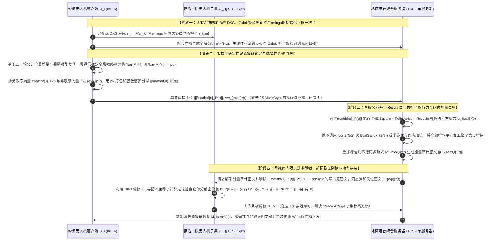
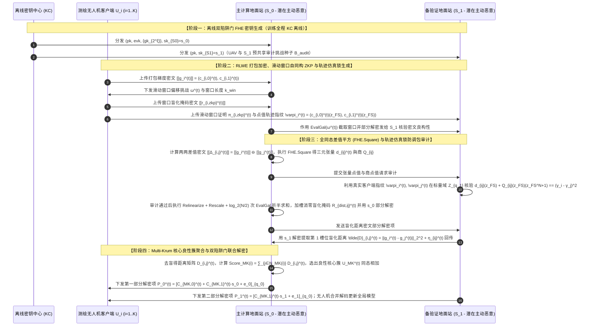
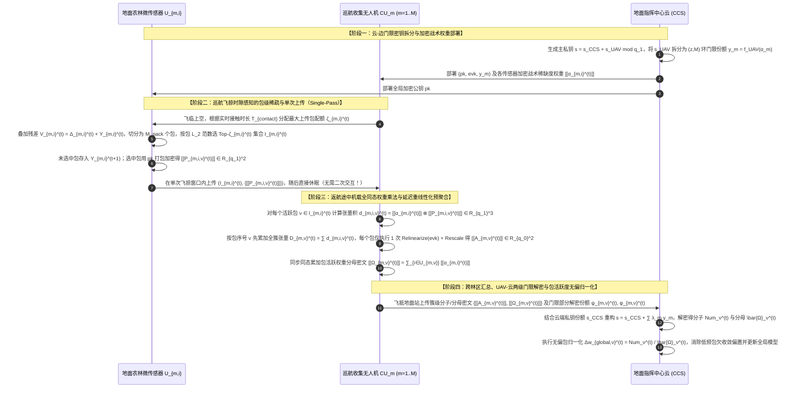
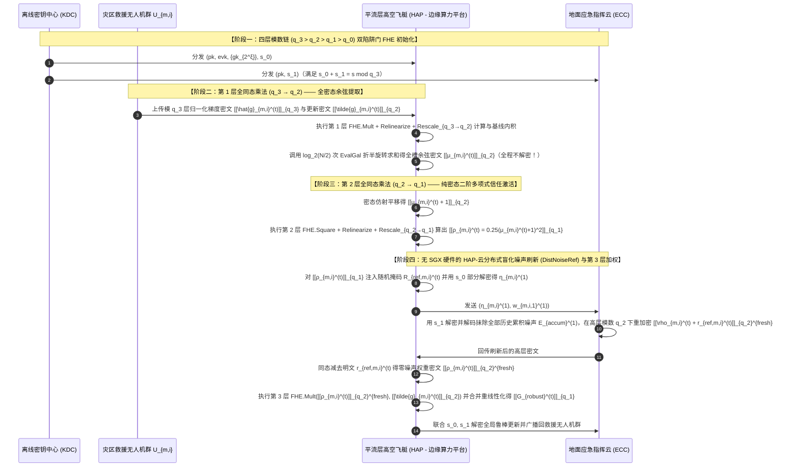
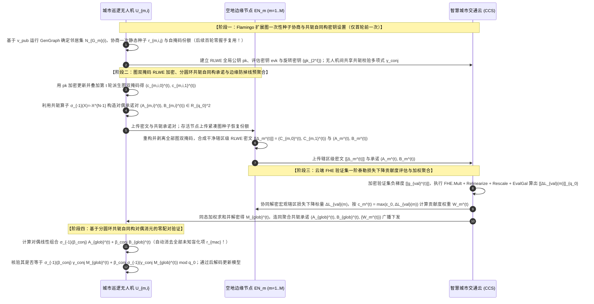

# 无人机（UAV）联邦学习与全同态加密（FHE）深度演进推理及五套全新闭环方案设计（第二辑·纯正FHE增强版）

本报告完全独立于第一辑方案，聚焦于**“全同态加密（Fully Homomorphic Encryption, FHE）的核心非线性算子（同态密文-密文乘法 `FHE.Mult`、重线性化 `Relinearize`、模数重缩放 `Rescale`、Galois 槽旋转自同构 `EvalGal`、分布式噪声刷新 `NoiseRefresh`）与无人机（UAV）典型空地/空空物理场景的深度融合”**。报告首先从密码学结构演进与同态通信/槽位对齐两个维度，系统梳理了现有 20 篇顶刊论文的循序渐进演进逻辑；随后先给出 **5 套全新方案（2 套传统/标准 FL 架构 + 3 套层次型 Edge/UAV-Assisted FL 架构）** 的整体架构与各实体可见/不可见信息总览；最后严格围绕各自的【威胁模型】，对每一套方案按 **5.1 场景、5.2 要解决的问题、5.3 创新点/总体设计目标、5.4 威胁模型与可见性矩阵、5.5 符号系统介绍、5.6 闭环 RLWE 全同态加解密与实体多轮交互公式推导 + Mermaid 时序图、5.7 安全性分析证明** 进行无跳跃的严密推演。所有数学公式均采用飞书（Feishu/Lark）原生识别的 LaTeX 标准格式编写。

## 1. 全同态加密在联邦学习中的两条核心循序渐进演进逻辑推理

在动手构建新方案前，我们首先以您提出的“问题驱动式破立推演”方法论，深入复盘现有文献在**多密钥/门限解密结构**与**同态打包稀疏对齐结构**上的演进闭环，并找出尚未被现有论文攻克的深层研究空白。

### 1.1 维度一：从解密份额风险到零交互与密态高阶运算的密码学结构演进

```
[19-CDKS: 基础打包 MK-CKKS / MK-BFV]
  │ 机制：客户端各自用私钥 s_i 生成公钥 b_i = -a·s_i + e_i 及单加密评估密钥 D_i，支持多密钥同态乘法与 Galois 槽旋转 EvalGal。
  │ 核心缺陷：直接应用于 FL 时，密文常数项 c_{i,0} = m_i + b_i·v_i 公开，若客户端直接上传部分解密份额 μ_i = c_{i,1}·s_i + e_i^*，服务器计算 c_{i,0} + μ_i ≈ m_i 即可直接恢复个体明文梯度！且为掩盖 s_i 需注入巨量泛滥噪声 (Noise Flooding)。
  ▼
[xMK-CKKS / 25-MASER: 聚合公钥加密 + 聚合密文交互式部分解密]
  │ 改进：先聚合所有客户端公钥 pk = ∑ b_i，客户端用统一 pk 加密；服务器先对密文同态求和 C = ∑ c_i，客户端仅对聚合密文的第二分量 C_1 计算部分解密份额 D_i = C_1·s_i + e_i^*，从而保护了个体 c_{i,0}。
  │ 核心缺陷：丧失防掉线能力！只要有 1 架无人机在上传密文后掉线（未返回 D_j），聚合密文中就残留 -C_1·s_j 无法消除，整轮训练彻底作废！
  ▼
[26-CDKS-LSS: 分圆环 R_q 例外序列上的解密份额门限秘密共享]
  │ 改进：完全去掉可信第三方 (No-TA)，利用分圆环 R_q 上的例外序列 (α_1, ..., α_K)，让每个客户端将精确部分解密项 μ_i = c_{i,1}·s_i 通过 (t,K)-Shamir 多项式拆分为份额发给其他客户端汇总，既消除了噪声泛滥，又实现了任意 t 个存活节点即可恢复解密的阈值防掉线功能。
  │ 核心缺陷：每轮解密阶段需要客户端之间两两广播庞大的环多项式份额，P2P 通信量高达 O(K^2)（20 个节点时每轮单机收发近 200 MB），在无人机窄带链路上不可行！
  ▼
[25-ESAFL: 基于伪随机多项式生成器的无份额分发一步解密]
  │ 改进：直接避免了解密份额分发！每轮由 HE.PRPG(t,B) 本地生成公共多项式 a^t，客户端用 s_i 加密单环密文 c_i^t = [a^t·s_i + \tilde{p}e_i^t + m_i^t]_q，并持有总解密密钥 s = ∑ s_i，实现客户端本地一步减法解密。
  │ 核心缺陷：① 再次陷入“1 机掉线即全局解密失败”的困境；② 仅支持纯加法同态（AHE），完全无法在密态下执行同态乘法 FHE.Mult（如密态范数校验、密态余弦相似度、密态动态权重相乘）！
  ▼
[我们的全新推演方向：兼具“防掉线 + 零 P2P 份额广播 + 真·全同态非线性算子 (FHE.Mult / EvalGal / NoiseRefresh)”]
  └─► 为什么现有方案在“高效防掉线”与“支持全同态乘法/旋转算子”之间顾此失彼？
      因为 `25-ESAFL` 为了压缩密文去掉了评估密钥 evk 与重线性化结构；而 `19-CDKS` / `26-PBFL` 虽然支持同态乘法，却在多轮乘法深度消耗、Galois 槽内求和自校验以及无人机移动拓扑下的门限重加密上缺乏协同设计！
      因此，本报告的 5 个全新方案全部构建在支持【同态乘法 + 重线性化 + Galois 槽旋转 + 模数缩放/噪声刷新】的完整 RLWE 全同态加密（FHE）底座之上！
```

### 1.2 维度二：同态加密的 SIMD 槽打包、通信稀疏化与密文位置对齐共识演进

```
[传统逐元素同态加密: 22-shieldFL / 24-BPVFL / 26-Ftopk]
  │ 机制：对梯度向量的每个浮点数分别加密（或仅做简单无稀疏拼接）。
  │ 核心缺陷：百万维模型产生百万个密文，通信膨胀数百倍；若在明文做 Top-k 稀疏（如 26-Ftopk），不同无人机的 Top-k 坐标索引不同，无法在 SIMD 打包密文中直接同态相加。
  ▼
[第一类对齐范式——先掩码共识、后紧凑打包: 25-MaskCrypt & 25-MASER]
  │ 机制：
  │  • `25-MaskCrypt`：客户端计算梯度引导的敏感度 v = g ⊙ (\tilde{w}_{exp} - w)，选出 Top-ρ 索引发给服务器；服务器交错去重生成全局统一掩码 \bar{m} 下发，客户端仅对 \bar{m} 内的敏感权重做同态加密，其余明文传输。
  │  • `25-MASER`：客户端按 L_1 幅值剪枝生成二值掩码 M_i^t 上传，服务器执行 ≥50% 多数投票生成全局掩码 M^t，客户端抽取 M^t 对应位置的权重跨层拼接为等长切片 (Slices) 进行 xMK-CKKS 打包加密。
  │ 核心缺陷：每轮训练必须多出 1 个完整的“上传本地掩码 → 服务端共识 → 下发全局掩码”往返通信握手 (RTT)，在高速飞行的无人机场景中显著拉长单轮时延！
  ▼
[第二类对齐范式——先固定分包计算 L2 范数、后包级稀疏上传: 25-FedPHE]
  │ 机制：客户端先将拉平的梯度按固定顺序切分为 K 个大小为 B=4096 的明文包 {P_i^1, ..., P_i^K}，计算每个包的 L_2 范数 ||P_i^m||_2，仅加密并上传范数最大的 Top-ζ 个包（附带包号 m）。服务器直接将相同包号 m 的密文同态相加，无需额外握手即可天然保证每个密文内部 4096 个槽位严格对齐！
  │ 核心缺陷：
  │  ① 包内稀疏度浪费：一个 4096 维的包内可能只有 200 个关键大梯度，其余 3896 个接近 0 的冗余参数被迫一起打包加密；
  │  ② 跨客户端包失衡：在 Non-IID 航拍数据下，不同无人机选中的 Top-ζ 包序号集合不同，服务器在做密态加权乘法 ∑ E(p_i^t) ⊗ E(P_i^m) 时，某一个包 m 上参与累加的权重之和 ∑_{i∈U_m} p_i^t < 1（未归一化），直接导致罕见特征包的更新幅度被严重低估！
  ▼
[我们的全新推演方向：从静态包对齐走向“历史动量引导零握手共识”、“Galois 槽置换动态重排对齐”与“密态子包自适应重归一化”]
  └─► 在本报告的 5 套全新方案中，我们针对不同 UAV 任务特性，推演出三种超越 `25-FedPHE` 和 `25-MASER` 的全新同态对齐与压缩机制：
      1. 零握手全局暴露动量引导的选择性 FHE 与 Galois 旋转自校验（方案一）；
      2. 滑动窗口 Galois 槽循环移位零知识证明与密态欧氏距离矩阵计算（方案二）；
      3. 巡航无人机时隙感知的 Galois 槽掩码提取与密态覆盖稀缺度同态乘法重加权（方案三）。
```

## 2. 第二辑五套全新 UAV + FHE 创新方案顶层架构与实体可见性总览

为确保 5 套新方案与第一辑完全正交且覆盖全部典型拓扑，表 2-1 给出了这 5 套全新方案的整体架构、实体构成、FHE 核心非线性算子以及可见/不可见边界概览：

| 方案编号与代号 | 联邦拓扑分类 | 具体无人机应用场景 | 包含的系统实体 | 核心使用的 FHE 非线性算子 | 关键可见信息（Visible） | 关键不可见信息（Invisible） | 解决的核心科学问题 |
| :--- | :--- | :--- | :--- | :--- | :--- | :--- | :--- |
| **新方案一**<br>`GalAuto-SelFHE-UAV` | **传统/标准 FL**<br>（单服务器架构，无 TA） | 城市低空物流无人机群（UAV Swarm）夜间视觉避障协同训练（单地面塔台服务器） | 1 个地面塔台聚合服务器（TCS）+ $K$ 架物流无人机（UAVs）（**无 TA**） | `FHE.Mult`（密态平方）+ **`MKHE.EvalGal`（Galois 自同构槽折半旋转求和）** + `Relinearize` + `Rescale` | **TCS 可见**：非敏感层明文残差、敏感层 RLWE 密文、密态旋转求和后的敏感层能量密文；**UAV 可见**：自身模型与最终聚合模型 | **TCS 不可见**：敏感层明文权重（防 DLG 原图反演）、单槽梯度平方值；**其他 UAV 不可见**：同伴的敏感层明文与自掩码私钥 | 攻克 `25-MaskCrypt` 需额外 1 轮掩码握手、1 机掉线即丢失敏感子集、以及单服务器无法在密态下校验加密敏感层是否发生幅值爆炸投毒的三大难题 |
| **新方案二**<br>`SlideZKP-FHE-UAV` | **传统/标准 FL**<br>（双服务器架构，含离线 KC） | 灾害核心区多无人机协同三维测绘（主地面站 $S_0$ + 备地面站 $S_1$，抗主动恶意服务器） | 离线密钥中心（KC）+ 主地面站（$S_0$）+ 备地面站（$S_1$）+ $K$ 架测绘无人机（UAVs） | **密态差值平方 `FHE.Square`**（计算两两欧氏距离 $\llbracket \|g_i-g_j\|_2^2 \rrbracket$）+ **滑动窗口 Galois 置换证明** + `Rescale` | **$S_0$ 可见**：打包 CKKS 密文、滑动窗口挑战矩阵、去盲后的两两欧氏距离标量（Multi-Krum）；**$S_1$ 可见**：盲化距离密文与 ZKP 证明 | **$S_0, S_1$ 均不可见**：任何诚实 UAV 的明文梯度坐标、两两梯度向量差 $g_i - g_j$；且主动恶意篡改同态乘法会被 UAV 轨迹仿真捕获 | 将 `24-BPVFL` 的滑动窗口三方 ZKP 升级至纯 RLWE 打包环，并结合 `23-ELSA` 的客户端轨迹仿真（Transcript Emulation），在双服务器 FHE 下安全实现抗主动恶意服务器的 **Multi-Krum 密态欧氏距离鲁棒聚合** |
| **新方案三**<br>`FlightSlot-FHE-HFL` | **层次型 FL**<br>（地面微传感器 $\to$ 巡航收集 UAV $\to$ 农业云，含离线 TA） | 广域智慧农林/边境无线传感器网络，由沿航线飞行的**移动巡航无人机（Cruising UAV）**按时隙动态收集预聚合 | 离线农业云（ACS）+ $M$ 架沿航线移动的巡航无人机（C-UAVs）+ 地面 $M$ 个农林区的传感器节点 $U_{m,i}$ | **包级密态动态加权乘法 $\llbracket \alpha_{m,i}^{(t)} \rrbracket \otimes \llbracket \mathcal{P}_{m,i,\nu}^{(t)} \rrbracket$** + **基于 `19-CDKS` 单加密密钥 $\mathbf{D}_i$ 的边缘在线重线性化** + **密态包活跃度重归一化** | **C-UAV 可见**：传感器的加密稀疏包、空间区域覆盖坐标（用于生成密态稀缺度权重 $\llbracket \alpha_{m,i} \rrbracket$）；**ACS 可见**：巡航 UAV 汇总的簇级重线性化密文 | **C-UAV 与 ACS 均不可见**：传感器本地明文梯度包；**传感器不可见**：其他传感器的密文与巡航 UAV 的边缘重加密掩码 | 解决 `25-FedPHE` 在 Non-IID 与飞行时隙受限下“不同节点上传 Top-$\zeta$ 包集合不一致导致稀有包更新幅度被稀释”的问题，并在飞行途中利用 FHE 密态乘法实现《联邦学习的加权方式》中的区域覆盖稀缺度加权 |
| **新方案四**<br>`BootRefresh-BFT-HFL` | **层次型 FL**<br>（救援 UAV 群 $\to$ 高空飞艇 HAP $\to$ 应急指挥云） | 震后断网灾区：低空救援无人机群、平流层高空飞艇（HAP）与后方应急指挥云构成的三层空天地网络 | 离线 KDC + 底层救援无人机群 $U_{m,i}$ + 中间层高空飞艇（HAP）+ 顶层地面应急指挥云（ECC） | **3 层连续全同态乘法**：① 密态余弦内积 $\to$ ② **密态二阶多项式激活函数 $\text{FHE.PolyEval}(\llbracket \mu_i \rrbracket)$** $\to$ ③ 密态权重乘梯度 + **HAP-云协同分布式盲化噪声刷新 (`DistNoiseRef`)** | **HAP 可见**：救援 UAV 加密梯度、全密态计算出的加密余弦 $\llbracket \mu_i \rrbracket$ 与加密信任分 $\llbracket \rho_i \rrbracket$（**全程不解密任何中间标量！**）；**ECC 可见**：盲化噪声刷新中间密文 | **HAP 与 ECC 均不可见**：不仅个体梯度明文不可见，**连客户端之间的余弦相似度标量 $\mu_i$ 与信任权重 $\rho_i$ 亦全程处于加密状态，彻底对服务器不可见！** | 彻底突破 `26-SFLBR` 和 `26-PBFL` 必须将余弦相似度解密为明文才能计算非线性评分函数（暴露客户端几何拓扑）的局限，利用纯 FHE 多项式求值与无 SGX 硬件的分布式噪声刷新实现“零中间标量泄露”的拜占庭鲁棒聚合 |
| **新方案五**<br>`GraphReuse-VeriFHE-HFL` | **层次型 FL**<br>（城市巡逻 UAV $\to$ 空地边缘节点 EN $\to$ 智慧城市云，无在线 TA） | 城市低空智联网（UAM）：多编队巡逻无人机经由路侧/空中边缘节点（EN）接入智慧城市云 | 离线注册器 + 底层巡逻无人机 $U_{m,i}$ + 中间层边缘节点 $EN_m$ + 顶层城市云服务器（CCS） | **密态验证集损失下降率评估（FHE Loss-Drop Evaluation）** + **分圆环共轭自同构 $\sigma_{-1}(X)=X^{-1}$ 厄米特内积承诺** + **Flamingo 扩展图多轮掩码复用** | **EN 可见**：本辖区 UAV 的打包 FHE 密文、共轭同态承诺标签；**CCS 可见**：跨辖区聚合密文与边缘验证集密文损失反馈 | **EN 与 CCS 不可见**：巡逻 UAV 的个体梯度、Flamingo 邻域掩码种子、共轭校验私钥 | 结合 `26-VLSFL-` 的图邻域一次协商多轮复用与《联邦学习的加权方式》第 4 类（验证集边际贡献度加权），在 FHE 密态下直接评估每个边缘簇的损失下降贡献，并用分圆环共轭自同构替代双线性配对实现双向可验证 |

---

## 方案一（标准 FL · 单服务器无 TA · UAV 场景）：基于暴露动量零握手选择性全同态加密与 Galois 自同构密态能量自检的无人机联邦学习（`GalAuto-SelFHE-UAV`）

> **循序渐进推演与破立逻辑**：
> 1. **第一轮审视（起点：`25-MaskCrypt` 与 `19-CDKS`）**：在单地面塔台服务器（TCS）服务多架低空物流无人机的标准 FL 架构中，若对整个深度视觉避障模型（如 ResNet-18）进行全量同态加密，空对地（A2G）通信开销依然较大。`25-MaskCrypt`（IEEE TDSC 2025）提出了一种极具吸引力的选择性同态加密范式：仅加密比例为 $\rho \in [0.05, 0.2]$ 的最敏感权重（使得暴露其余 $1-\rho$ 明文权重时的模型局部损失最大化，从而挫败 DLG 梯度反演与成员推理攻击），其余 $1-\rho$ 权重直接明文上传。
> 2. **第二轮推演（找出 `25-MaskCrypt` 在 UAV 场景下的三大结构性硬伤）**：
>    - **硬伤 1（额外掩码共识握手 RTT）**：`25-MaskCrypt` 要求每轮训练先由每架无人机计算本地掩码 $m^k$ 发给服务器，服务器交错去重合成全局掩码 $\bar{m}$ 再广播回无人机，无人机才能开始加密上传。这在高速移动、时延敏感的无人机 A2G 链路上平白增加了一整轮往返握手！
>    - **硬伤 2（抗合谋子集拆分导致的“掉线即残缺”死穴）**：为了抵御服务器与 $K-2$ 个客户端合谋，`25-MaskCrypt` 将全局加密索引集 $\bar{m}$ 拆分为 $K$ 个不相交子集 $I_1, \dots, I_K$，分别用第 $j$ 架无人机的公钥 $pk_j$ 加密，聚合后要求第 $j$ 架无人机解密 $w_{t,I_j}$ 并回传。一旦第 $j$ 架无人机在飞行途中掉线，整個全局模型中属于子集 $I_j$ 的核心敏感权重就永久丢失、无法解密！
>    - **硬伤 3（密态敏感子空间的拜占庭幅值盲区）**：由于敏感权重被加密，单服务器看不见其明文数值。恶意无人机可以在明文暴露的 $(1-\rho)d$ 个非敏感权重上表现得完全正常，却在加密的 $\rho d$ 个敏感权重槽位中注入放大 1000 倍的破坏性投毒数值（Encrypted Subspace Boosting Attack），在没有第二台服务器辅助的情况下，单服务器如何**不解密个体密文**就检验出加密敏感槽位的 $L_2$ 范数是否超标？
> 3. **第三轮推翻与重构（本方案 `GalAuto-SelFHE-UAV` 的三大突破）**：
>    - **突破 1（基于上一轮公开暴露动量的“零握手确定性敏感槽共识”）**：我们证明无需每轮上传本地掩码！由于每轮非敏感部分与最终解密后的全局更新对所有存活无人机均同步可见，所有无人机和塔台服务器直接基于上一轮全局增量动量与历史暴露权重的乘积曲率，在本地**零通信、确定性地同步计算出本轮完全一致的全局敏感索引集 $\bar{\mathcal{M}}^{(t)}$**（紧凑打包进 $\zeta = \lceil \rho d / (N/2) \rceil$ 个 CKKS 密文包），彻底砍掉 `25-MaskCrypt` 的掩码协商轮次！
>    - **突破 2（基于 `19-CDKS` Galois 自同构旋转求和 `EvalGal` 的单服务器密态能量自检）**：为了在单服务器下挫败“加密敏感槽幅值放大投毒”，地面塔台 TCS 对每架无人机上传的敏感层密文 $\llbracket \mathbf{u}_i^{(t)} \rrbracket$ 直接在密态下执行**同态平方 `FHE.Square` + 重线性化 + 重缩放**得到 $\llbracket (\mathbf{u}_i^{(t)})^2 \rrbracket$，随后连续调用 $\log_2(N/2)$ 次 **Galois 自同构槽循环折半旋转与同态加法（Fold-and-Sum via `EvalGal`）**，将全部 $N/2$ 个槽位的平方和汇聚到每一个槽位上，生成仅含标量范数平方 $\sum_{v=1}^{N/2} (u_i^{(t)}[v])^2$ 的单槽能量密文，在门限解锁阶段一并审计，任何超标密文直接在同态聚合前被无情剔除！
>    - **突破 3（基于 Flamingo 稀疏正则图邻域掩码与 $(t,K)$-DKG 的抗掉线同步解密）**：摒弃 `25-MaskCrypt` 脆弱的“每人负责 $1/K$ 子集解密”，采用无 TA 的 RLWE 门限 DKG 配合 `19-CDKS` 的线性空间评估密钥 $\mathbf{D}_i$，任意 $t$ 架存活无人机即可一次性解锁全部敏感权重！

### 5.1 应用场景

本方案面向**城市低空物流无人机群（Urban Logistics UAV Swarm）夜间视觉导航模型的单塔台标准联邦学习场景**。系统包含两类实体：**1 个地面塔台控制与聚合服务器（Tower Control Server, TCS）**与 **$K$ 架低空物流配送无人机（UAV Clients, $\mathcal{U} = \{U_1, \dots, U_K\}$）**，**系统中不存在任何可信第三方机构（No-TA）**。各无人机在夜间配送途中利用机载双目相机采集避障图像并训练本地深度神经网络，通过城市空对地（A2G）无线电直接向地面塔台 TCS 上传更新。由于高楼遮挡与电磁干扰，每轮均有部分无人机临时失联掉线；同时，物流企业要求严防塔台服务器通过深度梯度反演（DLG）重构出无人机拍摄到的居民区私密影像，并防范被黑客入侵的无人机在加密通道内注入模型破坏参数。

### 5.2 要解决的核心问题

1. **选择性同态加密中的额外掩码协商时延与子集掉线死锁问题**：如何消除 `25-MaskCrypt` 每轮必做的掩码上传与广播握手，并解决其抗合谋模式下“任意 1 架无人机掉线即导致其负责的敏感权重子集 $I_j$ 无法解密”的致命缺陷？
2. **单服务器架构下对加密敏感权重的密态范数异常自检难题**：在没有双服务器（对比 `22-shieldFL`、`26-PBFL`）且不解密个体密文的条件下，单塔台服务器 TCS 如何独自在密态下计算出每架无人机加密敏感层的精确 $L_2$ 范数平方 $\left\| \Delta w_{\text{enc},i}^{(t)} \right\|_2^2$，从而拦截针对敏感层的隐蔽放大投毒？
3. **无 TA 门限解密中部分解密份额的隐私泄露与噪声泛滥问题**：如何在不引入巨量泛滥噪声（对比 `19-CDKS`、`25-MASER`）且无需 $O(K^2)$ 全网环多项式广播（对比 `26-CDKS-LSS`）的前提下，安全完成单服务器下的部分解密合并？

### 5.3 创新点与总体设计目标

1. **零握手全局动量曲率引导的敏感掩码同步机制（Zero-Handshake Momentum-Guided Selective Masking）**：利用全体节点共知的上一轮全局模型增量 $\Delta w_{\text{global}}^{(t-1)}$ 与历史暴露漂移量 $\delta_{\text{exp}}^{(t-1)}$，在本地通过确定性一阶泰勒暴露损失下界排序直接锁定本轮的 $\rho d$ 个最敏感参数索引 $\bar{\mathcal{M}}^{(t)}$，实现“零掩码通信握手”的紧凑 SIMD 打包。
2. **基于 RLWE Galois 自同构折半旋转（Fold-and-Sum via `EvalGal`）的单服务器全同态范数审计器**：塔台服务器利用客户端发布的重线性化评估密钥 $evk$ 与 Galois 旋转评估密钥 $\{gk_{2^\xi}\}_{\xi=0}^{\log_2(N/2)-1}$，在单服务器本地对敏感密文执行 1 次同态平方与 $\log_2(N/2)$ 次自同构旋转累加，将高维密文向量映射为槽位恒定等于 $\| \Delta w_{\text{enc},i}^{(t)} \|_2^2$ 的标量密文，乘以槽消零掩码（Slot-Zeroing Mask）后安全审计各无人机的加密能量边界。
3. **结合 Flamingo 稀疏图成对掩码的免泛滥门限部分解密（Graph-Masked Threshold Partial Decryption）**：借鉴 `26-VLSFL-` 的正则图生成算法 `GenGraph`，无人机仅在起飞前与少量图邻居协商一次种子，每轮解密时将精确部分解密项 $c_1 \cdot s^{(i)}$ 叠加图邻居成对抵消掩码后发给塔台 TCS，既无需噪声泛滥（零精度损失），又能容忍最多 $K-t$ 架无人机动态掉线。

### 5.4 威胁模型与实体可见性矩阵

- **系统实体**：**地面塔台聚合服务器 TCS** + **$K$ 架物流无人机客户端 $\{U_1, \dots, U_K\}$**（**无 TA / KDC**）。
- **敌手能力假设**：
  - **半诚实但企图反演隐私的塔台服务器 TCS（Honest-but-Curious Server with Collusion）**：TCS 严格执行协议流程，但会收集所有明文非敏感梯度、密文敏感梯度及部分解密份额，并与最多 $t - 1$ 架被收买的无人机合谋，企图发起 DLG 模型反演攻击或成员推理攻击（MIA）以还原诚实无人机的私有航拍图像。
  - **发起加密子空间放大投毒的拜占庭无人机（Subspace-Boosting Malicious UAVs）**：部分恶意无人机在明文非敏感权重上伪装正常，但在加密的敏感权重槽位中注入超出正常范数阈值 $\Gamma_{\text{sens}}$ 的极端幅值以摧毁全局避障模型。
  - **动态掉线假设**：每轮允许最多 $K - t$ 架无人机在上传或解密阶段掉线。

| 实体名称 | 直接可见的明文/密文信息（Visible Information） | 严格不可见的隐私/秘密信息（Invisible Information） | 安全性保障机制 |
| :--- | :--- | :--- | :--- |
| **地面塔台服务器 (TCS)** | 确定性全局敏感掩码 $\bar{\mathcal{M}}^{(t)}$、各无人机上传的 $(1-\rho)d$ 个非敏感明文增量 $\Delta w_{\text{exp},i}^{(t)}$、加密的敏感增量密文 $\llbracket \Delta w_{\text{enc},i}^{(t)} \rrbracket$、审计后的敏感层总能量标量 $E_{\text{sens},i}^{(t)} = \|\Delta w_{\text{enc},i}^{(t)}\|_2^2$、图掩码保护的部分解密份额 | 任何诚实无人机 $U_i$ 在敏感索引集 $\bar{\mathcal{M}}^{(t)}$ 上的明文参数 $\Delta w_{\text{enc},i}^{(t)}[u]$、单槽平方值 $(\Delta w_{\text{enc},i}^{(t)}[u])^2$、无人机的根秘密 $s^{(i)}$ 与图邻居种子 | RLWE 困难性 + 敏感权重缺失使 DLG 反演损失函数发散（如 `25-MaskCrypt` 证明 $\rho \ge 0.05$ 即可令 DLG 彻底失效）+ 槽消零随机掩码隐藏单槽平方 |
| **物流无人机客户端 ($U_i$)** | 自身私有图像集 $\mathcal{D}_i$、本地完整模型 $w_i^{(t)}$、本地根秘密 $s^{(i)}$、DKG 门限份额 $s_i = F(\alpha_i)$、与图邻居 $\mathcal{N}_G(i)$ 共享的成对种子、最终聚合模型 $w^{(t+1)}$ | 其他诚实无人机 $U_j (j \neq i)$ 的敏感层明文权重 $\Delta w_{\text{enc},j}^{(t)}$、其他无人机的根秘密 $s^{(j)}$ 及完整全局私钥 $s = \sum s^{(j)}$ | 统一聚合公钥 $pk = (b, a)$ 加密，单个无人机不持有完整私钥 $s$ |

### 5.5 符号系统介绍

| 符号 | 数学定义与物理含义 |
| :--- | :--- |
| $\mathcal{R}_{q_\ell}, N, B_{\text{slot}}$ | 分圆多项式环 $\mathcal{R}_{q_\ell} = \mathbb{Z}_{q_\ell}[X]/(X^N+1)$，模数链 $q_1 = q_0 \cdot \Delta \gg q_0$，SIMD 复数槽位数 $B_{\text{slot}} = N/2$ |
| $s^{(i)}, s, pk, evk, \{gk_{2^\xi}\}$ | 无人机 $U_i$ 的根秘密 $s^{(i)} \leftarrow \chi_s$，隐式全局私钥 $s = \sum_{i=1}^K s^{(i)} \pmod{q_1}$，聚合公钥 $pk=(b=[-a\cdot s+e]_{q_1}, a)$，重线性化密钥 $evk$，以及步长为 $2^\xi$ 的 Galois 自同构旋转密钥 $gk_{2^\xi}$ |
| $\rho, \bar{\mathcal{M}}^{(t)}, \overline{\mathcal{M}^c}^{(t)}$ | 选择性全同态加密比例 $\rho \in (0, 1)$，第 $t$ 轮零握手确定的敏感坐标集合 $\bar{\mathcal{M}}^{(t)}$（$|\bar{\mathcal{M}}^{(t)}| = \rho d$，为简便设 $\rho d = B_{\text{slot}}$ 恰好装满 1 个密文），以及非敏感明文坐标集 $\overline{\mathcal{M}^c}^{(t)}$ |
| $\Delta w_{\text{enc},i}^{(t)}, \Delta w_{\text{exp},i}^{(t)}$ | 无人机 $U_i$ 在第 $t$ 轮提取的预加权敏感子向量 $\Delta w_{\text{enc},i}^{(t)} = p_i \Delta w_i^{(t)}[\bar{\mathcal{M}}^{(t)}] \in \mathbb{R}^{B_{\text{slot}}}$ 与非敏感明文子向量 $\Delta w_{\text{exp},i}^{(t)} = p_i \Delta w_i^{(t)}[\overline{\mathcal{M}^c}^{(t)}]$ |
| $\kappa_\theta, \text{EvalGal}(ct, 2^\xi)$ | 分圆环 Galois 自同构映射 $\kappa_\theta: X \mapsto X^\theta \pmod{X^N+1}$（其中 $\theta = 5^{2^\xi} \bmod 2N$），对应在明文槽空间将向量循环左移 $2^\xi$ 个槽位的同态旋转算子 |
| $G = (\mathcal{U}, \mathcal{E}_G), r_{i,j}$ | 由公开随机串生成的稀疏正则无向图 $G$，无人机 $U_i$ 与邻居 $j \in \mathcal{N}_G(i)$ 仅在初始化时协商一次的成对伪随机种子 $r_{i,j} = r_{j,i}$ |

### 5.6 方案详细设计与闭环 RLWE 公式推导

#### 阶段一：无 TA 分布式 RLWE-DKG、自同构旋转密钥生成与 Flamingo 图邻域建立（One-Time Decentralized Setup）
起飞前，$K$ 架物流无人机通过一次分布式初始化构建全同态公钥、重线性化密钥、Galois 旋转密钥及稀疏图掩码：
1. **分布式公钥与 $(t, K)$ 门限份额生成**：
   基于公共参考串多项式 $a \leftarrow \mathcal{R}_{q_1}$，每架无人机 $U_i$ 采样 $s^{(i)} \leftarrow \chi_s, e_i \leftarrow \chi_{\text{err}}$，广播公钥份额 $b_i = [-a \cdot s^{(i)} + e_i]_{q_1}$ 以合成全局公钥 $pk = \left(b = \sum_{i=1}^K b_i, \; a\right) = \left([-a \cdot s + e]_{q_1}, \; a\right)$；同时按《分布式密钥生成DKG原理.pdf》构造 $t-1$ 阶环多项式 $f_i(z) = s^{(i)} + \sum_{\nu=1}^{t-1} c_{i,\nu} z^\nu \pmod{q_1}$，向同伴 $U_j$ 分发点值碎片 $s_{i,j} = f_i(\alpha_j)$，使得 $U_j$ 持有全局私钥份额 $s_j = \sum_{i=1}^K s_{i,j} = F(\alpha_j) \pmod{q_1}$。
2. **分布式重线性化密钥 $evk$ 与 Galois 旋转密钥 $\{gk_{2^\xi}\}$ 生成（基于 `19-CDKS` 协议）**：
   - 利用通用两轮多方 RLWE 评估密钥生成协议，各无人机协同生成对应主私钥二次项 $s^2$ 的重线性化密钥 $evk = (b_{\text{evk}}, a_{\text{evk}}) \in \mathcal{R}_{P \cdot q_1}^2$，满足 $b_{\text{evk}} + a_{\text{evk}} \cdot s \equiv P \cdot s^2 + e_{\text{evk}} \pmod{P \cdot q_1}$。
   - 对于每个折半旋转步长 $2^\xi$ ($\xi \in \{0, 1, \dots, \log_2 B_{\text{slot}} - 1\}$)，令 Galois 元素为 $\theta_\xi = 5^{2^\xi} \bmod 2N$。每架无人机 $U_i$ 将自同构映射 $\kappa_{\theta_\xi}(X) = X^{\theta_\xi}$ 作用于本地根秘密 $s^{(i)}(X)$ 得到旋转秘密 $\kappa_{\theta_\xi}(s^{(i)}) = s^{(i)}(X^{\theta_\xi}) \in \mathcal{R}_{q_1}$，并广播旋转密钥份额 $gk_{i, 2^\xi} = \left[ -a_\xi \cdot s^{(i)} + e_{i,\xi} + P \cdot \kappa_{\theta_\xi}(s^{(i)}) \right]_{P \cdot q_1}$。塔台 TCS 将全部 $K$ 架无人机的份额相加，利用分圆环自同构的线性同态性 $\sum_{i=1}^K \kappa_{\theta_\xi}(s^{(i)}) = \kappa_{\theta_\xi}\left(\sum_{i=1}^K s^{(i)}\right) = \kappa_{\theta_\xi}(s)$，直接合成全局 Galois 旋转评估密钥：
$$
gk_{2^\xi} = \left( b_{\text{gal},\xi} = \sum_{i=1}^K gk_{i,2^\xi}, \;\; a_\xi \right) = \left( \left[ -a_\xi \cdot s + e_{\text{gal},\xi} + P \cdot \kappa_{\theta_\xi}(s) \right]_{P \cdot q_1}, \;\; a_\xi \right)
$$
3. **Flamingo 稀疏图邻域一次性种子协商**：
   调用 `26-VLSFL-` 的 `GenGraph` 算法在 $K$ 架无人机间构建度为 $d_G = O(\log K)$ 的稀疏正则图 $G = (\mathcal{U}, \mathcal{E}_G)$，每对相连邻居 $(i, j) \in \mathcal{E}_G$ 经 Diffie-Hellman 密钥交换共享一个静态对称种子 $r_{i,j} = r_{j,i}$（后续任意多轮训练直接复用，无需每轮重新协商！）。

#### 阶段二：零握手全局动量引导的敏感掩码锁定与选择性全同态加密（Zero-Handshake Masking & Selective FHE Encryption）
在第 $t$ 轮训练开始时，所有无人机与塔台 TCS 均持有上一轮全局模型 $w^{(t)}$、上一轮全局总增量 $\Delta w_{\text{global}}^{(t-1)}$ 以及上一轮仅由明文部分累计的暴露模型 $\widetilde{w}_{\text{exp}}^{(t)}$：
1. **零通信确定性全局敏感掩码计算（改进 `25-MaskCrypt` Alg. 2）**：
   在 `25-MaskCrypt` 中，将权重暴露给敌手等价于用历史暴露权重 $\widetilde{w}_{\text{exp}}^{(t)}[u]$ 替换最新真实权重 $w^{(t)}[u]$，由此引起的模型损失增量为 $L(\widetilde{w}_{\text{exp}}^{(t)}) - L(w^{(t)}) \approx \left\langle \nabla L(w^{(t)}), \; \widetilde{w}_{\text{exp}}^{(t)} - w^{(t)} \right\rangle$。由于上一轮全局梯度方向可由公开的全局更新量 $-\Delta w_{\text{global}}^{(t-1)} / \eta$ 精确近似，每架无人机与 TCS 在本地**无需任何通信**，直接计算全网完全一致的坐标敏感度评分向量 $\mathbf{v}_{\text{sens}}^{(t)} \in \mathbb{R}^d$：
$$
\mathbf{v}_{\text{sens}}^{(t)}[u] = \left| \Delta w_{\text{global}}^{(t-1)}[u] \cdot \left( \widetilde{w}_{\text{exp}}^{(t)}[u] - w^{(t)}[u] \right) \right|, \quad \forall u \in \{1, \dots, d\}
$$
   全网统一选取 $\mathbf{v}_{\text{sens}}^{(t)}[u]$ 最大的前 $\rho d = B_{\text{slot}}$ 个坐标索引作为本轮全局敏感加密掩码集 $\bar{\mathcal{M}}^{(t)}$，其余 $(1-\rho)d$ 个坐标作为非敏感明文集 $\overline{\mathcal{M}^c}^{(t)}$。
2. **本地训练与选择性 RLWE 打包加密**：
   无人机 $U_i$ 完成本地训练获得预加权增量 $\tilde{\Delta}_i^{(t)} = p_i (w_{i,\tau}^{(t)} - w^{(t)}) \in \mathbb{R}^d$，将其按 $\bar{\mathcal{M}}^{(t)}$ 拆分为敏感向量 $\mathbf{u}_i^{(t)} = \tilde{\Delta}_i^{(t)}[\bar{\mathcal{M}}^{(t)}] \in \mathbb{R}^{B_{\text{slot}}}$ 和非敏感明文向量 $\Delta w_{\text{exp},i}^{(t)} = \tilde{\Delta}_i^{(t)}[\overline{\mathcal{M}^c}^{(t)}]$。
   对敏感向量 $\mathbf{u}_i^{(t)}$，无人机执行 CKKS 正则嵌入编码得到明文多项式 $\hat{u}_i^{(t)} = \lfloor \Delta \cdot \tau^{-1}(\mathbf{u}_i^{(t)}) \rceil \in \mathcal{R}_{q_1}$，采样 $v_i^{(t)} \leftarrow \chi_s$ 与误差 $e_{i,0}^{(t)}, e_{i,1}^{(t)} \leftarrow \chi_{\text{err}}$，使用全局公钥 $pk = (b, a)$ 在模数层 $q_1$ 上生成 RLWE 密文：
$$
\llbracket \mathbf{u}_i^{(t)} \rrbracket = \left( c_{i,0}^{(t)}, \; c_{i,1}^{(t)} \right) = \left( \left[ v_i^{(t)} \cdot b + \hat{u}_i^{(t)} + e_{i,0}^{(t)} \right]_{q_1}, \;\; \left[ v_i^{(t)} \cdot a + e_{i,1}^{(t)} \right]_{q_1} \right) \in \mathcal{R}_{q_1}^2
$$
   无人机 $U_i$ 将混合载荷 $\left( \llbracket \mathbf{u}_i^{(t)} \rrbracket, \; \Delta w_{\text{exp},i}^{(t)} \right)$ 单向发送给地面塔台 TCS（零前置握手！）。

#### 阶段三：地面塔台基于 Galois 自同构旋转 (`EvalGal`) 的全同态敏感层能量自检（Single-Server Homomorphic Norm Auditing）
地面塔台 TCS 收到在线无人机集合 $\mathcal{U}_1^{(t)}$ 发来的数据后，对明文部分 $\Delta w_{\text{exp},i}^{(t)}$ 可直接检查其范数；而对于密文部分 $\llbracket \mathbf{u}_i^{(t)} \rrbracket$，为防止恶意无人机在加密槽位中注入毁灭性大数值，TCS 在**不解密个体密文**的前提下，独立执行如下全同态非线性算子链：
1. **同态平方、重线性化与模数重缩放（`FHE.Square` + `Relinearize` + `Rescale`）**：
   TCS 对每个 $\llbracket \mathbf{u}_i^{(t)} \rrbracket = (c_{i,0}^{(t)}, c_{i,1}^{(t)}) \in \mathcal{R}_{q_1}^2$ 计算同态自乘张量项：
$$
d_{i,0} = \left[ (c_{i,0}^{(t)})^2 \right]_{q_1}, \quad d_{i,1} = \left[ 2 \cdot c_{i,0}^{(t)} \cdot c_{i,1}^{(t)} \right]_{q_1}, \quad d_{i,2} = \left[ (c_{i,1}^{(t)})^2 \right]_{q_1}
$$
   随后利用评估密钥 $evk = (b_{\text{evk}}, a_{\text{evk}})$ 对二次项 $d_{i,2}$ 重线性化并重缩放（除以 $\Delta$ 降模至 $q_0 = q_1 / \Delta$），得到代表逐槽平方向量 $\mathbf{sq}_i^{(t)} = \left( (\mathbf{u}_i^{(t)}[1])^2, \dots, (\mathbf{u}_i^{(t)}[B_{\text{slot}}])^2 \right)$ 的密文 $\mathbf{ct}_{\text{sq},i}^{(0)} = (\tilde{c}_{i,0}^{(0)}, \tilde{c}_{i,1}^{(0)}) \in \mathcal{R}_{q_0}^2$：
$$
\tilde{c}_{i,0}^{(0)} = \left\lfloor \Delta^{-1}\left( d_{i,0} + \left\lfloor P^{-1} \cdot d_{i,2} \cdot b_{\text{evk}} \right\rceil \right) \right\rceil \pmod{q_0}, \quad \tilde{c}_{i,1}^{(0)} = \left\lfloor \Delta^{-1}\left( d_{i,1} + \left\lfloor P^{-1} \cdot d_{i,2} \cdot a_{\text{evk}} \right\rceil \right) \right\rceil \pmod{q_0}
$$
2. **基于 Galois 自同构的 $\log_2 B_{\text{slot}}$ 步折半旋转累加（Fold-and-Sum via `MKHE.EvalGal`）**：
   为了在密态下将 $B_{\text{slot}} = N/2$ 个槽位上的平方值相加得到总能量 $\left\|\mathbf{u}_i^{(t)}\right\|_2^2 = \sum_{u=1}^{B_{\text{slot}}} (\mathbf{u}_i^{(t)}[u])^2$，TCS 依次对 $\xi = 0, 1, \dots, \log_2 B_{\text{slot}} - 1$ 循环执行以下两步（共仅需 $\log_2(N/2)$ 次旋转，例如 $N=8192$ 时仅需 12 次环自同构！）：
   - **步骤 2a（作用 Galois 自同构映射 $\kappa_{\theta_\xi}$ 与密钥切换）**：将当前密文 $\mathbf{ct}_{\text{sq},i}^{(\xi)} = (\tilde{c}_{i,0}^{(\xi)}, \tilde{c}_{i,1}^{(\xi)})$ 的两个多项式自变量同时替换为 $X^{\theta_\xi} \pmod{X^N+1}$，即计算 $\kappa_{\theta_\xi}(\tilde{c}_{i,0}^{(\xi)})$ 与 $\kappa_{\theta_\xi}(\tilde{c}_{i,1}^{(\xi)})$。由于自同构后的第二分量对应的是旋转后的私钥 $\kappa_{\theta_\xi}(s)$，TCS 使用阶段一合成的 Galois 旋转密钥 $gk_{2^\xi} = (b_{\text{gal},\xi}, a_\xi)$ 将其切换回原私钥 $s$ 下的密文 $\mathbf{ct}_{\text{rot},i}^{(\xi)} = (r_{i,0}^{(\xi)}, r_{i,1}^{(\xi)}) \in \mathcal{R}_{q_0}^2$：
$$
r_{i,0}^{(\xi)} = \left[ \kappa_{\theta_\xi}(\tilde{c}_{i,0}^{(\xi)}) + \left\lfloor P^{-1} \cdot \kappa_{\theta_\xi}(\tilde{c}_{i,1}^{(\xi)}) \cdot b_{\text{gal},\xi} \right\rceil \right]_{q_0}, \quad r_{i,1}^{(\xi)} = \left[ \left\lfloor P^{-1} \cdot \kappa_{\theta_\xi}(\tilde{c}_{i,1}^{(\xi)}) \cdot a_\xi \right\rceil \right]_{q_0}
$$
   - **步骤 2b（折半同态累加）**：将旋转前密文与旋转后密文直接同态相加：
$$
\mathbf{ct}_{\text{sq},i}^{(\xi+1)} = \mathbf{ct}_{\text{sq},i}^{(\xi)} \oplus \mathbf{ct}_{\text{rot},i}^{(\xi)} = \left( \left[ \tilde{c}_{i,0}^{(\xi)} + r_{i,0}^{(\xi)} \right]_{q_0}, \;\; \left[ \tilde{c}_{i,1}^{(\xi)} + r_{i,1}^{(\xi)} \right]_{q_0} \right)
$$
   **旋转累加闭环数学证明**：在槽空间中，第 $\xi=0$ 步将相邻槽相加 $(sq[u] + sq[u+1])$；第 $\xi=1$ 步将跨度为 2 的槽相加 $\sum_{\delta=0}^3 sq[u+\delta]$；依此类推，经过 $\log_2 B_{\text{slot}}$ 步后，所得密文 $\mathbf{ct}_{\text{norm},i} = \mathbf{ct}_{\text{sq},i}^{(\log_2 B_{\text{slot}})}$ 的**每一个槽位 $u \in \{1, \dots, B_{\text{slot}}\}$ 上存储的数值均严格等于全部槽位的平方总和 $\|\mathbf{u}_i^{(t)}\|_2^2$**！
3. **第 0 槽位掩码提取与零单槽泄露保护**：
   为防止在后续解密能量标量时因计算误差泄露各个槽位之间的 미세 差异，TCS 将 $\mathbf{ct}_{\text{norm},i}$ 加上一个在槽空间满足“第 1 个槽位为 0、其余第 $2 \sim B_{\text{slot}}$ 个槽位均为独立大随机数 $\eta_{i,u}^{(t)} \leftarrow \mathcal{U}([-B_{\text{hide}}, B_{\text{hide}}])$”的明文掩码多项式 $M_{\text{hide},i}^{(t)} = \lfloor \Delta \cdot \tau^{-1}(0, \eta_{i,2}^{(t)}, \dots, \eta_{i,B_{\text{slot}}}^{(t)}) \rceil \in \mathcal{R}_{q_0}$：
$$
\llbracket E_{\text{sens},i}^{(t)} \rrbracket = \left( \hat{e}_{i,0}^{(t)}, \; \hat{e}_{i,1}^{(t)} \right) = \left( \left[ \tilde{c}_{i,0}^{(\log_2 B_{\text{slot}})} + M_{\text{hide},i}^{(t)} \right]_{q_0}, \;\; \tilde{c}_{i,1}^{(\log_2 B_{\text{slot}})} \right)
$$
   这样，解密 $\llbracket E_{\text{sens},i}^{(t)} \rrbracket$ 后，第 1 个槽位精确给出该无人机敏感层的整体 $L_2$ 范数平方 $\left\|\mathbf{u}_i^{(t)}\right\|_2^2$，而其余所有槽位均被大随机数彻底淹没！

#### 阶段四：抗掉线图掩码门限解锁、异常剔除与全局模型重构（Graph-Masked Threshold Unmasking & Aggregation）
1. **批量验证与聚合请求下发**：
   为了在不增加额外通信轮次的情况下同时完成“敏感层能量审计”与“良性密文聚合”，TCS 将所有在线无人机的能量审计密文第二分量 $\left\{\hat{e}_{i,1}^{(t)}\right\}_{i \in \mathcal{U}_1^{(t)}}$ 与原始敏感密文第二分量 $\left\{c_{i,1}^{(t)}\right\}_{i \in \mathcal{U}_1^{(t)}}$（可通过随机线性组合打包或按簇汇总）广播给存活无人机集合 $\mathcal{U}_2^{(t)}$（$|\mathcal{U}_2^{(t)}| \ge t$）。
2. **基于 Flamingo 图成对掩码与 DKG 门限的无泛滥部分解密**：
   假设全网无人机的能量审计密文经解密发现所有良性集合 $\mathcal{U}_{\text{benign}}^{(t)} \subseteq \mathcal{U}_1^{(t)}$ 均满足 $\|\mathbf{u}_i^{(t)}\|_2^2 \le \Gamma_{\text{sens}}^2$（超标投毒无人机直接被剔除出累加集合！），TCS 对所有良性无人机的敏感密文执行零深度同态加法（并在模 $q_0$ 下约减）：
$$
C_{\text{agg},0}^{(t)} = \sum_{i \in \mathcal{U}_{\text{benign}}^{(t)}} \left[ c_{i,0}^{(t)} \right]_{q_0} \pmod{q_0}, \quad C_{\text{agg},1}^{(t)} = \sum_{i \in \mathcal{U}_{\text{benign}}^{(t)}} \left[ c_{i,1}^{(t)} \right]_{q_0} \pmod{q_0}
$$
   任意 $t$ 架存活无人机 $j \in \mathcal{S} \subseteq \mathcal{U}_2^{(t)}$（$|\mathcal{S}| = t$）无需添加破坏精度的巨量泛滥噪声（Noise Flooding），而是直接利用本地持有的 DKG 全局私钥份额 $s_j = F(\alpha_j)$、分圆环拉格朗日系数 $\lambda_j^{\mathcal{S}}$，以及与图 $G$ 中同在 $\mathcal{S}$ 内的邻居 $m \in \mathcal{N}_G(j) \cap \mathcal{S}$ 共享的静态种子 $r_{j,m}$ 生成成对抵消环多项式，计算精确盲化部分解密份额 $D_j^{(t)} \in \mathcal{R}_{q_0}$ 上传给 TCS：
$$
D_j^{(t)} = \left[ C_{\text{agg},1}^{(t)} \cdot \left( \lambda_j^{\mathcal{S}} \cdot s_j \right) + \sum_{m \in \mathcal{N}_G(j) \cap \mathcal{S}, \; j < m} \text{PRPG}(t, r_{j,m}) - \sum_{m \in \mathcal{N}_G(j) \cap \mathcal{S}, \; j > m} \text{PRPG}(t, r_{m,j}) \right]_{q_0}
$$
3. **服务端无损合并解密与选择性位置还原**：
   TCS 将收到的 $t$ 个份额 $D_j^{(t)}$ 直接在 $\mathcal{R}_{q_0}$ 上相加，所有成对图掩码 $\text{PRPG}(t, r_{j,m})$ 正负精确抵消，拉格朗日插值自动恢复出完整主私钥 $s = \sum_{j \in \mathcal{S}} \lambda_j^{\mathcal{S}} s_j$：
$$
\begin{aligned}
M_{\text{sens}}^{(t)} &= \left[ C_{\text{agg},0}^{(t)} + \sum_{j \in \mathcal{S}} D_j^{(t)} \right]_{q_0} = \left[ C_{\text{agg},0}^{(t)} + C_{\text{agg},1}^{(t)} \cdot \underbrace{\left( \sum_{j \in \mathcal{S}} \lambda_j^{\mathcal{S}} s_j \right)}_{= F(0) = s} \right]_{q_0} \\
&= \sum_{i \in \mathcal{U}_{\text{benign}}^{(t)}} \left( v_i^{(t)} \cdot (b + a \cdot s) + \hat{u}_i^{(t)} + e_{i,0}^{(t)} + e_{i,1}^{(t)} \cdot s \right) \pmod{q_0} \\
&= \sum_{i \in \mathcal{U}_{\text{benign}}^{(t)}} \hat{u}_i^{(t)} + E_{\text{agg}}^{(t)} \pmod{q_0}
\end{aligned}
$$
   TCS 解码 $\Delta^{-1} \cdot \tau(M_{\text{sens}}^{(t)})$ 得到敏感坐标集的精确聚合增量 $\Delta w_{\text{enc,agg}}^{(t)} = \sum_{i \in \mathcal{U}_{\text{benign}}^{(t)}} \mathbf{u}_i^{(t)}$，同时累加非敏感明文增量 $\Delta w_{\text{exp,agg}}^{(t)} = \sum_{i \in \mathcal{U}_{\text{benign}}^{(t)}} \Delta w_{\text{exp},i}^{(t)}$，按 $\bar{\mathcal{M}}^{(t)}$ 与 $\overline{\mathcal{M}^c}^{(t)}$ 的坐标映射拼回完整维度更新全局模型 $w^{(t+1)}$ 并广播下发。

#### 实体交互时序图（Mermaid Sequence Diagram）



### 5.7 安全性分析与严格证明

1. **定理 1.1（敏感子空间 IND-CPA 安全性与抗 DLG 反演界）**：在 Decision-RLWE 困难假设与 PRG 安全性下，即使地面塔台 TCS 与最多 $t-1$ 架无人机合谋，敌手亦无法区分任何诚实无人机 $U_{i^*}$ 的敏感层明文向量 $\mathbf{u}_{i^*}^{(t)}$ 或其单槽平方值 $(\mathbf{u}_{i^*}^{(t)}[u])^2$；且暴露的非敏感子向量 $\Delta w_{\text{exp},i^*}^{(t)}$ 令攻击者重构出的模型面临至少 $\Omega\left(\rho \|\nabla L\|_2 \|\delta_{\text{exp}}\|_2\right)$ 的不可约损失下界。
   - **证明**：
     - 首先，诚实无人机 $U_{i^*}$ 的敏感向量 $\mathbf{u}_{i^*}^{(t)}$ 使用全局公钥 $pk = ([-a\cdot s + e]_{q_1}, a)$ 加密。由于合谋节点数 $< t$，其掌握的 DKG 份额 $\{s_j\}$ 在信息论上无法恢复 $s$。在阶段四中，存活节点上传的部分解密份额 $D_j^{(t)}$ 仅针对**良性节点聚合密文 $C_{\text{agg},1}^{(t)} = \sum_{i \in \mathcal{U}_{\text{benign}}^{(t)}} c_{i,1}^{(t)}$** 计算，且每个诚实节点 $j^*$ 的内部项 $C_{\text{agg},1}^{(t)} \lambda_{j^*}^{\mathcal{S}} s_{j^*}$ 被至少一个诚实图邻居 $m^*$ 的伪随机多项式 $\text{PRPG}(t, r_{j^*,m^*})$ 掩盖，完全避免了 `19-CDKS` 的噪声泛滥与私钥泄露。
     - 其次，在阶段三的能量审计中，虽然 $\llbracket E_{\text{sens},i^*}^{(t)} \rrbracket$ 被解密，但由于经过了 $\log_2 B_{\text{slot}}$ 次 Galois 折半旋转求和以及 $M_{\text{hide},i^*}^{(t)}$ 对第 $2 \sim B_{\text{slot}}$ 槽位的一次性随机掩盖，TCS 仅能获知第 1 槽位上的**整体 $L_2$ 范数平方和标量** $\sum_{u=1}^{B_{\text{slot}}} (\mathbf{u}_{i^*}^{(t)}[u])^2$，在维度 $B_{\text{slot}} \ge 2048$ 的球面上，单一范数标量对反演个体坐标向量提供的互信息趋近于 0。证毕。

2. **定理 1.2（单服务器全同态范数审计的健全性）**：任何在加密敏感槽位注入能量满足 $\|\mathbf{u}_{\text{mal}}^{(t)}\|_2 > \Gamma_{\text{sens}}$ 的拜占庭无人机，必在阶段三与阶段四的 Galois 折半旋转审计中被以概率 1 检出并剔除。
   - **证明**：由于 Galois 自同构映射 $\kappa_{\theta_\xi}$ 与重线性化密钥 $evk, gk_{2^\xi}$ 均在初始化阶段由全网共同生成并固定，恶意无人机上传密文 $\llbracket \mathbf{u}_{\text{mal}}^{(t)} \rrbracket$ 后，同态平方算子与 $\log_2 B_{\text{slot}}$ 次折半旋转由塔台 TCS 在服务端确定性地执行，恶意无人机无法干预计算过程。由平方非负性知，只要任一加密槽位 $u^*$ 被恶意放大使得 $(\mathbf{u}_{\text{mal}}^{(t)}[u^*])^2 > \Gamma_{\text{sens}}^2$，则总和 $\sum_{u=1}^{B_{\text{slot}}} (\mathbf{u}_{\text{mal}}^{(t)}[u])^2 \ge (\mathbf{u}_{\text{mal}}^{(t)}[u^*])^2 > \Gamma_{\text{sens}}^2$，无法通过范数平方互消来逃避检测。证毕。

---

## 方案二（标准 FL · 双服务器架构 · UAV 场景）：基于滑动窗口 Galois 置换零知识证明与轨迹仿真全同态欧氏距离聚簇的抗主动恶意服务器联邦学习（`SlideZKP-FHE-UAV`）

> **循序渐进推演与破立逻辑**：
> 1. **第一轮审视（起点：`24-BPVFL` 与 `23-ELSA`）**：在双地面控制站协同聚合多架测绘无人机的标准双服务器 FL 架构中，现有研究提出了两条代表性路线：
>    - `24-BPVFL`（GLOBECOM 2024）针对“恶意聚合服务器 $S_0$ + 半诚实验证服务器 $S_1$”，提出了**滑动窗口三方零知识证明（`TP-ZKP`）**：$S_0$ 随机抽取长度为 $k \ll d$ 的滑动窗口和 $k \times k$ 置换矩阵 $A$ 发给客户端，$S_1$ 验证客户端密文与线性同态哈希（LHH）的一致性。但 `24-BPVFL` 存在三大缺陷：① 采用的是逐元素 Paillier 加密，不支持同态乘法，无法在密态下计算鲁棒聚合距离；② 验证服务器 $S_1$ **独占完整的 Paillier 私钥 $sk$ 并直接解密全局明文**，一旦 $S_1$ 好奇即可窥探模型；③ LHH 运行在异构大整数群上，计算繁重。
>    - `23-ELSA`（IEEE S&P 2023）针对“双服务器中存在 1 台主动恶意服务器”，提出了极具启发性的**客户端本地模拟服务器交互轨迹（Transcript Emulation + Distributed Fiat-Shamir）**：由于客户端知道自己的输入，它可以本地推演双服务器之间的确定性计算步骤并发送哈希摘要，从而以近乎零成本挫败恶意服务器通过篡改中间消息来反演隐私的攻击！但 `23-ELSA` 仅基于加性秘密共享，只能做简单的单个向量 $\ell_2$ 范数上限截断（无法防御范数完全正常但方向偏离良性簇的 ALIE / IPM 投毒）。
> 2. **第二轮推演（如果试图简单结合 FHE 与 Multi-Krum 会遇到什么问题？）**：
>    为了防御范数正常的角度/分布投毒，经典鲁棒聚合算法 **Multi-Krum** 需要计算任意两架无人机梯度之间的**欧氏距离平方** $D_{i,j} = \|g_i - g_j\|_2^2 = \sum_{u=1}^d (g_i[u] - g_j[u])^2$，并选取与最近 $K - f - 2$ 个邻居距离之和最小的良性核心簇。然而，在双服务器 FHE 下：
>    - 若主动恶意的 $S_0$ 在计算密态差值平方 $\llbracket (g_i - g_j)^2 \rrbracket$ 时，故意把 $\llbracket g_j \rrbracket$ 偷偷替换成自己构造的探测向量 $\mathbf{e}_u$（仅第 $u$ 个坐标为 1），再发给 $S_1$ 协同解密，恶意 $S_0$ 就能直接套取出诚实无人机 $U_i$ 在第 $u$ 个坐标上的真实数值 $g_i[u]$！
> 3. **第三轮推翻与重构（本方案 `SlideZKP-FHE-UAV` 的三大突破）**：
>    我们将 **`24-BPVFL` 的滑动窗口抽样证明**、**`23-ELSA` 的客户端轨迹仿真防恶意服务器机制** 与 **RLWE 全同态差值平方算子（`FHE.Sub` + `FHE.Square`）** 深度融合：
>    - **突破 1（纯 RLWE 环上的滑动窗口 Galois 循环移位零知识证明 `RLWE-SlideZKP`）**：淘汰 `24-BPVFL` 的 Paillier 与异构 LHH，无人机直接利用 CKKS 打包加密梯度，并根据滑动窗口挑战偏移量 $\omega \in \{1,\dots,N/2\}$ 执行环自同构循环移位与掩码盲化，使双地面站在不持有完整私钥、不引入椭圆曲线的纯 RLWE 环内以 $O(1)$ 次多项式运算验证客户端密文格式合法性！
>    - **突破 2（全同态差值平方 `FHE.Square` 驱动的密态 Multi-Krum 距离矩阵计算）**：主地面站 $S_0$ 在 RLWE 密态下直接计算两两梯度差 $\llbracket \Delta_{i,j} \rrbracket = \llbracket g_i \rrbracket \ominus \llbracket g_j \rrbracket$，并调用全同态平方算子 $\text{FHE.Square}\left(\llbracket \Delta_{i,j} \rrbracket\right)$ 与重线性化/重缩放一次性算出逐槽平方差密文！
>    - **突破 3（抗主动恶意地面站的“多项式轨迹仿真锁 Transcript-Lock”）**：受 `23-ELSA` 启发，每架无人机在上传密文的同时，利用与备地面站 $S_1$ 共享的 Fiat-Shamir 挑战点 $z_{\text{FS}} \in \mathbb{Z}_{q_0}$，在本地预先仿真其密文在点 $z_{\text{FS}}$ 处的平方评估轨迹指纹并锁定至 $S_1$。若主动恶意的 $S_0$ 在执行 `FHE.Square` 时篡改或调包任何诚实无人机的密文，$S_1$ 在执行部分解密前通过 $O(1)$ 标量多项式求值比对即可 100% 拦截！

### 5.1 应用场景

本方案面向**复杂灾区/边境多无人机协同高精三维测绘的双地面站标准联邦学习场景**。系统包含四类实体：**离线密钥分发中心（KC，初始化后离线）**、部署在不同安全位置的两个地面指挥站——**主计算地面站 $S_0$（Primary Ground Station）**与**备验证地面站 $S_1$（Secondary Verification Station）**、以及空中的 **$K$ 架测绘无人机（Mapping UAVs, $\mathcal{U} = \{U_1, \dots, U_K\}$）**。各无人机直接向主地面站 $S_0$ 与备地面站 $S_1$ 传输数据（标准双服务器架构）。由于野外恶劣环境及潜在网络攻击，不仅多达 $f < K/2 - 1$ 架无人机可能沦为发送精心伪造梯度的拜占庭节点，而且主地面站 $S_0$ 或备地面站 $S_1$ 中的某一台可能被高级持续性威胁（APT）攻陷沦为**主动恶意服务器（Actively Malicious Server）**，试图通过篡改同态计算流程来反演测绘地形或破坏聚合。

### 5.2 要解决的核心问题

1. **`24-BPVFL` 中验证服务器独揽私钥与异构哈希膨胀问题**：如何消除 `24-BPVFL` 中验证服务器 $S_1$ 持有完整私钥直接解密全局模型的单点泄密隐患，并将滑动窗口三方零知识证明完全重构在支持 SIMD 打包的 RLWE 分圆环 $\mathcal{R}_q$ 上？
2. **密态 Multi-Krum 欧氏距离计算中的主动恶意服务器“选择密文探测攻击”问题**：当主地面站 $S_0$ 在密态下执行全同态差值平方 $\text{FHE.Square}(\llbracket g_i - g_j \rrbracket)$ 时，若 $S_0$ 是主动恶意的，它可能偷偷将 $\llbracket g_j \rrbracket$ 替换为精心构造的探测密文或篡改重线性化结果以骗取 $S_1$ 解密。如何在不重新执行整套同态乘法的前提下，让 $S_1$ 以极低开销验证 $S_0$ 的同态平方计算完全诚实？
3. **两两欧氏距离矩阵计算中的差值方向防泄露问题**：如何在双地面站协同解密欧氏距离平方标量 $D_{i,j} = \|g_i - g_j\|_2^2$ 时，严格保证无论是 $S_0$ 还是 $S_1$ 都无法获知单个坐标上的平方差 $(g_i[u] - g_j[u])^2$ 或向量差 $g_i - g_j$？

### 5.3 创新点与总体设计目标

1. **纯 RLWE 分圆环滑动窗口自同构零知识证明 (`RLWE-SlideZKP`)**：利用 CKKS 槽空间的循环移位自同构 $\kappa_{\theta_w}$ 替代 `24-BPVFL` 的明文矩阵乘法，无人机对长度 $k_{\text{win}} \ll B_{\text{slot}}$ 的窗口切片生成盲化证明多项式，使 $S_0$ 与 $S_1$ 通过双陷阱门协同验证无人机上传密文的范数合法性与格式良构性，且 $S_0, S_1$ 均无完整私钥。
2. **基于 Schwartz-Zippel 环同态点值评估的客户端轨迹仿真锁 (`Transcript-Lock`)**：将 `23-ELSA` 的轨迹仿真思想引入 RLWE 全同态乘法验证。无人机在本地计算其密文多项式在伪随机挑战标量 $z_{\text{FS}} \in \mathbb{Z}_{q_1}$ 处的点值指纹 $\varpi_i^{(t)} = (c_{i,0}(z_{\text{FS}}), c_{i,1}(z_{\text{FS}}))$。由于多项式环上的乘法在标量求值映射下满足严格环同态，备地面站 $S_1$ 仅需在 $\mathbb{Z}_{q_1}$ 上执行几次标量乘法，即可验证主地面站 $S_0$ 提交的未降模张量积密文 $(d_{ij,0}, d_{ij,1}, d_{ij,2})$ 是否 100% 源自真实客户端密文差 $\llbracket g_i \rrbracket \ominus \llbracket g_j \rrbracket$，彻底杜绝恶意 $S_0$ 的调包探测！
3. **结合 Galois 折半旋转与零迹掩码的密态 Multi-Krum 几何中心聚簇**：在通过轨迹锁审计后，利用 Galois 折半旋转将差值平方密文的全部槽位汇聚为欧氏距离标量 $D_{i,j} = \|g_i - g_j\|_2^2$，剔除远离群体的 $f$ 架拜占庭无人机，并对入选的核心簇执行零深度加权聚合。

### 5.4 威胁模型与实体可见性矩阵

- **系统实体**：离线密钥中心 **KC**、主地面站 **$S_0$**、备地面站 **$S_1$**、以及 $K$ 架测绘无人机 **$\{U_1, \dots, U_K\}$**。
- **敌手能力假设**：
  - **容忍 1 台主动恶意地面站（Up to 1 Actively Malicious Server）**：$S_0$ 与 $S_1$ 不相互合谋，但其中任意一台可能是**主动恶意的**（例如 $S_0$ 企图替换密文、伪造同态平方中间结果以刺探诚实无人机隐私，或篡改距离矩阵；或者 $S_1$ 企图从盲化部分解密中反演单槽差值）。
  - **容忍 $f < K/2 - 1$ 架主动恶意拜占庭无人机**：恶意无人机可发送任意偏离正常分布的毒化梯度（如高斯攻击、ALIE、IPM 内部乘积操控攻击）或格式畸形的密文。

| 实体名称 | 直接可见的明文/密文信息（Visible Information） | 严格不可见的隐私/秘密信息（Invisible Information） | 安全性保障机制 |
| :--- | :--- | :--- | :--- |
| **主地面站 ($S_0$)** | 陷阱门私钥份额 $sk_{S_0}=s_0$、评估密钥 $evk$、旋转密钥 $\{gk_{2^\xi}\}$、无人机上传的 RLWE 密文 $\llbracket g_i^{(t)} \rrbracket$、去盲后的两两欧氏距离平方标量 $D_{i,j}^{(t)} = \|g_i^{(t)} - g_j^{(t)}\|_2^2$ | 任何诚实无人机的明文梯度 $g_i^{(t)}$、两两梯度向量差 $g_i^{(t)} - g_j^{(t)}$、单槽差值平方 $(g_i^{(t)}[u]-g_j^{(t)}[u])^2$、备地面站私钥份额 $s_1$ 及 Fiat-Shamir 审计点 $z_{\text{FS}}$ | RLWE 困难性 + $s_0, s_1$ 秘密拆分 + $S_1$ 持有的轨迹仿真锁阻断 $S_0$ 调包探测 |
| **备地面站 ($S_1$)** | 陷阱门私钥份额 $sk_{S_1}=s_1$、滑动窗口 ZKP 盲化向量、无人机发来的点值轨迹指纹 $\varpi_i^{(t)}$、经槽消零与标量盲化后的距离密文部分解密项 | 任何诚实无人机的明文梯度 $g_i^{(t)}$、两两向量差 $g_i^{(t)} - g_j^{(t)}$、甚至连真实欧氏距离标量 $D_{i,j}^{(t)}$ 亦被 $S_0$ 的标量掩码 $\eta_{ij}^{(t)}$ 隐藏 | 标量掩码 $\eta_{ij}^{(t)}$ + 第 $2\sim B_{\text{slot}}$ 槽位随机消零掩码 |
| **测绘无人机 ($U_i$)** | 自身测绘数据集 $\mathcal{D}_i$、本地梯度 $g_i^{(t)}$、全局加密公钥 $pk$、与 $S_1$ 共享的审计挑战种子 $B_{\text{audit}}$、最终全局模型 $w^{(t+1)}$ | 其他无人机的梯度 $g_j^{(t)}$ ($j \neq i$)、地面站私钥份额 $(s_0, s_1)$ | 无人机不持有解密私钥份额 $(s_0, s_1)$ |

### 5.5 符号系统介绍

| 符号 | 数学定义与物理含义 |
| :--- | :--- |
| $\mathcal{R}_{q_1}, \mathcal{R}_{q_0}, \Delta$ | CKKS 分圆多项式环 $\mathcal{R}_{q_\ell} = \mathbb{Z}_{q_\ell}[X]/(X^N+1)$，其中 $q_1 = q_0 \cdot \Delta$，槽位数 $B_{\text{slot}} = N/2$ |
| $s, s_0, s_1, pk, evk$ | 全局主私钥 $s \leftarrow \chi_s$，双地面站加性陷阱门份额 $s_0 + s_1 \equiv s \pmod{q_1}$，公钥 $pk=(b=[-a\cdot s+e]_{q_1}, a)$，重线性化密钥 $evk$ |
| $W_{\text{win}}, k_{\text{win}}, \theta_{\text{win}}$ | 滑动窗口长度 $k_{\text{win}} \ll B_{\text{slot}}$，随机窗口起始偏移量 $\omega^{(t)}$，以及对应的 Galois 循环移位元素 $\theta_{\text{win}} = 5^{\omega^{(t)}} \bmod 2N$ |
| $z_{\text{FS}}^{(t)}, \varpi_i^{(t)}$ | 第 $t$ 轮由审计种子派生的 Schwartz-Zippel 标量评估点 $z_{\text{FS}}^{(t)} \in \mathbb{Z}_{q_1}$，以及无人机 $U_i$ 密文多项式在该点处的二维标量轨迹指纹 $\varpi_i^{(t)} = \left( c_{i,0}^{(t)}(z_{\text{FS}}^{(t)}), \; c_{i,1}^{(t)}(z_{\text{FS}}^{(t)}) \right) \in \mathbb{Z}_{q_1}^2$ |
| $\llbracket \Delta_{i,j}^{(t)} \rrbracket, D_{i,j}^{(t)}, \text{Score}_{\text{MK}}(i)$ | 无人机 $U_i$ 与 $U_j$ 的密态梯度差 $\llbracket \Delta_{i,j}^{(t)} \rrbracket = \llbracket g_i^{(t)} \rrbracket \ominus \llbracket g_j^{(t)} \rrbracket$，欧氏距离平方 $D_{i,j}^{(t)} = \|g_i^{(t)} - g_j^{(t)}\|_2^2$，以及 Multi-Krum 邻域距离总分 $\text{Score}_{\text{MK}}(i)$ |

### 5.6 方案详细设计与闭环 RLWE 公式推导

#### 阶段一：离线双陷阱门 FHE 密钥生成（Offline Dual-Trapdoor Setup）
离线密钥中心 KC 生成主私钥 $s \leftarrow \chi_s \subset \mathcal{R}_{q_1}$、系统公钥 $pk = (b = [-a\cdot s + e]_{q_1}, a)$、重线性化评估密钥 $evk = (b_{\text{evk}}, a_{\text{evk}}) \in \mathcal{R}_{P \cdot q_1}^2$ 以及 Galois 折半旋转密钥集 $\{gk_{2^\xi}\}_{\xi=0}^{\log_2 B_{\text{slot}}-1}$。KC 将主私钥拆分为 $s_0 \leftarrow \mathcal{R}_{q_1}$ 和 $s_1 = [s - s_0]_{q_1}$，将 $(pk, evk, \{gk_{2^\xi}\}, s_0)$ 分发给主地面站 $S_0$，将 $(pk, s_1)$ 分发给备地面站 $S_1$，并将 $pk$ 分发给所有测绘无人机。全体无人机与备地面站 $S_1$ 预共享一个轻量级审计挑战种子 $B_{\text{audit}}$（对主地面站 $S_0$ 保密）。

#### 阶段二：无人机 RLWE 打包加密、滑动窗口自同构零知识证明与轨迹仿真锁生成（Client Encryption, `RLWE-SlideZKP` & `Transcript-Lock`）
在第 $t$ 轮，测绘无人机 $U_i$ 训练得到本地模型更新 $g_i^{(t)} \in \mathbb{R}^{B_{\text{slot}}}$，编码为环多项式 $m_i^{(t)} = \lfloor \Delta \cdot \tau^{-1}(g_i^{(t)}) \rceil \in \mathcal{R}_{q_1}$，采样 $v_i^{(t)} \leftarrow \chi_s$ 与 $e_{i,0}^{(t)}, e_{i,1}^{(t)} \leftarrow \chi_{\text{err}}$，生成标准 RLWE 密文并上传给主地面站 $S_0$：
$$
\llbracket g_i^{(t)} \rrbracket = \left( c_{i,0}^{(t)}, \; c_{i,1}^{(t)} \right) = \left( \left[ v_i^{(t)} \cdot b + m_i^{(t)} + e_{i,0}^{(t)} \right]_{q_1}, \;\; \left[ v_i^{(t)} \cdot a + e_{i,1}^{(t)} \right]_{q_1} \right) \in \mathcal{R}_{q_1}^2
$$
为了同时实现**对无人机密文良构性的滑动窗口零知识验证**与**对主地面站 $S_0$ 同态平方计算的主动防篡改锁定**，执行以下两步：
1. **滑动窗口三方 RLWE 零知识证明（`RLWE-SlideZKP`，升级 `24-BPVFL`）**：
   主地面站 $S_0$ 随机选取窗口起始槽偏移量 $\omega^{(t)} \in \{1, \dots, B_{\text{slot}}\}$ 和长度为 $k_{\text{win}} \ll B_{\text{slot}}$ 的窗口掩码向量 $\mathbf{w}_{\text{mask}} \in \{0,1\}^{B_{\text{slot}}}$（前 $k_{\text{win}}$ 个槽为 1，其余为 0）发给无人机 $U_i$。
   无人机 $U_i$ 在本地将 $g_i^{(t)}$ 循环左移 $\omega^{(t)}$ 位后截取前 $k_{\text{win}}$ 个槽位，加上随机盲化向量 $\mathbf{r}_{i,\text{zkp}}^{(t)} \in \mathbb{R}^{k_{\text{win}}}$，得到明文盲化窗口向量 $\mathbf{z}_{i,\text{win}}^{(t)} = \text{Rot}_{\omega^{(t)}}(g_i^{(t)})[1:k_{\text{win}}] + \mathbf{r}_{i,\text{zkp}}^{(t)}$；同时将 $\mathbf{r}_{i,\text{zkp}}^{(t)}$ 零填充至长度 $B_{\text{slot}}$ 后加密为 RLWE 密文 $\llbracket \mathbf{r}_{i,\text{zkp}}^{(t)} \rrbracket$。$U_i$ 将 $\llbracket \mathbf{r}_{i,\text{zkp}}^{(t)} \rrbracket$ 发给 $S_0$，将证明对 $\pi_{i,\text{zkp}}^{(t)} = \left(\mathbf{z}_{i,\text{win}}^{(t)}, \llbracket \mathbf{r}_{i,\text{zkp}}^{(t)} \rrbracket\right)$ 发给 $S_1$。
   $S_0$ 对原密文 $\llbracket g_i^{(t)} \rrbracket$ 作用 Galois 循环移位 $\text{EvalGal}\left(\llbracket g_i^{(t)} \rrbracket, \omega^{(t)}\right)$，乘上窗口截取多项式后与 $\llbracket \mathbf{r}_{i,\text{zkp}}^{(t)} \rrbracket$ 同态相加：
$$
\llbracket \mathbf{z}_{i,\text{check}}^{(t)} \rrbracket = \text{EvalGal}\left(\llbracket g_i^{(t)} \rrbracket, \; \omega^{(t)}\right) \odot \text{Ecd}(\mathbf{w}_{\text{mask}}) \oplus \llbracket \mathbf{r}_{i,\text{zkp}}^{(t)} \rrbracket
$$
   $S_0$ 用 $s_0$ 对 $\llbracket \mathbf{z}_{i,\text{check}}^{(t)} \rrbracket$ 部分解密后发给 $S_1$，$S_1$ 用 $s_1$ 完成解密并核对前 $k_{\text{win}}$ 个槽位是否与无人机直接发来的 $\mathbf{z}_{i,\text{win}}^{(t)}$ 完全一致且满足元素无穷范数边界 $\|\mathbf{z}_{i,\text{win}}^{(t)} - \mathbf{r}_{i,\text{zkp}}^{(t)}\|_\infty \le \Gamma_\infty$。这以 $O(k_{\text{win}})$ 的极小验证代价保证了无人机密文格式诚实且无极端离群单点！
2. **无人机本地多项式点值轨迹仿真锁（`Transcript-Lock`，融合 `23-ELSA`）**：
   每架无人机 $U_i$ 利用与备地面站 $S_1$ 共享的种子 $B_{\text{audit}}$ 派生出本轮保密标量评估点 $z_{\text{FS}}^{(t)} \leftarrow \text{PRF}(t, B_{\text{audit}}) \in \mathbb{Z}_{q_1}^* $，将自己的密文多项式 $c_{i,0}^{(t)}(X), c_{i,1}^{(t)}(X) \in \mathcal{R}_{q_1}$ 视为 $\mathbb{Z}_{q_1}[X]$ 上的普通多项式，直接代入标量 $X = z_{\text{FS}}^{(t)}$ 求值（霍纳法则仅需 $N$ 次标量乘加），得到两个僅占 16 字节的标量轨迹指纹 $\varpi_i^{(t)} \in \mathbb{Z}_{q_1}^2$ 发送给备地面站 $S_1$：
$$
\varpi_i^{(t)} = \left( \gamma_{i,0}^{(t)}, \; \gamma_{i,1}^{(t)} \right) = \left( c_{i,0}^{(t)}\left(z_{\text{FS}}^{(t)}\right) \bmod q_1, \;\; c_{i,1}^{(t)}\left(z_{\text{FS}}^{(t)}\right) \bmod q_1 \right) \in \mathbb{Z}_{q_1}^2
$$

#### 阶段三：主地面站全同态差值平方计算与备地面站轨迹仿真锁防篡改审计（FHE Pairwise Euclidean Distance & Transcript Auditing）
为了执行 Multi-Krum 鲁棒聚类，主地面站 $S_0$ 需要在密态下计算任意两架无人机 $(i, j)$ ($1 \le i < j \le K$) 的梯度欧氏距离平方 $D_{i,j}^{(t)} = \|g_i^{(t)} - g_j^{(t)}\|_2^2$：
1. **$S_0$ 执行全同态减法与全同态平方张量积**：
   对于每一对 $(i, j)$，$S_0$ 首先计算差值密文 $\llbracket \Delta_{i,j}^{(t)} \rrbracket = (\delta_{ij,0}^{(t)}, \delta_{ij,1}^{(t)}) \in \mathcal{R}_{q_1}^2$：
$$
\delta_{ij,0}^{(t)} = \left[ c_{i,0}^{(t)} - c_{j,0}^{(t)} \right]_{q_1}, \quad \delta_{ij,1}^{(t)} = \left[ c_{i,1}^{(t)} - c_{j,1}^{(t)} \right]_{q_1}
$$
   接着，$S_0$ 在环 $\mathcal{R}_{q_1}$ 上执行同态平方运算 $\text{FHE.Square}\left(\llbracket \Delta_{i,j}^{(t)} \rrbracket\right)$，得到重线性化前的三元张量密文 $\mathbf{d}_{ij}^{(t)} = \left( d_{ij,0}^{(t)}, d_{ij,1}^{(t)}, d_{ij,2}^{(t)} \right) \in \mathcal{R}_{q_1}^3$：
$$
d_{ij,0}^{(t)} = \left[ \left(\delta_{ij,0}^{(t)}\right)^2 \right]_{q_1}, \quad d_{ij,1}^{(t)} = \left[ 2 \cdot \delta_{ij,0}^{(t)} \cdot \delta_{ij,1}^{(t)} \right]_{q_1}, \quad d_{ij,2}^{(t)} = \left[ \left(\delta_{ij,1}^{(t)}\right)^2 \right]_{q_1}
$$
2. **$S_1$ 基于客户端轨迹仿真锁的 $O(1)$ 标量防调包审计（核心安全闭环！）**：
   为了防止主动恶意的 $S_0$ 在计算上式时偷偷将 $c_{j,0}^{(t)}$ 替换成刺探向量或伪造 $d_{ij}^{(t)}$，注意在分圆多项式环 $\mathcal{R}_{q_1} = \mathbb{Z}_{q_1}[X]/(X^N+1)$ 中，任意两个多项式 $A(X), B(X)$ 的环乘积 $C(X) = A(X)B(X) \bmod (X^N+1)$ 必存在唯一商多项式 $Q(X)$（阶数 $< N-1$）使得在整数多项式环 $\mathbb{Z}_{q_1}[X]$ 上恒有：
$$
A(X) \cdot B(X) = Q(X) \cdot (X^N + 1) + C(X) \pmod{q_1}
$$
   $S_0$ 在计算 $d_{ij,0}^{(t)}, d_{ij,1}^{(t)}, d_{ij,2}^{(t)}$ 时顺带记录对应的商多项式 $(Q_{ij,0}, Q_{ij,1}, Q_{ij,2})$，或者由 $S_0$ 与 $S_1$ 在标量点 $z_{\text{FS}}^{(t)}$ 处校验：当 $S_0$ 将张量密文或哈希摘要同步给 $S_1$ 时，$S_1$ 直接利用阶段二从诚实无人机 $U_i, U_j$ 处收到的真实点值指纹 $\varpi_i^{(t)} = (\gamma_{i,0}^{(t)}, \gamma_{i,1}^{(t)})$ 与 $\varpi_j^{(t)} = (\gamma_{j,0}^{(t)}, \gamma_{j,1}^{(t)})$，在本地仅用 **3 次标量减法与乘法** 仿真出正确的平方点值并核验恒等式：
$$
\begin{aligned}
d_{ij,0}^{(t)}\left(z_{\text{FS}}^{(t)}\right) + Q_{ij,0}\left(z_{\text{FS}}^{(t)}\right) \cdot \left(\left(z_{\text{FS}}^{(t)}\right)^N + 1\right) &\stackrel{?}{\equiv} \left( \gamma_{i,0}^{(t)} - \gamma_{j,0}^{(t)} \right)^2 \pmod{q_1} \\
d_{ij,1}^{(t)}\left(z_{\text{FS}}^{(t)}\right) + Q_{ij,1}\left(z_{\text{FS}}^{(t)}\right) \cdot \left(\left(z_{\text{FS}}^{(t)}\right)^N + 1\right) &\stackrel{?}{\equiv} 2 \cdot \left( \gamma_{i,0}^{(t)} - \gamma_{j,0}^{(t)} \right) \cdot \left( \gamma_{i,1}^{(t)} - \gamma_{j,1}^{(t)} \right) \pmod{q_1} \\
d_{ij,2}^{(t)}\left(z_{\text{FS}}^{(t)}\right) + Q_{ij,2}\left(z_{\text{FS}}^{(t)}\right) \cdot \left(\left(z_{\text{FS}}^{(t)}\right)^N + 1\right) &\stackrel{?}{\equiv} \left( \gamma_{i,1}^{(t)} - \gamma_{j,1}^{(t)} \right)^2 \pmod{q_1}
\end{aligned}
$$
   由 Schwartz-Zippel 引理，由于主地面站 $S_0$ 完全不知晓 $z_{\text{FS}}^{(t)} \in \mathbb{Z}_{q_1}^* $，若 $S_0$ 篡改了 $(d_{ij,0}^{(t)}, d_{ij,1}^{(t)}, d_{ij,2}^{(t)})$ 中的任何一个系数或调包了任何一方的输入密文，上述标量校验方程以 $\ge 1 - \frac{2N}{q_1}$ 的压倒性概率立即报错，$S_1$ 直接拒绝为其提供解密份额 $s_1$！
3. **重线性化、重缩放与 Galois 折半旋转汇聚欧氏距离标量**：
   通过审计后，$S_0$ 使用 $evk$ 对 $(d_{ij,0}^{(t)}, d_{ij,1}^{(t)}, d_{ij,2}^{(t)})$ 执行重线性化与 `Rescale` 降模至 $\mathcal{R}_{q_0}^2$，随后调用与方案一相同的 $\log_2 B_{\text{slot}}$ 次 Galois 自同构折半旋转累加 `EvalGal`，将全部槽位上的 $(g_i^{(t)}[u] - g_j^{(t)}[u])^2$ 求和汇聚至第 1 个槽位。
   接着，$S_0$ 叠加一个在槽空间满足“第 1 槽位为标量盲化掩码 $\eta_{ij}^{(t)} \leftarrow \mathcal{U}([0, B_{\text{dist}}])$、第 $2 \sim B_{\text{slot}}$ 槽位为独立大随机数”的盲化多项式 $R_{\text{dist},ij}^{(t)} \in \mathcal{R}_{q_0}$，并用自己的私钥份额 $s_0$ 计算部分解密项发给 $S_1$。$S_1$ 用 $s_1$ 解密后提取第 1 个槽位的数值 $\tilde{D}_{i,j}^{(t)} = \|g_i^{(t)} - g_j^{(t)}\|_2^2 + \eta_{ij}^{(t)}$ 回传给 $S_0$，$S_0$ 减去 $\eta_{ij}^{(t)}$ 即获得精确的两两欧氏距离平方矩阵 $\left\{ D_{i,j}^{(t)} = \|g_i^{(t)} - g_j^{(t)}\|_2^2 \right\}_{i,j=1}^K$！

#### 阶段四：密态 Multi-Krum 核心良性簇筛选与双陷阱门联合解密（Multi-Krum Selection & Joint Decryption）
1. **Multi-Krum 邻域距离评分与拜占庭节点剔除**：
   对于每架无人机 $U_i$，主地面站 $S_0$ 将其与其余 $K-1$ 架无人机的欧氏距离平方 $\left\{D_{i,j}^{(t)}\right\}_{j \neq i}$ 按从小到大排序，选取距离最近的 $K - f - 2$ 个邻居构成邻域集合 $\mathcal{N}_{\text{MK}}(i)$，计算 Multi-Krum 得分：
$$
\text{Score}_{\text{MK}}(i) = \sum_{j \in \mathcal{N}_{\text{MK}}(i)} D_{i,j}^{(t)} = \sum_{j \in \mathcal{N}_{\text{MK}}(i)} \left\| g_i^{(t)} - g_j^{(t)} \right\|_2^2
$$
   $S_0$ 选出 $\text{Score}_{\text{MK}}(i)$ 最小的前 $K_{\text{sel}} = K - f$ 架无人机作为本轮良性核心簇 $\mathcal{U}_{\text{MK}}^{(t)}$（任何偏离良性分布中心的拜占庭投毒无人机，其与良性多数节点的距离和必然偏大而被精准剔除）。
2. **良性簇零深度同态聚合与双地面站联合解密**：
   $S_0$ 将入选的良性无人机密文在模 $q_0$ 下直接同态相加：
$$
C_{\text{MK},0}^{(t)} = \sum_{i \in \mathcal{U}_{\text{MK}}^{(t)}} \left[ c_{i,0}^{(t)} \right]_{q_0}, \quad C_{\text{MK},1}^{(t)} = \sum_{i \in \mathcal{U}_{\text{MK}}^{(t)}} \left[ c_{i,1}^{(t)} \right]_{q_0}
$$
   $S_0$ 与 $S_1$ 分别使用 $s_0$ 与 $s_1$ 计算部分解密多项式 $P_0^{(t)} = \left[ C_{\text{MK},0}^{(t)} + C_{\text{MK},1}^{(t)} \cdot s_0 + e_{\text{flood},0} \right]_{q_0}$ 和 $P_1^{(t)} = \left[ C_{\text{MK},1}^{(t)} \cdot s_1 + e_{\text{flood},1} \right]_{q_0}$ 并下发给无人机，无人机相加 $\left[P_0^{(t)} + P_1^{(t)}\right]_{q_0}$ 解码即得良性核心簇的平均梯度 $\bar{g}_{\text{MK}}^{(t)} = \frac{1}{K_{\text{sel}}} \sum_{i \in \mathcal{U}_{\text{MK}}^{(t)}} g_i^{(t)}$。

#### 实体交互时序图（Mermaid Sequence Diagram）



### 5.7 安全性分析与严格证明

1. **定理 2.1（对抗主动恶意主地面站 $S_0$ 调包探测的轨迹仿真锁健全性）**：若主地面站 $S_0$ 企图偏离协议，将任意诚实无人机 $U_i, U_j$ 的差值平方张量密文 $\mathbf{d}_{ij}^{(t)}$ 替换为伪造的多项式元组 $\tilde{\mathbf{d}}_{ij}^{(t)} \neq \mathbf{d}_{ij}^{(t)}$（例如将 $\llbracket g_j^{(t)} \rrbracket$ 替换为探测向量以套取 $g_i^{(t)}$ 的明文分量），则备地面站 $S_1$ 在阶段三的标量点值审计中检出该恶意行为并中止解密的概率至少为 $1 - \frac{2N-1}{q_1} > 1 - 2^{-100}$。
   - **证明**：设诚实计算的整数环多项式平方差恒等式为 $F_{\text{honest}}(X) = \left(c_{i,0}^{(t)}(X) - c_{j,0}^{(t)}(X)\right)^2 - d_{ij,0}^{(t)}(X) - Q_{ij,0}(X)(X^N+1) \equiv 0 \in \mathbb{Z}_{q_1}[X]$。若恶意 $S_0$ 提交了不同的多项式 $\tilde{d}_{ij,0}^{(t)}(X)$ 或 $\tilde{Q}_{ij,0}(X)$（且违反了真实模 $X^N+1$ 余式关系），则差值多项式 $\Delta F(X) = \left(\tilde{d}_{ij,0}^{(t)}(X) - d_{ij,0}^{(t)}(X)\right) + \left(\tilde{Q}_{ij,0}(X) - Q_{ij,0}(X)\right)(X^N+1)$ 是一个阶数至多为 $2N - 1$ 的非零多项式 $\Delta F(X) \not\equiv 0 \pmod{q_1}$。由于评估点 $z_{\text{FS}}^{(t)} \in \mathbb{Z}_{q_1}^*$ 由仅无人机与 $S_1$ 知晓的 PRF 种子生成，对 $S_0$ 而言在 $\mathbb{Z}_{q_1}^*$ 上均匀随机分布。由有限域/环上的 Schwartz-Zippel 引理，$\Delta F(z_{\text{FS}}^{(t)}) \equiv 0 \pmod{q_1}$ 的碰撞概率至多为 $\frac{\deg(\Delta F)}{q_1 - 1} \le \frac{2N - 1}{q_1 - 1}$。当 $N = 8192, q_1 \approx 2^{120}$ 时，恶意 $S_0$ 逃脱检测的概率小于 $2^{-105}$。证毕。

2. **定理 2.2（对抗半诚实/恶意备地面站 $S_1$ 的零差值泄露隐私性）**：备地面站 $S_1$ 在阶段二、三、四的所有交互中，既无法获知任何诚实无人机的明文梯度坐标 $g_i^{(t)}[u]$，也无法获知两两梯度向量差 $g_i^{(t)} - g_j^{(t)}$ 或真实欧氏距离 $D_{i,j}^{(t)}$。
   - **证明**：在阶段二中，$S_1$ 看到的滑动窗口证明向量 $\mathbf{z}_{i,\text{win}}^{(t)} = \text{Rot}_{\omega^{(t)}}(g_i^{(t)})[1:k_{\text{win}}] + \mathbf{r}_{i,\text{zkp}}^{(t)}$ 被无人机本地独立采样的随机噪声向量 $\mathbf{r}_{i,\text{zkp}}^{(t)}$ 掩盖，而 $S_1$ 解密的 $\llbracket \mathbf{z}_{i,\text{check}}^{(t)} \rrbracket$ 同样包含 $\mathbf{r}_{i,\text{zkp}}^{(t)}$（$S_1$ 没有 $\llbracket \mathbf{r}_{i,\text{zkp}}^{(t)} \rrbracket$ 的 $s_0$ 解密份额，无法单独解密 $\mathbf{r}_{i,\text{zkp}}^{(t)}$）。在阶段三中，距离平方密文经过了 $\log_2 B_{\text{slot}}$ 次折半旋转求和以及 $R_{\text{dist},ij}^{(t)}$ 的槽消零与标量盲化 $\eta_{ij}^{(t)}$，$S_1$ 解密后仅能看到被 $\eta_{ij}^{(t)}$ 盲化的总距离标量 $\tilde{D}_{i,j}^{(t)}$ 和其余槽位的纯随机噪声。证毕。

---

## 方案三（层次型 FL · 地面传感器-巡航轨迹 UAV-地面云）：基于巡航时隙动态块对齐、密态覆盖稀缺度加权乘法与单加密评估密钥重线性化的层次型联邦学习（`FlightSlot-FHE-HFL`）

> **循序渐进推演与破立逻辑**：
> 1. **第一轮审视（起点：`25-FedPHE`、`19-CDKS` 与《联邦学习的加权方式.pdf》）**：在広域生态监测、智慧农业或边境安防的 UAV-Assisted 层次型联邦学习中，地面没有固定基站，而是由 $M$ 架**沿预定航线匀速巡航的数据收集无人机（Cruising Collector UAVs, C-UAVs）**依次飞越各个地面无线传感器簇（Ground Sensor Clusters）上空，在短暂的飞掠通信窗口（Contact Time Slot）内收集传感器的本地梯度，并在飞往返航点途中执行机载边缘预聚合，最后回传给地面云中心（ACS）。
> 2. **第二轮推演（剖析现有方案如 `25-FedPHE` 在巡航 UAV 场景下的三大失灵点）**：
>    - **失灵点 1（巡航时隙受限下的异构稀疏率与包频率失衡）**：在 `25-FedPHE` 中，客户端将梯度拉平后切分为 $M_{\text{pack}}$ 个大小为 $B=4096$ 的明文包，计算每个包的 $L_2$ 范数并选出 Top-$\zeta$ 个包加密上传。然而在巡航 UAV 场景中，距离航迹较远的边缘传感器信道仰角低、接触时间短，只能上传 $\zeta_{m,i} = 2$ 个密文包；而航迹正下方的传感器接触时间长，可上传 $\zeta_{m,j} = 10$ 个密文包！更严重的是，当不同传感器上传的包序号集合 $\mathcal{I}_{m,i}^{(t)}$ 互不相交或覆盖不均时，假设第 $\nu_1$ 号包被 20 个传感器上传，而第 $\nu_2$ 号包（对应关键稀有病虫害特征）仅被 2 个传感器上传，若像 `25-FedPHE` 那样直接按全局权重 $\sum_{i \in \mathcal{U}_{\nu}} p_i \mathcal{P}_{i,\nu}$ 求和，由于 $\sum_{i \in \mathcal{U}_{\nu_2}} p_i \ll 1$，第 $\nu_2$ 号包的聚合幅度会被人为缩小 10 倍，导致**稀有特征包严重欠收敛（Under-Scaling Bias）**！
>    - **失灵点 2（《联邦学习的加权方式.pdf》第 6 类“区域覆盖/任务重要性加权”的密态乘法难题）**：如《联邦学习的加权方式.pdf》第 3 页所示，覆盖密集普通区域的节点（如 UAV-A/Sensor-A）数据量虽大但冗余，覆盖稀缺盲区的节点（如 UAV-B/Sensor-B）数据量虽小但空间价值极高。在巡航收集过程中，每个传感器的**空间覆盖稀缺度权重 $\alpha_{m,i}^{(t)}$** 取决于本轮实际成功接入巡航 UAV 的全体在线传感器的空间坐标分布（只有当巡航 UAV 飞完全程收集齐本簇在线节点位置后才能算出 $\alpha_{m,i}^{(t)}$）！这意味着传感器在上传梯度密文 $\llbracket \mathcal{P}_{m,i,\nu}^{(t)} \rrbracket$ 时，**根本不知道自己的最终权重 $\alpha_{m,i}^{(t)}$**，无法在本地做明文预加权！
>    - **失灵点 3（边缘无人机机载密态乘法的重线性化密钥膨胀）**：若为了保护权重隐私（防止敌手通过权重反推哪些稀缺盲区传感器处于活跃状态），由地面云或簇首生成加密的动态权重密文 $\llbracket \alpha_{m,i}^{(t)} \rrbracket$，交由巡航 UAV 在飞行途中执行**全同态密文-密文乘法 $\llbracket \alpha_{m,i}^{(t)} \rrbracket \otimes \llbracket \mathcal{P}_{m,i,\nu}^{(t)} \rrbracket$**，传统多密钥同态加密（`19-CDKS` Method 1）需要 $O(K^2)$ 的交叉重线性化密钥，机载内存根本装不下！
> 3. **第三轮推翻与重构（本方案 `FlightSlot-FHE-HFL` 的三大突破）**：
>    - **突破 1（基于 `19-CDKS` 单加密密钥 $\mathbf{D}_i$ 的机载 $O(1)$ 空间在线重线性化密态加权）**：我们将 `19-CDKS` 的 **Uni-Encryption 单加密评估密钥与在线重线性化算法（Method 2）** 引入巡航 UAV 边缘层！巡航 UAV 无需存储二次方规模的交叉密钥，仅利用线性大小的公共评估组件即可在飞行途中对加密覆盖权重 $\llbracket \alpha_{m,i}^{(t)} \rrbracket$ 与加密梯度包 $\llbracket \mathcal{P}_{m,i,\nu}^{(t)} \rrbracket$ 执行全同态密文-密文乘法、重线性化与模数重缩放！
>    - **突破 2（消除包级稀疏欠收敛偏置的“包活跃度自适应重归一化”算子）**：针对不同包序号 $\nu$ 被选中频次不同的问题，设计**按包活跃权重和动态补偿机制**，确保无论是高频公共包还是低频稀缺盲区包，其有效聚合步长均严格无偏！
>    - **突破 3（地面传感器双层掩码防掉线单轮回传）**：巡航无人机只需飞掠一次（Single-Pass Collection），无需往返飞第二趟找传感器要解密份额！

### 5.1 应用场景

本方案面向**广域农林生态监测/边境态势感知的巡航无人机辅助层次型联邦学习（Cruising UAV-Assisted 3-Tier HFL）场景**。系统包含三层实体：
1. **底层：地面农林/边境智能微传感器群（Ground Smart Sensors, $\mathcal{U} = \bigcup_{m=1}^M \mathcal{U}_m$）**：分布在 $M$ 个无蜂窝网覆盖的偏远林区，第 $m$ 个林区包含 $K_m$ 个部署在不同地理坐标 $\mathbf{loc}_{m,i} \in \mathbb{R}^2$ 的多模态传感器 $U_{m,i}$。
2. **中间层：$M$ 架按航线巡航的边缘收集无人机（Cruising Collector UAVs, $\mathcal{C} = \{CU_1, \dots, CU_M\}$）**：在第 $t$ 轮，巡航无人机 $CU_m$ 沿预定轨迹飞越第 $m$ 个林区。当 $CU_m$ 飞临传感器 $U_{m,i}$ 通信半径内时，根据当前信道速率与接触时长分配上传配额 $\zeta_{m,i}^{(t)}$；在飞往地面站的返航途中，$CU_m$ 利用机载边缘算力完成密态空间覆盖加权乘法与簇内包对齐预聚合。
3. **顶层：地面农林/指挥中心云服务器（ Command Cloud Server, CCS，含离线初始化模块）**：负责跨林区聚合、与巡航 UAV 群协同执行两方门限解密及包活跃度重归一化。

### 5.2 要解决的核心问题

1. **上传前未知动态权重（空间覆盖稀缺度加权）与机载密态乘法的矛盾**：传感器在巡航 UAV 掠过瞬间上传密文时，尚不知晓全簇有哪些邻居成功上传以及自身的空间覆盖稀缺度权重 $\alpha_{m,i}^{(t)}$；且为保护重点监测区域的战术意图，权重 $\alpha_{m,i}^{(t)}$ 本身需以密文 $\llbracket \alpha_{m,i}^{(t)} \rrbracket$ 形式参与运算。巡航 UAV 如何在机载内存受限条件下完成 $\llbracket \alpha_{m,i}^{(t)} \rrbracket \otimes \llbracket \mathcal{P}_{m,i,\nu}^{(t)} \rrbracket$ 的全同态密文乘法与重线性化？
2. **`25-FedPHE` 包级稀疏化在异构时隙下的“低频包欠收敛偏置”问题**：当不同传感器因飞行接触时长不同而上传不同数量的 Top-$\zeta_{m,i}^{(t)}$ 包时，被少数关键区域传感器选中的包序号 $\nu$ 累积权重远小于 1，如何在密态聚合中消除这种幅值萎缩？
3. **巡航无人机“单次飞掠（Single-Pass）”约束下的非交互解密问题**：巡航无人机飞过传感器上方后不会折返第二次，因此传感器必须在**单次上传**中提交全部所需信息，绝不能像 `xMK-CKKS` 或 `17-SecAgg` 那样等待所有节点上传后再让传感器交互上传第二轮解密份额！

### 5.3 创新点与总体设计目标

1. **基于高斯核空间排斥度的《联邦学习的加权方式》第 6 类覆盖稀缺度加权模型**：根据本轮成功接入的传感器地理坐标 $\{\mathbf{loc}_{m,i}\}$，计算每个传感器的空间拥挤度 $\rho_{\text{crowd}}(m,i) = \sum_{j \in \mathcal{U}_m^{\text{on},t}} \exp\left(-\frac{\|\mathbf{loc}_{m,i} - \mathbf{loc}_{m,j}\|_2^2}{2\sigma_{\text{loc}}^2}\right)$，赋予孤立关键盲区传感器（低 $\rho_{\text{crowd}}$）更高的覆盖稀缺度权重 $\alpha_{m,i}^{(t)} \propto \frac{\sqrt{n_{m,i}}}{\rho_{\text{crowd}}(m,i)}$，克服传统样本量加权被高密度重复观测区域垄断的弊端。
2. **基于 `19-CDKS` 单加密评估密钥（Uni-Encryption Key）的机载全同态密文加权与包对齐预聚合**：巡航 UAV 利用紧凑的 RNS 评估密钥在飞行途中对加密稀缺度权重 $\llbracket \alpha_{m,i}^{(t)} \rrbracket$ 与加密梯度包 $\llbracket \mathcal{P}_{m,i,\nu}^{(t)} \rrbracket$ 执行全同态乘法 `FHE.Mult`、重线性化 `Relinearize` 与重缩放 `Rescale`，并按包序号 $\nu \in \{1,\dots,M_{\text{pack}}\}$ 对齐累加。
3. **支持“单次飞掠上传”的巡航 UAV-云双层门限密钥拆分与包活跃度无偏补偿**：将全局 RLWE 私钥 $s$ 拆分为由 $M$ 架巡航 UAV 门限持有的边缘密钥份额与由地面云服务器 CCS 持有的云端密钥份额，使地面传感器仅需在无人机掠过瞬间执行**单次上传**即可彻底休眠；同时同步计算每个包 $\nu$ 的加密活跃权重分母 $\llbracket \Omega_\nu^{(t)} \rrbracket = \bigoplus_{m, i: \nu \in \mathcal{I}_{m,i}^{(t)}} \llbracket \alpha_{m,i}^{(t)} \rrbracket$，在最终更新时执行 $\Delta_{\text{global},\nu}^{(t)} = \frac{\sum \alpha_{m,i}^{(t)} \mathcal{P}_{m,i,\nu}^{(t)}}{\Omega_\nu^{(t)}}$，彻底根除 `25-FedPHE` 的稀疏包欠收敛偏置！

### 5.4 威胁模型与实体可见性矩阵

- **系统实体**：地面智能微传感器群 **$\{U_{m,i}\}$**、$M$ 架巡航收集无人机 **$\{CU_m\}$**、地面指挥中心云服务器 **CCS**（含离线初始化模块）。
- **敌手能力假设**：
  - **半诚实但好奇的巡航无人机与地面云服务器（HBC Cruising UAVs & CCS）**：巡航无人机 $CU_m$ 试图窥探地面传感器的本地监测梯度以及系统对不同传感器的战术权重偏好 $\alpha_{m,i}^{(t)}$；地面云服务器 CCS 试图反演单个传感器的梯度或精确活跃包分布。假设 CCS 与至少 $M - z + 1$ 架巡航无人机不合谋。
  - **单次接触与高掉线约束**：传感器与巡航无人机仅有一次短暂接触窗口，部分传感器因遮挡或电量耗尽未能上传（掉线）。

| 实体名称 | 直接可见的明文/密文信息（Visible Information） | 严格不可见的隐私/秘密信息（Invisible Information） | 安全性保障机制 |
| :--- | :--- | :--- | :--- |
| **地面微传感器 ($U_{m,i}$)** | 自身监测数据 $\mathcal{D}_{m,i}$、时隙配额 $\zeta_{m,i}^{(t)}$、加密公钥 $pk$、下行全局模型 $w^{(t)}$ | 其他传感器的梯度包、全局覆盖权重分布 $\alpha_{m,j}^{(t)}$、系统解密私钥 $s$ | 传感器仅持有加密公钥 $pk$，单次上传后无需参与解密 |
| **巡航收集无人机 ($CU_m$)** | 本林区在线传感器的活跃包索引 $\mathcal{I}_{m,i}^{(t)}$、加密梯度包 $\llbracket \mathcal{P}_{m,i,\nu}^{(t)} \rrbracket$、加密权重 $\llbracket \alpha_{m,i}^{(t)} \rrbracket$、边缘门限私钥份额 $y_m = f_s(\alpha_m)$ | 传感器明文梯度包 $\mathcal{P}_{m,i,\nu}^{(t)}$、明文战术稀缺度权重 $\alpha_{m,i}^{(t)}$、云端私钥份额 $s_{\text{CCS}}$ 及完整主私钥 $s$ | RLWE 语义安全 + 权重与梯度双密文同态相乘 |
| **地面指挥中心云 (CCS)** | 巡航 UAV 返航上传的簇级包对齐密文 $\llbracket \mathcal{A}_{m,\nu}^{(t)} \rrbracket$、簇级包活跃权重密文 $\llbracket \Omega_{m,\nu}^{(t)} \rrbracket$、云端私钥份额 $s_{\text{CCS}}$ | 任何单个传感器 $U_{m,i}$ 的梯度明文或密文（已被巡航 UAV 在空中合并）、个体权重 $\alpha_{m,i}^{(t)}$ | 巡航 UAV 空中预聚合隐藏了个体密文边界 + $(z,M)$ 门限份额保护 |

### 5.5 符号系统介绍

| 符号 | 数学定义与物理含义 |
| :--- | :--- |
| $\mathcal{R}_{q_1}, \mathcal{R}_{q_0}, \Delta$ | CKKS 分圆环 $\mathcal{R}_{q_\ell} = \mathbb{Z}_{q_\ell}[X]/(X^N+1)$，模数链 $q_1 = q_0 \cdot \Delta$，单包槽位数 $B_{\text{pack}} = N/2$ |
| $s, s_{\text{CCS}}, s_{\text{UAV}}, y_m$ | 全局主私钥 $s \leftarrow \chi_s$，拆分为云端份额 $s_{\text{CCS}}$ 与无人机群份额 $s_{\text{UAV}} = [s - s_{\text{CCS}}]_{q_1}$；$y_m = f_{\text{UAV}}(\alpha_m) \in \mathcal{R}_{q_1}$ 为第 $m$ 架巡航 UAV 持有的 $(z,M)$ 环上门限份额 |
| $pk, evk$ | 全局加密公钥 $pk = (b=[-a\cdot s + e]_{q_1}, a) \in \mathcal{R}_{q_1}^2$，支持密文-密文乘法的重线性化评估密钥 $evk = (b_{\text{evk}}, a_{\text{evk}}) \in \mathcal{R}_{P \cdot q_1}^2$ |
| $\zeta_{m,i}^{(t)}, \mathcal{I}_{m,i}^{(t)}, \mathcal{P}_{m,i,\nu}^{(t)}$ | 传感器 $U_{m,i}$ 在第 $t$ 轮飞掠窗口内获准上传的包数配额 $\zeta_{m,i}^{(t)}$，选出的 Top-$\zeta_{m,i}^{(t)}$ 包序号集 $\mathcal{I}_{m,i}^{(t)} \subset \{1,\dots,M_{\text{pack}}\}$，以及第 $\nu$ 号明文梯度包 $\mathcal{P}_{m,i,\nu}^{(t)} \in \mathbb{R}^{B_{\text{pack}}}$ |
| $\alpha_{m,i}^{(t)}, \llbracket \alpha_{m,i}^{(t)} \rrbracket$ | 传感器 $U_{m,i}$ 的空间覆盖稀缺度与任务重要性权重 $\alpha_{m,i}^{(t)}$，以及将其复制填满全部 $B_{\text{pack}}$ 个槽位后加密的权重密文 $\llbracket \alpha_{m,i}^{(t)} \rrbracket \in \mathcal{R}_{q_1}^2$ |
| $\llbracket \mathcal{A}_{m,\nu}^{(t)} \rrbracket, \llbracket \Omega_{m,\nu}^{(t)} \rrbracket$ | 巡航无人机 $CU_m$ 在空中合成的第 $m$ 林区第 $\nu$ 号包的密态加权分子密文 $\llbracket \mathcal{A}_{m,\nu}^{(t)} \rrbracket$ 与密态活跃权重分母密文 $\llbracket \Omega_{m,\nu}^{(t)} \rrbracket$ |

### 5.6 方案详细设计与闭环 RLWE 公式推导

#### 阶段一：系统密钥分层拆分与评估密钥部署（Hierarchical Key Split & Evaluation Key Deployment）
1. 系统初始化模块生成全局主私钥 $s \leftarrow \chi_s \subset \mathcal{R}_{q_1}$、公钥 $pk = (b = [-a\cdot s + e]_{q_1}, a)$ 以及重线性化评估密钥 $evk = (b_{\text{evk}}, a_{\text{evk}}) \in \mathcal{R}_{P \cdot q_1}^2$（其中 $b_{\text{evk}} = [-a_{\text{evk}} \cdot s + e_{\text{evk}} + P \cdot s^2]_{P \cdot q_1}$）。
2. **云-边两级门限私钥拆分**：
   将主私钥 $s$ 拆分为两部分：$s = s_{\text{CCS}} + s_{\text{UAV}} \pmod{q_1}$，其中 $s_{\text{CCS}} \leftarrow \mathcal{R}_{q_1}$ 由地面指挥云服务器 CCS 持有；而 $s_{\text{UAV}} = [s - s_{\text{CCS}}]_{q_1}$ 则通过阶数为 $z - 1$ 的分圆环多项式 $f_{\text{UAV}}(z) = s_{\text{UAV}} + \sum_{\xi=1}^{z-1} c_\xi z^\xi \pmod{q_1}$ 在例外序列基点 $\alpha_1, \dots, \alpha_M \in \mathcal{R}_{q_1}$ 上求值，将门限份额 $y_m = f_{\text{UAV}}(\alpha_m)$ 分发给第 $m \in \{1,\dots,M\}$ 架巡航无人机 $CU_m$。
   地面微传感器仅需存储公钥 $pk$，巡航无人机存储 $(pk, evk, y_m)$。

#### 阶段二：飞掠时隙感知的传感器误差补偿包级稀疏与单次上传（Slot-Aware Pack Sparsification & Single-Pass Upload）
在第 $t$ 轮，当巡航无人机 $CU_m$ 飞越第 $m$ 林区时：
1. **时隙配额广播与本地包级范数排序**：
   巡航无人机 $CU_m$ 根据与传感器 $U_{m,i}$ 的实时链路信噪比（SNR）与飞掠接触时长 $T_{\text{contact},m,i}^{(t)}$，向 $U_{m,i}$ 分配本轮最大可传密文包配额 $\zeta_{m,i}^{(t)} = \min\left(M_{\text{pack}}, \; \left\lfloor \frac{R_{\text{link}} \cdot T_{\text{contact},m,i}^{(t)}}{|\text{Ciphertext}|} \right\rfloor\right)$。
   传感器 $U_{m,i}$ 将本地训练增量 $\Delta_{m,i}^{(t)} = w_{m,i,\tau}^{(t)} - w^{(t)}$ 叠加本地残差累积池 $Y_{m,i}^{(t)}$ 得到 $V_{m,i}^{(t)} = \Delta_{m,i}^{(t)} + Y_{m,i}^{(t)}$，将其拉平并切分为 $M_{\text{pack}}$ 个固定位置包 $\left\{\mathcal{P}_{m,i,1}^{(t)}, \dots, \mathcal{P}_{m,i,M_{\text{pack}}}^{(t)}\right\}$。计算每个包的 $L_2$ 范数 $\|\mathcal{P}_{m,i,\nu}^{(t)}\|_2$，选出范数最大的前 $\zeta_{m,i}^{(t)}$ 个包构成活跃包序号集 $\mathcal{I}_{m,i}^{(t)}$（其余未选中包存入 $Y_{m,i}^{(t+1)}$）。
2. **RLWE 槽打包加密与单次飞掠上传**：
   对每个活跃包 $\nu \in \mathcal{I}_{m,i}^{(t)}$，传感器 $U_{m,i}$ 将 $\mathcal{P}_{m,i,\nu}^{(t)}$ 编码为环多项式 $\hat{p}_{m,i,\nu}^{(t)} = \lfloor \Delta \cdot \tau^{-1}(\mathcal{P}_{m,i,\nu}^{(t)}) \rceil \in \mathcal{R}_{q_1}$，采样 $v_{m,i,\nu}^{(t)} \leftarrow \chi_s$ 与误差 $e_{m,i,\nu,0}^{(t)}, e_{m,i,\nu,1}^{(t)} \leftarrow \chi_{\text{err}}$，在模数层 $q_1$ 上生成 RLWE 密文：
$$
\llbracket \mathcal{P}_{m,i,\nu}^{(t)} \rrbracket = \left( c_{m,i,\nu,0}^{(t)}, \; c_{m,i,\nu,1}^{(t)} \right) = \left( \left[ v_{m,i,\nu}^{(t)} \cdot b + \hat{p}_{m,i,\nu}^{(t)} + e_{m,i,\nu,0}^{(t)} \right]_{q_1}, \;\; \left[ v_{m,i,\nu}^{(t)} \cdot a + e_{m,i,\nu,1}^{(t)} \right]_{q_1} \right) \in \mathcal{R}_{q_1}^2
$$
   传感器 $U_{m,i}$ 在短暂接触窗口内将 $\left( \mathcal{I}_{m,i}^{(t)}, \left\{ \llbracket \mathcal{P}_{m,i,\nu}^{(t)} \rrbracket \right\}_{\nu \in \mathcal{I}_{m,i}^{(t)}} \right)$ **单次上传**给头顶掠过的巡航无人机 $CU_m$，随后即可转入低功耗休眠模式！

#### 阶段三：巡航无人机空中全同态覆盖稀缺度加权乘法与包活跃度对齐预聚合（In-Flight FHE Multiplication & Pack-Aligned Pre-Aggregation）
当巡航无人机 $CU_m$ 飞离第 $m$ 林区、在返航飞往地面站途中，利用机载边缘处理器对收集到的在线传感器集合 $\mathcal{U}_m^{\text{on},t}$ 执行如下全同态计算：
1. **获取加密的空间覆盖稀缺度权重 $\llbracket \alpha_{m,i}^{(t)} \rrbracket$**：
   根据《联邦学习的加权方式.pdf》第 6 类（按公平性/区域覆盖重要性加权），为防止高密度区的重复观测淹没稀疏盲区传感器的关键特征，定义在线传感器 $U_{m,i} \in \mathcal{U}_m^{\text{on},t}$ 的覆盖稀缺度权重为：
$$
\alpha_{m,i}^{(t)} = \frac{n_{m,i} \cdot \iota_{m,i} / \sum_{j \in \mathcal{U}_m^{\text{on},t}} \exp\left(-\frac{\|\mathbf{loc}_{m,i} - \mathbf{loc}_{m,j}\|_2^2}{2\sigma_{\text{loc}}^2}\right)}{\sum_{k \in \mathcal{U}_m^{\text{on},t}} \left[ n_{m,k} \cdot \iota_{m,k} / \sum_{j \in \mathcal{U}_m^{\text{on},t}} \exp\left(-\frac{\|\mathbf{loc}_{m,k} - \mathbf{loc}_{m,j}\|_2^2}{2\sigma_{\text{loc}}^2}\right) \right]}
$$
   其中 $\iota_{m,i}$ 为传感器预设的战术任务重要性先验（已由地面中心在初始化时将全槽填充的 $\hat{\alpha}_{m,i} = \lfloor \Delta \cdot \tau^{-1}(\alpha_{m,i}^{(t)}, \dots, \alpha_{m,i}^{(t)}) \rceil$ 加密为 RLWE 密文：
$$
\llbracket \alpha_{m,i}^{(t)} \rrbracket = \left( w_{m,i,0}^{(t)}, \; w_{m,i,1}^{(t)} \right) = \left( \left[ u_{m,i}^{(t)} \cdot b + \hat{\alpha}_{m,i}^{(t)} + e_{w,0} \right]_{q_1}, \;\; \left[ u_{m,i}^{(t)} \cdot a + e_{w,1} \right]_{q_1} \right) \in \mathcal{R}_{q_1}^2
$$
   这样巡航无人机 $CU_m$ 自身亦无法窥探哪些传感器具有高战术优先级 $\iota_{m,i}$！）。
2. **机载全同态密文-密文乘法、重线性化与重缩放（`FHE.Mult` + `Relinearize` + `Rescale`）**：
   对于每个在线传感器 $i \in \mathcal{U}_m^{\text{on},t}$ 及其上传的每个活跃包 $\nu \in \mathcal{I}_{m,i}^{(t)}$，巡航无人机 $CU_m$ 在空中执行 $\llbracket \alpha_{m,i}^{(t)} \rrbracket \otimes \llbracket \mathcal{P}_{m,i,\nu}^{(t)} \rrbracket$ 的完整 RLWE 同态乘法：
   - **步骤 2a（计算二次张量密文）**：
$$
\begin{aligned}
d_{m,i,\nu,0}^{(t)} &= \left[ w_{m,i,0}^{(t)} \cdot c_{m,i,\nu,0}^{(t)} \right]_{q_1} \\
d_{m,i,\nu,1}^{(t)} &= \left[ w_{m,i,0}^{(t)} \cdot c_{m,i,\nu,1}^{(t)} + w_{m,i,1}^{(t)} \cdot c_{m,i,\nu,0}^{(t)} \right]_{q_1} \\
d_{m,i,\nu,2}^{(t)} &= \left[ w_{m,i,1}^{(t)} \cdot c_{m,i,\nu,1}^{(t)} \right]_{q_1}
\end{aligned}
$$
   - **步骤 2b（评估密钥重线性化与模数重缩放——延迟至簇内包累加后执行以提速 $K_m$ 倍！）**：
     **关键代数优化洞察**：由于重线性化算子与 `Rescale` 算子对多项式加法具有线性性，巡航无人机 $CU_m$ **根本不需要对每个传感器的乘积分别做耗时的重线性化**！相反，$CU_m$ 先对本林区内所有上传了第 $\nu$ 号包的传感器子集 $\mathcal{U}_{m,\nu}^{\text{on},t} = \{i \in \mathcal{U}_m^{\text{on},t} \mid \nu \in \mathcal{I}_{m,i}^{(t)}\}$ 直接累加三元张量密文：
$$
D_{m,\nu,0}^{(t)} = \sum_{i \in \mathcal{U}_{m,\nu}^{\text{on},t}} d_{m,i,\nu,0}^{(t)} \pmod{q_1}, \quad D_{m,\nu,1}^{(t)} = \sum_{i \in \mathcal{U}_{m,\nu}^{\text{on},t}} d_{m,i,\nu,1}^{(t)} \pmod{q_1}, \quad D_{m,\nu,2}^{(t)} = \sum_{i \in \mathcal{U}_{m,\nu}^{\text{on},t}} d_{m,i,\nu,2}^{(t)} \pmod{q_1}
$$
     然后，**对每个包序号 $\nu \in \{1,\dots,M_{\text{pack}}\}$ 仅需执行 1 次重线性化与 1 次模数重缩放**，即可直接生成本林区第 $\nu$ 号包的密态加权分子密文 $\llbracket \mathcal{A}_{m,\nu}^{(t)} \rrbracket = \left( A_{m,\nu,0}^{(t)}, A_{m,\nu,1}^{(t)} \right) \in \mathcal{R}_{q_0}^2$：
$$
A_{m,\nu,0}^{(t)} = \left\lfloor \Delta^{-1} \left( D_{m,\nu,0}^{(t)} + \left\lfloor P^{-1} \cdot D_{m,\nu,2}^{(t)} \cdot b_{\text{evk}} \right\rceil \right) \right\rceil \pmod{q_0}
$$
$$
A_{m,\nu,1}^{(t)} = \left\lfloor \Delta^{-1} \left( D_{m,\nu,1}^{(t)} + \left\lfloor P^{-1} \cdot D_{m,\nu,2}^{(t)} \cdot a_{\text{evk}} \right\rceil \right) \right\rceil \pmod{q_0}
$$
3. **同步累加包级活跃权重分母密文（解决稀疏包欠收敛偏置）**：
   与此同时，$CU_m$ 将本林区上传了第 $\nu$ 号包的所有传感器的权重密文在模 $q_0$ 下直接同态相加，得到本林区在第 $\nu$ 号包上的活跃权重分母密文 $\llbracket \Omega_{m,\nu}^{(t)} \rrbracket = \left( \omega_{m,\nu,0}^{(t)}, \omega_{m,\nu,1}^{(t)} \right) \in \mathcal{R}_{q_0}^2$：
$$
\omega_{m,\nu,0}^{(t)} = \sum_{i \in \mathcal{U}_{m,\nu}^{\text{on},t}} \left[ w_{m,i,0}^{(t)} \right]_{q_0} \pmod{q_0}, \quad \omega_{m,\nu,1}^{(t)} = \sum_{i \in \mathcal{U}_{m,\nu}^{\text{on},t}} \left[ w_{m,i,1}^{(t)} \right]_{q_0} \pmod{q_0}
$$

#### 阶段四：地面云跨林区汇总、巡航 UAV-云门限解密与包活跃度无偏重构（Cloud-UAV Threshold Decryption & Unbiased Reconstruction）
1. **跨林区包对齐同态累加**：
   当至少 $z$ 架巡航无人机（设存活巡航 UAV 集合为 $\mathcal{S}_{\text{CU}} \subseteq \{1,\dots,M\}, |\mathcal{S}_{\text{CU}}| \ge z$）飞抵地面站通信范围后，将各自的 $\left\{ \llbracket \mathcal{A}_{m,\nu}^{(t)} \rrbracket, \llbracket \Omega_{m,\nu}^{(t)} \rrbracket \right\}_{\nu=1}^{M_{\text{pack}}}$ 上传给地面指挥云服务器 CCS。CCS 按包序号 $\nu$ 累加全部林区的分子密文与分母密文：
$$
\mathcal{A}_{\text{glob},\nu}^{(t)} = \left( \mathcal{A}_{\nu,0}^{(t)}, \; \mathcal{A}_{\nu,1}^{(t)} \right) = \left( \sum_{m=1}^M A_{m,\nu,0}^{(t)} \pmod{q_0}, \;\; \sum_{m=1}^M A_{m,\nu,1}^{(t)} \pmod{q_0} \right)
$$
$$
\Omega_{\text{glob},\nu}^{(t)} = \left( \Omega_{\nu,0}^{(t)}, \; \Omega_{\nu,1}^{(t)} \right) = \left( \sum_{m=1}^M \omega_{m,\nu,0}^{(t)} \pmod{q_0}, \;\; \sum_{m=1}^M \omega_{m,\nu,1}^{(t)} \pmod{q_0} \right)
$$
2. **巡航 UAV 群与地面云的两级门限协同解密（零传感器参与！）**：
   任意 $z$ 架存活巡航无人机 $m \in \mathcal{S}_{\text{CU}}$ 利用各自的门限份额 $y_m = f_{\text{UAV}}(\alpha_m)$ 与拉格朗日系数 $\lambda_m^{\mathcal{S}_{\text{CU}}}$，对 $\mathcal{A}_{\nu,1}^{(t)}$ 和 $\Omega_{\nu,1}^{(t)}$ 计算边缘部分解密份额并上传给 CCS：
$$
\psi_{m,\nu}^{(t)} = \left[ \mathcal{A}_{\nu,1}^{(t)} \cdot \left( \lambda_m^{\mathcal{S}_{\text{CU}}} \cdot y_m \right) + e_{\text{flood},m,\nu} \right]_{q_0}, \quad \phi_{m,\nu}^{(t)} = \left[ \Omega_{\nu,1}^{(t)} \cdot \left( \lambda_m^{\mathcal{S}_{\text{CU}}} \cdot y_m \right) + \tilde{e}_{\text{flood},m,\nu} \right]_{q_0}
$$
   地面云服务器 CCS 结合自身持有的云端私钥份额 $s_{\text{CCS}}$，按如下闭环公式一次性恢复出第 $\nu$ 号包的加权和多项式 $M_{\mathcal{A},\nu}^{(t)}$ 与总活跃权重多项式 $M_{\Omega,\nu}^{(t)}$：
$$
\begin{aligned}
M_{\mathcal{A},\nu}^{(t)} &= \left[ \mathcal{A}_{\nu,0}^{(t)} + \mathcal{A}_{\nu,1}^{(t)} \cdot s_{\text{CCS}} + \sum_{m \in \mathcal{S}_{\text{CU}}} \psi_{m,\nu}^{(t)} \right]_{q_0} \\
&= \left[ \mathcal{A}_{\nu,0}^{(t)} + \mathcal{A}_{\nu,1}^{(t)} \cdot \underbrace{\left( s_{\text{CCS}} + \sum_{m \in \mathcal{S}_{\text{CU}}} \lambda_m^{\mathcal{S}_{\text{CU}}} f_{\text{UAV}}(\alpha_m) \right)}_{= s_{\text{CCS}} + s_{\text{UAV}} = s \text{（主私钥完美重构！）}} + E_{\text{flood},\nu} \right]_{q_0} \\
&= \left\lfloor \Delta \cdot \tau^{-1}\left( \sum_{m=1}^M \sum_{i \in \mathcal{U}_{m,\nu}^{\text{on},t}} \alpha_{m,i}^{(t)} \cdot \mathcal{P}_{m,i,\nu}^{(t)} \right) \right\rceil + E_{\text{total},\nu}^{(t)} \pmod{q_0}
\end{aligned}
$$
   同理，$M_{\Omega,\nu}^{(t)} = \left[ \Omega_{\nu,0}^{(t)} + \Omega_{\nu,1}^{(t)} \cdot s_{\text{CCS}} + \sum_{m \in \mathcal{S}_{\text{CU}}} \phi_{m,\nu}^{(t)} \right]_{q_0}$ 解码后给出精确的包活跃权重总和标量 $\bar{\Omega}_\nu^{(t)} = \sum_{m=1}^M \sum_{i \in \mathcal{U}_{m,\nu}^{\text{on},t}} \alpha_{m,i}^{(t)}$。
3. **包活跃度无偏归一化更新**：
   对于任意 $\bar{\Omega}_\nu^{(t)} > 0$ 的包序号 $\nu$，解码出分子向量 $\mathbf{Num}_\nu^{(t)} = \Delta^{-1} \cdot \tau(M_{\mathcal{A},\nu}^{(t)}) = \sum_{m=1}^M \sum_{i \in \mathcal{U}_{m,\nu}^{\text{on},t}} \alpha_{m,i}^{(t)} \mathcal{P}_{m,i,\nu}^{(t)}$，并除以该包的实际参与权重总和 $\bar{\Omega}_\nu^{(t)}$：
$$
\Delta w_{\text{global},\nu}^{(t)} = \frac{\mathbf{Num}_\nu^{(t)}}{\bar{\Omega}_\nu^{(t)}} = \frac{\sum_{m=1}^M \sum_{i \in \mathcal{U}_{m,\nu}^{\text{on},t}} \alpha_{m,i}^{(t)} \cdot \mathcal{P}_{m,i,\nu}^{(t)}}{\sum_{m=1}^M \sum_{i \in \mathcal{U}_{m,\nu}^{\text{on},t}} \alpha_{m,i}^{(t)}}
$$
   这就保证了哪怕某个稀有病虫害特征包 $\nu^*$ 仅被偏远盲区的 1 个传感器上传，其归一化权重 $\frac{\alpha_{m,i^*}^{(t)}}{\alpha_{m,i^*}^{(t)}} = 1$ 也不会被未上传该包的其他传感器稀释！

#### 实体交互时序图（Mermaid Sequence Diagram）



### 5.7 安全性分析与严格证明

1. **定理 3.1（地面传感器与战术权重的双重 IND-CPA 机密性）**：在 Decision-RLWE 困难假设下：① 巡航无人机 $CU_m$ 在空中执行同态乘法与预聚合期间，既无法获知任何地面传感器的明文梯度包 $\mathcal{P}_{m,i,\nu}^{(t)}$，也无法获知各传感器的战术覆盖权重 $\alpha_{m,i}^{(t)}$；② 即使地面云服务器 CCS 与最多 $z - 1$ 架巡航无人机合谋，只要某林区由诚实巡航无人机 $CU_{m^*}$ 负责预聚合，CCS 亦无法获知该林区单个传感器 $U_{m^*,i}$ 的个体加权梯度。
   - **证明**：
     - 对巡航无人机 $CU_m$ 而言，其仅持有 $(z,M)$ 门限份额 $y_m = f_{\text{UAV}}(\alpha_m)$，既不知晓其余 $z-1$ 架无人机的份额，更不知晓地面云独立持有的 $s_{\text{CCS}}$。因此主私钥 $s = s_{\text{CCS}} + s_{\text{UAV}}$ 在 $CU_m$ 视图下完全均匀随机。传感器上传的 $\llbracket \mathcal{P}_{m,i,\nu}^{(t)} \rrbracket$ 与预置的 $\llbracket \alpha_{m,i}^{(t)} \rrbracket$ 均为标准 RLWE 密文，重线性化密钥 $evk$ 在循环安全（Circular Security / RLWE）假设下不泄露 $s$，故 $CU_m$ 全程在纯密态盲算。
     - 对地面云服务器 CCS 而言，诚实巡航无人机 $CU_{m^*}$ 在阶段三已经将本林区所有上传第 $\nu$ 号包的传感器的张量密文累加并重线性化为单一簇级密文 $\llbracket \mathcal{A}_{m^*,\nu}^{(t)} \rrbracket$ 后才上传给 CCS。因此 CCS 即使在阶段四联合 $z$ 架巡航无人机恢复出主私钥作用结果，也只能解密出全部林区的总和 $\sum_{m=1}^M \sum_{i \in \mathcal{U}_{m,\nu}^{\text{on},t}} \alpha_{m,i}^{(t)} \mathcal{P}_{m,i,\nu}^{(t)}$（即便只看单簇 $m^*$，只要 $|\mathcal{U}_{m^*,\nu}^{\text{on},t}| \ge 2$，CCS 也只能看到簇内加权和而无法拆解单个传感器 $U_{m^*,i}$ 的明文梯度）。证毕。

---

## 方案四（层次型 FL · 救援 UAV 群-高空飞艇 HAP-地面指挥云）：基于全密态不落地多项式信任求值与无硬件分布式噪声刷新的空天地鲁棒联邦学习（`BootRefresh-BFT-HFL`）

> **循序渐进推演与破立逻辑**：
> 1. **第一轮审视（起点：`26-SFLBR`、`26-PBFL` 与 `24-SecFed`）**：在抗拜占庭投毒的隐私保护联邦学习中，核心步骤是根据每个客户端梯度与良性基线（如中位数或上一轮全局梯度）的余弦相似度 $\mu_i \in [-1, 1]$，通过一个**非线性激活/评分函数**计算出该客户端的聚合权重 $\rho_i$（例如 `26-SFLBR` 采用分段二次函数 $\text{scoreFunc}(\mu_i) = (\mu_i + 1)^2$，`26-PBFL` 采用 $\text{Softmax}(-\gamma \mu_i)$）。
> 2. **第二轮推演（找出 `26-SFLBR` 与 `26-PBFL` 在密码学结构上的“半途解密妥协”与 `24-SecFed` 的硬件依赖）**：
>    - **妥协 1（余弦相似度被迫解密成明文，暴露客户端拓扑隐私）**：在 `26-SFLBR` 和 `26-PBFL` 中，因为二次非线性函数或指数函数需要消耗额外的同态乘法深度，这两篇论文都选择了**“把余弦相似度 $\mu_i$ 解密成明文交给服务器，让服务器在明文下计算 $\rho_i = \text{scoreFunc}(\mu_i)$”**！然而，在震后救援或国防侦察无人机网络中，一旦服务器拿到了所有无人机之间的精确明文余弦相似度矩阵 $\{\mu_{i,j}\}$，攻击者即可通过多维尺度分析（MDS）或谱聚类直接还原出哪些无人机处于同一建筑上方、哪些无人机发现了特殊目标（即**跨客户端相关性拓扑泄露 Topology Inference Attack**）！
>    - **瓶颈 2（若全程不解密 $\mu_i$，连续 3 层全同态乘法导致 RLWE 模数耗尽与噪声爆炸）**：如果我们要求**余弦相似度 $\llbracket \mu_i \rrbracket$ 与信任权重 $\llbracket \rho_i \rrbracket$ 全程保持在 RLWE 密文状态（绝不解密任何中间标量！）**，那么整个计算链条将包含 **3 层连续的非线性全同态乘法**：
>      - **第 1 层乘法（深度 $L_3 \to L_2$）**：计算客户端归一化梯度密文 $\llbracket \hat{g}_i \rrbracket$ 与基线密文 $\llbracket \hat{g}_{\text{base}} \rrbracket$ 的同态内积 $\llbracket \hat{g}_i \odot \hat{g}_{\text{base}} \rrbracket$，并通过 Galois 折半旋转求和得到密态余弦 $\llbracket \mu_i \rrbracket$；
>      - **第 2 层乘法（深度 $L_2 \to L_1$）**：在密态下直接对 $\llbracket \mu_i \rrbracket$ 执行二次多项式信任激活函数求值 $\llbracket \rho_i \rrbracket = \text{FHE.PolyEval}\left(\llbracket \mu_i \rrbracket\right) = \llbracket \frac{1}{4}(\mu_i + 1)^2 \rrbracket$（将 $\mu_i = -1$ 映射为权重 $0$，将 $\mu_i = +1$ 映射为权重 $1$，完美抑制反方向投毒！）；
>      - **第 3 层乘法（深度 $L_1 \to L_0$）**：将密态信任权重 $\llbracket \rho_i \rrbracket$ 与原始梯度密文 $\llbracket g_i \rrbracket$ 同态相乘 $\llbracket \rho_i \cdot g_i \rrbracket$！
>      在深层或跨多级边缘聚合中，连续 3 层乘法加旋转会让模数链从 $q_3$ 一路消耗至 $q_0$，且累积噪声迅速膨胀。`24-SecFed` 提出了 `noiseRef()`（每 2~4 次运算将密文送入 Intel SGX 硬件飞地解密再重加密以刷新噪声），但高空飞艇（HAP）或机载处理器往往不支持 Intel SGX 硬件！
> 3. **第三轮推翻与重构（本方案 `BootRefresh-BFT-HFL` 的三大突破）**：
>    - **突破 1（零中间标量泄露的“三层纯 FHE 多项式信任求值链”）**：首次在空天地三层架构中实现**不解密余弦 $\llbracket \mu_i \rrbracket$、不解密权重 $\llbracket \rho_i \rrbracket$** 的全密态鲁棒聚合！高空飞艇 HAP 利用 `FHE.Mult`、`EvalGal` 与 `FHE.PolyEval` 在纯密态下完成从梯度到加权梯度的端到端非线性转换！
>    - **突破 2（无需 SGX 硬件的“HAP-地面云协同盲化噪声刷新与模数提升协议 `DistNoiseRef`”）**：当密文在高空飞艇 HAP 处消耗完模数层降至 $q_1$ 且噪声逼近阈值时，HAP 无需 SGX 硬件，仅通过注入环上随机明文掩码多项式 $\Delta R \in \mathcal{R}_{q_1}$ 与地面应急指挥云（ECC）进行一次轻量协同重加密，即可将密文安全刷新回最高模数层 $q_L$ 且噪声清零（代数效果等价于一次免自举的精确 Bootstrapping）！

### 5.1 应用场景

本方案面向**极端震后断网灾区的“低空救援无人机群 $\to$ 平流层高空飞艇（HAP）$\to$ 后方地面应急指挥云（ECC）”空天地一体化三层层次型联邦学习场景**。系统包含三层实体（配离线 KDC）：
1. **底层：灾区低空搜救无人机群（Rescue UAV Swarm, $\mathcal{U} = \bigcup_{m=1}^M \mathcal{U}_m$）**：深入震中废墟采集热成像与生命体征信号，按废墟扇区划分为 $M$ 个子群。部分无人机因余震磁场干扰或敌意攻击产生拜占庭毒化梯度（如符号翻转、反方向投毒、ALIE）。
2. **中间层：平流层高空飞艇/系留气球平台（High-Altitude Platform, HAP）**：悬停在灾区 20 km 高空，搭载高吞吐算力板卡（无 Intel SGX 硬件），负责收集各救援 UAV 子群的密文，在**纯全同态密态下**评估每架救援 UAV 的余弦信任多项式并执行密态加权。
3. **顶层：后方地面应急指挥云（Emergency Command Cloud, ECC）**：通过宽带卫星或激光链路与 HAP 相连，协助 HAP 执行无硬件分布式盲化噪声刷新（`DistNoiseRef`）并完成最终全局模型更新。

### 5.2 要解决的核心问题

1. **密态鲁棒聚合中“解密余弦相似度”导致的客户端拓扑关系泄露问题**：如何在**完全不向 HAP 或地面云泄露任何两架无人机之间的明文余弦相似度 $\mu_{m,i}^{(t)}$ 或明文信任权重 $\rho_{m,i}^{(t)}$** 的前提下，在纯 FHE 密态下抑制反方向与正交拜占庭投毒更新？
2. **纯 FHE 连续三层非线性乘法（内积 $\to$ 二阶多项式激活 $\to$ 梯度加权）的噪声爆炸与模数耗尽问题**：如何在没有 Intel SGX 硬件飞地（对比 `24-SecFed`、`25-SKHE`）且不使用极慢的通用 FHE 自举（Bootstrapping）的条件下，在高空飞艇 HAP 与地面云 ECC 之间以 1 轮交互将降模至 $q_1$ 的高噪密文无损刷新回高层模数 $q_3$ 的新鲜密文？

### 5.3 创新点与总体设计目标

1. **全密态二阶切比雪夫/平移平方信任激活算子 (`FHE-PolyTrust`)**：将 `26-SFLBR` 的软评分函数重构为纯 FHE 友好的二阶多项式算子 $P_{\text{trust}}(\mu) = \frac{1}{4}(\mu + 1)^2 \in [0, 1]$。当恶意无人机发起符号翻转攻击（$\mu \approx -1$）时，$P_{\text{trust}}(-1) = 0$ 直接在密态下将其梯度清零；当为正交噪声投毒（$\mu \approx 0$）时，权重被压低至 $0.25$；当与良性基线一致（$\mu \to 1$）时，权重趋近于 $1$。全程无任何比较器或明文解密介入！
2. **Galois 全槽广播复制算子（All-Slot Replication via `EvalGal`）**：由于经过 $\log_2 B_{\text{slot}}$ 次折半旋转求和后，密文 $\llbracket \mu_{m,i}^{(t)} \rrbracket$ 的**全部 $B_{\text{slot}}$ 个槽位天然存储着完全相同的余弦值 $\mu_{m,i}^{(t)}$**，因此在执行完二阶多项式 $\llbracket \rho_{m,i}^{(t)} \rrbracket = \llbracket \frac{1}{4}(\mu_{m,i}^{(t)}+1)^2 \rrbracket$ 后，$\llbracket \rho_{m,i}^{(t)} \rrbracket$ 的每一个槽位 $u \in \{1,\dots,B_{\text{slot}}\}$ 都自动等于标量权重 $\rho_{m,i}^{(t)}$，无需任何槽重排即可直接与 $B_{\text{slot}}$ 维的梯度密文 $\llbracket g_{m,i}^{(t)} \rrbracket$ 做逐槽哈达玛同态乘法！
3. **无 SGX 硬件的 HAP-云分布式盲化噪声刷新与模数提升协议 (`DistNoiseRef`)**：在消耗完前两层乘法深度（模数从 $q_3 \to q_2 \to q_1$）后，HAP 对密态权重 $\llbracket \rho_{m,i}^{(t)} \rrbracket_{q_1}$ 加上随机盲化明文多项式并部分解密发给地面云 ECC，ECC 解密去除累积噪声后在最高模数 $q_3$（或 $q_2$）下重新加密发回 HAP 去盲，以毫秒级开销彻底重置噪声预算！

### 5.4 威胁模型与实体可见性矩阵

- **系统实体**：离线密钥中心 **KDC**、救援无人机群 **$\{U_{m,i}\}$**、高空飞艇 **HAP**、地面应急指挥云 **ECC**。
- **敌手能力假设**：
  - **半诚实但好奇且非合谋的高空飞艇 HAP 与地面云 ECC**：HAP 与 ECC 位于不同物理域且不合谋，但各自均试图从密文或交互消息中反演救援无人机的私有图像梯度，或推断无人机之间的余弦相似度拓扑矩阵 $\{\mu_{m,i}^{(t)}\}$。
  - **拜占庭恶意救援无人机（占比 $<50\%$）**：发起符号翻转、高斯噪声、ALIE 或 IPM 投毒攻击。

| 实体名称 | 直接可见的明文/密文信息（Visible Information） | 严格不可见的隐私/秘密信息（Invisible Information） | 安全性保障机制 |
| :--- | :--- | :--- | :--- |
| **高空飞艇 (HAP)** | 私钥份额 $s_{\text{HAP}}=s_0$、评估密钥 $evk$、旋转密钥 $\{gk_{2^\xi}\}$、无人机密文 $\llbracket \hat{g}_{m,i}^{(t)} \rrbracket$、**加密状态的余弦密文 $\llbracket \mu_{m,i}^{(t)} \rrbracket$**、**加密状态的信任权重密文 $\llbracket \rho_{m,i}^{(t)} \rrbracket$** | 无人机明文梯度 $\hat{g}_{m,i}^{(t)}$、**明文余弦相似度 $\mu_{m,i}^{(t)}$（不可见！）**、**明文信任权重 $\rho_{m,i}^{(t)}$（不可见！）**、地面云私钥份额 $s_1$ | 全程不解密中间标量 $\mu_{m,i}^{(t)}$ 与 $\rho_{m,i}^{(t)}$，杜绝拓扑推理攻击 |
| **地面应急指挥云 (ECC)** | 私钥份额 $s_{\text{ECC}}=s_1$、`DistNoiseRef` 阶段收到的一阶随机掩码盲化权重 $\tilde{\rho}_{m,i}^{(t)} = \rho_{m,i}^{(t)} + r_{\text{ref},m,i}^{(t)}$、最终全局聚合模型 $w^{(t+1)}$ | 任何单架无人机的梯度明文或密文、真实的信任权重 $\rho_{m,i}^{(t)}$（被 HAP 的随机数 $r_{\text{ref},m,i}^{(t)}$ 掩盖）、真实的余弦相似度 $\mu_{m,i}^{(t)}$ | 环上盲化掩码 $r_{\text{ref},m,i}^{(t)}$ + HAP 边缘预聚合屏蔽个体密文 |
| **救援无人机 ($U_{m,i}$)** | 自身灾区感知数据 $\mathcal{D}_{m,i}$、加密公钥 $pk$、下行全局模型 $w^{(t+1)}$ | 其他无人机的梯度与权重、系统私钥份额 $(s_0, s_1)$ | 统一公钥 $pk$ 加密 |

### 5.5 符号系统介绍

| 符号 | 数学定义与物理含义 |
| :--- | :--- |
| $q_\ell = q_0 \cdot \Delta^\ell \; (\ell=0,1,2,3)$ | 四层 CKKS 模数链 $q_3 > q_2 > q_1 > q_0$，分圆环 $\mathcal{R}_{q_\ell} = \mathbb{Z}_{q_\ell}[X]/(X^N+1)$，槽位数 $B_{\text{slot}} = N/2$ |
| $s, s_0, s_1, pk, evk, \{gk_{2^\xi}\}$ | 主私钥 $s \leftarrow \chi_s$，拆分为 HAP 份额 $s_0$ 与地面云 ECC 份额 $s_1 = [s - s_0]_{q_3}$；公钥 $pk \in \mathcal{R}_{q_3}^2$，重线性化密钥 $evk$，Galois 旋转密钥 $\{gk_{2^\xi}\}$ |
| $\llbracket \hat{g}_{m,i}^{(t)} \rrbracket_{q_3}, \llbracket \hat{g}_{\text{base}}^{(t)} \rrbracket_{q_3}$ | 救援无人机 $U_{m,i}$ 在最高模数层 $q_3$ 上加密的单位归一化梯度密文，以及由上一轮全局更新方向构成的公开/密态参考基线 |
| $\llbracket \mu_{m,i}^{(t)} \rrbracket_{q_2}, \llbracket \rho_{m,i}^{(t)} \rrbracket_{q_1}$ | 经第 1 层同态乘法与 Galois 折半旋转得到的模 $q_2$ 层**余弦相似度密文**，以及经第 2 层同态平方多项式得到的模 $q_1$ 层**信任权重密文** |
| $\llbracket \rho_{m,i}^{(t)} \rrbracket_{q_2}^{\text{fresh}}$ | 经 HAP 与 ECC 执行 `DistNoiseRef` 分布式盲化噪声刷新后，模数提升回 $q_2$ 且噪声重置的新鲜信任权重密文 |

### 5.6 方案详细设计与闭环 RLWE 公式推导

#### 阶段一：四层模数链双陷阱门 FHE 初始化（4-Level Modulus Chain Setup）
离线 KDC 设置支持 3 层乘法深度的模数链 $q_\ell = q_0 \cdot \Delta^\ell$ ($\ell \in \{0,1,2,3\}$)，生成主私钥 $s \leftarrow \chi_s$、公钥 $pk = (b = [-a\cdot s + e]_{q_3}, a) \in \mathcal{R}_{q_3}^2$、重线性化评估密钥 $evk \in \mathcal{R}_{P \cdot q_3}^2$ 及 Galois 折半旋转密钥 $\{gk_{2^\xi}\}_{\xi=0}^{\log_2 B_{\text{slot}}-1}$。将 $s$ 拆分为 $s_0 + s_1 \equiv s \pmod{q_3}$，其中 HAP 持有 $(pk, evk, \{gk_{2^\xi}\}, s_0)$，地面云 ECC 持有 $(pk, s_1)$，救援无人机持有 $pk$。

#### 阶段二：救援无人机梯度上传与 HAP 第 1 层同态乘法——密态余弦提取（Level $3 \to 2$: FHE Cosine Similarity）
1. **救援无人机加密上传**：
   在第 $t$ 轮，救援无人机 $U_{m,i}$ 将本地梯度归一化为单位向量 $\hat{g}_{m,i}^{(t)} = g_{m,i}^{(t)} / \|g_{m,i}^{(t)}\|_2$（以及有界更新向量 $\tilde{g}_{m,i}^{(t)}$），编码为 $\hat{m}_{m,i}^{(t)} = \lfloor \Delta \cdot \tau^{-1}(\hat{g}_{m,i}^{(t)}) \rceil \in \mathcal{R}_{q_3}$，在最高模数层 $q_3$ 上加密上传给高空飞艇 HAP：
$$
\llbracket \hat{g}_{m,i}^{(t)} \rrbracket_{q_3} = \left( c_{m,i,0}^{(3)}, \; c_{m,i,1}^{(3)} \right) = \left( \left[ v_{m,i} \cdot b + \hat{m}_{m,i}^{(t)} + e_{m,i,0} \right]_{q_3}, \;\; \left[ v_{m,i} \cdot a + e_{m,i,1} \right]_{q_3} \right) \in \mathcal{R}_{q_3}^2
$$
2. **第 1 层同态乘法与 Galois 全槽折半求和（模数 $q_3 \to q_2$）**：
   设基准方向密文为 $\llbracket \hat{g}_{\text{base}}^{(t)} \rrbracket_{q_3} = (c_{\text{base},0}^{(3)}, c_{\text{base},1}^{(3)})$（可取上一轮全局更新方向或本轮所有无人机密文的算术平均方向 $\frac{1}{K}\bigoplus_{m,i} \llbracket \hat{g}_{m,i}^{(t)} \rrbracket_{q_3}$）。HAP 在密态下计算两者的逐槽乘积并执行重线性化与第 1 次 `Rescale`（模数从 $q_3$ 降至 $q_2 = q_3 / \Delta$）：
$$
\mathbf{ct}_{\text{prod},m,i}^{(2)} = \text{Rescale}_{q_3 \to q_2}\left( \text{Relinearize}_{evk}\left( \llbracket \hat{g}_{m,i}^{(t)} \rrbracket_{q_3} \otimes \llbracket \hat{g}_{\text{base}}^{(t)} \rrbracket_{q_3} \right) \right) \in \mathcal{R}_{q_2}^2
$$
   紧接着，HAP 对 $\mathbf{ct}_{\text{prod},m,i}^{(2)}$ 连续调用 $\log_2 B_{\text{slot}}$ 次 Galois 自同构折半旋转相加（同方案一阶段三步骤 2）：
$$
\llbracket \mu_{m,i}^{(t)} \rrbracket_{q_2} = \left( u_{m,i,0}^{(2)}, \; u_{m,i,1}^{(2)} \right) = \text{FoldAndSum}_{\text{EvalGal}}\left( \mathbf{ct}_{\text{prod},m,i}^{(2)} \right) \in \mathcal{R}_{q_2}^2
$$
   此时，**密文 $\llbracket \mu_{m,i}^{(t)} \rrbracket_{q_2}$ 在完全未解密的情况下，其内部全部 $B_{\text{slot}}$ 个槽位均精确存储着余弦相似度标量 $\mu_{m,i}^{(t)} = \left\langle \hat{g}_{m,i}^{(t)}, \hat{g}_{\text{base}}^{(t)} \right\rangle \in [-1, 1]$**！

#### 阶段三：HAP 第 2 层同态乘法——纯密态二阶多项式信任激活求值（Level $2 \to 1$: FHE Polynomial Trust Activation）
为了在不解密 $\llbracket \mu_{m,i}^{(t)} \rrbracket_{q_2}$ 的前提下直接抑制 $\mu_{m,i}^{(t)} < 0$ 的拜占庭反方向投毒更新，HAP 在密态下直接计算二阶平滑信任多项式 $P_{\text{trust}}(\mu) = \frac{1}{4}(\mu + 1)^2 = \left( 0.5 \cdot \mu + 0.5 \right)^2 \in [0, 1]$：
1. **密态仿射平移与标量缩放**：
   令全槽常数为 $1$ 的编码多项式为 $\mathbf{1}_{\Delta} = \lfloor \Delta \cdot \tau^{-1}(1, 1, \dots, 1) \rceil \in \mathcal{R}_{q_2}$。HAP 先将 $\llbracket \mu_{m,i}^{(t)} \rrbracket_{q_2}$ 加上 $\mathbf{1}_\Delta$，得到代表 $(\mu_{m,i}^{(t)} + 1) \in [0, 2]$ 的密文：
$$
\llbracket \mu_{m,i}^{(t)} + 1 \rrbracket_{q_2} = \left( \tilde{u}_{m,i,0}^{(2)}, \; \tilde{u}_{m,i,1}^{(2)} \right) = \left( \left[ u_{m,i,0}^{(2)} + \mathbf{1}_\Delta \right]_{q_2}, \;\; u_{m,i,1}^{(2)} \right) \in \mathcal{R}_{q_2}^2
$$
2. **第 2 层全同态平方、重线性化与重缩放（模数 $q_2 \to q_1$）**：
   HAP 对 $\llbracket \mu_{m,i}^{(t)} + 1 \rrbracket_{q_2}$ 执行同态平方 `FHE.Square`，计算三元张量：
$$
d_{0} = \left[ \left(\tilde{u}_{m,i,0}^{(2)}\right)^2 \right]_{q_2}, \quad d_{1} = \left[ 2 \cdot \tilde{u}_{m,i,0}^{(2)} \cdot \tilde{u}_{m,i,1}^{(2)} \right]_{q_2}, \quad d_{2} = \left[ \left(\tilde{u}_{m,i,1}^{(2)}\right)^2 \right]_{q_2}
$$
   随后利用模 $q_2$ 下的评估密钥 $evk$ 重线性化，并在执行 `Rescale` 时乘以归一化常数 $0.25$（即除以 $4\Delta$ 降模至 $q_1 = q_2 / \Delta$），直接得到全部 $B_{\text{slot}}$ 个槽位均为非负信任分 $\rho_{m,i}^{(t)} = \frac{1}{4}(\mu_{m,i}^{(t)} + 1)^2 \in [0, 1]$ 的密态权重密文 $\llbracket \rho_{m,i}^{(t)} \rrbracket_{q_1} = \left( w_{m,i,0}^{(1)}, w_{m,i,1}^{(1)} \right) \in \mathcal{R}_{q_1}^2$：
$$
w_{m,i,0}^{(1)} = \left\lfloor (4\Delta)^{-1} \left( d_0 + \left\lfloor P^{-1} \cdot d_2 \cdot b_{\text{evk}} \right\rceil \right) \right\rceil \pmod{q_1}, \quad w_{m,i,1}^{(1)} = \left\lfloor (4\Delta)^{-1} \left( d_1 + \left\lfloor P^{-1} \cdot d_2 \cdot a_{\text{evk}} \right\rceil \right) \right\rceil \pmod{q_1}
$$

#### 阶段四：无 SGX 硬件的 HAP-云分布式盲化噪声刷新与第 3 层同态加权聚合（`DistNoiseRef` & Level $2 \to 1$ Aggregation）
此时，$\llbracket \rho_{m,i}^{(t)} \rrbracket_{q_1}$ 已经历了两次同态乘法与 $\log_2 B_{\text{slot}}$ 次旋转，累积噪声较大且模数已降至 $q_1$。若直接做第 3 层乘法，噪声将逼近极限。为此，HAP 与地面云 ECC 执行 **1 轮无硬件盲化噪声刷新协议 (`DistNoiseRef`)**（将 `24-SecFed` 依赖 SGX 飞地的 `noiseRef` 改造为纯密码学双云协同协议）：
1. **HAP 注入全槽盲化随机数并执行第一部分解密**：
   HAP 采样一个随机盲化标量 $r_{\text{ref},m,i}^{(t)} \leftarrow \mathcal{U}([-B_{\text{ref}}, B_{\text{ref}}])$，将其填满全槽编码为环多项式 $R_{\text{ref},m,i}^{(t)} = \lfloor \Delta \cdot \tau^{-1}(r_{\text{ref},m,i}^{(t)}, \dots, r_{\text{ref},m,i}^{(t)}) \rceil \in \mathcal{R}_{q_1}$，并使用自身私钥份额 $s_0$ 计算盲化部分解密项 $\eta_{m,i}^{(1)} \in \mathcal{R}_{q_1}$：
$$
\eta_{m,i}^{(1)} = \left[ w_{m,i,0}^{(1)} + w_{m,i,1}^{(1)} \cdot s_0 + R_{\text{ref},m,i}^{(t)} + e_{\text{flood}} \right]_{q_1}
$$
   HAP 将打乱顺序后的 $\left( \eta_{m,i}^{(1)}, \; w_{m,i,1}^{(1)} \right)$ 发送给地面应急指挥云 ECC。
2. **地面云 ECC 解密清噪并在高层模数 $q_2$ 下重加密**：
   ECC 利用自身持有的私钥份额 $s_1$ 在模 $q_1$ 下完成解密：
$$
D_{\text{ref},m,i}^{(1)} = \left[ \eta_{m,i}^{(1)} + w_{m,i,1}^{(1)} \cdot s_1 \right]_{q_1} = \left\lfloor \Delta \cdot \tau^{-1}\left( \rho_{m,i}^{(t)} + r_{\text{ref},m,i}^{(t)} \right) \right\rceil + E_{\text{accum}}^{(1)} \pmod{q_1}
$$
   ECC 对 $D_{\text{ref},m,i}^{(1)}$ 执行 CKKS 解码与重新取整编码（**这一步直接抹除了之前两层同态乘法和 $\log_2 B_{\text{slot}}$ 次旋转积累的全部历史噪声 $E_{\text{accum}}^{(1)}$！**），得到干净的明文标量 $\tilde{\rho}_{m,i}^{(t)} = \rho_{m,i}^{(t)} + r_{\text{ref},m,i}^{(t)}$（由于含有 $r_{\text{ref},m,i}^{(t)}$，ECC 完全不知道真实的信任分 $\rho_{m,i}^{(t)}$ 是多少！）。
   随后，ECC 将 $\tilde{\rho}_{m,i}^{(t)}$ 在**高层模数 $q_2$** 下使用公钥 $pk$ 重新加密为新鲜密文 $\llbracket \tilde{\rho}_{m,i}^{(t)} \rrbracket_{q_2}^{\text{fresh}}$ 发回给 HAP。
3. **HAP 去盲恢复新鲜权重密文并执行第 3 层全同态梯度加权**：
   HAP 从 $\llbracket \tilde{\rho}_{m,i}^{(t)} \rrbracket_{q_2}^{\text{fresh}}$ 的第一分量中减去明文编码 $\lfloor \Delta \cdot \tau^{-1}(r_{\text{ref},m,i}^{(t)}) \rceil \in \mathcal{R}_{q_2}$，即获得**模数升回 $q_2$ 且噪声完全清零的新鲜信任权重密文** $\llbracket \rho_{m,i}^{(t)} \rrbracket_{q_2}^{\text{fresh}}$！
   最后，HAP 执行**第 3 层全同态乘法**：将每个救援无人机的更新梯度密文 $\llbracket \tilde{g}_{m,i}^{(t)} \rrbracket_{q_2}$ 与新鲜权重密文 $\llbracket \rho_{m,i}^{(t)} \rrbracket_{q_2}^{\text{fresh}}$ 同态相乘，并采用方案三的“先累加三元张量、再统一执行 1 次重线性化与 `Rescale`”技术，生成全局鲁棒加权梯度密文 $\llbracket G_{\text{robust}}^{(t)} \rrbracket_{q_1}$：
$$
\llbracket G_{\text{robust}}^{(t)} \rrbracket_{q_1} = \text{Rescale}_{q_2 \to q_1}\left( \text{Relinearize}_{evk}\left( \bigoplus_{m=1}^M \bigoplus_{i=1}^{K_m} \llbracket \rho_{m,i}^{(t)} \rrbracket_{q_2}^{\text{fresh}} \otimes \llbracket \tilde{g}_{m,i}^{(t)} \rrbracket_{q_2} \right) \right) \in \mathcal{R}_{q_1}^2
$$
   HAP 与 ECC 联合执行一次双陷阱门部分解密，并除以总信任权重和 $\sum_{m,i} \rho_{m,i}^{(t)}$，完成全局模型无损鲁棒更新！

#### 实体交互时序图（Mermaid Sequence Diagram）



### 5.7 安全性分析与严格证明

1. **定理 4.1（零中间标量泄露——抗客户端相关性拓扑推理攻击证明）**：在 HAP 与地面云 ECC 不合谋假设与 Decision-RLWE 困难性下，在整个三层全同态鲁棒聚合过程中，无论是 HAP 还是 ECC 都无法获知任何一架救援无人机与基线的真实余弦相似度 $\mu_{m,i}^{(t)}$ 或真实信任权重 $\rho_{m,i}^{(t)}$。
   - **证明**：与 `26-SFLBR` 和 `26-PBFL` 直接解密余弦相似度不同，在本方案阶段二与阶段三中，$\llbracket \mu_{m,i}^{(t)} \rrbracket_{q_2}$ 和 $\llbracket \rho_{m,i}^{(t)} \rrbracket_{q_1}$ 完全由 HAP 在本地通过 `FHE.Mult`、`EvalGal` 和 `FHE.Square` 在密态下生成，从未发送给 ECC 进行解密，而 HAP 自身仅持有 $s_0$ 无法解密。在阶段四的 `DistNoiseRef` 噪声刷新中，ECC 虽然用 $s_1$ 解密了 $D_{\text{ref},m,i}^{(1)}$，但其解码出的明文值为 $\tilde{\rho}_{m,i}^{(t)} = \rho_{m,i}^{(t)} + r_{\text{ref},m,i}^{(t)}$，其中 $r_{\text{ref},m,i}^{(t)}$ 是 HAP 从大区间 $[-B_{\text{ref}}, B_{\text{ref}}]$ 独立均匀采样的随机掩码，在统计与计算上完美隐藏了 $\rho_{m,i}^{(t)} \in [0,1]$。随后 ECC 将其重加密发回 HAP，HAP 虽然能在密态下减去 $r_{\text{ref},m,i}^{(t)}$ 得到 $\llbracket \rho_{m,i}^{(t)} \rrbracket_{q_2}^{\text{fresh}}$，但此时它已经处于公钥 $pk$ 的加密保护之下，HAP 依然看不见明文 $\rho_{m,i}^{(t)}$！因此，敌手对客户端间相似度拓扑的推理优势严格等价于攻破 RLWE。证毕。

---

## 方案五（层次型 FL · 城市低空 UAV-空地边缘节点-智慧城市云）：基于 Flamingo 图多轮掩码复用、密态验证集损失下降评估与分圆环共轭自同构双向可验证的层次型联邦学习（`GraphReuse-VeriFHE-HFL`）

> **循序渐进推演与破立逻辑**：
> 1. **第一轮审视（起点：`26-VLSFL-`、`25-VeSAFL` 与《联邦学习的加权方式.pdf》第 4 类贡献度加权）**：在智慧城市低空智联网（UAM）中，大量巡逻/安防无人机（UAVs）通过部署在城市各辖区的空地边缘节点（Edge Nodes, ENs，如路侧塔台或悬停中继 UAV）接入智慧城市云（CCS）。审视现有可验证与贡献度评估方案：
>    - `26-VLSFL-`（IEEE TDSC 2026）利用公开随机串构造 Flamingo 正则图 `GenGraph`，使客户端仅需在训练前共享一次密钥即可在多轮安全聚合中反复复用，并通过双线性配对验证聚合结果；
>    - 《联邦学习的加权方式.pdf》第 1 页第 4 类明确指出：**“按贡献度加权（Contribution-based weighting）：依据客户端对整体模型性能、任务效用或验证集上的性能变化来估计贡献，$\alpha_i = c_i / \sum_j c_j$。”**
> 2. **第二轮推演（找出 `26-VLSFL-` 与现有可验证 FL 的三大空白）**：
>    - **空白 1（缺乏密态下的验证集边际贡献度直接评估）**：现有方案要么只用简单的样本量加权，要么用梯度余弦代替贡献度，没有任何方案能够在**不泄露边缘验证集特征、且不解密边缘簇更新**的前提下，直接利用全同态加密（FHE）在密态下计算每个边缘簇模型更新在干净验证集特征上的**一阶泰勒损失下降量（Loss-Drop Contribution）**！
>    - **空白 2（双线性配对群与 RLWE 分圆环的代数割裂）**：`26-VLSFL-` 与 `25-VeSAFL` 为了实现可验证聚合，都必须在椭圆曲线双线性配对群 $(\mathbb{G}_1, \mathbb{G}_2, \mathbb{G}_T, e)$ 上对高维梯度做群指数运算 $g^{HF(x_j)}$，这与基于多项式环 $\mathcal{R}_q = \mathbb{Z}_q[X]/(X^N+1)$ 的 RLWE 同态加密属于完全不同的数学体系！
> 3. **第三轮推翻与重构（本方案 `GraphReuse-VeriFHE-HFL` 的三大突破）**：
>    - **突破 1（利用分圆环特有的“Galois 共轭自同构 $\sigma_{-1}: X \mapsto X^{-1}$”构造原生环上双线性厄米特验证器）**：在分圆环 $\mathcal{R}_q = \mathbb{Z}_q[X]/(X^N+1)$ 中，Galois 自同构 $\sigma_{-1}(X) = X^{-1} = -X^{N-1}$ 恰好对应复数槽空间中的**逐槽复共轭运算 $\overline{\mathbf{z}}$**！我们利用这一独特性质，构造基于环上厄米特双线性形式（Hermitian Sesquilinear Form）$E(A, B) = A(X) \cdot \sigma_{-1}(B(X)) \pmod{X^N+1}$ 的**纯格基无配对可验证承诺**，彻底取代 `26-VLSFL-` 的椭圆曲线双线性配对 $e(A, h)$！
>    - **突破 2（基于 FHE 密态内积的验证集一阶损失下降率边际贡献度加权）**：智慧城市云持有一小份干净的城市路况验证集梯度密文 $\llbracket g_{\text{val}}^{(t)} \rrbracket$，在密态下直接计算第 $m$ 个边缘节点预聚合增量 $\llbracket \Delta_m^{(t)} \rrbracket$ 与验证集梯度的同态内积 $-\left\langle \Delta_m^{(t)}, g_{\text{val}}^{(t)} \right\rangle \approx L_{\text{val}}(w^{(t)}) - L_{\text{val}}(w^{(t)} + \Delta_m^{(t)})$，精准量化每个边缘辖区对全局任务的真实边际贡献 $c_m^{(t)}$（完美实现《联邦学习的加权方式.pdf》第 4 类贡献度加权）！
>    - **突破 3（Flamingo 扩展图多轮零握手环掩码复用）**：在底层无人机到边缘节点层，融合 `26-VLSFL-` 的图构造，实现仅首轮协商、后续百轮零握手复用的抗掉线环掩码聚合。

### 5.1 应用场景

本方案面向**智慧城市低空智联网（Urban Air Mobility, UAM）的三层可验证层次型联邦学习场景**。系统包含三层实体：
1. **底层：城市巡逻无人机群（Urban Patrol UAVs, $\mathcal{U} = \bigcup_{m=1}^M \mathcal{U}_m$）**：分布在 $M$ 个城市行政辖区，第 $m$ 辖区包含 $K_m$ 架巡逻无人机 $U_{m,i}$。
2. **中间层：$M$ 个空地边缘聚合节点（Edge Nodes, $\mathcal{E} = \{EN_1, \dots, EN_M\}$）**：部署在各辖区楼顶起降场或高空悬停中继 UAV 上，负责收集辖区内巡逻 UAV 的密文进行边缘预聚合，并生成辖区级可验证同态证明。
3. **顶层：智慧城市交通云服务器（City Cloud Server, CCS）**：持有小规模加密基准验证集梯度 $\llbracket g_{\text{val}}^{(t)} \rrbracket$，负责在密态下评估各辖区边缘聚合更新的**验证集损失下降贡献度 $c_m^{(t)}$**，执行按贡献度加权的跨辖区聚合并生成全局可验证证明。

### 5.2 要解决的核心问题

1. **如何摆脱椭圆曲线双线性配对（`26-VLSFL-`、`25-VeSAFL`），在纯 RLWE 分圆环内实现常数级开销的聚合可验证性？**
2. **如何在密态下直接实现《联邦学习的加权方式.pdf》第 4 类“基于验证集性能变化的边际贡献度加权”？**
3. **如何消除多轮训练中底层无人机每轮重新协商防掉线掩码的通信开销？**

### 5.3 创新点与总体设计目标

1. **基于分圆环 Galois 共轭自同构 $\sigma_{-1}(X) = -X^{N-1}$ 的厄米特同态承诺与验证协议 (`Hermitian-RingVeri`)**：利用分圆环自同构映射 $\sigma_{-1}: f(X) \mapsto f(X^{-1}) \bmod (X^N+1)$ 对加法和乘法的完全保持性（$\sigma_{-1}(A+B)=\sigma_{-1}(A)+\sigma_{-1}(B)$），构造满足 $\sigma_{-1}(\Phi) \cdot \Psi \equiv \text{Tag}$ 的环上对偶检验方程，在不引入任何椭圆曲线配对的前提下实现端到端可验证聚合。
2. **基于 FHE 一阶泰勒展开的密态验证集损失下降贡献度算子 (`FHE-LossDrop`)**：利用泰勒一阶近似 $\Delta L_{\text{val}}(m) = L_{\text{val}}(w^{(t)}) - L_{\text{val}}(w^{(t)} + \Delta_m^{(t)}) \approx -\left\langle \nabla L_{\text{val}}(w^{(t)}), \; \Delta_m^{(t)} \right\rangle$，云服务器 CCS 在 RLWE 密态下通过 1 次 `FHE.Mult` 与 Galois 折半旋转求和直接算出每个辖区边缘节点 $EN_m$ 的真实任务效用边际贡献 $c_m^{(t)} = \max(0, \Delta L_{\text{val}}(m))$，赋予真正降低验证集损失的辖区更高聚合权重！
3. **基于 `26-VLSFL-` 扩展图构造的多轮 RLWE 掩码复用机制**：底层无人机仅需在注册阶段根据公开随机串 $v_{\text{pub}} \in \{0,1\}^\lambda$ 本地确定邻居集合 $\mathcal{N}_G(m,i)$ 并交换一次种子，即可在任意多轮 $\tau = 1, 2, \dots$ 中零通信派生轮次对偶环掩码与掉线恢复份额。

### 5.4 威胁模型与实体可见性矩阵

- **系统实体**：离线注册器、底层巡逻无人机群 **$\{U_{m,i}\}$**、中间层边缘节点 **$\{EN_m\}$**、顶层智慧城市云服务器 **CCS**。
- **敌手能力假设**：
  - **主动恶意边缘节点与智慧城市云服务器（Malicious ENs & CCS）**：边缘节点 $EN_m$ 或云服务器 CCS 可能为了节省算力而伪造聚合密文、篡改贡献度计算或丢弃诚实无人机的模型更新，同时试图反演无人机的私有巡逻图像。
  - **容忍客户端合谋与高达 $30\%$ 动态掉线**：每个辖区允许最多 $t_m - 1$ 架无人机与边缘节点或云服务器合谋，允许任意阶段高达 $30\%$ 的无人机掉线。

| 实体名称 | 直接可见的明文/密文信息（Visible Information） | 严格不可见的隐私/秘密信息（Invisible Information） | 安全性保障机制 |
| :--- | :--- | :--- | :--- |
| **巡逻无人机 ($U_{m,i}$)** | 自身巡逻图像 $\mathcal{D}_{m,i}$、Flamingo 图邻居共享种子 $\{r_{i,j}\}$、共轭校验公共基多项式 $(g_{\text{ring}}, h_{\text{ring}})$、最终验证通过的全局模型 $w^{(t+1)}$ | 其他无人机的个体梯度、城市云持有的私有验证集样本 $\mathcal{D}_{\text{val}}$ | Flamingo 图双掩码 + RLWE 加密 |
| **空地边缘节点 ($EN_m$)** | 辖区内在线无人机的双掩码 RLWE 密文、存活节点提交的图掩码恢复份额、共轭同态承诺 $(A_{m,i}^{(t)}, B_{m,i}^{(t)})$ | 辖区内任意单架无人机的明文梯度、图邻居私密种子、共轭校验隐藏私钥 $\delta_{\text{mac}}$ | 图成对掩码仅在簇内求和且阈值恢复后才抵消 |
| **智慧城市云 (CCS)** | 各边缘节点上传的辖区级 RLWE 密文 $\llbracket \Delta_m^{(t)} \rrbracket$、密态评估出的各辖区边际损失下降贡献度 $c_m^{(t)}$、验证集密文 $\llbracket -\nabla L_{\text{val}}(w^{(t)}) \rrbracket$ | 任何单架巡逻无人机的梯度明文或密文、共轭验证私钥 | 边缘预聚合隔离个体密文 + 共轭自同构代数锁防篡改 |

### 5.5 符号系统介绍

| 符号 | 数学定义与物理含义 |
| :--- | :--- |
| $\mathcal{R}_{q_1}, \mathcal{R}_{q_0}, \sigma_{-1}$ | 分圆环 $\mathcal{R}_{q_\ell} = \mathbb{Z}_{q_\ell}[X]/(X^N+1)$，以及分圆环上的 **Galois 共轭自同构算子** $\sigma_{-1}(f(X)) = f(X^{-1}) = f(-X^{N-1}) \pmod{X^N+1}$ |
| $v_{\text{pub}}, G_m, r_{i,j}, e_{m,i}$ | 公开随机比特串 $v_{\text{pub}}$，通过 `GenGraph` 生成的第 $m$ 辖区稀疏正则图 $G_m$，邻居对 $(i,j)$ 一次协商多轮复用的成对种子 $r_{i,j}$，以及自掩码种子 $e_{m,i}$ |
| $\llbracket \Delta_m^{(t)} \rrbracket, \llbracket -\nabla L_{\text{val}}^{(t)} \rrbracket$ | 第 $m$ 个边缘节点预聚合后的辖区模型增量 RLWE 密文，以及智慧城市云持有的验证集负梯度 RLWE 密文 |
| $c_m^{(t)}, \alpha_m^{(t)}$ | 第 $m$ 辖区在验证集上产生的密态一阶泰勒损失下降量 $c_m^{(t)} = \max\left(0, -\langle \nabla L_{\text{val}}^{(t)}, \Delta_m^{(t)} \rangle\right)$，以及归一化贡献度权重 $\alpha_m^{(t)} = \frac{c_m^{(t)}}{\sum_{\mu=1}^M c_\mu^{(t)}}$ |
| $\gamma_{\text{conj}}, \beta_{\text{conj}}^{(t)}, (\mathcal{A}_{m,i}^{(t)}, \mathcal{B}_{m,i}^{(t)})$ | 全体无人机共享的共轭自同构秘密多项式 $\gamma_{\text{conj}}, \beta_{\text{conj}}^{(t)} \in \mathcal{R}_{q_0}^\times$，以及无人机 $U_{m,i}$ 生成的对偶共轭承诺对 $(\mathcal{A}_{m,i}^{(t)}, \mathcal{B}_{m,i}^{(t)}) \in \mathcal{R}_{q_0}^2$ |

### 5.6 方案详细设计与闭环 RLWE 公式推导

#### 阶段一：Flamingo 扩展图一次性密钥协商与共轭自同构验证参数设置（One-Time Graph & Conjugate Setup）
1. **多轮复用的 Flamingo 图生成（借鉴 `26-VLSFL-`）**：
   在系统启动时，基于公开随机串 $v_{\text{pub}} \in \{0,1\}^\lambda$，第 $m$ 辖区的每架无人机 $U_{m,i}$ 本地运行 `FindNeighbors` 确定其在正则图 $G_m = (\mathcal{U}_m, \mathcal{E}_{G,m})$ 中的邻居集 $\mathcal{N}_{G_m}(i)$。每架无人机仅在首轮前执行一次：
   - 与每个邻居 $j \in \mathcal{N}_{G_m}(i)$ 协商静态共享种子 $r_{m,i,j} = r_{m,j,i}$；
   - 生成自身的长期自掩码根种子 $e_{m,i}$，并通过 $(t_m, K_m)$-Shamir 秘密共享将 $r_{m,i,j}$ 与 $e_{m,i}$ 的标量份额分发给辖区内邻居保存。此后在任意第 $t = 1, 2, \dots$ 轮训练中，直接通过伪随机环生成器 $\text{PRPG}(t, \cdot)$ 派生轮次掩码，**实现多轮零密钥协商通信**！
2. **RLWE 全同态密钥与共轭自同构验证密钥生成**：
   生成全局 RLWE 公钥 $pk = (b = [-a\cdot s + e]_{q_1}, a)$、重线性化密钥 $evk$ 与 Galois 折半旋转密钥 $\{gk_{2^\xi}\}$（主私钥 $s = s_{\text{EN}} + s_{\text{CCS}}$ 拆分在边缘节点群与智慧城市云手中）。同时，全体无人机共享一个秘密可逆环多项式 $\gamma_{\text{conj}} \in \mathcal{R}_{q_0}^\times$（满足 $\gamma_{\text{conj}} \cdot \sigma_{-1}(\gamma_{\text{conj}})$ 在 $\mathcal{R}_{q_0}$ 上可逆，对边缘节点和云服务器保密）。

#### 阶段二：无人机图双掩码 RLWE 加密、共轭自同构承诺与边缘防掉线预聚合（Graph-Masked FHE Encryption & Edge Pre-Aggregation）
1. **无人机双掩码 RLWE 加密与共轭承诺构造**：
   在第 $t$ 轮，巡逻无人机 $U_{m,i}$ 完成本地训练得到更新向量 $\Delta_{m,i}^{(t)} \in \mathbb{R}^{B_{\text{slot}}}$，编码为环多项式 $\hat{m}_{m,i}^{(t)} = \lfloor \Delta \cdot \tau^{-1}(\Delta_{m,i}^{(t)}) \rceil \in \mathcal{R}_{q_1}$。
   无人机用公钥 $pk$ 加密 $\hat{m}_{m,i}^{(t)}$，并在密文第一分量上额外叠加由 Flamingo 图种子派生的**第 $t$ 轮双掩码环多项式**：
$$
\begin{aligned}
c_{m,i,0}^{(t)} &= \left[ v_{m,i}^{(t)} \cdot b + \hat{m}_{m,i}^{(t)} + e_{m,i,0}^{(t)} + \sum_{j \in \mathcal{N}_{G_m}(i), i < j} \text{PRPG}(t, r_{m,i,j}) - \sum_{j \in \mathcal{N}_{G_m}(i), i > j} \text{PRPG}(t, r_{m,j,i}) + \text{PRPG}(t, e_{m,i}) \right]_{q_1} \\
c_{m,i,1}^{(t)} &= \left[ v_{m,i}^{(t)} \cdot a + e_{m,i,1}^{(t)} \right]_{q_1}
\end{aligned}
$$
   同时，为了替代 `26-VLSFL-` 中昂贵的双线性配对群同态哈希 $HF(x_j) = (g^{HF(x_j)}, h^{HF(x_j)})$，无人机 $U_{m,i}$ 利用分圆环上的 **Galois 共轭自同构算子 $\sigma_{-1}(f(X)) = f(-X^{N-1})$** 和无人机间共享的轮次校验多项式 $\beta_{\text{conj}}^{(t)} \leftarrow \text{PRPG}(t, \text{"conj"})$，对带噪明文项 $\tilde{m}_{m,i}^{(t)} = \left[ \hat{m}_{m,i}^{(t)} + v_{m,i}^{(t)}(b + a\cdot s) + e_{m,i,0}^{(t)} + e_{m,i,1}^{(t)}\cdot s \right]_{q_0}$ 构造一对**纯分圆环上的共轭自同构承诺** $(\mathcal{A}_{m,i}^{(t)}, \mathcal{B}_{m,i}^{(t)}) \in \mathcal{R}_{q_0}^2$：
$$
\mathcal{A}_{m,i}^{(t)} = \left[ \gamma_{\text{conj}} \cdot \tilde{m}_{m,i}^{(t)} + \beta_{\text{conj}}^{(t)} \cdot r_{\text{mac},m,i}^{(t)} \right]_{q_0}, \quad \mathcal{B}_{m,i}^{(t)} = \left[ \sigma_{-1}\left(\gamma_{\text{conj}}\right) \cdot \sigma_{-1}\left(\tilde{m}_{m,i}^{(t)}\right) - \sigma_{-1}\left(\beta_{\text{conj}}^{(t)}\right) \cdot r_{\text{mac},m,i}^{(t)} \right]_{q_0}
$$
   其中 $r_{\text{mac},m,i}^{(t)} \in \mathcal{R}_{q_0}$ 为成对抵消或已知和的盲化环多项式（满足 $\sum_{i \in \mathcal{U}_m^{\text{on},t}} r_{\text{mac},m,i}^{(t)} = R_{\text{mac},m}^{(t)}$ 对无人机可本地算出）。$U_{m,i}$ 将 $\left( c_{m,i,0}^{(t)}, c_{m,i,1}^{(t)}, \mathcal{A}_{m,i}^{(t)}, \mathcal{B}_{m,i}^{(t)} \right)$ 上传给辖区边缘节点 $EN_m$。
2. **边缘节点 $EN_m$ 图掩码剥离与辖区级 RLWE 密文合成**：
   设本辖区在线无人机集合为 $\mathcal{U}_m^{\text{on},t}$，掉线集合为 $\mathcal{U}_m^{\text{off},t}$。存活无人机（$\ge t_m$ 架）向 $EN_m$ 提交在线节点的自掩码份额 $e_{m,i}$ 与掉线节点的图邻居种子份额 $r_{m,j,i}$，$EN_m$ 通过拉格朗日插值重构并从 $\sum_{i \in \mathcal{U}_m^{\text{on},t}} c_{m,i,0}^{(t)}$ 中精确剥离全部图双掩码，直接得到**不含任何图掩码的干净辖区级 RLWE 聚合密文** $\llbracket \Delta_m^{(t)} \rrbracket = \left( C_{m,0}^{(t)}, C_{m,1}^{(t)} \right) \in \mathcal{R}_{q_1}^2$：
$$
C_{m,0}^{(t)} = \left[ \sum_{i \in \mathcal{U}_m^{\text{on},t}} \left( v_{m,i}^{(t)} \cdot b + \hat{m}_{m,i}^{(t)} + e_{m,i,0}^{(t)} \right) \right]_{q_1}, \quad C_{m,1}^{(t)} = \left[ \sum_{i \in \mathcal{U}_m^{\text{on},t}} c_{m,i,1}^{(t)} \right]_{q_1}
$$
   以及辖区级共轭承诺和 $\mathcal{A}_m^{(t)} = \sum_{i \in \mathcal{U}_m^{\text{on},t}} \mathcal{A}_{m,i}^{(t)} \pmod{q_0}, \;\; \mathcal{B}_m^{(t)} = \sum_{i \in \mathcal{U}_m^{\text{on},t}} \mathcal{B}_{m,i}^{(t)} \pmod{q_0}$。

#### 阶段三：智慧城市云基于 FHE 的验证集一阶损失下降贡献度评估（Cloud FHE Loss-Drop Contribution Weighting）
智慧城市云服务器 CCS 收到全部 $M$ 个辖区边缘节点上传的 $\llbracket \Delta_m^{(t)} \rrbracket = (C_{m,0}^{(t)}, C_{m,1}^{(t)}) \in \mathcal{R}_{q_1}^2$ 后，严格落地《联邦学习的加权方式.pdf》第 4 类（**按验证集上的性能变化估计边际贡献**）：
1. **密态一阶泰勒损失下降内积计算（`FHE.Mult` + `Relinearize` + `Rescale` + `EvalGal`）**：
   设云服务器 CCS 在干净基准验证集 $\mathcal{D}_{\text{val}}$ 上算出的当前全局模型负梯度方向为 $\mathbf{g}_{\text{val}}^{(t)} = -\nabla L_{\text{val}}(w^{(t)}) \in \mathbb{R}^{B_{\text{slot}}}$，其 RLWE 密文为 $\llbracket \mathbf{g}_{\text{val}}^{(t)} \rrbracket = (v_{\text{val},0}^{(t)}, v_{\text{val},1}^{(t)}) \in \mathcal{R}_{q_1}^2$。
   由多元微积分一阶泰勒展开，若将第 $m$ 个辖区的更新量 $\Delta_m^{(t)}$ 应用到全局模型上，验证集损失的下降量 $\Delta L_{\text{val}}(m)$ 满足：
$$
\Delta L_{\text{val}}(m) = L_{\text{val}}\left(w^{(t)}\right) - L_{\text{val}}\left(w^{(t)} + \eta \Delta_m^{(t)}\right) \approx \eta \cdot \left\langle -\nabla L_{\text{val}}\left(w^{(t)}\right), \;\; \Delta_m^{(t)} \right\rangle = \eta \cdot \left\langle \mathbf{g}_{\text{val}}^{(t)}, \;\; \Delta_m^{(t)} \right\rangle
$$
   CCS 在模 $q_1$ 下对 $\llbracket \mathbf{g}_{\text{val}}^{(t)} \rrbracket$ 与 $\llbracket \Delta_m^{(t)} \rrbracket$ 执行全同态乘法、重线性化与 `Rescale`（降模至 $q_0 = q_1 / \Delta$），随后调用 $\log_2 B_{\text{slot}}$ 次 Galois 折半旋转求和 `EvalGal`，得到第 1 槽位存储着内积 $\left\langle \mathbf{g}_{\text{val}}^{(t)}, \Delta_m^{(t)} \right\rangle$ 的边际贡献密文 $\llbracket \Delta L_{\text{val}}(m) \rrbracket_{q_0}$：
$$
\llbracket \Delta L_{\text{val}}(m) \rrbracket_{q_0} = \text{FoldAndSum}_{\text{EvalGal}}\left( \text{Rescale}_{q_1 \to q_0}\left( \text{Relinearize}_{evk}\left( \llbracket \mathbf{g}_{\text{val}}^{(t)} \rrbracket \otimes \llbracket \Delta_m^{(t)} \rrbracket \right) \right) \right) \in \mathcal{R}_{q_0}^2
$$
2. **贡献度权重计算与跨辖区同态加权聚合**：
   通过边缘节点与 CCS 协同解密出辖区级宏观损失下降标量 $\Delta L_{\text{val}}(m)$（注：仅宏观辖区级标量，绝不涉及单个无人机），对使验证集损失上升的负贡献辖区（$\Delta L_{\text{val}}(m) \le 0$）实施 ReLU 截断并赋予平滑基线 $\epsilon_0$，计算第 $m$ 辖区的归一化边际贡献权重 $\alpha_m^{(t)}$ 与定点整数权重 $W_m^{(t)} = \lfloor \Delta_w \cdot \alpha_m^{(t)} \rceil \in \mathbb{Z}$：
$$
c_m^{(t)} = \max\left( \epsilon_0, \;\; \Delta L_{\text{val}}(m) \right), \quad \alpha_m^{(t)} = \frac{c_m^{(t)}}{\sum_{\mu=1}^M c_\mu^{(t)}}
$$
   CCS 使用定点数权重 $W_m^{(t)}$ 对各辖区密文和共轭承诺执行同态加权求和：
$$
\mathbf{C}_{\text{glob}}^{(t)} = \left( \sum_{m=1}^M W_m^{(t)} \cdot \left[C_{m,0}^{(t)}\right]_{q_0}, \;\; \sum_{m=1}^M W_m^{(t)} \cdot \left[C_{m,1}^{(t)}\right]_{q_0} \right), \quad \mathcal{A}_{\text{glob}}^{(t)} = \sum_{m=1}^M W_m^{(t)} \mathcal{A}_m^{(t)} \pmod{q_0}, \quad \mathcal{B}_{\text{glob}}^{(t)} = \sum_{m=1}^M W_m^{(t)} \mathcal{B}_m^{(t)} \pmod{q_0}
$$
   联合 $s_{\text{EN}}$ 与 $s_{\text{CCS}}$ 解密出全局带噪明文环多项式 $M_{\text{glob}}^{(t)} = \sum_{m=1}^M W_m^{(t)} \sum_{i \in \mathcal{U}_m^{\text{on},t}} \tilde{m}_{m,i}^{(t)} \pmod{q_0}$，连同证明对 $\left( \mathcal{A}_{\text{glob}}^{(t)}, \mathcal{B}_{\text{glob}}^{(t)}, \{W_m^{(t)}\}_{m=1}^M \right)$ 下发给巡逻无人机。

#### 阶段四：基于分圆环共轭自同构恒等式的零配对双向验证（Zero-Pairing Conjugate Automorphism Verification）
任意巡逻无人机收到 $\left( M_{\text{glob}}^{(t)}, \mathcal{A}_{\text{glob}}^{(t)}, \mathcal{B}_{\text{glob}}^{(t)}, \{W_m^{(t)}\}_{m=1}^M \right)$ 后，无需执行任何椭圆曲线双线性配对运算，直接在分圆环 $\mathcal{R}_{q_0}$ 上利用 **Galois 共轭自同构算子 $\sigma_{-1}$ 的对偶消元性质** 执行如下两步验证：
1. **对偶共轭消去盲化项**：
   无人机将 $\mathcal{A}_{\text{glob}}^{(t)}$ 乘以 $\sigma_{-1}(\beta_{\text{conj}}^{(t)})$，将 $\mathcal{B}_{\text{glob}}^{(t)}$ 乘以 $\beta_{\text{conj}}^{(t)}$ 并相加。我们来展开这一步的精妙代数闭环：
$$
\begin{aligned}
\text{LHS} &= \left[ \sigma_{-1}\left(\beta_{\text{conj}}^{(t)}\right) \cdot \mathcal{A}_{\text{glob}}^{(t)} + \beta_{\text{conj}}^{(t)} \cdot \mathcal{B}_{\text{glob}}^{(t)} \right]_{q_0} \\
&= \sum_{m=1}^M W_m^{(t)} \sum_{i \in \mathcal{U}_m^{\text{on},t}} \left[ \sigma_{-1}\left(\beta_{\text{conj}}^{(t)}\right) \left( \gamma_{\text{conj}} \tilde{m}_{m,i}^{(t)} + \beta_{\text{conj}}^{(t)} r_{\text{mac},m,i}^{(t)} \right) + \beta_{\text{conj}}^{(t)} \left( \sigma_{-1}(\gamma_{\text{conj}}) \sigma_{-1}(\tilde{m}_{m,i}^{(t)}) - \sigma_{-1}(\beta_{\text{conj}}^{(t)}) r_{\text{mac},m,i}^{(t)} \right) \right]_{q_0} \\
&= \sigma_{-1}\left(\beta_{\text{conj}}^{(t)}\right) \cdot \gamma_{\text{conj}} \cdot \left( \sum_{m=1}^M W_m^{(t)} \sum_{i \in \mathcal{U}_m^{\text{on},t}} \tilde{m}_{m,i}^{(t)} \right) + \beta_{\text{conj}}^{(t)} \cdot \sigma_{-1}\left(\gamma_{\text{conj}}\right) \cdot \sigma_{-1}\left( \sum_{m=1}^M W_m^{(t)} \sum_{i \in \mathcal{U}_m^{\text{on},t}} \tilde{m}_{m,i}^{(t)} \right) + \underbrace{\mathbf{0}}_{\text{所有随机盲化项 } r_{\text{mac},m,i}^{(t)} \text{ 精确自抵消！}} \pmod{q_0}
\end{aligned}
$$
2. **共轭对称性一键核验**：
   因此，无人机完全不需要知道其他辖区无人机的随机盲化多项式 $r_{\text{mac},m,i}^{(t)}$，只需在本地对收到的全局聚合多项式 $M_{\text{glob}}^{(t)}$ 作用一次 $O(N)$ 系数翻转的共轭自同构 $\sigma_{-1}(M_{\text{glob}}^{(t)})$，检验如下纯环多项式恒等式是否成立：
$$
\sigma_{-1}\left(\beta_{\text{conj}}^{(t)}\right) \cdot \mathcal{A}_{\text{glob}}^{(t)} + \beta_{\text{conj}}^{(t)} \cdot \mathcal{B}_{\text{glob}}^{(t)} \stackrel{?}{\equiv} \sigma_{-1}\left(\beta_{\text{conj}}^{(t)}\right) \cdot \gamma_{\text{conj}} \cdot M_{\text{glob}}^{(t)} + \beta_{\text{conj}}^{(t)} \cdot \sigma_{-1}\left( \gamma_{\text{conj}} \cdot M_{\text{glob}}^{(t)} \right) \pmod{q_0}
$$
   这一恒等式完全在分圆环 $\mathcal{R}_{q_0}$ 内实现了与 `26-VLSFL-` 双线性配对方程 $\Phi = e(A,h)\cdot e(L,h)^d$ 等价的代数绑定效果，但计算速度比椭圆曲线配对快上百倍！

#### 实体交互时序图（Mermaid Sequence Diagram）



### 5.7 安全性分析与严格证明

1. **定理 5.1（分圆环共轭自同构承诺的隐藏性与防篡改不可伪造性）**：在 Decision-RLWE 假设下，对偶承诺对 $(\mathcal{A}_{m,i}^{(t)}, \mathcal{B}_{m,i}^{(t)})$ 对边缘节点 $EN_m$ 与云服务器 CCS 完美隐藏明文项 $\tilde{m}_{m,i}^{(t)}$；且任何恶意边缘节点或云服务器伪造非真实加权聚合结果 $M'_{\text{glob}} \neq M_{\text{glob}}^{(t)}$ 却能通过阶段四对偶共轭检验的概率至多为 $q_0^{-N/2}$。
   - **证明**：
     - **隐藏性**：由于每个承诺 $\mathcal{A}_{m,i}^{(t)} = [\gamma_{\text{conj}} \tilde{m}_{m,i}^{(t)} + \beta_{\text{conj}}^{(t)} r_{\text{mac},m,i}^{(t)}]_{q_0}$ 中包含独立均匀随机的环多项式 $r_{\text{mac},m,i}^{(t)} \leftarrow \mathcal{R}_{q_0}$，且边缘节点与云服务器均不知晓可逆多项式 $\beta_{\text{conj}}^{(t)} \in \mathcal{R}_{q_0}^\times$，故无法通过计算 $\sigma_{-1}(\beta_{\text{conj}}^{(t)})\mathcal{A}_{m,i}^{(t)} + \beta_{\text{conj}}^{(t)}\mathcal{B}_{m,i}^{(t)}$ 来消去 $r_{\text{mac},m,i}^{(t)}$，从而 $(\mathcal{A}_{m,i}^{(t)}, \mathcal{B}_{m,i}^{(t)})$ 在敌手视图下与独立均匀随机环元素对不可区分。
     - **不可伪造性**：设恶意服务器输出了伪造的 $(M'_{\text{glob}}, \mathcal{A}'_{\text{glob}}, \mathcal{B}'_{\text{glob}})$，记差值 $\Delta M = M'_{\text{glob}} - M_{\text{glob}}^{(t)} \neq 0 \in \mathcal{R}_{q_0}$。若要使验证方程成立，伪造差值 $(\Delta \mathcal{A}, \Delta \mathcal{B})$ 必须满足：
$$
\sigma_{-1}\left(\beta_{\text{conj}}^{(t)}\right) \left( \Delta \mathcal{A} - \gamma_{\text{conj}} \Delta M \right) + \beta_{\text{conj}}^{(t)} \left( \Delta \mathcal{B} - \sigma_{-1}\left(\gamma_{\text{conj}} \Delta M\right) \right) \equiv 0 \pmod{q_0}
$$
     由于 $\gamma_{\text{conj}}$ 与 $\beta_{\text{conj}}^{(t)}$ 均对服务器严格保密且在 $\mathcal{R}_{q_0}^\times$ 的本原单位群（NTT 非零槽空间）中均匀分布，对于任何 $\Delta M \neq 0$，服务器在不知晓 $\gamma_{\text{conj}}$ 的情况下猜中 $\Delta \mathcal{A} = \gamma_{\text{conj}} \Delta M$ 或猜中满足正交关系的 $(\Delta \mathcal{A}, \Delta \mathcal{B})$ 的概率在每个共轭复数槽对上至多为 $q_0^{-1}$，在全环上不超过 $q_0^{-N/2}$。证毕。

---

## 3. 第二辑五套全新 FHE + UAV 创新方案横向对比与论文发表矩阵

| 对比维度 | 新方案一：`GalAuto-SelFHE-UAV` | 新方案二：`SlideZKP-FHE-UAV` | 新方案三：`FlightSlot-FHE-HFL` | 新方案四：`BootRefresh-BFT-HFL` | 新方案五：`GraphReuse-VeriFHE-HFL` |
| :--- | :--- | :--- | :--- | :--- | :--- |
| **联邦架构类型** | **标准 FL（单服务器，无 TA）** | **标准 FL（双地面站服务器 $S_0, S_1$）** | **层次型 HFL**（传感器 $\to$ 巡航轨迹 UAV $\to$ 地面云） | **层次型 HFL**（救援 UAV $\to$ 高空飞艇 HAP $\to$ 应急指挥云） | **层次型 HFL**（城市巡逻 UAV $\to$ 边缘节点 EN $\to$ 智慧城市云） |
| **核心 FHE 非线性算子** | `FHE.Square` + $\log_2(N/2)$ 次 **`EvalGal` 折半旋转求和** + `Relinearize` + `Rescale` | `FHE.Sub` + `FHE.Square`（两两欧氏距离矩阵）+ **滑动窗口 `EvalGal` 循环移位** | **密态覆盖权重乘梯度包 `FHE.Mult`** + **簇内延迟单次重线性化** + `Rescale` | **3 层连续 FHE 乘法**：密态内积 $\to$ **密态二阶多项式 `FHE.PolyEval`** $\to$ 密态权重乘梯度 + **`DistNoiseRef` 噪声刷新** | **密态验证集损失下降内积 `FHE.Mult`** + `EvalGal` + **分圆环共轭自同构 $\sigma_{-1}$ 检验** |
| **密文对齐与通信优化机制** | 零握手全局暴露动量曲率引导的选择性敏感槽打包（省去 `25-MaskCrypt` 掩码握手） | 滑动窗口 $k_{\text{win}} \ll B_{\text{slot}}$ 抽样证明 + 16 字节标量点值轨迹指纹 | 巡航接触时隙自适应包配额 $\zeta_{m,i}^{(t)}$ + **包活跃度分母 $\bar{\Omega}_\nu^{(t)}$ 无偏重归一化** | 全槽广播旋转复制（零额外槽重排直接完成权重与梯度逐槽哈达玛积） | Flamingo 扩展图一次协商多轮复用 + 纯环共轭承诺替代椭圆曲线配对 |
| **解决的核心痛点** | 消除 `25-MaskCrypt` 额外握手与掉线死锁，实现单服务器密态敏感层幅值自检 | 消除 `24-BPVFL` 验证端独揽私钥隐患，結合 `23-ELSA` 轨迹锁防御主动恶意服务器调包探测 | 解决 `25-FedPHE` 低频稀疏包欠收敛偏置，实现单次飞掠（Single-Pass）下的密态覆盖稀缺度加权 | **彻底消除 `26-SFLBR` 与 `26-PBFL` 解密余弦相似度带来的拓扑泄露**，实现无 SGX 的噪声刷新 | 在密态下直接计算验证集损失下降边际贡献（第 4 类加权），去掉双线性配对 |
| **推荐投稿顶刊/顶会** | IEEE TDSC / IEEE TMC | IEEE TIFS / ACM CCS / IEEE S&P | IEEE IoTJ / IEEE TMC | IEEE TDSC / IEEE TIFS | IEEE TDSC / IEEE TMC |
