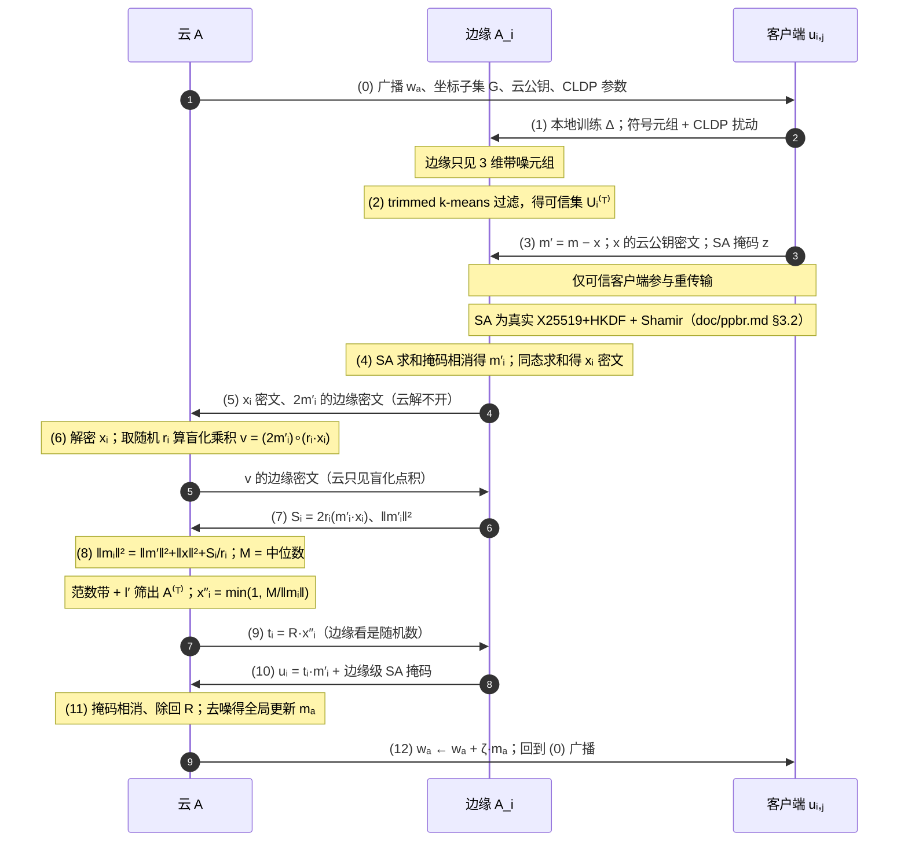

# HFL-Attack

层次化联邦学习鲁棒性隐私保护研究框架：在 **CKKS 同态加密** 保护的联邦学习环境中，系统评估 **数据投毒 / 模型投毒 / 系统攻击 / 隐私推断** 四类共 25 种攻击的效果。

核心机制：

- **CKKS 同态加密**：客户端上传的模型更新全程以密文形式参与服务器聚合，服务器不接触明文梯度。
- **密钥分离架构**：服务器仅持有公钥上下文，只能加密下发与同态聚合，**不能解密任何密文**；私钥只分发给客户端，全局模型的解密与评估都在客户端完成（模拟环境中由实验编排方充当密钥生成中心 KGC）。
- **FedAvg 联邦聚合**：支持加权平均及多种鲁棒聚合规则。
- **TopK 稀疏化 + Global Mask Vote**：客户端本地按 batch 打分做 TopK，只上传 0/1 掩码；服务器聚合各客户端投票生成全局掩码并广播，客户端按全局掩码加密上传对应 batch，显著降低通信量。
- **PTopk 残差补偿**（Error Feedback）：客户端维护明文残差累加器，未被选中的 batch 信息累积到下一轮，避免稀疏化造成永久信息丢失。
- **层次联邦学习（云-边-端）**：可选开启边缘层（UAV 场景），客户端密文 → 边缘密文聚合 → 云密文聚合，密文全局模型沿云→边→端逐级下发；边缘节点只持公钥，不能解密。
- **统一攻击框架**（`hfl_attacks/`）：四类攻击注册到统一注册表，由主配置 `attack` 段一键开关，攻击发生在客户端本地明文域、加密上传之前。
- **PPBR 可插拔拜占庭鲁棒**（`ppbr/`）：严格按 He 等 IEEE TMC 2026 实现完整协议——边层 CLDP 符号统计聚类过滤恶意客户端、云层两轮点积范数盲化 + 中位数筛选与裁剪恶意边缘、SA 成对掩码安全聚合、客户端动量；`ppbr.enabled: true` 自动开启云-边-端架构并**切换整条加解密路线为 PPBR 协议**（双轨架构，不走全局投票/TopK），与 attack 段组合即"攻击 × 防御"实验。详见 `doc/ppbr.md`。

> **已知限制**：密文域只能执行同态加权平均（FedAvg），median/krum/trimmed_mean 等
> 需要明文坐标值的鲁棒聚合规则在纯密文服务器上无法执行——这是密钥分离架构的
> 固有约束，也是层次化方案（如边缘节点可信聚合 / 阈值解密）要解决的问题。

## 目录结构

```
HFL-Attack/
├── ckks_fed/                  # 核心包
│   ├── crypto.py              # CKKS 上下文/加密/解密/同态聚合 (CKKSManager)
│   ├── packing.py             # 打包策略: layerwise / merged
│   ├── sparsification.py      # 客户端本地 TopK/RandK 稀疏化
│   ├── global_mask_vote.py    # 服务器端全局掩码投票
│   ├── ptopk.py               # Packed TopK 残差补偿 (Error Feedback)
│   ├── client.py              # FederatedClient
│   ├── server.py              # AggregationServer (聚合 + 掩码投票 + 防御过滤)
│   ├── hierarchy.py           # 层次联邦: EdgeNode / UAV 关联 / 云-边-端密文聚合
│   ├── client_selection.py    # 客户端随机选择 (random)
│   ├── models.py              # MLP / CNN / LeNet 等模型定义
│   ├── data.py                # 数据集加载与客户端数据划分 (IID / Dirichlet 非IID)
│   ├── attacks/               # 模型投毒后端类 (供 hfl_attacks 适配)
│   └── defenses/              # 鲁棒聚合规则实现 (仅明文聚合路径生效)
├── hfl_attacks/               # 统一攻击库 (4 类 25 种, 注册表驱动)
│   ├── base.py                # 攻击接口 + ATTACK_REGISTRY
│   ├── metrics.py             # 攻击评价指标 (ASR / PSNR / MIA-AUC 等)
│   ├── runner.py              # 攻击离线评估 CLI
│   ├── data_poisoning/        # 数据投毒 ×5
│   ├── model_poisoning/       # 模型投毒 ×9
│   ├── system_attacks/        # 系统攻击 ×6
│   └── privacy_inference/     # 隐私推断 ×4
├── ppbr/                      # PPBR 可插拔拜占庭鲁棒 (He 等 TMC 2026，双轨架构)
│   ├── config.py              # PPBRConfig 超参数（论文默认值）
│   ├── cldp.py                # 算法2b: CLDP 差分隐私扰动 (式2)
│   ├── sign_stats.py          # 算法2a: 符号统计元组 + 坐标子集
│   ├── clustering.py          # 算法2c: trimmed k-means 聚类过滤
│   ├── controller.py          # 数学机制: 动量/边缘均值/范数筛选裁剪
│   ├── crypto.py              # 传输层: PLHE 分块加解密 + sim 模式种子掩码
│   ├── sa.py                  # 真实 SA (Bonawitz'17): X25519+HKDF 协商、
│   │                          #   Shamir 掉线恢复（见 doc/ppbr.md §3.2）
│   └── protocol.py            # PPBRProtocol: 云/边缘/客户端完整协议时序
├── configs/
│   └── config.yaml            # 唯一主配置 (训练 + 攻击开关 + 层次架构 + PPBR)
├── scripts/                   # 辅助脚本
├── tests/                     # 单元/集成测试
├── doc/                       # 解释性文档 (攻击原理 / 层次架构等)
├── paperlist/                 # 参考论文列表
├── main.py                    # 主实验入口: 单次加密联邦学习训练
└── requirements.txt
```

## 快速开始

```bash
pip install -r requirements.txt

# 主实验: 单次联邦学习训练 (CKKS 加密 + TopK 稀疏化 + PTopk)
python main.py

# 开启攻击: 编辑 configs/config.yaml 的 attack 段
#   attack:
#     enabled: true
#     name: "model:sign_flipping"   # 注册表攻击名
#     malicious_count: 2
python main.py

# 开启 PPBR 拜占庭鲁棒防御（自动启用云-边-端架构，可与攻击同时开启）
#   ppbr:
#     enabled: true
python main.py

# 隐私推断类攻击的离线评估 (成员推断 AUC / 梯度重建 PSNR 等)
python -m hfl_attacks.runner --help

# 使用其他配置文件
python main.py --config path/to/config.yaml
```

数据集（mnist / fashion_mnist / cifar10 等）首次运行会自动下载到 `data/` 目录。实验结果输出到配置中 `output.results_dir` 指定的目录（默认 `./results`）。

## 攻击配置

攻击在主配置 `configs/config.yaml` 的 `attack` 段统一控制（`enabled: false` 时代码路径与正常 FedAvg 完全一致）：

| 配置项 | 作用 |
|--------|------|
| `attack.enabled` | 攻击总开关：`false`=正常 FedAvg；`true`=注入攻击实验 |
| `attack.name` | 攻击注册名，前缀决定类别：`data:` / `model:` / `system:` / `privacy:` |
| `attack.malicious_count` | 恶意客户端数量（取编号最大的最后 N 个） |

攻击实现库 `hfl_attacks/` 与配置的关系：

- **`hfl_attacks/` = 攻击实现库**：25 个攻击类实现统一接口（`DataPoisoner` / `ClientUpdateAttack` / `SystemAttack` / `PrivacyAttack`），通过 `@register_attack` 注册到 `ATTACK_REGISTRY`；`main.py` 按 `attack.name` 实例化并注入训练循环（数据投毒替换恶意客户端 `train_loader`；模型/系统投毒在客户端本地明文域篡改更新；DoS 类按轮次剔除不上传的客户端；隐私推断不修改训练过程，指标用 `hfl_attacks/runner.py` 单独评估）。
- **防御**（`ckks_fed/defenses/`）：median / krum / trimmed_mean 等明文域聚合规则与异常检测。它们需要明文坐标值，**在当前 CKKS 密文聚合路径下不生效**（密文不可解密），仅保留作明文对照与未来在边缘可信节点上落地的候选。

| 类别 | 攻击 |
|------|------|
| 数据投毒 `data:` | label_flipping_random / label_flipping_targeted / backdoor_badnets / backdoor_blend / backdoor_edgecase |
| 模型投毒 `model:` | sign_flipping / scaling / gaussian_noise / backdoor_model / constant / mimic_alie / alie / min_max / min_sum / ipm |
| 系统攻击 `system:` | random_dropout / persistent_dos / free_riding_zeros / free_riding_previous / free_riding_masked / sybil_collusion |
| 隐私推断 `privacy:` | dlg / idlg / inverting_gradients / membership_inference |

## 执行流程与代码逻辑

### 启动流程（`main.py` → `CKKSFedExperiment`）

```
python main.py --config configs/config.yaml
        │
        ▼
CKKSFedExperiment.__init__()
  ├─ 加载 config.yaml，自动修正 num_classes 与数据集不匹配
  ├─ _init_components()
  │   ├─ create_client_dataloaders()   数据集加载 + IID/Dirichlet 划分
  │   ├─ create_model()                全局模型 (LeNet/MLP/CNN)
  │   ├─ CKKSManager                   KGC 生成完整上下文（含私钥）
  │   ├─ server_ckks_manager           服务器：仅公钥上下文，不能解密
  │   ├─ AggregationServer             密文全局状态初始化
  │   ├─ FederatedClient × N           每个客户端持完整上下文（可解密）
  │   ├─ HierarchyController（可选）   hierarchy.enabled=true 时创建边缘层
  │   ├─ PPBRProtocol（可选）          ppbr.enabled=true 时创建（自动开启
  │   │                                hierarchy），双轨架构切换到 PPBR 协议轨道
  │   ├─ 攻击注入（可选）              attack.enabled=true 时按 name 实例化攻击，
  │   │                                恶意客户端 = 编号最大的最后 malicious_count 个
  │   │                                • data:* → 替换恶意客户端 train_loader
  │   │                                • privacy:* → 只登记，训练中空操作
  │   └─ BandwidthSimulator            异构带宽采样（虚拟时钟用）
  └─ run_experiment()                  双轨分发：ppbr.enabled ? run_round_ppbr
                                       : run_round_encrypted()（逐轮执行）
```

### 单轮流程 A：CKKS 加密轨道（`run_round_encrypted`，默认）

```
1. 客户端选择     _select_clients()（可插拔策略，默认 random 采样）
2. 密文下发       server.get_encrypted_global_params() → 客户端
3. 本地训练       client.local_train()
                  解密全局模型 → 本地 SGD → 明文更新（差值或全量）
4. 攻击注入（可选） attack.enabled 时（发生在明文域、加密上传之前）：
                  • DoS 类：participates(round) 为 False 的恶意客户端
                    本轮剔除（同步过滤 update/weight/loss/acc 列表）
                  • model:/system: 调 attack(update, AttackContext) 篡改
                    恶意客户端更新（合谋攻击可见本轮全部明文更新）
5. 掩码投票（可选） 客户端本地 TopK 打分只上传 0/1 mask → 服务器/边缘
                  聚合生成 global_mask 并广播（服务器永远看不到明文梯度）
6. 加密上传       client.encrypt_update(update, global_mask)
                  TopK 稀疏化 + slot packing + CKKS 加密 + PTopk 残差补偿
7. 密文聚合       • 标准：客户端密文 → 服务器加权平均（同态）
                  • 层次：客户端密文 → 边缘密文聚合 → 云加法合并
                    （边缘只持公钥；乘法深度方案见 doc/hierarchy.md）
8. 解密评估       客户端解密全局模型并完成测试集评估后上报
                  （服务器不持私钥，永远拿不到明文模型/梯度）
9. 指标记录      准确率/损失/通信量/时间/密文膨胀率 → MetricsCollector
```

### 单轮流程 B：PPBR 协议轨道（`run_round_ppbr`，ppbr.enabled=true）

开启 PPBR 后**整条加解密路线切换为论文协议**，不走全局投票/TopK/单密钥 CKKS 聚合：

```
1. 明文下发       云广播明文 w_a（论文设定：全局模型公开）
2. 本地训练       client.local_train(global_params=...)（与 A 共享同一实现）
3. 攻击注入（可选） _apply_attacks_to_updates（与 A 完全相同的语义）
4. PPBR 协议     ppbr.run_round()（ppbr/protocol.py 完整时序）：
                  • 算法2：客户端符号统计 + CLDP → 边缘 trimmed k-means 过滤
                  • 客户端：动量 m←φ·m+(1−φ)·Δ；相对噪声 x；[x]_A + SA 掩码 z
                  • 边缘：SA 聚合得 m'_i；同态求和 [x_i]_A；[2m'_i]_{Ei} 发云
                  • 云：两轮点积范数盲化 → 中位数筛选 + 裁剪系数 x″_i
                  • 盲化裁剪聚合（全局随机 R）→ denoise 得 m_a
5. 全局更新       w_a ← w_a + ζ·m_a（论文 w ← w − ζ·m；Δ 为参数变化量
                  方向故符号为正，见 doc/ppbr.md §3 第 17 步）
6. 明文评估       evaluate(server.model) → 指标入库
```

信任模型差异（云持 sk_A、边缘各自持私钥、客户端零密钥）与泄露分析详见
`doc/ppbr.md`。两轨共享数据/模型/本地训练/攻击注入/分组/指标，"同一攻击 ×
两轨"对比实验只改 `ppbr.enabled` 一个开关。

#### PPBR 一轮完整实体时序（云 / 边缘 / 客户端）



图中公式用 Unicode 数学文本（mermaid 图内不支持 LaTeX 渲染）；精确公式对照如下
（GitHub 在正文中原生渲染 `$...$`）：

| 图中记号 | 公式 | 含义 |
|----------|------|------|
| wₐ | $w_a$ | 全局模型（明文，任何客户端可得） |
| m′、x | $m' = m - x,\quad x = \eta \lVert m \rVert \frac{u}{\lVert u \rVert}$ | 客户端相对噪声掩码（η = `noise_rel`） |
| x 的云公钥密文 | $[x]_A = \mathrm{Enc}_{pk_A}(x)$ | 云公钥加密的分块 CKKS 密文 |
| SA 掩码 z | $z_j = m'_j + \sum_{j'>j}\mathrm{PRG}(s_{j,j'}) - \sum_{j'<j}\mathrm{PRG}(s_{j',j}) + \mathrm{PRG}(b_j)$ | 成对掩码在 $\sum_j z_j$ 上相消（Bonawitz'17） |
| m′ᵢ | $m'_i = \frac{1}{n'_i}\sum_j m'_{i,j}$ | 边缘聚合均值（边缘只见此值） |
| 2m′ᵢ 的边缘密文 | $[2m'_i]_{E_i} = \mathrm{Enc}_{pk_{E_i}}(2m'_i)$ | 边缘公钥加密，云解不开 |
| Sᵢ | $S_i = 2r_i\,(m'_i \cdot x_i)$ | 盲化点积（rᵢ 为云取的随机标量） |
| ‖mᵢ‖ | $\lVert m_i \rVert^2 = \lVert m' \rVert^2 + \lVert x \rVert^2 + S_i / r_i$ | 范数盲化（云只知范数） |
| x″ᵢ | $x''_i = \min\!\big(1,\; M / \lVert m_i \rVert\big)$ | 裁剪系数（M 为范数中位数） |
| tᵢ、uᵢ | $t_i = R\,x''_i,\quad u_i = t_i\,m'_i + \text{边缘级 SA 掩码}$ | 盲化裁剪聚合（R 为云随机数） |
| mₐ | $m_a = \frac{1}{l'}\Big(\sum_{i \in A^{(T)}} x''_i\,m'_i + \sum_{i \in A^{(T)}} x''_i\,x_i\Big)$ | 除回 R、去噪后的全局更新 |
| wₐ 更新 | $w_a \leftarrow w_a + \zeta\, m_a$ | 对应论文 $w \leftarrow w - \zeta m$（Δ 为变化量方向） |

要点：客户端筛选（步骤 1-2）发生在重密文传输（步骤 3）**之前**，边缘筛选
（步骤 6-9）发生在边缘转发（步骤 5）**之后**——云筛选边缘所依据的范数本就
来自边缘已发出的密文，不可能先筛后传；筛完后还有第二轮盲化裁剪聚合（9-11）。

#### 密钥清单与论文核对

| 密钥 | 论文 | 本项目实现 | 匹配 |
|------|------|-----------|------|
| PLHE 云密钥对 (pk_A, sk_A) | 1 对，仅云持有 | `PPBRKeyContext`（cloud_ctx，含 sk_A） | ✅ |
| PLHE 边缘密钥对 (pk_{A_i}, sk_{A_i}) | l 对，边缘 A_i 各自持有 | 每边缘一个 `PPBRKeyContext`（edge_ctxs，私钥边缘自持，公钥注册到云） | ✅ |
| SA 客户端密钥 (sk_i, pk_i, b_i) | 每客户端一组（DH 协商 + Shamir 分片 b_i） | **真实实现**（`ppbr/sa.py`）：每轮临时 X25519 密钥对，成对种子=HKDF(DH(sk_i,pk_j))；sk_i 与 b_i 均 Shamir (t,n−1) 分片，early/late 两阶段掉线恢复（私钥重建路径，见 doc/ppbr.md §3.2）；`sa_key_exchange: sim` 退回种子模拟 | ✅ |
| CLDP 参数 (ε_χ, L, L') | 公开 | `PPBRConfig` | ✅ |

差异说明：范数盲化中论文在 [·]_{A_i} 密文上同态算出 ‖m'‖² 并以 (x'_i)² 盲化
后送边缘解密；本项目因 TenSEAL 无密文 rotate/槽求和，改为边缘直发 ‖m'‖² +
两轮点积协议求 m'·x（泄露等价性论证见 doc/ppbr.md §4.5）。

### 关键代码位置

| 功能 | 文件 |
|------|------|
| 实验编排 / 单轮流程 | `main.py` (`CKKSFedExperiment`) |
| 客户端训练 / 加密上传 | `ckks_fed/client.py` (`FederatedClient`) |
| 密文聚合 / 掩码投票 | `ckks_fed/server.py` (`AggregationServer`) |
| CKKS 上下文 / 同态运算 | `ckks_fed/crypto.py` (`CKKSManager`) |
| slot packing / TopK 稀疏化 | `ckks_fed/packing.py` / `ckks_fed/sparsification.py` |
| 全局掩码投票 | `ckks_fed/global_mask_vote.py` |
| PTopk 残差补偿 | `ckks_fed/ptopk.py` |
| 层次架构（云-边-端 / UAV） | `ckks_fed/hierarchy.py` |
| PPBR 拜占庭鲁棒（算法 2/3/4/5 数学机制） | `ppbr/controller.py` |
| PPBR 完整协议（PLHE + SA 掩码 + 范数盲化） | `ppbr/protocol.py` + `ppbr/crypto.py` |
| PPBR 真实 SA（X25519 协商 / Shamir 掉线恢复） | `ppbr/sa.py` |
| PPBR 阅读笔记（论文全文技术细节） | `paperlist/ppbr_notes.md` |
| 攻击接口 / 注册表 | `hfl_attacks/base.py` (`ATTACK_REGISTRY`) |
| 攻击评估 CLI | `hfl_attacks/runner.py` |
| 攻击全量生效验证 | `scripts/verify_attacks.py` |

### 验证攻击是否生效

```bash
# 全部 25 个攻击逐一跑 1 轮端到端（非层次模式，约 10 分钟）
python scripts/verify_attacks.py

# 只验证初始化注入（秒级）
python scripts/verify_attacks.py --quick

# 单个攻击的集成测试
python -m pytest tests/test_attack_integration.py -v
```

> 本文档随代码演进维护：涉及配置结构、训练流程、攻击/防御机制的重大改动时，
> 需同步更新本章节与 `doc/` 下对应文档。

## 配置文件说明

### configs/config.yaml（唯一主配置）

| 配置段 | 作用 |
|--------|------|
| `system` | 客户端数量、轮数、本地 epoch、batch size、学习率、设备、随机种子、客户端采样率等 |
| `data` | 数据集名称、存储目录、类别数、IID/非IID 划分及 Dirichlet 参数 |
| `model` | 模型结构（mlp/cnn/lenet 等）及超参数 |
| `ckks` | CKKS 加密参数（多项式模次数、系数模链、缩放因子）、packing 策略、TopK/RandK 稀疏化、PTopk 残差补偿开关 |
| `global_mask_vote` | 服务器端掩码聚合模式（none/union/threshold/topk）及阈值 |
| `hierarchy` | 层次联邦开关：边缘节点数量、客户端-边缘关联策略（static/uav）、边缘采样率、UAV 移动模型 |
| `attack` | 攻击总开关、攻击注册名、恶意客户端数量 |
| `ppbr` | PPBR 拜占庭鲁棒开关（自动开启 hierarchy，双轨架构切换到完整协议路线，详见 doc/ppbr.md）及超参数：CLDP(ε_χ,L,L′)、聚类(k,b,trim)、动量(φ,ζ)、噪声掩码(noise_rel)、范数筛选(θ,β) |
| `bandwidth` | 带宽模拟参数（用于虚拟时钟通信时间估计） |
| `metrics` | 指标采集开关（时间、通信量、准确率等） |
| `visualization` | 可视化开关与图像格式 |
| `output` | 结果/模型/图表输出目录 |

## 测试

```bash
python -m pytest tests/
```

## 环境

- Python + PyTorch (CPU 即可运行，支持 CUDA)
- TenSEAL (CKKS 同态加密)
- 其余依赖见 `requirements.txt`
