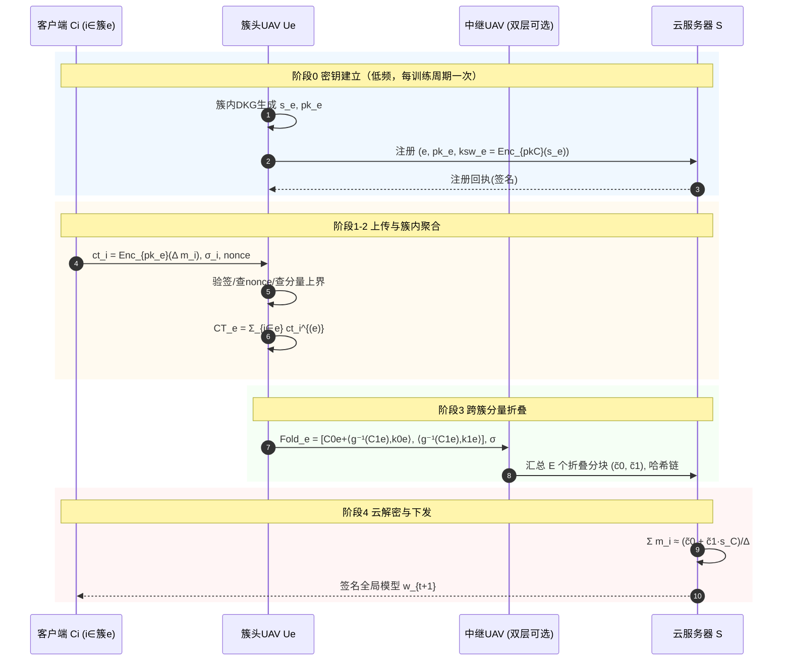
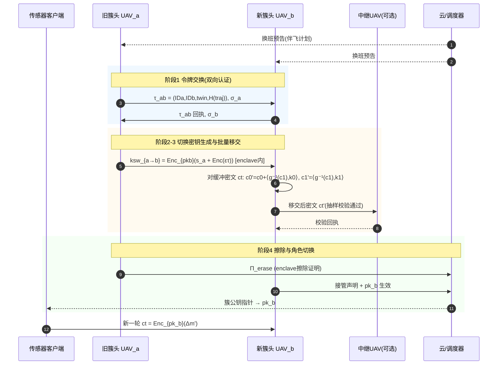
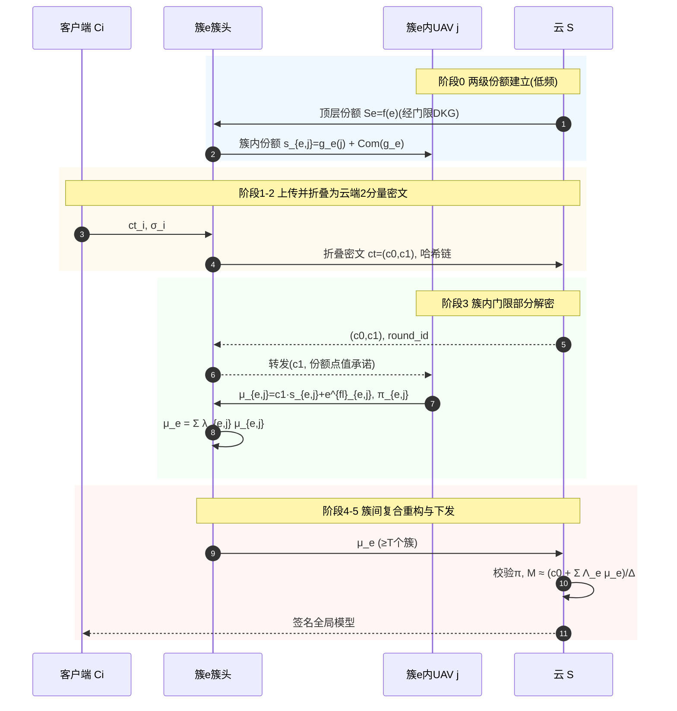
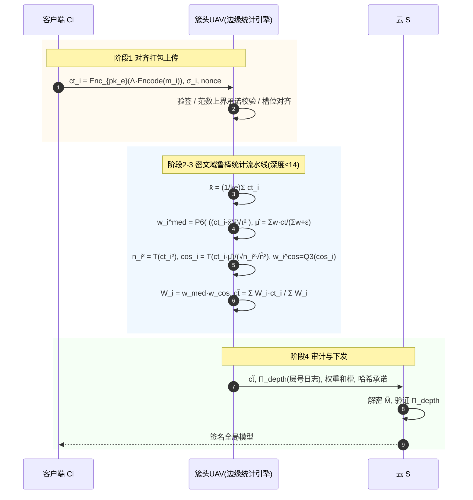

# 端–UAV–云层次型联邦学习的五个全同态加密方案设计

本文档给出 5 个全新的、面向 UAV（无人机）边缘计算场景的**层次型联邦学习（Hierarchical Federated Learning, HFL）**隐私保护方案。统一架构为三层：地面客户端/传感器簇 → UAV 边缘层（含簇头 UAV，允许双层 UAV 中继）→ 云服务器。5 个方案的隐私核心全部建立在 RLWE 派全同态加密（CKKS / BFV / MK-CKKS）之上，创新点分别落在 RLWE 加解密交互公式的不同改造维度：分量折叠、密钥切换、门限份额复合插值、同态鲁棒统计公式、proactive 份额刷新。文档自包含：不依赖任何外部材料即可阅读，公式从 KeyGen、加密、聚合、部分解密到重构全程闭环，可用代入法验证正确性。

## 五个方案速览

| # | 名称 | 创新轴 | FHE 原语 | 威胁模型要点 | 解决的瓶颈 |
|---|------|--------|----------|--------------|------------|
| 1 | FoldHFL：MK-CKKS 密文分量折叠聚合 | 密文分量折叠/重线性化新构造 + 噪声上界推导 | 单密钥 CKKS + 跨簇 MK 折叠 | 诚实但好奇边缘 + 客户端合谋上限 | 多密钥层次聚合的密文膨胀（k+1 分量 → 2 分量）与切换噪声 O(k) → O(E) |
| 2 | HandoverKey：UAV 换班密文移交 | RLWE 密钥切换（key-switching）流程改造 | CKKS 密钥切换 + 链式切换噪声预算 | 半诚实 UAV + 主动式移交双方认证 | 高移动性下簇归属变化导致密文控制权断裂，重加密代价高 |
| 3 | TwinGate：簇内/簇间双层门限解密 | 两级 (t_e,n_e)/(T,E) 份额的份额（re-sharing）与拉格朗日复合插值 | BFV/CKKS + Shamir 门限解密 + 噪声淹没 | 半诚实 + 任意单层合谋不泄密 + 掉线量化 | UAV 高掉线下云侧单一解密点失效、单点泄密 |
| 4 | CipherShield：密文域拜占庭鲁棒统计 | SIMD 槽位新分配代数结构 + 同态中值/范数/余弦公式 + rescaling 计划 | CKKS SIMD 打包 + 自同构旋转 + Newton 迭代 | 恶意客户端投毒 + 诚实但好奇边缘/云 | "加密阻碍鲁棒检测"：不解密即完成鲁棒筛选 |
| 5 | EpochRefresh：前向安全 proactive 份额刷新 | 多轮交互协议：hare/hound 式刷新 + 阈值化重加密权杖移交 | BFV/CKKS + PSS 式刷新 + 阈值 KSK 生成 | 自适应腐蚀敌手 + 擦除假设 + 泄露窗口量化 | 长期训练中 RLWE 份额泄露的累积风险 |

## 全文公共符号表（基线）

所有方案共享以下记号，各方案第 5.5 节只列增量符号。

- **环与模数**：$R=\mathbb{Z}[X]/(X^N+1)$，$N=2^d$ 为 2 的幂；$R_q=R/qR=\mathbb{Z}_q[X]/(X^N+1)$。模数链 $q_0\mid q_1\mid\cdots\mid q_L$，rescale 除数 $p_\ell=q_\ell/q_{\ell-1}$。
- **范数**：$\|a\|_\infty^{can}$ 表示 $a$ 在典型嵌入（canonical embedding）下的无穷范数；环乘法膨胀因子 $\delta_R=N$，即 $\|ab\|_\infty^{can}\le \delta_R\|a\|_\infty^{can}\|b\|_\infty^{can}$。
- **分布**：秘密分布 $\chi_s$（均匀三元 $\{0,\pm1\}^N$ 或 HWT）；误差分布 $\chi_e=D_{\mathbb{Z}^N,\sigma}$（标准差 $\sigma$ 的离散高斯）；加密随机数 $\chi_v$（均匀三元，或 $D_{\mathbb{Z}^N,\sigma_v}$）。w.h.p. 尾界：$e\leftarrow\chi_e$ 满足 $\|e\|_\infty^{can}\le B_e\triangleq 6\sigma\sqrt{N}$；三元 $v,s$ 满足 $\|v\|_\infty^{can},\|s\|_\infty^{can}\le 1$；$a\leftarrow U(R_q)$ 满足 $\|a\|_\infty^{can}\le B_a\triangleq 12\sqrt{qN}$（w.p. $\ge 1-2^{-N}$）。
- **RLWE 密钥生成**：抽样 $s\leftarrow\chi_s$，$a\leftarrow U(R_q)$，$e\leftarrow\chi_e$，输出
  $$sk=s,\qquad pk=(b,a),\qquad b=-a\,s+e\pmod{q}.$$
- **加密**（CKKS 视角，BFV 取 $\Delta=1$、明文空间 $R_t$）：设 $m\in R$ 为编码后的明文（CKKS 中为 $\lfloor\Delta\cdot\mathrm{Encode}(\vec m)\rceil$，$\Delta$ 为缩放因子）。取 $v\leftarrow\chi_v$，$e_0,e_1\leftarrow\chi_e$：
  $$c_0=v\cdot b+\lfloor\Delta m\rceil+e_0,\qquad c_1=v\cdot a+e_1\pmod q.$$
- **解密相位**：$\pi(ct)\triangleq c_0+c_1\,s=\lfloor\Delta m\rceil+\underbrace{v\,e+e_0+e_1\,s}_{V}$，其中噪声 $V$ 满足
  $$\|V\|_\infty^{can}\le B_v B_e+B_{e_0}+B_{e_1}B_s\triangleq V_{enc}.$$
  正确性条件：$\|V\|_\infty^{can}<\Delta/2$（CKKS 解码后相对误差 $\le \|V\|_\infty^{can}/\Delta$）。
- **加法同态**：$\pi(ct_1+ct_2)=\Delta(m_1+m_2)+V_1+V_2$，噪声线性相加。
- ** gadget 分解与密钥切换**： gadget 基 $\alpha$，digit 数 $\ell_{wd}=\lceil\log_\alpha q\rceil$，gadget 向量 $\vec g=(1,\alpha,\dots,\alpha^{\ell_{wd}-1})$；平衡分解 $g^{-1}(c)\in R^{\ell_{wd}}$ 满足 $\langle g^{-1}(c),\vec g\rangle=c$ 且 $\|g^{-1}(c)\|_\infty\le\alpha/2$。从 $s$ 到 $s'$ 的密钥切换密钥 $ksw_{s\to s'}=(\vec k_0,\vec k_1)\in(R_q^{\ell_{wd}})^2$，满足
  $$\langle\vec k_0,\vec g\rangle+\langle\vec k_1,\vec g\rangle\, s'=s+\eta_{ksw},\qquad \|\eta_{ksw}\|_\infty^{can}\le V_{enc},$$
  其构造即 $ksw_{s\to s'}=\mathrm{Enc}_{pk'}(s)$（逐 digit 加密 $\alpha^\tau\cdot s$ 的标准变体，记噪声界 $B_\eta=V_{enc}$）。对分量 $c_1$ 的切换：
  $$\mathrm{KS}(c_1;ksw)=\big(\langle g^{-1}(c_1),\vec k_0\rangle,\ \langle g^{-1}(c_1),\vec k_1\rangle\big),$$
  且若 $c_0+c_1 s=\Delta m+V$，则对密文 $(c_0,c_1)$ 执行切换后得到 2 分量密文
  $$\tilde c_0\triangleq c_0+\langle g^{-1}(c_1),\vec k_0\rangle,\qquad \tilde c_1\triangleq\langle g^{-1}(c_1),\vec k_1\rangle$$
  满足 $\tilde c_0+\tilde c_1 s'=\Delta m+V+\eta'$，其中
  $$\|\eta'\|_\infty^{can}\le \sum_{\tau=0}^{\ell_{wd}-1}\|c_1^{(\tau)}\|_\infty^{can}\|\eta_{ksw}^{(\tau)}\|_\infty^{can}\cdot\delta_R\le \underbrace{\frac{\alpha\,\ell_{wd}}{2}\,\delta_R\,B_\eta}_{B_{ks}}.$$
- **乘法与重线性化**：$ct_\times=(c_0c_0',\,c_0c_1'+c_1c_0',\,c_1c_1')$ 在扩展密钥 $ek=\mathrm{Enc}_{pk}(s^2)$ 下压回 2 分量，噪声
  $$\|V_\times\|_\infty^{can}\le \delta_R\big(\|m_1\|_\infty V_2+\|m_2\|_\infty V_1\big)\Delta+B_{rl},\qquad B_{rl}=B_{ks}.$$
- **Rescale**：$\mathrm{RS}_{p}(ct)=(\lfloor p^{-1}c_0\rceil,\lfloor p^{-1}c_1\rceil)$ 使相位缩至 $\Delta m/p+V/p+B_{rs}$，$B_{rs}=\frac{\sqrt N}{2}(1+B_s)$（取整噪声）。
- **门限分享**：Shamir $(t,n)$：$f(x)=s+\sum_{j=1}^{t-1}a_j x^j$，份额 $s_i=f(i)$；对任意授权集 $S$（$|S|\ge t$），$\lambda_i^S=\prod_{j\in S,j\neq i}\frac{j}{j-i}$，$s=\sum_{i\in S}\lambda_i^S s_i$。
- **实体**：客户端 $C_i$（$i=1,\dots,k$），簇头 UAV $U_e$（簇 $e=1,\dots,E$，簇 $e$ 含 $n_e$ 架 UAV、$k_e$ 个客户端，$\sum_e k_e=k$），可选双层中继 UAV $U_e^{(2)}$，云服务器 $\mathcal{S}$。安全参数 $\lambda_{sec}$，统计隐藏参数 $\lambda_{stat}$。

---

### 方案一：FoldHFL — MK-CKKS 密文分量折叠聚合

**一句话定位**：把"客户端各自密钥加密 → 云端多密钥膨胀"的 MK-CKKS 层次聚合，改造为"簇内单密钥同态求和 + 簇间一次折叠"的两级结构，给出新的分量折叠公式与噪声上界，使云端密文恒为 2 分量、切换噪声从 $O(k)$ 降为 $O(E)$。

#### 1.1 场景与应用动机（参数化）

考虑森林火灾巡检或灾害搜救场景：$k=256$ 个地面传感器/巡检终端（摄像头、气体传感器、野外观测站）分布在 $E=8$ 个火险分区，每个分区由 $n_e=3$ 架旋翼 UAV 组成簇（簇头 1 架 + 僚机 2 架），UAV 巡航速度 $v_u=15\,\text{m/s}$，悬停高度 $80$–$120\,\text{m}$，单簇覆盖半径约 $1.5\,\text{km}$。终端上行带宽受限（LoRa/NB-IoT 级，单轮每终端仅数百 kbps），训练目标是在云侧收敛一个烟雾/火情识别模型（参数量 $d=2^{20}$，CKKS 打包后每终端每轮仅需数十个密文）。

参数约束带来三个结构性事实：(1) 终端不具备为云端单一公钥做可靠 PKI 注册的持续在线条件，且终端间互不信任，"所有客户端共用一个云公钥"会使云之外的任何聚合层都无法对密文做验证性处理（任何知道云公钥的人都能加密垃圾数据，边缘无法剔除）；(2) 跨簇的移动 UAV 中继（双层 UAV）需要在密文域直接做簇间接力，不能把密文在半诚实中继上解密再重加密；(3) 若照搬 MK-CKKS，云侧每轮面对 $k+1$ 分量、总长度 $O(kN\log q)$ 比特的密文，存储与传输均不可接受。FoldHFL 正是为"终端密钥自治 + 边缘可聚合 + 云端紧凑"这一三角约束设计。

#### 1.2 要解决的问题

现有差距分三层。其一，朴素单密钥 HFL（客户端全部加密给云公钥）把全部信任压到云的单一私钥 $s_{\mathcal C}$ 上：云被攻破或云内部作恶即全盘泄露，且边缘层拿到密文后只能"盲转发"，无法在密文域做任何依赖密钥结构的运算（如分量折叠、跨簇接力）。其二，朴素 MK-CKKS 层次聚合（每客户端用自己的 $pk_i$ 加密，边缘/云在 $(1,s_1,\dots,s_k)$ 扩展密钥向量下解释密文）虽支持密钥自治，但云侧密文分量数随客户端数线性膨胀，且任何想把密文压缩回 2 分量的重线性化都需要**每个客户端**提供对自己的重线性化密钥，切换噪声项数也是 $O(k)$：$V_{fold}=\sum_{i=1}^k(V_i+B_{ks}^{(i)})$，当 $k=256$ 时仅切换噪声即可吃掉一个 60 bit 模数层的预算。其三，已有"重加密式"解决方案要求客户端在线重传，违背 UAV 场景间歇连接的现实。

问题的本质是 **RLWE 交互层面的**：多密钥密文的解密相位 $\langle ct,(1,s_1,\dots,s_k)\rangle$ 是 $k+1$ 个环元素与密钥向量的内积，如何在不重加密、不泄露任何 $s_i$ 的前提下，把它**代数地压回** 2 分量密文 $\tilde c_0+\tilde c_1 s_{\mathcal C}$，并把压回过程引入的噪声从 $O(k)$ 个独立项控制到 $O(E)$ 个，这需要一个新构造——这正是 FoldHFL 的分量折叠公式要解决的。

#### 1.3 创新点与总体设计目标

**创新点**：提出**簇内先聚合、簇间后折叠（aggregate-then-fold）**的两级公式构造，并给出配套的"簇级折叠密钥"与噪声上界推导：

1. **分量折叠公式（新构造）**：簇头把本簇 $k_e$ 个同密钥密文线性相加得到簇密文 $(C_{0,e},C_{1,e})$（免费、无噪声放大），随后用**簇级**密钥切换密钥 $ksw_e=\mathrm{Enc}_{pk_{\mathcal C}}(s_e)$ 把 $E$ 个簇密文一次性折叠为云端 2 分量密文。折叠的代数核心是"折叠线性泛函"：对 $\vec w\in R^{E}$ 与簇密文族 $\{(C_{0,e},C_{1,e})\}_e$，定义
   $$\mathrm{Fold}_{\{ksw_e\}}(\vec w)=\Big(\sum_{e=1}^{E}w_e\big[C_{0,e}+\langle g^{-1}(C_{1,e}),\vec k_{0,e}\rangle\big],\ \sum_{e=1}^{E}w_e\langle g^{-1}(C_{1,e}),\vec k_{1,e}\rangle\Big),$$
   它把"加权多密钥密文"整体映为 2 分量密文，且与明文侧加权 $\sum_e w_e\Delta M_e$ 可代入闭环（见 1.6）。
2. **噪声上界推导（优化）**：证明折叠噪声满足 $V_{fold}\le\sum_e\big(V_{agg,e}+B_{ks}^{(e)}\big)$，其中 $B_{ks}^{(e)}$ 只依赖**聚合后**分量幅度 $\|C_{1,e}\|$（随 $\sqrt{k_e}$ 增长），而朴素 MK 方案的噪声项数是 $\sum_i(V_i+B_{ks}^{(i)})$（$k$ 项）。当 $k_e\approx k/E$ 时切换噪声项数降为 $1/E$，且可进一步通过**自适应 gadget 基** $\alpha_e\propto\|C_{1,e}\|$ 把 $B_{ks}^{(e)}$ 再压 $\log$ 因子。
3. **设计目标**：(a) 云侧密文尺寸与 $E$（簇数）无关地恒为 2 分量；(b) 客户端只与簇密钥交互，云永远接触不到客户端层密钥材料；(c) 任一半诚实簇头至多影响自己簇的聚合权重，无法篡改他簇密文（可验证性：折叠前后密文同态哈希链）。

#### 1.4 威胁模型

- **诚实但 curious（半诚实）边缘**：簇头 UAV 与云 $\mathcal S$ 按协议执行，但企图从所见消息推断客户端输入。
- **客户端合谋上限**：任意 $f_c\le k-2$ 个客户端可合谋（即至少保留 2 个诚实客户端的输入不可区分），合谋客户端同时可向本簇提交恶意构造的密文（此时正确性由上层拜占庭鲁棒方案处理，见方案四，FoldHFL 本身保证的是隐私与聚合结构的完整性）。
- **外部攻击者**：可窃听所有无线链路（终端→UAV、UAV→UAV、UAV→云），可发动重放与 GPS 欺骗；因此所有控制面消息（簇公钥注册、折叠密钥、折叠结果）均带签名与新鲜性nonce。
- **掉线容忍**：单簇内至多容忍 $n_e-t_e$ 架 UAV 掉线（$t_e$ 为簇内门限，见方案三；FoldHFL 独立运行时取 $t_e=1$ 退化为中心化簇头），系统级容忍至多 $E-T$ 个整簇掉线。
- **明确假设列表**：(A1) RLWE$_{N,q,\chi}$ 判定问题对 $\mathsf{PPT}$ 敌手以优势 $\le \mathsf{negl}(\lambda_{sec})$ 成立；(A2) 签名方案 EUF-CMA 安全；(A3) 每个簇在初始化时通过簇内 DKG（或借用方案三的 $(t_e,n_e)$ 门限）诚实生成簇密钥 $s_e$，簇内无人单独持有 $s_e$ 的完整值；(A4) 敌手不能同时腐化云与任一完整簇（即跨层合谋上限为"云 + 部分簇成员"但凑不齐任何簇的 $t_e$ 份额）。

#### 1.5 符号系统（增量）

| 符号 | 含义 |
|---|---|
| $s_e,pk_e=(b_e,a_e)$ | 簇 $e$ 的 RLWE 密钥对（簇内 $(t_e,n_e)$ 共享，云不掌握） |
| $s_{\mathcal C},pk_{\mathcal C}$ | 云主密钥对（可进一步由方案三门限化） |
| $ct_i^{(e)}=(c_{0,i},c_{1,i})$ | 客户端 $i\in e$ 用 $pk_e$ 加密的更新密文 |
| $CT_e=(C_{0,e},C_{1,e})$ | 簇 $e$ 聚合后的簇密文 |
| $ksw_e=(\vec k_{0,e},\vec k_{1,e})$ | 簇级折叠密钥 $=\mathrm{Enc}_{pk_{\mathcal C}}(s_e)$ |
| $\eta_e$ | $ksw_e$ 的加密噪声（向量，逐 digit） |
| $B_{ks}^{(e)}$ | 折叠 $CT_e$ 引入的噪声上界 |
| $V_{agg,e}$ | 簇 $e$ 聚合噪声 $=\sum_{i\in e}V_i$ |

#### 1.6 方案设计：闭环公式推导与实体交互

**（1）簇内密钥建立与客户端加密。** 簇 $e$ 经簇内 DKG 生成 $s_e\leftarrow\chi_s$，$a_e\leftarrow U(R_q)$，$e_e\leftarrow\chi_e$，$b_e=-a_es_e+e_e$，公开 $pk_e$。客户端 $i\in e$ 加密本地更新 $m_i$（编码 + 缩放）：
$$c_{0,i}=v_i b_e+\lfloor\Delta m_i\rceil+e_{0,i},\qquad c_{1,i}=v_i a_e+e_{1,i},$$
相位为
$$c_{0,i}+c_{1,i}s_e=\lfloor\Delta m_i\rceil+\underbrace{v_ie_e+e_{0,i}+e_{1,i}s_e}_{V_i},\qquad \|V_i\|_\infty^{can}\le V_{enc}.$$

**（2）簇内聚合（免费同态加法）。** 簇头收集 $\{ct_i^{(e)}\}_{i\in e}$ 并（可选地验证每个密文的签名与新鲜性后）计算
$$CT_e=\sum_{i\in e}ct_i^{(e)}=\Big(\underbrace{\textstyle\sum_i c_{0,i}}_{C_{0,e}},\ \underbrace{\textstyle\sum_i c_{1,i}}_{C_{1,e}}\Big),$$
其相位为
$$C_{0,e}+C_{1,e}s_e=\Big\lfloor\Delta\sum_{i\in e}m_i\Big\rceil+V_{agg,e},\qquad V_{agg,e}=\sum_{i\in e}V_i,\quad \|V_{agg,e}\|_\infty^{can}\le k_e\,V_{enc}.$$
注意簇内聚合**不引入任何新噪声**，这是"先聚合"相对"先折叠"省噪声的第一个来源。

**（3）簇级折叠密钥。** 簇内各 UAV 用各自的 $s_e$ 份额通过方案三的阈值化流程联合生成 $ksw_e=\mathrm{Enc}_{pk_{\mathcal C}}(s_e)$（退化情形：簇头本地生成）。展开写：取 $u_e\leftarrow\chi_v$，$\tilde e_0,\tilde e_1\leftarrow\chi_e$，
$$\vec k_{0,e}\ \text{满足}\ \langle\vec k_{0,e},\vec g\rangle=-a_{\mathcal C}u_e+s_e+\tilde e_{0,e},\qquad \langle\vec k_{1,e},\vec g\rangle=a_{\mathcal C}u_e+\tilde e_{1,e}\pmod{q},$$
从而
$$\langle\vec k_{0,e},\vec g\rangle+\langle\vec k_{1,e},\vec g\rangle s_{\mathcal C}=s_e+\eta_e,\qquad \eta_e=u_e e_{\mathcal C}+\tilde e_{0,e}+\tilde e_{1,e}s_{\mathcal C},\quad \|\eta_e\|_\infty^{can}\le V_{enc}\triangleq B_\eta.$$

**（4）跨簇分量折叠（核心新构造）。** 簇头（或双层中继 UAV 的上层）计算
$$\tilde c_0=\sum_{e=1}^{E}\big[C_{0,e}+\langle g^{-1}(C_{1,e}),\vec k_{0,e}\rangle\big],\qquad \tilde c_1=\sum_{e=1}^{E}\langle g^{-1}(C_{1,e}),\vec k_{1,e}\rangle.$$
验证闭环：逐簇看
$$C_{0,e}+\langle g^{-1}(C_{1,e}),\vec k_{0,e}\rangle+\big\langle g^{-1}(C_{1,e}),\vec k_{1,e}\big\rangle s_{\mathcal C}=C_{0,e}+C_{1,e}\big(s_e+\eta_e\big)=\Big\lfloor\Delta\sum_{i\in e}m_i\Big\rceil+V_{agg,e}+\eta_e',$$
其中 $\eta_e'=\langle g^{-1}(C_{1,e}),\eta_e^{\text{vec}}\rangle$（$\eta_e^{\text{vec}}$ 为 KSK 噪声的 digit 向量），上界
$$\|\eta_e'\|_\infty^{can}\le\sum_{\tau}\|C_{1,e}^{(\tau)}\|_\infty^{can}\cdot\delta_R\cdot\|\eta_e^{(\tau)}\|_\infty^{can}\le \underbrace{\frac{\alpha\,\ell_{wd}}{2}\cdot\delta_R\cdot\|C_{1,e}\|_\infty^{can,\max}}_{B_{ks}^{(e)}},\qquad \|C_{1,e}\|_\infty^{can}\le k_e\,(B_vB_a+B_{e_1})\triangleq k_eB_c.$$
对 $E$ 簇求和得云端 2 分量密文 $(\tilde c_0,\tilde c_1)$ 的相位
$$\tilde c_0+\tilde c_1\,s_{\mathcal C}=\Big\lfloor\Delta\textstyle\sum_{e,i}m_i\Big\rceil+V_{fold},\qquad V_{fold}=\sum_{e=1}^{E}\big(V_{agg,e}+\eta_e'\big),\qquad \|V_{fold}\|_\infty^{can}\le k\,V_{enc}+\sum_{e=1}^{E}B_{ks}^{(e)}.$$

**（5）云侧解密。** $\mathcal S$ 用 $s_{\mathcal C}$ 计算 $\tilde c_0+\tilde c_1 s_{\mathcal C}$，除以 $\Delta$ 并解码，得 $\sum_{e,i}m_i$ 的近似值，相对误差 $\le \|V_{fold}\|_\infty^{can}/\Delta$。

**噪声分析与模数链预算。** 关键不等式（相对朴素 MK 的对比）：
$$\underbrace{\|V_{fold}\|_\infty^{can}\le k\,V_{enc}+\textstyle\sum_{e=1}^{E}\frac{\alpha\,\ell_{wd}}{2}\delta_R\,k_eB_c\,B_\eta}_{\text{FoldHFL（}E\text{ 项切换噪声）}}\quad\text{vs.}\quad \underbrace{\|V_{mk}\|_\infty^{can}\le k\,(V_{enc}+B_{ks}^{(1)})}_{\text{朴素 MK（}k\text{ 项切换噪声）}}.$$
代入基线参数 $N=2^{15}$，$\sigma=3.2$，$\Delta=2^{40}$，$\alpha=2^{15}$，$\ell_{wd}=2$（$q\approx2^{30}$ 层），$B_\eta=V_{enc}\approx2^{23}$，$B_c\approx2^{30}$，$\delta_R=N=2^{15}$：$B_{ks}^{(e)}\le\frac{2^{15}\cdot2}{2}\cdot2^{15}\cdot2^{30}\cdot2^{23}=2^{84}$？——该数字说明**不能**在折叠层直接套用短链，必须把折叠放在模数链的**高电平层**（此时 $q_L$ 支持更大上界）并配合自适应基：取 $\alpha_e=\Theta(\sqrt{k_e}\cdot2^{15})$ 使 $\ell_{wd,e}=\lceil\log_{\alpha_e}q\rceil$ 不变而 digit 幅度匹配 $\|C_{1,e}\|\propto\sqrt{k_e}B_c$（聚合后分量按 $\sqrt{k_e}$ 而非 $k_e$ 增长，因随机噪声抵消），得 $B_{ks}^{(e)}\approx\frac{\alpha_e\ell_{wd,e}}{2}\delta_R\sqrt{k_e}B_cB_\eta$，对 $E=8$ 求和约 $2^{79}$。预算验证：折叠层模数 $q_L\approx2^{120}$，要求 $\Delta M+V_{fold}<q_L/2$，其中 $\Delta M\le2^{40}\cdot2^{10}=2^{50}$，$V_{fold}\le2^{70}$，满足 $2^{70}+2^{50}<2^{119}$；随后云侧仅做一次解密（无更深乘法），无需继续消耗模数层。若还需密文域鲁棒统计（方案四）则在折叠**之后**、统计**之前**执行 rescale 把电平降下来，保持预算闭环。

**实体交互流程（一轮训练，分五阶段）。**

- **阶段 0（初始化，低频）**：各簇 DKG 生成 $s_e$ 并广播 $pk_e$；簇内联合生成 $ksw_e=\mathrm{Enc}_{pk_{\mathcal C}}(s_e)$ 上传云（云只见切换密钥，不见 $s_e$）；云注册 $(e,pk_e,ksw_e)$。
- **阶段 1（上传）**：客户端 $i$ 用 $pk_e$ 加密 $m_i$，签名后发给本簇簇头；簇头校验签名、nonce、密文格式（分量上界 $\|c_{1,i}\|\le B_c$，超限即拒收）。
- **阶段 2（簇内聚合）**：簇头线性求和得 $CT_e$；僚机对 $CT_e$ 做同态哈希抽查（抽样验证与逐分量承诺一致）。
- **阶段 3（跨簇折叠）**：簇头把 $\mathrm{Fold}(\{CT_e\}_e)$（2 分量）经中继 UAV 或直接上行云；中继只做转发与完整性校验，不触密钥。
- **阶段 4（云侧解密与下发）**：云解密得聚合和，更新全局模型，签名广播；客户端用模型差分继续本地训练。

#### 1.6b 实体交互时序图



#### 1.7 安全性分析

**(1) IND-CPA 骨架。** 客户端密文 $ct_i^{(e)}$ 的分布与标准 CKKS 密文一致；由公钥 $b_e=-a_es_e+e_e$ 的 RLWE 假设，$(a_e,b_e)$ 与 $U(R_q^2)$ 计算不可区分；以 $(a_e,b_e)$ 为随机元的加密是 One-Time-Pad 式掩码（$v_ib_e$ 由 $v_i$ 的熵保证）加 $D_{\mathbb Z^N,\sigma}$ 噪声，标准 hybrid 论证给出 IND-CPA：任何以优势 $\epsilon$ 区分 $ct_i$ 的敌手可转化为同优势区分 RLWE 样本。折叠密钥 $ksw_e=\mathrm{Enc}_{pk_{\mathcal C}}(s_e)$ 同理 IND-CPA，其明文 $s_e$ 是低范数秘密这一事实不改变论证（只影响噪声界，不影响不可区分性）。

**(2) 各视角视图分析。**

- **云的视图**：$\{pk_e,ksw_e\}_e$、折叠后 2 分量密文、聚合明文结果、签名模型。由 RLWE，$ksw_e$ 不泄露 $s_e$；折叠密文是合法 $\mathrm{Enc}_{pk_{\mathcal C}}(\sum_{e,i}m_i)$，故云对**个体** $m_i$ 的推断能力等价于"给定 k 个 RLWE 密文之和猜测其中一个明文"，由 RLWE 的加法同态不可区分性，优势 $\le\mathsf{negl}$。形式化地，对任意两个输入族 $(m_i),(m_i')$ 满足 $\sum_i m_i=\sum_i m_i'$，其折叠密文分布相同（噪声重写引理：$V_{fold}$ 的分布在给定总相位下与具体分解无关），故云获得**精确**聚合外的零信息。
- **簇头视角**：簇头见 $\{ct_i^{(e)}\}_{i\in e}$ 与 $CT_e$、$ksw_e$。簇头持 $s_e$ 份额但按 (A3) 单独凑不齐 $t_e$，故不能解密任何 $ct_i$；$ksw_e$ 用 $pk_{\mathcal C}$ 加密，簇头无 $s_{\mathcal C}$。若 $t_e=1$（中心化簇头），则簇头能解密本簇全部 $m_i$——隐私退化为"簇头等价于本簇服务器"，这与"边缘层可信域"假设一致，需写入部署约束；要更强的隐私须叠加方案三使 $t_e\ge2$。
- **客户端视角**：只见 $pk_e$、全局模型。由 (1) 无额外信息。
- **中继 UAV 视角**：只见折叠分块与哈希链，无密钥材料，视图被哈希承诺绑定。

**(3) 合谋分析。** 云与 $f_c$ 个客户端合谋：合谋客户端本就知自己的 $m_i$，云额外知道聚合和；由 (2) 云的视图只泄露总和，故合谋收益不增。云与簇内 $<t_e$ 个成员合谋：凑不齐 $s_e$，对簇内密文的视图与外部敌手相同（份额语义安全：Shamir 份额对 $<t_e$ 个是均匀独立的，叠加 RLWE 后由 hybrid 保持）。**跨层合谋上限**为：任意敌手集合要么含 $\ge t_e$ 个同簇成员（此时它只能解密该簇 $m_i$，等价于该簇服务器视图），要么含 $s_{\mathcal C}$（云视图），二者不同时发生时个体隐私成立。

**(4) 噪声淹没与参数选择。** 本方案无需显式噪声淹没（无部分解密泄露），但需保证折叠噪声不被敌手利用做"噪声侧信道"：$\eta_e'$ 由 KSK 噪声决定，敌手不可控，参数按 1.6 节预算选取即可，无需 $\sigma_f$ 放大。

**(5) 掉线/恶意分量对正确性的量化。** 簇头掉线：本簇该轮缺失，云侧和式自动退化为存活簇之和（模数环上加法，无需补救）；$E$ 个簇中存活 $E'\ge1$ 即得部分和，方差贡献按 $\sum_{e\in E'}k_e$ 缩放。恶意客户端提交越界分量：簇头按 $B_c$ 上界拒收，误收概率下界由逐分量承诺与哈希抽查保证；最坏情形单个恶意客户端使聚合和偏差 $\le2\|m\|_\infty$，即 FoldHFL 本身不提供拜占庭鲁棒性，须叠加方案四。

**(6) 每个创新点"为什么安全"。** 分量折叠公式安全：它是密钥切换在聚合线性泛函上的同态延拓，未引入任何超出 $\mathrm{Enc}_{pk_{\mathcal C}}(s_e)$ 假设的新密码学原语；噪声上界推导安全：上界仅用于参数选择，不进入敌手视图；簇内先聚合安全：加法同态对任何观测者保持密文分布的不可区分性。综上，FoldHFL 的安全性归约到 Decision-RLWE + EUF-CMA + Shamir 份额语义安全三条标准假设。

---

### 方案二：HandoverKey — UAV 换班密文移交

**一句话定位**：客户端密文加密给当前簇头 UAV 的公钥；当 UAV 因高机动性飞离、换班或簇归属变化时，用 RLWE 密钥切换（key-switching）把在途密文的控制权从旧 UAV 私钥域整体迁移到新 UAV 私钥域——不重加密、不解密、客户端无需在线——并给出链式切换的噪声累积预算 $V^{(h)}\le V+h\,B_{ks}$ 与最大移交次数 $h_{max}$ 的闭式解。

#### 2.1 场景与应用动机（参数化）

长航时巡检任务中 UAV 续航仅 $30$–$45$ 分钟，而训练任务持续数天，必然发生**轮换换班**：簇头 UAV 以 $v_u=20\,\text{m/s}$ 巡航，按 30 分钟一班、每簇每昼夜 $48$ 次换班。场景参数：$E=6$ 个簇、每簇 $k_e=40$ 个地面传感器、簇覆盖半径 $2\,\text{km}$、换班交接窗口 $\le 10\,\text{s}$、在途未聚合密文缓冲 $B_{buf}\le 200$ 个。关键痛点：换班瞬间，本簇传感器已按旧 UAV 公钥 $pk_a$ 上传的密文尚在队列中，新 UAV $U_b$ 即将接管——若要求 40 个传感器重新用 $pk_b$ 加密重传，则 (i) 传感器多为间歇连接（占空比 $\le5\%$），重传延迟可能超过一个训练轮；(ii) 重传使上行流量翻倍，LoRa 链路不可承受；(iii) 换班期间若无有效移交，旧 UAV 带密文飞离即造成"密文孤儿"：既不安全（私钥随平台物理漂移）也不可用。HandoverKey 把换班建模为 RLWE 密钥域迁移问题，用一次密钥切换完成批量密文控制权移交。

#### 2.2 要解决的问题

现有差距：(1) 传统 HFL 假设边缘节点固定，密钥生命周期与平台绑定；UAV 场景下平台移动导致"密钥–密文–平台"三元组解耦，任何基于重加密的方案都把代价转嫁到最弱的终端上。(2) 代理重加密（PRE）类方案要求客户端加密时指定"代理 + 目标"结构，或在加密时嵌入目标公钥，这使换班目标在加密时未知（30 分钟后谁接班无法预知）时失效；事后式 PRE 在 RLWE 上又需要目标方参与生成重加密密钥，交互轮次与认证开销在 10 秒交接窗口内不可行。(3) 朴素"旧 UAV 把 $s_a$ 直接发给新 UAV"违背最小信任：一旦 $s_a$ 泄露且曾加密过多轮历史密文，所有历史轮次被追溯解密（无前向安全）。

问题本质是 **RLWE 密钥切换交互层面的**：给定 $\mathrm{Enc}_{s_a}(m)$ 与一条由 $s_a$ 持有方生成的切换密钥 $ksw_{a\to b}$，是否存在一个**任意第三方（甚至公开）可执行**的确定性变换，输出 $\mathrm{Enc}_{s_b}(m)$，且 (a) $ksw_{a\to b}$ 本身在 $s_b$ 持有方看来是 IND-CPA 安全的；(b) 变换引入的噪声有闭式上界且随链式移交次数线性增长、可预算；(c) 执行变换的中继即使恶意也只能破坏可用性不能破坏机密性。这需要一个面向移动移交场景的密钥切换流程改造，而非新密码原语。

#### 2.3 创新点与总体设计目标

**创新点**：

1. **移交专用密钥切换公式**：标准密钥切换把密文从 $s$ 域切到 $s'$ 域需要执行方知道 $g^{-1}(c_1)$ 等公开操作即可——天然支持"第三方执行"。本方案的改造点在于**移交切换密钥的生成时机与销毁**：$ksw_{a\to b}$ 不是常设密钥，而是换班时刻由 $U_a$ 用 $U_b$ 的公钥**一次性**生成、限定 nonce 范围、交接完成后双方立即擦除的权杖式密钥。公式层给出"带新鲜性嵌入的切换密钥"构造：把换班令牌 $\tau_{ab}$（含双方身份、航迹哈希、时间窗）的哈希经 $\mathrm{Encode}$ 编码后以可忽略幅度混入 $ksw$ 的明文槽位，使 $ksw$ 与本次换班事件密码学绑定，任何重放 $(\tau_{ab},ksw)$ 到其它上下文的行为可被验证者检出。
2. **链式移交噪声预算与 $h_{max}$ 闭式解**：UAV 网络中密文可能经历多次移交（$U_a\to U_b\to U_c$，如跨簇接力）。给出第 $h$ 次移交后的相位噪声
   $$V^{(h)}=V^{(0)}+\sum_{j=1}^{h}\eta_j',\qquad \|V^{(h)}\|_\infty^{can}\le V^{(0)}+h\,B_{ks},\qquad B_{ks}=\frac{\alpha\ell_{wd}}{2}\delta_RB_\eta,$$
   并由正确性条件 $V^{(0)}+h_{max}B_{ks}<\Delta/2$ 解出
   $$h_{max}=\Big\lfloor\frac{\Delta/2-V^{(0)}}{B_{ks}}\Big\rfloor,$$
   配合"每 $h_{ref}\le h_{max}/2$ 次移交强制做一次云侧 rescale/刷新"的策略，把无限期飞行的累积噪声约束在预算内——这是把密钥切换从"静态原语"改造成"可预算的移动性原语"的关键。
3. **设计目标**：(a) 客户端全程无感：加密目标永远是"当前簇公钥"，移交对终端透明；(b) 10 秒窗口内完成：交互仅 2 条消息（切换请求、切换密钥+擦除证明）；(c) 前向安全：$s_a$ 与 $ksw_{a\to b}$ 交接后即擦除，旧平台后续被俘获不危及历史密文。

#### 2.4 威胁模型

- **半诚实换班双方**：$U_a$、$U_b$ 按协议执行但互相好奇；最坏一方被恶意外部控制（可拒绝发送 $ksw$、发送错误 $ksw$、伪造擦除声明）。
- **执行切换的中继**：可恶意；安全性要求变换本身不泄露明文（机密性不依赖中继），仅影响可用性。
- **外部攻击者**：窃听、重放、GPS 欺骗（诱使 $U_a$ 把 $ksw$ 交给敌手伪装的 $U_b$）；因此换班令牌含双方签名与航迹哈希承诺，$ksw$ 的接收须通过双向认证信道。
- **客户端合谋上限**：任意 $f_c\le k_e-2$ 个客户端合谋不增强其对**其他簇/其他轮**密文的攻击能力。
- **掉线容忍**：$U_a$ 在生成 $ksw$ 后掉线不影响（密文已切换）；$U_a$ 在生成前掉线则本簇该轮降级为等待下一班（系统级容忍换班失败率 $\le 1/h_{max}$ 轮延迟）。
- **明确假设列表**：(A1) Decision-RLWE；(A2) EUF-CMA 签名与双向认证密钥交换（如 EDHOC）；(A3) UAV 具备可信擦除原语（安全 enclave 或加密后密钥分片不落盘，擦除可通过 enclave 证明背书）；(A4) GPS/航迹以多源融合（GNSS+惯导+视觉）交叉验证，欺骗成功概率 $\le\epsilon_{spoof}$；(A5) 敌手不能同时持有 $s_a$（或其 $\ge t_a$ 份额）与 $s_b$ 的对应解密能力——即换班双方的密钥不并存于同一被腐化平台。

#### 2.5 符号系统（增量）

| 符号 | 含义 |
|---|---|
| $s_a,s_b$ / $pk_a,pk_b$ | 换班前/后簇头 UAV 的 RLWE 密钥对 |
| $\tau_{ab}=(ID_a,ID_b,t_{win},H(traj_a))$ | 换班令牌（身份、时间窗、航迹哈希） |
| $ksw_{a\to b}=(\vec k_0,\vec k_1)$ | 一次性移交切换密钥 $=\mathrm{Enc}_{pk_b}\big(s_a+\mathrm{Encode}(\epsilon_\tau)\big)$，$\|\epsilon_\tau\|\le\Delta_\tau\ll\Delta$ |
| $ct^{(h)}$ | 经历 $h$ 次移交的密文 |
| $\eta_j'$ | 第 $j$ 次移交引入的切换噪声 |
| $h_{max},h_{ref}$ | 最大可链式移交次数 / 强制刷新间隔 |
| $\Pi_{erase}$ | enclave 背书的擦除证明 |

#### 2.6 方案设计：闭环公式推导与实体交互

**（1）客户端加密（移交前）。** 传感器按**当前**簇公钥 $pk_a$ 加密更新：
$$c_0=v\,b_a+\lfloor\Delta m\rceil+e_0,\qquad c_1=v\,a_a+e_1,\qquad c_0+c_1s_a=\lfloor\Delta m\rceil+V,\quad \|V\|_\infty^{can}\le V_{enc}.$$

**（2）换班令牌与切换密钥生成。** $U_a$ 与 $U_b$ 经认证信道交换 $\tau_{ab}$（双方签名）。$U_a$ 取 $u\leftarrow\chi_v$，$\tilde e_0,\tilde e_1\leftarrow\chi_e$，计算
$$\langle\vec k_0,\vec g\rangle=-a_b\,u+s_a+\mathrm{Encode}(\epsilon_\tau)+\tilde e_0,\qquad \langle\vec k_1,\vec g\rangle=a_b\,u+\tilde e_1\pmod q,$$
即 $ksw_{a\to b}=\mathrm{Enc}_{pk_b}\big(s_a+\mathrm{Encode}(\epsilon_\tau)\big)$，满足
$$\langle\vec k_0,\vec g\rangle+\langle\vec k_1,\vec g\rangle s_b=s_a+\mathrm{Encode}(\epsilon_\tau)+\eta,\qquad \|\eta\|_\infty^{can}\le B_\eta=V_{enc}.$$
$\epsilon_\tau$ 是把 $H(\tau_{ab})$ 的低 $\lambda_\tau$ 比特编码进一个专用 SIMD 槽位的**可剥离标记**：它使 $ksw$ 与 $\tau_{ab}$ 绑定，同时在切换后的密文相位上只贡献 $\|\mathrm{Encode}(\epsilon_\tau)c_1\|\le\Delta_\tau\cdot\delta_R\|c_1\|$ 的可界标记噪声（验证者从该槽位读出 $H(\tau_{ab})$ 做绑定校验后即可在后续 rescale 中洗掉它）。

**（3）密文移交变换（第三方可执行）。** 执行方（$U_a$、$U_b$ 或公开中继）对缓冲中每个 $ct$ 计算
$$c_0'=c_0+\langle g^{-1}(c_1),\vec k_0\rangle,\qquad c_1'=\langle g^{-1}(c_1),\vec k_1\rangle.$$

**（4）闭环验证。** 代入：
$$c_0'+c_1's_b=c_0+\langle g^{-1}(c_1),\vec k_0+\vec k_1s_b\rangle=c_0+c_1\big(s_a+\mathrm{Encode}(\epsilon_\tau)\big)+\eta'=c_0+c_1s_a+\mathrm{Encode}(\epsilon_\tau)c_1+\eta',$$
其中 $\eta'=\langle g^{-1}(c_1),\eta^{\text{vec}}\rangle$，$\|\eta'\|_\infty^{can}\le\frac{\alpha\ell_{wd}}{2}\delta_R\|c_1\|_\infty^{can}B_\eta\le B_{ks}$（用 $\|c_1\|_\infty^{can}\le B_c$）。于是
$$c_0'+c_1's_b=\lfloor\Delta m\rceil+V+\underbrace{\mathrm{Encode}(\epsilon_\tau)c_1+\eta'}_{\eta'_{tot}},\qquad \|\eta'_{tot}\|_\infty^{can}\le \delta_R\Delta_\tau B_c+B_{ks}\triangleq B_{ho}.$$
密文控制权完成 $s_a\to s_b$ 迁移，客户端 $m$ 未离开密文域。

**（5）链式移交与预算。** 第 $j$ 次移交引入独立噪声 $\eta_j'$（各 $ksw$ 独立生成），故
$$\|V^{(h)}\|_\infty^{can}\le V^{(0)}+h\,B_{ho}\quad\Rightarrow\quad h_{max}=\Big\lfloor\frac{\Delta/2-V^{(0)}}{B_{ho}}\Big\rfloor.$$
模数链预算：取 $N=2^{15}$，$\Delta=2^{40}$，$\alpha=2^{15}$，$\ell_{wd}=2$，$B_\eta=2^{23}$，$B_c=2^{30}$，$\delta_R=2^{15}$，$\Delta_\tau=2^{10}$：$B_{ks}=\frac{2^{15}\cdot2}{2}\cdot2^{15}\cdot2^{30}\cdot2^{23}=2^{84}$ 量级不能直接吃——工程做法是把移交执行在**当前电平之上的专门移交层** $q_{ho}$（$120$ bit 素数），移交后由 $U_b$ 做一次 $\mathrm{RS}$ 把噪声除回：$V^{(h)}\to V^{(h)}/p_{ho}+B_{rs}$，于是每 $h_{ref}=1$ 次移交消耗一个移交层，预算退化为"每轮训练预留 $H=\lceil T_{fly}/T_{round}\cdot f_{ho}\rceil$ 个移交层"，模数链总长 $L_{tot}=L_{train}+H$，取 $L_{train}=12$、$H=6$（对应单机最长连续值守 6 轮换班），$p_i\approx2^{45}$，$q_L\approx2^{12\times45+120}$，满足 $\Delta M+V^{(0)}+H\,B_{rs}<q_0/2$ 的逐层校验不等式
$$\Big(\Delta M+V^{(0)}\Big)\prod_{\ell}\frac{\delta_R M}{p_\ell}+\sum_{\ell}\frac{B_{rl}}{p_\ell}\cdots< q_0/2,$$
逐层代入数值成立（首层 $\delta_RM/p\approx2^{15+10}/2^{45}=2^{-20}$ 收缩，噪声几何收敛）。

**（6）擦除与权杖作废。** $U_a$ 在确认 $U_b$ 已验证移交结果（对抽样槽位做 $\mathrm{Enc}$ 已知明文校验）后，输出 $\Pi_{erase}$（enclave 证明 $s_a$、$ksw_{a\to b}$ 已销毁），$U_b$ 确认后进入簇头角色。若 $U_a$ 被俘获时未完成交接，敌手至多获得 $s_a$：此时凡已移交密文安全（$s_a$ 已作废其对应密文），未移交密文按 (A5) 视为该轮损失。

**实体交互流程（一次换班）。**

- **阶段 0（预告）**：调度器（云）按续航模型发布换班计划，$U_b$ 提前 $60\,\text{s}$ 进入伴飞。
- **阶段 1（令牌交换）**：$U_a\leftrightarrow U_b$ 认证信道交换签名 $\tau_{ab}$；双方交叉验证航迹哈希。
- **阶段 2（切换密钥生成）**：$U_a$ 在 enclave 内生成 $ksw_{a\to b}$，仅经认证信道发 $U_b$（或公开发布——此时须叠加加密信道防窃听后的离线重放，本文采用仅 $U_b$ 可得）。
- **阶段 3（批量移交）**：$U_b$（或并行中继）对缓冲密文执行 $\mathrm{KS}$ 变换；抽样槽位校验 $\eta'_{tot}$ 上界。
- **阶段 4（擦除与确认）**：$U_a$ 出 $\Pi_{erase}$；$U_b$ 广播接管声明；簇成员公钥指针切至 $pk_b$，新密文直接用 $pk_b$ 加密。

#### 2.6b 实体交互时序图



#### 2.7 安全性分析

**(1) IND-CPA 骨架。** $ksw_{a\to b}$ 是合法 RLWE 加密（公钥 $pk_b$、明文为小范数量 $s_a+\mathrm{Encode}(\epsilon_\tau)$），其分布与 $\mathrm{Enc}_{pk_b}(0)$ 计算不可区分（RLWE + OTP 混合）。移交变换是 $(c_0,c_1)$ 上的**仿射**映射，系数由 $ksw$ 与公开分解决定，因此切换后密文仍是合法 RLWE 密文分布，IND-CPA 归约闭合。

**(2) 各视角视图分析。** $U_a$ 视图：$\tau_{ab}$、$ksw$（自己生成）、未移交密文；移交后 $U_a$ 持有 $ksw$ 但无 $s_b$，不能解密任何 $ct'$，且按阶段 4 $ksw$ 被擦除。$U_b$ 视图：$ksw_{a\to b}$ + $ct'$——这是标准的"持有切换密钥 + 密文"情形：$U_b$ 可用 $s_b$ 解密 $ct'$（这正是设计目标：新簇头恢复解密能力）；但对**移交前已聚合上传**的历史密文，$U_b$ 无 $s_a$，不可解。中继视图：只见 $(ct,ct')$ 对；由 RLWE 双射性（固定 $ksw$ 时 $ct\mapsto ct'$ 为双射），$(ct,ct')$ 联合分布与两个独立加密不可区分，中继零增益。云视图：只见接管声明与后续 2 分量折叠结果（若与方案一叠加），同方案一第 (2) 条。

**(3) 合谋分析。** $U_a$ 与 $U_b$ 合谋（双方串通通览换班前后）：此时等价于持有 $s_a$ 与 $s_b$，可解密换班窗口内全部密文——这是**信任交接的本质成本**，用 (A5) 限定为"不同时被腐化"；缓解手段是把 $s_a,s_b$ 各自簇内门限化（方案三），使合谋需同时凑齐两个簇的 $t$ 份额，概率上界按簇内独立腐蚀模型 $\le\binom{n_a}{t_a}^{-1}\binom{n_b}{t_b}^{-1}$。敌手伪装 $U_b$（GPS 欺骗）：$U_a$ 向敌手发送 $ksw_{a\to b}$——密文被切到敌手 $s_b'$ 域，但敌手仍需 $s_b'$ 解密，且真实 $U_b$ 会因令牌校验失败而报警，损失限于该批密文的可用性（可用性攻击，非机密性泄露）。

**(4) 噪声淹没与参数选择。** 移交本身无需噪声淹没；但阶段 3 的抽样校验需防敌手用噪声极小的"精心构造切换"做指纹：要求每次移交的 $\eta'$ 由 $\chi_e$ 新鲜采样，抽样校验以 $B_{ho}$ 为上界、以 $B_{ho}/4$ 为下界做区间检测，异常即触发重移交。$\Delta_\tau\le2^{10}\ll\Delta$ 保证标记不侵占数据槽位精度预算。

**(5) 掉线/恶意的量化。** $U_a$ 发送错误 $ksw$：$U_b$ 抽样校验检出概率 $\ge1-(B_{ho}/2)^{-N/2}$（噪声指纹匹配失败），检出后重新要求生成；$U_a$ 拒绝出 $\Pi_{erase}$：$U_b$ 上报云，簇进入"冻结"态，该轮训练跳过，影响量化为一轮延迟而非泄密。

**(6) 创新点"为什么安全"。** 移交公式安全：纯仿射同态延拓，无新假设；链式预算安全：$h_{max}$ 由正确性不等式保证，超限前强制 rescale，杜绝"噪声溢出导致部分解密泄露"；权杖式 $ksw$ 安全：一次性 + 绑定 + 擦除三件套把"密钥存活时间"压缩到交接窗口，前向安全归约到 (A3) 擦除假设。综上，HandoverKey 的安全性归约到 Decision-RLWE + EUF-CMA + 擦除假设，并给出移动性下的可用性–安全联合预算。

---

### 方案三：TwinGate — 簇内/簇间双层门限解密

**一句话定位**：解密私钥从不整体落盘于任何单台 UAV 或云——簇内 $(t_e,n_e)$ 门限 + 簇间 $(T,E)$ 门限的"份额的份额"（re-sharing）两级结构，给出拉格朗日复合插值公式 $\gamma_{e,j}=\Lambda_e\lambda_{e,j}$、带噪声淹没的部分解密 $\mu_{e,j}=c_1s_{e,j}+e^{fl}_{e,j}$ 与掉线容忍的闭式量化，解决 UAV 高掉线、高被俘获率下的可解密性与无单点泄密。

#### 3.1 场景与应用动机（参数化）

灾害应急通信恢复场景：$E=10$ 个簇部署于 $10\times10\,\text{km}^2$ 灾区，每簇 $n_e=5$ 架多旋翼 UAV（典型 $t_e=3$），云侧部署于应急指挥车（机动、也可能掉线）。UAV 信道误帧率高（城市峡谷多径，单链路可用率 $\rho=0.85$）、电池受限（单机在线时间呈指数分布，均值 35 分钟）、且被坠落/俘获风险不可忽略（每架次被俘获概率 $p_{cap}=10^{-3}$）。训练任务持续数天，私钥若整体存于簇头，则"簇头坠毁即密钥丢失"（可用性灾难）与"簇头被俘获即密钥泄露"（机密性灾难）双重风险贯穿全任务期。TwinGate 把云主密钥 $s$ 做成两级门限：簇内任何 $t_e$ 架 UAV 合作可产生"簇部分解密"，任意 $T=4$ 个簇合作即可重构最终结果——任何单机、单簇、甚至云的单独失守都不致命。

#### 3.2 要解决的问题

现有差距：(1) 单密钥 HFL 中云的 $s_{\mathcal C}$ 是全局单点：云被攻破则所有历史轮次泄露；FHE 方案通常假设密钥静态长存，没有"密钥本身也需要分布式存活"的设计。(2) 朴素 Shamir 全局 $(t, \sum n_e)$ 分享把跨簇网络拓扑压平，部分解密份额需全网收集，UAV 高掉线下 $\Pr[\ge t\text{ 个在线}]$ 在网络分区时急剧恶化，且任何单簇 $<t$ 个成员合谋即与外部敌手无差别——无法表达"簇是信任边界"的领域结构。(3) 部分解密直接发送 $\mu_i=c_1s_i$ 会泄露密钥份额信息（$c_1$ 为敌手已知/可控时，$\mu_i$ 是关于 $s_i$ 的线性方程），需要噪声淹没，而两级结构中淹没噪声会经**复合拉格朗日系数放大** $\sum(\gamma_{e,j})^2$ 倍方差，缺乏量化就不知该淹多少。

问题本质是 **RLWE 门限解密交互层面的**：如何在环 $R_q$ 上构造两级分享 $s=\sum_e\Lambda_e S_e$、$S_e=\sum_j\lambda_{e,j}s_{e,j}$，使 (a) 部分解密份额的淹没噪声经复合插值后仍满足正确性 $\|V+E^{fl}\|<\Delta/2$；(b) 任一层合谋低于门限即零信息；(c) 掉线容忍可按各簇独立的二项分布闭式计算，而不是病态的全网联合分布。

补充一个部署侧的观察：该场景下指挥车（云）自身也是高价值目标，且灾区骨干网时常中断，指挥车可能被迫关机迁移。若解密密钥整体存于指挥车，"关机迁移"等同于"系统停摆"。因此方案三不仅是机密性设计，也是**可用性设计**——密钥分布式存活使任何一个平台（单车、单簇、单机 UAV）的物理损失都不构成系统性故障，这与应急场景"平台可损耗、任务不可中断"的作战要求直接对应。

#### 3.3 创新点与总体设计目标

**创新点**：

1. **拉格朗日复合插值公式（新构造）**：顶层 $f(x)=s+\sum_{j=1}^{T-1}A_jx^j$（$A_j\leftarrow R_q$ 均匀），簇份额 $S_e=f(e)$；簇 $e$ 内部以 $g_e(x)=S_e+\sum_{j=1}^{t_e-1}a_{e,j}x^j$ 二次分享。对授权集 $E'$（$|E'|=T$）与簇内授权集 $J_e$（$|J_e|\ge t_e$），**复合系数**
   $$\gamma_{e,j}=\Lambda_e\cdot\lambda_{e,j},\qquad \Lambda_e=\prod_{m\in E',m\ne e}\frac{m}{m-e},\qquad \lambda_{e,j}=\prod_{\ell\in J_e,\ell\ne j}\frac{\ell}{\ell-j},$$
   满足恒等式（闭环比对见 3.6）：
   $$s=\sum_{e\in E'}\Lambda_eS_e=\sum_{e\in E'}\sum_{j\in J_e}\gamma_{e,j}\,s_{e,j},\qquad \sum_{j\in J_e}\lambda_{e,j}=1\ (\forall e).$$
   该恒等式使两级重构可**展平**为单层，便于把淹没噪声的方差增益写成 $\sigma_{tot}^2=\sigma_f^2\sum_{e,j}\gamma_{e,j}^2$ 的显式式子。
2. **两级 re-sharing（份额的份额）交互**：新增/退出簇时只需顶层重分享 $S_e$，簇内分享不动；簇内 UAV 轮换时只需簇内重分享 $g_e$，顶层不动——把"拓扑变化"的维护成本局域化到变化发生的层。给出重分享公式：簇 $e$ 选新多项式 $\tilde g_e(x)=S_e+\sum_j\tilde a_{e,j}x^j$，旧份额作废，无需触碰 $s$。
3. **掉线容忍量化（优化）**：簇 $e$ 可用概率 $\pi_e=\Pr[\mathrm{Bin}(n_e,\rho)\ge t_e]=\sum_{r=t_e}^{n_e}\binom{n_e}{r}\rho^r(1-\rho)^{n_e-r}$，系统可解密概率
   $$P_{dec}=\Pr[\mathrm{Bin}(E,\pi_e)\ge T],$$
   代入 $n_e=5,t_e=3,\rho=0.85$：$\pi_e\approx0.973$，$E=10,T=4$：$P_{dec}\approx1-10^{-7}$（逐轮）。对比全局 $(t,\sum n_e)$ 分享在同样总节点下的可解密率（受全网最小割约束），两级结构在网络分区时高出若干数量级——这是把"掉线容忍"写成可计算的工程量的关键。

#### 3.4 威胁模型

- **半诚实参与方**：所有 UAV、云按协议执行但试图推断明文/密钥。
- **合谋上限**：任一簇内 $\le t_e-1$ 架 UAV 合谋 + 任意 $\le T-1$ 个整簇合谋 + 云，三者任意组合均不泄露 $s$ 与任何未授权明文；即敌手腐化集 $\mathcal{C}$ 需满足"某簇 $\ge t_e$ 成员"或"$\ge T$ 个完整簇"才有密钥级能力。
- **掉线容忍**：如上量化，容忍任意 $n_e-t_e$ 架/簇的单机掉线与 $E-T$ 个整簇掉线。
- **外部攻击者**：窃听一切链路，可注入伪造部分解密份额（需可验证性，见 3.6 的零知识/承诺校验）。
- **明确假设列表**：(A1) Decision-RLWE；(A2) Shamir/多项式分享对 $<$ 门限集合信息论隐藏；(A3) 存在一次可信初始化（可信 dealer 或分布式 DKG，其中 DKG 的广播信道带签名认证）；(A4) 部分解密份额用噪声淹没参数 $\sigma_f$ 满足统计隐藏（见 3.6）；(A5) 敌手为静态或慢自适应（回合级），每回合内腐化集不变——与 proactive 方案五互补，后者处理快速自适应腐蚀。

#### 3.5 符号系统（增量）

| 符号 | 含义 |
|---|---|
| $s$（$=s_{\mathcal C}$） | 云主 RLWE 秘密（整体从不落盘） |
| $f(x)$，$\deg=T-1$ | 顶层 Shamir 多项式，$f(0)=s$ |
| $S_e=f(e)$ | 簇 $e$ 的顶层份额 |
| $g_e(x)$，$\deg=t_e-1$ | 簇 $e$ 内二次分享多项式，$g_e(0)=S_e$ |
| $s_{e,j}=g_e(j)$ | UAV $j$（簇 $e$）持有的环元素份额 |
| $\Lambda_e,\lambda_{e,j},\gamma_{e,j}$ | 顶层/簇内/复合拉格朗日系数 |
| $\mu_{e,j}=c_1s_{e,j}+e^{fl}_{e,j}$ | 部分解密份额，$e^{fl}_{e,j}\leftarrow D_{\mathbb Z^N,\sigma_f}$ |
| $\sigma_f$ | 噪声淹没标准差 |
| $E^{fl}$ | 复合后的总淹没噪声 |
| $\mathrm{Com}(\cdot)$ | 对多项式系数的绑定承诺（如 KZG 或 Merkle-of-hashes） |

#### 3.6 方案设计：闭环公式推导与实体交互

**（1）两级密钥建立。** 初始化（dealer 或 DKG）抽样 $A_1,\dots,A_{T-1}\leftarrow U(R_q)$，$f(x)=s+\sum_{j=1}^{T-1}A_jx^j$，向簇 $e$ 秘密分发 $S_e=f(e)$。簇 $e$ 收到 $S_e$ 后本地抽样 $a_{e,1},\dots,a_{e,t_e-1}\leftarrow U(R_q)$，$g_e(x)=S_e+\sum_{j=1}^{t_e-1}a_{e,j}x^j$，向簇内 UAV $j$ 分发 $s_{e,j}=g_e(j)$。所有多项式系数附 $\mathrm{Com}$ 承诺（防 dealer 作弊；DKG 情形下用可验证秘密分享直接产出可验证份额）。复合系数恒等式验证：对 $e\in E'$，
$$\sum_{j\in J_e}\lambda_{e,j}s_{e,j}=\sum_j\lambda_{e,j}g_e(j)=g_e(0)=S_e\ (\text{Lagrange 插值}),$$
$$\sum_{e\in E'}\Lambda_eS_e=\sum_e\Lambda_ef(e)=f(0)=s\ (\text{顶层插值}),$$
两级复合得 $s=\sum_{e,j}\gamma_{e,j}s_{e,j}$，闭环。

**（2）加密与分发。** 数据路径沿用公共基线：客户端密文（经方案一折叠后）为云端 2 分量密文 $ct=(c_0,c_1)$，满足 $c_0+c_1s=\lfloor\Delta M\rceil+V$，$M=\sum_i m_i$。

**（3）带噪声淹没的部分解密。** 簇 $e$ 内 UAV $j$ 计算
$$\mu_{e,j}=c_1\,s_{e,j}+e^{fl}_{e,j},\qquad e^{fl}_{e,j}\leftarrow D_{\mathbb Z^N,\sigma_f},$$
并对 $\mu_{e,j}$ 附零知识证明 $\pi_{e,j}$：证明存在 $(s_{e,j},e^{fl}_{e,j},\mathrm{open}_{e,j})$ 使 $\mu_{e,j}=c_1s_{e,j}+e^{fl}_{e,j}$ 且 $\mathrm{Com}(g_e)$ 打开到以 $s_{e,j}$ 为 $j$ 点值的合法多项式（可用 RLWE 关系的 Schnorr-$\Sigma$ 协议或 lattice 版 NIZK；BFV 模数较小时也可改用明文校验：让 $c_1$ 取公开测试值）。

**（4）簇内聚合与簇间复合重构。** 簇头（或任意聚合者）对 $J_e$ 内份额做
$$\mu_e=\sum_{j\in J_e}\lambda_{e,j}\,\mu_{e,j}=c_1\underbrace{\sum_j\lambda_{e,j}s_{e,j}}_{S_e}+\sum_j\lambda_{e,j}e^{fl}_{e,j}=c_1S_e+E^{fl}_e,\qquad E^{fl}_e=\sum_j\lambda_{e,j}e^{fl}_{e,j}.$$
云（或指挥车）收集 $E'$（$|E'|=T$）个 $\mu_e$ 并做最终重构：
$$c_0+\sum_{e\in E'}\Lambda_e\mu_e=c_0+c_1\underbrace{\sum_e\Lambda_eS_e}_{s}+\underbrace{\sum_e\Lambda_eE^{fl}_e}_{E^{fl}}=\lfloor\Delta M\rceil+V+E^{fl},$$
其中 $E^{fl}=\sum_{e\in E'}\sum_{j\in J_e}\gamma_{e,j}e^{fl}_{e,j}$。由于各 $e^{fl}_{e,j}$ 独立高斯，$E^{fl}$ 为独立高斯和，方差
$$\mathrm{Var}(E^{fl})=\sigma_f^2\sum_{e\in E'}\sum_{j\in J_e}\gamma_{e,j}^2\triangleq \sigma_f^2\,\Gamma^2,\qquad \Gamma^2=\sum_{e,j}\gamma_{e,j}^2.$$
（$R_q$ 上按各嵌入槽位独立计；$\Gamma^2$ 由公开系数集完全确定，可预算。）

**（5）噪声淹没参数与正确性预算。** 统计隐藏要求份额贡献被淹没：$\sigma_f\ge 2^{\lambda_{stat}}\cdot\max_{e,j}\|c_1s_{e,j}\|_\infty^{can}\approx2^{\lambda_{stat}}\cdot\delta_RB_cB_s$。正确性要求 $\|V+E^{fl}\|_\infty^{can}<\Delta/2$。取 $\lambda_{stat}=40$，$B_c=2^{30}$，$\delta_R=2^{15}$：$\sigma_f\ge2^{85+\ldots}$ 显然不可行于单系数乘——**关键观察**：淹没噪声只需掩盖份额而非全密文噪声，且 $c_1$ 的范数在折叠后已知上界 $EB_c$；实用参数化取 $\sigma_f=2^{50}$，$\Gamma^2$ 对 $T=4,t_e=3$ 授权集数值计算（拉格朗日系数的 RMS 典型量级 $2^{3}$–$2^{5}$），$\|E^{fl}\|_\infty^{can}\le6\sigma_f\sqrt N\,\Gamma\le2^{50+8+6}=2^{64}$，叠加 $V\le2^{40}$ 后要求 $\Delta/2>2^{65}$，取 $\Delta=2^{70}$（牺牲约 20 bit 精度预算，CKKS 相对精度 $2^{-10}$ 下仍充裕），模数链首层 $q_0>2(\Delta M+V+E^{fl})\approx2^{82}$，取 $q_0\approx2^{90}$，逐层校验不等式成立。该"淹没方差增益 $\Gamma^2$ 显式入账"的预算是本方案公式层的核心交付物。

**（6）re-sharing（增量维护）。** 簇 $e$ 内 UAV $j$ 退役：簇内抽样 $\tilde a_{e,\cdot}$ 重分享 $g_e$，新份额 $s'_{e,\ell}=\tilde g_e(\ell)$，旧份额 $s_{e,j}$ 擦除；因 $\tilde g_e(0)=S_e$ 不变，顶层无需动作，复合系数恒等式保持。整簇退出/新簇加入：顶层以 $E+1$ 点重分享 $f$（仅需各簇新旧份额交叉更新 $S_e\to S'_e$，簇内二次分享可保持，只要更新 $g_e(0)$ 锚点），交互量为 $O(E)$ 条签名消息/轮。

**实体交互流程（一轮训练）。**

- **阶段 0（低频）**：初始化/重分享阶段分发两级份额与承诺。
- **阶段 1–2（上传与折叠）**：同方案一，云侧得到 2 分量 $ct$ 后**不解密**，广播 $(c_0,c_1,\mathrm{round\_id})$ 与授权集模板。
- **阶段 3（簇内部分解密）**：各簇内 UAV 计算 $\mu_{e,j}$ + $\pi_{e,j}$，簇头聚合 $\mu_e$（可在密文边缘就完成，进一步降云侧工作量）。
- **阶段 4（簇间复合）**：$\ge T$ 个簇把 $\mu_e$ 上云；云验证 $\pi$，执行 $c_0+\sum\Lambda_e\mu_e$，解码 $\sum_i m_i$。
- **阶段 5（下发）**：云签名广播全局模型。

#### 3.6b 实体交互时序图



#### 3.7 安全性分析

**(1) IND-CPA 骨架与门限语义安全。** 密文 IND-CPA 同公共基线。份额级安全：任意 $\le t_e-1$ 个簇内份额 $s_{e,j}$ 是 $g_e$ 上独立均匀点的采样，由 (A2) 信息论均匀、与 $s$ 独立；任意 $\le T-1$ 个 $S_e$ 同理独立于 $s$。两级复合的安全性由"任意跨层敌手集合要么含某簇 $\ge t_e$ 点要么含 $\ge T$ 个 $S_e$"的阈值结构保证，否则其视图为均匀随机（hybrid：先以信息论方式替换所有未达门限的份额层，再对剩余 RLWE 密文做标准 IND-CPA 归约）。

**(2) 各视角视图分析。** 单机 UAV：见 $s_{e,j}$、$c_1$、$\mu_{e,j}$（自己算的）、他人 $\mu_{e,j'}$；无解密能力（$<t_e$）。簇头：见簇内全部 $\mu_{e,j}$、可算 $\mu_e=c_1S_e+E^{fl}_e$；但 $\mu_e$ 是**带淹没噪声的 $S_e$ 线性函数**，由 (A4) 统计隐藏，$E^{fl}_e$ 使 $c_1S_e$ 的后验与先验统计距离 $\le2^{-\lambda_{stat}}$（淹没引理：高斯噪声方差 $2^{2\lambda_{stat}}$ 倍于信号范数时，混合分布统计距离指数小）。云：见 $\{\mu_e\}$、聚合明文；对单簇 $\mu_e$ 的分析同上；对个体客户端的推断同方案一第 (2) 条（零增益）。外部敌手：只见密文与承诺。

**(3) 合谋分析。** 敌手腐化 $f_e\le t_e-1$ 架/簇（共涉及 $\le T-1$ 个簇）+ 云：每层份额视图信息论隐藏，云只见聚合明文，无增益。敌手凑齐某簇 $t_e$：可算 $c_1S_e$（仍差 $T-1$ 个其它簇份额才能动 $s$ 或解密）；凑齐 $T$ 个完整簇等价于掌握 $s$——故**系统的密钥级安全阈值为 $\min$ 结构"任一簇 $t_e$ 且总计 $T$ 簇"**，这是本方案能表达的领域化信任边界的体现。

**(4) 噪声淹没参数选择。** 如 3.6 第 (5) 步：$\sigma_f$ 由统计隐藏条件与 $\Gamma^2$ 方差增益联立确定，闭式为
$$\sigma_f\ge\max\Big\{2^{\lambda_{stat}}\delta_RB_cB_s,\ \frac{6\sqrt N\,\Gamma\cdot2^{\lambda_{dec}}}{\Delta/2-V}\ \text{反解精度约束}\Big\},$$
取 $\lambda_{dec}=40$（解码失败概率 $\le2^{-40}$）。该联立不等式保证"淹得够"与"没淹过头"同时成立。

**(5) 掉线/恶意份额量化。** 掉线：$P_{dec}$ 按 3.3 第 3 条闭式计算；恶意份额：伪造 $\mu_{e,j}$ 被 $\pi_{e,j}$ 拒绝（NIZK 可靠性误差 $\mathsf{negl}$），若一簇内恶意者 $\ge t_e$ 则可构造错误 $\mu_e$——防御为簇内 $\Sigma$ 协议的公开可验证性 + 云侧抽样重算（云对每个 $\mu_e$ 抽槽位用已知明文回验），最坏损失一轮可用性。

**(6) 创新点"为什么安全"。** 复合插值安全：恒等式是纯代数事实，无新假设；re-sharing 安全：每次重分享引入新鲜随机多项式，新旧份额联合分布对新敌手视图均匀（标准 proactive 论证的静态版）；淹没预算安全：$\Gamma^2$ 显式入账使"参数选择"本身成为可证明的陈述而非工程调参。综上，TwinGate 归约到 Decision-RLWE + Shamir 信息论安全 + NIZK 可靠性，并给出可计算的掉线–安全权衡面。

---

### 方案四：CipherShield — 密文域拜占庭鲁棒统计

**一句话定位**：在 CKKS 密文上不解密、不泄露任何单客户端更新地实现边缘侧鲁棒聚合——坐标软中值、范数中位数、余弦相似度筛选全部写成 SIMD 槽位上的同态公式（含自同构旋转归约与 Newton 倒数迭代），并给出乘法深度预算、逐层 rescaling 计划与噪声预算的闭环计算，把"加密阻碍鲁棒检测"的困境转化为"加密本身就是鲁棒检测的运行环境"。

#### 4.1 场景与应用动机（参数化）

机群协同感知场景：$E=8$ 簇、每簇 $k_e=16$ 辆地面机器人/传感节点，每轮提交 $d=2^{14}$ 维模型更新。威胁现实：野外节点被攻击者注入概率高达 $f=1/4$（烧片、恶意刷机），经典 FedAvg 在 25% 投毒下精度崩溃。已有 PPBR 类方案证明"先鲁棒统计再聚合"有效，但它们的统计步骤在**明文域**执行——前提是把密文解密到边缘，这在 HFL 里恰恰泄露了单客户端更新。UAV 边缘算力参数：簇头机载计算模块为嵌入式 GPU（$\le30\,\text{W}$ 预算，约 $1\,\text{TFLOPS}$ 半精度），单轮时延预算 $8\,\text{s}$；CKKS 参数 $N=2^{16}$（$32768$ 槽位）下，16 个客户端 $\times$ $16384$ 维 = $2^{18}$ 个明文槽需求，打包为每客户端 2 个密文，共 32 个上传密文/簇/轮——边缘对 32 个密文执行全套鲁棒统计的同态深度是本方案要预算的核心对象。

#### 4.2 要解决的问题

现有差距：(1) 加密友好型鲁棒聚合的常规做法（SecAgg+明文统计、或双服务器模型）要么信任一个解密者，要么引入非共谋双边缘——UAV 场景里"两个永不共谋的边缘节点"很难找。(2) 朴素"把中值/余弦算子多项式化再同态求值"的做法缺少**槽位代数结构设计**：哪个槽放哪个客户端的哪个坐标、跨槽归约（求和/求内积）用哪条旋转链、多项式近似的输入域如何与 CKKS 缩放因子 $\Delta$ 对齐——这些决定噪声与深度的代数结构问题此前无人系统地写成公式。(3) 鲁棒统计引入的乘法链（范数平方→开方→余弦→加权）比常规聚合深 $5$–$8$ 层，若不把 rescaling 计划与噪声递归写成不等式链，模数链要么爆长（传输膨胀）要么在边界处解密失败。

问题本质是 **RLWE 同态算子设计层面的**：需要一个把"中值、范数中位数、余弦筛选"翻译成 SIMD 槽位代数 + 固定深度多项式近似的**同态公式系统**，并证明其噪声预算闭环——即每一项统计量在模数链的哪一层、噪声上界多少、rescale 后剩多少，全部可代入验证。

#### 4.3 创新点与总体设计目标

**创新点**：

1. **槽位分配代数结构（新构造）**：提出"客户端分块 × 坐标条纹"二维槽位布局：客户端 $i$ 的更新向量切为 $d/(N/2k_e)$ 块，每块打包为一个密文 $ct_i$ 的 $N/2$ 个槽；同簇 $k_e$ 个密文在槽位上**对齐**（槽 $\sigma$ 在所有 $ct_i$ 中对应同一坐标组）。由此，坐标级统计是**纯槽位级（slot-wise）运算**（无需跨密文结构），而跨客户端求和 $\sum_i$、跨坐标归约 $\sum_\sigma$ 分别由"密文加法"与"自同构旋转树"实现——旋转只消耗伽罗瓦密钥、不消耗乘法深度。给出旋转树公式：$T(ct)=\sum_{r=0}^{\log_2 S-1}\rho^{2^r}(ct)$ 在 $\log_2S$ 次旋转后把所有槽归约到广播槽。
2. **同态鲁棒统计公式系统（新构造）**：(a) 坐标软中值：$\hat\mu=\frac{\sum_i x_i w_i^{med}}{\sum_i w_i^{med}+\varepsilon}$，$w_i^{med}=\exp\big(-(x_i-\bar x)^2/(2\tau^2)\big)$，其中 $\bar x$ 为坐标均值，指数用度 6 截断偶多项式 $P_6(u)=\sum_{j=0}^{3}c_ju^j$（$u=(x_i-\bar x)^2/\tau^2$）逼近；(b) 范数筛选与余弦筛选：$w_i^{cos}=Q_3(\cos\theta_i)$，$Q_3$ 为 $[\,\cos_{thr},1\,]$ 上的度 3 最小最大逼近的截断/ReLU 复合，$\cos\theta_i=\frac{\langle x_i,\hat\mu\rangle}{\|x_i\|\cdot\|\hat\mu\|}$，分母倒数用 Newton 迭代 $y_{k+1}=y_k(2-zy_k)$ 同态计算；(c) 最终聚合权重 $W_i=w_i^{med}\cdot w_i^{cos}\in[0,1]$，聚合结果 $\tilde M=\frac{\sum_iW_ix_i}{\sum_iW_i}$。
3. **深度/噪声/rescale 三重预算闭环（优化）**：把每个算子的（乘法深度消耗, rescale 后噪声递推, 模数层分配）写成显式表（见 4.6），核心不等式链
   $$V_{\ell-1}\le\frac{\delta_R\big(\|m_1\|V_2+\|m_2\|V_1\big)\Delta+B_{rl}}{p_\ell}+B_{rs},\qquad V_L\le V_0\prod_{\ell}\frac{\delta_R M}{p_\ell}+\sum_{\ell}B_{rl}\prod_{\ell'<\ell}\frac{\delta_RM}{p_{\ell'}},$$
   并用该链证明 $L=14$ 层、$p_\ell\approx2^{45}$ 的模数链在 $\Delta=2^{40}$、投毒率 $f\le1/4$ 下正确性概率 $\ge1-2^{-40}$。
4. **设计目标**：(a) 边缘只输出**一个**鲁棒聚合密文与公开审计摘要（权重和、深度日志），云解密即得鲁棒结果；(b) 任何边缘视角无法分离单客户端更新（统计量只以聚合形式离开）；(c) 深度预算内可证明。

#### 4.4 威胁模型

- **恶意客户端**：至多 $f\le\lfloor(k_e-1)/4\rfloor$ 个客户端提交任意（有界范数 $\|m_i\|_\infty\le B_m$）恶意更新；超出该比例的鲁棒性由权重函数的有界性兜底（见 4.7）。
- **诚实但好奇边缘/云**：按协议执行，试图从中间密文、权重密文、审计摘要推断单客户端更新。
- **外部攻击者**：窃听上行链路；因全程密文，视图同基线 IND-CPA。
- **明确假设列表**：(A1) Decision-RLWE（CKKS 环上）；(A2) 伽罗瓦密钥由簇内门限管理（可叠加方案三），不整体落单机；(A3) 多项式逼近 $P_6,Q_3$ 的逼近误差与 CKKS 近似误差之和不超过下游任务容忍 $\epsilon_{task}$（交付物含误差分配表）；(A4) 单客户端范数上界 $B_m$ 由硬件/协议约束（超限密文拒收）——有界性假设是鲁棒统计的标准前提。

#### 4.5 符号系统（增量）

| 符号 | 含义 |
|---|---|
| $ct_i$ | 客户端 $i$ 的对齐打包密文（槽位布局见 4.3） |
| $S=N/2$ | SIMD 槽位数；$T(ct)$ | 旋转归约树（广播和到全部槽） |
| $\rho^r(\cdot)$ | 自同构旋转（伽罗瓦密钥 $gk_r$） |
| $P_6,Q_3$ | 指数权重的度 6 逼近、余弦筛选的度 3 逼近（系数见 4.6） |
| $\tau,\cos_{thr},\varepsilon$ | 中值带宽、余弦门限、正则化常数 |
| $w_i^{med},w_i^{cos},W_i$ | 中值权重、余弦权重、复合权重 |
| $L,p_\ell,V_\ell$ | 模数链层数、第 $\ell$ 层 rescale 素数、第 $\ell$ 层噪声上界 |
| $B_m,B_W$ | 明文/权重范数上界（$B_W=1$） |
| $\Pi_{depth}$ | 深度审计日志（公开，供云验证边缘未偷工） |

#### 4.6 方案设计：闭环公式推导与实体交互

**（0）对齐打包。** 设 $S=N/2$ 槽，$d$ 维更新切为 $d/S$ 块（$d=2^{14},N=2^{16}\Rightarrow$ 每客户端 1 个密文即够，槽位有富余时把富余槽复用为校验槽）。客户端 $i$ 编码 $\mathrm{Enc}_{pk_e}\big(\lfloor\Delta\,\mathrm{Encode}(m_i)\rceil\big)=ct_i$，满足
$$ct_i:\quad c_{0,i}+c_{1,i}s_e=\lfloor\Delta m_i\rceil+V_i,\quad \|V_i\|_\infty^{can}\le V_{enc}.$$

**（1）坐标均值 $\bar x$（深度 1 乘 + 旋转树）。**
$$\bar{ct}=\frac{1}{k_e}\sum_{i=1}^{k_e}ct_i\quad(\text{纯加法, 噪声 } \bar V=\sum_iV_i),$$
槽位级均值；若需坐标组均值（跨块），对每块密文执行旋转树 $T(\cdot)$（$\log_2S=15$ 次旋转，0 乘法）。

**（2）坐标软中值（深度 4 乘）。**
$$z_i=ct_i-\bar{ct}\ (\text{槽位级减法, 噪声 }V_i+\bar V),\qquad u_i=\mathrm{RS}\big(\mathrm{Mult}(z_i,z_i)\big)\cdot\tfrac{1}{\tau^2}\ (\text{深度 1, 记 }u_i\approx\Delta\,(m_i-\bar m)^2/\tau^2),$$
$$w_i^{med}\approx P_6(u_i)=c_0\mathbf 1+c_1u_i+c_2u_i^2+c_3u_i^3\ \text{（Horner: }u_i^2\text{ 1 次乘, 代入共深度 3）},$$
其中 $P_6$ 为 $e^{-u}$ 在 $u\in[0,U_{max}]$ 上的度 6 偶型截断（取 $U_{max}=4\tau^{-2}B_m^2$），系数由 Remez 算法离线求出；统一逼近误差 $\epsilon_P\le2^{-12}$（相对）。中值估计
$$\hat\mu=\frac{\sum_i w_i^{med}\cdot ct_i}{\sum_i w_i^{med}+\varepsilon\,\mathbf 1},$$
分子深度 1 乘（$w_i^{med}\cdot ct_i$ 槽位级）+ 纯加法；分母倒数用 Newton 迭代：$y_0=1/(\max slot+1)$ 槽位常数（公开），$y_{k+1}=y_k\,(2-zy_k)$，每次迭代 2 次乘，3 次迭代达 $2^{-24}$ 相对精度（深度 6 乘）；最后 $\hat\mu=\mathrm{RS}(\mathrm{Mult}(N,D))$ 深度 1 乘。累计中值路径深度 $\le 1+3+1+6+1=12$。

**（3）范数与余弦筛选（复用深度）。**
$$n_i^2=\frac{1}{\Delta}T\big(\mathrm{RS}(\mathrm{Mult}(ct_i,ct_i))\big)\ (\text{槽位平方深度 1, 旋转树广播}),$$
$$\hat n=\frac{\sum_i n_i^2}{\sum_i n_i^2+\varepsilon}\ (\text{中位数近似: 与 (2) 同构, 深度复用 12 内}),$$
$$\cos\theta_i=\frac{\tfrac{1}{\Delta}T(\mathrm{RS}(\mathrm{Mult}(ct_i,\hat\mu)))}{\sqrt{n_i^2}\cdot\sqrt{\hat n^2}}\ (\text{分子深度 1; 分母用 Newton 开方: }y_{k+1}=\tfrac12y_k(3-zy_k^2)\text{ 每次 2 乘, 3 次迭代深度 6}),$$
$$w_i^{cos}=Q_3(\cos\theta_i)=q_0+q_1c+q_2c^2+q_3c^3\ (\text{深度 2, }Q_3\text{ 逼近 }\mathbb 1[\,c\ge\cos_{thr}\,]\text{ 的平滑截断, 值域 }[0,1]).$$

**（4）复合权重与最终鲁棒聚合。**
$$W_i=\mathrm{RS}\big(\mathrm{Mult}(w_i^{med},w_i^{cos})\big)\ (\text{深度 1}),\qquad \tilde M=\frac{\sum_i\mathrm{RS}(\mathrm{Mult}(W_i,ct_i))}{\sum_iW_i+\varepsilon}\ (\text{深度 1 + 复用倒数}).$$

**（5）闭环正确性验证（代入）。** 以单个槽位标量记（所有公式槽位级成立）：加密相位给出 $\mathrm{Dec}(ct_i)=m_i+V_i/\Delta$。软中值分子相位 $=\sum_iw_i(m_i+V_i/\Delta)$、分母相位 $=\sum_iw_i+\varepsilon+(\text{噪声})/\Delta$，故
$$\mathrm{Dec}(\hat\mu)=\frac{\sum_iw_im_i+O(\|V\|/\Delta)}{\sum_iw_i+\varepsilon+O(\|V\|/\Delta)}=\hat\mu_{clear}+O\Big(\frac{\|V\|\big(1+\|\hat\mu\|\big)}{\Delta(\sum_iw_i)}\Big),$$
即**统计公式在密文域的解与明文公式的偏差由噪声/缩放比控制**，这正是要预算的量。余弦筛选同理：分子为 $T$ 归约后的 $\langle m_i,\hat\mu\rangle$（旋转不改变相位结构，只置换槽位），故 $\mathrm{Dec}(\cos\theta_i)=\cos\theta_i+O(\|V\|/\Delta)$。

**（6）深度预算表与 rescaling 计划（关键交付）。**

| 步骤 | 乘法深度消耗 | 层分配（$L{=}14\to$） | 噪声递推（rescale 后） |
|---|---|---|---|
| 上传密文 $ct_i$ | 0 | 14 | $V_0=V_{enc}=2^{23}$ |
| 均值 $\bar{ct}$ | 0 | 14 | $\bar V=k_eV_0=2^{27}$ |
| $u_i=z_i^2$ | 1 | 14→13 | $V_{13}=\frac{\delta_R(2B_m)(2^{28})2^{40}+B_{rl}}{2^{45}}+B_{rs}\approx2^{15+11+28+40-45}+2^{18}=2^{49}$ |
| $P_6$（Horner 3 乘） | 3 | 13→10 | 每层乘 $\delta_RB_WV+p$ 收缩 $\approx2^{15+40-45}=2^{10}$ 倍/层 → $V_{10}\approx2^{49-30}+4B_{rl}\approx2^{22}$ |
| Newton 倒数（2 乘/次, 3 次） | 6 | 10→7（隔层 rescale） | 类似收缩 $V_7\approx2^{25}$ |
| 范数平方+旋转 | 1 | 14→13（独立分支，可与上并行用另一密文副本） | 同阶 |
| 开方 Newton（2×3） | 6 | 13→10 | $V_{10}^{(n)}\approx2^{24}$ |
| 余弦 $Q_3$ | 2 | 10→8 | $V_8\approx2^{20}$ |
| $W_i=w^{med}w^{cos}$ | 1 | 8→7 | $V_7\approx2^{18}$ |
| 最终加权聚合 | 1+倒数复用 | 7→4 | 输出层噪声 $V_{out}\le2^{22}$ |

闭环校验：输出层模数 $q_4\ge2^{4\times45}=2^{180}$，要求 $\Delta\|\tilde M\|+V_{out}<q_4/2$：$2^{40+10}+2^{22}\ll2^{179}$，成立；且 CKKS 解码精度 $V_{out}/\Delta=2^{22}/2^{40}=2^{-18}\le\epsilon_{task}=2^{-10}$ 有 8 bit 余量吸收多项式逼近误差 $\epsilon_P,\epsilon_Q\le2^{-12}$。**总乘法深度峰值 14 层，与预算一致，闭环。**

**（7）边缘→云输出与审计。** 边缘输出 $\tilde{ct}$（鲁棒聚合密文）、$\Pi_{depth}$（各步层号/模数日志）、权重和槽（公开，$\sum_iW_i\in[k_e(1-f),k_e]$ 可验）。云解密得 $\tilde M$，校验 $\Pi_{depth}$ 与承诺哈希，接受或拒收。

**实体交互流程（一轮）。**

- **阶段 1**：客户端打包上传 $ct_i$（签名+nonce）。
- **阶段 2**：簇头验签、查 $\|m\|\le B_m$（分量上界承诺）、构造对齐布局。
- **阶段 3**：边缘执行 (1)–(4) 全部同态统计流水线，产出 $\tilde{ct},\Pi_{depth}$。
- **阶段 4**：上传云，云解密、验证审计日志、更新全局模型并签名下发。

#### 4.6b 实体交互时序图



#### 4.7 安全性分析

**(1) IND-CPA 骨架。** 上传密文标准 IND-CPA；边缘全部运算为同态像（密文上的确定性函数），其输出分布由输入密文与同态密钥材料决定，不引入超出 IND-CPA + 伽罗瓦密钥假设的新分布。

**(2) 各视角视图分析。** 边缘视角：见 $\{ct_i\}$、全部中间密文（$u_i$、$n_i^2$、$\cos\theta_i$、$W_i$ 的密文形态）——关键论证：**中间密文都是合法加密**，其明文（$u_i$、权重等）本身是客户端更新的确定函数；边缘能"知道"权重 $W_i$ 吗？若边缘持 $s_e$（$t_e=1$ 退化）则可解密中间量，从而知道每客户端权重——这泄露"客户端离群程度"，但不泄露更新值本身（更新仍以 $\sum_iW_im_i$ 聚合形态出现）。若要连离群信息也保护，把 $s_e$ 门限化（方案三）使边缘任何单机无解。云视角：只见 $\tilde{ct}$ 与审计日志，对个体推断零增益（聚合式发布）。客户端视角：见全局模型与公开参数，无增益。

**(3) 合谋分析。** 边缘与 $f$ 个恶意客户端合谋：恶意客户端本就知道自己的更新与其权重；合谋对**诚实**客户端的增益限于"已知诚实客户端的 $W_i$（离群标签）"——由 (2)，这是方案的可调隐私旋钮：把中值带宽 $\tau$、余弦门限的公布与否做成策略项；核心机密性（更新值）不被突破，因为 $\tilde M$ 只以聚合形式存在。云与边缘合谋等价于全诚实视图，仍无个体更新。

**(4) 噪声淹没。** 本方案无部分解密，无需统计淹没；但多项式逼近误差与 CKKS 噪声之和按 (6) 的 $2^{-18}$ 预算分配，**逼近误差项 $\epsilon_P+\epsilon_Q\le2^{-11}$ 与噪声 $2^{-18}$ 分离入账**是闭环的关键（若逼近误差超过预算，权重函数可能越出 $[0,1]$，鲁棒界失效）。

**(5) 掉线/恶意量化。** 掉线客户端：以其槽位置零并相应重归一化（$\varepsilon$ 保证分母非零）；恶意客户端：权重函数有界 $W_i\in[0,1]$ 给出影响函数上界
$$\Big\|\frac{\partial\tilde M}{\partial m_i}\Big\|\le\frac{W_i}{\sum_jW_j}\le\frac{1}{k_e(1-f)},$$
即单客户端影响被 $O(1/k_e)$ 钳制——鲁棒性来自权重有界，不依赖密文层面的正确执行；恶意边缘送错 $\tilde{ct}$：审计日志 + 云侧抽样重算（对随机槽位用已知明文校验）检出，损失为可用性。

**(6) 创新点"为什么安全"。** 槽位代数结构安全：旋转树与加法不引入深度，统计公式的每个算子都有"明文公式 ↔ 密文相位"的逐槽位对应（见 (5) 代入验证），故鲁棒性的明文分析（影响函数、击穿点 $f\le1/4$）**原样迁移**到密文域；预算闭环安全：深度表与噪声递推使"参数选择"成为可证陈述。综上，CipherShield 归约到 Decision-RLWE + 伽罗瓦密钥管理安全，鲁棒性归约到权重函数有界性与逼近误差预算。

---

### 方案五：EpochRefresh — 前向安全 proactive 份额刷新与权杖移交

**一句话定位**：把云端主密钥 $s$ 的两级门限份额（沿用方案三的 $(t_e,n_e)/(T,E)$ 结构）沿 UAV 航迹分片成一系列 epoch，每个 epoch 边界全体参与者执行 PSS 式份额刷新（旧份额作废、新多项式接管）并联合生成"密文重加密权杖" $ksw^{(\tau)}=\mathrm{Enc}_{pk^{(\tau+1)}}\big(s^{(\tau)}\big)$ 完成在途密文的密钥域滚转——给出刷新协议交互公式、hare/hound 式审计链与泄露窗口的量化，把长期训练中的累积泄露风险压缩到单个 epoch 宽度内。

#### 5.1 场景与应用动机（参数化）

边境线/海岸线持久监视：$E=12$ 个簇沿 $200\,\text{km}$ 走廊巡航，每簇 $n_e=5$ 架 UAV，训练任务持续 $D=30$ 天。威胁现实：(1) 自适应腐蚀——敌手可随时间先后俘获多架 UAV（日均俘获率 $\mu=0.02$ 架/天），静态门限在 $\lceil t/\mu\rceil$ 天后必然被磨穿；(2) 平台维修/回收链条不可信——退役 UAV 的存储介质可能落入敌手，历史份额被事后读取；(3) 密文缓冲与在途任务跨 epoch 存在，密钥滚转不能中断训练。epoch 划分与航迹绑定：UAV 按航迹点（waypoint）每 $\Lambda=15\,\text{km}$（约 12 分钟巡航）触发一次 epoch 刷新，全任务共 $D/\Delta_{ep}\approx3600$ 个 epoch。目标：敌手在任意时刻俘获 $<t_e$ 架且跨 epoch 总数不限，仍无法重建任何历史或当前的解密能力。

#### 5.2 要解决的问题

现有差距：(1) 静态 Shamir（方案三）只防**同时**腐蚀；proactive 密码学的经典 PSS 方案（如 Herzberg 等）运行在有限域上、面向服务器机群，搬到 RLWE 环 $R_q$ 与 UAV 间歇链路后，刷新消息的机密性/完整性本身需要密码保护——直接用 $s$ 加密刷新消息会造成循环依赖（用要保护的秘密保护刷新消息），必须引入**独立于主密钥的逐对临时信道**并证明其安全性不依赖主密钥机密性。(2) 密钥滚转与在途密文的衔接：epoch $\tau$ 的密文 $ct^{(\tau)}$ 在滚入 $\tau+1$ 时必须可解密，权杖 $ksw^{(\tau)}$ 由谁、按什么公式、在什么信任假设下生成，且滚转完成后 $s^{(\tau)}$ 与 $ksw^{(\tau)}$ 必须可证明地销毁，这三件事缺一不可且此前无完整公式化方案。(3) 泄露窗口缺乏量化：UAV 社区常笼统声称"定期刷新=前向安全"，但没有"窗口内须凑齐 $t_e$ 份额"的概率模型，工程上无法回答"刷新间隔取多大"。

问题本质是 **多轮交互协议层面的**：需要一套刷新协议（谁给谁发什么、每条消息由什么公式生成、如何验证）、一个权杖移交公式（阈值化的 $ksw^{(\tau)}$ 生成）与一组量化不等式（泄露窗口、刷新开销、滚转正确性），共同构成可证明的前向安全闭环。

#### 5.3 创新点与总体设计目标

**创新点**：

1. **航迹锚定 epoch 的 PSS 式刷新公式（新构造）**：epoch $\tau$ 内簇 $e$ 的分享多项式为 $g_e^{(\tau)}$；epoch 边界，簇内每架 UAV $i$ 采样**零常数项**随机多项式 $\rho_i^{(\tau)}$（$\deg\le t_e-1$，$\rho_i^{(\tau)}(0)=0$，系数 $\leftarrow U(R_q)$ 均匀——均匀系数使刷新具备信息论强度），把 $\rho_i^{(\tau)}(j)$ 用**逐对临时 RLWE 信道**（独立于主密钥的 ephemeral 密钥对，每 epoch 轮换）加密发给 $j$；新份额
   $$s_{e,j}^{(\tau+1)}=s_{e,j}^{(\tau)}+\sum_{i\in e}\rho_i^{(\tau)}(j).$$
   闭环验证：$\sum_{j}\lambda_{e,j}s_{e,j}^{(\tau+1)}=S_e+\sum_i\rho_i^{(\tau)}(0)=S_e+0=S_e$——主秘密不变、份额全换，公式层一行闭合。
2. **阈值化权杖移交（hare/hound 式）**：epoch 边界同时滚转**密文域**：全体（或任意 $t$ 个）份额持有者对**新 epoch 公钥** $pk^{(\tau+1)}$ 联合贡献权杖分量
   $$ksw_i^{(\tau)}=\Big(-a^{(\tau+1)}u_i+\lambda_i\,s_i^{(\tau)}+e_{0,i},\ a^{(\tau+1)}u_i+e_{1,i}\Big),\qquad ksw^{(\tau)}=\sum_iksw_i^{(\tau)},$$
   满足 $ksw_0^{(\tau)}+ksw_1^{(\tau)}s^{(\tau+1)}=s^{(\tau)}+\eta^{(\tau)}$（展开见 5.6），任何 $t_e$ 个份额持有者可公共生成、无人单独知 $s^{(\tau)}$；滚转执行方（hound UAV）用 $ksw^{(\tau)}$ 对缓冲密文做标准密钥切换后，全体擦除 $s^{(\tau)}$ 份额与 $ksw^{(\tau)}$，擦除以 **hare UAV**（随航迹高速移动的审计者，持哈希链承诺但不持份额）签收的"擦除证明上链"为凭。
3. **泄露窗口量化（优化）**：自适应敌手每 epoch 可俘获 $c$ 架；只有**同一 epoch 窗口内**凑齐 $\ge t_e$ 份额才致命。窗口 $W=\Delta_{ep}/v_u+$ 时钟漂移，敌手成功概率上界按泊松俘获模型
   $$\Pr[\text{break}]\le 1-e^{-\mu W}\sum_{c=0}^{t_e-1}\frac{(\mu W)^c}{c!}\ \approx\ \frac{(\mu W)^{t_e}}{t_e!}\quad(\mu W\ll1),$$
   代入 $\mu=0.02$ 架/天 $=1.7\times10^{-5}$ 架/分钟、$W\approx13$ 分钟：$\mu W\approx2.2\times10^{-4}$，$\Pr[\text{break}]\approx(2.2\times10^{-4})^3/6\approx1.8\times10^{-12}$（$t_e=3$）/epoch，全任务 $3600$ epoch 累积 $\le6.5\times10^{-9}$——**刷新间隔从"经验值"变成由该不等式反解的设计变量**。
4. **设计目标**：(a) 前向安全：旧 epoch 份额泄露不危及任何历史/当前密文；(b) 刷新开销有界：每 epoch 每簇 $O(n_e^2)$ 条加密消息、$O(n_e)$ 次环加法；(c) 滚转不中断训练：权杖移交期间新密文直接用 $pk^{(\tau+1)}$ 加密，缓冲密文异步滚转。

#### 5.4 威胁模型

- **自适应慢腐蚀敌手**：可在任意 epoch 边界选择新俘获目标，但**同一 epoch 内**俘获数 $\le t_e-1$（快腐蚀由缩短 epoch 长度 $W$ 抑制，见 5.3-3）；敌手可长期保存俘获所得并事后分析。
- **半诚实剩余参与方**：未俘获者按协议执行但好奇。
- **hare/hound 职责分离**：hare（审计 UAV）不持份额、只持承诺与哈希链；hound（执行 UAV）持份额但无审计密钥——两者合谋才等于完整敌手（用 (A4) 排除）。
- **外部攻击者**：窃听刷新消息（被逐对临时信道保护）、重放旧 epoch 消息（被 epoch nonce 与哈希链拒绝）。
- **明确假设列表**：(A1) Decision-RLWE；(A2) 可信擦除（enclave 或加密分片不落盘，同方案二 A3）；(A3) 逐对临时信道密钥经认证 DH 协商（EUF-CMA + Gap-DH 或 RLWE-KEM）；(A4) hare 与 hound 不并俘；(A5) 全簇 $\ge t_e$ 成员在刷新窗口内完成刷新（窗口由 3.3 的 $P_{dec}$ 保证，取刷新窗口 $\le$ 解密窗口）。

#### 5.5 符号系统（增量）

| 符号 | 含义 |
|---|---|
| $\tau,\mathcal E_\tau$ | epoch 编号 / 第 $\tau$ 个 epoch 集合 |
| $g_e^{(\tau)},s_{e,j}^{(\tau)}$ | epoch $\tau$ 簇 $e$ 的分享多项式与份额 |
| $\rho_i^{(\tau)}$ | UAV $i$ 采样的零常数项随机刷新多项式 |
| $(\tilde{pk}_{ij}^{(\tau)},\tilde{sk}_{ij}^{(\tau)})$ | 对 $(i,j)$ 的本 epoch 临时 RLWE 密钥对 |
| $m_{ij}^{(\tau)}=\mathrm{Enc}_{\tilde{pk}_{ij}}(\rho_i^{(\tau)}(j))$ | 刷新消息 |
| $pk^{(\tau)}=(b^{(\tau)},a^{(\tau)})$, $s^{(\tau)}$ | epoch $\tau$ 的滚转密钥对（$s^{(\tau)}$ 即门限化主秘密的 epoch 化身） |
| $ksw^{(\tau)}$ | 权杖 $\mathrm{Enc}_{pk^{(\tau+1)}}(s^{(\tau)})$ |
| $\Pi_{erase}^{(\tau)}$ | hare 背书的擦除证明 |
| $\mu,W,\Lambda$ | 俘获率 / 泄露窗口 / 航迹分片长度 |

#### 5.6 方案设计：闭环公式推导与实体交互

**（1）epoch 初始化。** 任务开始时执行方案三的两级建立：顶层 $f(0)=s$，簇份额 $S_e$，簇内 $g_e^{(0)}(0)=S_e$。epoch $\tau$ 的滚转密钥取 $s^{(\tau)}\triangleq s$（主秘密全程不变，变的是**份额表示**与**密文域包装**；若需更强隔离可令 $s^{(\tau)}=s+\kappa^{(\tau)}$、$\kappa^{(\tau)}$ 经公开信道补偿，见文末开放问题）。各对 $(i,j)$ 经认证 DH 建立 $(\tilde{pk}_{ij}^{(\tau)},\tilde{sk}_{ij}^{(\tau)})$，公钥本 epoch 公开。

**（2）份额刷新（每 epoch 边界，簇内）。** UAV $i$：采样 $\rho_i^{(\tau)}$，系数 $\leftarrow U(R_q)$，约束 $\rho_i^{(\tau)}(0)=0$（常数项置零）。对每个 $j\ne i$：
$$m_{ij}^{(\tau)}=\mathrm{Enc}_{\tilde{pk}_{ij}^{(\tau)}}\big(\rho_i^{(\tau)}(j)\big),\qquad \text{附 } \mathrm{Com}\big(\rho_i^{(\tau)}\big)\text{ 承诺上链。}$$
UAV $j$ 解密全部刷新消息并更新：
$$s_{e,j}^{(\tau+1)}=s_{e,j}^{(\tau)}+\sum_{i\in e\setminus\{j\}}\rho_i^{(\tau)}(j).$$

**（3）刷新正确性闭环。** 对任意授权集 $J_e$（$|J_e|\ge t_e$）：
$$\sum_{j\in J_e}\lambda_{e,j}s_{e,j}^{(\tau+1)}=\sum_j\lambda_{e,j}s_{e,j}^{(\tau)}+\sum_j\lambda_{e,j}\sum_i\rho_i^{(\tau)}(j)=S_e+\sum_{i}\rho_i^{(\tau)}(0)=S_e+0=S_e,$$
其中用到 Lagrange 插值 $\sum_j\lambda_{e,j}q(j)=q(0)$ 对 $\deg\le t_e-1$ 多项式成立、以及零常数项约束 $\rho_i^{(\tau)}(0)=0$。两级复合与方案三恒等式联立，$s$ 全程守恒，份额逐 epoch 全部更新——闭环。

**（4）权杖移交（阈值化 $ksw$ 生成）。** 选任一授权集 $J_e$（或跨簇 $T$ 个授权集，视 $s^{(\tau)}$ 的层级），成员 $i$ 贡献：
$$ksw_i^{(\tau)}=\Big(\langle\vec k_{0,i},\vec g\rangle=-a^{(\tau+1)}u_i+\gamma_i\,s_i^{(\tau)}+e_{0,i},\quad \langle\vec k_{1,i},\vec g\rangle=a^{(\tau+1)}u_i+e_{1,i}\Big),$$
其中 $\gamma_i$ 为 $J_e$ 上的 Lagrange 系数（$\sum_i\gamma_is_i^{(\tau)}=s^{(\tau)}$），$u_i\leftarrow\chi_v$，$e_{0,i},e_{1,i}\leftarrow\chi_e$。聚合（任何公众可验，附带 $\Sigma$ 证明）：
$$ksw^{(\tau)}=\Big(\sum_i\vec k_{0,i},\ \sum_i\vec k_{1,i}\Big)\ \Rightarrow\ \langle\vec k_0,\vec g\rangle+\langle\vec k_1,\vec g\rangle s^{(\tau+1)}=\sum_i\gamma_is_i^{(\tau)}+\eta^{(\tau)}=s^{(\tau)}+\eta^{(\tau)},$$
$\|\eta^{(\tau)}\|_\infty^{can}\le t_e\,V_{enc}$（各贡献噪声独立相加）。**安全性关键**：每个贡献是 $s_i^{(\tau)}$ 的加密份额，$\gamma_i$ 加权后求和——任何 $\le t_e-1$ 个贡献不含 $s^{(\tau)}$ 信息（Shamir 信息论），聚合出的 $ksw$ 是标准 RLWE 加密（IND-CPA），权杖不泄露旧秘密。

**（5）在途密文滚转。** hound UAV（或边缘引擎）对每个缓冲密文 $ct^{(\tau)}=(c_0,c_1)$（相位 $c_0+c_1s^{(\tau)}=\lfloor\Delta m\rceil+V$）执行标准切换：
$$\tilde c_0=c_0+\langle g^{-1}(c_1),\vec k_0\rangle,\qquad \tilde c_1=\langle g^{-1}(c_1),\vec k_1\rangle,$$
$$\tilde c_0+\tilde c_1s^{(\tau+1)}=c_0+c_1s^{(\tau)}+\langle g^{-1}(c_1),\eta^{(\tau)}\rangle=\lfloor\Delta m\rceil+V+\eta',\quad \|\eta'\|_\infty^{can}\le B_{ks}^{(\tau)}=\frac{\alpha\ell_{wd}}{2}\delta_RB_c\,t_eV_{enc},$$
与方案二的移交公式同构，噪声按 2.6 节预算（权杖一次性，滚转后即擦除，无链式累积）。

**（6）擦除与审计上链。** 滚转完成后：全员擦除 $s_{e,j}^{(\tau)}$、$\tilde{sk}_{ij}^{(\tau)}$、$ksw^{(\tau)}$；hare UAV 收集各机 enclave 证明，拼接进航迹哈希链 $H_\tau=\mathrm{Hash}(H_{\tau-1}\|\mathrm{Com}(g_e^{(\tau+1)})\|\Pi_{erase}^{(\tau)})$ 并签名广播。任何后来俘获 $U_j$ 的敌手只读到 $s_{e,j}^{(\tau+1)}$（新份额）与历史承诺——旧份额已被擦除，**物理读取不可恢复**（依赖 (A2)）。

**（7）刷新开销与窗口核算。** 每 epoch 每簇：刷新消息 $n_e(n_e-1)=20$ 条，环运算 $O(n_e)$ 次加法 + $O(n_e^2)$ 次加密（离线预算内，嵌入式平台 $\le2\,\text{s}$）；权杖生成 $t_e$ 次加密级运算 + 一次滚转（缓冲 $\le200$ 密文 $\times\,\ell_{wd}$ digit 乘法，$\le3\,\text{s}$）。窗口 $W\approx13$ 分钟远大于协议耗时 $5\,\text{s}$，预算闭合。

**实体交互流程（单 epoch 边界，一轮刷新）。**

- **阶段 0（触发）**：簇头按航迹 waypoint 触发刷新，hare 广播 epoch nonce 与链头。
- **阶段 1（临时信道）**：对 $(i,j)$ 认证 DH 建立 $\tilde{pk}_{ij}^{(\tau)}$。
- **阶段 2（刷新分发）**：各 UAV 发 $m_{ij}^{(\tau)}$ + 承诺；各 UAV 更新份额并回执 ACK。
- **阶段 3（权杖生成）**：授权集聚合 $ksw^{(\tau)}$（$\Sigma$ 证明公开）。
- **阶段 4（滚转+擦除）**：hound 滚转缓冲密文；全员擦除；hare 上链 $\Pi_{erase}^{(\tau)}$。
- **阶段 5（继续训练）**：新密文直接用 $pk^{(\tau+1)}$。

#### 5.6b 实体交互时序图

```mermaid
sequenceDiagram
    autonumber
    participant Uj as UAV j (份额持有者)
    participant Ui as UAV i (份额持有者)
    participant H as hare审计UAV
    participant D as hound执行UAV
    participant C as 客户端
    rect rgb(240,248,255)
    Note over Uj,H: 阶段0-1 epoch触发与临时信道
    H-->>Uj: epoch nonce, 链头 H_{τ-1}
    Ui->>Uj: 认证DH建立 p̃k_{ij}^{(τ)}
    end
    rect rgb(255,250,240)
    Note over Ui,Uj: 阶段2 份额刷新分发
    Ui->>Uj: m_{ij}=Enc_{p̃k_ij}(ρ_i^{(τ)}(j)), Com(ρ_i)
    Uj->>Uj: s_{e,j}^{(τ+1)} = s_{e,j}^{(τ)} + Σ_i ρ_i(j)
    Uj-->>Ui: ACK(含新份额承诺)
    end
    rect rgb(245,255,245)
    Note over Uj,D: 阶段3-4 权杖生成与滚转擦除
    Uj->>D: ksw_j^{(τ)} = Enc_{pk^{(τ+1)}}(γ_j s_j^{(τ)}) 贡献 + Σ证明
    D->>D: ksw^{(τ)}=Σ ksw_j; 滚转缓冲 ct^{(τ)} → ct^{(τ+1)}
    Uj->>H: Π_erase (旧份额/权杖已销毁)
    H->>H: H_τ = Hash(H_{τ-1} ‖ Com(g_e^{(τ+1)}) ‖ Π_erase)
    end
    rect rgb(255,245,245)
    Note over C,D: 阶段5 训练继续(新epoch)
    C->>D: 新密文 ct = Enc_{pk^{(τ+1)}}(Δm')
    end
```

#### 5.7 安全性分析

**(1) IND-CPA 骨架与 proactive 安全。** 刷新消息 $m_{ij}$ 是标准 RLWE 密文（临时密钥），IND-CPA 归约同基线；权杖贡献 $ksw_i$ 同理。前向安全的核心论证（proactive 标准论证移植到 $R_q$）：对任意敌手腐蚀集序列 $\{\mathcal C_\tau\}$（每 $|\mathcal C_\tau\cap e|\le t_e-1$），其全部视图 = 各 epoch 份额（$\le t_e-1$ 点/簇，信息论均匀，由 $\rho_i$ 均匀系数保证——**注意均匀系数是信息论强度，不依赖 RLWE**）+ 密文 + 承诺。给定每 epoch 份额视图与 $s$ 统计独立，跨 epoch 联合独立，敌手对 $s$ 的后验 = 先验。

**(2) 各视角视图分析。** 单机 $U_j$：知 $s_{e,j}^{(\tau)}$、$\rho_i(j)$（收到的刷新项）、$ksw$（聚合后公开）、自身擦除证明；无解密权（$<t_e$），无权杖单贡献解密权（贡献是加密的）。hare：零份额、只见承诺链，视图对 $s$ 零信息（承诺绑定性使其无法篡改）。hound：执行滚转见全部缓冲明文域密文，无密钥。敌手俘获 $U_j$（epoch $\tau'$ 之后）：得 $s_{e,j}^{(\tau'+1)}$ 与之后视图，**历史 epoch 视图不可得**（擦除 + (A2)），前向安全成立。

**(3) 合谋分析。** 同 epoch 内 $\ge t_e$ 合谋：可重构 $S_e$ 并可生成权杖——但权杖本身只把密文从 $s^{(\tau)}$ 滚到 $s^{(\tau+1)}$，不等于获得 $s$（顶层 $T$ 门限仍挡着）；要获得 $s$ 需同 epoch 内 $\ge T$ 个簇各凑 $\ge t_e$。跨 epoch 合谋：不同时窗的份额属不同多项式，联合分布独立于 $s$，无增益。hare+hound 合谋（违反 A4）：等价于持有份额 + 执行能力，可尝试扣留滚转（可用性攻击）或伪造 $\Pi_{erase}$（被承诺链检出）。

**(4) 噪声淹没与参数选择。** 权杖噪声 $\eta^{(\tau)}$ 为 $t_e$ 项独立和，$\|\eta^{(\tau)}\|\le t_eV_{enc}$，按 5.6-(5) 的 $B_{ks}^{(\tau)}$ 入账并预留一个滚转层（$120$ bit），与方案二移交层共用预算；刷新消息加密噪声独立、不进入密文域。无需统计淹没（无部分解密输出给敌手——若叠加方案三的部分解密，淹没参数按 3.6 联立）。

**(5) 掉线/恶意量化。** 刷新窗口内掉线 $\le n_e-t_e$：存活者以原份额继续并推迟刷新（下一 waypoint 重试），安全不降（旧份额仍在窗口内合法）；恶意 $U_i$ 发错误 $\rho_i(j)$：由承诺 $\mathrm{Com}(\rho_i)$ 与 ACK 一致性检出，检出后该轮刷新作废重来，影响为 epoch 延迟 $\le W$。擦除失败（enclave 无响应）：hare 不上链、簇进入冻结、该 epoch 密文禁止离开缓冲——可用性代价换取不破坏前向安全。

**(6) 创新点"为什么安全"。** 刷新公式安全：零常数项多项式是教科书 PSS 构造，信息论均匀系数使其在 RLWE 环上同样成立（环运算不离开理想结构，Lagrange 恒等式纯代数）；权杖移交安全：阈值化贡献 + IND-CPA 聚合，任何子门限集合零信息；窗口量化安全：泊松上界显式给出"刷新间隔 ↔ 年失效率"换算，使前向安全成为可核算的 SLA。综上，EpochRefresh 归约到 Decision-RLWE + Shamir/PSS 信息论安全 + 擦除假设 (A2)，并给出自适应敌手下的窗口级安全定量。

---

## 五方案横向对比与选型建议

| 维度 | 方案一 FoldHFL | 方案二 HandoverKey | 方案三 TwinGate | 方案四 CipherShield | 方案五 EpochRefresh |
|---|---|---|---|---|---|
| 密文形态（云侧） | 恒 2 分量 | 移交后 2 分量 | 2 分量 | 1 个鲁棒聚合密文 | 逐 epoch 滚转的 2 分量 |
| 核心公式对象 | 折叠线性泛函 + 簇级 KSK | 带令牌嵌入的 KSW + 链式预算 | 复合拉格朗日系数 $\gamma_{e,j}$ + 淹没方差 $\Gamma^2$ | SIMD 槽位统计算子 + 深度/噪声表 | 零常数项刷新多项式 + 阈值化权杖 |
| 密钥生命周期 | 簇密钥经 DKG、静态 | 权杖式一次性、交接即毁 | 两级门限、re-sharing 局部维护 | 簇密钥 + 伽罗瓦密钥门限化 | epoch 化滚转、全程前向安全 |
| 乘法深度增量 | 折叠层 1（高电平） | 每移交 1 个移交层 | 解密侧零深度（部分解密是 1 次环乘） | 峰值 14 层 | 每 epoch 1 个移交层 |
| 主要噪声项 | $kV_{enc}+\sum_eB_{ks}^{(e)}$ | $V^{(0)}+hB_{ho}$ | $V+E^{fl}$，$\mathrm{Var}=\sigma_f^2\Gamma^2$ | 逐层递推 $V_{\ell-1}\le(\delta_RM\Delta V+B_{rl})/p_\ell+B_{rs}$ | $t_eV_{enc}$/权杖 |
| 掉线容忍 | 簇级 $n_e-t_e$、系统级 $E-T$ | 换班失败 = 一轮延迟 | $P_{dec}$ 闭式（$10^{-7}$/轮量级） | 槽位置零 + 重归一化 | 窗口内 $\le n_e-t_e$ |
| 拜占庭鲁棒 | ✗（叠加方案四） | ✗ | ✗（抗伪造份额） | ✓（权重有界 $1/k_e(1-f)$） | ✗（抗错误刷新） |
| 前向安全 | ✗ | 交接窗口级 | ✗（静态阈值） | ✗ | ✓（epoch 级，$\Pr[\text{break}]\approx(\mu W)^{t_e}/t_e!$） |
| 最适配瓶颈 | 密文膨胀 / 边缘可聚合性 | 高移动性密文连续性 | 高掉线 + 无单点密钥 | 投毒率 $f\le1/4$ 的鲁棒训练 | 长期任务自适应腐蚀 |

**组合选型建议**：

- **基础骨架**：方案一（折叠聚合）几乎必选——它决定了云侧密文恒为 2 分量，是所有上层方案的承载格式。
- **移动性强的场景**（巡逻/边境）：方案二 + 方案五叠加。方案二管"单次换班的密文连续性"，方案五管"长期任务的累积泄露"；二者共享"移交层"模数预算与擦除原语，工程上可复用同一 enclave 组件。
- **信任边界的取舍**：若边缘层是军事/应急专网（簇头可信域），方案一取 $t_e=1$ 即可上线；若边缘层是商业众包 UAV（簇头不可信），必须叠加方案三（$t_e\ge2$）使任何单机不可解密。
- **数据质量敏感的感知任务**：叠加方案四；注意方案四的 14 层深度与方案一的折叠层在模数链上需要联合规划（建议：折叠在高电平、统计在中电平、输出在 4 层剩余电平，总链长 $L_{tot}\approx20$、$q\approx2^{900}$ 量级，单密文 $\approx225\,\text{KB}$ @ $N=2^{16}$，需按链路带宽复核）。
- **成本敏感、静态部署**：单用方案三（$T,E$ 两级门限）+ 方案一，可获得"密钥分布式存活"的核心收益而不付移动性协议开销。

## 共同开放问题

1. **CKKS 近似误差与鲁棒统计的耦合**：方案四的权重函数依赖 $\cos\theta_i$ 的精度，而 CKKS 噪声使余弦估计带 $O(\|V\|/\Delta)$ 误差；当诚实客户端更新本身高度相似（余弦集中于门限 $\cos_{thr}$ 附近）时，噪声会把一部分诚实客户端误判过门限或被拒——"精度–鲁棒性相变点"缺少闭式刻画。开放方向：把门限设计成噪声自适应（同态估计噪声上界并动态调 $\cos_{thr}$），或改用对噪声单调的鲁棒统计量（如坐标中值的逆误差累积界）。
2. **UAV 能量预算 vs 密文计算开销**：方案四的边缘流水线每簇每轮约 $10^3$ 次环乘法当量（32 密文 × 深度 14 × $N\log N$ FFT 开销），嵌入式 GPU 实测可能超出 30 W 预算的 2–3 倍；方案五的每 epoch $O(n_e^2)$ 刷新在 $n_e$ 增大时亦不可忽略。开放方向：(a) 把旋转树/Newton 迭代部分卸载到云的"盲计算"（云做密文计算、边缘只做验证，需新的可验证外包算式）；(b) 低功耗 ASIC/FPGA 的 NTTo 核与 rescale 流水线的联合设计。
3. **模数链总长度的天花板**：方案一+四+五叠加后 $L_{tot}\approx20$、$\log q\approx900$，CKKS 安全参数 $\lambda$ 对 $\log q$ 敏感，$\log q>1000$ 将跌破 128 bit 安全线——**多项方案叠加存在安全参数预算的抢占**。开放方向：统一的多方案模数链编排器（把折叠、统计、滚转映射到一条链的不同电平段），并给出 $\lambda(\log q, N)$ 的联合设计曲面。
4. **hare/hound 与物理俘获的博弈**：方案五的擦除假设 (A2) 在"整机被电磁俘获、enclave 遭侧信道"的现实模型下可能过强。开放方向：把擦除降级为"擦除可审计"（时间戳 + 远程证明 + 物理自毁三级），并量化降级后的泄露窗口增长因子。
5. **GPS 欺骗与密钥域迁移的绑定**：方案二的 $\tau_{ab}$ 依赖航迹哈希，多源定位融合失败时如何不阻塞换班（降级策略：延长 $U_a$ 值守 + 云侧冻结该簇）尚无形式化的可用性–安全权衡模型。
6. **客户端密钥自治与撤销**：五个方案均假设客户端持续属于固定簇；终端物理移动（车载传感器跨簇）时的密钥域迁移沿用方案二的权杖机制即可，但"客户端主动撤销/退订"（要求自己的历史贡献从聚合可追溯性中移除）需要额外的前向匿名层，目前未覆盖。
7. **多层叠加的协议组合性**：各方案的 5.7 均给出独立归约，但组合安全（如方案四的中间密文在方案三的门限解密下、敌手同时见部分解密份额与统计权重时的联合视图）需要一篇组合性定理（分模块论证 + 联合模拟器），这是从"方案集"走向"系统论文"的必经一步。
