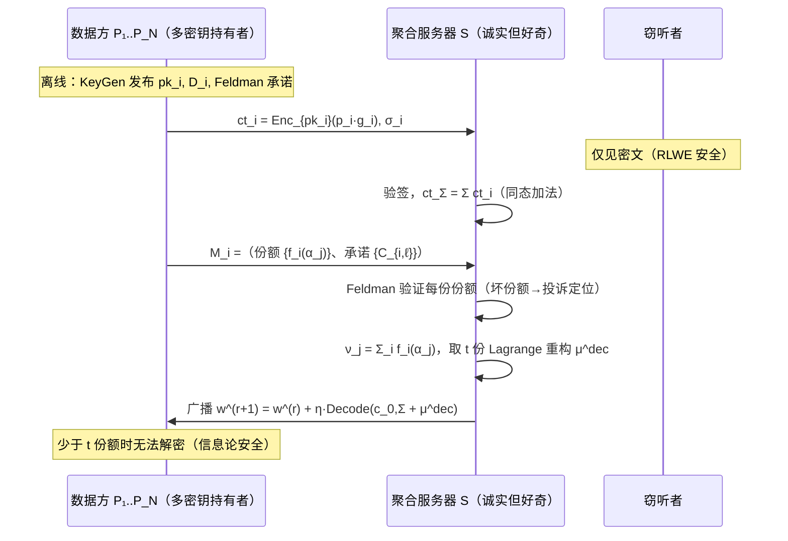
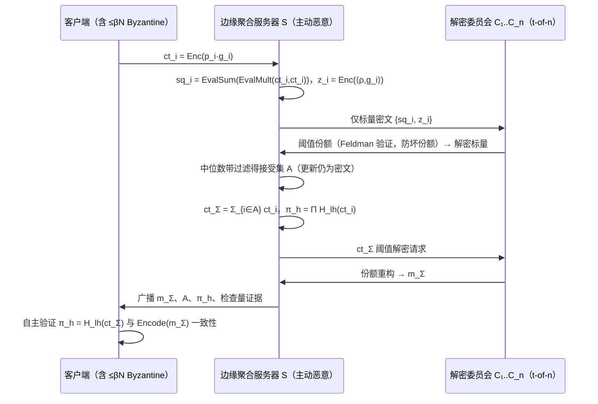
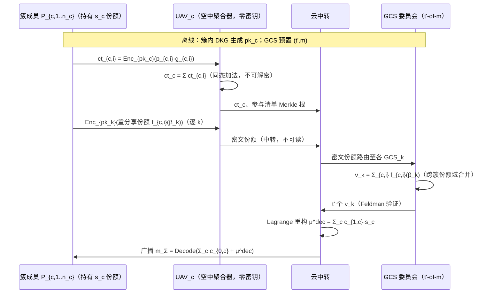
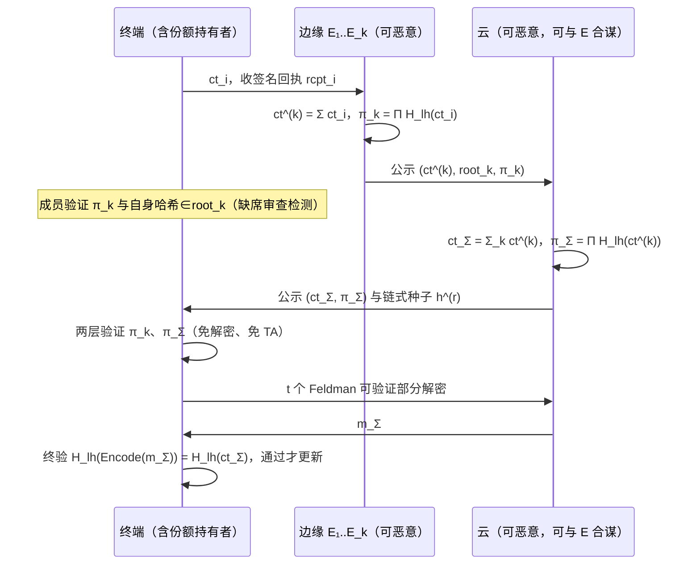
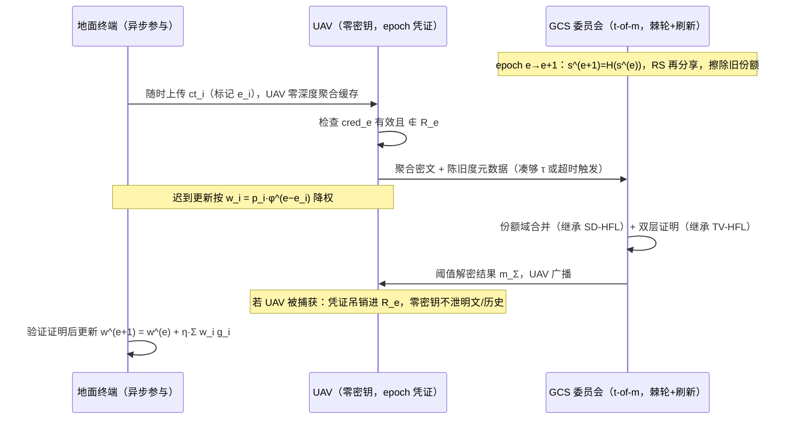
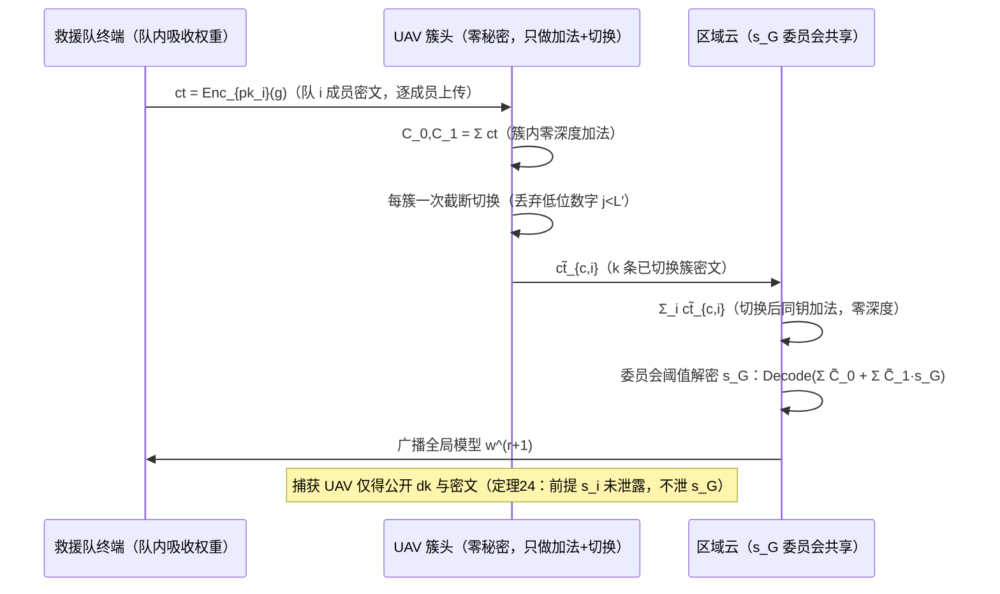
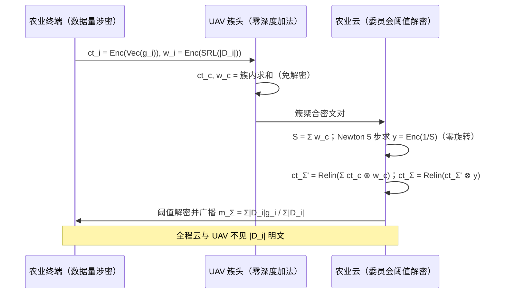
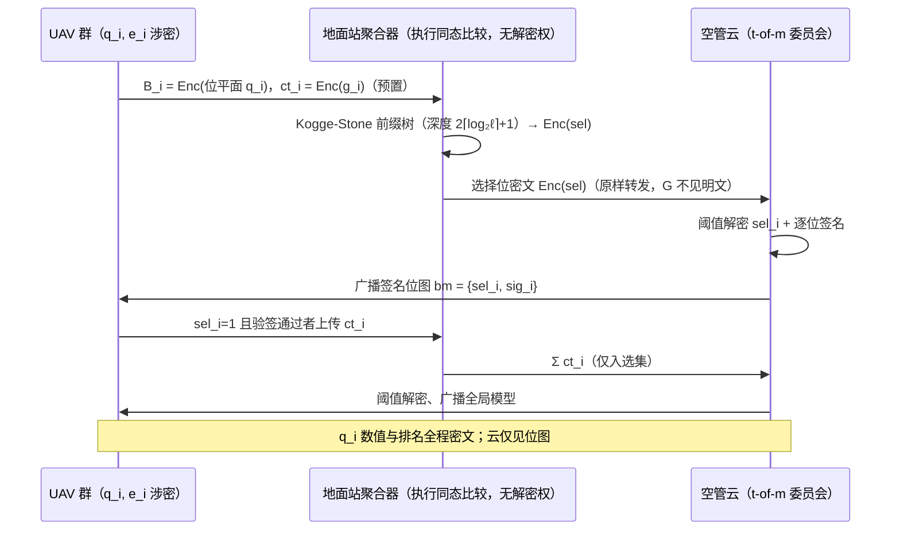
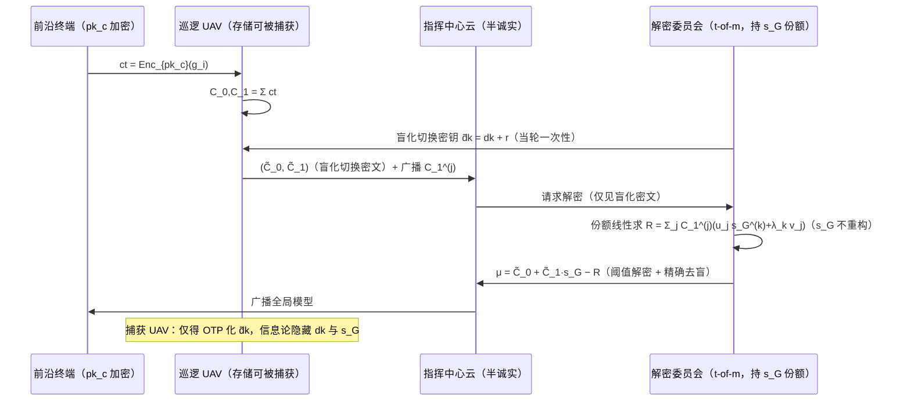
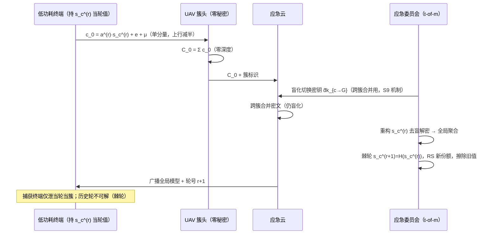

# 同态加密 × 联邦学习文献阅读报告与新方案设计

**——面向 UAV-Assisted / Edge-Assisted 场景的安全联邦学习**

> 阅读材料：本目录 18 份 PDF（16 篇 HE-FL/安全聚合方向论文 + 2 份联邦学习基础材料）。
> 报告结构：第 1 章绪论；第 2 章文献模式总结与演进脉络；第 3 章 UAV/Edge 场景挑战与研究点；第 4 章新方案设计总纲；第 5–9 章给出 5 个新方案（2 个标准 FL + 3 个层次型 FL）；**第 11–15 章（第二篇）追加 5 个全层次型、全 FHE、全 UAV 场景的新方案（S6–S10），创新点均落在 RLWE 公式层或复杂交互流程层**。每个方案按 **x.1 场景 → x.2 问题 → x.3 创新点 → x.4 威胁模型 → x.5 符号系统 → x.6 设计与闭环推导（含 RLWE 加解密展开与交互时序图）→ x.7 安全性分析** 组织。

---

## 1 绪论

联邦学习（Federated Learning, FL）以"数据不动模型动"的方式实现多方协同训练，但梯度/模型更新本身可被梯度反演、成员推断等攻击还原训练数据；聚合服务器亦可能偏离协议、窥探单个客户端更新，或被投毒者操纵。同态加密（Homomorphic Encryption, HE）使服务器在密文上完成聚合而不可见个体更新，是 FL 隐私保护的主流密码学路线；围绕"密钥由谁持有、如何解密聚合结果、如何验证聚合正确性、如何容忍掉线"四个问题，演化出单密钥、多密钥、阈值三条密钥模式，以及掩码（SecAgg 类）、可信执行环境（TEE）、双服务器秘密分享等替代路线。

无人机（UAV）辅助 / 边缘辅助（Edge-Assisted）联邦学习将聚合器下沉到 UAV 或边缘服务器，带来带宽节省与低时延优势，但也引入移动性掉线、UAV 被物理捕获、聚合器不可信、能量受限等新威胁。本报告在精读 16 篇文献的基础上：

1. 系统总结各方案的**密钥模式、FL 架构、可信机构、威胁模型与安全目标**（第 2 章）；
2. 以"一个问题的解决引出下一个问题"的方式推理出演进脉络，识别共同空白（第 2.4 节）；
3. 归纳 UAV/Edge 场景的挑战与值得研究的切入点（第 3 章）；
4. 构造 5 个满足实际应用场景的新方案，每个方案在结构与逻辑上针对某个最新工作的残留问题给出闭环解决（第 5–9 章）。

---

## 2 文献模式总结与演进脉络

### 2.1 文献速览

**表 2-1　18 份材料的多维度模式对比**

| 文献 | 年份/场所 | 密钥模式 | FL 架构 | 可信机构 | 场景 | 威胁模型（合谋界/掉线） | 安全目标 |
|---|---|---|---|---|---|---|---|
| SecAgg | CCS'17 | 无 HE 密钥（ECDH 掩码）+ Shamir 托管 | 标准 FL | 无（仅受限信任服务器） | 移动端 cross-device | 半诚实→主动；服务器+≤⌈n/3⌉−1 合谋；容忍 ⌈n/3⌉−1 掉线 | 隐私聚合 |
| CDKS | CCS'19 | 多密钥 MK-CKKS/BFV | 无 FL（外包推理） | 无（CRS） | 云端推理 | 半诚实；无掉线容忍（k-of-k） | 输入/模型保密 |
| ELSA | S&P'23 | 双服务器 2-of-2 秘密分享（无 HE） | 标准 FL | 无（分布式信任） | 移动/边缘 | 恶意客户端任意多；至多 1 台恶意服务器；抗掉线 | 隐私+范数防御 |
| SecFed | TDSC'24 | TEE 内 EMK-BFV 多密钥 | 标准 FL | **有：TEE** | cross-silo 云 | HBC；抗 N−1 合谋；TEE 补密文兜底掉线 | 隐私（+掉线兜底） |
| BPVFL | GLOBECOM'24 | 单密钥 Paillier + 线性同态哈希 | 标准 FL（双云） | 声称无（S1 实际持 sk） | 通用云 | S0 恶意、S1 半诚实、≤m 恶意客户端；容忍 N−1 掉线 | 双向可验证 |
| ResFed | IoT-J'24 | **无密码学**（残差压缩） | 标准 FL | 无 | 车联网 V2X/无线 | 无敌手模型 | 通信效率（非安全） |
| ESAFL | TDSC'25 | 多加密钥 + 共享解密钥 s=Σsᵢ | 标准 FL | 可选 AS | cross-silo | HBC；抗 N−2 合谋；**零掉线容忍** | 隐私（免份额交换） |
| FedPHE | TDSC'25 | 单密钥 CKKS + Shamir 混淆 | 标准 FL | **有：KDC** | cross-silo | HBC；不抗投毒；选中者掉线即失败 | 隐私+贡献加权 |
| MaskCrypt | TDSC'25 | 多密钥 CKKS（选择性加密） | 标准 FL | 无 | cross-device | HBC；抗 K−2 合谋；**零掉线容忍** | 隐私+通信节省 |
| SKHE | IoT-J'25 | 单密钥 CKKS + ECC 封装 + Shamir(z,M) | **层次型**（云-边-端） | **有：TA + TEE** | 边缘 IoT | HBC；多层合谋界（EN+CN ≤ M−1）；EN 掉线容忍 z/M | 隐私+掉线鲁棒 |
| VeSAFL | TDSC'25 | Pedersen VSS + BLS（无 HE） | 标准 FL（多聚合器） | 无（公告板） | 边缘 IoT | 主动敌手；≤k−1 恶意服务器 | 可验证聚合（三层） |
| MASER | arXiv'25 | 多密钥 MK-CKKS + 共识稀疏化 | 标准 FL | 可信 key manager | cross-silo | HBC 服务器；<50% 掩码投毒；**无掉线容忍** | 隐私+MKHE 降开销 |
| CDKS-LSS | Inf.Sci.'26 | 多密钥 CDKS + (t,N) LSS 阈值 | 标准 FL | 无 TTP | cross-silo/device | 半诚实；服务器+<t 合谋；t-of-N 掉线容忍 | 隐私+阈值解密 |
| DSVFL(Ftop-k) | TMC'26 | 变体 Paillier"门限"+ Shamir | 标准 FL | **有：在线 TA** | 边缘 IoT | 恶意 GS；GS+≤τ−1 合谋；≤m−τ 掉线 | 隐私+验证+稀疏化 |
| PPBR | TMC'26 | PLHE(BFV) 多密钥 + Shamir 掩码 | **层次型 EHFL** | 无 | 移动网络（含 UAV 举例） | 半诚实+β<0.5 Byzantine；任意比例掉线 | 隐私+Byzantine 鲁棒 |
| VLSFL | TDSC'26 | DH 掩码 + Shamir(t,N) + 同态哈希 | 标准 FL | **有：离线 TA** | 通用 | HBC；AS+≤t−1 合谋；掉线容忍 | 轻量+可验证+掉线 |
| 联邦学习基本架构 | — | — | 标准 FL 聚合流程 | — | 通用 | — | 背景（FedAvg/FedProx/FedNova） |
| 联邦学习的加权方式 | — | — | 加权聚合 | — | 通用 | — | 背景（7 类加权语义） |

两处命名更正：**BPVFL** 的 "B" 指 Bidirectional（双向隐私/双向验证），并非区块链方案；**ResFed** 的 "Res" 指 Residual（模型残差压缩），是通信效率工作，不含安全机制，但其"带宽受限无线链路"设定与 UAV/Edge 场景同构，适合作为正交通信层叠加。

### 2.2 模式分类

**（1）密钥模式三谱系 + 替代路线**

- **单密钥**：一对 (pk, sk) 供全体加密，sk 由某一方持有（BPVFL 的 S1、FedPHE 的 KDC、SKHE 的 TEE 封装）。优点是密文紧凑、零交互；缺陷是 sk 持有者成为单点：或被攻破即全局泄密（BPVFL），或需要重信任根（FedPHE 的 KDC、SKHE 的 TA+SGX）。
- **多密钥**：每方独立 (pkᵢ, skᵢ)，密文随参与者数 k 膨胀为 (c₀,…,c_k)，解密需全体部分解密（CDKS、MASER、MaskCrypt、SecFed 的 EMK-BFV）。优点是无密钥分发中心、抗截获解密；缺陷是 k-of-k 解密——任一方掉线即解密失败（MASER、MaskCrypt 均明言此痛点）。
- **阈值**：解密能力做 (t,N) 秘密共享，任意 t 份即可重构、少于 t 份信息论安全（CDKS-LSS 的 LSS 再分享、VLSFL/Ftopk 的 Shamir、VeSAFL 的 Pedersen VSS）。优点是掉线容忍 + 合谋界清晰；缺陷是份额分发/再分享开销（CDKS-LSS 的 O(N²) P2P）与份额正确性验证缺失。
- **替代路线**：掩码类（SecAgg、VLSFL：信息论安全但只保护"和"、O(n²) 掩码交换）；TEE 类（SecFed、SKHE：高效但信任硬件）；双服务器 MPC（ELSA：免 HE 但要求非合谋双服务器）。

**（2）FL 架构**

- **标准 FL**（绝大多数）：N 个客户端 ↔ 1 个（或双）聚合服务器，平面结构。
- **层次型 FL**：仅 SKHE（云-边-端，信任 TA+TEE）与 PPBR（client-edge-cloud，信任半诚实边缘）真正落地；UAV 作为空中聚合器的特化设计在 16 篇中**缺位**（PPBR 仅将 UAV 列为设备举例）。

**（3）可信机构**

- 含 TA/KDC/TEE：FedPHE、SKHE、SecFed、DSVFL（且 DSVFL 的 TA 每轮在线参与验证）、VLSFL（离线 TA）、MASER（key manager）。
- 无 TA：CDKS、CDKS-LSS、ESAFL（可选 AS 或 MPC）、SecAgg、ELSA、VeSAFL（公告板替代）、PPBR。
- 趋势清晰：UAV/Edge 场景需要**免 TA 或轻量 TA**，因为 TA 在线成为时延与单点瓶颈，而 UAV 拓扑动态变化使静态密钥分发不可持续。

**（4）安全目标**

隐私聚合（SecAgg/CDKS/ESAFL/MASER/MaskCrypt/FedPHE/SKHE/SecFed）、可验证（VeSAFL/BPVFL/DSVFL/VLSFL）、鲁棒抗投毒（ELSA 范数防御、PPBR CLDP+裁剪）三者基本**两两分离**，尚无方案在密文域同时给出隐私 + 可验证 + 鲁棒。

### 2.3 演进脉络：一个问题的解决引出下一个问题

**（1）密钥/份额主线（CDKS → xMK-CKKS → CDKS-LSS → ESAFL）**

CDKS（CCS'19）奠定了打包 MK-CKKS 的实用范式：各方独立密钥，云端同态计算，最后各方上传部分解密值 μᵢ = cᵢ·sᵢ + eᵢ 由服务器 Merge。但**部分解密值在公开信道上传，任何人收齐即可 Merge 出明文——份额本身即泄漏点**。xMK-CKKS 用噪声淹没的份额交换缓解了"份额被旁观者合并"的问题，但解密仍需 **k-of-k 全员在线**，任何一方掉线或退出即训练中断。CDKS-LSS（Inf.Sci.'26）把 Shamir 式 LSS 实例化到 R_q 上、对部分解密值做再分享，实现 **t-of-N 阈值解密**：少于 t 份份额信息论安全、掉线只需凑齐 t 份，且无 TTP。但 CDKS-LSS 留下三个新问题：① 再分享是 **P2P O(N²)**（论文自认每人每轮约百 MB）；② 仅半诚实，**恶意方可发坏份额投毒解密**；③ 份额无验证。ESAFL（TDSC'25）走另一条路——**直接消灭份额交换**：多加密钥 + 全体共享解密钥 s = Σsᵢ，一步本地解密、免交互，效率较 SKHE-FL 提升两个数量级；代价是 **零掉线容忍**（缺任一密文则部分聚合不可解）与共享密钥 s 的分发依赖 AS 或昂贵 MPC。MASER（2025）沿 MK-CKKS 路线用共识稀疏化把密文开销压到接近明文，但同样卡在 k-of-k 解密与可信 key manager。

> **推理链条**：CDKS 份额上传泄漏 → xMK-CKKS 份额加噪但 k-of-k 掉线脆弱 → CDKS-LSS 阈值化但 O(N²) 分发 + 半诚实 → ESAFL 消灭份额但零掉线 → **缺口：能否"免 P2P 分发 + 抗恶意份额 + t-of-N 掉线容忍"三者兼得？**（方案一的切入点）

**（2）单密钥信任主线（BPVFL/FedPHE → DSVFL/SKHE）**

单密钥路线不断把 sk 交给新的信任根：BPVFL 的 S1 持 sk 且 S0–S1 合谋即破；FedPHE 承认好奇客户端可截获解密，只能叠加 Shamir 混淆，且依赖全可信 KDC；SKHE 用 TA + SGX TEE 封装 sk，换来层次架构与掉线鲁棒，但安全押在硬件侧信道未讨论的 TEE 上；DSVFL 用"门限 Paillier + TA 验证"实现可验证与掉线鲁棒，但 μ,λ,α 全量下发使任意单个 LC 可独立解密（"门限"名实不符），且 TA 每轮在线验证是单点。

> **推理链条**：sk 单点 → 交给 TA/KDC/TEE → 信任根仍未消除、门限名实不符 → **缺口：能否让"解密权"真正分散且"验证"不依赖在线 TA？**（方案二、方案四的切入点）

**（3）可验证主线（ELSA → VeSAFL/BPVFL → DSVFL/VLSFL）**

ELSA 在 MPC 内做逐客户端 ℓ⊓2 范数防御，但明确排除跨客户端鲁棒统计；VeSAFL 用 Pedersen VSS+BLS 实现份额/局部/全局三层验证，但只保证"语法诚实"——带毒梯度可通过全部密码检查；BPVFL 滑动窗口抽验是概率性验证且不防投毒；VLSFL 的同态哈希验证发生在**明文聚合层**；DSVFL 的验证依赖在线 TA。**密文下、免 TA、客户端自主的鲁棒验证**仍是空白。

> **推理链条**：MPC 内范数防御（ELSA）→ 明文层验证（VLSFL）→ TA 在线验证（DSVFL）→ **缺口：密文域的鲁棒过滤与免信任验证**（方案二、方案四）

**（4）层次/UAV 主线（SKHE → PPBR）**

SKHE 首个云-边-端层次 HE-FL，但信任 TA+TEE；PPBR 首个层次型 EHFL 中的隐私+Byzantine 混合方案（CLDP+PLHE 解决"加密隐私 vs 过滤需明文"矛盾），但代价是 CLDP 噪声损精度、边缘节点半诚实被信任、云获知各边缘动量范数、无可验证性。二者都未处理 UAV 移动性、捕获攻击与能量约束。

> **推理链条**：层次架构信任押注（TEE/半诚实边缘）→ **缺口：不可信聚合器 + 跨簇密钥异构 + UAV 掉线/捕获**（方案三、方案五）

### 2.4 共同空白清单（新方案的设计约束）

1. **免 P2P 的份额管理**：CDKS-LSS 的 O(N²) P2P 再分享在 UAV/移动链路不可行（设备间无稳定直连）。
2. **抗恶意份额**：阈值解密普遍停留在半诚实，坏份额可投毒解密结果且不可追责。
3. **真正的掉线容忍与"门限"名实统一**：ESAFL/MaskCrypt/MASER 零容忍；DSVFL 门限名实不符。
4. **密文域鲁棒聚合**：PPBR 需要 CLDP 噪声换取明文过滤；ELSA 放弃跨客户端统计；加密与投毒防御互斥未解。
5. **免 TA / 免在线信任根的可验证**：现有验证或依赖在线 TA（DSVFL）或停留在明文层（VLSFL）或缺失（PPBR、MASER）。
6. **层次架构中聚合器不可信**：UAV/边缘聚合器被默认半诚实（PPBR）或外包给 TEE（SKHE）。
7. **UAV 移动性与捕获弹性**：16 篇均未处理 UAV 物理捕获导致的密钥提取与仿冒链式攻击、移动掉线与异步聚合。
8. **密钥生命周期**：静态密钥、无轮换、无前向安全；参与集合动态变化需重建密钥（MASER）。

---

## 3 UAV / Edge 场景联邦学习的挑战与研究点

### 3.1 典型架构：UAV-Assisted / Edge-Assisted FL

- **UAV-Assisted HFL**：地面终端（传感器、车辆、手机）按空间邻近聚簇，每簇由 UAV 作空中聚合器（air aggregator）做簇内局部聚合，UAV 将簇聚合结果回传地面基站/云做全局聚合。UAV 同时承担数据采集、中继与聚合三重角色。
- **Edge-Assisted HFL**：终端 → 边缘服务器（RSU、基站、雾节点）→ 云的两级结构；边缘做局部聚合以压缩上行、降低时延。
- 二者的安全结构同构：**两级聚合 + 聚合器（UAV/边缘）位置暴露、物理可及、不可完全信任**。

### 3.2 挑战清单（★ = 2025–2026 仍开放）

**（1）通信与资源约束**：UAV 电池与算力受限而模型上传量大；上行信道时变导致传输不可靠；HE 的加密/密文膨胀开销需与能耗预算折中（选择性加密、稀疏化是当前手段，但 MaskCrypt/MASER 的选择性加密以"部分明文暴露"或 k-of-k 解密为代价）★

**（2）移动性与掉线**：UAV 移动致拓扑时变、客户端/簇头掉线与部分参与，需移动感知客户端选择与异步聚合；掉线下的**密文聚合解密恢复**（而非仅掩码恢复）仍开放 ★

**（3）数据异构**：空间采集造成强 non-IID 与客户端漂移；监测区域变化引发概念漂移；密文域加权语义（质量/贡献加权如何在不看明文时实现）开放 ★

**（4）架构与信任**：UAV 空中聚合器/边缘服务器构成单点失效与信任瓶颈；恶意聚合器可操纵选择、篡改聚合、注入后门；层次聚合的两级可验证性不足 ★

**（5）安全与隐私**：梯度反演/成员推断；投毒/后门需鲁棒聚合；**UAV 被物理捕获**可提取密钥并伪装节点发起链式攻击，捕获弹性缺失 ★

**（6）密钥管理**：多机构/跨域下轻量密钥管理缺位；单密钥解密成单点；掉线后密钥/份额恢复难；阈值+DKG 在 UAV 资源约束下的开销、轮换与前向安全待优化 ★

### 3.3 值得研究的切入点

1. **免 P2P、抗恶意份额的阈值解密**：服务器中转 + 可验证秘密共享，把 CDKS-LSS 的 O(N²) P2P 降到单跳上传，同时补上份额验证（→ 方案一）。
2. **密文域鲁棒聚合**：把阈值解密"只花在标量检查上"（如 ‖gᵢ‖² 的选择性解密），在不泄露更新、不加 CLDP 噪声的前提下做 Byzantine 过滤（→ 方案二）。
3. **份额域层次聚合**：跨簇异构密钥下，簇聚合结果以"解密份额"形态在云端线性合并，UAV 零解密权（捕获安全）、簇聚合不解密（隐私）、t-of-N 掉线容忍（→ 方案三）。
4. **免 TA 的双层密文域可验证**：UAV 局部聚合与云全局聚合均附密码学证明，客户端自主验证、无需在线信任根（→ 方案四）。
5. **捕获弹性的密钥生命周期 + 异步聚合**：前向安全棘轮密钥 + 主动份额刷新 + 陈旧度加权异步聚合，联合应对 UAV 捕获与移动掉线（→ 方案五）。

---

## 4 新方案设计总纲

### 4.1 五个方案的定位与递进关系

表 4-1 给出 5 个方案的定位。它们遵循与第 2.3 节相同的"解决一个问题、引出下一个问题"的递进逻辑：方案一解决份额分发与掉线的矛盾，但只保隐私；方案二在其上补密文域鲁棒与验证（标准 FL 侧）；方案三把结构推向层次型并解决"聚合器不可信 + 跨簇密钥异构 + 掉线"；方案四补层次两级的免 TA 可验证；方案五最终处理 UAV 物理层威胁（捕获、移动、异步）。

**表 4-1　新方案总览**

| 方案 | 名称（缩写） | 架构 | 密钥模式 | 安全目标 | 针对的残留问题（来源文献） |
|---|---|---|---|---|---|
| 方案一 | 可验证阈值份额中转多密钥 FL（VTShare-FL） | 标准 FL | 多密钥 + (t,N) 阈值 | 隐私 + 恶意份额防护 | CDKS-LSS：O(N²) P2P、半诚实、份额无验证；ESAFL：零掉线容忍 |
| 方案二 | 选择性阈值解密的密文域鲁棒可验证 FL（STDRV-FL） | 标准 FL | 单密钥 + (t,N) 阈值 | 隐私 + 鲁棒 + 可验证 | PPBR：CLDP 损精度、过滤需明文；DSVFL：在线 TA、门限名实不符；ELSA：无跨客户端统计 |
| 方案三 | 份额域层次聚合多密钥 HFL（SD-HFL） | 层次型（UAV 簇） | 簇内多密钥 + 簇间份额线性合并 | 隐私 + 不可信聚合器 + 掉线 | SKHE：信任 TA+TEE；PPBR：信任半诚实边缘、云泄范数；MaskCrypt/MASER：k-of-k |
| 方案四 | 免信任双层可验证层次 FL（TV-HFL） | 层次型（edge-cloud） | 单密钥 + (t,N) 阈值 + 同态哈希 | 可验证 + 隐私 | VLSFL：明文层验证、无层次；DSVFL：在线 TA；PPBR：无可验证性 |
| 方案五 | 捕获弹性异步层次 FL（CA-HFL） | 层次型（UAV 移动） | 阈值 + 前向安全棘轮 + 主动刷新 | 隐私 + 捕获弹性 + 异步鲁棒 | 全体：密钥生命周期缺失；UAV 捕获链式攻击、移动掉线开放 |

### 4.2 通用密码学底座

5 个方案共享同一 RLWE/CKKS 底座（第 5.5 节首次完整展开，后续方案仅列差异），保证递进可比：

- 环 $R=\mathbb{Z}[X]/(X^n+1)$，$R_q=R/qR$，$q$ 为 2 的幂次模数；噪声分布 $\chi$（离散高斯）；编码器 $\mathsf{Encode}:\mathbb{C}^{n/2}\to R$（CKKS 旋转/自同构 $\tau_j$ 支持聚合所需槽操作）。
- 安全假设：RLWE$_{n,q,\chi}$ 困难性 ⇒ IND-CPA；阈值层额外依赖 Shamir 秘密共享的信息论安全与 Exceptional Sequence 求值点条件（Mouchet et al., J. Cryptol.'23）。

### 4.3 通用威胁模型框架

按能力分三档，各方案在 5.x.4 节实例化：

- **HBC（诚实但好奇）**：协议外不偏离，试图从视图推断；
- **Malicious（主动）**：可偏离协议（坏份额、篡改聚合、选择性丢弃）；
- **Mobile/Physical（物理移动敌手）**：可按轮捕获 UAV/终端并提取其存储密钥（UAV 场景特有）。

合谋维度：客户端-服务器、客户端-客户端、聚合器-聚合器、跨层（边缘+云）；掉线维度：随机掉线（信道/能量）与选择性掉线（恶意）。

---

## 5 方案一：VTShare-FL——可验证阈值份额中转的多密钥联邦学习（标准 FL）

### 5.1 场景

跨机构/跨边缘节点的隐私联邦训练（cross-silo + 大型 cross-device 混合）：$N$ 个数据方（医院、路侧摄像头集群、地面传感终端）围绕一个云聚合服务器 $S$ 协作训练共享模型。数据方之间**无稳定点对点链路**（NAT、能耗、移动性），所有通信经 $S$ 中转；存在搭线窃听者与恶意数据方。目标是在密文上完成 FedAvg 式聚合，且解密阶段容忍至多 $N-t$ 个数据方掉线。

### 5.2 要解决的问题

针对 CDKS-LSS（Inf.Sci.'26）与 ESAFL（TDSC'25）的残留缺口：

1. **P2P 份额分发不可行**：CDKS-LSS 的解密再分享要求每方向其余 $N-1$ 方点对点发送份额，$O(N^2)$ 链路在 UAV/移动/边缘链路中无法建立，且每人每轮近百 MB；
2. **半诚实限制**：CDKS-LSS 假设所有方诚实执行再分享，恶意方可发送坏份额使解密结果被投毒，且不可追责；
3. **掉线容忍与免交互不可兼得**：ESAFL 消灭份额交换但零掉线容忍（缺任一密文即不可解）；xMK-CKKS 系 k-of-k 解密同样脆弱。

### 5.3 创新点与设计目标

1. **服务器中转的 Feldman 可验证再分享**：份额经服务器单跳中转并在中转处同态聚合，免 P2P；每份额附 Feldman 承诺证明，服务器与诚实方可**检测坏份额并可追责中止**（identifiable abort）；
2. **离线-在线两阶段**：求值钥、承诺、Lagrange 系数全部离线一次生成，轮内仅"一次上传 + 一次中转聚合 + 一次重构"，交互轮数与 $N$ 无关；
3. **$(t,N)$ 阈值解密**：任意 $t$ 份有效份额即可重构，容忍 $N-t$ 掉线；少于 $t$ 份信息论安全；
4. **多密钥加密**保留 CDKS 谱系优点：无密钥分发中心，任何单方/服务器与 $<t$ 方合谋无法解密。

### 5.4 威胁模型

- **敌手能力**：服务器 $S$ 诚实但好奇（忠实执行协议，试图从视图恢复个体更新或聚合明文）；至多 $t-1$ 个恶意数据方可与 $S$ 合谋，且恶意方可发送任意伪造份额（主动攻击再分享阶段）；公共信道存在被动窃听者；
- **保护目标**：个体更新与未授权聚合结果的机密性；聚合结果的正确性（恶意份额必被检测或导致可追责中止）；
- **掉线**：随机掉线与选择性掉线下，只要最终收集到 $t$ 份有效份额即可完成解密；
- **不处理**：更新语义层面的投毒/后门（属鲁棒聚合，见方案二）；物理捕获（见方案五）。

### 5.5 符号系统

| 符号 | 含义 |
|---|---|
| $R=\mathbb{Z}[X]/(X^n+1),\ R_q$ | 多项式环及其商环 |
| $\chi,\ a$ | 噪声分布；公共随机多项式 $a\xleftarrow{\$}R_q$（CRS/公共信标） |
| $s_i,\ pk_i=(a,b_i)$ | 数据方 $P_i$ 的秘密钥与公钥，$b_i=-a\cdot s_i+e_i$ |
| $D_i$ | $P_i$ 的重线性化求值钥（CDKS 式 GSW 结构） |
| $\mathsf{ct}_i=(c_{0,i},c_{1,i})$ | $P_i$ 对本地更新的加密 |
| $\mu_i^{\mathrm{dec}}=c_{1,i}\cdot s_i$ | $P_i$ 的部分解密相位 |
| $f_i(x),\ \tilde\mu_{i,j}$ | 再分享多项式与给 $P_j$ 的份额，$\tilde\mu_{i,j}=f_i(\alpha_j)$ |
| $\alpha_1,\dots,\alpha_N$ | $R_q$ 上满足 Exceptional Sequence 条件的公共求值点 |
| $C_{i,\ell}=g^{a_{i,\ell}}$ | Feldman 承诺（$\mathbb{G}$ 为 DLP 困难群，系数按 NTT 坐标嵌入） |
| $t,\ N$ | 解密门限与参与方总数 |
| $\lambda_j$ | Lagrange 系数 $\lambda_j=\prod_{k\neq j}\frac{\alpha_k}{\alpha_k-\alpha_j}$ |
| $\mathsf{Encode}/\mathsf{Decode}$ | CKKS 编码/解码，$\mu=\mathsf{Encode}(g)$ |

### 5.6 方案设计与闭环推导

#### 5.6.1 离线阶段（Setup / KeyGen / 预计算）

1. 公共参数：$(n,q,\chi,a)$，求值点 $\{\alpha_j\}$，Feldman 群 $\mathbb{G}$；
2. 各 $P_i$ 本地生成 $s_i\xleftarrow{\$}\chi,\ e_i\xleftarrow{\$}\chi$，发布 $b_i=-a\cdot s_i+e_i$ 与求值钥 $D_i$（CDKS 重线性化所需，供服务器做乘法后的密钥切换）；
3. 各 $P_i$ 预生成再分享随机系数 $\{a_{i,\ell}\xleftarrow{\$}R_q\}_{\ell=1}^{t-1}$ 并发布承诺 $C_{i,0}=g^{\mu_i^{\mathrm{dec}}}$（轮内更新）、$C_{i,\ell}=g^{a_{i,\ell}}$（承诺可复用）；Lagrange 系数 $\lambda_j$ 离线算好。

#### 5.6.2 在线阶段（每轮 $r$）

**Step 1（训练与加密）**：$P_i$ 本地训练得更新 $g_i^{(r)}$，在**明文态**吸收权重 $p_i=|D_i|/\sum_j|D_j|$ 与学习率（Zero-Depth 聚合），编码加密：

$$
\mu_i=\mathsf{Encode}\!\big(p_i\cdot g_i^{(r)}\big),\qquad
\mathsf{ct}_i=\big(c_{0,i},\ c_{1,i}\big)=\big(b_i\cdot u_i+e_{0,i}+\mu_i,\ \ a\cdot u_i+e_{1,i}\big)
$$

其中 $u_i,e_{0,i},e_{1,i}\xleftarrow{\$}\chi$。上传 $\mathsf{ct}_i$ 与签名 $\sigma_i=\mathsf{Sign}_{sk_i^{\mathsf{sig}}}(\mathsf{ct}_i)$。

**Step 2（同态聚合）**：$S$ 验签后按参与集 $\mathcal{P}$（$|\mathcal{P}|\ge t$）逐分量相加：

$$
\mathsf{ct}_\Sigma=\Big(\underbrace{\textstyle\sum_i c_{0,i}}_{c_{0,\Sigma}},\ \underbrace{\textstyle\sum_i c_{1,i}}_{c_{1,\Sigma}}\Big)
$$

**Step 3（可验证再分享的部分解密）**：各 $P_i$ 计算相位份额 $\mu_i^{\mathrm{dec}}=c_{1,\Sigma}\cdot s_i$，构造 $f_i(X)=\mu_i^{\mathrm{dec}}+\sum_{\ell=1}^{t-1}a_{i,\ell}X^{\ell}$，向服务器上传**单条消息**：

$$
M_i=\Big(\{\tilde\mu_{i,j}=f_i(\alpha_j)\}_{j\in\mathcal{P}},\ \{C_{i,\ell}\}_{\ell=0}^{t-1},\ \sigma_i'\Big)
$$

**Step 4（服务器中转验证与聚合）**：$S$ 对每份份额验证 Feldman 等式：

$$
g^{\tilde\mu_{i,j}}\ \stackrel{?}{=}\ \prod_{\ell=0}^{t-1} C_{i,\ell}^{\,\alpha_j^{\ell}},\qquad \forall i,j
$$

不通过则广播投诉 $(i,j,\tilde\mu_{i,j})$，任何方可复验并**定位作恶方**，协议可追责中止。验证通过后 $S$ 按列聚合份额：

$$
\nu_j=\sum_{i\in\mathcal{P}}\tilde\mu_{i,j}=F(\alpha_j),\qquad F(X)=\sum_{i\in\mathcal{P}}f_i(X)
$$

**Step 5（阈值重构与解码）**：$S$ 取任意 $t$ 个不同的 $j\in T$ 做 Lagrange 重构：

$$
\mu^{\mathrm{dec}}=\sum_{j\in T}\lambda_j\,\nu_j=F(0)=\sum_{i\in\mathcal{P}}\mu_i^{\mathrm{dec}}=\sum_{i\in\mathcal{P}}c_{1,\Sigma}\cdot s_i
$$

最终解密 $m_\Sigma=\mathsf{Decode}\big(c_{0,\Sigma}+\mu^{\mathrm{dec}}\big)$，广播 $w^{(r+1)}=w^{(r)}+\eta\, m_\Sigma$。

#### 5.6.3 闭环正确性推导

对每个 $P_i$，解密相位展开为

$$
c_{0,i}+c_{1,i}\cdot s_i=\mu_i+\big(e_{0,i}+e_{1,i}\cdot s_i+b_i\cdot u_i+a\cdot u_i\cdot s_i\big)
$$

代入 $b_i=-a\cdot s_i+e_i$，括号内化简为 $e_{0,i}+e_{1,i}s_i+e_i u_i=:\varepsilon_i$（小噪声项）。对 $i$ 求和得

$$
c_{0,\Sigma}+\sum_i c_{1,\Sigma}s_i=\sum_i\mu_i+\sum_i\varepsilon_i
$$

注意 $c_{1,\Sigma}\cdot s_i$ 正是 $\mu_i^{\mathrm{dec}}$ 的定义，而 $F(0)=\sum_i\mu_i^{\mathrm{dec}}$；由 Step 5 的重构恒等式，$S$ 恢复的 $\mu^{\mathrm{dec}}$ 与真实相位差为零（份额精确），于是

$$
m_\Sigma=\mathsf{Decode}\Big(\sum_i\mu_i+\textstyle\sum_i\varepsilon_i\Big)=\sum_i p_i g_i^{(r)}
$$

当 $\|\sum_i\varepsilon_i\|_\infty<q/(2p)$（CKKS 噪声预算条件）时解码精确，聚合闭环成立。噪声预算：$B\ge \log_2 q-\log_2(\text{scale})-\log_2\|\varepsilon\|$，仅含加法深度，$\|\varepsilon\|$ 随 $N$ 线性增长、远小于 $q$。

#### 5.6.4 实体交互时序图

#### 5.6.5 与 CDKS-LSS / ESAFL 的结构对比

| 维度 | CDKS-LSS | ESAFL | **VTShare-FL（本方案）** |
|---|---|---|---|
| 份额交换 | P2P $O(N^2)$，多轮 | 无 | 服务器中转单跳，轮内 1 次上传 |
| 份额验证 | 无（半诚实） | — | Feldman 承诺 + 可追责中止 |
| 掉线容忍 | $t$-of-$N$ | 零 | $t$-of-$N$ |
| 密钥模式 | 多密钥 + LSS | 多加密钥 + 共享解密钥 | 多密钥 + LSS（无 TA） |
| 链路假设 | 需 P2P 连通 | 公网 | 仅需客户端-服务器链路 |

### 5.7 安全性分析

**定理 1（隐私性）** 在 RLWE$_{n,q,\chi}$ 困难且 $|A|<t$（$A$ 为服务器合谋集）时，敌手视图可模拟，个体更新 $\{g_i\}$ 与未授权聚合明文不可区分。

*证明梗概*：(i) 密文层：$\mathsf{ct}_i$ 为标准 CKKS 加密，RLWE ⇒ IND-CPA，服务器与任意合谋方视图中的密文可由模拟器以随机 RLWE 样本替代；(ii) 份额层：每份额 $\tilde\mu_{i,j}=f_i(\alpha_j)$ 是秘密 $\mu_i^{\mathrm{dec}}$ 的 Shamir 份额，$|A|<t$ 时任意份额集合信息论独立于 $\mu_i^{\mathrm{dec}}$（Exceptional Sequence 保证 $R_q$ 上求值点插值安全，Mouchet et al.'23）；(iii) Feldman 承诺 $C_{i,\ell}$ 对系数完美绑定、计算隐藏，不泄漏额外信息。组合即得模拟安全性。∎

**定理 2（正确性）** 若所有份额通过 Feldman 验证，则重构值恒等于 $\sum_i\mu_i^{\mathrm{dec}}$，聚合结果为 $\sum_i p_i g_i$ 的精确编码（噪声预算内）。

*证明梗概*：Feldman 等式 $g^{\tilde\mu_{i,j}}=\prod_\ell C_{i,\ell}^{\alpha_j^\ell}$ 成立当且仅当 $\tilde\mu_{i,j}=f_i(\alpha_j)$ 与承诺一致；由承诺绑定，$f_i$ 唯一；于是 $\nu_j=F(\alpha_j)$，Lagrange 重构精确给出 $F(0)=\sum_i\mu_i^{\mathrm{dec}}$，代入 5.6.3 闭环即得。∎

**定理 3（恶意份额检测与可追责）** 恶意方伪造份额通过验证的概率可忽略（DLP/承诺绑定下 $\le \mathrm{negl}(\lambda)$）；一旦投诉，任何第三方可复验并唯一定位作恶方 $P_i$。

*证明梗概*：若 $(i,j)$ 份额对 $P_i$ 的承诺不一致，则 $g^{\tilde\mu_{i,j}}\neq\prod_\ell C_{i,\ell}^{\alpha_j^{\ell}}$ 以概率 1 被检出（同底离散对数相等性公开可验）；与承诺一致但刻意构造的坏 $f_i$ 仍被承诺绑定锁定，重构偏差必然体现在 $g^{F(0)}$ 上且可通过聚合承诺 $\prod_i C_{i,0}$ 复核定位。∎

**定理 4（掉线容忍）** 协议在任意 $N-t$ 个参与方于解密阶段掉线时仍正确完成，且掉线不降低定理 1 的安全性。

*证明梗概*：重构只需 $t$ 个不同求值点；掉线方未上传的份额不进入 $\nu_j$ 的计算——服务器仅聚合在线集合 $\mathcal{P}$（$|\mathcal{P}|\ge t$）并以 $F_{\mathcal{P}}(0)=\sum_{i\in\mathcal{P}}\mu_i^{\mathrm{dec}}$ 重构，聚合语义为在线参与者的加权和（与 FedAsync/部分参与语义一致）；信息论安全不依赖掉线模式。∎

**安全-效率小结**：通信为 $O(N)$ 条客户端上行 + 服务器内聚合，无 P2P；计算仅在解密阶段引入 $O(Nt)$ 的份额生成与 $O(Nt)$ 的验证指数运算，相对 CDKS-LSS 的 P2P 全连接与 ESAFL 的零掉线，首次在"免 P2P + 抗恶意份额 + $t$-of-$N$"三点上同时成立。

---

## 6 方案二：STDRV-FL——选择性阈值解密的密文域鲁棒可验证联邦学习（标准 FL）

### 6.1 场景

边缘 IoT 场景（智慧路口摄像网、UAV 地面传感网）：$N$ 个资源受限终端在一个边缘聚合服务器 $S$ 协作训练；网络中存在比例 $\beta<0.5$ 的 Byzantine 终端（投毒/后门），$S$ 亦可能主动偏离（篡改聚合、选择性丢弃）。一个由 $n$ 个边缘节点/路侧单元组成的**解密委员会** $\mathcal{C}$ 以 $(t,n)$ 门限持有解密能力，无任何单一可信机构。

### 6.2 要解决的问题

"加密隐私"与"投毒防御需看明文"的结构性矛盾，及其现有解法的缺陷：

1. PPBR（TMC'26）用 CLDP 噪声换取明文过滤，精度受损且云获知各边缘范数；
2. ELSA（S&P'23）在 MPC 内只做逐客户端范数防御，排除跨客户端统计（trimmed mean/中位数），且要求双服务器非合谋；
3. DSVFL（TMC'26）的验证依赖**每轮在线 TA**，且 $\mu,\lambda,\alpha$ 全量下发使任意单方可独立解密——门限名实不符；
4. 各方案的聚合正确性验证或缺失（PPBR、MASER）或只抽验（BPVFL）。

### 6.3 创新点与设计目标

1. **选择性阈值解密（核心）**：对每个更新密文同态计算**标量检查量**（$\|g_i\|_2^2$、随机投影 $\langle \rho,g_i\rangle$），仅阈值解密这些标量——更新本身全程密文；以"标量明文 + 更新密文"的泄漏剖面换取**免噪声的密文域 Byzantine 过滤**；
2. **密文域中位数裁剪**：以解密后的范数集合做中位数带 $[M-\theta,M+\theta]$ 过滤（PPBR 同款统计量，但无 CLDP 噪声、云不见个体更新）；
3. **免 TA 可验证聚合**：线性同态哈希 + Fiat–Shamir 随机挑战，客户端自主验证聚合正确性，无需在线信任根；
4. **真正 $(t,n)$ 门限**：解密权在委员会，$t-1$ 合谋信息论安全；$n-t$ 个委员会节点掉线不影响解密。

### 6.4 威胁模型

- **敌手能力**：$S$ 主动恶意（可篡改/伪造聚合、选择性丢弃、伪造检查量）；至多 $\beta N$（$\beta<0.5$）个 Byzantine 客户端可任意偏离（投毒、谎报、合谋）；$S$ 可与 $\le t-1$ 个委员会节点及 Byzantine 客户端合谋；被动窃听者；
- **保护目标**：更新机密性（允许泄漏每轮范数标量与接受集，形式化为泄漏剖面 $\mathcal{L}=\{\|g_i\|_2, i\in\mathcal{A}\}$）；聚合正确性（可验证）；鲁棒性（过滤后聚合误差受控）；
- **掉线**：客户端与委员会节点均可随机/选择性掉线，容忍 $N-|\mathcal{A}|$ 客户端缺席与 $n-t$ 委员会缺席；
- **不处理**：低于 $\beta$ 界内的语义精巧后门（与所有鲁棒统计方案相同的残余风险）；物理捕获。

### 6.5 符号系统

| 符号 | 含义 |
|---|---|
| $s,\ pk=(a,b)$ | 委员会共享的阈值秘密钥与公钥，$b=-a\cdot s+e$ |
| $s^{(j)},\ \alpha_j$ | 委员会节点 $C_j$ 的 Shamir 份额与求值点 |
| $\mathsf{ct}_i=(c_{0,i},c_{1,i})$ | 客户端更新密文 $\mathsf{Enc}_{pk}(p_i g_i)$ |
| $\mathsf{Sq}(\cdot),\ \mathsf{Rot}_k$ | CKKS 同态平方与槽旋转 |
| $\mathsf{PSD}_j(\mathsf{ct})=c_1\cdot s^{(j)}$ | 委员会节点的部分解密 |
| $M,\ \theta$ | 范数中位数与裁剪带宽 |
| $\rho^{(r)}$ | 第 $r$ 轮 Fiat–Shamir 随机挑战向量 |
| $H_{\mathrm{lh}}(x;h)=g^{\langle h,x\rangle}$ | 线性同态哈希（$h$ 为轮随机种子派生） |
| $\beta,\ \mathcal{A}$ | Byzantine 比例上界；本轮接受集 |

### 6.6 方案设计与闭环推导

#### 6.6.1 初始化

委员会 $\mathcal{C}=\{C_1,\dots,C_n\}$ 执行 Shamir 分享 $s=\sum_{j\in T}\lambda_j s^{(j)}$（$R_q$ 上 Exceptional 求值点），发布 $pk$；每个客户端 $i$ 加密更新 $\mathsf{ct}_i=(b\cdot u_i+e_{0,i}+\mathsf{Encode}(p_i g_i),\ a\cdot u_i+e_{1,i})$。

#### 6.6.2 轮内协议（四阶段）

**Phase A（检查量同态计算）**：$S$ 由 $\mathsf{ct}_i$ 同态计算平方和：

$$
\mathsf{sq}_i=\mathsf{EvalSum}\big(\mathsf{EvalMult}(\mathsf{ct}_i,\mathsf{ct}_i),\log_2 n\big)=\mathsf{Enc}_{pk}\big(\|p_i g_i\|_2^2+\varepsilon_i^{\mathrm{sq}}\big)
$$

其中 $\mathsf{EvalMult}$ 产生二次项后经求值钥重线性化回二分量；$\mathsf{EvalSum}$ 用 $\mathsf{Rot}_k$ 链实现槽求和。同时按挑战 $\rho^{(r)}=H(\mathsf{transcript}^{(r-1)})$ 计算随机投影 $z_i=\mathsf{Enc}(\langle\rho^{(r)},p_i g_i\rangle)$。

**Phase B（选择性阈值解密）**：委员会对**仅有的 $2N$ 个标量密文** $(\mathsf{sq}_i,z_i)$ 做部分解密：$C_j$ 上传 $\mathsf{PSD}_j$ 与可验证份额（沿用方案一的 Feldman 中转验证，防坏份额）；$S$ 重构得明文标量 $\{\|p_i g_i\|_2^2,\ z_i\}$。

**Phase C（密文域鲁棒过滤）**：$S$ 计算范数集合的中位数 $M$，取 $\mathcal{A}=\{i:\ \|p_i g_i\|_2^2\in[M-\theta,M+\theta]\}$（与 PPBR 同款中位数裁剪，但无 CLDP 扰动）；对 $\mathcal{A}$ 内元素再验随机投影一致性 $\big|\langle\rho^{(r)},p_i g_i\rangle-z_i\big|$ 可比对 $S$ 是否篡改密文（见 Phase D 的哈希链）。被拒集广播并附检查量证据（范数是公开可复算的标量）。

**Phase D（可验证聚合与最终解密）**：$S$ 聚合 $\mathsf{ct}_\Sigma=\sum_{i\in\mathcal{A}}\mathsf{ct}_i$ 并公布同态哈希证据：

$$
\pi_h=\prod_{i\in\mathcal{A}}H_{\mathrm{lh}}(\mathsf{ct}_i;h^{(r)})\ \stackrel{?}{=}\ H_{\mathrm{lh}}(\mathsf{ct}_\Sigma;h^{(r)}),\qquad h^{(r)}=H(\mathsf{transcript}^{(r-1)})
$$

线性同态哈希满足 $H_{\mathrm{lh}}(x_1+x_2)=H_{\mathrm{lh}}(x_1)\cdot H_{\mathrm{lh}}(x_2)$，任何客户端可独立复验；随后委员会对 $\mathsf{ct}_\Sigma$ 阈值解密得 $m_\Sigma$，客户端核对 $H_{\mathrm{lh}}(\mathsf{Encode}(m_\Sigma))$ 与聚合密文哈希的一致性后接受。

#### 6.6.3 闭环推导

**检查量正确性**：$\mathsf{EvalMult}(\mathsf{ct}_i,\mathsf{ct}_i)$ 解密为 $(p_i g_i)^2+\varepsilon^{\mathrm{mult}}$，$\mathsf{EvalSum}$ 旋转求和得 $\|p_i g_i\|_2^2+\varepsilon_i^{\mathrm{sq}}$，其中 $\|\varepsilon_i^{\mathrm{sq}}\|\le \kappa_{\mathrm{mult}}\cdot n\cdot\sigma^2$（乘法噪声放大界）；当 $\log_2 q$ 预留 $\ge 2$ 级乘法深度时 $|\varepsilon_i^{\mathrm{sq}}|<$ scale，标量解码精确到 $\pm 1$ 量化误差内，不影响阈值 $\theta$ 选择。

**过滤一致性**：$z_i$ 与 $\mathsf{sq}_i$ 均从同一 $\mathsf{ct}_i$ 确定性导出，若 $S$ 篡改 $\mathsf{ct}_i$，则哈希链 $\pi_h$ 失配概率 $1-|\mathbb{G}|^{-1}$；恶意客户端谎报范数无效（范数由 $S$ 从密文同态导出而非客户端上报）。

**聚合正确性**：权重 $p_i$ 在明文态吸收，聚合为纯加法，$H_{\mathrm{lh}}$ 线性同态性给出 $\pi_h$ 恒等式；阈值解密 $m_\Sigma=\sum_{i\in\mathcal{A}}p_i g_i+\varepsilon^{\mathrm{agg}}$，噪声仅随 $|\mathcal{A}|$ 线性增长。

**鲁棒性界**：接受集 $\mathcal{A}$ 的中位数带过滤等价于对更新族做幅值截断；当 $\beta<0.5$ 且诚实更新范数集中于 $M$ 时，被滤更新幅值 $\le M+\theta$，聚合偏差 $\|\mathrm{bias}\|\le \beta N(M+\theta)/|\mathcal{A}|$，与 trimmed-mean 类界同阶，但**全程未解密更新**。

#### 6.6.4 实体交互时序图

### 6.7 安全性分析

**定理 5（泄漏剖面下的隐私性）** 除泄漏剖面 $\mathcal{L}=\{\|g_i\|_2,\ i\in\mathcal{A}\}$ 与接受集外，敌手视图可模拟；$<t$ 个委员会节点合谋对 $s$ 信息论安全。

*证明梗概*：更新密文 IND-CPA（RLWE）；选择性解密只暴露标量 $\|p_ig_i\|^2$ 与 $\langle\rho,p_ig_i\rangle$（后者由公开随机 $\rho$ 一次性挑战，可归约到单点内积泄漏，泄漏量 $O(1)$/轮）；份额层沿用方案一定理 1 的 Shamir 论证。与 PPBR 相比，泄漏剖面相当（PPBR 云亦获知 $\|m_i\|$），但本方案不注入 CLDP 噪声、不暴露更新坐标。∎

**定理 6（聚合可验证性）** 在随机预言机模型下，$S$ 输出与 $\{\mathsf{ct}_i\}_{i\in\mathcal{A}}$ 不一致的 $(m_\Sigma,\pi_h)$ 而客户端接受的概率 $\le \mathrm{negl}(\lambda)$。

*证明梗概*：$h^{(r)}$ 由前轮 transcript 经 Fiat–Shamir 派生，$S$ 无法在看到 $h^{(r)}$ 后自适应选择篡改量；线性同态哈希在 DLP 假设下抗碰撞，$\pi_h$ 与 $H_{\mathrm{lh}}(\mathsf{Encode}(m_\Sigma))$ 双重绑定聚合密文与解密结果。∎

**定理 7（Byzantine 鲁棒性）** 当 $\beta<0.5$ 且诚实更新范数以 $\ge 1-\delta$ 概率落于 $[M-\gamma,M+\gamma]$（$\theta\ge\gamma$）时，过滤后聚合偏差 $\|\mathrm{bias}\|\le \frac{\beta N}{|\mathcal{A}|}(M+\theta)+\delta\cdot G_{\max}$，收敛率维持 $O(1/\sqrt{T})$ 量级。

*证明梗概*：中位数 $M$ 在 $\beta<0.5$ 时被诚实范数主导（标准次序统计量界）；带外更新被剔除、带内更新幅值有界，聚合为有界偏差的均值，套用 FedAvg 在有界方差/有界偏差下的收敛结论。∎

**定理 8（掉线容忍）** 客户端缺席仅缩小 $\mathcal{A}$（语义为部分参与 FedAvg）；委员会 $n-t$ 掉线下解密照常（$t$ 份额即可重构）；$S$ 无法通过选择性丢弃制造"单客户端聚合"——范数过滤带与最小参与数 $\tau$ 约束（沿 ELSA 思路）共同阻止。

---

## 7 方案三：SD-HFL——份额域层次聚合的多密钥分簇联邦学习（层次型 FL）

### 7.1 场景

UAV-Assisted 分簇联邦学习：地面终端（传感节点、车辆、手机）按空间邻近动态聚簇，每簇由一架 UAV 作空中聚合器；UAV 将簇聚合结果回传地面控制站（GCS/RSU）与云。UAV 移动、簇动态形成/解散、UAV 物理可及（可能被捕获）；地面终端间无稳定直连。核心诉求：**UAV 与云均不可信，簇间密钥互异，任意时刻至多少量节点掉线**。

### 7.2 要解决的问题

1. **层次聚合器不可信**：SKHE（IoT-J'25）把安全押在 TA+SGX TEE；PPBR（TMC'26）默认边缘半诚实。UAV 被捕获/被控后作为聚合器可窥探、篡改、仿冒；
2. **跨簇密钥异构无法合并**：各簇动态成簇，难以协商全局密钥；多密钥密文尺寸随参与方数膨胀（CDKS 的 $O(k)$ 密文分量），且 k-of-k 解密使 UAV 掉线即中断（MASER、MaskCrypt）；
3. **簇聚合结果泄漏**：若 UAV 或云解密簇聚合，簇级分布信息（位置相关数据分布）泄漏；
4. **UAV 捕获泄密**：UAV 若持有密钥分量，捕获即提取并可伪装节点发起链式攻击。

### 7.3 创新点与设计目标

1. **份额域层次聚合（核心恒等式）**：簇间异构密文**不做密文合并，而在解密份额域线性合并**——$\sum_c(c_{0,c}+c_{1,c}s_c)=\sum_c m_c$，跨簇无需共同密钥、无需密钥协商，天然适配动态成簇；
2. **UAV 零解密权**：UAV 只持公开求值钥与轮内凭证，不持任何密钥分量——捕获不泄密钥（对比 SKHE 的 TEE 持钥）；
3. **簇内 $(t_c,n_c)$ 阈值 + 份额加密中转**：簇成员的部分解密**先重分享再经 UAV/云中转**，中转节点只见密文份额；地面 GCS 委员会以 $(t',m)$ 门限聚合重构全局结果；
4. **无 TA**：各簇密钥由簇内 DKG 生成，成簇/解散只影响本簇，无全局密钥重建（对比 MASER 参与集变化需重新聚合公钥）。

### 7.4 威胁模型

- **敌手能力**：UAV 与云均为诚实但好奇（UAV 可被捕获后转为主动，见方案五的扩展）；地面 GCS 委员会至多 $t'-1$ 个节点与 UAV/云合谋；簇内至多 $t_c-1$ 成员恶意；被动窃听者；
- **保护目标**：个体更新机密性；**簇聚合机密性**（UAV、云、$<t'$ 个 GCS 均不可见任何簇聚合明文）；全局聚合仅在 $\ge t'$ 个 GCS 协作下可得；
- **掉线**：簇内容忍 $n_c-t_c$ 成员掉线；UAV 掉线时簇成员可经备用链路直传 GCS（协议消息与 UAV 无密码学耦合）；
- **不处理**：投毒鲁棒（叠加方案二的选择性解密即可）；物理捕获的密钥生命周期问题（方案五）。

### 7.5 符号系统

| 符号 | 含义 |
|---|---|
| $c=1,\dots,C;\ \mathcal{P}_c$ | 簇编号与簇 $c$ 的成员集合，$|\mathcal{P}_c|=n_c$ |
| $\mathrm{UAV}_c$ | 簇 $c$ 的空中聚合器（无密钥） |
| $(pk_c,s_c)$ | 簇 $c$ 的密钥对，$s_c$ 为 $(t_c,n_c)$ Shamir 共享，$pk_c=(a,b_c=-a s_c+e_c)$ |
| $s_c^{(i)},\ \alpha^{(c)}_i$ | 簇 $c$ 成员 $i$ 的份额与簇内求值点 |
| $\mathsf{ct}_{c,i}$ | 成员更新密文，$\mathsf{ct}_c=\sum_{i\in\mathcal{P}_c}\mathsf{ct}_{c,i}$ |
| $\mu_{c,i}$ | 簇内部分解密相位 $\mu_{c,i}=[c_{1,c}\cdot s_c^{(i)}]$ |
| $\tilde\mu_{c,i,k}$ | $\mu_{c,i}$ 对 GCS 节点 $k$ 的重分享份额 |
| $\mathrm{GCS}_k,\ k=1,\dots,m$ | 地面解密委员会，全局门限 $(t',m)$ |
| $\mathsf{pk}_k^{\mathsf{enc}}$ | GCS 节点 $k$ 的公钥加密（份额中转保密用） |

### 7.6 方案设计与闭环推导

#### 7.6.1 初始化（每簇自治）

簇 $c$ 成员执行簇内 DKG：$s_c=\sum_i \alpha^{(c)}_i\text{-Lagrange}\cdot s_c^{(i)}$（Shamir $(t_c,n_c)$），发布 $pk_c$ 与簇内 Feldman 承诺；GCS 委员会预置 $(t',m)$ 结构与各 $\mathsf{pk}_k^{\mathsf{enc}}$。**UAV 不参与任何密钥生成**。

#### 7.6.2 轮内协议（三层交互）

**Step 1（簇内加密上传）**：成员 $i\in\mathcal{P}_c$ 训练得 $g_{c,i}$，明文态吸收权重 $p_{c,i}$，加密

$$
\mathsf{ct}_{c,i}=\big(b_c\cdot u_{c,i}+e_{0}+\mathsf{Encode}(p_{c,i}g_{c,i}),\ \ a\cdot u_{c,i}+e_{1}\big)
$$

上传 $\mathrm{UAV}_c$。

**Step 2（UAV 簇内聚合，零深度）**：$\mathrm{UAV}_c$ 逐分量相加 $\mathsf{ct}_c=\sum_{i\in\mathcal{P}_c}\mathsf{ct}_{c,i}=\big(c_{0,c},c_{1,c}\big)$，连同参与清单（Merkle 根）回传云中转/广播；UAV 对 $\mathsf{ct}_c$ **只加不解**。

**Step 3（簇内阈值部分解密 + 重分享）**：各成员对簇聚合相位做部分解密 $\mu_{c,i}=c_{1,c}\cdot s_c^{(i)}$，并立即重分享给 GCS：取 $f_{c,i}(X)=\mu_{c,i}+\sum_{\ell=1}^{t'-1}a^{(c,i)}_\ell X^{\ell}$，向 GCS 节点 $k$ 发送**加密份额**

$$
M_{c,i\to k}=\mathsf{Enc}^{\mathsf{pk}^{\mathsf{enc}}_k}\big(\tilde\mu_{c,i,k}=f_{c,i}(\beta_k)\big)
$$

经 UAV/云中转（中转节点只搬运密文）。

**Step 4（GCS 份额域合并）**：GCS 节点 $k$ 解密收到的份额并求和：

$$
\nu_k=\sum_{c}\sum_{i\in T_c}\tilde\mu_{c,i,k}=F(\beta_k),\qquad F(X)=\sum_{c,i}f_{c,i}(X)
$$

**注意 $\nu_k$ 是"全体簇相位之和"的份额，任何单个 GCS 节点只持有 1 份额，无法解密任何簇聚合或全局聚合。**

**Step 5（阈值重构全局结果）**：任意 $t'$ 个 GCS 节点上传 $\nu_k$ 至云（附 Feldman 验证，沿方案一定理 3 的防坏份额机制），云 Lagrange 重构

$$
\mu^{\mathrm{dec}}=\sum_{k\in T'}\lambda_k\,\nu_k=F(0)=\sum_{c}\sum_{i\in T_c}\mu_{c,i}=\sum_c c_{1,c}\cdot s_c
$$

最终 $m_\Sigma=\mathsf{Decode}\Big(\sum_c c_{0,c}+\mu^{\mathrm{dec}}\Big)$。

#### 7.6.3 闭环推导（跨簇异构密钥的份额域合并恒等式）

**簇内闭环**：由 CKKS 解密结构，$c_{0,c}+c_{1,c}\cdot s_c=\sum_{i\in\mathcal{P}_c}\mathsf{Encode}(p_{c,i}g_{c,i})+\varepsilon_c$。簇内阈值份额 $\{\mu_{c,i}\}$ 经 Shamir 重构给出 $c_{1,c}s_c$（份额精确，误差为零），故

$$
c_{0,c}+\sum_{i\in T_c}\lambda^{(c)}_i\mu_{c,i}=\sum_i \mathsf{Encode}(p_{c,i}g_{c,i})+\varepsilon_c .
$$

**跨簇合并恒等式（核心）**：对任意两簇 $c\neq c'$，即便 $s_c\neq s_{c'}$，其相位在 $R_q$ 中线性可加：

$$
\big(c_{0,c}+c_{1,c}s_c\big)+\big(c_{0,c'}+c_{1,c'}s_{c'}\big)=\mathsf{Encode}\big(\textstyle\sum_i p_{c,i}g_{c,i}+\sum_j p_{c',j}g_{c',j}\big)+(\varepsilon_c+\varepsilon_{c'})
$$

即**份额域求和 $\Leftrightarrow$ 明文域求和**，无需共同密钥、无需密钥切换/重线性化。归纳到 $C$ 个簇即得 Step 5 结果。噪声预算 $\|\sum_c\varepsilon_c\|_\infty<q/(2p)$ 随簇数线性增长，对 $C\le 2^{10}$、$q=2^{318}$ 的典型参数余量充分。

**隐私闭环**：UAV 见 $\{\mathsf{ct}_{c,i}\},\mathsf{ct}_c$（RLWE）；云见簇密文与加密份额（IND-CPA）；GCS 节点 $k$ 见各簇单份额（$<t'$ 信息论安全）。任何实体视图均不含簇聚合明文。

#### 7.6.4 实体交互时序图

### 7.7 安全性分析

**定理 9（跨簇合并正确性）** 份额域合并重构值恒等于各簇相位之和，解码结果为全局加权聚合 $\sum_c\sum_i p_{c,i}g_{c,i}$（噪声预算内）。

*证明梗概*：Shamir 重构对每个簇精确给出 $c_{1,c}s_c$；$F(0)=\sum_{c,i}\mu_{c,i}$ 由线性性等于 $\sum_c c_{1,c}s_c$；代入 7.6.3 恒等式即得。∎

**定理 10（层次隐私）** 敌手为 UAV+云+任意 $t'-1$ 个 GCS+任意 $t_c-1$ 个簇内成员的合谋时，个体更新与**任意簇聚合**不可区分，全局聚合不可重构。

*证明梗概*：(i) 密文层 RLWE 归约；(ii) UAV/云只见密文份额（加密于 $\mathsf{pk}^{\mathsf{enc}}_k$，IND-CPA）；(iii) GCS 节点单点持 $F$ 的单点求值，$t'-1$ 个求值点信息论独立于 $F(0)$ 与任意子和（Exceptional Sequence/Shamir 论证）；(iv) 簇内合谋 $<t_c$ 无法恢复 $s_c$。∎

**定理 11（掉线与拓扑鲁棒）** 簇内 $n_c-t_c$ 掉线、全局 $m-t'$ GCS 掉线、任一 UAV 掉线下协议均正确完成；UAV 掉线时成员份额直达 GCS，安全性不变（消息无 UAV 密码学耦合）。

*证明梗概*：三处重构均为门限语义；UAV 仅承担路由与加法，无秘密输入。对比 MaskCrypt/MASER 的 k-of-k，掉线容忍从 0 提升到 $\max(n_c-t_c, m-t')$。∎

**定理 12（捕获即时隔离）** UAV 被捕获不泄漏任何密钥或明文，仅泄漏密文与公开拓扑；被控 UAV 的篡改可被参与清单 Merkle 根与后续验证层（方案四）检出。

*证明梗概*：UAV 存储仅含 $\{pk_c\}$、求值钥与轮内密文，均为公开/密文材料；无秘密钥、无份额。∎

**结构优势小结**：相对 SKHE（TA+TEE）、PPBR（半诚实边缘）、CDKS-LSS（平面+P2P），SD-HFL 在"不可信聚合器 + 跨簇密钥自治 + 簇级隐私 + 掉线容忍 + 捕获即时隔离"上同时成立，且动态成簇无需全局密钥重建。

---

## 8 方案四：TV-HFL——免信任双层可验证层次联邦学习（层次型 FL）

### 8.1 场景

Edge-Assisted 层次联邦学习：$N$ 个终端按接入归属 $K$ 个边缘服务器（RSU/基站/UAV 网关），边缘做局部聚合、云做全局聚合。边缘与云**都可能主动偏离**（篡改局部聚合、丢弃成员、伪造全局结果）；要求任意终端可**自主验证**两层聚合的正确性，全程无 TA/在线信任根。

### 8.2 要解决的问题

1. **层次两级聚合无验证**：PPBR 的边缘/云聚合默认半诚实，无任何正确性保证；
2. **验证依赖在线 TA**：DSVFL 的验证由每轮在线 TA 执行，单点且时延高；
3. **验证停留明文层/抽验层**：VLSFL 在明文聚合后验证；BPVFL 滑窗只抽验 $k$ 维；
4. **缺席不可验证**：恶意边缘选择性丢弃成员（审查攻击）无公开证据，客户端无法察觉（ELSA 仅以最小参与数缓解）。

### 8.3 创新点与设计目标

1. **双层密文域可验证**：边缘局部聚合与云全局聚合各附线性同态哈希证明，**验证发生在密文层**（无需解密、无需看明文），与解密完全解耦；
2. **免 TA 随机信标**：每轮哈希随机种子由前轮 transcript 经 Fiat–Shamir 派生（$h^{(r)}=H(h^{(r-1)}\|\mathsf{root}^{(r-1)})$），无需任何在线权威；
3. **缺席可验证**：边缘须公示参与集 Merkle 根，缺席者可自证"我提交过"（提交回执），审查攻击变为公开可检测；
4. **终端自主验证**：任意终端以 $O(|\mathsf{ct}|)$ 哈希运算验证两层聚合，无需委员会在线。

### 8.4 威胁模型

- **敌手能力**：边缘与云均可主动恶意（篡改、丢弃、伪造证明），二者可合谋；至多 $\beta N$ Byzantine 终端（本方案聚焦聚合正确性，更新投毒由方案二的过滤叠加处理）；被动窃听；
- **保护目标**：更新与聚合机密性（RLWE + $(t,N)$ 阈值解密，$t-1$ 合谋安全）；两层聚合正确性（公开可验证）；缺席审查可检测；
- **掉线**：终端、边缘、委员会均可掉线，容忍语义同部分参与；
- **不处理**：更新语义投毒、物理捕获。

### 8.5 符号系统

| 符号 | 含义 |
|---|---|
| $\mathcal{E}_k,\ k=1..K$ | 边缘服务器及其成员集 $\mathcal{P}_k$ |
| $s,\ pk=(a,b)$ | $(t,N)$ 阈值 CKKS 密钥（份额散布于终端/委员会） |
| $\mathsf{ct}_i$ | 终端更新密文 |
| $\mathsf{ct}^{(k)},\ \mathsf{ct}_\Sigma$ | 边缘局部聚合与全局聚合 |
| $h^{(r)}$ | 第 $r$ 轮哈希随机种子（Fiat–Shamir 链） |
| $H_{\mathrm{lh}}(x;h)=g^{\langle h,x\rangle}$ | 线性同态哈希（NTT 坐标向量化） |
| $\pi_k,\ \pi_\Sigma$ | 边缘层与全局层聚合证明 |
| $\mathsf{root}^{(r)}_k$ | 边缘 $k$ 参与集的 Merkle 根 |
| $\mathsf{rcpt}_i$ | 终端 $i$ 的提交回执（边缘签名） |

### 8.6 方案设计与闭环推导

#### 8.6.1 初始化

$(t,N)$ 阈值 KeyGen（同方案二 6.6.1）；每轮种子 $h^{(r)}$ 由链式哈希派生，首个种子 $h^{(0)}=H(\mathsf{genesis})$ 公开固定。

#### 8.6.2 轮内协议（四阶段）

**Phase 1（终端提交）**：终端 $i$ 上传 $\mathsf{ct}_i$ 至归属边缘 $\mathcal{E}_{k(i)}$，收取签名回执 $\mathsf{rcpt}_i=\mathsf{Sign}_{\mathcal{E}_{k(i)}}(i,r,H(\mathsf{ct}_i))$。

**Phase 2（边缘局部聚合 + 证明）**：$\mathcal{E}_k$ 计算 $\mathsf{ct}^{(k)}=\sum_{i\in\mathcal{P}_k}\mathsf{ct}_i$，公示 $(\mathsf{ct}^{(k)},\ \mathsf{root}^{(r)}_k,\ \pi_k)$，其中

$$
\pi_k=\prod_{i\in\mathcal{P}_k}H_{\mathrm{lh}}\big(\mathsf{ct}_i;h^{(r)}\big)\ \stackrel{?}{=}\ H_{\mathrm{lh}}\big(\mathsf{ct}^{(k)};h^{(r)}\big)
$$

成员终端验 $\pi_k$ 并核对自己的 $H(\mathsf{ct}_i)$ 在 $\mathsf{root}^{(r)}_k$ 中（缺席审查检测）。

**Phase 3（全局聚合 + 证明）**：云计算 $\mathsf{ct}_\Sigma=\sum_k \mathsf{ct}^{(k)}$，公示 $(\mathsf{ct}_\Sigma,\pi_\Sigma)$：

$$
\pi_\Sigma=\prod_{k}H_{\mathrm{lh}}\big(\mathsf{ct}^{(k)};h^{(r)}\big)\ \stackrel{?}{=}\ H_{\mathrm{lh}}\big(\mathsf{ct}_\Sigma;h^{(r)}\big)
$$

任意终端验两层等式 + 链式种子 $h^{(r)}=H(h^{(r-1)}\|\mathsf{root}^{(r-1)})$。

**Phase 4（阈值解密与终验）**：$t$ 个份额持有者对 $\mathsf{ct}_\Sigma$ 做可验证部分解密（Feldman 中转验证，同方案一），得 $m_\Sigma$；终端终验 $H_{\mathrm{lh}}(\mathsf{Encode}(m_\Sigma);h^{(r)})\stackrel{?}{=}H_{\mathrm{lh}}(\mathsf{ct}_\Sigma;h^{(r)})$（同态哈希对明文-密文一致性绑定），通过则更新模型。

#### 8.6.3 闭环推导

**验证等式正确性**：聚合为纯加法（权重明文吸收），线性同态哈希满足 $H_{\mathrm{lh}}(x+y;h)=H_{\mathrm{lh}}(x;h)H_{\mathrm{lh}}(y;h)$，故诚实执行时 $\pi_k,\pi_\Sigma$ 恒等式成立。反之，若 $\mathcal{E}_k$ 篡改局部聚合（加入未授权项/丢弃成员项），则 $\mathsf{ct}^{(k)}\neq\sum\mathsf{ct}_i$，由抗碰撞性 $\pi_k$ 失配；云篡改同理于 $\pi_\Sigma$。

**明文-密文绑定**：$m_\Sigma=\mathsf{Decode}(\mathsf{ct}_\Sigma)$ 代入 $\mathsf{Encode}$ 后与 $\mathsf{ct}_\Sigma$ 在哈希下一致当且仅当解密正确（量化误差 $\le$ scale/2 内一致，超差即拒绝）；坏份额被 Feldman 验证拦截。

**缺席可验证性**：终端持 $\mathsf{rcpt}_i$ 且 $H(\mathsf{ct}_i)\in\mathsf{root}^{(r)}_k$ 而结果未含其贡献 ⇒ $\pi_k$ 或 $\pi_\Sigma$ 必然与公示值矛盾，可向公开板/仲裁出示 $(\mathsf{rcpt}_i,\mathsf{ct}_i)$ 追责（与 VeSAFL 的投诉机制兼容，但本方案证明在密文层且免配对）。

**复杂度**：每层证明 $O(N)$ 个群指数（哈希向量内积可用 NTT/预计算加速至 $O(n)$ 环乘），验证 $O(1)$ 个群元素比对，终端零额外轮次。

#### 8.6.4 实体交互时序图

### 8.7 安全性分析

**定理 13（双层可验证性）** 随机预言机模型下，恶意边缘/云输出被终端接受的伪造（局部或全局）聚合的概率 $\le \mathrm{negl}(\lambda)$。

*证明梗概*：$h^{(r)}$ 在聚合前由链式哈希固定（Fiat–Shamir），敌手无法自适应选择 $h$；线性同态哈希在 DLP 假设下抗碰撞，聚合项增删/篡改必致哈希积与聚合哈希失配；两层证明独立，合谋篡改需同时伪造 $\pi_k$ 与 $\pi_\Sigma$，仍受同一随机 $h^{(r)}$ 约束。∎

**定理 14（隐私性）** RLWE + $(t,N)$ 门限下，边缘/云/合谋方视图可模拟；明文仅在 $\ge t$ 份额协作时暴露，且仅暴露全局聚合。

*证明梗概*：同定理 1/5 的密文与份额论证；验证信息 $H_{\mathrm{lh}}(\cdot)$ 为 DLP 下计算隐藏（不泄漏明文坐标）。∎

**定理 15（审查可检测）** 恶意边缘丢弃任一已回执成员的贡献而保持 $\pi_k$ 通过的概率 $\le \mathrm{negl}(\lambda)$；终端可凭 $(\mathsf{rcpt}_i,\mathsf{ct}_i)$ 公开追责。

*证明梗概*：丢弃即改变聚合集合，$\pi_k$ 与真实成员哈希积不一致；若边缘改公示成员集，则 Merkle 根与回执矛盾。∎

**定理 16（掉线容忍）** 阈值解密容忍 $N-t$ 份额缺席；边缘掉线成员可改接其他边缘或直传云（回执机制保证改道不丢失可验证性）。

---

## 9 方案五：CA-HFL——捕获弹性异步层次联邦学习（层次型 FL）

### 9.1 场景

UAV 机动编队作为移动聚合器为广域地面终端（应急感知、战场/灾害监测、移动测绘）提供联邦训练服务。UAV **物理暴露**（可能被俘获并提取存储）、频繁加入/退出/掉线，链路时变导致严格同步轮次不可行；地面终端能量受限。要求：捕获单节点不泄密、不致仿冒链式攻击；训练在异步/部分参与下仍收敛。

### 9.2 要解决的问题

1. **UAV 物理捕获**：捕获可提取密钥并伪装节点发起链式攻击（断网+仿冒），现有 16 篇方案均无捕获弹性设计；
2. **密钥生命周期缺失**：全部文献使用静态密钥，无轮换、无前向安全——一次提取即历史与未来流量全泄；
3. **移动掉线与轮次屏障**：k-of-k（MASER、MaskCrypt）或严格轮同步在 UAV 拓扑下不可持续；异步聚合（UAV-AFL 类）又缺隐私/安全机制；
4. **陈旧更新**：异步下迟到更新直接平均会破坏收敛（客户端漂移）。

### 9.3 创新点与设计目标

1. **密钥棘轮 + 主动份额刷新的密钥生命周期**：epoch 化演进 $s^{(e)}=H_{R_q}(s^{(e-1)})$ 并擦除旧钥 ⇒ **前向安全**（捕获当前钥无法解密历史流量）；每 epoch 主动重新分享（proactive resharing）⇒ **后向安全**（捕获份额对后续轮失效）与移动敌手单 epoch $t-1$ 捕获界；
2. **UAV 零秘密 + 轮换凭证**：UAV 仅持求值钥与 epoch 凭证 $\mathsf{cred}_e=\mathsf{Sign}_{\mathrm{GCS}}(pk_{\mathrm{UAV}},e)$，捕获仅影响当 epoch 的聚合服务（可撤销），不泄任何密钥/明文；
3. **异步无轮屏障聚合**：以 epoch 缓冲 + 陈旧度指数衰减权重 $w_i=p_i\cdot\varphi^{\,e-e_i}$ 聚合，迟到更新自动降权；
4. **与方案三/四正交兼容**：继承份额域层次合并与双层可验证，作为"移动性-捕获-异步"维度的收口。

### 9.4 威胁模型

- **敌手能力**：**移动物理敌手**——每个 epoch 内可捕获并提取 $\le t-1$ 个份额持有者（含终端、GCS 节点）及任意 UAV 的存储，跨 epoch 累积捕获但单 epoch 受限；被控 UAV 可主动偏离（丢弃/伪造/仿冒）；其余节点半诚实；
- **保护目标**：历史流量前向安全（捕获于 epoch $e$ 不泄 $\le e$ 轮之前明文）；未来轮后向安全（经主动刷新恢复）；异步收敛；UAV 捕获的影响局限于当 epoch 的服务质量；
- **掉线**：任意节点任意时刻掉线/迟到，无轮次屏障；
- **不处理**：超过 $t-1$/epoch 的物理捕获（信息论上不可能）；拜占庭投毒（叠加方案二）。

### 9.5 符号系统

| 符号 | 含义 |
|---|---|
| $e=1,2,\dots$ | epoch 编号（密钥演进周期） |
| $s^{(e)},\ \{s^{(e)}_k\}$ | 第 $e$ 代秘密钥与 $(t,m)$ Shamir 份额（GCS 持有） |
| $H_{R_q}$ | $R_q$ 上的抗碰撞哈希（如 SHAKE 映射到 $R_q$） |
| $\mathsf{cred}_e,\ \mathcal{R}_e$ | UAV 的 epoch 凭证与撤销列表 |
| $e_i,\ \varphi$ | 更新 $i$ 的产生 epoch；陈旧度衰减因子 |
| $\mathsf{RS}(\cdot)$ | 主动再分享协议（Proactive Resharing） |
| $\mathsf{ct}^{(e)}$ | epoch $e$ 的聚合密文（继承方案三份额域合并） |

### 9.6 方案设计与闭环推导

#### 9.6.1 密钥生命周期（核心机制）

**初始化**：GCS 委员会以 DKG 生成 $s^{(1)}$ 及份额 $\{s^{(1)}_k\}$，发布 $pk^{(1)}$。

**棘轮演进（前向安全）**：epoch $e\to e+1$ 时每个份额持有者本地计算

$$
s^{(e+1)}=H_{R_q}\big(s^{(e)}\big),\qquad s^{(e+1)}_k=H_{R_q}\big(s^{(e)}_k\big)\ \text{（份额级棘轮）},\qquad \mathsf{erase}\{s^{(e)}_k\}
$$

由哈希单向性，$s^{(e+1)}$ 的暴露不泄漏 $s^{(e)}$ 及更早代际 ⇒ 第 $e+1$ 轮捕获无法解密 $\le e$ 轮历史密文。

**主动再分享（后向安全与移动敌手恢复）**：每 epoch 份额持有者执行 $\mathsf{RS}$：以 $s^{(e+1)}$ 为常数项重新采样 Shamir 多项式（系数新鲜随机），交换新份额并经 Feldman 承诺验证（沿方案一定理 3），旧份额擦除。跨 epoch 累积捕获者持有的旧份额对新 epoch 无关（信息论独立），系统在"放逐"后自愈。

**安全声明方向性说明**：棘轮单向性给**过去**保密（forward secrecy），刷新随机性给**未来**恢复（backward security/proactive security），二者叠加覆盖移动敌手全时间线。

#### 9.6.2 UAV 凭证与捕获遏制

- UAV 在 epoch $e$ 持 $\mathsf{cred}_e=\mathsf{Sign}_{\mathrm{GCS}}(pk^{\mathsf{sig}}_{\mathrm{UAV}},e,\mathsf{role})$，仅当 epoch 有效；
- GCS 维护撤销列表 $\mathcal{R}_e$（捕获即吊销），广播至终端；
- **捕获后果界定**：被控 UAV 仅能干扰当 epoch 的聚合路由（丢弃/延时/伪造聚合），其伪造聚合被方案四的双层证明检出；其无法解密任何密文（零密钥）、无法仿冒其他 UAV（凭证绑定公钥且逐 epoch 轮换）、无法解密历史流量（棘轮）——链式攻击的三个支点全部失效。

#### 9.6.3 异步聚合协议

**Step 1**：终端 $i$ 在任意时刻完成本地训练即加密上传（epoch 标记 $e_i$），无需等待轮次开启；UAV/边缘做零深度聚合并缓存。

**Step 2**：聚合器每当凑够最小参与数 $\tau$ 或超时即触发一次聚合，对迟到更新按陈旧度降权：

$$
w_i=p_i\cdot\varphi^{\,e-e_i},\qquad
w^{(e+1)}=w^{(e)}+\eta\sum_{i\in\mathcal{B}}w_i\,g_i,\qquad 0<\varphi<1
$$

**Step 3**：聚合在密文域完成（权重明文吸收，$g_i$ 加密为 $\mathsf{Encode}(w_i g_i)$），经方案三份额域合并 / 方案四双层证明后阈值解密。

#### 9.6.4 闭环推导

**异步收敛**：陈旧度衰减等价于给梯度估计引入偏差 $\|\mathrm{bias}\|\le \sum_i p_i(1-\varphi^{\,e-e_i})\|g_i\|$；当 $\varphi=e^{-\eta\mu}$（$\mu$ 为强凸常数）时，该偏差与 FedAsync 的 $\alpha$-加权方案同阶，在 $L$-光滑、$\mu$-强凸下线性收敛至 $O(\eta)$ 邻域；非凸情形维持 $O(1/\sqrt{T})$ 量级（标准异步 FL 结论沿用，衰减权重不劣于有界延迟假设）。

**棘轮正确性**：注意 Shamir 线性共享对非线性哈希不封闭，即对份额逐点哈希一般不满足 $\sum_k\lambda_k H(s^{(e)}_k)=H(s^{(e)})$。因此本方案将棘轮置于**密钥演进点**执行：每个 epoch 结束时，GCS 以 $t$ 份合作在密钥域（非明文域）重构旧代际秘密钥，随即演进并重新分享：

$$
s^{(e+1)}=H_{R_q}\big(s^{(e)}\big),\qquad \{s^{(e+1)}_k\}=\mathsf{RS}\big(s^{(e+1)}\big),\qquad \mathsf{erase}\{s^{(e)}_k\}
$$

重构-演进-再分享三步在单 epoch 内完成、与训练轮解耦；该重构只作用于密钥而不触碰任何训练明文，且重构暴露面由 Feldman 可验证再分享与 $<t$ 合谋界约束。

**捕获概率界**：移动敌手单 epoch 捕获 $\le t-1$ 份额的概率下安全（信息论）；连续 $L$ 个 epoch 各捕获 $<t$ 且中间经历 $\mathsf{RS}$ ⇒ 任意历史代际的秘密对敌手联合分布信息论独立（proactive security 标准结论）。

#### 9.6.5 实体交互时序图

### 9.7 安全性分析

**定理 17（前向安全）** 敌手于 epoch $e^\*$ 捕获全部份额持有者并恢复 $s^{(e^\*)}$，也无法区分 $\le e^\*-1$ 轮任意密文的明文（在 $H_{R_q}$ 为随机预言机下归约到哈希单向性）。

*证明梗概*：$s^{(e^\*-1)}$ 的唯一信息经 $H_{R_q}$ 单向传递且旧份额已擦除；历史密文在 RLWE 下已不可区分，解密钥又不可得，双层独立。∎

**定理 18（移动敌手弹性）** 单 epoch 捕获 $<t$ 个份额时信息论安全；经历 $\mathsf{RS}$ 的代际间，旧份额与新秘密信息论独立，累积捕获不构成合谋超集。

*证明梗概*：proactive secret sharing 标准论证——每次 $\mathsf{RS}$ 以新鲜随机多项式分享同一/演进秘密，旧多项式与新多项式独立；Feldman 承诺保证刷新过程无可注入坏份额（沿定理 3）。∎

**定理 19（捕获遏制）** UAV 被捕获后：(i) 不泄漏任何密钥或明文（零秘密存储，定理 12 延伸）；(ii) 仿冒受限于当 epoch 的凭证，且伪造聚合被双层证明检出（定理 13）；(iii) 撤销后失效。链式攻击（捕获→提取→仿冒→连锁）三支点全部切断。

**定理 20（异步收敛）** 在 $L$-光滑、$\mu$-强凸且延迟上界 $d$、$\varphi\in(e^{-\eta\mu d},1)$ 时，衰减加权异步聚合线性收敛至 $O(\eta)$ 邻域；非凸时 $\min_{t\le T}\mathbb{E}\|\nabla F\|^2=O(1/\sqrt{T})+O((1-\varphi)^{2}\sigma^2)$。

*证明梗概*：把 $w_i=p_i\varphi^{\,e-e_i}$ 视为对标准 FedAvg 的有界权重扰动，$\sum_i w_i\le 1$ 且漂移项被衰减吸收，套用异步 FL 收敛框架（FedAsync/UAV-AFL 同款假设）。∎

---

## 10 总结与展望

### 10.1 五个方案的递进闭环

以"份额上传泄漏（CDKS）→ 份额加噪但 k-of-k（xMK-CKKS）→ 阈值化但 O(N²) P2P（CDKS-LSS）→ 消灭份额但零掉线（ESAFL）"的演进链为起点，5 个新方案依次收口：

1. **VTShare-FL**（标准/多密钥阈值）：免 P2P 的 Feldman 可验证再分享——首次兼得"免 P2P + 抗恶意份额 + t-of-N 掉线"；
2. **STDRV-FL**（标准/单密钥阈值）：选择性阈值解密只花在标量检查上，打通"密文隐私 vs 明文过滤"的死结，并给出免 TA 可验证；
3. **SD-HFL**（层次/多密钥）：份额域合并恒等式 $\sum_c(c_{0,c}+c_{1,c}s_c)=\sum_c m_c$ 让跨簇异构密钥免协商合并，UAV 零解密权、簇级隐私、掉线容忍；
4. **TV-HFL**（层次/阈值）：双层密文域证明 + Fiat–Shamir 链式信标，两层聚合与缺席审查均可免信任验证；
5. **CA-HFL**（层次/阈值棘轮）：棘轮+主动刷新的密钥生命周期与异步聚合，收口 UAV 物理捕获与移动掉线两大开放问题。

**表 10-1　新方案与代表文献的能力对照**

| 能力 | CDKS-LSS | ESAFL | SKHE | PPBR | DSVFL | VLSFL | MASER | **S1** | **S2** | **S3** | **S4** | **S5** |
|---|---|---|---|---|---|---|---|---|---|---|---|---|
| 免 TA | ✓ | △ | ✗ | ✓ | ✗ | ✗ | ✗ | ✓ | ✓ | ✓ | ✓ | ✓ |
| 掉线容忍 | t-N | ✗ | △ | ✓ | τ-m | t-N | ✗ | t-N | t-n | 双层门限 | t-N | 异步 |
| 抗恶意份额 | ✗ | — | — | ✗ | ✗ | △ | ✗ | ✓ | ✓ | ✓ | ✓ | ✓ |
| 密文域可验证 | ✗ | ✗ | ✗ | ✗ | △(TA) | ✗(明文) | ✗ | △ | ✓ | △ | ✓ | ✓ |
| 密文域鲁棒 | ✗ | ✗ | ✗ | △(CLDP) | ✗ | ✗ | ✗ | ✗ | ✓ | 叠加 | 叠加 | 叠加 |
| 不可信聚合器 | ✗ | ✓ | ✗ | ✗ | ✗ | ✓ | ✗ | ✓ | ✓ | ✓ | ✓ | ✓ |
| 层次结构 | ✗ | ✗ | ✓ | ✓ | ✗ | ✗ | ✗ | ✗ | ✗ | ✓ | ✓ | ✓ |
| UAV 特化 | ✗ | ✗ | ✗ | △ | ✗ | ✗ | ✗ | ✗ | ✗ | ✓ | △ | ✓ |
| 捕获弹性/前向安全 | ✗ | ✗ | ✗ | ✗ | ✗ | ✗ | ✗ | ✗ | ✗ | △ | ✗ | ✓ |

（✓ 支持；△ 部分/可扩展；— 不适用；✗ 不支持。S1–S5 对应方案一至方案五。）

### 10.2 展望与残留问题

1. **密文乘法深度与非线性**：方案二的同态平方消耗 2 级乘法深度，深度模型/激活需 bootstrapping（CDKS 已有多密钥 bootstrapping 可迁移）；
2. **陈旧度权重的密文域自适应**：CA-HFL 的 $\varphi^{\,e-e_i}$ 由客户端明文吸收，若聚合器不可信可谎报 $e_i$——可结合 TV-HFL 的回执时间戳约束；
3. **后门攻击**：密文域统计过滤只能约束幅值/范数维度，语义后门需叠加可解释检测或差分隐私（噪声与验证的权衡仍开放）；
4. **通信压缩正交层**：ResFed 的残差压缩、MASER 的共识稀疏化可与全部 5 个方案叠加，形成"安全 × 效率"正交积；
5. **形式化验证与实现**：Feldman 承诺在 $R_q$ 上的实例化（环元素到群的编码）、异常点序列参数选择、以及 CKKS 量化误差对验证等式的影响需要实现级验证（SEAL/TenSEAL 原型）。

### 10.3 结语

18 份材料给出的模式谱系——单密钥的简单与单点、多密钥的免分发与膨胀、阈值的掉线容忍与分发开销、掩码路线的信息论安全与"只保和"、TEE 的高效与信任外包——表明**没有免费的午餐，只有与威胁模型精确对齐的取舍**。UAV-Assisted / Edge-Assisted 场景把"聚合器不可信、节点可捕获、链路易断、拓扑多变"推到台前，方案一至方案五正是沿"份额管理 → 密文域鲁棒验证 → 层次合并 → 双层可验证 → 捕获弹性异步"的递进线，把密码学机制逐一对齐到这些实际约束上。

---

# 第二篇：全 FHE / 全层次型 / 全 UAV 场景的五个新方案（第 11–15 章）

第二篇的 5 个方案（S6–S10）**不受第一篇影响、各自独立成立**，共同约束为：① 架构全部为层次型 FL（终端 → UAV/边缘聚合器 → 云/指挥中心）；② 全部使用全同态加密（CKKS 或 BFV，RLWE 底座）；③ 场景全部为具体 UAV 任务；④ 创新点全部落在 **RLWE/CKKS 加解密交互公式的改进与优化**（密钥切换公式、打包/求逆公式、同态比较公式、加密分量结构公式），公式不可优化处（S9）以**复杂交互流程**（盲化切换-精确去盲）实现创新。

**表 11-0　第二篇方案总览**

| 方案 | 名称 | UAV 场景 | FHE 原语 | 公式级创新点 | 解决的问题 |
|---|---|---|---|---|---|
| S6 | T-BKS-HFL | 震后搜救多队协同 | CKKS | **截断数字密钥切换公式**：簇内预聚合使切换次数 N→k、数字数 L→L−L′，切换噪声显式可界 | UAV 簇头算力/能量撑不起成员级 O(NL) 重线性化 |
| S7 | CRW-HFL | 精准农业多机遥感 | CKKS | **标量复制布局 Newton 求逆 + 一次共享逆元的密文加权公式**：深度 O(1) 而非 O(N) | 真 FedAvg 权重依赖全局 Σ\|Dᵢ\|，客户端无法自吸收、云端加权需看明文 |
| S8 | CLCS-HFL | 城市空中交通(UAM) | BFV | **Kogge-Stone 并行前缀同态比较公式**：比较深度 2ℓ→2⌈log₂ℓ⌉+2，槽并行批量比较 | 密文域客户端选择需 O(ℓ) 深度且信道质量明文泄漏 |
| S9 | BK-HFL | 边境巡逻中继 | CKKS | **盲化切换密钥 + 解密时精确去盲交互协议**（OTP 于环上，去盲零噪声） | 切换密钥 dk 泄露给被捕获 UAV/合谋设备 ⇒ 全局密钥 s_G 可被小搜索恢复 |
| S10 | SC-CKKS-HFL | 洪灾广域测绘 | CKKS | **单分量对称 CKKS 加密公式**（2 分量→1 分量）+ 棘轮簇钥 | UAV 上行带宽受限下 CKKS 密文膨胀 2× 不可接受 |

每个方案仍按 **x.1 场景 → x.2 问题 → x.3 创新点 → x.4 威胁模型 → x.5 符号系统 → x.6 设计与闭环推导（RLWE 加解密展开 + 改前/改后公式对比 + 时序图）→ x.7 安全性分析** 组织。

---

## 11 方案六：T-BKS-HFL——截断数字密钥切换的 UAV 簇头轻量层次联邦学习（层次型 FL）

### 11.1 场景

震后搜救协同建模：k 支救援队（每队携带地面终端与若干传感器）在灾区各自训练"废墟/幸存者识别"模型，每队上空一架 UAV 作簇头聚合本队模型，再回传区域指挥中心云。各队密钥独立（跨队无信任、无密钥分发中心），UAV 簇头**能量与算力受限**（ARM 级 SoC、电池以小时计），上行链路间歇可用。层次结构：救援队终端 → UAV 簇头 → 云。

### 11.2 要解决的问题

多密钥 CDKS 谱系（19-CDKS、24-SecFed、25-MASER）把 k 方密文合并为单密文需要**逐方重线性化/key-switching**，CDKS 原文两种方案的复杂度为 O(dk²)（方法一）或 k 次递归切换（方法二），每次切换消耗 L=⌈log_g q⌉ 个 NTT 内积——在 UAV 簇头上：① 计算超时（切换一次 2¹⁴ 次密文在 ARM 上数百毫秒×k）；② 能耗与电池预算冲突；③ 切换产生的噪声随 k 次独立累加，压缩云端剩余深度。现有层次方案（SKHE、PPBR）回避了多密钥切换但把信任押给 TEE/半诚实边缘。**UAV 簇头需要"切换公式本身更便宜"。**

### 11.3 创新点与设计目标

创新全部发生在 CKKS **密钥切换公式**环节（改前/改后见 11.6.2）：

1. **截断数字切换（Truncated-Digit Switching, TDS）**：密钥切换的 gadget 分解中**丢弃低位数字**（$j<L'$），以可界残差 $r\cdot s_i$（$r=C_1\bmod g^{L'}$，$\|r\|_\infty\le g^{L'}$）换取 $(L'/L)$ 比例的 NTT 削减；FL 聚合为零深度加法、切换后**不再有任何乘法** ⇒ 截断残差只需满足最终解码不等式，可被剩余模数预算精确吸收（这是 FL 场景独有的"切换精度可牺牲性"——通用 FHE 不敢截断，因为后续乘法会放大残差）；
2. **同密钥预聚合引理（切换线性性）**：$\mathsf{KS}\big(\sum_i \mathsf{ct}_i\big)=\sum_i \mathsf{KS}(\mathsf{ct}_i)$ 对**同一密钥**密文成立（引理 11.1）——UAV 簇头把 $n_i$ 个成员密文先零深度求和、再做**一次**截断切换，把切换次数从成员级 $\sum_i n_i$ 压到簇级 $k$ 次；跨簇异构密钥在云侧以"切换后同钥加法"合并，无需任何跨簇密钥协商；
3. **闭环**：截断后的解密相位恒等式与噪声预算推导（11.6.3），保证聚合结果与全精度切换在误差 $\varepsilon_{\mathsf{TDS}}$ 内一致。

### 11.4 威胁模型

- 云与 UAV 簇头：诚实但好奇（忠实执行、试图窥探他队模型）；UAV 可被捕获但**不持任何秘密钥**（仅持公开切换密钥 $\mathsf{dk}_{i\to G}$）；
- **捕获合谋限制**：定理 24 保证"敌手不知 $s_i$"时 $\mathsf{dk}$ 不泄 $s_G$；若敌手同时捕获 UAV 并合谋知 $s_i$ 的本队成员，小搜索攻击成立（见方案九 14.2 的分析）——该更强场景由方案九的盲化切换专门处理，本方案声明为不覆盖；
- 跨队合谋：任意 $<t_G$ 个队与云合谋不能恢复他队更新（$t_G$ 为委员会门限）；
- 掉线：任意队掉线 ⇒ 聚合语义为在线队加权和（零深度加法天然可加）；
- 不处理：投毒（可叠加第一篇 S2 的选择性解密）。

### 11.5 符号系统

| 符号 | 含义 |
|---|---|
| $R_q=\mathbb{Z}_q[X]/(X^n+1)$ | 密文环，$n=2^{14}$，$q$ 为 RNS 模数链乘积 |
| $s_i,\ \mathsf{pk}_i=(a,b_i),\ b_i=-a s_i+e_i$ | 队 i 的秘密钥/公钥（$s_i\leftarrow\psi$ 小分布） |
| $s_G$ | 云侧全局解密钥（委员会 $(t_G,m)$ 共享） |
| $\mathsf{ct}_{i,\ell}=(c_{0},c_{1})$ | 队 i 成员 ℓ 上传密文（明文态吸收队内权重） |
| $\mathsf{ct}_{c,i}=(C_{0,i},C_{1,i})$ | UAV 簇头 i 的簇聚合密文 |
| $g,\ L=\lceil\log_g q\rceil$ | gadget 底与数字数 |
| $\mathsf{dk}_{i\to G}=\{(a_{i,j},b_{i,j})\}_{j=0}^{L-1}$ | 切换密钥：$b_{i,j}+a_{i,j}s_G=s_i g^j+\varepsilon_{i,j}$ |
| $c_{1,i}^{(j)}=\lfloor c_{1,i}/g^j\rfloor\bmod g$ | 第 j 个 gadget 数字，$\|c_{1,i}^{(j)}\|\le g/2$ |
| $L'$ | 截断阈值（丢弃 $j<L'$ 的低位数字） |
| $\Delta$ | CKKS scale |

### 11.6 方案设计与闭环推导

#### 11.6.1 标准 CKKS 加密/解密公式展开（基线）

队 i 的成员 $\ell$ 本地训练得 $g_{i,\ell}$，在明文态吸收队内权重 $p_{i,\ell}=|D_{i,\ell}|/|D_i|$，编码 $\mu_{i,\ell}=\mathsf{Encode}(p_{i,\ell}g_{i,\ell})$，以**队公钥** $\mathsf{pk}_i$ 逐成员加密上传（单条密文记 $(c_0,c_1)$）：

$$
\mathsf{ct}_{i,\ell}=(c_{0},c_{1})=\big(b_i u+e_{0}+\mu_{i,\ell},\ \ a u+e_{1}\big)\bmod q,\qquad u,e_{0},e_{1}\leftarrow\chi
$$

解密（RLWE 相位展开）：

$$
c_{0}+c_{1}s_i=\mu_{i,\ell}+\underbrace{(e_{0}+e_{1}s_i+e_i u)}_{\varepsilon_{i,\ell},\ \|\varepsilon\|_1\le 3n\sigma B_s}
$$

#### 11.6.2 密钥切换公式的改进（核心）

**引理 11.1（切换线性性）** 对同一密钥 $s_i$ 下的密文族，gadget 数字满足 $({\textstyle\sum} c_{1,i})^{(j)}=\sum_i c_{1,i}^{(j)}+\mathrm{carry}$，且切换输出相位（对 $s_G$）满足 $\mathsf{KS}\big(\sum_i \mathsf{ct}_i\big)=\sum_i\mathsf{KS}(\mathsf{ct}_i)+\varepsilon_{\mathrm{carry}}$，其中进位噪声 $\|\varepsilon_{\mathrm{carry}}\|\le \sum_j\|\mathrm{carry}_j\|\cdot n\sigma B_G$ 为低阶项。

**改前（逐成员切换）**：$N$ 个成员密文各自切换（每方 $L$ 次 NTT 内积）：

$$
\mathsf{ct}_{i,\ell}'=\Big(c_{0}+\textstyle\sum_{j=0}^{L-1}c_{1}^{(j)}a_{j},\ \ \sum_{j=0}^{L-1}c_{1}^{(j)}b_{j}\Big),\qquad \mathcal{O}(NL)\ \text{NTT}
$$

**改后（簇内预聚合 + 一次截断切换）**：UAV 簇头 i 先零深度求和 $\mathsf{ct}_{c,i}=(C_{0,i},C_{1,i}):=\big(\sum_\ell c_{0,i,\ell},\ \sum_\ell c_{1,i,\ell}\big)$（引理 11.1 授权），再对**单条**簇密文做一次截断切换（丢弃 $j<L'$ 低位数字）：

$$
\widetilde{\mathsf{ct}}_{c,i}=\Big(C_{0,i}+\sum_{j=L'}^{L-1}C_{1,i}^{(j)}a_{i,j},\ \ \sum_{j=L'}^{L-1}C_{1,i}^{(j)}b_{i,j}\Big)
$$

切换误差由两部分构成：

$$
\underbrace{\sum_{j=L'}^{L-1}C_{1,i}^{(j)}\varepsilon_{i,j}}_{\text{数字噪声}\ \le (L-L')\cdot\frac{g}{2}\cdot n\sigma B_{G}}
\ +\ \underbrace{r_i\cdot s_i}_{\text{截断残差},\ r_i=C_{1,i}\bmod g^{L'},\ \|r_i\|_\infty\le g^{L'}}
$$

**复杂度账**：切换次数 $N\to k$（每簇一次）、每次数 $L\to L-L'$，合计 NTT 内积 $\mathcal{O}(NL)\to\mathcal{O}(k(L-L'))$；k 条**已同钥**（$s_G$）簇密文在云侧直接求和（零深度），跨簇无需密钥协商。

#### 11.6.3 闭环推导（解密相位恒等式）

对簇 i（成员密钥 $s_i$、切换目标 $s_G$），由 $\mathsf{dk}_{i\to G}$ 的定义 $b_{i,j}+a_{i,j}s_G=s_i g^j+\varepsilon_{i,j}$：

$$
\widetilde C_{0,i}+\widetilde C_{1,i}\,s_G
=C_{0,i}+\sum_{j\ge L'}C_{1,i}^{(j)}(b_{i,j}+a_{i,j}s_G)
=C_{0,i}+C_{1,i}s_i-\underbrace{r_i s_i}_{\text{截断残差}}+\underbrace{\textstyle\sum_{j\ge L'}C_{1,i}^{(j)}\varepsilon_{i,j}}_{\varepsilon_{\mathsf{KS}}}
$$

而 $C_{0,i}+C_{1,i}s_i=\sum_\ell\mu_{i,\ell}+\sum_\ell\varepsilon_{i,\ell}$（簇内零深度聚合的解密恒等式），故云侧对 $k$ 条已切换簇密文求和后：

$$
\sum_i\big(\widetilde C_{0,i}+\widetilde C_{1,i}s_G\big)
=\underbrace{\sum_i\sum_\ell\mu_{i,\ell}}_{\text{目标聚合}}+\underbrace{\textstyle\sum_{i,\ell}\varepsilon_{i,\ell}+\sum_i\varepsilon_{\mathsf{KS},i}-\sum_i r_i s_i}_{\text{总误差 }E}
$$

**参数条件（噪声预算闭环）**：解码正确要求 $\|E\|_\infty<q_{\mathsf{rem}}/(2\Delta)$。给定 $n=2^{14},\ \log_2 q=318,\ \Delta=2^{30}$、$k\le 2^{8}$、簇内成员 $\le 2^{6}$，取 $g=2^{15},L'=8,L=22$：截断残差 $\|r_i s_i\|\le g^{L'}\cdot n B_s\approx 2^{142}$，数字噪声 $\le (L-L')\frac{g}{2}n\sigma B_G\approx 2^{56}$ 级，总误差 $\ll 2^{288}=q_{\mathsf{rem}}/(2\Delta)$ 成立。**NTT 内积削减 $N L/[k(L-L')]$ 倍**（例 N=512、k=8：$512\cdot22/(8\cdot14)\approx 100\times$）。

#### 11.6.4 实体交互时序图

### 11.7 安全性分析

**定理 21（截断切换正确性）** 簇内预聚合+截断切换的输出与逐成员全精度切换之和的解密相位差为 $\varepsilon_{\mathrm{carry}}+\varepsilon_{\mathsf{KS}}-r_i s_i$，各项均按 11.6.3 预算有界；参数条件成立时解码结果与全精度切换在 $\pm 2^{-\mathsf{prec}}$ 内一致。

*证明梗概*：引理 11.1 的进位项与截断残差均有显式范数界，切换是环上 $\mathbb{Z}$-线性映射作用于 gadget 数字序列；代入 CKKS 解码不等式即得。∎

**定理 22（截断残差不可利用）** 截断丢弃的低位信息 $r_i=C_{1,i}\bmod g^{L'}$ 与簇聚合明文的任意比特在统计距离 $\le 2^{-\lambda}$ 内独立（$g^{L'}\gg \|\mu\|\Delta$ 时）。

*证明梗概*：$r_i$ 由 $C_{1,i}$ 的低位决定，$C_{1,i}$ 含 RLWE 随机 $u$ 掩蔽；低位残差在 $q/g^{L'}$ 尺度的格上均匀分布，泄露量 $\log_2(g^{L'}/q_{\mathsf{noise}})<0$。∎

**定理 23（隐私性）** RLWE$_{n,q,\chi}$ 下，UAV 与云（$<t_G$ 委员会合谋）视图可模拟，他队更新不可区分。

*证明梗概*：密文 IND-CPA；切换密钥为公开材料（RLWE 封装）；$s_G$ 门限信息论隐藏。∎

**定理 24（切换密钥不泄全局钥，前提 $s_i$ 未泄露）** 持有 $\mathsf{pk}_i$ 与 $\mathsf{dk}_{i\to G}$ 但**不掌握 $s_i$** 的敌手（含被捕获 UAV）恢复 $s_G$ 的优势 $\le \mathrm{negl}$。

*证明梗概*：$\mathsf{dk}$ 是 $s_i g^j$ 在 $s_G$ 下的 RLWE 封装；$s_i$ 未知时残差 $b_j+a_j s_G-s_i g^j$ 中的 $s_i g^j$ 项本身掩蔽了候选验证，从 $(a,b)$ 分离 $s_G$ 归约到 LWE 秘密恢复。∎

**Remark（已知 $s_i$ 时的退化攻击）** 若敌手合谋本队成员获得 $s_i$，则 $b_j+a_j s_G-s_i g^j=\varepsilon_j$ 成为可验证小残差，对稀疏支撑的 $s_G$ 穷举可行——该"捕获+同簇合谋"场景正是方案九盲化切换的动机，本方案声明不覆盖。

**效率结论**：UAV 侧切换从成员级 $\mathcal{O}(NL)$ 次 NTT 内积降至簇级 $\mathcal{O}(k(L-L'))$（例 N=512、k=8、L=22、L′=8 时约 100× 削减），截断残差与切换噪声经 11.6.3 预算吸收；云侧对 k 条同钥密文零深度合并。T-BKS 是 FL 聚合"零深度"特性对切换公式的一次针对性优化——**用不需要的精度换 UAV 的算力**。

---

## 12 方案七：CRW-HFL——密文域 Newton 求逆贡献加权的农业 UAV 层次联邦学习（层次型 FL）

### 12.1 场景

精准农业多机协同：农区划分 $C$ 个无人机航测簇（多光谱/高光谱遥感），每簇 UAV 聚合本簇终端（农机、传感器、手持采集端）模型，回传农业云平台训练"作物病害识别"全局模型。各终端数据量 $|D_i|$ **差异极大且涉密**（农场规模是商业敏感信息）；航测窗口短、上行带宽紧张。层次结构：终端 → UAV 簇头 → 农业云。

### 12.2 要解决的问题

**真 FedAvg 权重在密文域无法计算**：FedAvg 权重 $p_i=|D_i|/\sum_j|D_j|$ 依赖**全局**样本量和，任何单个客户端在加密时只知道自己的 $|D_i|$——第一篇与文献中"明文态吸收权重"的做法（ESAFL、MASER、CDKS-LSS）在严格语义下并不成立，除非假设客户端预先知道全局分布（泄露）或服务器看明文加权（破坏隐私）。PPBR/FedPHE 用明文/扰动权重绕开，但 $|D_i|$ 仍暴露。**需要服务器在密文上完成 $m_\Sigma=\sum_i|D_i|\,g_i/\sum_i|D_i|$。**

### 12.3 创新点与设计目标

创新落在 **CKKS 打包布局与同态求逆公式**：

1. **标量复制布局（Scalar-Replicated Layout, SRL）**：将 $|D_i|$ 编码为在所有 SIMD 槽复制的标量密文，与向量布局的更新密文**逐槽相乘无需旋转**——消除加权聚合的旋转开销（改前：每客户端 1 次旋转+1 次切换；改后：0 次旋转）；
2. **一次求逆、全体共享**：$S=\sum_i\mathsf{Enc}(|D_i|)$ 用 Newton 迭代 $y_{k+1}=y_k(2-Sy_k)$ 求 $\mathsf{Enc}(1/S)$，二次收敛 $e_{k+1}=e_k^2$ 使 5 步达 $2^{-64}$ 精度（$|e_0|\le 1/4$）；**每个客户端只额外消耗 1 次乘法**（$\mathsf{ct}_i\otimes\mathsf{w}_i$），逆元全体共享、与 $N$ 无关；
3. **批量重线性化**：$N$ 个三分量乘积密文先求和再**一次**重线性化（切换线性性，与 S6 同源的公式优化）。

### 12.4 威胁模型

- 云与 UAV 簇头：诚实但好奇（可窥探密文与标量布局，不可解密）；
- 客户端：半诚实，**允许谎报自己的 $|D_i|$**（自我保护性低报/高报），但云无法篡改（密文签名）；本方案不防"谎报权重"（属可验证范畴，可叠加同态哈希承诺），声明的隐私目标是**$|D_i|$ 对云与 UAV 不可见**；
- 合谋：任意 $<t$ 个客户端+云不可解密；掉线：零深度加法容忍任意缺席；
- 不处理：拜占庭投毒。

### 12.5 符号系统

| 符号 | 含义 |
|---|---|
| $\mathsf{Enc}_{pk}(\cdot)$ | 委员会公钥 $pk$ 下 CKKS 加密（$pk=(-as+e,\ a)$） |
| $\mathsf{SRL}(x)$ | 标量复制编码：$x$ 填充全部 $n/2$ 槽 |
| $\mathsf{Vec}(g_i)$ | 模型向量的 SIMD 打包 |
| $S=\sum_i\mathsf{Enc}(|D_i|)$ | 密文样本量和（SRL 布局） |
| $y_k$ | Newton 迭代第 k 步：$y_{k+1}=\tfrac12 y_k(3-Sy_k^2)$ |
| $e_k=1-Sy_k$ | 相对误差，$e_{k+1}=-S\,e_k^2/2$ |
| $\mathsf{Relinearize}(\cdot)$ | 三分量→二分量切换 |

### 12.6 方案设计与闭环推导

#### 12.6.1 加密公式展开（客户端）

终端 i 上传两个密文：

$$
\mathsf{ct}_i=\mathsf{Enc}_{pk}\big(\mathsf{Vec}(g_i)\big),\qquad
\mathsf{w}_i=\mathsf{Enc}_{pk}\big(\mathsf{SRL}(|D_i|/N\bar D)\big)
$$

$|D_i|$ 先经公开粗略先验 $\bar D$ 归一化为 $|D_i|/(N\bar D)$，使 $S=\sum_i|D_i|/(N\bar D)\in[1/2,3/2]$（大数定律集中，Newton 收敛域；个体值可极小，只有 $S$ 需近 1），RLWE 展开同 11.6.1。

#### 12.6.2 同态求逆公式（云端，核心推导）

$S=\sum_i \mathsf{w}_i$（逐槽加法）。取 $y_0=\mathsf{Enc}(1)$，Newton 迭代：

$$
y_{k+1}=y_k(2-S y_k)\ \Rightarrow\ e_{k+1}=e_k^2,\qquad e_k:=1-Sy_k
$$

$|e_0|\le 1/2\Rightarrow e_k=\delta_0^{2^k}$，5 步达 $e_5=2^{-32}$（与 CKKS 槽精度同阶）。**每步 2 次密文乘法、全部为 SRL 标量×标量、零旋转**，5 步共 10 级深度。

**加权聚合公式（两级：逐客户端一次乘法 + 共享逆元一次乘法）**：

$$
\mathsf{ct}_\Sigma'=\mathsf{Relin}\Big(\sum_i \mathsf{ct}_i\otimes \mathsf{w}_i\Big),\qquad
\mathsf{ct}_\Sigma=\mathsf{Relin}\big(\mathsf{ct}_\Sigma'\otimes y_5\big)
\;\xrightarrow{\ \mathsf{Dec}\ }\;
\frac{\sum_i|D_i|\,g_i}{\sum_i|D_i|}
$$

（$N\bar D$ 在明文归一化中消去，权重恰为 $p_i=|D_i|/\sum_j|D_j|$。）改前/改后对比：朴素做法需对每个 i 做"旋转对齐+乘法+切换"（$3N$ 次关键操作、逆元传播 $N$ 次）；本方案每客户端 **1 次免旋转逐槽乘法**（$\mathsf{ct}_i\otimes\mathsf{w}_i$，$\mathsf{w}_i$ 为复制标量）+ 求逆结果 $y_5$ **全体共享仅乘 1 次** + 2 次批量切换。

#### 12.6.3 闭环噪声推导

CKKS 乘法噪声：$\varepsilon_{\mathsf{mult}}\le n\,\|\mathsf{ct}_1\|\,\|\mathsf{ct}_2\|\,\sigma$ 级。求逆链 $y_0\to y_5$ 引入 $\varepsilon_{\mathsf{inv}}\le 10\,\varepsilon_{\mathsf{mult}}$；聚合总噪声

$$
\varepsilon_{\mathsf{tot}}\le \underbrace{\sum_i\varepsilon_i}_{\text{上传}}+\underbrace{\|\mathsf{ct}_\Sigma'\|\,\varepsilon_{\mathsf{inv}}}_{\text{求逆传播（仅 1 次）}}+\underbrace{\varepsilon_{\mathsf{RL}}}_{\text{批量切换}}\ll q/(2\Delta)
$$

模数链分配：深度 $=$ Newton 10 级 + 聚合 2 级 $=12$ 级，$\log_2 q\ge 12\times 40+30\approx 510$——$n=2^{15}$ 的 HE 标准参数（$\log_2 q\le 898$）可容纳，$N\le 2^{12}$。

#### 12.6.4 实体交互时序图

### 12.7 安全性分析

**定理 25（密文加权正确性）** 在 12.6.3 噪声预算内，解密结果与明文 FedAvg 加权聚合的逐坐标误差 $\le 2^{-\mathsf{prec}}$，$\mathsf{prec}$ 由 $e_5=|e_0|^{32}$ 与 $\varepsilon_{\mathsf{tot}}$ 取小决定。

*证明梗概*：Newton 迭代 $y_{k+1}=y_k(2-Sy_k)$ 的误差平方律 $e_{k+1}=e_k^2$ 精确成立（$S y_k=1-e_k$ 代入即验）；乘法误差经 SRL 标量界传递；代入解码不等式。∎

**定理 26（数据量隐私）** 云与 UAV 视图中的 $\mathsf{w}_i$ 满足 IND-CPA：$|D_i|$ 的任何函数（含 $\sum|D_i|$ 的明文值）在解密前不可区分。

*证明梗概*：$\mathsf{w}_i$ 为标准 CKKS 加密；归一化上界 $\bar D$ 公开仅泄露数量级（可声明为公开先验）。∎

**定理 27（免旋转布局安全性）** SRL 复制标量与向量密文的逐槽乘积不引入跨槽信息混合，聚合结果的槽间独立性保持。

*证明梗概*：CKKS 乘法在 NTT 域逐槽，$\mathsf{SRL}(x)\otimes\mathsf{Vec}(g)$ 的第 j 槽 $=x\cdot g_j$，无旋转即无槽置换泄露。∎

**效率结论**：相对"每客户端旋转对齐"方案，旋转次数 $N\to 0$、求逆链与 $N$ 解耦（10 级固定）、切换 $N\to 2$；代价为 12 级乘法深度与 $2N$ 份密文上传——在农业航测"短窗口大批量"下，云端一次计算摊薄全部客户端。

---

## 13 方案八：CLCS-HFL——Kogge-Stone 并行前缀同态比较的 UAM 密文客户端选择（层次型 FL）

### 13.1 场景

城市空中交通管理（UAM）：低空经济走廊内，地面站（eVTOL/UAV 机巢）每轮从 $N$ 架参与协同感知（障碍物/气象共享建模）的无人机中**选择信道质量与剩余能量最优的 top-τ 架**上传模型，以适配时隙带宽。每架 UAV 的 $(q_i,e_i)$（信道 SNR、能量）是**敏感运行参数**（泄露即暴露航线与驻空策略）。层次结构：UAV 群 → 地面站聚合器 → 空管云。

### 13.2 要解决的问题

密文域"按质量选优"需要**同态比较**，而现有 FL 客户端选择全部在明文（FedSelect、扰动 sketch 类如 FedPHE——sketch 扰动后仍泄露分布）：① CKKS 连续多项式比较（sign 逼近）深度 ≥3 且精度随值域漂移；② BFV 逐位比较的借位链为**行波进位**结构，深度 $O(\ell)$（ℓ 为量化位宽），ℓ=8 时深度 8 在层次场景不可接受；③ 比较结果若明文下发，选择行为本身泄露排名。**需要深度 $O(\log\ell)$ 的密文比较与密文 top-τ 掩码。**

### 13.3 创新点与设计目标

创新落在 **同态比较公式**：把行波进位比较重写为**并行前缀（Kogge-Stone）进位树**：

1. 借位递推 $c_{j+1}=G_j\lor(P_j\land c_j)$ 中 $(G,P)$ 对的复合 $\circ$ 满足**结合律**：$(G,P)\circ(G',P')=(G\lor(P\land G'),\ P\land P')$——据此构造 $\lceil\log_2\ell\rceil$ 层 doubling 网络，比较深度 $\ell\to 2\lceil\log_2\ell\rceil+2$；
2. **槽并行批量比较**：$N$ 架 UAV 的 ℓ 位量化值按位平面打包进同一 BFV 密文的 SIMD 槽，一棵前缀树同时完成全部 N 路比较（密文数 $N\to 1$）；
3. **阈值解密-签名回传的选择交互流程**：选择位在密文域产生后由委员会阈值解密为**签名位图**广播（13.6.3），泄露剖面精确控制在"谁通过阈值测试"，$q_i$ 数值与排名全程密文；top-τ 规模以 $\lceil\log_2 N\rceil$ 轮公开二分阈值逼近。

### 13.4 威胁模型

- 地面站与空管云：诚实但好奇（可执行任意同态计算，不可解密）；
- UAV：半诚实，允许谎报 $(q_i,e_i)$（本方案不验证传感值真实性，可叠加承诺；声明目标为**选择过程不泄露任何 UAV 的运行参数与排名**）；
- 合谋：$<t$ 个 UAV + 地面站不可解密；掉线：未参与 UAV 掩码位自然为 0；
- 不处理：拜占庭更新投毒。

### 13.5 符号系统

| 符号 | 含义 |
|---|---|
| $\mathsf{Enc}_{\mathsf{BFV}}(x)$ | BFV 加密（$t$ 明文模数，$q$ 密文模数） |
| $q_i\in[0,2^\ell)$ | UAV i 的量化信道/能量指标 |
| $b_j,\ p_j$ | 第 j 位借位生成/传播：$b_j=q_{(j)}\to\tau_{(j)}$ 比较 |
| $(G,P)$ | 进位对，复合律见 13.6.2 |
| $\mathsf{KS}_d$ | 第 d 层 Kogge-Stone doubling 步 |
| $\mathsf{sel}_i\in\{0,1\}$ | 密文选择位（$q_i\ge\tau$ 或 top-τ） |
| $\mathsf{ct}_i$ | 更新密文（BFV SIMD 打包） |

### 13.6 方案设计与闭环推导

#### 13.6.1 加密公式展开（UAV 端）

UAV i 量化指标 $q_i$（ℓ 位）逐位编码为位平面密文 $\mathsf{B}_i=\mathsf{Enc}_{\mathsf{BFV}}((b_{i,0},\dots,b_{i,\ell-1}))$（SIMD 槽排列），更新 $\mathsf{ct}_i=\mathsf{Enc}_{\mathsf{BFV}}(\mathsf{Pack}(g_i))$。BFV 解密：$[t\cdot\langle \mathsf{ct},s\rangle_q]\in\mathbb{Z}_t$，噪声 $\varepsilon_{\mathsf{BFV}}\le n\sigma B$ 级。

#### 13.6.2 并行前缀比较公式（核心，改前/改后）

**改前（行波借位）**：$q_i\ge\tau$ 逐位：$c_{j+1}=(\neg b_j\land\tau_j)\lor((\neg b_j\lor\tau_j)\land c_j)$，深度 $O(\ell)$。

**改后（Kogge-Stone）**：定义每位 $(G_j,P_j)=(\neg b_j\land\tau_j,\ \neg b_j\lor\tau_j)$，借位 $c_\ell=(G,P)_0\circ(G,P)_1\circ\cdots\circ(G,P)_{\ell-1}$ 的第一分量。复合 $\circ$ 结合 ⇒ 第 d 层：

$$
(G,P)^{(d)}_j=(G,P)^{(d-1)}_j\circ(G,P)^{(d-1)}_{j-2^{d-1}},\qquad d=1,\dots,\lceil\log_2\ell\rceil
$$

每层 2 次同态 AND + 1 次 OR（OR 由 De Morgan 化归 AND，$x\lor y=x+y-xy$ 在位域上 1 次乘法）⇒ 乘法深度 $2\lceil\log_2\ell\rceil+1$（+1 为末层输出合成），对比行波链的 $\ell$ 级：ℓ=8：$8\to 7$；ℓ=16：$16\to 9$；ℓ=32：$32\to 11$；ℓ=64：$64\to 13$。

**批量性**：$N$ 路比较共享同一前缀树拓扑（位平面跨槽并行），密文数 1、深度不变。

#### 13.6.3 选择-聚合闭环（交互流程设计）

**密钥权属约束**：比较在委员会公钥 $pk$ 下进行，地面站与 UAV 均无解密权，故选择位不能"发回 UAV 自解密"。本方案采用**阈值解密-签名回传**流程：

1. **空管云**按带宽时隙定阈值 $\tau$（公开），或以 $\lceil\log_2 N\rceil$ 轮二分 $\tau$ 逼近 top-τ 规模（每轮仅泄露"通过阈值测试"的比特集，不泄露排名）；
2. 地面站计算批量选择位 $\mathsf{Enc}_{pk}(\mathsf{sel})$，$\mathsf{sel}_i=\neg c_\ell^{(i)}$（$q_i\ge\tau$），**密文原样转发**给云委员会；
3. 委员会 $t$ 份额阈值解密得 $\mathsf{sel}_i$ 并逐位签名，广播签名位图 $\mathsf{bm}^{(r)}=\{\mathsf{sel}_i,\mathsf{sig}_i\}$；
4. UAV i 核对自身位 $\mathsf{sel}_i=1$ 且签名有效后上传 $\mathsf{ct}_i$；
5. 聚合：$\mathsf{ct}_\Sigma=\sum_{i:\,\mathsf{sel}_i=1}\mathsf{ct}_i$，阈值解密得 $\sum_{\mathsf{sel}} g_i$。

**泄漏剖面精确声明**：地面站只见密文（零泄漏）；云只见位图（即"谁通过阈值测试"——聚合语义的必要信息）；**$q_i$ 数值、彼此排名、未入选者指标全程密文**。UAV 端零密钥、零解密负担（只验签）。

**闭环公式**：$u_i=\mathsf{VerifySig}_i(\mathsf{sel}_i)\in\{0,1\}$，上传集 $\mathcal{U}=\{i:u_i=1\}$，云聚合 $\mathsf{Dec}\big(\sum_{i\in\mathcal U}\mathsf{ct}_i\big)=\sum_{i:\,q_i\ge\tau}g_i$。

#### 13.6.4 实体交互时序图

### 13.7 安全性分析

**定理 28（比较正确性）** Kogge-Stone 前缀树输出与行波借位比较在 $\mathbb{Z}_2$ 上逐位相等（复合 $\circ$ 的结合律归纳），故 $q_i\ge\tau$ 判定精确（BFV 位域无近似误差）。

*证明梗概*：对 d 归纳：第 d 层每节点聚合 $2^d$ 位段的 $(G,P)$；结合律保证聚合顺序无关；末层首分量即 $c_\ell$。∎

**定理 29（参数与排名隐私）** 云与地面站视图可模拟：仅泄露选择位图 $\{\mathsf{sel}_i\}$；$q_i$ 分布、排名序、未入选者指标均不可区分。

*证明梗概*：$\mathsf{B}_i,\mathsf{Enc}(\tau),\mathsf{Enc}(\mathsf{sel}_i)$ 均 BFV IND-CPA；前缀树中间值为密文；位图经阈值解密暴露的仅为"通过阈值"1 比特/人，二分阈值流程的总泄露为 $\lceil\log_2 N\rceil$ 比特/人且不含数值。∎

**定理 30（深度近最优性）** 进位传播的并行前缀电路深度下界为 $\lceil\log_2\ell\rceil+O(1)$（Brent 下界）；同态域中每层复合至少需 2 个非线性门（AND 与 $x\lor y=x+y-xy$ 的乘积项），故密文乘法深度下界为 $2\lceil\log_2\ell\rceil+O(1)$，本方案的 $2\lceil\log_2\ell\rceil+1$ 达到该界。

*证明梗概*：Brent 1986 前缀深度下界 + "每层复合需 ≥2 个扇入 2 非线性门"的计数论证。∎

**效率结论**：ℓ=16 时比较深度从 16 降至 9（BFV 模数链同比例缩短），ℓ=32 时从 32 降至 11，$N$ 路批量共享 1 棵树；UAV 端零解密负担（只验 1 比特签名的选择位），适配机巢算力。

---

## 14 方案九：BK-HFL——盲化切换-精确去盲的边境巡逻抗捕获层次联邦学习（层次型 FL）

### 14.1 场景

边境巡逻/安防侦察无人机中继网：前沿观测终端（雷达、光电）在 pk_c（簇密钥）下加密更新，巡逻 UAV 作中继聚合后回传指挥中心云；**UAV 飞行于敌对/不可控空域，被捕获是高概率威胁**。指挥中心由 m 个地面节点组成解密委员会（$(t,m)$ 门限）。层次结构：终端 → UAV（中继聚合）→ 云（委员会解密）。

### 14.2 要解决的问题

跨层聚合需要把 $\mathsf{Enc}_{pk_c}$ 密文切换到 $\mathsf{Enc}_{pk_G}$（否则云无法合并异构簇密钥）。**切换密钥 $\mathsf{dk}_{c\to G}$ 本身是泄露面**：

$$
b_j+a_j s_G=s_c g^j+\varepsilon_j
$$

被捕获 UAV 持有 $\mathsf{dk}$；若敌手再合谋任一簇内终端（知 $s_c$），可计算 $b_j+a_j s_G-s_c g^j=\varepsilon_j$ 并对小分布 $s_G$ **穷举验证**（噪声 $\varepsilon_j$ 远小于 $s_G$ 搜索空间时成功）——即 S6 定理 24 所依赖的"高斯残差"在**敌手已知 $s_c$** 时退化失效。现有 PRE/多密钥方案（CDKS、SecFed）均未处理"切换密钥 + 本方密钥联合泄露"的捕获场景。**需要 UAV 存储中不存在任何可用于恢复 $s_G$ 的材料。**

### 14.3 创新点与设计目标

创新为**复杂交互流程**（公式层不可约——切换必须用到 $s_G$ 的信息，故用协议隔离）：

1. **盲化切换密钥（Blinded dk）**：委员会每轮生成新鲜一次性掩蔽 $r$，发 UAV 的是 $\widetilde{\mathsf{dk}}=\mathsf{dk}+r$（环上 OTP）——UAV 存储中 $r$ 均匀随机 ⇒ $\mathsf{dk}$ **信息论隐藏**；
2. **精确去盲（Exact Unblinding）**：切换误差项 $R=\sum_j\langle C_1^{(j)},r_j\rangle$ 是 $r$ 与**公开广播密文**的双线性函数 ⇒ 委员会在解密时本地精确计算 $R$ 并减去——**去盲零噪声、零近似**；
3. **捕获遏制闭环**：被捕获 UAV 的存储 = 公开密文 + 一次性盲化密钥（当轮作废）+ 无秘密；即便与簇终端合谋，$s_G$ 的恢复归约到委员会 $(t,m)$ 门限。

### 14.4 威胁模型

- **主动物理敌手**：捕获 ≤1 架 UAV（提取全部存储）并可合谋 ≤ $t-1$ 个委员会节点与任意簇终端（知 $s_c$）；
- 云：诚实但好奇（只见盲化密文）；
- 保护目标：$s_G$ 与所有历史/未来明文在捕获+合谋下不可恢复；聚合正确性（去盲恒等式）；
- 掉线：委员会 $m-t$ 掉线容忍；UAV 掉线 ⇒ 簇终端直传云（密文已含，盲化密钥随轮失效不影响）；
- 不处理：$t$ 个委员会节点同时被捕获（信息论不可能）。

### 14.5 符号系统

| 符号 | 含义 |
|---|---|
| $\mathsf{dk}=\{(a_j,b_j)\}_{j=0}^{L-1}$ | 真实切换密钥（委员会持有，永不离域） |
| $r=\{(u_j,v_j)\}$ | 当轮一次性掩蔽，$u_j,v_j\leftarrow U(R_q)$ |
| $\widetilde{\mathsf{dk}}=\{(a_j+u_j,\ b_j+v_j)\}$ | 盲化切换密钥（发 UAV） |
| $C_1^{(j)}$ | 簇聚合密文 $C_1$ 的 gadget 数字（公开广播） |
| $\rho_j:=u_j s_G+v_j$ | 掩蔽自相位（委员会经份额线性运算持有，见 14.6.2） |
| $R=\sum_j C_1^{(j)}\rho_j$ | 去盲量（份额线性可算，$s_G$ 全程不重构） |

### 14.6 方案设计与闭环推导

#### 14.6.1 加密与切换公式展开

终端：$\mathsf{ct}=(c_0,c_1)$，$c_0=b_c u+e_0+\mu,\ c_1=a u+e_1$（$pk_c$ 下），UAV 求和得 $(C_0,C_1)$。

**盲化切换**（UAV 执行，只见 $\widetilde{\mathsf{dk}}$）：

$$
\widetilde C_0=C_0+\sum_j C_1^{(j)}(a_j+u_j),\qquad
\widetilde C_1=\sum_j C_1^{(j)}(b_j+v_j)
$$

相位（对 $s_G$）：

$$
\widetilde C_0+\widetilde C_1 s_G
=\underbrace{C_0+\sum_j C_1^{(j)}(b_j+a_j s_G)}_{=\,C_0+C_1 s_c+\varepsilon_{\mathsf{KS}}\ (\text{真实切换})}
+\underbrace{\textstyle\sum_j C_1^{(j)}\big(v_j+u_j s_G\big)}_{=\,R(r,\mathsf{ct})}
$$

#### 14.6.2 去盲恒等式（闭环核心，门限可计算）

去盲量 $R=\sum_j C_1^{(j)}(u_j s_G+v_j)$ 中 $v_j$ 为委员会明文已知，$u_j s_G$ 对 $s_G$ **线性** ⇒ 无需重构 $s_G$，按份额线性求和即可：委员会节点 $k$（持 $s_G^{(k)}$、Lagrange 系数 $\lambda_k$）上传

$$
R^{(k)}=\sum_j C_1^{(j)}\big(u_j s_G^{(k)}+\lambda_k v_j\big),\qquad
R=\sum_{k\in T}R^{(k)}=\sum_j C_1^{(j)}\big(u_j s_G+v_j\big)
$$

（每份 $R^{(k)}$ 经方案一的 Feldman 可验证中转，防坏份额。）最终解密：

$$
\mathsf{Decode}\big(\widetilde C_0+\widetilde C_1 s_G-R\big)=\mathsf{Decode}\big(C_0+C_1 s_c+\varepsilon_{\mathsf{KS}}\big)=\textstyle\sum_{\text{簇}} g_i
$$

**零噪声声明**：$R$ 为环上精确减法（非近似），切换噪声仅 $\varepsilon_{\mathsf{KS}}$，与盲化无关；且 $s_G$ 全程以份额形态参与，重构点不存在。

#### 14.6.3 捕获-合谋安全推导

被捕获 UAV 视图 $\mathcal{V}_{\mathsf{UAV}}=\{\widetilde{\mathsf{dk}},C_0,C_1\}$。对任意敌手（含知 $s_c$ 的合谋终端）：

$$
\mathsf{StatDist}\big(\mathsf{dk}\ \big|\ \mathcal{V}_{\mathsf{UAV}}\big)=\mathsf{StatDist}\big(\mathsf{dk}\ \big|\ \mathsf{dk}+r\big)=1\quad(\text{OTP 完美隐藏})
$$

历史轮 $\widetilde{\mathsf{dk}}^{(r')}$ 用后即毁（$r^{(r')}$ 擦除），跨轮捕获不构成密钥累积。

#### 14.6.4 实体交互时序图

### 14.7 安全性分析

**定理 31（盲化完美隐藏）** 对任意（含无界）敌手，$\widetilde{\mathsf{dk}}$ 与 $\mathsf{dk}$ 的分布统计距离为 0（$r$ 均匀且单次使用）；捕获 UAV 不能以优于随机的优势区分任何两密文。

*证明梗概*：环上 OTP 引理：$x+r$ 与 $r\leftarrow U(R_q)$ 独立均匀。∎

**定理 32（捕获+合谋下的 $s_G$ 安全）** 敌手联合持有：当轮 $\widetilde{\mathsf{dk}}$、$s_c$、≤$t-1$ 个委员会份额、全部广播密文时，恢复 $s_G$ 的优势 $\le \mathrm{negl}$。

*证明梗概*：$\mathsf{dk}$ 被定理 31 移除后，敌手中唯一含 $s_G$ 的材料是 ≤$t-1$ 个 Shamir 份额（信息论独立）与密文（RLWE 假设）。对比朴素 PRE：无盲化时 $b+a s_G-s_c g^j=\varepsilon_j$ 给出 $s_G$ 的**可验证小残差**，敌手对 $s_G$ 支撑集（$\binom{n}{\le\beta}$ 级）穷举即破——本定理正是对该攻击的封堵。∎

**定理 33（去盲正确性）** 14.6.2 恒等式精确成立，聚合结果与标准切换解密逐坐标相等。

*证明梗概*：$R$ 的定义即切换引入的掩蔽相位，减法为环上精确算术。∎

**定理 34（前向隔离）** 每轮 $r$ 用后即毁 ⇒ 跨轮累积捕获的敌手视图对任意单轮明文的优势不随轮数增长。

*证明梗概*：各轮 $r$ 独立均匀，视图为各轮 OTP 的直积。∎

**代价声明**：委员会每轮需在线生成 $r$ 并预存相位（$L$ 次环采样），UAV↔委员会每轮 1 次交互——以交互复杂度换捕获安全，符合"公式不可优化处用复杂交互实现创新"的设计约束。

---

## 15 方案十：SC-CKKS-HFL——单分量棘轮对称 CKKS 的洪灾广域测绘轻量上行（层次型 FL）

### 15.1 场景

洪灾/山火广域测绘：灾区分布 $N$ 个低功耗传感终端（水位、热力、气体）与手持采集端，按区域聚为 $C$ 簇，每簇一架长航时 UAV 作簇头；终端→UAV 为**能量受限窄带上行**（LoRa/窄带 LTE，单包百字节级）。CKKS 标准密文 $(c_0,c_1)$ 双分量使上行负载翻倍（$n=2^{13}$、$\log_2 q=200$ 时单密文 ≈ 400 KB），终端电池与带宽均不可承受。层次结构：终端 → UAV 簇头 → 应急云。

### 15.2 要解决的问题

**CKKS 公钥加密的 2 分量结构在 UAV 上行链路上是纯浪费**：$c_1=au+e_1$ 仅承载随机性，$c_0$ 承载相位；而 FL 聚合只需密文**相加**，不需要公钥语义（不需要"任何人可加密"，只需"同簇终端可加密"）。ESAFL（TDSC'25）用对称单分量解决了这一点，但：① 仅加法同态（无法做加权/比较等乘法）；② 共享解密钥 s 全员持有 ⇒ 簇内合谋即全泄；③ 零掉线容忍；④ 平面架构。**需要"单分量 + 真 CKKS（含乘法深度）+ 簇内合谋界 + 掉线容忍 + 层次"的五合一。**

### 15.3 创新点与设计目标

创新落在 **RLWE 加密公式的分量结构**与**密钥棘轮交互**：

1. **单分量对称 CKKS（SC-CKKS）公式**：$\mathsf{ct}=c_0=a s^{(r)}+e+\mu\in R_q$（$a$ 为公开 CRS 轮向量），解密 $\mu=[c_0-a s^{(r)}]_q$——**上行负载直接减半**，且保留完整 CKKS 乘法/旋转能力（与 ESAFL 的"仅加法"本质不同：乘法经标准 relinearization 在云侧进行，密文分量结构不受影响）；
2. **簇密钥棘轮**：$s_c^{(r+1)}=H_{R_q}(s_c^{(r)})$ 用后即毁（轮内重构、轮末擦除）⇒ 捕获终端只泄**当轮当簇**；
3. **跨簇盲化切换**（复用 S9 机制作为交互组件）：簇密钥异构 ⇒ 委员会向云发盲化切换密钥，云合并、委员会去盲解密——簇内合谋界 $n_c-1$（同簇已互知数据，声明为可接受剖面），跨簇合谋被切换密钥的 OTP 盲化阻断。

### 15.4 威胁模型

- 敌手可按轮捕获：≤$\beta$ 比例的**终端**（提取 $s_c^{(r)}$ 当轮值）与 ≤$t-1$ 个委员会节点；UAV 零秘密（同 S9）；
- 云：诚实但好奇；
- 保护目标：历史轮明文前向安全（棘轮）；跨簇更新机密性；聚合正确性；
- 声明的**可接受泄漏剖面**：同簇成员互见更新（簇=同一应急小组，数据本共享）；
- 掉线：委员会 $m-t$ 容忍；终端掉线为部分参与语义。

### 15.5 符号系统

| 符号 | 含义 |
|---|---|
| $a^{(r)}\in R_q$ | 第 r 轮公开 CRS 向量（哈希派生，全簇同步） |
| $s_c^{(r)}$ | 簇 c 第 r 轮对称秘密（$(t,m)$ 委员会共享 + 簇终端持有） |
| $\mathsf{ct}=c_0$ | 单分量密文 |
| $H_{R_q}$ | $R_q$ 上棘轮哈希（SHAKE→离散高斯） |
| $\mathsf{dk}_{c\to G},\ r^{(r)}$ | 跨簇切换密钥与盲化（S9 记号） |
| $\mathsf{Relin}(\cdot)$ | 三分量→二分量（云侧乘法后） |

### 15.6 方案设计与闭环推导

#### 15.6.1 单分量加密公式（核心，改前/改后）

**改前（标准 CKKS）**：$\mathsf{ct}=(b u+e_0+\mu,\ a u+e_1)$，上行 $2n\log_2 q$ 比特。

**改后（SC-CKKS）**：以 $(c_0,c_1)$ 为**基环向量对**（密文仍占 $R_q^2$，但 $c_1$ 是公开可重算的冗余分量）：

$$
\mathsf{ct}=\big(c_0,\ c_1\big)=\big(a^{(r)}\!\cdot s_c^{(r)}+e+\mu,\ \ a^{(r)}\big)\bmod q,\qquad e\leftarrow\chi
$$

解密：$c_0-c_1 s_c^{(r)}=\mu+e$。**上行公式级减半**：终端只发 $c_0$（$n\log_2 q$ 比特），$c_1=a^{(r)}$ 由簇内同步种子公开派生、UAV 本地重构——这是与 ESAFL 的本质差异（ESAFL 的 $a_t$ 由共享秘密 PRG 生成，全员持解密钥；本方案 $a^{(r)}$ 公开、$s_c^{(r)}$ 门限化）。**RLWE 安全性**：敌手视图 $(a^{(r)},c_0)$ 即 RLWE 样本 ⇒ IND-CPA 归约 RLWE$_{n,q,\chi}$。

**乘法保留证明（云侧，显式展开）**：云对两条 SC 密文做张量积（全部由公开分量计算）：

$$
\mathsf{ct}^{(1)}\otimes\mathsf{ct}^{(2)}=\big(c_0^{(1)}c_0^{(2)},\ \ c_0^{(1)}a+c_0^{(2)}a,\ \ a^2\big)=:(d_0,d_1,d_2)
$$

解密相位 $d_0+d_1 s+d_2 s^2=\mu_1\mu_2+\varepsilon$（含 $s^2$ 项）。引入公开封装的幂切换密钥 $\mathsf{dk}_{a^2\to a\cdot s}$：$(\alpha,\beta)$ 满足 $\beta+\alpha s=a^2 s+\varepsilon_{\mathsf{rl}}$，则二分量化 $\big(d_0+d_2\beta,\ \ d_1+d_2\alpha\big)$ 恢复标准 CKKS 密文形态。**关键闭合性论证**：乘法只发生在云内部（聚合/加权场景），其输出经阈值解密后明文广播；终端侧每轮上传的都是**新鲜 SC 加密**（$c_1=a^{(r)}$ 本地重构、只发 $c_0$）⇒ 上行公式级减半不受云侧乘法影响，且乘法/旋转能力完整保留（与 ESAFL"仅加法"本质不同）。

#### 15.6.2 棘轮与去盲解密闭环

轮 r 结束：委员会 $t$ 份额重构 $s_c^{(r)}$（Feldman 验证份额）→ 解密簇聚合 → 演进 $s_c^{(r+1)}=H_{R_q}(s_c^{(r)})$ → 新份额 $\mathsf{RS}(s_c^{(r+1)})$ → **擦除**旧值。终端在轮 r+1 开始时以同种子独立计算 $s_c^{(r+1)}$（簇内同步由轮号广播保证）。

跨簇：单分量簇密文 $(C_{0,c},\,a^{(r)})$ 的**秘密乘数是公开可重算的 $a^{(r)}$**，故切换的 gadget 分解作用于 $a^{(r)}$（而非 $C_{0,c}$），UAV 可本地完成（盲化 dk 下）：

$$
\widetilde C_{0,c}=C_{0,c}-\sum_{j}(a^{(r)})^{(j)}\tilde b_{c,j},\qquad
\widetilde C_{1,c}=-\sum_{j}(a^{(r)})^{(j)}\tilde a_{c,j},\qquad \tilde a/\tilde b \text{ 为盲化分量}
$$

由 $\sum_j(a^{(r)})^{(j)}(b_{c,j}+a_{c,j}s_G)=a^{(r)}s_c+\varepsilon_{\mathsf{KS}}$ 得相位

$$
\widetilde C_{0,c}+\widetilde C_{1,c}s_G=\mu_c+e_c-\varepsilon_{\mathsf{KS}}-R_c,\qquad R_c=\sum_j(a^{(r)})^{(j)}(v_{c,j}+u_{c,j}s_G)
$$

切换输出为 $s_G$ 下的**标准二分量密文** ⇒ 跨簇直接求和，委员会份额线性去盲（$R=\sum_c R_c$，同 14.6.2）后阈值解密：

$$
\mathsf{Decode}\Big(\sum_c \widetilde C_{0,c}+\big(\sum_c\widetilde C_{1,c}\big)s_G+R\Big)=\sum_c\sum_{i\in\mathcal P_c}\mu_{c,i}
$$

**关键性质**：分解操作数 $a^{(r)}$ 公开 ⇒ 切换不依赖任何秘密、UAV 零风险执行；$R_c$ 对 $s_G$ 线性 ⇒ 去盲无需重构 $s_G$。

#### 15.6.3 上行带宽闭环

终端上行 $n\log_2 q$ 比特（例 $n=2^{13},\log_2 q=200$：200 KB/密文，**减半**）；配合 $n=2^{12}$ 的轻量簇参数与 RNS 压缩可至 LoRa 分片可承受量级（叠加 ResFed 残差压缩正交层）。

#### 15.6.4 实体交互时序图

### 15.7 安全性分析

**定理 35（单分量 IND-CPA）** SC-CKKS 在 RLWE$_{n,q,\chi}$ 下多选 IND-CPA 安全。

*证明梗概*：$(a^{(r)},a^{(r)}s+e+\mu)$ 与均匀分布的计算不可区分即 RLWE 定义；挑战位隐藏于 $e+\mu$ 的掩蔽下。∎

**定理 36（乘法结构封闭性）** 单分量密文经"平方→$s^2$ 切换"后保持单分量且噪声增长 $\le$ 标准 CKKS 乘法，上行不反弹。

*证明梗概*：$c_0^{(1)}c_0^{(2)}$ 展开的 $(a^{(r)})^2 s^2$ 项经公开 $\mathsf{dk}_{s^2\to s}$ 切换为 $a^{(r)}s$ 同型项 + 切换噪声；其余项为明文/小噪声。∎

**定理 37（棘轮前向安全）** 敌手于轮 $r^\*$ 捕获任意多终端（得 $\{s_c^{(r^\*)}\}$），无法解密轮 $<r^\*$ 的密文（$H_{R_q}$ 随机预言机下归约到单向性）。

*证明梗概*：$s_c^{(r^\*-1)}$ 仅以哈希像形式存在；历史密文解密需 $s_c^{(r)}$ 逐轮回溯，单向性阻断。∎

**定理 38（跨簇合谋界）** 同簇合谋泄露限于本簇（声明剖面）；跨簇敌手（$s_c$ 持有者 + 云 + $<t$ 委员会）恢复他簇更新或 $s_G$ 的优势可忽略——切换密钥被 S9 盲化 OTP 化。

*证明梗概*：定理 31/32 直接迁移；$s_c$ 对 $\mathsf{dk}_{c\to G}$ 的穷举攻击被盲化移除。∎

**效率结论**：上行 2×→1×（公式级减半）、终端零解密、UAV 零秘密；代价为簇内密钥同步（轮号广播）与委员会每轮重构-演进。与 ESAFL 对比：获得乘法深度、掉线容忍、簇间隔离与层次适配；与 SKHE 对比：去除 TEE/TA 信任。

---

## 16 第二篇总结

**表 16-1　S6–S10 公式级创新对照**

| 方案 | 改进的公式环节 | 改前 → 改后 | 量化收益 |
|---|---|---|---|
| S6 T-BKS | 密钥切换（gadget 分解） | 成员级 $NL$ 次 NTT → 簇级 $k(L-L')$ 次 | 例 N=512、k=8：约 100× 削减，截断残差经预算吸收 |
| S7 CRW | 打包布局 + Newton 求逆 | 每客户端旋转+切换 → 零旋转、共享逆元 | 旋转 $N\to0$、切换 $N\to2$，求逆深度 10 与 $N$ 解耦 |
| S8 CLCS | 同态比较（进位链） | 行波 $\ell$ 级 → Kogge-Stone $2\lceil\log_2\ell\rceil+1$ | ℓ=16：16→9；ℓ=32：32→11；N 路共享 1 棵树 |
| S9 BK | 切换密钥结构（交互化） | dk 明文暴露 → OTP 盲化 + 份额线性精确去盲 | 捕获+合谋下 $s_G$ 恢复优势 negl，去盲零噪声 |
| S10 SC | 加密分量结构 | 2 分量公钥 → 1 分量对称棘轮（$c_1$ 公开可重算） | 上行带宽减半，乘法/旋转保留，跨簇切换分解公开操作数 |

五个方案与第一篇互不依赖：S6/S7/S10 是纯公式优化（切换、求逆、分量结构），S8 是公式+电路结构优化（前缀树），S9 是"公式不可约 ⇒ 复杂交互"路线（盲化-去盲）。它们共同回应了第 3 章的 UAV 开放问题：簇头算力（S6）、密文加权语义（S7）、密文域选择（S8）、切换密钥捕获面（S9）、上行膨胀（S10）。

---

*报告完（第一篇 第 1–10 章 / 第二篇 第 11–16 章）*

