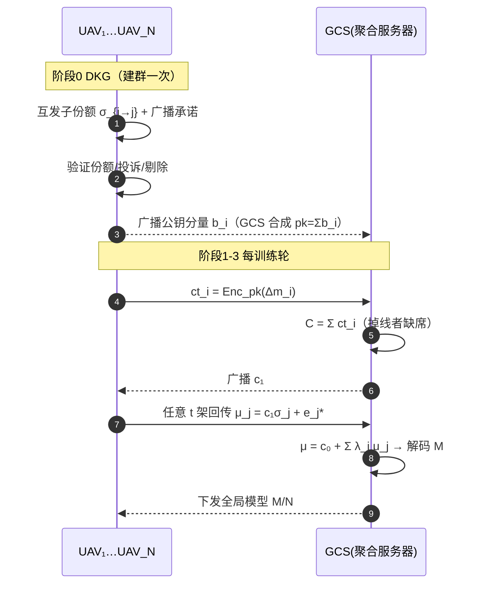
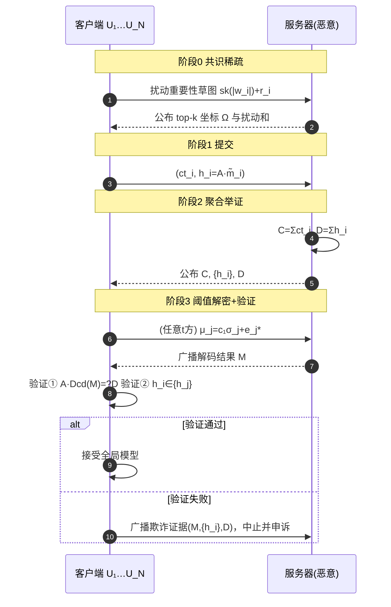
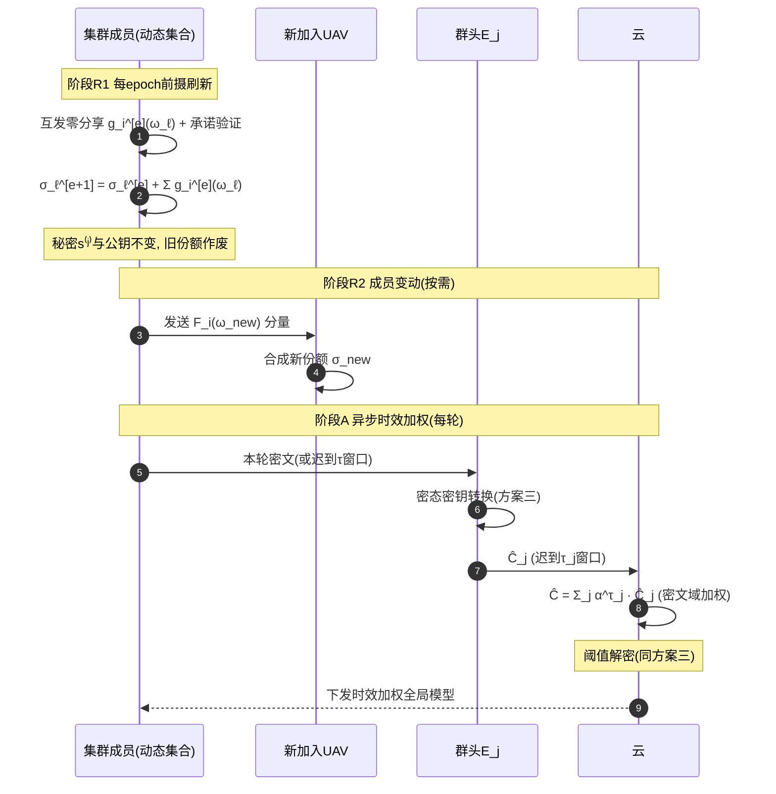

# 同态加密 × 联邦学习 文献阅读报告

> 阅读范围：本目录下 16 篇英文文献（17-SecAgg、19-CDKS、23-ELSA、24-BPVFL、24-ResFed、24-SecFed、25-ESAFL、25-FedPHE、25-MASER、25-MaskCrypt、25-SKHE、25-VeSAFL、26-CDKS-LSS、26-Ftopk(DSVFL)、26-PPBR、26-VLSFL）。
> 阅读视角：全同态密码与联邦学习交叉领域，面向无人机（UAV）/边缘应用场景。
> 报告结构：第一部分为文献总结（模式归纳 → 演进脉络 → UAV 场景挑战）；第二部分为基于文献空白设计的 5 个新方案（2 个标准 FL + 3 个层次 FL）。

---

# 第一部分：文献总结

## 1. 各方案模式归纳

### 1.1 总览表

| 文献 | 年份/出处 | 密钥类型 | FL 架构 | 可信依赖 | 类别 | 核心技术 |
|---|---|---|---|---|---|---|
| **SecAgg** (Bonawitz 等) | 2017 CCS | 无 HE（成对掩码 + Shamir 分享） | 标准 FL（单服务器） | 无 TTP；容忍 ≤1/3 掉线 | 隐私保护聚合 | 双重掩码、密钥协商、掉线可恢复 |
| **CDKS** (Chen-Dai-Kim-Song) | 2019 | **多密钥**（MK-CKKS / MK-BFV，打包密文） | 密码原语（未针对 FL 设计） | 无 TTP | 隐私保护（原语层） | 新重线性化算法、多密钥自举；解密需各方上传部分解密份额 $\mu_i = c_i \cdot s_i + e_i^*$ |
| **ELSA** (Rathee 等) | 2023 S&P | 无 HE（算术秘密分享） | 标准 FL（**双服务器**） | 分布式信任：两台服务器任一台诚实即可 | 隐私 + 恶意客户端防御（鲁棒输入） | 秘密分享 + 零知识有效性证明（Prio 系）、Beaver 三元组 |
| **BPVFL** (Liu 等) | 2024 | **单密钥** Paillier | 标准 FL（**双云服务器** S0 计算 + S1 验证） | 无完全可信第三方；S1 负责密钥生成与验证 | 隐私 + **可验证** | Paillier 加法同态 + 哈希承诺双向验证 |
| **ResFed** (Song 等) | 2024 | 无（非密码学方案） | 标准 FL | — | 通信效率（背景文献） | 残差传输 + 有损深度压缩 |
| **SecFed** (Cai 等) | 2024 TDSC | **多密钥**（EMK-BFV） | 标准 FL（云 = GP + TEE） | **TEE 完全可信** | 隐私保护 | 首个 TEE 辅助多密钥 HE，TEE 代理重线性化/密钥管理/掉线处理 |
| **ESAFL** (Wu 等) | 2025 TDSC | 多密钥形态、**集合密钥** $s=\sum s_i$（ESHE） | 标准 FL（cross-silo） | 可选可信 AS（也可由客户端 MPC 替代） | 隐私保护 | RLWE 加法同态 ESHE：单分量紧凑密文、**一步非交互解密**，抗 $\kappa < N-1$ 合谋 |
| **FedPHE** (Li 等) | 2025 TDSC | **单密钥** CKKS 打包 + **(th, N) 阈值分享** | 标准 FL（cross-silo） | KDC 密钥分发中心 | 隐私 + 效率 | 贡献感知加权聚合、pack 级稀疏化、扰动 sketch 客户端选择、抗掉队 |
| **MASER** (Al Omar 等) | 2025 arXiv | **多密钥**（MK-CKKS） | 标准 FL（cross-silo） | 无 TTP（仍需部分解密交互） | 隐私 + 效率 | 共识式幅度剪枝（统一掩码）+ 参数切片，3.03–8.29× 加速 |
| **MaskCrypt** (Hu & Li) | 2025 TDSC | **每客户端独立密钥对**，协同解密 | 标准 FL | 无 TTP；解密需全体选中客户端在线 | 隐私 + 效率 | 梯度引导的选择性加密掩码（只加密小部分更新） |
| **SKHE-FL** (Liu 等) | 2025 IoT-J | **单密钥** HE + ECC 包裹 | 标准 FL（IoT，云 + 边节点 EN） | **TEE 可信**；ECC 私钥分片给 EN | 隐私 + 抗合谋 | ECC 加密 HE 私钥、ECC 私钥秘密分享、TEE 内解密 + 哈希校验防滥用 |
| **VeSAFL** (Bouamama 等) | 2025 TDSC | 秘密分享 + 短签名（非格 HE） | 边缘 FL（**多聚合器**） | 多聚合器分布式信任 | 隐私 + **可验证** | Pedersen 可验证秘密分享 + 双线性短签名、去中心化边缘聚合 |
| **CDKS-LSS** (Wang 等) | 2026 Inf. Sci. | **多密钥** CDKS + **Shamir LSS 阈值** | 标准 FL（cross-silo，面向 LLM 微调） | **无 TTP** | 隐私保护 | 将 $R_q$ 上（exceptional sequence）的 Shamir 线性秘密分享嵌入 CDKS 解密流；**t/N 阈值**容忍迟到/掉线 |
| **DSVFL / Ftop-k** (Li 等) | 2026 TMC | **阈值 Paillier** | 标准 FL（边缘计算，单云） | **可信 TA**（仅验证，不参与训练） | 隐私 + 可验证 + 效率 | 细粒度 top-k 梯度选择、单云安全聚合 SCSA、可信验证算法抗合谋 |
| **PPBR** (He 等) | 2026 TMC | **打包线性同态 PLHE** + CLDP | **层次 FL（EHFL：云-边-端）** | 无 TTP | 隐私 + **Byzantine 鲁棒** | 符号统计聚类过滤 + 动量范数裁剪、CLDP 扰动符号元组、PLHE 加密边级动量 |
| **VLSFL** (Li 等) | 2026 TDSC | 无格 HE（双重掩码 + 秘密分享） | 标准 FL（大规模客户端、多轮） | 无 TTP | 隐私 + 可验证 + 掉线容忍 | 双重掩码轻量化、秘密分享掉线恢复、同态哈希验证聚合正确性 |

### 1.2 模式层面的四点观察

**（1）密钥类型的三条技术路线已形成清晰谱系。**
- **单密钥（SKHE）**：所有客户端共享同一密钥对（FedPHE、BPVFL、SKHE-FL、MaskCrypt 的退化形式）。优点是密文尺寸恒定 $O(1)$、密态聚合无需重线性化；致命缺点是**"一匙泄露、全盘皆输"**——任一诚实但好奇的客户端即可解密他人密文，且无法抵抗客户端间合谋。FedPHE 用 (th, N) 阈值分享把单密钥"掰开"，SKHE-FL 用 ECC+TEE 把单密钥"锁起来"，都是对单密钥合谋缺陷的补丁。
- **多密钥（MKHE，CDKS 系）**：各客户端独立密钥对（19-CDKS、SecFed、MASER、CDKS-LSS）。从密码学上根治了共享密钥问题，但引入两个新代价：密文随参与者数膨胀（$ct_{add} \in R_q^{N+1}$）；解密必须是**两轮交互**（部分解密 + 合并），且部分解密份额 $\mu_i = c_i \cdot s_i + e_i^*$ 在公开信道上构成新的泄漏面。
- **阈值/集合密钥**：介于两者之间——ESAFL 的 ESHE 让每个客户端持独立 $s_i$ 加密，但聚合密文用集合密钥 $s=\sum_i s_i$ **一步解密**；CDKS-LSS 用 LSS 把解密份额本身再做阈值分享。这条路线的目标是同时获得 MKHE 的密钥独立性与 SKHE 的解密简洁性。

**（2）FL 架构上，层次化（HFL）与多服务器化是 2025–2026 的明显趋势。**
16 篇中仅 PPBR 是真正的"云-边-端"三层 EHFL；VeSAFL 用多边缘聚合器替代单云（逻辑上的扁平多中心）；ELSA/BPVFL 用双服务器拆分信任。层次化的动机有三：缓解单点故障、把通信留在本地（边缘内聚合）、契合真实网络拓扑（蜂窝/无人机集群天然分层）。但层次化也把威胁面拉长：边缘服务器既要看局部模型（做鲁棒过滤）又不该看到明文——PPBR 的 CLDP+PLHE 混合正是被这个矛盾逼出来的折中。

**（3）可信依赖谱系：无 TTP → 分布式信任 → TEE → 可信 TA。**
- 无 TTP：SecAgg、CDKS、MASER、CDKS-LSS、VLSFL（密码学自足，部署最自由）；
- 分布式信任（至少一方诚实）：ELSA（双服务器）、VeSAFL（多聚合器）、ESAFL（可选 AS）；
- TEE 硬件信任：SecFed、SKHE-FL（效率收益大，但引入侧信道/厂商信任假设，且轻量终端常无 TEE）；
- 显式可信机构：DSVFL 的 TA、FedPHE 的 KDC（工程上简单，学术上是减分项）。

**（4）能力维度上，"隐私 → 隐私+可验证 → 隐私+鲁棒 → 隐私+效率"四条支线并行推进。**
纯隐私保护（SecAgg、CDKS、ESAFL、CDKS-LSS、SecFed、SKHE-FL）只保证密文不泄漏；可验证支线（BPVFL、VeSAFL、DSVFL、VLSFL）解决"服务器算错/造假怎么办"；鲁棒支线（ELSA 防恶意输入、PPBR 防 Byzantine 投毒）解决"客户端使坏怎么办"；效率支线（ResFed 残差压缩、MaskCrypt 选择性加密、MASER 剪枝切片、FedPHE 打包+选择、Ftop-k 稀疏化）解决"HE 太贵用不起"。**目前尚无方案同时占据三个以上的维度**，这正是第二部分方案设计的切入点。

## 2. 技术演进脉络：问题驱动的发展链条

### 2.1 主线一：密钥形态与解密结构的演化（最核心的一条链）

```
共享单密钥的合谋困境                    多密钥的部分解密泄漏
SKHE (BatchCrypt系) ──────────────▶ CDKS (19-CDKS) ──────────────┐
 "任何客户端都能解密他人密文"         "μ_i = c_i·s_i + e_i* 在公开    │
                                      信道上传 = 新的泄漏面"        ▼
                                            ┌──── xMK-CKKS (Ma 等, 被引方案)
                                            │     聚合公钥 pk = Σ pk_i 加密，
                                            │     消除份额上传 ── 但一人掉线，
                                            │     聚合公钥失效，解密失败
                                            ▼
                              CDKS-LSS (26)：把部分解密值再做
                              Shamir 阈值分享，t/N 即可重构
                              ── 无 TTP、容忍掉线/迟到
                                            │
                                            ▼
                              ESAFL (25)：釜底抽薪——ESHE 让聚合
                              密文用集合密钥 s = Σs_i 一步解密，
                              根本不产生"部分解密份额"这个对象
```

这条链的内在逻辑：**每一步都是把上一代的"解密交互面"继续压缩**。CDKS 需要 $N$ 个份额在公开信道上裸奔；xMK-CKKS 用聚合公钥免去了份额上传，却把活性和全体在线绑定（掉线即死锁）；CDKS-LSS 用 LSS 把"全体在线"放宽为"阈值在线"；ESAFL 则换了个角度——重新设计密文结构（$ct_i = [a_t \cdot s_i + \tilde{p}\cdot e_i + m_i]_q$），使加法聚合后天然可用集合密钥一次解出，交互轮数从 2 轮降到 0.5 轮（仅上传密文）。旁路上，SecFed 与 SKHE-FL 代表"硬件补丁"路线：不改密码结构，把最危险的操作（重线性化、解密）搬进 TEE。代价是信任假设从"数学困难性"换成了"芯片厂商 + 无侧信道"。

### 2.2 主线二：效率优化的递进（让 HE-FL 从"能跑"到"跑得动"）

**精度无损的密文减重**：19-CDKS 引入打包密文（SIMD slots），一次加密一个向量 → FedPHE 把打包 + pack 级稀疏化 + 贡献感知权重结合，并指出"打包方案默认共享单钥"的安全窟窿，用阈值分享补上。
**明文减重（加密前压缩）**：ResFed（残差传输 + 有损压缩，证明残差比梯度/权重更耐压缩）→ Ftop-k（细粒度 top-k 选择，通信量不变精度最高 +49.14%）→ MaskCrypt（梯度引导掩码，**只加密敏感的小部分参数**，把 HE 开销砍掉一个数量级）→ MASER（共识剪枝：全体客户端对剪枝掩码达成一致 + 参数切片，专治 MKHE 密文膨胀）。
**逻辑递进**：先压"每个密文装多少"（packing）→ 再压"要加密多少参数"（选择性/稀疏化）→ 再压"多少客户端要参与"（FedPHE 扰动 sketch 选择、掉队容忍）。UAV 场景下这三层压缩正好对应：带宽受限、电量受限、链路间歇。

### 2.3 主线三：信任拆解与能力叠加

**信任的横向拆分**：单服务器（SecAgg，诚实但好奇）→ 双服务器（ELSA：任一台诚实即可，还能用 ZK 证明挡住恶意客户端的畸形输入；BPVFL：S0 算、S1 验，双向可验证）→ 多聚合器（VeSAFL：Pedersen VSS + 短签名，边缘节点去中心化聚合，消除单点故障）。
**能力的纵向叠加**：VLSFL 把 SecAgg 的双重掩码轻量化 + 掉线恢复 + **同态哈希验证**（客户端可验证服务器聚合正确性），是"SecAgg 系"的集大成者；DSVFL 在单云假设下用阈值 Paillier + 可信 TA 验证做到同等能力，展示"信任换效率"的另一极端；PPBR 则把战场推进到层次 FL：边服务器要做 Byzantine 过滤就必须"看见"局部模型，与隐私矛盾，于是用 CLDP 扰动符号统计（过滤用的最小信息）+ PLHE 保护动量（聚合用的核心信息）——**按信息敏感度分级保护**是 PPBR 最值得借鉴的设计哲学。

### 2.4 尚未闭环的缺口（第二部分的问题来源）

1. **MKHE 系方案仍缺"可验证性"**：CDKS-LSS、ESAFL、MASER 都假设服务器诚实执行聚合；而可验证方案（VLSFL/DSVFL/BPVFL）都停留在掩码/Paillier 世界，**没有人在 RLWE 多密钥 + 阈值解密框架下做聚合正确性验证**。
2. **无 TTP 的密钥自举**：ESAFL 默认可信 AS，FedPHE 依赖 KDC，DSVFL 依赖 TA；CDKS-LSS 虽无 TTP，但 $N$ 个独立密钥意味着 $O(N)$ 密文膨胀。**蜂群场景下"落地即组网、无预置 PKI"的分布式密钥生成（DKG）+ 恒定尺寸密文，尚未被同时满足**。
3. **层次 FL 的端到端密态聚合**：PPBR 是唯一 EHFL 方案，但边层用 CLDP（有精度损失）、云层用 PLHE（仅线性），**没有方案做到"UAV→边→云"全程 RLWE 密文、边云互不信任、且边节点掉线不死锁**。
4. **高动态拓扑**：所有方案都假设参与者集合在一轮内固定。UAV 蜂群的分裂/合并/中继切换会造成**密钥份额失效与阈值参数失配**，前摄秘密共享（proactive refresh）在 FL 中尚无应用。
5. **Byzantine 鲁棒与密文的矛盾**：鲁棒过滤需要检查更新内容，密文天然抗拒检查。ELSA 的 ZK 有效性证明（在分享值上）提示了一条路，但还没有人把它嫁接到 HE 密文上形成"密文 + 范数界证明"的组合。

## 3. UAV 场景下的挑战与研究点

### 3.1 三种典型部署模式

| 模式 | 拓扑 | 对应文献设定 | 典型应用 |
|---|---|---|---|
| **UAV-as-Client**（UAV 作客户端） | 多 UAV ↔ 地面站/云 | 标准 FL（SecAgg、ESAFL、CDKS-LSS…） | 多机协同目标识别、频谱感知模型共训 |
| **UAV-as-Edge**（UAV 作边缘服务器/中继） | 端设备 ↔ 中继 UAV ↔ 云 | 层次 FL（PPBR）、边缘 FL（VeSAFL、DSVFL） | 灾害现场空中基站、灾区应急感知 |
| **Swarm 跨群**（多蜂群联邦） | 群头 UAV ↔ 群头 UAV | cross-silo FL（ESAFL、MASER、FedPHE） | 多单位/多厂商蜂群联合训练，数据互不开放 |

### 3.2 核心挑战

1. **链路间歇与掉线**：UAV 高速移动 + 无线信道衰落，客户端"中途掉线"是常态而非异常。SecAgg/VLSFL 的掩码恢复、CDKS-LSS 的阈值解密都处理掉线，但**密钥持有者掉线**（而非普通参与者掉线）仍是死结——xMK-CKKS 的聚合公钥一死俱死即是例证。
2. **高动态拓扑**：蜂群分裂/合并使参与者集合逐轮变化，密钥份额、掩码对、阈值参数全部需要刷新，现有方案全部假设集合静态。
3. **资源极度受限**：小型 UAV 的算力/电量/带宽比手机还差一个量级。CKKS 全量加密（FedPHE 报告 CKKS 仍有 42.3× 开销）在机载 SoC 上不可行；选择性加密（MaskCrypt）、稀疏化（Ftop-k、MASER）是必由之路，但稀疏模式与密文打包的对齐（谁选哪些 slot）尚无系统方案。
4. **广播信道暴露面**：UAV 链路是开放无线信道，被动窃听者可以收集**全部**协议消息——CDKS 部分解密份额的泄漏风险在此被放到最大，ESAFL 消灭份额上传的动机在 UAV 场景尤为充分。
5. **被劫持 UAV 的 Byzantine 威胁**：UAV 可被物理俘获、固件改写，投毒/畸形更新威胁真实存在。PPBR 的鲁棒过滤面向地面移动网络设计，未考虑 UAV 集群的"成批同向劫持"（一片空域的 UAV 同时失陷，更新高度同向，符号统计聚类会被整体带偏）。
6. **Non-IID 加剧**：不同空域、不同任务载荷导致数据分布差异远大于地面设备，鲁棒聚合与收敛性压力更大。
7. **验证的可行性**：地面站可能由任务承包方运营（半可信），UAV 需要验证聚合结果但没有重算一遍的算力——需要 $O(1)$ 级的轻量验证（同态哈希/采样验证），而非 BPVFL 式的双向重计算。

### 3.3 值得研究的点（本报告第二部分的选题依据）

- **R1：蜂群自组网的无 TTP 阈值密钥基础设施**（对应缺口 2 + 挑战 1/2）→ 方案一
- **R2：RLWE 框架下的轻量可验证聚合**（对应缺口 1 + 挑战 7）→ 方案二
- **R3：UAV→边→云全程密文、边云互不信任的层次聚合**（对应缺口 3 + 挑战 4）→ 方案三
- **R4：密文友好的 Byzantine 鲁棒层次 FL**（对应缺口 5 + 挑战 5/6）→ 方案四
- **R5：高动态拓扑下的密钥份额前摄刷新与动态阈值**（对应缺口 4 + 挑战 2）→ 方案五

---

# 第二部分：方案构建

> 共同记号约定（五个方案通用）：安全参数 $\lambda$；分圆环 $R = \mathbb{Z}[X]/(X^n+1)$，$R_q = R/qR$；$n$ 为 2 的幂；$\chi$ 为 $R$ 上稀疏/小系数秘密分布，$\psi$ 为离散高斯错误分布，$\phi$ 为涂抹（smudging）噪声分布（标准差远大于 $\psi$）；$a \xleftarrow{\$} R_q$ 表示均匀采样；$\Delta = \lfloor q/p \rfloor$ 为 BFV 缩放因子（CKKS 情形直接以缩放因子 $\Delta_{c}$ 表示）；$[\,\cdot\,]_q$ 表示模 $q$ 约化；$\lfloor\cdot\rceil_p$ 表示按模 $p$ 取整解码。

---

## 方案一：SkyDKG-FL —— 面向 UAV 蜂群自组网的无 TTP 分布式密钥生成阈值 CKKS 安全聚合（标准 FL 架构）

### 5.1 应用场景

多单位联合演习/联合救灾场景：来自不同组织的 $N$ 架 UAV（UAV-as-Client）临时组成蜂群，需联合训练目标识别模型。**各方落地即组网，无预置 PKI、无可信密钥中心**；地面控制站 GCS（单一聚合服务器）由任务承包方运营，不完全可信；无线广播信道上存在被动监听者。UAV 因电量/遮挡随时掉线，但只要剩余在线 UAV 数 $\ge t$，本轮训练必须能闭环。

### 5.2 要解决的具体问题

现有方案在该场景下三重失灵：
1. **ESAFL** 依赖可信 AS 生成并分发密钥——临时蜂群没有、也不该信任这样一个中心；
2. **xMK-CKKS 系**（聚合公钥）一人掉线则解密死锁；**CDKS-LSS** 虽解决阈值问题，但保留 CDKS 的逐客户端独立密钥，聚合密文 $ct_{add}\in R_q^{N+1}$ 随 $N$ 线性膨胀，部分解密仍需逐客户端交互——$N$ 大时通信与同步开销不可接受；
3. **FedPHE** 的阈值分享依赖 KDC 预置，仍是可信机构。

**问题陈述**：如何在**无任何可信机构**的前提下，获得"集合单密钥"的恒定尺寸密文与一步解密效率（ESAFL 的优点），同时保留阈值掉线容忍（CDKS-LSS 的优点）？

### 5.3 创新点与总体设计目标

**创新点 1（无 TTP 的格上 DKG）**：$N$ 架 UAV 通过一轮 Pedersen 式可验证秘密分发（在 $R_q$ 上的 exceptional sequence 取值）联合生成集合密钥对 $(pk, sk=s)$，其中 $s=\sum_i s_i$ 仅以 $(t,N)$-Shamir 份额形式分布式存在于蜂群中，**任何实体（包括任何 $t-1$ 架 UAV 联盟）都不知道 $s$**。
**创新点 2（恒定尺寸 + 阈值解密的兼得）**：所有 UAV 用同一集合公钥加密，聚合密文为 $R_q^2$ 中的单一元素（与 $N$ 无关）；解密时任意 $t$ 架在线 UAV 提交涂抹噪声保护的部分解密，GCS 用 Lagrange 系数合并即得全局模型——密文尺寸与解密交互双双最优。
**创新点 3（投诉机制）**：DKG 阶段用 Feldman 型承诺（基于格的单项式承诺）公开验证份额有效性，作恶分发者被当场剔除，无需事后追责。

设计目标：(G1) 无 TTP；(G2) 聚合密文 $O(1)$；(G3) $(t,N)$ 掉线/迟到容忍；(G4) 对 GCS 与 $\le t-1$ 合谋 UAV 的隐私性；(G5) 全流程消息复杂度 $O(N)$。

### 5.4 威胁模型

- **GCS**：诚实但好奇（honest-but-curious），忠实执行聚合但试图从协议消息中推断个体更新；不与 UAV 合谋（合谋情形在方案四中处理）。
- **UAV**：至多 $t-1$ 架半诚实（跟随协议但合谋共享视图）；DKG 阶段允许存在**恶意**分发者（通过承诺验证与投诉机制检测并剔除）。
- **外部敌手**：被动监听全部无线信道消息；计算能力多项式有界，无法求解 RLWE。
- **安全目标**：个体更新的语义安全（IND-CPA）；除全局聚合结果外不泄漏任何个体信息；任意 $\ge t$ 架在线即可完成功能（健壮性）。

### 5.5 符号系统介绍

| 符号 | 含义 |
|---|---|
| $U_i\ (i=1..N)$ | 第 $i$ 架 UAV；$\mathcal{U}_{on}$ 为本轮在线集合 |
| $\mathcal{S}$ | 地面控制站 GCS（聚合服务器） |
| $s_i\in R$ | $U_i$ 的本地秘密（$\xleftarrow{\$}\chi$）；集合秘密 $s=\sum_i s_i$ |
| $\omega_i\in R_q$ | exceptional sequence 第 $i$ 个取值点（任意 $\omega_i-\omega_j$ 可逆） |
| $\sigma_{i\to j}=f_i(\omega_j)$ | $U_i$ 发给 $U_j$ 的 Shamir 子份额；$\sigma_j=\sum_i\sigma_{i\to j}$ 为 $U_j$ 的合成份额 |
| $\lambda_j^{T}$ | 在线集合 $T$ 的 Lagrange 系数，$\sum_{j\in T}\lambda_j^T\,\sigma_j = s$ |
| $pk=(b,a)$ | 集合公钥，$b=-a\cdot s+e$ |
| $m_i\in R$ | $U_i$ 编码/打包后的本地模型更新（$\Delta m_i$ 为缩放形式） |
| $\mu_j$ | $U_j$ 的部分解密值（含涂抹噪声 $e_j^*\xleftarrow{\$}\phi$） |
| $t,N$ | 解密阈值与总机数 |

### 5.6 方案设计

**实体**：$N$ 架 UAV + 单台 GCS，无任何其他机构。

**阶段 0：格上 DKG（建群一次性执行，可周期性重跑）**
1. 每个 $U_i$ 采样 $s_i\xleftarrow{\$}\chi$，$e_i\xleftarrow{\$}\psi$，广播公钥分量 $b_i=-a\cdot s_i+e_i$（$a$ 为公共参考串 CRS）；
2. $U_i$ 以 $s_i$ 为常数项构造 $t-1$ 次多项式 $f_i(X)=s_i+\sum_{k=1}^{t-1}r_{i,k}X^k$，向 $U_j$ 私发 $\sigma_{i\to j}=f_i(\omega_j)$，并广播 Feldman 型承诺 $\{C_{i,k}=b^{(r_{i,k})}=-a\cdot r_{i,k}+e'_{i,k}\}$；
3. 每个 $U_j$ 用承诺验证所收份额（$b^{(\sigma_{i\to j})}\overset{?}{=}\sum_k \omega_j^k\cdot C_{i,k}+(\text{小噪声项})$，噪声界公开可检）；验证失败即广播投诉，作恶者剔除；
4. 合成：$pk=(b,a)$，$b=\sum_i b_i=-a\cdot s+\sum_i e_i$；$U_j$ 本地合成份额 $\sigma_j=\sum_i\sigma_{i\to j}$。由 Shamir 同态性，$\{\sigma_j\}$ 构成 $s$ 的 $(t,N)$ 分享。

**阶段 1：本地训练与加密（每轮）**
$U_i$ 本地训练得更新 $w_i$，打包编码为 $m_i\in R$，采样 $v_i\xleftarrow{\$}\chi$，$e_{i,0},e_{i,1}\xleftarrow{\$}\psi$，计算 RLWE/CKKS 加密：

$$ct_i=(c_{i,0},\,c_{i,1})=\big(v_i\cdot b+\Delta m_i+e_{i,0},\;\; v_i\cdot a+e_{i,1}\big)\in R_q^2$$

**阶段 2：密态聚合**
$\mathcal{S}$ 收齐在线集合 $\mathcal{U}_{on}$ 的密文后求和（掉线者的更新自然缺席，不影响解密）：

$$C=(c_0,c_1)=\Big(\sum_{i\in\mathcal{U}_{on}}c_{i,0},\;\sum_{i\in\mathcal{U}_{on}}c_{i,1}\Big)\in R_q^2$$

**阶段 3：阈值解密**
1. $\mathcal{S}$ 广播 $c_1$；
2. 任意 $t$ 架在线 UAV（集合 $T\subseteq\mathcal{U}_{on}$）各计算 $\mu_j=c_1\cdot\sigma_j+e_j^*$（$e_j^*\xleftarrow{\$}\phi$ 为涂抹噪声），发送 $\mu_j$；
3. $\mathcal{S}$ 合并：$\mu=c_0+\sum_{j\in T}\lambda_j^T\,\mu_j$，解码 $\lfloor\mu\rceil_\Delta = M=\sum_{i\in\mathcal{U}_{on}}m_i$，下发全局模型。

**闭环正确性推导**：

$$\begin{aligned}
\mu &= c_0+\sum_{j\in T}\lambda_j^T\big(c_1\cdot\sigma_j+e_j^*\big) \\
&= c_0+c_1\cdot\underbrace{\sum_{j\in T}\lambda_j^T\sigma_j}_{=\,s\ (\text{Lagrange 重构})}+\underbrace{\sum_{j\in T}\lambda_j^T e_j^*}_{\text{涂抹噪声}}\\
&= \sum_{i}\big(v_i b+\Delta m_i+e_{i,0}\big)+\Big(\sum_i(v_i a+e_{i,1})\Big)\cdot s + E^*\\
&= \Delta\!\sum_i m_i+\sum_i\underbrace{v_i(b+a\!\cdot\! s)}_{=\,v_i e_i\ (\text{因 }b=-as+\sum e_i)}+\sum_i(e_{i,0}+e_{i,1}\cdot s)+E^*\\
&= \Delta M+\underbrace{\sum_i(v_i e_i+e_{i,0}+e_{i,1}s)+E^*}_{\text{总噪声}\ \ll q/2\ (\text{参数可保证})}\;\approx\;\Delta M
\end{aligned}$$

噪声上界：$\|\text{noise}\|_\infty \le N(B_\chi B_\psi+2B_\psi B_\chi)+t B_\phi$，取 $q$ 满足 $\Delta M+\text{noise}<q/2$ 即正确解码。

**实体交互时序图**：



### 5.7 安全性分析与证明

**定理 1（对 GCS 的隐私性）**：若 RLWE$_{n,q,\chi,\psi}$ 假设成立，则 GCS 在整个协议视图中获得的关于任一个体 $m_i$ 的信息，不超过从 $M=\sum m_i$ 可计算的信息。
*证明概要*：GCS 视图 = $\{ct_i\}_{i}\cup\{\mu_j\}_{j\in T}\cup$ DKG 广播。① DKG 广播中 $b_i=-as_i+e_i$ 是 RLWE 样本，与均匀分布计算不可区分，承诺 $C_{i,k}$ 同理；故 DKG 视图可由模拟器以公开参数生成。② 每个 $ct_i$ 是公钥 $pk$ 下的 RLWE 加密，由公钥加密的 IND-CPA 安全性（RLWE 假设归约），可用均匀随机 $R_q^2$ 元素替换。③ 部分解密 $\mu_j=c_1\sigma_j+e_j^*$：给定 $c_1$ 与目标输出 $M$，模拟器先采样"假"合并值 $\tilde\mu=\Delta M+\tilde e$，再对 $j\in T$ 采样均匀 $\mu_j$ 并条件化 $\sum\lambda_j^T\mu_j=\tilde\mu-c_0$；涂抹噪声 $e_j^*\xleftarrow{\$}\phi$（标准差超多项式大于 $c_1\sigma_j$ 的系数界）保证真实分布与模拟分布在统计上不可区分（smudging lemma）。三段混合论证完成模拟，故 GCS 视图可由 $(pk, M, T)$ 模拟。$\square$

**定理 2（抗合谋性）**：任意 $\le t-1$ 架半诚实 UAV 合谋，联合视图不包含关于 $s$ 的任何信息，从而不能解密他人密文。
*证明概要*：$t-1$ 个 Shamir 份额对常数项 $s_i$ 在信息论上完全隐藏（Shamir 完美隐私性，因 $\omega_j$ 取值于 exceptional sequence，Vandermonde 矩阵在 $R_q$ 上可逆）；集合秘密 $s=\sum s_i$ 中至少含一个诚实方的 $s_{i^*}$，合谋者关于 $s$ 的分布与均匀分布统计不可区分。余下归约同定理 1 的②③。$\square$

**定理 3（健壮性/活性）**：只要 DKG 阶段诚实方 $\ge t$ 且每轮在线方 $\ge t$，协议必然输出正确全局模型；掉线仅缩小聚合集合，不阻断解密。
*证明*：由 Lagrange 重构的阈值性质（任意 $t$ 份合成份额恢复 $s$）+ 5.6 节闭环正确性。$\square$

**与最新研究的对比定位**：相对 CDKS-LSS（26），密文从 $O(N)$ 降至 $O(1)$、解密交互从"每客户端一份额"降为"$t$ 份合计"；相对 ESAFL（25），去掉了可信 AS；相对 xMK-CKKS，掉线不再死锁。

---

## 方案二：VeriPack-FL —— 可验证稀疏打包 CKKS 安全聚合（标准 FL 架构）

### 5.1 应用场景

UAV 物流/巡检联盟（cross-silo 形态的标准 FL）：若干运营商各出少量高性能 UAV/地面站作为客户端，聚合服务器由云平台提供。**平台有动机"偷工减料"**：例如丢弃迟到者的更新（省事）、注入偏向自家业务的模型（牟利）、或重放旧轮聚合结果。客户端需要**不重算全局聚合、不暴露自己更新**的前提下，$O(1)$ 成本验证"服务器确实把本轮所有合格更新如实求和了"。同时 UAV 端带宽/电量受限，要求加密前先稀疏化。

### 5.2 要解决的具体问题

1. **可验证方案与 RLWE 打包世界脱节**：VLSFL/DSVFL/BPVFL 的验证都构建在掩码或 Paillier 上；而在 CDKS-LSS、ESAFL、FedPHE 这类 RLWE/CKKS 方案里，**服务器返回什么客户端只能照单全收**；
2. **VLSFL 的双重掩码本身太贵**：每轮 $O(N^2)$ 次密钥协商消息，大规模/跨域客户端不实用；且掩码方案无法与"贡献加权"自然结合；
3. **稀疏化与打包的对齐**：Ftop-k/MaskCrypt 各客户端自选 top-k，稀疏位置不一致则密文求和得到的是"错位之和"，无法正确解码。

### 5.3 创新点与总体设计目标

**创新点 1（共识稀疏 + 打包对齐）**：用扰动 sketch（借鉴 FedPHE 的 perturbed sketch，但作用于坐标重要性而非客户端选择）让全体客户端对 top-$k$ 坐标集合 $\Omega$ 达成共识，所有客户端只在相同 slot 打包加密，密文聚合天然对齐——把 MaskCrypt 的选择性加密与 FedPHE 的打包在"集合一致"层面统一。
**创新点 2（RLWE 密文的同态校验和）**：每客户端对量化后的稀疏更新计算 SIS 型同态哈希 $h_i=A\cdot \tilde m_i$（$\tilde m_i$ 为整数向量），服务器除聚合密文外还须公布 $\{h_i\}$ 与聚合摘要 $D=\sum h_i$；客户端解密得 $M$ 后验证 $A\cdot M \overset{?}{=} D$，并确认自己的 $h_i$ 在公布列表中——两步共 $O(1)$ 次哈希运算即完成"结果被篡改/我的更新被丢弃"双重检测。
**创新点 3（验证不牺牲隐私）**：哈希输入为整数化更新，SIS 哈希具有原像抗性（单向性），公布 $\{h_i\}$ 不泄漏 $m_i$；同时哈希的线性结构与 BFV 加法同态完全兼容，无需额外交互轮。

设计目标：(G1) 恶意服务器下的聚合**正确性可验证**；(G2) 客户端验证成本 $O(k)$ 哈希运算、无额外密码学交互；(G3) 通信开销较全量加密降低 $d/k$ 倍；(G4) 保持对服务器与外部敌手的语义安全。

### 5.4 威胁模型

- **聚合服务器 $\mathcal{S}$**：**恶意**——可丢弃/篡改/重放客户端更新，可返回错误聚合结果；但不与客户端合谋。
- **客户端**：诚实但好奇者至多占 $t-1$（隐私维度）；允许少量恶意客户端提交非法更新（本方案的范数界检查仅做基本约束，投毒鲁棒性交由方案四）。
- **安全目标**：① 隐私性（IND-CPA）；② **不可伪造性**：恶意 $\mathcal{S}$ 无法使客户端接受 $M'\neq\sum_{i\in\mathcal{U}_{on}}m_i$ 的结果（归约到 SIS 困难性）；③ **不可遗漏性**：客户端必能检出自己的更新被丢弃。

### 5.5 符号系统介绍

| 符号 | 含义 |
|---|---|
| $\Omega\subset[d],\ |\Omega|=k$ | 共识 top-$k$ 坐标集合 |
| $\tilde m_i\in \mathbb{Z}_p^{k}\hookrightarrow R$ | $U_i$ 量化并稀疏化的更新（仅 $\Omega$ 上非零），打包进一个多项式 |
| $A\in \mathbb{Z}_q^{\ell\times n}$ | SIS 哈希公开矩阵（$\ell$ 为输出维度），$\mathsf{H}(x)=A x\bmod q$ |
| $h_i=\mathsf{H}(\tilde m_i)$ | $U_i$ 的更新摘要；$D=\sum_i h_i$ 聚合摘要 |
| $pk,sk=s$ | 集合 BFV 密钥对（复用方案一的 DKG 结果，$s$ 以 $(t,N)$ 分享持有） |
| $\kappa$ | 哈希输出安全参数（$q^\ell$ 决定抗碰撞强度） |

### 5.6 方案设计

**实体**：$N$ 个客户端（UAV/站点）+ 单台聚合服务器 $\mathcal{S}$（恶意）。密钥基础设施复用方案一的 DKG（无 TTP）。

**阶段 0：共识稀疏（每轮）**
1. $U_i$ 本地训练得全量更新 $w_i\in\mathbb{R}^d$，计算坐标重要性草图 $\mathsf{sk}(|w_i|)$（Count-Sketch + 随机扰动 $r_i$，服务器只见草图不见原始幅度）；
2. $\mathcal{S}$ 汇总草图，公布 top-$k$ 坐标集合 $\Omega$ 与扰动和 $r=\sum r_i$（各客户端可验证 $\Omega$ 来自草图，防服务器操纵坐标选择——操纵仅能降低收敛速度，不能造成隐私泄漏）。

**阶段 1：量化、哈希与加密**
$U_i$ 截取 $w_i|_\Omega$，按步长 $\eta$ 量化为整数向量 $\tilde m_i\in\mathbb{Z}_p^k$，打包为多项式（BFV 槽位编码）$\mathsf{Ecd}(\tilde m_i)\in R$；计算摘要 $h_i=A\,\tilde m_i\bmod q$；加密：

$$ct_i=(c_{i,0},c_{i,1})=\big(v_i b+\Delta\,\mathsf{Ecd}(\tilde m_i)+e_{i,0},\;v_i a+e_{i,1}\big)$$

发送 $(ct_i,\ h_i)$。

**阶段 2：聚合与举证**
$\mathcal{S}$ 计算并公布：聚合密文 $C=\sum_{i\in\mathcal{U}_{on}}ct_i=(c_0,c_1)$、摘要列表 $\{h_i\}_{i\in\mathcal{U}_{on}}$、聚合摘要 $D=\sum_i h_i$。

**阶段 3：阈值解密 + 双重验证**
1. 与方案一相同：任意 $t$ 个客户端提交 $\mu_j=c_1\sigma_j+e_j^*$，$\mathcal{S}$ 合并解码得 $M$（对应明文和 $\sum_i \tilde m_i$），广播 $M$；
2. **完整性验证**：每个客户端独立计算 $A\cdot\mathsf{Dcd}(M)\bmod q\overset{?}{=}D$（验证服务器未篡改求和结果）；
3. **含我性验证**：检查 $h_i\in\{h_j\}_{j\in\mathcal{U}_{on}}$（验证自己的更新未被丢弃），且 $|h_i|$ 列表长度等于服务器声称的参与者数（防静默踢人）。

**闭环正确性推导**（解密正确性 + 验证一致性双闭环）：

解密环与方案一相同：

$$\mu=c_0+c_1 s+E^*=\Delta\,\mathsf{Ecd}\!\Big(\sum_i \tilde m_i\Big)+\underbrace{\textstyle\sum_i(v_i e_i+e_{i,0}+e_{i,1}s)+E^*}_{<q/2}\;\Rightarrow\;\mathsf{Dcd}(M)=\sum_i\tilde m_i \pmod p$$

验证环（利用 SIS 哈希对 $\mathbb{Z}_p$ 向量的精确线性性，BFV 无量纲误差）：

$$A\cdot\mathsf{Dcd}(M)=A\cdot\sum_i\tilde m_i=\sum_i A\,\tilde m_i=\sum_i h_i=D\pmod q$$

若服务器如实聚合，验证恒等式必然成立——**正确性闭环成立**。注意此处必须采用精确算术的 BFV（而非近似 CKKS），否则哈希等式会被近似噪声破坏；这是本方案相对 FedPHE（CKKS）在编码层的关键取舍。

**实体交互时序图**：



### 5.7 安全性分析与证明

**定理 1（隐私性）**：在 RLWE 假设下，$\mathcal{S}$ 与外部敌手对任一 $\tilde m_i$ 的了解不超过 $(\sum_i\tilde m_i,\ h_i,\ \mathsf{sk}(|w_i|))$ 所泄漏的信息。
*证明概要*：$ct_i$ 的 IND-CPA 安全性同方案一定理 1 之②；$\{h_i\}$ 的安全性依赖 SIS 的单向性（原像抗性）：给定 $h_i=A\tilde m_i$，求满足约束的短原像等价于求解 $\mathsf{SIS}_{q,n,\ell,\beta}$，在最坏情形格假设（GapSVP/SIVP）下多项式敌手不可行；草图经扰动后满足轻量统计隐藏（扰动和 $r$ 对单点幅度的掩盖）。$\square$

**定理 2（聚合不可伪造性）**：若存在多项式时间恶意 $\mathcal{S}^*$ 能以不可忽略概率使诚实客户端接受 $M'$ 且 $\mathsf{Dcd}(M')\neq\sum_{i\in\mathcal{U}_{on}}\tilde m_i$，则存在多项式算法求解 $\mathsf{SIS}_{q,n,\ell,\beta}$。
*证明概要*：客户端接受当且仅当 $A\cdot\mathsf{Dcd}(M')=D=\sum_i A\tilde m_i$。令 $z=\mathsf{Dcd}(M')-\sum_i\tilde m_i\neq 0$，则 $Az=0\bmod q$ 且 $\|z\|$ 有界（明文空间有界）。于是 $\mathcal{S}^*$ 输出了 SIS 实例 $A$ 的一个非零短解——直接用 $\mathcal{S}^*$ 构造 SIS 求解器（$A$ 由挑战者提供）。$\square$

**定理 3（含我性）**：若 $U_i$ 的更新被丢弃（$h_i\notin$ 列表或 $M$ 不含 $m_i$ 的贡献），$U_i$ 必以概率 1 检出。
*证明*：含我性检查 $h_i\in\{h_j\}$ 为确定性集合成员判定；若服务器伪造一个 $h_i'=h_i$ 但对应不同更新，则产生哈希碰撞，归约到 SIS 抗碰撞性（SIS 的碰撞对与短解等价）。$\square$

**与最新研究的对比定位**：相对 VLSFL（26），把验证从掩码世界搬进 RLWE 打包世界，每轮省去 $O(N^2)$ 密钥协商；相对 DSVFL（26），去掉可信 TA；相对 FedPHE（25），增加了其完全不具备的聚合正确性验证；相对 Ftop-k/MaskCrypt，解决了稀疏位置不一致导致的密文错位问题。

---

## 方案三：HMK-UAVNet —— 边云互不信任的双层多密钥层次安全聚合（层次 FL 架构：UAV → 群头边缘 → 云）

### 5.1 应用场景

大规模空域监视网络（UAV-as-Client + UAV-as-Edge）：若干 UAV 集群分属不同作业区，每个集群由一架长航时中继 UAV（群头，充当边缘服务器）汇聚本群数据，云层做跨集群全局聚合。**三方互不信任**：成员不信任群头（群头可能被俘获）、群头不信任云（云由第三方运营）、云不应看到任何集群级明文（跨单位数据主权）。要求：成员更新对群头保密、集群聚合对云保密，只有最终全局模型对所有参与者公开。

### 5.2 要解决的具体问题

1. **PPBR（26）是目录中唯一 EHFL 方案，但为让边缘"看得见"局部模型做鲁棒过滤，付出了双重代价**：CLDP 噪声直接损伤模型精度（其论文自报 Non-IID 下精度损失），且 PLHE 仅支持线性运算，边到云只能传递"已降级的"统计量；
2. **密文尺寸悖论**：若直接用 CDKS 多密钥做层次聚合，密文长度随参与者数膨胀（$R_q^{N+1}$），跨层传递时雪上加霜；
3. **边节点掉线=集群失联**：现有 HFL 假设边缘服务器稳定在线，中继 UAV 电量耗尽/被召回即整群缺席本轮，且密钥随之中断。

### 5.3 创新点与总体设计目标

**创新点 1（密态密钥转换桥，边缘零知识中继）**：集群内用**集群集合密钥** $pk^{(j)}$（阈值分享于成员间，复用方案一 DKG）加密；群头持有的是 **gadget 密钥转换钥族** $\mathsf{KSK}_j=\{\mathsf{KSK}_k=\mathsf{Enc}_{PK}(2^k\,s^{(j)})\}_{k=0}^{L-1}$（集群秘密按数字位在云集合公钥 $PK$ 下的密文族，由成员分布式加密、群头同态求和生成，**任何实体都不曾见过 $s^{(j)}$ 明文**）。群头把集群聚合密文从 $s^{(j)}$ 域**同态平移**到 $SK$ 域——全程在密文上操作，群头对内容零知识。（注：初稿曾写作单一 $\mathsf{ksk}_j$ 配"密文×明文"乘法，经验证会因乘数 $c_1$ 的大系数导致噪声爆炸、无法解密，已修正为 gadget 分解形式；完整推导与噪声预算见飞书文档《方案三 HMK-UAVNet：RLWE 闭环推导评估与详解》。）
**创新点 2（全程精确、无 DP 噪声的端到端隐私）**：UAV→群头→云每一跳都是 RLWE 密文，不存在 PPBR 式的"边缘必须看（扰动）明文"妥协；精度损失为零（BFV 精确算术）。
**创新点 3（边缘可替换性）**：密态转换桥使群头退化为纯计算中继——掉线时集群可直接切换为"成员直传云（用 $PK$ 加密）"的降级模式，密钥体系不受影响；新群头上任只需重新领取/重新生成 $\mathsf{ksk}_j$，无需重发密钥。

设计目标：(G1) 成员更新对群头、外部监听者保密；(G2) 集群聚合结果对云保密（云只见全局和）；(G3) 每层聚合密文 $O(1)$ 尺寸；(G4) 群头掉线可降级、可替换；(G5) 密钥管理无 TTP。

### 5.4 威胁模型

- **群头（边缘）**：诚实但好奇，可执行任意被动推断；可能被俘获从而与外部敌手共享视图（但无法获得任何明文，见定理 1）。
- **云 $\mathcal{C}$**：诚实但好奇；**不与群头实时合谋**（跨单位部署下该假设现实；合谋情形的防护在方案四讨论）。
- **成员 UAV**：至多 $t-1$ 架半诚实合谋。
- **安全目标**：端到端个体隐私（任何单一非客户端实体只见密文）；全局结果正确性；集群自治（集群密钥生命周期独立于云）。

### 5.5 符号系统介绍

| 符号 | 含义 |
|---|---|
| $U_i^{(j)}$ | 集群 $j$ 的第 $i$ 个成员（$i=1..N_j$）；$E_j$ 为群头；$\mathcal{C}$ 为云 |
| $(pk^{(j)}, sk^{(j)})$ | 集群 $j$ 的集合密钥对，$sk^{(j)}=s^{(j)}$ 以 $(t_j,N_j)$ 分享于成员 |
| $(PK, SK)$ | 云集合密钥对，$SK=S$ 以 $(t_c, J)$ 分享于 $J$ 个群头（跨集群 DKG） |
| $\mathsf{KSK}_k$ | 集群 $j$ → 云的 gadget 密钥转换钥（按数字位，$k=0..L-1$，密文形式） |
| $ct_i^{(j)}$ | 成员密文（$pk^{(j)}$ 域）；$C_j$ 集群聚合密文；$\hat C_j$ 平移后的云域密文 |
| $M_j=\sum_i m_i^{(j)}$ | 集群明文和；$M=\sum_j M_j$ 全局和 |

### 5.6 方案设计

**实体**：$J$ 个集群，集群 $j$ 含 $N_j$ 架成员 UAV 与一架群头 $E_j$；单朵云 $\mathcal{C}$。

**阶段 0：双层密钥基础设施（一次性）**
1. 集群内：成员运行方案一 DKG，得 $pk^{(j)}=(b^{(j)},a)$，$b^{(j)}=-a\,s^{(j)}+e^{(j)}$；$s^{(j)}$ 以 $(t_j,N_j)$ 分享于成员；
2. 跨集群：$J$ 个群头运行同一 DKG，得 $PK=(B,A)$，$B=-A S+E$；$S$ 以 $(t_c,J)$ 分享于群头；
3. **转换钥生成（关键协议，按 gadget 数字位）**：取数字基 $T$、位数 $L=\lceil\log_T q\rceil$。对每个 $k$，成员 $U_i^{(j)}$ 采样 $w_{i,k}\xleftarrow{\$}\chi$、$f_{i,k,0},f_{i,k,1}\xleftarrow{\$}\psi$，向群头提交 $PK$ 下（刻度为 1 的）RLWE 加密 $\mathsf{KSK}_{i,k}=(w_{i,k}B+2^k\lambda_i\sigma_i+f_{i,k,0},\;w_{i,k}A+f_{i,k,1})$（注意 $\sum_i\lambda_i\sigma_i=s^{(j)}$），群头求和得

$$\mathsf{KSK}_k=\sum_i\mathsf{KSK}_{i,k}=\big(W_kB+2^k s^{(j)}+F_{k,0},\;W_kA+F_{k,1}\big)$$

其在 $S$ 下"解"得 $b_k+a_kS=2^k s^{(j)}+\eta_k$（$\eta_k=W_kE+F_{k,0}+F_{k,1}S$ 为小项），即 $\mathsf{KSK}_k$ 是 $2^k s^{(j)}$ 在密钥 $S$ 下的合法 RLWE 样本。任何单方只见 $PK$ 密文与份额，无人能恢复 $s^{(j)}$。

**阶段 1：集群内密态聚合（成员 → 群头）**
$U_i^{(j)}$ 本地训练、打包编码 $m_i^{(j)}$，加密：

$$ct_i^{(j)}=\big(v_i\,b^{(j)}+\Delta m_i^{(j)}+e_{i,0},\;v_i\,a+e_{i,1}\big)$$

$E_j$ 求和：$C_j=(c_0^{(j)},c_1^{(j)})=\sum_i ct_i^{(j)}$（$O(1)$ 尺寸）。

**阶段 2：密态密钥转换（群头，零知识中继，gadget 分解）**
$E_j$ 先对 $c_1^{(j)}$ 做数字分解 $c_1^{(j)}=\sum_k 2^k c_1^{(j,k)}$（$\|c_1^{(j,k)}\|_\infty\le T/2$），再计算平移密文：

$$\hat C_j=\Big(c_0^{(j)}+\sum_k c_1^{(j,k)}\cdot b_k,\;\;\sum_k c_1^{(j,k)}\cdot a_k\Big)\in R_q^2$$

其中 $(b_k,a_k)$ 为 $\mathsf{KSK}_k$ 的两个分量。注意修正要点：乘数是**小系数数字** $c_1^{(j,k)}$（$\le T/2$）而非密文分量 $c_1^{(j)}$ 本身——后者系数 $\approx q$，会把转换钥噪声放大约 $q$ 倍导致解密失败；且 $c_0^{(j)}$ 直接并入密文第一分量，无需"加密 $c_0$"、全程单一 $\Delta$ 刻度。结果 $\hat C_j$ 是 $SK$ 域密文。

**阶段 3：云层聚合与阈值解密**
$\mathcal{C}$ 求和 $\hat C=\sum_j\hat C_j$；广播解密请求，任意 $t_c$ 个群头提交部分解密 $\tilde\mu_\ell=\hat c_1\cdot\Sigma_\ell+\tilde e_\ell^*$（$\Sigma_\ell$ 为群头 $\ell$ 持有的 $S$ 之份额），云合并解码得 $M=\sum_j M_j$。

**闭环正确性推导**（核心：转换桥不改变明文）：

$$\begin{aligned}
\mathsf{Dec}_{SK}(\hat C_j)
&= c_0^{(j)}+\sum_k c_1^{(j,k)}\big(b_k+a_kS\big)
 = c_0^{(j)}+\sum_k c_1^{(j,k)}\big(2^k s^{(j)}+\eta_k\big)\\
&= \underbrace{c_0^{(j)}+c_1^{(j)}\cdot s^{(j)}}_{=\ \Delta M_j+\varepsilon_0}+\underbrace{\sum_k c_1^{(j,k)}\eta_k}_{\varepsilon_1}
 = \Delta M_j+\varepsilon_0+\varepsilon_1
\end{aligned}$$

其中 $\varepsilon_0$ 为集群内加密噪声（方案一已界），$\varepsilon_1$ 为转换噪声（乘数为小系数数字，界 $\le L\cdot n\cdot (T/2)\cdot\|\eta\|_\infty$；取 $n=2^{13}$、$T=2^4$、$q\approx2^{62}$ 时总噪声 $\approx2^{48}\ll q/2=2^{61}$，**解密必然成功**）。云层解码：

$$\hat\mu=\hat c_0+\hat c_1\cdot S+E^{**}=\Delta\sum_j M_j+(\text{有界噪声})\;\Rightarrow\;M=\sum_j\sum_i m_i^{(j)}$$

端到端闭环成立：**云解出的恰好是全体成员的明文和，而云全程未见任何集群级明文**。

**实体交互时序图**：

```mermaid
sequenceDiagram
    autonumber
    participant U as 成员UAV群
    participant E as 群头E_j(边缘/中继)
    participant C as 云
    Note over U,C: 阶段0 双层DKG + 转换钥生成（一次性）
    U->>U: 集群内DKG → pk⁽ʲ⁾, sk⁽ʲ⁾分片持有
    E->>C: 群头间DKG → PK, SK分片持有
    U->>E: KSK份额密文 Enc(2^k·λ_i·σ_i), k=0..L-1
    E->>E: KSK_k = Σ份额密文 = Enc(2^k·s⁽ʲ⁾)
    Note over U,C: 阶段1 集群内聚合
    U->>E: ct_i⁽ʲ⁾ = Enc_{pk⁽ʲ⁾}(Δm_i⁽ʲ⁾)
    E->>E: C_j = Σ ct_i⁽ʲ⁾
    Note over U,C: 阶段2 密态密钥转换（边缘零知识）
    E->>E: c₁=Σ2^k·c₁⁽ᵏ⁾; Ĉ_j=(c₀+Σc₁⁽ᵏ⁾b_k, Σc₁⁽ᵏ⁾a_k)
    E->>C: Ĉ_j（SK域密文）
    Note over U,C: 阶段3 云聚合+阈值解密
    C->>C: Ĉ = Σ_j Ĉ_j
    C-->>E: 广播 ĉ₁
    E->>C: 任意t_c个群头回传 μ̃_ℓ
    C->>C: 解码 M = Σ_j M_j
    C-->>U: 经群头下发全局模型
```

### 5.7 安全性分析与证明

**定理 1（对群头的零知识性）**：群头 $E_j$ 的协议视图可由公开参数与输出 $M$ 有效模拟，即 $E_j$ 对任何成员更新、任何集群明文和 $M_j$ 的知识为零（除全局和 $M$ 公开后可反推的 trivial 信息外）。
*证明概要*：$E_j$ 视图 = $\{ct_i^{(j)}\}\cup\{\mathsf{Enc}_{PK}(\lambda_i\sigma_i)\}\cup\{\hat C_\cdot\}\cup\{\tilde\mu_\cdot\}$。① 成员密文：$pk^{(j)}$ 下 IND-CPA（RLWE），可模拟为均匀随机；② 份额密文：$PK$ 下 IND-CPA，同上；③ $\hat C_j$ 由 $E_j$ 自己计算，不含新信息；其他集群密文为 $SK$ 域 IND-CPA 密文；④ 群头自己的部分解密 $\tilde\mu_\ell$ 含涂抹噪声，由 smudging lemma 可模拟。注意 $E_j$ **从不持有** $sk^{(j)}$ 或 $S$，故无法对任何密文脱密。混合论证完成。$\square$

**定理 2（对云的集群级隐私）**：在 RLWE 假设且云不与 $\ge t_c$ 个群头合谋的前提下，云关于单个集群和 $M_j$ 的信息不超过从全局和 $M=\sum_j M_j$ 可计算的信息。
*证明概要*：$\hat C_j$ 是 $SK$ 域 IND-CPA 密文；云不持有 $S$（阈值分享于群头，$<t_c$ 份无信息，Shamir 完美隐私）；云持有的 $\{\tilde\mu_\ell\}$ 与输出 $M$ 可由模拟器以涂抹噪声生成（同方案一定理 1 之③）。$\square$

**定理 3（端到端正确性与活性）**：所有参与方半诚实时，云输出 $M=\sum_{j,i}m_i^{(j)}$；若某群头掉线，其集群切换直传模式（成员以 $PK$ 直接加密上传），协议仍输出正确结果且安全级别不变。
*证明*：正确性由 5.6 双闭环；直传模式下成员密文为 $PK$ 域 IND-CPA 密文，云视图不变（定理 2 的模拟器同样适用）；密钥体系未被触碰。$\square$

**与最新研究的对比定位**：相对 PPBR（26），消除 CLDP 精度损失、边缘从"看扰动明文"变为"零知识中继"；相对 CDKS-LSS（26），每层密文 $O(1)$ 且天然支持层次拓扑；相对 VeSAFL（25）的多聚合器，给出严格的层间密码学隔离而非仅靠架构分散。

---

## 方案四：SkyGuard-HFL —— 抗合谋劫持的 Byzantine 鲁棒层次安全聚合（层次 FL 架构）

### 5.1 应用场景

对抗环境下的 UAV 集群作业（如边境巡检、战区侦察）：每集群配备**两架分属不同保障单位的中继节点**（一架空中中继 UAV + 一座地面边缘站，或两架不同厂商中继），构成互不合谋的双边缘服务器。威胁是真实的：**成批 UAV 被同一攻击者俘获**后提交高度同向的投毒更新（成组同向性使 PPBR 的符号统计聚类整体失效）；云层仍只做跨集群聚合。要求：在不检查明文更新的前提下，拦截范数异常/畸形更新，且被俘获节点无法反推诚实成员的更新。

### 5.2 要解决的具体问题

1. **PPBR 的过滤前提是"边缘能看见（扰动后的）局部模型符号统计"**——这在密码学上是一个信任漏洞：CLDP 只是噪声掩盖，边缘拿到的仍是个体级信息；且成批同向劫持可使符号聚类把投毒方向误判为"多数派"；
2. **ELSA（23）证明了恶意安全聚合可行，但它是平面双服务器结构**，未解决层次化部署，也未与 HE 云层衔接；其 ZK 有效性证明开销按全维向量计，直接搬到带宽受限的 UAV 链路不可行；
3. **信任链断点**：方案三的"云不与群头合谋"假设在对抗环境中过强——需要把鲁棒过滤从"看明文"彻底改为"验证明文满足的性质"。

### 5.3 创新点与总体设计目标

**创新点 1（双层异构密码学分工）**：内层（成员→双边缘）用**算术秘密分享 + 零知识范数界证明**（ELSA 风格的恶意安全，但把证明对象从全维向量压缩到"共识稀疏坐标 + 范数"两项，证明大小从 $O(d)$ 降到 $O(k+\log d)$）；外层（边缘→云）切换为**云集合 CKKS 公钥 $PK$ 的密文域**（复用方案三基础设施），双边缘各自把自己那份分享值用 $PK$ 加密上传，云密态求和——**鲁棒性由分享域获得，跨域隐私由 HE 域获得**，各司其职。
**创新点 2（密文/分享双域的鲁棒聚合规则）**：双边缘在分享值上执行"范数界过滤 + 坐标中位数"鲁棒聚合（安全比较仅在 $k$ 个稀疏坐标上进行，成本可控），成批同向劫持者因无法通过范数界证明且在中位数下被天然抑制。
**创新点 3（单边缘作恶不破坏隐私）**：任一边缘节点恶意（含被俘获），只要另一台诚实，成员更新在信息论上隐藏（两分享值的秘密分享性质）；恶意边缘只能造成本轮该集群拒绝服务，无法污染全局——污染行为会被另一台的跨校验捕获。

设计目标：(G1) 恶意客户端（$\le f<N/3$）的投毒更新被拦截或中和；(G2) 单边缘被俘获不泄漏个体更新；(G3) 云只见密文与全局和；(G4) 证明/验证开销适配 UAV 链路（$O(k\log d)$ 级）。

### 5.4 威胁模型

- **成员 UAV**：至多 $f<N/3$ 架**恶意**（任意偏离协议：注入缩放攻击、畸形向量、伪造证明）；
- **双边缘 $E_j^{(0)},E_j^{(1)}$**：**至多一台恶意**（被俘获），另一台诚实——"互不合谋"由分属不同保障单位/不同厂商背书；
- **云**：诚实但好奇，不与被俘获边缘实时合谋；
- **安全目标**：① 个体更新隐私（对任一边缘、云、外部敌手）；② 输入有效性（恶意客户端无法提交范数越界更新而不被发现）；③ 输出鲁棒性（全局聚合结果与"仅诚实客户端参与"的结果在 $\ell_2$ 意义下有界接近）。

### 5.5 符号系统介绍

| 符号 | 含义 |
|---|---|
| $E_j^{(0)},E_j^{(1)}$ | 集群 $j$ 的双边缘服务器（空中中继 + 地面站） |
| $\langle x\rangle^{(b)}\in\mathbb{Z}_Q$ | $x$ 在环 $\mathbb{Z}_Q$ 上对边缘 $b$ 的加法分享，$\langle x\rangle^{(0)}+\langle x\rangle^{(1)}=x$ |
| $\pi_i$ | $U_i$ 的零知识范数界证明：证明 $\|\tilde m_i\|_2^2\le B^2$ 且 $\tilde m_i$ 在 $\Omega$ 外为零 |
| $\mathsf{SNIP}$ | 基于分享的有效性证明协议（ELSA/Prio 系，证明在分享上验证） |
| $(PK,SK)$ | 云集合 CKKS 密钥（复用方案三）；$\mathsf{Med}(\cdot)$ 坐标中位数 |
| $\Omega,k,B$ | 共识稀疏坐标集、稀疏度、公开范数界 |

### 5.6 方案设计

**实体**：每集群 $N_j$ 成员 + 双边缘 $E_j^{(0)},E_j^{(1)}$ + 云 $\mathcal{C}$。

**阶段 1：稀疏化、分享与有效性证明（成员 → 双边缘）**
1. 共识稀疏同方案二（得 $\Omega$）；$U_i$ 量化得 $\tilde m_i\in\mathbb{Z}^k$（嵌入 $\mathbb{Z}_Q^d$，$\Omega$ 外为零）；
2. $U_i$ 生成加法分享 $\big(\langle \tilde m_i\rangle^{(0)},\langle \tilde m_i\rangle^{(1)}\big)$ 与范数界证明 $\pi_i$（对两边缘的分享分别给出证明份额 $\pi_i^{(0)},\pi_i^{(1)}$），分别发送给 $E_j^{(0)},E_j^{(1)}$；
3. 双边缘交互执行 $\mathsf{SNIP}$ 验证：联合检查 $\|\tilde m_i\|^2\le B^2$（在分享上计算内积 $\langle \tilde m_i,\tilde m_i\rangle$ 的分享并与 $B^2$ 比较，证明正确性由 $\mathsf{SNIP}$ 的 soundness 保证）；**验证不通过者当场丢弃，双边缘各自记录弃票**。

**阶段 2：分享域鲁棒聚合（双边缘）**
1. 对通过验证的集合 $\mathcal{V}_j$，双边缘在分享域计算坐标中位数：对 $\Omega$ 中每个坐标 $\ell$，用 $O(\log Q)$ 轮安全比较/比特分解求得 $\mu_\ell=\mathsf{Med}\{\tilde m_{i,\ell}\}_{i\in\mathcal{V}_j}$ 的分享 $\langle\mu_\ell\rangle^{(b)}$（仅 $k$ 个坐标，成本 $O(k\log Q)$ 次比较）；
2. 得集群鲁棒聚合的分享 $\langle M_j^{rob}\rangle^{(b)}$（中位数向量的坐标嵌入）。

**阶段 3：HE 域跨集群聚合（边缘 → 云）**
1. 每台边缘 $E_j^{(b)}$ 把自己的分享值打包并用 $PK$ 加密：

$$ct_j^{(b)}=\big(v_b B+\Delta\,\mathsf{Ecd}(\langle M_j^{rob}\rangle^{(b)})+e_{b,0},\;v_b A+e_{b,1}\big)$$

2. 云求和：$\hat C=\sum_{j}\sum_{b\in\{0,1\}}ct_j^{(b)}$；
3. 阈值解密同方案三（$t_c$ 个边缘节点联合），云得

$$M=\sum_j\big(\langle M_j^{rob}\rangle^{(0)}+\langle M_j^{rob}\rangle^{(1)}\big)=\sum_j M_j^{rob}$$

**闭环正确性推导**：

$$\mathsf{Dec}_{SK}(\hat C)=\Delta\sum_{j,b}\mathsf{Ecd}(\langle M_j^{rob}\rangle^{(b)})+(\text{有界噪声})\;\xrightarrow{\mathsf{Dcd}}\;\sum_{j}\underbrace{\sum_b\langle M_j^{rob}\rangle^{(b)}}_{=\,M_j^{rob}\ (\text{分享重构})}\pmod p$$

即云解出的正是各集群鲁棒聚合之和——**分享域的鲁棒性结果与 HE 域的跨域求和无损衔接**，闭环成立。注意分享重构发生在"密文求和之后、解码之时"，云自始至终只见密文。

**实体交互时序图**：

```mermaid
sequenceDiagram
    autonumber
    participant U as 成员UAV(含恶意)
    participant E0 as 边缘E⁽⁰⁾(空中中继)
    participant E1 as 边缘E⁽¹⁾(地面站)
    participant C as 云
    Note over U,E1: 阶段1 分享+范数界证明
    U->>E0: ⟨m̃_i⟩⁽⁰⁾, π_i⁽⁰⁾
    U->>E1: ⟨m̃_i⟩⁽¹⁾, π_i⁽¹⁾
    E0<->E1: SNIP联合验证 ‖m̃_i‖²≤B²
    Note over E0,E1: 剔除未通过者(恶意投毒)
    Note over U,E1: 阶段2 分享域鲁棒聚合
    E0<->E1: 安全比较求坐标中位数(k个坐标)
    Note over E0,E1: 各持 ⟨M_j^rob⟩⁽ᵇ⁾
    Note over U,C: 阶段3 HE域跨集群聚合
    E0->>C: ct_j⁽⁰⁾=Enc_PK(⟨M_j^rob⟩⁽⁰⁾)
    E1->>C: ct_j⁽¹⁾=Enc_PK(⟨M_j^rob⟩⁽¹⁾)
    C->>C: Ĉ=Σ_{j,b} ct_j⁽ᵇ⁾
    E0->>C: (阈值解密, t_c个边缘)
    E1->>C: 部分解密份额
    C->>C: 解码 M=Σ_j M_j^rob
    C-->>U: 下发全局鲁棒模型
```

### 5.7 安全性分析与证明

**定理 1（输入有效性/防投毒注入）**：除可忽略概率外，任何通过双边缘验证的更新都满足 $\|\tilde m_i\|_2\le B$ 且支撑集 $\subseteq\Omega$；特别地，恶意客户端无法提交范数任意大的缩放攻击向量。
*证明概要*：直接归约到 $\mathsf{SNIP}$ 类有效性证明的 soundness（ELSA 定理 1 的同款论证）：若被分享的值不满足谓词而两台边缘中至少一台诚实，则作弊客户端伪造证明份额通过验证的概率 $\le 1/Q+\mathsf{negl}(\lambda)$；诚实边缘独立核算弃票，单台恶意边缘无法"放行"非法输入（验证是双方交互协议，诚实方的挑战不可预测）。$\square$

**定理 2（输出鲁棒性）**：设恶意客户端比例 $f/N<1/3$ 且诚实更新的坐标分布关于中位数弱集中（非退化假设），则全局输出与"仅诚实方"聚合结果满足

$$\Big\|\sum_j M_j^{rob}-\sum_j \bar M_j^{honest}\Big\|_2\le O\big(\sqrt{d}\cdot B\cdot f/N\big)$$

*证明概要*：坐标中位数是崩溃点为 $1/2$ 的稳健统计量；范数界 $B$ 把任一幸存异常坐标的偏差限制在 $B$ 内；恶意比例 $<1/3$ 保证每坐标中位数两侧必有诚实多数；逐坐标合并得界。特别地，**成批同向劫持**（投毒向量方向一致）在中位数下等价于普通离群点，不构成额外威胁——这正是相对 PPBR 符号聚类的关键改进。$\square$

**定理 3（隐私性）**：(a) 单边缘被俘获：其对任一诚实成员 $\tilde m_i$ 的知识为零（信息论意义）；(b) 云（不与 $\ge t_c$ 边缘合谋）：仅知全局和 $M$。
*证明概要*：(a) 加法秘密分享的完美隐私性：单方份额与均匀随机同分布；恶意边缘从 $\mathsf{SNIP}$ 交互中所得视图可由模拟器生成（诚实方挑战的随机性保证）。(b) $ct_j^{(b)}$ 为 $PK$ 域 IND-CPA 密文，归约同方案三定理 2。$\square$

**与最新研究的对比定位**：相对 PPBR（26），过滤依据从"边缘可见的扰动统计"变为"密码学证明的性质"，杜绝了 CLDP 的精度-隐私权衡与成批同向劫持失效；相对 ELSA（23），从平面双服务器扩展为层次部署并与 HE 云层衔接，证明开销从 $O(d)$ 降至 $O(k\log d)$；相对方案三，把"不合谋"假设从云层前移到双边缘层，威胁模型更贴合对抗环境。

---

## 方案五：ProShare-HFL —— 高动态拓扑下的前摄秘密共享与时效加权层次聚合（层次 FL 架构）

### 5.1 应用场景

长航时多蜂群协同任务（如连续数日的大范围搜救/环境监测）：蜂群在执行中**不断分裂、合并、换防**——UAV 因电量轮换进出集群，集群因任务调整拆分/合编，中继群头定期更换。攻击者是**移动攻击者**：不追求同一时刻控制多数节点，而是跨时间逐步渗透不同 UAV（今天俘获甲、明天俘获乙），静态阈值方案下其累计获得的密钥份额终将达到阈值 $t$。要求：密钥材料随时间"流动"起来，旧份额作废；迟到/陈旧更新按时效自动降权，而非简单丢弃。

### 5.2 要解决的具体问题

1. **目录中全部 16 篇文献都隐含"参与者集合与密钥材料在一轮（乃至全程）内静止"的假设**——而 UAV 蜂群的成员变动是常态：CDKS-LSS 的阈值 $(t,N)$、FedPHE 的 $(th,|S_t|)$ 分享、方案一/三/四的 DKG 结果，在成员变动后全部面临"旧成员份额仍然有效"的残留风险；
2. **移动攻击者（mobile adversary）零防护**：静态分享下，跨 epoch 累计收集 $\ge t$ 份份额即攻破系统，这是门限密码学早已提出前摄安全（proactive security）要解决的经典问题，但**从未被引入 HE-FL**；
3. **陈旧更新的处理粗糙**：异步到达的更新要么被当轮拒收（浪费算力与电量）、要么无差别混入（FedAsync 类工作表明陈旧梯度直接拉偏收敛）——且**时效加权必须是密文可计算的**，否则又回到"服务器看明文"的老路。

### 5.3 创新点与总体设计目标

**创新点 1（前摄份额刷新协议）**：每个 epoch（可对应若干训练轮），集群成员执行**零分享刷新**——每方分发一个常数项为 0 的多项式分享，全体叠加后各成员的份额更新为 $s^{(j)}$ 的一组全新 $(t,N)$ 分享，而秘密本身与公钥完全不变（公钥无需重发，密文无需重加密）。旧份额即刻作废，移动攻击者的跨 epoch 累计份额无法拼合。
**创新点 2（成员变动的动态阈值重分享）**：新成员加入（enroll）/旧成员退出（evict）时，由在线定额成员执行份额重发，把 $(t,N)$ 平滑迁移到 $(t',N')$；退出者的份额在数学上被永久排除（新分享多项式与旧的不在任何 $t-1$ 点上重合于有用信息）。
**创新点 3（密文域时效加权聚合）**：云/群头对迟到 $\tau$ 个窗口的集群密文乘以公开衰减系数 $\alpha^\tau$（$\alpha\in(0,1)$，任务设定）——**标量乘是 RLWE 密文的精确同态运算**，时效加权在密文上零成本完成，服务器无需知晓任何明文；解码后直接得到指数衰减加权和 $\sum_j \alpha^{\tau_j}M_j$，与 FedAsync 的明文公式逐项对应。

设计目标：(G1) 前摄安全：跨 epoch 的份额积累对攻击者无意义；(G2) 成员变动后旧份额失效、系统平滑迁移；(G3) 异步到达更新的密文域时效加权；(G4) 刷新协议开销 $O(N^2)$ 场元素通信、可在训练间隙执行；(G5) 与方案三/四架构即插即用。

### 5.4 威胁模型

- **移动攻击者 $\mathcal{A}_{mob}$**：每个 epoch 内至多腐化 $t-1$ 架成员（跨 epoch 可腐化不同对象、累计可超过 $t$），被腐化者泄漏其当前持有的全部份额与状态；腐化在 epoch 边界"释放"（节点修复/换防后重新可信）；
- **群头/云**：诚实但好奇（继承方案三模型）；
- **网络**：弱同步——消息在已知上界 $\delta$ 内到达，允许更新迟到若干窗口；
- **安全目标**：① 前摄隐私性（$\mathcal{A}_{mob}$ 的跨 epoch 联合视图不泄漏 $s^{(j)}$）；② 活性（成员变动与刷新不阻断训练）；③ 时效一致性（加权规则公开可验证）。

### 5.5 符号系统介绍

| 符号 | 含义 |
|---|---|
| $e=0,1,2,\dots$ | epoch 编号；$\sigma_i^{[e]}$ 为 $U_i$ 在 epoch $e$ 持有的份额 |
| $g_i^{[e]}(X)$ | $U_i$ 在刷新协议中生成的**零常数项**随机多项式（次数 $t-1$，$g_i^{[e]}(0)=0$） |
| $\omega_i$ | exceptional sequence 取值点（同方案一） |
| $(t_e,N_e)$ | epoch $e$ 生效的阈值参数 |
| $\alpha,\tau_j$ | 时效衰减因子与集群 $j$ 密文的迟到窗口数 |
| $\hat C_j^{(\tau_j)}$ | 集群 $j$ 迟到 $\tau_j$ 窗口到达的密文 |

### 5.6 方案设计

**实体**：继承方案三的三层结构（成员 UAV / 群头 $E_j$ / 云 $\mathcal{C}$），密钥基础设施同方案三。

**阶段 R1：前摄份额刷新（每 epoch 边界，集群内）**
1. 每个在线成员 $U_i^{(j)}$ 采样 $g_i^{[e]}(X)=\sum_{k=1}^{t-1}\rho_{i,k}X^k$（常数项为 0），向 $U_\ell^{(j)}$ 私发 $g_i^{[e]}(\omega_\ell)$，并广播 Feldman 型承诺供验证（防恶意分发者注入非零常数项）；
2. 各成员本地更新份额：

$$\sigma_\ell^{[e+1]}=\sigma_\ell^{[e]}+\sum_{i}g_i^{[e]}(\omega_\ell)$$

3. 正确性（**秘密不变的证明**）：设旧份额对应多项式 $F^{[e]}(X)$（$F^{[e]}(0)=s^{(j)}$），则新份额对应

$$F^{[e+1]}(X)=F^{[e]}(X)+\sum_i g_i^{[e]}(X)\;\Rightarrow\;F^{[e+1]}(0)=s^{(j)}+\sum_i g_i^{[e]}(0)=s^{(j)}+0$$

公钥 $pk^{(j)}$、所有历史密文、转换钥 $\mathsf{ksk}_j$ **全部继续有效**；而 $\{\sigma_\ell^{[e]}\}$ 与 $\{\sigma_\ell^{[e+1]}\}$ 是相互独立的随机分享（刷新多项式的随机性），跨 epoch 拼合无意义。

**阶段 R2：动态成员变动（按需触发）**
- **加入**：现有定额（$\ge t_e$）成员各自用新成员的取值点 $\omega_{new}$ 求值本地多项式，向新成员发送 $\{F_i^{[e]}(\omega_{new})\}$ 的分享分量；新成员合成 $\sigma_{new}$；$N_e\!\to\!N_e+1$；如需提高阈值则同步重分享升阈；
- **退出**：其余成员立即执行一轮 R1 刷新——退出者的旧份额因多项式更新而作废；
- **群头更换**：云层 $SK$ 的份额在群头集合上执行同款刷新（方案三的跨集群 DKG 配套协议）。

**阶段 A：异步时效加权聚合（每训练轮，云/群头）**
1. 集群 $j$ 的密文 $\hat C_j$ 若迟到 $\tau_j$ 个聚合窗口到达，云计算时效权重 $w_j=\alpha^{\tau_j}$（公开规则，所有方可复核）；
2. **密文域加权**：云计算 $\hat C=\sum_j w_j\cdot\hat C_j$（$R_q$ 上的标量-多项式乘，精确无噪声增长）；
3. 阈值解密（同方案三）得

$$M=\sum_j \alpha^{\tau_j}\,M_j\;\xrightarrow{\;w_t\gets w_{t-1}-\eta\frac{M}{\sum_j\alpha^{\tau_j}}\;}\;\text{FedAsync 式全局更新}$$

**闭环正确性推导**：

$$\mathsf{Dec}_{SK}(\hat C)=\mathsf{Dec}_{SK}\Big(\sum_j \alpha^{\tau_j}\hat C_j\Big)=\sum_j \alpha^{\tau_j}\cdot\mathsf{Dec}_{SK}(\hat C_j)=\sum_j\alpha^{\tau_j}\big(\Delta M_j+\varepsilon_j\big)$$

第二步用 RLWE 加密的**标量乘同态性**（$c\cdot\mathsf{Enc}(m)=\mathsf{Enc}(c\,m)$，公开标量精确相乘、噪声仅按 $\alpha^{\tau_j}<1$ 收缩）；解码噪声 $\sum_j\alpha^{\tau_j}\varepsilon_j\le\sum_j\varepsilon_j$，不恶化方案三的噪声预算。闭环成立：解密结果恰为时效加权明文和。

**实体交互时序图**：



### 5.7 安全性分析与证明

**定理 1（前摄隐私性）**：若 RLWE 假设成立，则任何每 epoch 至多腐化 $t-1$ 架成员的移动攻击者 $\mathcal{A}_{mob}$，其跨任意多个 epoch 的联合视图在计算上不泄漏 $s^{(j)}$ 的任何信息。
*证明概要*：对 epoch 数做归纳。基例：单 epoch 内 $<t$ 份 Shamir 份额信息论隐藏 $s^{(j)}$（方案一定理 2）。归纳步：设 epoch $e$ 结束时攻击者视图 $V_e$ 可模拟；epoch $e+1$ 中攻击者新获得的份额集合 $\{\sigma_\ell^{[e+1]}\}_{\ell\in\mathcal{C}_{e+1}}$（$|\mathcal{C}_{e+1}|\le t-1$）满足 $\sigma_\ell^{[e+1]}=\sigma_\ell^{[e]}+\sum_i g_i^{[e]}(\omega_\ell)$，其中至少一个诚实方的 $g_{i^*}^{[e]}$ 的子份额对攻击者信息论隐藏，故 $\{\sigma_\ell^{[e+1]}\}$ 的联合分布与"对同一秘密的全新独立随机分享"统计不可区分——攻击者跨 epoch 持有的两组各 $\le t-1$ 份额对应**两个独立的随机化**，拼合后不超两组独立均匀随机向量的信息量。承诺验证（R1 步骤 1）阻止恶意方在刷新中注入非零常数项破坏秘密完整性（soundness 同方案一 DKG 投诉机制）。$\square$

**定理 2（动态成员变动的安全性）**：退出成员的旧份额在下一轮解密中不提供任何有效贡献；新成员份额与既有分享体系同源（同一秘密、同一 exceptional sequence 域）。
*证明概要*：退出触发 R1 刷新后，重构秘密需新多项式 $F^{[e+1]}$ 的 $t$ 个点；旧份额是 $F^{[e]}$ 上的点，由定理 1 两多项式的独立性，旧份额在新体系下与均匀随机不可区分。新成员的份额由 $\ge t_e$ 个诚实定额的求值分量合成，其分布与"经销商直接对 $s^{(j)}$ 做 $(t_e,N_e+1)$ 分享"一致（Shamir 份额的线性同态性）。$\square$

**定理 3（时效加权的一致性）**：云输出的 $M=\sum_j\alpha^{\tau_j}M_j$ 可由任何参与者用公开信息 $\{\tau_j,\alpha\}$ 复算验证（结合方案二的哈希校验机制可升级为密码学可验证）。
*证明概要*：权重规则公开；标量乘同态的确定性保证"密文加权 $\leftrightarrow$ 明文加权"一一对应（5.6 闭环推导）；恶意云若偏离规则即偏离诚实求和，按方案二定理 2 的框架可检出。$\square$

**与最新研究的对比定位**：这是五个方案中唯一处理**时间维度**的设计——目录中全部文献（含 2026 年最新的 CDKS-LSS、PPBR、VLSFL）均为静态假设。本方案把门限密码学的前摄安全范式首次引入 HE-FL，并与方案三/四即插组合；密文域时效加权则以零隐私代价实现了 FedAsync 类异步聚合。

---

# 第三部分：五方案横向对比与递进关系

## 6. 对比总表

| 维度 | 方案一 SkyDKG-FL | 方案二 VeriPack-FL | 方案三 HMK-UAVNet | 方案四 SkyGuard-HFL | 方案五 ProShare-HFL |
|---|---|---|---|---|---|
| FL 架构 | 标准（蜂群-GCS） | 标准（cross-silo） | 层次（UAV-边-云） | 层次（双边缘） | 层次（动态拓扑） |
| 密钥类型 | 集合单钥 $(t,N)$ 阈值 | 集合单钥 $(t,N)$ 阈值 | 双层集合密钥 + 密态转换钥 | 分享域 + 云集合钥 | 继承方案三 + 前摄刷新 |
| TTP | 无（格上 DKG） | 无（复用方案一） | 无（双层 DKG） | 无（双边缘信任拆分） | 无 |
| 对抗服务器 | 半诚实 | **恶意（可验证）** | 半诚实 | 半诚实（鲁棒性在边缘） | 半诚实 |
| 对抗客户端 | $\le t-1$ 半诚实 | $\le t-1$ 半诚实 | $\le t-1$ 半诚实 | **$<N/3$ 恶意（投毒）** | 移动攻击者 |
| 掉线/动态性 | $t/N$ 阈值容忍 | $t/N$ 阈值容忍 | 群头可降级替换 | 双边缘冗余 | **成员分裂合并 + 异步** |
| 可验证性 | — | **SIS 同态哈希** | — | ZK 范数界证明 | 时效规则公开可复算 |
| 鲁棒性 | — | — | — | **中位数鲁棒聚合** | 时效降权 |
| 密文尺寸 | $O(1)$ | $O(1)$ | 每层 $O(1)$ | 每层 $O(1)$ | 每层 $O(1)$ |
| 直接对标的最新研究 | CDKS-LSS / ESAFL | VLSFL / FedPHE | PPBR / VeSAFL | PPBR / ELSA | 全部文献（静态假设） |

## 7. 递进逻辑小结

五个方案共享同一密钥基础设施主线（方案一的格上 DKG → 方案三的双层化 → 方案五的时间维度化），在能力维度上递进叠加：**方案一解决"无中心、可掉线"（活的隐私）→ 方案二叠加"可验证"（对的隐私）→ 方案三扩展"层次化"（结构化的隐私）→ 方案四叠加"抗投毒"（鲁棒的隐私）→ 方案五扩展"动态性"（时间维度的隐私）**。每个方案都对应第一部分梳理出的明确文献缺口（R1–R5），并给出与威胁模型匹配的形式化安全论证，构成从现有研究到新方案的完整递进链条。

## 8. 后续工作建议

1. **工程验证优先级**：方案一与方案三的关键协议（格上 DKG、密态密钥转换）可用 SEAL/OpenFHE 快速原型化，建议先在 5–20 节点规模验证噪声预算与通信开销；
2. **方案二与 CKKS 的矛盾**：哈希校验要求精确算术（BFV），若需浮点模型需设计"近似友好的校验和"（如对舍入不变量的哈希），是有价值的理论问题；
3. **方案四的比较协议成本**：分享域安全比较仍是性能瓶颈，可探索用 CKKS 批量比较（SIMD）替代逐坐标比特分解；
4. **与 UAV 信道建模结合**：五个方案的阈值参数 $t$、衰减因子 $\alpha$ 应依据真实链路中断统计（如用户已有的带宽数据集）标定，形成"密码参数 ← 信道模型"的协同设计闭环。

---

*报告完。阅读基础：本目录 16 篇文献全文提取（.tmp_extract 为中间产物，可随时删除）。*


