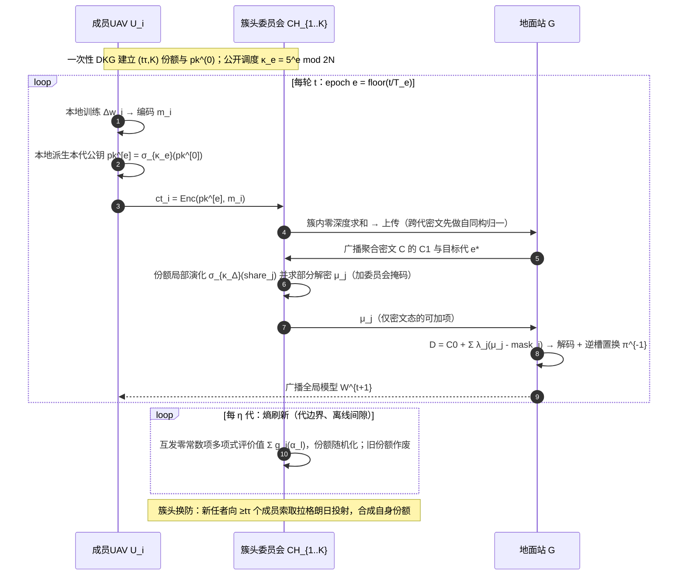
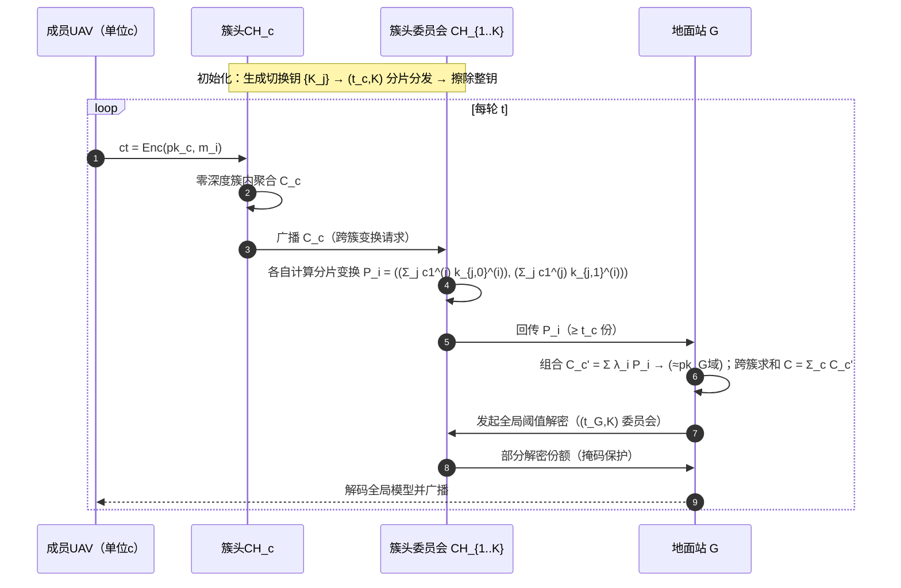
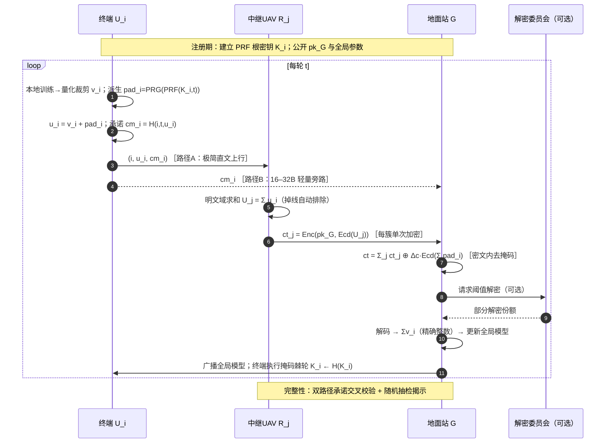
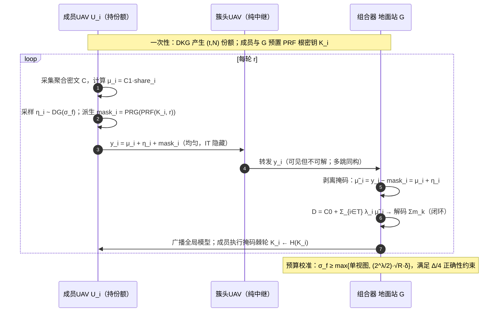
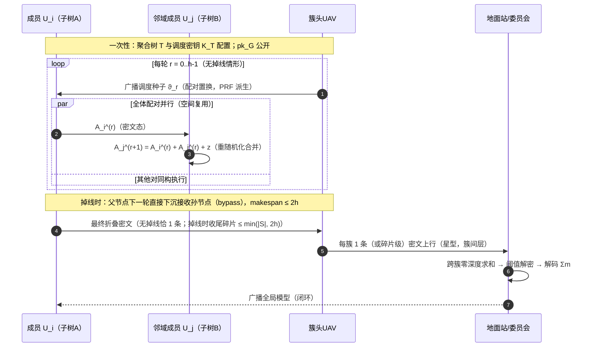

# 面向 UAV 的五个层次型全同态联邦学习方案

**—— 全 FHE · 全层次型 · 全 UAV 场景 · 创新点落在 RLWE 公式层或复杂交互层**

> **说明**：本文件为独立新设计，与本目录此前任何一版方案设计不存在继承关系。五个方案共享"成员/终端 → 簇头 UAV → 地面站/云"的层次拓扑原型，但密码内核彼此独立，可正交组合。
> **格式**：每个方案按 **x.1 场景 → x.2 要解决的问题 → x.3 创新点与总体设计目标 → x.4 威胁模型 → x.5 符号系统 → x.6 方案设计（整体架构与可见性矩阵 + RLWE 公式展开 + 闭环推导）→ x.7 实体交互时序图 → x.8 安全性分析证明** 组织。
> **方案索引**：K1 AKE-HFL（自同构密钥演化）｜K2 TEK-HFL（门限评估密钥）｜K3 BlindEnc-HFL（掩码旁路加密卸载）｜K4 TierFlood-HFL（分层淹没预算）｜K5 BFA-HFL（簇内蝶式密文聚合）。

---

# 第 I 部分　通用密码底座（五个方案共享）

## A. 环、分布与 RLWE 假设

- 环 $\mathcal{R}=\mathbb{Z}[X]/(X^N+1)$，$N=2^k$；$\mathcal{R}_q=\mathcal{R}/q\mathcal{R}$，$q$ 为 RNS 模数链乘积，$\lceil\log_2 q\rceil$ 与 $N$ 按 128-bit 安全选取。
- 秘密分布 $\chi_s$：系数取自 $\{0,\pm1\}$（HW 可调）；误差分布 $\chi_e$：离散高斯 $\mathcal{D}_{\mathbb{Z},\sigma_e}$；淹没分布 $\phi$：$\mathcal{D}_{\mathbb{Z},\sigma_f}$（$\sigma_f\gg\sigma_e$）。
- **RLWE 假设**：$(a,\ a s+e)\approx_c U(\mathcal{R}_q^2)$，$a\xleftarrow{\$}\mathcal{R}_q$，$s\leftarrow\chi_s$，$e\leftarrow\chi_e$。由 RLWE 得 IND-CPA。本章五个方案同时适用于 BFV（$\Delta=\lfloor q/t\rfloor$ 精确算术）与 CKKS（$(\Delta_c,\text{scale})$ 近似算术）；公式统一以 $\Delta$ 表示明文缩放因子，CKKS 情形 $\Delta=\Delta_c$、解码取 $\lfloor\cdot/\Delta\rceil$。

## B. 基础公式（全套沿用）

**密钥生成**：$s\leftarrow\chi_s,\ a\xleftarrow{\$}\mathcal{R}_q,\ e\leftarrow\chi_e,\ b=-a s+e \bmod q$，$\mathrm{pk}=(b,a)$，$\mathrm{sk}=s$。

**加密**：$u\leftarrow\chi_s,\ e_0,e_1\leftarrow\chi_e$，
$$\mathrm{ct}=(c_0,c_1)=\big(b u+e_0+\Delta m,\ a u+e_1\big)\bmod q .$$

**解密**：$D=c_0+c_1 s=\Delta m+\underbrace{(e u+e_0+e_1 s)}_{\nu}\bmod q$，$\mathrm{Dec}=[\![\lfloor D/\Delta\rceil]\!]$。

**同态加法**（零深度）：$\mathrm{ct}_1+\mathrm{ct}_2=(c_{1,0}+c_{2,0},\ c_{1,1}+c_{2,1})$，$\nu_{add}=\nu_1+\nu_2$。

**明文（标量）乘**：$k\cdot\mathrm{ct}=(k c_0,k c_1)$，$\nu'=\|k\|_\infty\nu$。

**噪声预算不等式**：可正确解码当且仅当 $\|\nu_{sum}\|_\infty<q/(2\Delta)$（BFV）或 $|\nu_{sum}|<\Delta/2$（CKKS 逐槽）。

**gadget 密钥切换（KS，通用工具）**：数字基 $g$，$L=\lceil\log_g q\rceil$，$c_1=\sum_{j=0}^{L-1}c_1^{(j)}g^j$，$\|c_1^{(j)}\|_\infty\le g/2$；切换钥元组 $\{K_j=(k_{j,0},k_{j,1})\}$ 满足 $k_{j,0}+k_{j,1}s'=g^j s+e_j$（$s$ 源密钥、$s'$ 目标密钥），则
$$\mathrm{KS}(\mathrm{ct})=\Big(c_0+\sum_j c_1^{(j)}k_{j,0},\ \sum_j c_1^{(j)}k_{j,1}\Big),\qquad \varepsilon_{\mathrm{KS}}=\sum_j c_1^{(j)}e_j .$$
**关键引理（线性性）**：$\mathrm{KS}$ 对切换钥 $\{K_j\}$ 逐元线性；即若 $K_j=\sum_{i}K_j^{(i)}$，则 $\sum_i \mathrm{KS}^{(i)}(\mathrm{ct})=\mathrm{KS}(\mathrm{ct})$（K2 的构件）。

**阈值重构（Shamir over $\mathcal{R}_q$）**：$(t,K)$ 分享 $\{f(\alpha_j)\}_{j=1}^{K}$，$\alpha_j\in\mathbb{Z}_q$ 为公开求值点，$f\in\mathcal{R}_q[Y]$，$f(0)=s$；任意 $|T|\ge t$：$s=\sum_{j\in T}\lambda_j f(\alpha_j)$，$\lambda_j=\prod_{l\in T\setminus\{j\}}\frac{\alpha_l}{\alpha_l-\alpha_j}$。采用小拉格朗日常数求值点序列（exceptional sequence 构造）抑制 $\max_j|\lambda_j|$。

## C. 通用威胁模型元件

- **HBC（诚实但好奇）**：忠实执行协议，企图从视图推断；
- **主动/恶意**：可偏离协议（伪造、选择性丢弃、重放）；
- **捕获**：物理提取实体全部存储（UAV 场景的现实威胁）；**移动攻击者**：可按期/按节点自适应地更换捕获对象，跨时间累积视图；
- **合谋界**：明文写出"哪些实体不同时共谋"（$<\kappa$ 个成员合谋、单台服务器等）；
- **掉线**：随机掉线（信道/能量）与选择性掉线（恶意）；默认要求方案给出显式掉线语义；
- **安全定义**：IND-CPA（RLWE）、半诚实模拟（理想/现实世界）、信息论隐藏（统计距离 SD $\le 2^{-\lambda}$）、$t$-阈值隐私。

**可见性矩阵约定**：每个方案在 x.6 给出"实体 × 信息对象"矩阵，行为实体、列为信息对象，单元格填"可见/不可见/仅见变换态"。

---

# 第 II 部分　五个层次型方案

## 5　方案 K1：AKE-HFL —— 自同构密钥演化层次联邦学习

### 5.1 场景

**长航时多蜂群协同侦察/巡检**（连续数日乃至数周的大范围空域作业）：成员 UAV $\{U_i\}_{i=1}^N$ 分属若干簇，簇头 UAV 作空中聚合器，地面站 $\mathcal{G}$ 做全局聚合与模型广播。蜂群特征：簇头按期轮换（电量/任务互换）、成员增减频繁、**簇头 UAV 是高价值捕获目标**（飞行于不可控空域）；攻击者可为**移动攻击者**——本期俘获甲机、下期俘获乙机，静态密钥材料下拆解存储、跨期累积终将凑齐阈值。

任何具备长期密钥材料的实体（簇头委员会）都在时间维度上暴露给捕获攻击。本方案的目标：**让密钥材料"随时间流动"**——演化在密码学上真实发生（密文、公钥、份额同步迁移），但对网络几乎零成本（零交互、零噪声），并周期注入熵使旧捕获失效。

### 5.2 要解决的问题

1. **全目录隐含静态密钥假设**：16 篇文献（含 2026 最新）无一提供密钥生命周期管理；参与集变化时要么重建密钥（MASER 需重新聚合公钥），要么依赖信任根重新分发（SKHE 的 TA、FedPHE 的 KDC）；
2. **捕获弹性没有密码学答案**：SKHE/SecFed 把"兜底"押在 TEE 上；无 TEE 的 UAV 场景下，无任何方案讨论"捕获后剩余系统的安全性"；
3. **密钥更新的两难**：传统密钥轮换 = 重新分发 + 密文重加密（$O(N^2)$ 交互 + 停机）或全员换钥（训练中断）；在窄带、间歇的 UAV 链路上均不可行；
4. **跨轮密文聚合缺位**：若允许密钥逐轮演化，则"上一轮在途的密文与下一轮聚合"需要**跨代密文归一**机制——现无任何方案处理（全部假定单一密钥域）。

### 5.3 创新点与总体设计目标

**创新全部落在 RLWE 公式层**——利用环自同构 $\sigma_\kappa: X\mapsto X^\kappa$ 这一 RLWE 结构自带的"免费变换"：

1. **自同构迁移恒等式（核心）**：对密文、公钥与**秘密份额**同时施加同一自同构，
   $$\sigma_\kappa(\mathrm{ct})\ \text{解密于}\ \sigma_\kappa(\mathrm{sk})\iff \langle\sigma_\kappa(\mathrm{ct}),\sigma_\kappa(\mathrm{sk})\rangle=\sigma_\kappa(\Delta m+\nu),$$
   且份额以**局部运算**同步演化：$f(\alpha_j)\xmapsto{\sigma_\kappa}\sigma_\kappa(f(\alpha_j))=g(\alpha_j)$（$g$ 系数逐项演化、$g(0)=\sigma_\kappa(s)$，求值点 $\alpha_j\in\mathbb{Z}_q$ 为常数、被自同构固定）——**零通信、零噪声增长**（系数带符号置换，$\|\sigma_\kappa(f)\|_\infty=\|f\|_\infty$）；
2. **演化与刷新解耦（经济学）**：逐 epoch 演化 = 纯局部 $O(N)$ 运算、无需任何人协调（调度 $\kappa_e=5^e\bmod 2N$ 公开）；稀疏的"零分享熵刷新"（每 $E$ 个 epoch 一次、簇头间 $O(K^2)$）负责真正的熵注入与前向安全。**对齐问题与安全问题分离**：前者免费、高频；后者付费、低频；
3. **跨代密文归一**：任意两代的密文经公开自同构差 $\sigma_{\kappa_{e'}\kappa_e^{-1}}$ 即归一到同一密钥域（噪声不变），天然支持在途密文与突发迟到聚合；
4. **槽置换簿记引理**：CKKS 打包域中自同构诱导槽置换 $\pi$；全流程在"当前轮转域"内聚合、解码后以 $\pi^{-1}$ 一次性复原——给出正确性证明（见 5.8 定理 T5）。

设计目标：(G1) 密钥/密文/份额三方同步演化零交互；(G2) 移动攻击者前向安全（刷新周期为安全参数）；(G3) 跨代密文可归一无缝聚合；(G4) 演化与聚合均为零深度、噪声不新增；(G5) 无 TTP、无在线信任根。

### 5.4 威胁模型

- **移动攻击者 $\mathcal{A}_{mob}$**：可按 epoch 自适应捕获簇头（提取其全部存储：当前份额、状态），**每个刷新区间内至多捕获得 $\tau-1$ 个不同簇头**；跨区间可累计超过 $\tau$ 个不同对象（这正是静态方案被破的场景）；被捕获节点下轮修复/换防后脱离敌手；
- **地面站 $\mathcal{G}$**：诚实但好奇（见聚合视图与部分解密消息）；
- **成员 UAV**：诚实但好奇，至多 $\tau-1$ 个成员与 $\mathcal{G}$ 合谋（构成内部合谋界）；
- **信道**：完全公开（允许搭线窃听者收集全部消息）；
- **目标**：(i) 个体更新机密性（对 $\mathcal{G}$ 与窃听者）；(ii) **前向密钥安全**——刷新区间之间的捕获视图不可拼合，任意跨区间合谋不能重构主密钥；(iii) 演化/刷新/迁移不破坏聚合正确性（闭环）；
- **不含**：主动篡改聚合（可验证性留给本批外方向）；成员侧投毒。

### 5.5 符号系统

| 符号 | 含义 |
|---|---|
| $\mathcal{R}_q,\ N,\ q,\ \chi_s,\chi_e$ | 密文环、维度、模数、秘密/误差分布 |
| $\sigma_\kappa$ | 环自同构 $X\mapsto X^\kappa$，$\gcd(\kappa,2N)=1$，$\kappa\equiv 1\ (\mathrm{mod}\ 4)$ |
| $\kappa_e=5^e\bmod 2N$ | 第 $e$ 代公开演化参数（$e=\lfloor t/T_e\rfloor$，$T_e$ 为轮-代比） |
| $(\mathrm{pk}^{[0]},\mathrm{sk}^{[0]}=s^{[0]})$ | 初始密钥对（一次性 DKG） |
| $\mathrm{pk}^{[e]},\ s^{[e]}=\sigma_{\kappa_e}(s^{[0]})$ | 第 $e$ 代公钥与秘密（$s^{[e]}$ 任何单一实体均不以完整形式持有） |
| $\{f(\alpha_j)\}_{j=1}^{K}$ | $(t_\tau,K)$ 份额（簇头委员会持有），$\alpha_j\in\mathbb{Z}_q$ 公开求值点 |
| $\mathrm{share}_j^{[e]}=\sigma_{\kappa_e}(f(\alpha_j))$ | 第 $e$ 代份额 |
| $\pi_\kappa$ | $\sigma_\kappa$ 诱导的 CKKS 槽置换 |
| $\eta$ | 熵刷新周期（每 $\eta$ 代一次） |
| $\nu,\varepsilon_{\mathrm{KS}}$ | 解密噪声、密钥切换噪声 |
| $T_e$ | 每代包含的训练轮数 |

### 5.6 方案设计

#### 5.6.1 整体架构与实体可见性

**三实体层次架构**：成员 UAV（$\mathcal{U}$，加密方）→ 簇头委员会（$\mathcal{C}=\{\mathrm{CH}_1,\dots,\mathrm{CH}_K\}$，聚合中继 + 解密委员会）→ 地面站（$\mathcal{G}$，全局聚合 + 协调）。成员**不持有任何秘密**（只有公钥与本地数据）；秘密以 $(t_\tau,K)$ 份额形式分散于簇头委员会；$\mathcal{G}$ 持零秘密。

| 信息对象 \ 实体 | 成员 $U_i$ | 簇头 $\mathrm{CH}_j$ | 地面站 $\mathcal{G}$ | 窃听者 | 被捕获的 $\mathrm{CH}_j^\star$ |
|---|---|---|---|---|---|
| 自身更新 $\Delta w_i$（明文） | 可见 | 不可见 | 不可见 | 不可见 | — |
| 全部密文 $\{\mathrm{ct}_i\}$ | 仅自身 | 可见（密文态） | 可见（密文态） | 可见（密文态） | 可见（密文态） |
| 主密钥 $s^{[e]}$ | 不可见 | 不可见（仅份额） | 不可见 | 不可见 | 不可见（仅份额） |
| 份额 $\mathrm{share}_j^{[e]}$ | 不可见 | 仅自身份额 | 不可见 | 不可见 | **可见（仅该代；刷新后作废）** |
| 演化调度 $\kappa_e$、$\pi_{\kappa}$ | 可见（公开） | 可见 | 可见 | 可见 | 可见 |
| 聚合明文 $\sum_i \Delta w_i$ | 不可见（G 广播的是全局模型） | 不可见 | 经解码可见 | 不可见 | 不可见 |

**初始化（一次性，离线完成）**：簇头委员会执行分布式密钥生成（DKG）：各方对 $s^{[0]}$ 贡献份额，联合产出 $\mathrm{pk}^{[0]}=(b^{[0]},a^{[0]})$ 与 $(t_\tau,K)$ 份额 $\{f(\alpha_j)\}$；公开调度表 $\{\kappa_e\}$。

#### 5.6.2 RLWE 公式展开（演化三恒等式）

**(i) 自同构作用**：$\sigma_\kappa(\sum a_l X^l)=\sum a_l X^{\kappa l \bmod 2N}$（模 $X^N+1$ 归约），系数层面为"带符号置换"：$\|\sigma_\kappa(f)\|_\infty=\|f\|_\infty$；对 $\kappa\equiv 1\ (\mathrm{mod}\ 4)$，槽层面为纯置换 $\pi_\kappa$（无共轭）。

**(ii) 密钥与公钥演化恒等式**：
$$b^{[e]}=\sigma_{\kappa_e}(b^{[0]}),\quad a^{[e]}=\sigma_{\kappa_e}(a^{[0]})\ \Longrightarrow\ b^{[e]}=-a^{[e]}s^{[e]}+\sigma_{\kappa_e}(e^{[0]}),$$
即 $(\mathrm{pk}^{[e]},\ s^{[e]})$ 仍是合法 RLWE 密钥对（误差项为置换后的高斯，分布不变）——**公钥可由任何一方本地派生**（$\mathrm{pk}^{[0]}$ 与调度全公开），无一次分发。

**(iii) 份额演化恒等式**（K1 的数学核心）：
$$\mathrm{share}_j^{[e]}:=\sigma_{\kappa_e}\big(\mathrm{share}_j^{[0]}\big)=\sigma_{\kappa_e}\big(f(\alpha_j)\big)=\sigma_{\kappa_e}(f)\big(\alpha_j\big)=g^{(e)}(\alpha_j),$$
其中 $g^{(e)}(Y)=\sum_{i}\sigma_{\kappa_e}(f_i)Y^i$ 为系数逐项演化后的分享多项式。**推导**：$\sigma$ 是环同态，$\mathrm{share}_j=\sum_i f_i\alpha_j^i\Rightarrow\sigma(\mathrm{share}_j)=\sum_i\sigma(f_i)\sigma(\alpha_j)^i=\sum_i\sigma(f_i)\alpha_j^i=g(\alpha_j)$（应用 $\sigma(\alpha_j)=\alpha_j$：求值点取标量常数，被一切自同构固定）。于是 $g(0)=\sigma(f_0)=\sigma(s^{[0]})=s^{[e]}$：**每个簇头仅对自身份额做一次系数置换，即完成密钥演化**——零通信、零噪声（置换）、拉格朗日系数不变。

**(iv) 密文迁移**：第 $e$ 代密文迁至第 $e'$ 代：
$$\mathrm{ct}^{[e\to e']}=\sigma_{\kappa_{e'}\kappa_e^{-1}\bmod 2N}\big(\mathrm{ct}^{[e]}\big),\qquad 
\langle\mathrm{ct}^{[e\to e']},s^{[e']}\rangle=\sigma_{\kappa_{e'}\kappa_e^{-1}}\big(\Delta m+\nu\big)=\Delta\, \pi_{e'\setminus e}(m)+\nu'. $$
噪声 $\nu'$ 为 $\nu$ 的带符号置换（分布不变）；消息槽被公开置换 $\pi_{e'\setminus e}$ 作用。

**(v) 熵刷新**（每 $\eta$ 代、代边界处）：第 $j$ 个簇头采样零常数项多项式 $g_j(Y)=\sum_{i=1}^{t_\tau-1}\rho_{j,i}Y^i$（$\rho_{j,i}\xleftarrow{\$}\mathcal{R}_q$），互发评价值，各员更新
$$\mathrm{share}_l^{[e]}\ \leftarrow\ \mathrm{share}_l^{[e]}+\sum_{j=1}^{K}g_j(\alpha_l),$$
秘密不变（$\sum_j g_j(0)=0$），旧份额对多项式 $g$ 的对应关系被随机化 $t_\tau-1$ 度——**旧份额与新份额属于同一秘密的独立随机分享**。

#### 5.6.3 闭环协议与公式推导（第 $t$ 轮，$e=\lfloor t/T_e\rfloor$）

**① 本地训练与编码**：$U_i$ 得 $\Delta w_i^t$，量化编码 $m_i=\mathrm{Ecd}(\Delta w_i^t)\in\mathcal{R}$（CKKS 打包槽语义，$N/2$ 槽）。

**② 加密**（第 $e$ 代公钥，本地派生）：$u_i\leftarrow\chi_s$，$e_{i,0},e_{i,1}\leftarrow\chi_e$，
$$\mathrm{ct}_i=\big(c_{i,0},c_{i,1}\big)=\big(b^{[e]}u_i+e_{i,0}+\Delta m_i,\ a^{[e]}u_i+e_{i,1}\big)\bmod q .$$

**③ 上传与聚合**（零深度）：$\mathcal{G}$ 汇总（可经簇内先加）
$$C=\sum_i \mathrm{ct}_i=\Big(\sum_i c_{i,0},\sum_i c_{i,1}\Big),\qquad 
C_0+C_1s^{[e]}=\Delta\sum_i m_i+\sum_i\nu_i .$$
在途跨代密文按 (iv) 归一到当前代 $e^\star$：$C\leftarrow\sum_i \mathrm{ct}_i^{[e_i\to e^\star]}$。

**④ 阈值解密（委员会）**：$\mathcal{G}$ 广播 $C_1$ 与目标代 $e^\star$；任一在线子集 $T$（$|T|\ge t_\tau$）各自计算并回传
$$\mu_j=C_1\cdot \mathrm{share}_j^{[e^\star]}+\underbrace{\mathsf{mask}_j}_{\text{成对掩码}},\qquad 
\mathcal{G}:\ D=C_0+\sum_{j\in T}\lambda_j(\mu_j-\mathsf{mask}_j)=C_0+C_1\underbrace{\sum_{j\in T}\lambda_j\,\mathrm{share}_j^{[e^\star]}}_{=s^{[e^\star]}}+\underbrace{\sum_{j\in T}\lambda_j\varepsilon_j^{\mathrm{KS}}}_{\text{份额传输噪声}} .$$
其中掩码为委员会内部成对 PRG 掩码（相加抵消，见 K4 对份额传输保护的统一处理）。

**⑤ 解码与槽复原**：
$$\sum_i \Delta w_i^t=\pi^{-1}_{\kappa_{e^\star}}\Big(\big\lfloor D/\Delta\big\rceil\Big),\qquad \text{（CKKS：逐槽取整；BFV：模 }t\text{ 取整）}$$
噪声条件：$\big\|\sum_i\nu_i+\sum_{j\in T}\lambda_j\varepsilon_j^{\mathrm{KS}}\big\|_\infty<q/(2\Delta)$——**仅含加法与置换，深度零消耗**。

**⑥ 更新与闭环**：$W^{t+1}=W^t+\frac{1}{N}\sum_i\Delta w_i^t$，$\mathcal{G}$ 广播（明文模型为标准 FedAvg 输出）。**闭环成立**：下一轮回到 ①；代边界 $t\equiv 0\ (\mathrm{mod}\ T_e)$ 时全员（隐式）切换 $\kappa_e$；每 $\eta$ 代插一次⑤.5.6.2-(v) 刷新（$\eta T_e$ 轮一次，$O(K^2)$ 条消息，训练间隙执行）。

**⑦ 与轮换/接替的接口**：簇头换防——新任簇头在换防窗口内向 $\ge t_\tau$ 个现有成员索取份额投射（各方以拉格朗日结构给出 $\lambda_j f(\alpha_{\mathrm{new}})$ 分片，合成其份额）；被撤换者份额在下一次熵刷新后彻底作废。

### 5.7 实体交互时序图

### 5.8 安全性分析证明

**记录约定**：敌手视图含全部公开消息、其腐化实体的内部状态；"$\approx_c$"为概率多项式不可区分，"$\approx_s$"为统计距离 $\le 2^{-\lambda}$。所有引理证明给出梗概；$\mathcal{R}_q$ 上自同构的置换性质为标准事实（$\kappa\equiv1\bmod4$ 时保持槽结构）。

> **引理 K1.1（置换不变性）**：对任意 $f\in\mathcal{R}_q$，$\|\sigma_\kappa(f)\|_\infty=\|f\|_\infty$，且 $\sigma_\kappa(e)\sim\chi_e$（循环对称高斯经置换/取反后分布不变）。
> *证明梗概*：$\sigma_\kappa$ 在系数向量上是带符号置换（$X^{\kappa l}=(-1)^{\lfloor \kappa l/N\rfloor}X^{\kappa l\bmod 2N}$），$\ell_\infty$ 范数与循环对称分布均不变。∎

> **引理 K1.2（演化恒等式）**：对任意成员集合 $T\subseteq[K]$，$|T|\ge t_\tau$：$\sum_{j\in T}\lambda_j\,\mathrm{share}_j^{[e]}=s^{[e]}$ 对一切 $e$ 成立。且 $\mathrm{pk}^{[e]}$ 是 $s^{[e]}$ 的合法公钥。
> *证明梗概*：份额演化恒等式（5.6.2-iii）保证 $\{\mathrm{share}_j^{[e]}\}$ 是多项式 $g^{(e)}$ 在原点集 $\{\alpha_j\}$ 上的求值，$g^{(e)}(0)=\sigma_{\kappa_e}(s^{[0]})$；拉格朗日系数仅依赖公开点集，不变；公钥分量为 RLWE 样本的自同构像。∎

> **定理 K1-A（闭环正确性）**：设 $\|\sum_i\nu_i\|_\infty+\max_j|\lambda_j|\cdot\|\sum_{j\in T}\varepsilon_j^{\mathrm{KS}}\|_\infty<q/(2\Delta)$，则每轮解码恰为 $\sum_i\Delta w_i^t$（CKKS 在 $\Delta/2$ 精度内），且全流程同态深度为 0。
> *证明梗概*：沿 5.6.3 的公式链逐步代入引理 K1.1/K1.2；置换与加法不消耗模数层级。∎

> **定理 K1-B（密文与公钥的 IND-CPA）**：若 RLWE$_{N,q,\chi}$ 困难，则对任意 $e$，$\mathrm{pk}^{[e]}$ 下加密满足 IND-CPA；且相邻两代公钥不可区分于独立均匀样本。
> *证明梗概*：$a^{[e]}=\sigma_{\kappa_e}(a^{[0]})$ 是均匀分布的自同构像（仍均匀，需 $\kappa_e$ 与 $2N$ 互素，由 $5$ 的阶保证）；$b^{[e]}=-a^{[e]}s^{[e]}+\sigma(e)$ 是标准 RLWE 样本；归约到 RLWE。∎

> **定理 K1-C（移动攻击者下的前向安全）**：设每刷新区间至多捕获 $t_\tau-1$ 个簇头（跨区间累计不限），则任意多项式时间敌手对"$s^{[0]}$ 的任意函数"的区分优势 $\le \mathsf{negl}(\lambda)$（视图对 $s^{[0]}$ 统计独立化）。
> *证明梗概（混合论证）*：(1) 自同构可逆且公开，敌手可将任一区间的捕获视图归一到任意同区间代，WLOG 按区间聚合；(2) **单区间**：捕获的 $\le t_\tau-1$ 份份额是同一多项式上的求值，由 Shamir 的逐点均匀性，$t_\tau-1$ 个求值对 $g^{(e)}(0)$（及 $s^{[0]}$）统计独立——存在模拟器仅凭公开输入生成同分布视图；(3) **跨区间**：刷新（5.6.2-v）注入的随机多项式使相邻区间的分享相互独立、且旧份额对新多项式不构成求值——任意跨区间份额组合无法对应同一个分享多项式，形式化为"跨区间拼合失败引理"；(4) 逐区间混合即得结论。**边界（诚实声明）**：同一刷新区间内捕获 $\ge t_\tau$ 个簇头即恢复该区间秘密（阈值方案的信息论极限，无法规避）；安全参数即"刷新周期 $\eta T_e$"的设计旋钮。∎

> **定理 K1-D（阈值与地面站视图隐私）**：$\mathcal{G}$ 与 $\le t_\tau-1$ 个被腐化簇头的联合视图仅由 $\{C_0,C_1\}$、掩码后份额与公开参数构成；在 RLWE 与掩码 PRG 下其分布可由模拟器生成，其中 $\sum_i m_i$ 为唯一被揭示信息。
> *证明梗概*：份额经成对掩码后为伪随机（类似 VLSFL 的双掩码论证）；$C$ 是密文，模拟器用"加密零"替换 $C$ 中消息项、以 RLWE 归约；解码输出仅依赖 $\sum_i m_i$。∎

> **定理 K1-E（槽置换簿记正确性）**：若解码后按公开逆置换 $\pi^{-1}_{\kappa_{e^\star}}$ 重排，则得真实坐标序的聚合模型。
> *证明梗概*：CKKS 中自同构对应复数槽的重排 $\pi_\kappa$（$\kappa\equiv1\bmod4$：纯置换）；聚合在同域内线性进行，槽置换对所有项一致作用；$D/\Delta$ 解码得到 $\pi(\sum m_i)$，逆置换复原。BFV 情形无槽共轭问题，直接系数级成立。∎

**威胁模型 ↔ 机制对照表**

| 威胁 | 机制 | 定理 |
|---|---|---|
| 窃听者/地面站窥探个体更新 | RLWE 加密 + 阈值解密 | K1-B, K1-D |
| 移动攻击者跨期累积捕获 | 逐代自同构演化 + 周期熵刷新 | K1-C |
| 单次捕获后长期可用 | 刷新后旧份额作废（同秘密新分享） | K1-C |
| 密钥更新/演化导致的正确性破坏 | 三恒等式 + 槽簿记 | K1-A, K1-E |
| $\le t_\tau-1$ 内部合谋 | $(t_\tau,K)$ 阈值 | K1-D |

---

## 6　方案 K2：TEK-HFL —— 门限评估密钥的跨单位层次聚合

### 6.1 场景

**多单位/多运营商联合蜂群**（跨单位联合建模）：各作业单位（消防、测绘、电力巡检等）保有独立蜂群与独立密钥体系（跨单位**不存在**共同的密钥分发信任）；为训练联合模型，需要把"各簇密文域"归并到全局域（跨簇密钥切换），并支持槽操作（旋转/Galois 钥）与可选的密文乘法（重线性化钥）。簇头 UAV = 各单位代表节点；地面站 $\mathcal{G}$ = 区域指挥中心（中立协调者）。

现实约束：(a) 簇头飞行于开放空域、参与轮换，**被捕获是高概率事件**；(b) 各单位的密钥材料托管给"另一单位或中心"在组织上不可接受——**跨簇合并能力本身是需要共同行使的权限**；(c) 评估密钥体积大（CDKS 报告：$n=8192$、4 方时评估钥 2.25 MB），是存储与暴露负担。

### 6.2 要解决的问题

1. **变换能力的单点化**：跨簇切换/旋转能力现有形态要么由单一服务器完整持有、要么托管给 TEE；一旦该点被捕获，攻击者即掌握"任意密文的跨域重定向/合并"能力；
2. **切换材料的"残差可验证"攻击面**：对密钥小、结构特殊的目标密钥，完整持有的切换钥与源密钥联合可支撑"小残差穷举"型攻击（对切换关系 $k_{j,0}+k_{j,1}s_G=g^j s_c+e_j$ 检验 $e_j$ 的小性）；**分散持有必须同时消灭"可检验残差"本身**；
3. **可用性随单点波动**：簇头轮换、掉线、换防常态下，单点持有的变换能力直接成为服务瓶颈；
4. **治理缺位**：多单位联合体中"谁有权执行跨簇合并"在密码协议层无表达。

### 6.3 创新点与总体设计目标

**创新落在 RLWE 公式层**——以"评估密钥对整钥的线性性"与"Shamir 求值的均匀性"两个代数事实为支点：

1. **门限评估密钥（Threshold Evaluation Key, TEK）**：任一族**对密钥线性**的评估密钥（跨簇切换钥 $\{K_j\}$、旋转钥 $\{\mathrm{RK}_\theta\}$、重线性化钥）逐系数以 $(t_c,K)$ Shamir 分享于全部 $K$ 个簇头。联合变换协定：
   $$\sum_{i\in T}\lambda_i\,P_i^{(c)}=\mathrm{KS}(C_c)\quad(\forall |T|\ge t_c),$$
   $P_i^{(c)}$ 为第 $i$ 个簇头用自身分片算出的**分片变换输出**（公式 6.6.2）。**重组即精确**：输出与"完整单点持有"逐比特同分布、噪声逐项相同（无 $\sqrt{\cdot}$ 级放大）；
2. **结构性盲化（一次性，免逐轮交互）**：分片是随机多项式的求值，$\le t_c-1$ 个分片与任何公开信息组合**信息论独立**于评估密钥；且分享求值不继承整钥的代数关系——攻击者无法构造"小残差"检验（对照单点持有的标准攻击），**捕获 + 源密钥不再构成威胁**；
3. **可用性**：任意 $t_c$ 个簇头在线即完成变换（容忍 $K-t_c$ 掉线）；不同在线子集得到的变换输出恒定（线性重组一致性）；
4. **治理语义**：跨单位合并 = ≥$t_c$ 个单位代表共同执行的动作；单点失陷不构成"合并权"。

设计目标：(G1) 任何 $<t_c$ 实体组不可执行跨簇变换（信息论）；(G2) 联合变换与单点变换逐项等价（正确性+噪声）；(G3) 容忍 $K-t_c$ 簇头掉线；(G4) 捕获视图对评估钥 IT 盲化；(G5) 与 K1/K4 正交可叠加。

### 6.4 威胁模型

- **簇头**：HBC；可被捕获（提取全部存储）。**至多 $t_c-1$ 个簇头**同时被腐化/合谋（捕获等价于腐化；捕获者可能知晓其归属簇的源密钥 $s_c$）；
- **地面站 $\mathcal{G}$**：HBC；不与 $\ge t_c$ 个簇头合谋；$\mathcal{G}$ 的错误聚合由下游解码异常暴露（正确性验证层为本批外挂件，见阅读报告 G7）；
- **成员**：HBC；不持有其簇的完整密钥（簇密钥以 $(t_c',n_c)$ 分享于簇成员，密文由成员用公开 $\mathrm{pk}_c$ 加密）；
- **初始化阶段的诚实假设**：切换钥的"生成-分享-擦除"窗口内，生成方诚实执行并擦除中间态（可选强化：以两方掩码化生成消除该假设；见 6.6.4）；
- **掉线**：随机掉线 ≤ $K-t_c$；
- **目标**：(i) 变换输出正确；(ii) $<t_c$ 分片视图 IT 盲化；(iii) 捕获（含源密钥）不产生目标密钥恢复攻击；(iv) 运营语义上的"联合审批"；
- **不含**：$\mathcal{G}$ 的输出正确性证明；成员投毒。

### 6.5 符号系统

| 符号 | 含义 |
|---|---|
| $\mathcal{R}_q,N,q$ | 通用底座；本方案可用 BFV 或 CKKS |
| $s_c,\ \mathrm{pk}_c$ | 簇 $c$ 的密钥对（$(t_c',n_c)$ 分享于簇成员） |
| $s_G,\ \mathrm{pk}_G$ | 全局密钥对（$(t_G,K)$ 分享于簇头，复用阈值结构） |
| $g,\ L,\ c_1^{(j)}$ | gadget 基、数字数、$c_1$ 的第 $j$ 个数字分解（$\|c_1^{(j)}\|_\infty\le g/2$） |
| $K_j=(k_{j,0},k_{j,1})$ | 簇 $c\to$ 全局的切换钥元组：$k_{j,0}+k_{j,1}s_G=g^j s_c+e_j$ |
| $K_j^{(i)}$ | 第 $i$ 个簇头持有的分片（$(t_c,K)$ Shamir，求值点 $\alpha_i$） |
| $P_i^{(c)}$ | 分片变换输出（第 $i$ 簇头对 $C_c$ 的部分 KS） |
| $\lambda_i$ | 拉格朗日系数（公开点集、公开子集决定） |
| $t_c,\ K$ | 变换门限与簇头总数 |
| $\varepsilon_{\mathrm{KS}}$ | 切换噪声 $\sum_j c_1^{(j)}e_j$ |

### 6.6 方案设计

#### 6.6.1 整体架构与实体可见性

**架构**：成员 → 簇头 $\mathrm{CH}_c$（簇内零深度聚合）→ **簇头委员会**（跨簇变换，≥$t_c$ 联合执行）→ 地面站 $\mathcal{G}$（跨簇求和 + 全局阈值解密协调）。

| 信息对象 \ 实体 | 成员 $U$ | 簇头 $\mathrm{CH}_i$ | 地面站 $\mathcal{G}$ | 窃听者 | 被捕获 $\mathrm{CH}^\star$（+知 $s_c$） |
|---|---|---|---|---|---|
| 个体更新 | 仅自身 | 不可见 | 不可见 | 不可见 | 不可见 |
| 簇聚合密文 $C_c$ | 不可见 | 可见（密文态） | 可见（密文态） | 可见（密文态） | 可见（密文态） |
| 评估密钥 $K_j$（整钥） | 不可见 | **不可见**（仅分片） | 不可见 | 不可见 | **不可见（仅分片）** |
| 分片 $K_j^{(i)}$ | 不可见 | 仅自身分片 | 不可见 | 不可见 | 可见（$\le t_c-1$ 份时无意义） |
| 分片变换输出 $P_i$ | 不可见 | 仅自身 | 可见（聚合用） | 可见（密文态） | 可见 |
| 全局明文模型 | 经广播可见（授权结果） | 经广播可见 | 解码可见 | 不可见 | 不可见 |

#### 6.6.2 RLWE 公式展开与联合变换协定

**（i）整钥关系（源 $s_c$ → 目标 $s_G$）**：采样 $k_{j,1}\xleftarrow{\$}\mathcal{R}_q$、$e_j\leftarrow\chi_e$，
$$K_j=\big(k_{j,0},\ k_{j,1}\big),\qquad k_{j,0}=-k_{j,1}s_G+g^j s_c+e_j \bmod q .$$
性质：$k_{j,0}+k_{j,1}s_G=g^j s_c+e_j$（可验证的"整钥"关系——单点持有场景的攻击面即在此检验上）。

**（ii）单点密钥切换（标准，作为正确性基准）**：$c_1=\sum_j c_1^{(j)}g^j$，
$$\mathrm{KS}(C)=\Big(C_0+\sum_j c_1^{(j)}k_{j,0},\ \sum_j c_1^{(j)}k_{j,1}\Big),\qquad C_0+\mathrm{KS}(C)_1\cdot s_G=C_0+C_1 s_c+\varepsilon_{\mathrm{KS}},$$
$$\varepsilon_{\mathrm{KS}}=\sum_j c_1^{(j)}e_j .$$

**（iii）分片化（逐系数 Shamir）**：对 $k_{j,0},k_{j,1}$ 的**每个系数**在 $\mathbb{Z}_q$ 上做 $(t_c,K)$ Shamir 分享（同一组公开求值点 $\{\alpha_i\}$），第 $i$ 簇头持有
$$K_j^{(i)}=\big(k_{j,0}^{(i)},\ k_{j,1}^{(i)}\big):=\big(P_{j,0}(\alpha_i),\ P_{j,1}(\alpha_i)\big),\qquad \sum_{i\in T}\lambda_i\,k_{j,\bullet}^{(i)}=k_{j,\bullet}\ \ (\forall |T|\ge t_c).$$

**（iv）联合变换协定（核心恒等式）**：设在线子集 $T$，$|T|\ge t_c$，各 $\mathrm{CH}_i$ 用自身分片计算
$$P_i^{(c)}=\Big(\sum_j c_1^{(j)}k_{j,0}^{(i)},\ \ \sum_j c_1^{(j)}k_{j,1}^{(i)}\Big),$$
$\mathcal{G}$ 组合：
$$\boxed{\ \sum_{i\in T}\lambda_i\,P_i^{(c)}=\Big(\sum_j c_1^{(j)}\underbrace{\sum_{i\in T}\lambda_i k_{j,0}^{(i)}}_{=k_{j,0}},\ \sum_j c_1^{(j)}\underbrace{\sum_{i\in T}\lambda_i k_{j,1}^{(i)}}_{=k_{j,1}}\Big)=\mathrm{KS}(C_c)\ }$$
**推导**：$P_i^{(c)}$ 对分片逐元线性；拉格朗日重组对每个 gadget 分量精确还原整钥分量；$c_1^{(j)}$ 公开。**因此联合输出与单点输出逐项相同，切换噪声同为 $\varepsilon_{\mathrm{KS}}=\sum_j c_1^{(j)}e_j$，无额外放大**。

**（v）旋转钥/重线性化钥的门限化（同构推广）**：旋转钥元组满足 $k_{\theta,0}+k_{\theta,1}s=\sigma_\theta(s)g^j+e_{\theta,j}$；对其施加 (iii)-(iv) 同样流程即得门限旋转；重线性化钥同理（对 $s\otimes s$ 的线性封装）。

**（vi）闭环轮循环**（第 $t$ 轮）：① 成员以 $\mathrm{pk}_c$ 加密 $\mathrm{ct}_{c,i}=\mathrm{Enc}(\mathrm{pk}_c,m_i)$；② $\mathrm{CH}_c$ 零深度聚合 $C_c=\sum_i\mathrm{ct}_{c,i}$；③ 向全体簇头广播 $C_c$（跨簇可批量打包为一次请求）；④ 每个在线 $\mathrm{CH}_i$（$\ge t_c$ 个）回传 $P_i^{(c)}$；⑤ $\mathcal{G}$ 组合 $C_c'=\sum_{i\in T}\lambda_iP_i^{(c)}$（≈ $\mathrm{pk}_G$ 域），并跨簇求和 $C=\sum_c C_c'$；⑥ 全局阈值解密（委员会 $(t_G,K)$）；⑦ 解码得 $\sum_c\sum_i m_{c,i}$，闭环回到 ①。全程深度 0（仅加法+KS 线性组合）。

#### 6.6.3 初始化（生成-分享-擦除）与可选强化

簇 $c$ 的 $\mathrm{CH}_c$（知道 $s_c$）本地生成 $\{K_j\}_{j=0}^{L-1}$，随机采样分享多项式并**经安全信道分发分片**，随后**擦除** $\{K_j\}$ 与 \(s_c\) 的本地副本（若 $s_c$ 本就以份额存在，则由 $t_c'$ 个簇成员联合投射生成 $g^j s_c$ 项，流程相同）。可选强化：以掩码化两方生成（生成方持随机掩码、委员会持校验）消除"生成窗口单点"，代价为一次额外交互——列为部署选项。

#### 6.6.4 存储与通信核算

- 分片与整钥同尺寸（Shamir 特性），**单簇头存储不降但功能受门限约束**；若追求存储下降，可将 gadget 数字的高位组下放至"冷分片"（仅变换需求时唤醒），低频组件（旋转钥）分片存于离线存储；
- 每轮变换通信：每簇 $t_c$ 条分片输出（密文态），$C$ 个簇合计 $Ct_c$ 条上行至 $\mathcal{G}$；相较单点方案增加 $(t_c-1)$ 倍变换上行，换取信息论盲化与容错——**这是本方案的显式代价**。

### 6.7 实体交互时序图

### 6.8 安全性分析证明

> **引理 K2.1（线性性）**：$\mathrm{KS}(\cdot)$ 对切换钥元组逐元线性：若 $K_j=\sum_i K_j^{(i)}$ 则 $\sum_i\mathrm{KS}^{(i)}(C)=\mathrm{KS}(C)$。
> *证明梗概*：$\mathrm{KS}$ 输出为 $\sum_j c_1^{(j)}\cdot(\cdot)$ 的线性组合（通用底座 B）。∎

> **引理 K2.2（分片均匀性/IT 盲化）**：设分享多项式系数独立均匀，则任意 $|C|<t_c$ 个分片 $\{K_j^{(i)}\}_{i\in C}$ 的联合分布与整钥 $K_j$ 独立（存在模拟器仅凭公开参数生成同分布）。
> *证明梗概*：随机多项式的任意 $<t_c$ 个求值联合均匀；整钥为第 $t_c$ 个自由度，在给定观察下仍均匀 → 视图与整钥独立。∎

> **定理 K2-A（联合变换正确性）**：$\forall |T|\ge t_c$：$\sum_{i\in T}\lambda_i P_i^{(c)}=\mathrm{KS}(C_c)$ 逐系数精确成立；组合密文的解密误差为 $\nu+\varepsilon_{\mathrm{KS}}$，**与单点持有方案逐项相同**。
> *证明梗概*：代入 6.6.2-(iv) 恒等式与引理 K2.1/K2.2 的拉格朗日精确性；无额外四舍五入或近似。∎

> **定理 K2-B（$<t_c$ 非可执行性）**：对任意概率多项式敌手 $\mathcal{A}$，持任意 $|C|<t_c$ 个分片、全部公开消息、任意辅助信息，其输出 $\mathrm{KS}(C_c)$ 的区分优势 $\le 2^{-\lambda}+\mathsf{negl}(\lambda)$。
> *证明梗概*：$\mathrm{KS}(C_c)$ 为缺失分片的线性函数（缺项含独立均匀未知量）；由引理 K2.2，缺失分片分布均匀且未知 → 任何候选输出与真值可区分性由一次一密式论证界定。∎

> **定理 K2-C（捕获+源密钥安全性："残差检验不可构造"）**：设敌手捕获 $|C|<t_c$ 个簇头并**已知** $s_c$。则：(i) 单点场景的标准攻击——由整钥关系 $k_{j,0}+k_{j,1}s_G=g^j s_c+e_j$ 检验残差 $e_j$ 的小性——在分片场景下**不存在可达的检验式**；(ii) $s_G$ 的恢复优势 $\le 2^{-\lambda}+\mathsf{negl}(\lambda)$。
> *证明梗概*：敌手可构造的最强检验为 $\sum_{i\in C}\lambda_i(k_{j,0}^{(i)}+k_{j,1}^{(i)}\hat s-g^j s_c)$ $=\sum_{i\in C}\lambda_i k_{j,0}^{(i)}+\hat s\sum_{i\in C}\lambda_i k_{j,1}^{(i)}-(\sum_{i\in C}\lambda_i)g^j s_c$：其中两个求和项均为分片的线性组合——**随机多项式的部分求值不满足整钥关系**（求值与系数演化不交换），其值为均匀环元素；故对一切候选 $\hat s$（含真值）该量均非小量，检验统计量不存在。$s_G$ 的任何函数同样由引理 K2.2 落入盲化域。∎

> **定理 K2-D（掉线可用性与一致性）**：任意两个在线集 $T_1,T_2$（$|T_i|\ge t_c$）产出的变换输出相同；$K-t_c$ 个簇头任意掉线不阻断服务。
> *证明梗概*：两者均等于 $\mathrm{KS}(C_c)$（定理 K2-A 对任意子集成立），故一致。∎

> **定理 K2-E（端到端隐私）**：$\mathcal{G}$、任意 $\le t_c-1$ 簇头、任意成员子集的联合视图不能解出跨簇合并明文；全局明文仅对 $\mathcal{G}$（或授权委员会）在完成阈值解密后可见。
> *证明梗概*：$C_c$ 的 IND-CPA（RLWE）；$P_i$ 为评估钥分片的线性像，由引理 K2.2 为盲化；全局解密受 $(t_G,K)$ 阈值约束（复用 K1 论证）。∎

**威胁模型 ↔ 机制对照表**

| 威胁 | 机制 | 定理 |
|---|---|---|
| 单点捕获变换能力 | $(t_c,K)$ 分片 + 联合变换 | K2-B |
| 捕获 + 源密钥联合攻击 | 结构性盲化（分片不继承整钥关系） | K2-C |
| 簇头掉线/轮换 | 任意子集重组一致性 | K2-D |
| $\mathcal{G}$/内部合谋窥探 | RLWE + 阈值 + 盲化分片 | K2-E |
| 联合体治理（单方不可合并） | $t_c$ 门限审批语义 | K2-B |

---

## 7　方案 K3：BlindEnc-HFL —— 掩码旁路加密卸载的弱终端层次聚合

### 7.1 场景

**UAV 辅助的地面物联网联合训练**（灾害监测、农田传感、城市管网）：地面终端（LoRa/MCU 级，电池以周计）无法承担 CKKS 加密（NTT/RNS 运算量级 $10^8$ 周期级）；其上行链路为窄带（单包百字节级），而单条密文在典型参数下约 $2N\log_2 q$ 比特（$N=2^{13},\log_2 q=200$ 时约 400 KB）。中继 UAV（簇头）算力与电量高一个数量级、可承担加密与聚合；地面站/云负责全局聚合与（可选）阈值解密。

**核心问题**：如何让"连加密都跑不动"的终端参与全同态联邦学习，且不牺牲"聚合进入统一密文管道"的性质？

### 7.2 要解决的问题

1. **加密单价的错配**：MaskCrypt（TDSC'25）等只压缩"加密多少参数"（$\rho N$ 个权重），**不降低加密一次的单价**；对 MCU 级终端，即使 5% 的加密量仍不可承受；
2. **上行带宽的单位成本**：密文每值成本 $\approx 4\lceil\log_2 q\rceil$ 比特（两分量、槽利用率 $N/2$），明文每值成本仅需量化位宽 $\approx 20\text{–}50$ 比特——**差 15–40×**；
3. **混合接入缺位**：现有方案要么默认全员 HE（强节点假设），要么纯掩码聚合（SecAgg 系：$O(n^2)$ 成对协商、掩码在全员间抵消、无法与 HE 管道合并、无阈值解密语义）；
4. **掉线处理成本**：SecAgg 式成对掩码在掉线时必须触发恢复子协议；弱终端场景无法承受额外交互轮。

### 7.3 创新点与总体设计目标

1. **掩码旁路协议（Masked Bypass）**：终端侧仅执行"量化 + 一次性掩码 + 提交承诺"（PRG 与整数加法级开销）；掩码明文以极简编码上行；**中继 UAV 先明文域求和、再单次加密**（每簇一次加密）；地面站在密文内以明文加法一次性去掩码——"加密的算力与通信"从弱节点整体卸载到强节点，且聚合仍进入统一 RLWE 管道、与（阈值）解密兼容；
2. **零噪声掩码**：掩码/去掩码全部在明文域完成，**不消耗任何 RLWE 噪声预算**（区别于噪声类保护）；唯一的量化代价是"幅值预算"——给出闭环不等式（掩码位宽 $b$、参与数 $n$、模数容量 $q/\Delta$ 的联合约束，公式 7.6.2-③）；
3. **任意掉线天然兼容**：每个终端持独立掩码（无成对结构），去掩码按"实收集合"计算，掉线零额外交互（对照 SecAgg 的成对掩码恢复）；
4. **双路径承诺 + 抽检的完整性**：终端承诺经中继与第二轻量路径双发，地面站交叉校验（延迟确定性检测）+ 随机抽检（当轮概率检测）——把"恶意中继篡改掩码明文"变成可检测事件。

设计目标：(G1) 终端成本降至 PRG+加法级（较本地 CKKS 加密下降 $\ge 3$ 个数量级）；(G2) 终端上行压至量化位宽（$\ge 15\times$）；(G3) 掩码统计安全 $\le 2^{-\lambda_1}$（对中继与窃听者）；(G4) 聚合正确性、噪声零增、掉线零处理；(G5) 与全 HE 成员的统一管道兼容。

### 7.4 威胁模型

- **中继 UAV（簇头）**：HBC——**可见全部掩码明文 $u_i$**，企图反推 $v_i$；可转为恶意（篡改/伪造/丢弃）；
- **地面站 $\mathcal{G}$**：HBC——持有全部掩码密钥（去掩码能力），但只见到**聚合后的**密文与总和；
- **窃听者**：被动收集全部无线消息（含掩码明文）；
- **显式排除（诚实声明）**：**中继与地面站共谋**（两者合并即可解出个体更新——与"单跳信任"类方案同级假设）；恶意终端的投毒（可叠加输入校验/鲁棒层）；
- **掉线**：终端任意掉线（实收集合语义）；中继掉线由网络层改路（协议无状态耦合）；
- **目标**：(i) $v_i$ 对中继/窃听者统计隐藏；(ii) 聚合正确（闭环恒等式）；(iii) 中继篡改可检测（延迟确定性 + 当轮概率性）；(iv) 前向不可链接（掩码棘轮）。

### 7.5 符号系统

| 符号 | 含义 |
|---|---|
| $v_i\in[-R,R]^d$ | 终端 $i$ 量化后的更新向量（整数，本地裁剪保证幅值界 $R$） |
| $\Delta_c$ | 明文缩放因子（与全 HE 管道一致） |
| $K_i$ | 终端 $i$ 与 $\mathcal{G}$ 共享的 PRF 根密钥（注册期一次） |
| $\mathsf{pad}_i^{(t)}\in[0,P)^d$ | 第 $t$ 轮掩码向量：$\mathsf{pad}_i^{(t)}=\mathrm{PRG}\big(\mathrm{PRF}(K_i,t)\big)$ |
| $P=2^{b}$ | 掩码模（整数幅度窗口），$b$ 由幅值预算确定 |
| $u_i=v_i+\mathsf{pad}_i^{(t)}$ | 掩码明文（整数向量，逐坐标） |
| $\mathsf{cm}_i=H(i,t,u_i)$ | 承诺（短哈希，双路径下发） |
| $\mathcal R_j,\ C_j$ | 中继 $j$ 与簇聚合密文 |
| $n,\ \lambda_1$ | 实收终端数、统计安全参数 |
| $\nu,\ \Delta_c$ | 解密噪声与缩放精度 |

### 7.6 方案设计

#### 7.6.1 整体架构与实体可见性

**架构**：终端（明文掩码极简上行）→ 中继 UAV（明文域求和 + 单次加密）→ 地面站 $\mathcal{G}$（密文内去掩码 + 全局聚合）→（可选）阈值解密委员会。

| 信息对象 \ 实体 | 终端 $U_i$ | 中继 $\mathcal R_j$ | 地面站 $\mathcal{G}$ | 窃听者 | 委员会 |
|---|---|---|---|---|---|
| 个体更新 $v_i$（明文） | 可见 | **不可见**（仅见 $u_i$，统计隐藏） | 不可见 | 不可见（仅见 $u_i$） | 不可见 |
| 掩码 $\mathsf{pad}_i$ | 可见（派生） | 不可见 | 可见（派生） | 不可见 | 不可见 |
| 掩码明文 $u_i$ | 可见 | 可见 | 不可见（仅见聚合） | 可见 | 不可见 |
| 欠掩码聚合密文 | 不可见 | 可见（自身生成） | 可见 | 可见（密文态） | 可见（密文态） |
| 全局明文和 $\sum v_i$ | 不可见 | 不可见 | 可见（解码+去掩码后） | 不可见 | 仅参与解密所得明文 |

#### 7.6.2 RLWE 公式展开与闭环推导

**① 终端的量化与掩码**（明文域，零密码开销）：$v_i=\mathrm{Quant}(\Delta w_i)$（本地裁剪 $\|v_i\|_\infty\le R$），
$$u_i=v_i+\mathsf{pad}_i^{(t)}\ \ (\text{逐坐标整数加}),\qquad u_i\in[0,\ P+2R).$$

**② 中继的明文域聚合与单次加密**：
$$U_j=\sum_{i\in\mathcal S_j}u_i,\qquad \mathrm{ct}_j=\big(bu+e_0+\Delta_c\,\mathrm{Ecd}(U_j),\ au+e_1\big),$$
其中 $\mathcal S_j$ 为中继实收集合（掉线终端自动排除，其掩码也不进入后续去掩码——**掉线零处理**）。

**③ 幅值预算闭环不等式**（掩码位宽-模数容量-参与数）：
$$\underbrace{\|\mathrm{Ecd}(U)\|_\infty\le n(P+2R)\Delta_c<q/2}_{\text{无回绕条件}},\qquad 
\underbrace{b=\lceil\log_2 2R\rceil+\lambda_1}_{\text{统计隐藏}},\qquad 
\underbrace{\left|\nu_{sum}\right|<\Delta_c/2}_{\text{解码条件（与无掩码同）}} .$$
由 $b$ 代入得设计式：$\lceil\log_2 q\rceil-\lceil\log_2\Delta_c\rceil\ \ge\ \lceil\log_2 n\rceil+b+1$（示例：$n=64,\ R=2^{16},\ \lambda_1=30\Rightarrow b=47$，需约 54 比特容量——典型 $q$（$\ge 2^{200}$）余量充裕）。**注意第三式不含 $b$**：掩码不改变噪声，只改变消息幅值——这是"零噪声"的形式化含义。

**④ 地面站在密文内去掩码**：对实收集合按密钥派生 $\Sigma\mathsf{pad}=\sum_{i\in\bigcup_j\mathcal S_j}\mathsf{pad}_i^{(t)}$，明文加同态：
$$\mathrm{ct}=\sum_j\mathrm{ct}_j\ \oplus\ \Delta_c\,\mathrm{Ecd}(\Sigma\mathsf{pad}),\qquad 
D=\mathrm{ct}_0+\mathrm{ct}_1s=\Delta_c\,\mathrm{Ecd}\Big(\sum v_i\Big)+\nu_{sum}.$$

**⑤ 解码与拆掩码**：
$$\sum v_i=\Big\lfloor \frac{D}{\Delta_c}\Big\rceil-\Sigma\mathsf{pad},$$
**推导链**（闭环）：$D/\Delta_c=\mathrm{Ecd}(\Sigma u)+\nu/\Delta_c=\mathrm{Ecd}(\Sigma v+\Sigma\mathsf{pad})+\nu'$；取整（$|\nu'|<1/2$ 时）得 $\Sigma v+\Sigma\mathsf{pad}$（精确整数）；减去公开派生的 $\Sigma\mathsf{pad}$ 得 $\Sigma v$ **精确**。聚合模型 $\bar v=\frac{1}{n}\Sigma v$ 还原为浮点更新并入全局模型。

**⑥ 闭环轮循环**：$t\!\to\!t\!+\!1$：终端更新掩码棘轮 $K_i\!\leftarrow\!H(K_i)$（旧码即毁，前向性）；中继清零轮缓冲；$\mathcal{G}$ 更新账户；回到 ①。

#### 7.6.3 完整性协议（双路径承诺 + 抽检）

- 终端计算 $\mathsf{cm}_i=H(i,t,u_i)$，随 $u_i$ 经**路径 A**（中继）上行；同时以极小报文（约 16–32 B）经**路径 B**（次跳中继/低码率信标/延迟上行）送达 $\mathcal{G}$；
- **延迟确定性检测**：$\mathcal{G}$ 校对 A、B 两路 $\mathsf{cm}_i$ 集合；任何不一致即暴露中继篡改（检测时延 = 路径 B 时延）；
- **当轮概率检测**：$\mathcal{G}$ 随机抽 $\mathcal S\subset$ 实收集合（大小 $s$），要求中继揭示 $\{u_i,\mathsf{cm}_i\}_{i\in\mathcal S}$，校验 $H(i,t,u_i)=\mathsf{cm}_i$。若中继篡改 $m$ 个终端的 $u_i$：
  $$\Pr[\text{当轮未检出}]\approx\Big(1-\frac{s}{n}\Big)^{m}\ \Longrightarrow\ \text{多轮累计以几何速率趋零}.$$

### 7.7 实体交互时序图

### 7.8 安全性分析证明

> **定理 K3-A（掩码统计安全）**：设 $\mathsf{pad}_i$ 逐坐标均匀于 $[0,P)$ 且与数据独立，则对中继/窃听者，$\forall v,v'\in[-R,R]^d$：
> $$\mathsf{SD}\Big(\mathcal{D}(u\,|\,v),\ \mathcal{D}(u\,|\,v')\Big)\ \le\ \frac{d\cdot 2R}{P}\ \le\ d\cdot 2^{-\lambda_1}\ \le\ 2^{-\lambda_1+\lceil\log_2 d\rceil}.$$
> *证明梗概*：逐坐标 $u_j=v_j+\mathrm{pad}_j$ 为 $[0,P)$ 上均匀（平移不改变均匀性），两假设分布为同一均匀分布平移 $\delta_j=|v_j-v'_j|\le 2R$：单坐标 $\mathsf{SD}=\delta_j/P\le 2R/P$；向量取并集界。∎

> **定理 K3-B（闭环正确性）**：若③中三式成立，则 $\mathcal{G}$ 输出恰为 $\sum_{i\in\bigcup_j\mathcal S_j}v_i$（逐坐标整数精确）。
> *证明梗概*：7.6.2-(5) 推导链；取整误差仅由 $\nu_{sum}$ 决定（与无掩码聚合完全相同），掩码项在取整后精确抵消。∎

> **定理 K3-C（地面站视图最小化）**：$\mathcal{G}$（及委员会）的视图可被模拟器仅以 $\{\sum v_i\}$、$\{\Sigma\mathsf{pad}\}$ 与公开参数生成；个体 $v_i$ 不出现在任何中间对象中。
> *证明梗概*：$\mathcal{G}$ 只接收各簇聚合密文（IND-CPA 下等价于聚合值本身）与承诺（哈希，PRF 模型下为随机串）；单次解密揭示全局和；去掩码为公开派生量的加/减。∎

> **定理 K3-D（前向不可链接）**：掩码棘轮 + 状态擦除下，敌手在第 $t$ 轮捕获终端存储，其视图对第 $t'<t$ 轮的 $(u_i^{(t')},v_i^{(t')})$ 无优势（PRG/PRF 单向性）；且不同轮的 $\{u_i^{(t)}\}_t$ 在中继视图下两两联合均匀。
> *证明梗概*：$K_i^{(t)}=H^{(t)}(K_i^{(0)})$ 的单向链使过去轮密钥为 PRF 输出；各轮 $\mathsf{pad}$ 独立均匀 → 联合视图为均匀平移。∎

> **定理 K3-E（完整性）**：(i) 双路径承诺一致 ⇒ 中继无法在 A、B 路径不一致的情况下同时欺骗 $\mathcal{G}$；(ii) 篡改 $m$ 个终端的当轮检出概率 $1-(1-s/n)^m$，延迟检出概率 $1$（路径 B 到达后）。
> *证明梗概*：$H$ 抗碰撞性使 $u_i$ 的修改必然改变 $\mathsf{cm}_i$；两路径独立传输使"同时改写两路"超出中继能力。∎

> **定理 K3-F（混合管道兼容）**：旁路聚合结果与全 HE 成员的密文分量满足同态加法结合律，统一解密输出 $\sum_{\text{HE}}m+\sum_{\text{bypass}}v$；槽对齐由统一 `Ecd` 布局保证（零深度）。
> *证明梗概*：同一 $\mathrm{pk}_G$ 下密文加法分量逐项相加；消息域加法结合性。∎

**威胁模型 ↔ 机制对照表**

| 威胁 | 机制 | 定理 |
|---|---|---|
| 中继/窃听者窥探个体更新 | OTP 掩码（统计隐藏，零噪声） | K3-A |
| 掩码破坏正确性 | 幅值预算三式 + 密文内去掩码 | K3-B |
| $\mathcal{G}$ 越权窥探个体 | 只见聚合（阈值解密兼容） | K3-C |
| 捕获终端 + 轮间关联 | 掩码棘轮 + 状态擦除 | K3-D |
| 恶意中继篡改/伪造 | 双路径承诺 + 抽检 | K3-E |
| 异构成员混入统一管道 | 同 pk + 同编码 + 零深度 | K3-F |
| **中继+地面站共谋（不含）** | ——（显式排除，单跳信任） | —— |

---

## 8　方案 K4：TierFlood-HFL —— 阈值解密的掩码-淹没分层预算

### 8.1 场景

**多部门联合应急蜂群**（跨机构救援：应急、消防、医疗、交通的 UAV 集群协同训练态势感知模型）：解密权以 $(t,N)$ 份额分散于各成员 UAV；簇头 UAV 逐跳中继解密份额；地面指挥中心作为**组合器**完成最终重构与解码。训练周期长（$R$ 可达数百至数千轮），组合器在每一轮、每一链路反复接触份额材料。

**关键观察**：阈值方案的长期风险不在单次泄密，而在**时间的积累**——组合器（或任何长期观察者）跨轮收集"份额-视角"样本，样本数越多，对被保护量的统计压力越大。与此同时，解密份额的每一份上传都在无线信道上暴露于簇头与窃听者。本方案回答：**这些暴露面分别需要什么级别的保护、各付多少噪声代价、跨 $R$ 轮如何校准预算。**

### 8.2 要解决的问题

1. **保护资源错配**：CDKS 系方案对每一条份额、在每一条链路上都施加满配噪声淹没——而份额在传输途中的暴露与在组合器处的暴露其**风险结构完全不同**（前者是"看得见单条份额"，后者是"反复看得见带密钥的线性组合"），统一淹没把噪声预算浪费在低风险侧；
2. **组合器侧提取风险的形式化缺位**：不带噪声的组合视图 $C_1\cdot s_G$ 在 $C_1$ 可逆时可直接反解主密钥；现有文献只给单视图淹没引理，**没有"跨轮组合"的预算理论**——固定 $\sigma_f$ 会随轮数 $R$ 增长而失效（样本平均攻击），或被过度设计；
3. **份额路由的 $O(N^2)$ 与掉线包袱**：CDKS-LSS 用 LSS + P2P 再分享换阈值性，付出每方每轮约百 MB 级通信；掉线与恶意份额需要额外机制；
4. **份额传输成本可以极低**（SKHE 实测单份额仅 83–86 B）：说明"轻量份额协议"现实可行——保护机制不应把份额协议做重。

### 8.3 创新点与总体设计目标

1. **掩码-淹没分层分工（经济学核心）**：份额的**传输链路**（成员→簇头→组合器）全部以"成员-组合器共享 PRF"的环上均匀掩码保护——对簇头/窃听者**信息论隐藏且零噪声**（OTP 在环上同样成立）；**噪声淹没只保留给组合器视图**。噪声预算集中投向唯一需要它的对手；
2. **跨轮泄漏累积定理（核心新分析）**：以 χ² 散度组合论证给出 $R$ 轮组合视图统计距离的上界
   $$\varepsilon_R\ \le\ \tfrac12\sqrt{\big(1+\delta^2/\sigma_f^2\big)^{R}-1}\ \lesssim\ \tfrac12\sqrt{R}\cdot\frac{\delta}{\sigma_f},$$
   由此得**视野感知的淹没设计式** $\sigma_f=\tfrac12\sqrt{R}\,\delta\,2^{\lambda}$（$\delta$ 为份额假设差在公开 $C_1$ 尺度下的界）；同一定理同时解释了"样本平均攻击"（$\sqrt{R}$ 信噪比增益）与"预算应随轮数增长"的一致性——把单视图淹没（CDKS 式）升级为 $R$-轮保障；
3. **掉线原生的轻量路由**：掩码独立（无成对结构、无 LSS、无再分享），任意 $\ge t$ 在线子集直接可解，掉线零处理、零重分发；
4. **预算仲裁框架**：给出"观察者 × 所需保护 × 机制 × 噪声代价"的完整分配表（8.6.4），并提供组合器侧的两档配置（标准单组合器 + 附加"半拆分"加固）。

设计目标：(G1) 传输侧份额对簇头/窃听者 IT 隐藏（SD $\le2^{-\lambda_1}$）；(G2) 组合器视图 $R$ 轮统计距离 $\le 2^{-\lambda}$（定理化、可校准）；(G3) 任意 $\ge t$ 在线子集正确重构；(G4) 无 P2P、无再分享、掉线零处理；(G5) 淹没噪声代价可闭式计算并与其他方案叠加。

### 8.4 威胁模型

- **成员 UAV**：HBC；至多 $t-1$ 个成员与任何外部实体合谋（阈值界）；
- **簇头 UAV**：HBC 中继（可见全部经手消息；可多跳）；
- **窃听者**：被动收集全部无线消息、可跨轮关联；
- **组合器（地面站 $\mathcal{G}$）**：HBC——**长期视图**包含每轮的 $\{C_1^{(r)}\}$、掩码剥离后的份额与最终明文；是本方案的**主要风险承担者**；
- **移动敌手**：可跨轮选择腐化组合器的辅助进程/存储；
- **不含**：$\ge t$ 个成员与组合器的同步合谋（进入阈值内=拥有解密权，属定义域）；主动破坏正确性（验证层外挂）；
- **目标**：(i) 传输侧 IT 隐藏；(ii) 组合器侧 $R$ 轮累计统计界；(iii) 正确重构；(iv) 掉线/迟到语义为"在线子集"。

### 8.5 符号系统

| 符号 | 含义 |
|---|---|
| $s_G,\ \{\mathrm{share}_i\}$ | 主密钥与其 $(t,N)$ Shamir 份额（求值点 $\{\alpha_i\}$） |
| $C=(C_0,C_1)$ | 本轮聚合密文 |
| $\mu_i=C_1\cdot \mathrm{share}_i$ | 份额的部分解密值（危险对象） |
| $\mathsf{mask}_i^{(r)}$ | 环上均匀掩码：$\mathsf{mask}_i^{(r)}=\mathrm{PRG}\big(\mathrm{PRF}(K_i,r)\big)\in\mathcal{R}_q$ |
| $\eta_i^{(r)}\leftarrow\mathcal{D}_{\mathbb{Z},\sigma_f}$ | 淹没分量（只有它承载噪声；永不公开） |
| $y_i=\mu_i+\eta_i+\mathsf{mask}_i$ | 上行的受保护份额 |
| $\sigma_f,\ \delta,\ \lambda$ | 淹没标准差、假设差尺度、统计安全参数 |
| $R,\ T$ | 训练轮数、在线子集 |
| $\lambda_i$ | 拉格朗日系数（公开） |
| $\nu_{\mathrm{mk}},\varepsilon_{\mathrm{ms}}$ | 密文自身噪声、降模舍入误差 |

### 8.6 方案设计

#### 8.6.1 整体架构与实体可见性

**架构**：成员（持份额）→ 簇头（纯中继）→ 组合器（剥离掩码、拉格朗日重构、解码）。

| 信息对象 \ 实体 | 成员 $U_i$ | 簇头 | 组合器 $\mathcal{G}$ | 窃听者 | $t-1$ 成员合谋 + $\mathcal{G}$ |
|---|---|---|---|---|---|
| 自身份额 $\mathrm{share}_i$ | 可见 | **不可见** | 不可见（仅见湮没后态） | 不可见 | 仅其自身份额 |
| 上行 $y_i$ | 自身生成 | 可见（**均匀、IT 隐藏**） | 可见 | 可见（**均匀、IT 隐藏**） | 同 $\mathcal{G}$ 视图 |
| $\eta_i$（淹没） | 自身生成 | 不可见 | **不可见** | 不可见 | 不可见 |
| $\mu_i$（净份额值） | 可见（自身） | **不可见** | 不可见（只在含 $\eta$ 的态中出现） | 不可见 | 不可见 |
| 重构密钥相位 $C_1 s_G$ | 不可见 | 不可见 | 可见（带噪声 $\Sigma\lambda\eta$） | 不可见 | 可见（带噪） |
| 全局明文 $\sum m_i$ | 不可见 | 不可见 | 可见（解码输出） | 不可见 | 可见 |

#### 8.6.2 RLWE 公式展开与闭环推导

**① 密文聚合（与通用底座一致）**：$C=\sum_k\mathrm{ct}_k$，$C_0+C_1 s_G=\Delta\sum_k m_k+\sum_k\nu_k$。

**② 受保护份额的生成与上行**（第 $r$ 轮，成员 $i$）：
$$\mu_i=C_1\cdot \mathrm{share}_i,\qquad y_i=\mu_i+\eta_i+\mathsf{mask}_i\ \bmod q,\qquad \eta_i\leftarrow\mathcal{D}_{\mathbb{Z},\sigma_f},\ \ \mathsf{mask}_i\leftarrow\mathrm{Uniform}(\mathcal{R}_q).$$
- **传输侧（簇头/窃听者）视图**：$\mathsf{mask}_i$ 均匀于 $\mathcal{R}_q$ ⇒ $y_i$ 与 $(\mu_i,\eta_i)$ 独立、$y_i$ 均匀 ⇒ **SD $=0$（信息论零泄漏，零噪声代价）**；
- **组合器视图**（剥掩码后）：$\tilde\mu_i=y_i-\mathsf{mask}_i=\mu_i+\eta_i$。

**③ 重构与解码（闭环）**：
$$D=C_0+\sum_{i\in T}\lambda_i\,\tilde\mu_i
=C_0+\underbrace{\Big(\sum_{i\in T}\lambda_i\Big)C_1\cdot\mathrm{share}_i}_{=\,C_1s_G}+\sum_{i\in T}\lambda_i\eta_i
=\Delta\sum_k m_k+\underbrace{\sum_k\nu_k+\sum_{i\in T}\lambda_i\eta_i}_{\nu_{\mathrm{tot}}},$$
$$\sum_k m_k=\Big\lfloor D/\Delta\Big\rceil\quad\text{当}\ \|\nu_{\mathrm{tot}}\|_\infty<\Delta/2\ (\text{CKKS 逐槽}；\text{BFV 类似}).$$
**推导**：拉格朗日恒等式 $\sum_{i\in T}\lambda_i\mathrm{share}_i=s_G$ 对任意 $|T|\ge t$ 成立（与在线集合无关的性质）；掩码项在 $\mathcal{G}$ 处被精确减除（整数/环上减法），**不进入噪声**；唯一新增噪声 = 淹没项 $\sum\lambda_i\eta_i$。

**④ 淹没预算的设计方程（本方案的核心工程式）**：
$$\boxed{\ \sigma_f\ \ge\ \max\Big\{\underbrace{\tfrac{2^{\lambda}}{\sqrt{2\pi}}\,\delta}_{\text{单视图 SD}},\ \underbrace{\tfrac{2^{\lambda}}{2}\sqrt{R}\ \delta}_{\text{跨轮累计（定理 K4-C）}}\Big\}\ }\qquad\text{s.t.}\quad
\max_j|\lambda_j|\cdot t\cdot\sigma_f\ \lesssim\ \frac{\Delta}{4}\ .$$
其中 $\delta$ 为"相邻份额假设差在公开 $C_1$ 尺度下的界"（保守取 $\delta=\|C_1\|_\infty$-派生的设计上界，工程中以参数校准表取值；见 8.8 的诚实边界说明）。**关键收益**：掩码把传输侧的淹没需求归零，使式中的 $\sigma_f$ 只需服务组合器一个对手；$R$ 轮视野以 $\sqrt{R}$ 显式进入设计。

**⑤ 掉线与迟到语义**：$T=$ 在截止时刻前到达的份额集合；$\lambda_i$ 按 $T$ 现算（点集与子集公开）。若 $|T|<t$：本轮合并到下一窗口或转降级模式（明示活性语义）；无任何份额恢复子协议。

**⑥ 闭环轮循环**：$r\to r+1$：成员刷新掩码（PRF 棘轮 $K_i\leftarrow H(K_i)$）；$\mathcal{G}$ 的新一轮视图与前轮**统计独立**（掩码独立 + 淹没独立），跨轮唯一的不变量是 $\sigma_f$ 的预算校准（定理 K4-C 给出累计界）。

#### 8.6.3 组合器侧两档配置

- **标准档**：单组合器 + 上节淹没预算（$\sigma_f$ 由 ④ 式确定）；
- **加固档（半拆分）**：解密委员会中任一子集 $T=T_A\sqcup T_B$ 的两半由两个不共谋的进程分别求和，各自先本地加噪 $\eta_i$ 再交换"半和"（$\sum_{T_A}\lambda_i(\mu_i+\eta_i)$ 与 $\sum_{T_B}\lambda_i(\mu_i+\eta_i)$），最终仅组合器 $Z$ 做加法；任一半进程单独视图对 $s_G$ 的提取难度增加一个"未知半和"掩体（半和是均匀随机多项式系数的线性像）。该档把 ④ 式中 $\delta$ 的有效值进一步压低（半视图的假设差含另一半的均匀项），代价是一次额外进程间交换。**定位**：纵深防御选项，不改变主协议。

#### 8.6.4 预算仲裁表（观察者 × 机制 × 代价）

| 观察者 | 风险结构 | 机制 | 噪声代价 | 备注 |
|---|---|---|---|---|
| 簇头（中继） | 单条份额、逐跳 | 环上均匀掩码（OTP） | **0** | IT 隐藏；对照 CDKS 式逐条淹没 |
| 窃听者 | 全消息收集、可跨轮 | 掩码 + PRF 棘轮 | **0** | 掩码跨轮独立 |
| 组合器（单轮） | 带密钥线性组合 | 淹没 $\sigma_f^{(1)}=2^{\lambda}\delta/\sqrt{2\pi}$ | $\propto\sigma_f^{(1)}$ | 单视图引理 |
| 组合器（$R$ 轮） | 样本平均攻击 | 视野校准 $\sigma_f^{(R)}=\frac{2^\lambda}{2}\sqrt{R}\delta$ | $\propto\sqrt{R}$ | **定理 K4-C** |
| $\le t-1$ 合谋+组合器 | 阈值内最坏界 | 阈值 + 淹没（同上） | 同上 | 超阈值不可防（定义域） |
| 掉线 | 可用性 | 在线子集重构（独立掩码） | 0 | 无恢复子协议 |

### 8.7 实体交互时序图

### 8.8 安全性分析证明

> **定理 K4-A（传输侧 IT 隐藏）**：$\mathsf{mask}_i$ 均匀于 $\mathcal{R}_q$ 且与 $(\mu_i,\eta_i)$ 独立（PRG 模型下计算意义），则对簇头与窃听者：
> $$\mathsf{SD}\Big(\mathcal{D}(y_i\,|\,\mu_i,\eta_i),\ U(\mathcal{R}_q)\Big)=0,$$
> 且跨轮联合视图 $\{y_i^{(r)}\}_r$ 逐分量均匀、与全部 $(\mu_i^{(r)},\eta_i^{(r)})$ 独立。
> *证明梗概*：环上一次一密：均匀掩码平移全空间，分布恒为均匀；PRF 棘轮保证各轮掩码独立（伪随机性归约到 PRF 安全）。∎

> **定理 K4-B（单视图淹没引理，标准形式）**：对任意两个相邻份额假设（差 $\le\delta$），组合器单轮视图的统计距离
> $$\varepsilon_1\ \le\ \frac{\delta}{\sigma_f\sqrt{2\pi}}\quad(\text{高斯差分布的标准平移界}).$$
> *证明梗概*：两视图为同一分布平移 $\delta$（淹没项之差），高斯密度比积分；smoothing 项对环上用离散高斯可忽略。∎

> **定理 K4-C（跨轮泄漏累积，核心）**：设各轮淹没独立，则 $R$ 轮组合器视图对"份额/密钥假设"的统计距离满足
> $$\varepsilon_R\ \le\ \frac{1}{2}\sqrt{\Big(1+\frac{\delta^2}{\sigma_f^2}\Big)^{R}-1}\ \le\ \frac{1}{2}\sqrt{R}\,\frac{\delta}{\sigma_f}\cdot\Big(1+O\big(\tfrac{\delta^2}{\sigma_f^2}\big)\Big),$$
> 从而 $\varepsilon_R\le 2^{-\lambda}$ 由 $\sigma_f\ge \frac{1}{2}\sqrt{R}\,\delta\,2^{\lambda}$ 保证。同时给出保守对照界 $\varepsilon_R\le R\,\varepsilon_1$（三角不等式）。
> *证明梗概*：$\chi^2$ 散度对独立乘积可乘性：$1+\chi^2_R\le\prod_{r}(1+\chi^2_r)$；单轮平移高斯的 $\chi^2_1=e^{\delta^2/\sigma_f^2}-1$（精确计算：$\mathbb{E}_{p}[(q/p)^2]=e^{\delta^2/\sigma_f^2}$）；由 $\mathsf{SD}\le\frac12\sqrt{\chi^2}$ 得结论。该界同时解释"样本平均攻击"：$R$ 个带噪样本对 $\delta$ 的信噪比增益为 $\sqrt{R}$，故噪声须以 $\sqrt{R}$ 校准以维持恒定安全$\lambda$。∎

> **定理 K4-D（正确性闭环）**：若 $|T|\ge t$、$\max_j|\lambda_j|\cdot t\cdot\sigma_f\lesssim\Delta/4$、$\|\sum_k\nu_k\|_\infty<\Delta/4$，则解码输出精确等于 $\sum_k m_k$（精度 $\Delta/2$ 内）；掩码与拉格朗日项**不贡献任何噪声**。
> *证明梗概*：8.6.2-(3) 恒等式链；掩码精确减除（环上减法）；拉格朗日恒等式对任意在线子集成立。∎

> **定理 K4-E（掉线原生性）**：对任意在线集 $T,T'$（$|T|,|T'|\ge t$），两视图仅取决于各自子集内成员的 $(\mu_i+\eta_i)$；无跨成员相关结构（掩码独立），故掉线不引入任何额外协议假设或失败模式。
> *证明梗概*：掩码与淹没逐成员独立采样；重构仅用公开加权。∎

**威胁模型 ↔ 机制对照表**

| 威胁 | 机制 | 定理 |
|---|---|---|
| 簇头/窃听者窥探份额 | 环上 OTP 掩码（零噪声） | K4-A |
| 组合器单轮提取 | 淹没（标准引理） | K4-B |
| 组合器跨轮样本平均 | 视野感知校准 $\sigma_f\propto\sqrt{R}$ | K4-C |
| 掉线/迟到 | 独立掩码 + 在线子集重构 | K4-E |
| 正确性被保护机制破坏 | 掩码零噪声 + 预算不等式 | K4-D |

> **诚实边界（重要）**：(i) 定理 K4-C 的 $\sqrt{R}$ 校准是**严格且与攻击模型一致**的通用定理，但其乘数 $\delta$ 的紧致取值依赖于"$C_1$ 与份额的伪随机几何"（$C_1$ 尺度下的份额假设差），本方案给出保守参数化与校准流程；对 $\delta$ 的紧致分析（利用 $C_1$ 求逆放大换取更小 $\sigma_f$）留作后续形式化工作；(ii) 超过阈值 $t$ 的合谋进入"解密权"定义域，任何阈值方案不可防止；(iii) 组合器与 $\ge t$ 成员的同步合谋不在保护范围。

---

## 9　方案 K5：BFA-HFL —— 簇内蝶式密文聚合的轻上行层次联邦学习

### 9.1 场景

**低功耗巡检蜂群**（密集编队作业：农业精准植保、建筑外立面巡检、灾后缝隙搜索）：每簇含 $n_c$ 架小型 UAV（短程网状电台，如 802.11s / LoRa-Mesh），簇头 UAV 携带远距回程链路（数传/卫星）。成员间为**短程、室内级功率**的邻域链路；成员到簇头/簇头到地面站为**高功耗、低速率的长距链路**。

在全目录方案（以及几乎所有 HE-FL 工作）中，聚合拓扑都是"成员→聚合器"的**星型**：$n_c$ 个成员各自向簇头发射一条完整密文（CKKS 密文量级：$N=2^{13}$、$\log_2 q=200$ 时约 400 KB）。在窄带长距链路上，这形成两个瓶颈：**(i) 上行能量风暴**——每架 UAV 都要完成一次（或多次重传的）长距高功率发射；**(ii) 簇头接收风暴**——簇头电台需串行/竞争接收 $n_c$ 条大密文，且自身被 $n_c$ 路流量压制。本方案回答：**能否让密文"走一条对数轮的短程路线"，把长距发射压缩到"每簇一条"？**

### 9.2 要解决的问题

1. **聚合拓扑从未被重构**：目录 16 篇的全部优化都作用于"数据本身"（MASER 切片、ResFed 残差、MaskCrypt 选择性加密、Ftopk 稀疏），而数据流动的**路径形状**——星型中心化——无人触动；蜂群的能量与时延瓶颈恰恰在路径上；
2. **簇头盔甲化负担**：簇头要接收 $n_c$ 条大密文再转发，其电台占用与能耗随 $n_c$ 线性增长，且长期成为单点寿耗件；
3. **星型对掉线脆弱**：成员掉线直接损失一条支路，重传成本高（长距）；
4. **流量关联**：同一条密文沿链路逐跳转发，逐跳视图可精确匹配（可链接），为流量分析提供便利。

### 9.3 创新点与总体设计目标

**创新为复杂交互流程**（公式层不可约——加法聚合的代数已是最优，改进空间在**交互结构与调度**）：

1. **簇内对数轮蝶式折叠（Butterfly Fold）**：在预定义的平衡二叉/超立方调度上，成员以 $\lceil\log_2 n_c\rceil$ 轮**并合并**（每轮 $n_c/2$ 对节点同时收发，空间复用）把 $n_c$ 条密文折叠为 1 条；密文相加（零深度）作为合并算子，任意结合顺序下结果不变；
2. **加零重随机化（Re-randomization）**：每跳合并时附加一条新鲜的"零密文" $z=\mathrm{Enc}(0)$——密文在两跳之间不可精确匹配（抗流量关联/抗重放），代价仅为每跳 $\nu_0$ 的噪声；
3. **携带规则（Carry-on-Dropout）**：任一节点掉线时，其父节点直接下沉接收其子节点输出（bypass），聚合在 $2\lceil\log_2 n_c\rceil$ 轮内完成、簇头收尾碎片数受控——星型的"重传长距"被"绕过短距"替代；
4. **调度盲化**：配对模式由簇头每轮广播的 PRF 种子决定（伪随机置换），外部观察者无法预先构造配对表——流量模式不可预测化。

设计目标：(G1) 簇内完聚合的**轮数**从 $n_c$ 级降到 $\lceil\log_2 n_c\rceil$ 级；(G2) 簇头长距接收量从 $n_c$ 条密文降到 1 条（无掉线）；(G3) 任意掉线在 $2\lceil\log_2 n_c\rceil$ 轮内完成；(G4) 抗流量关联（重随机化 + 调度盲化）；(G5) 对密文语义零影响（零深度、噪声预算不变；解密层与本批其他方案即插即用）。

### 9.4 威胁模型

- **簇头**：HBC（中继 + 调度者）；可被捕获但**不持任何密钥**（只见密文与调度元数据）；
- **窃听者**：被动，具备**全消息收集 + 跨跳匹配能力（流量分析）**——专门建模为本方案的对手；
- **掉线**：成员随机/选择性掉线（含"内部节点掉线"）；
- **恶意节点**：可注入畸形密文/伪造调度回复——鲁棒性外挂（不含）；但其破坏局限与本簇，不扩散；
- **解密层**：密文始终在 $\mathrm{pk}_G$ 之下，最终由阈值委员会解密（标准件，非本方案核心）；
- **目标**：(i) 聚合正确性（任意在线集合、任意掉线模式）；(ii) 个体更新机密性（对簇头/窃听者）；(iii) 抗跨跳流量关联；(iv) 能量-时延模型收益。

### 9.5 符号系统

| 符号 | 含义 |
|---|---|
| $n_c,\ h=\lceil\log_2 n_c\rceil$ | 簇成员数、树高/轮数 |
| $\mathcal{T}$ | 预定义聚合树（内部节点为成员；簇头为根之上的一跳） |
| $A_i^{(r)}$ | 第 $r$ 轮后节点 $i$ 持有的累积密文（子树和的加密） |
| $z_i^{(r)}=\mathrm{Enc}(\mathrm{pk}_G,0)$ | 第 $r$ 轮节点 $i$ 的新鲜零密文（重随机化） |
| $\nu_0$ | 单条新鲜密文的噪声量级 |
| $\vartheta_r$ | 第 $r$ 轮调度种子（簇头广播，PRF 派生配对置换） |
| $\mathcal S$ | 在线集合；$\mathcal F$ | 收尾碎片集合 |
| $E_{\mathrm{tx}}(d),\ e_{\mathrm{amp}},\ L$ | 发射能量模型（距离 $d$、密文长 $L$） |
| $\mathsf{ct}_i$ | 成员 $i$ 的原始更新密文 |

### 9.6 方案设计

#### 9.6.1 整体架构与实体可见性

**两层结构**：簇内 = 蝶式折叠（成员间短程并合并，$h$ 轮）；簇间 = 星型（簇头→地面站，每簇 1 条折叠密文）。**总结构仍是"成员→簇头→地面站"层次型**，仅簇内路径形状由星型改为对数轮折叠。

| 信息对象 \ 实体 | 成员 $U_i$ | 邻域接收者（同簇成员） | 簇头 | 地面站/窃听者 |
|---|---|---|---|---|
| 自身更新明文 | 可见 | 不可见 | 不可见 | 不可见 |
| 原始密文 $\mathsf{ct}_i$ | 自身生成 | 仅子树内（密文态） | 仅最终折叠态 | 仅最终折叠态 |
| 子树和密文 $A_i^{(r)}$ | 自身所在子树 | 仅当前轮接收 | 仅最终态 | 仅最终态 |
| 配对调度 $\vartheta_r$ | 可见（公开广播） | 可见 | 可见（生成） | 可见 |
| 密文跨跳精确匹配 | — | **不可行**（重随机化） | 不可行 | **不可行（本方案目标）** |
| 解密密钥/份额 | 不可见（解密层独立） | 不可见 | 不可见 | 不可见 |

#### 9.6.2 RLWE 公式展开与闭环推导

**① 成员加密（与通用底座一致）**：$\mathsf{ct}_i=\mathrm{Enc}(\mathrm{pk}_G,m_i)=(b u_i+e_{i,0}+\Delta m_i,\ a u_i+e_{i,1})$；初始累积 $A_i^{(0)}=\mathsf{ct}_i$。

**② 合并算子与重随机化**（零深度）：
$$A_i^{(r+1)}=A_i^{(r)}+A_{j}^{(r)}+z_i^{(r+1)},\qquad j=\mathrm{partner}_r(i)\ (\text{由 }\vartheta_r\text{ 派生}),\ z=\mathrm{Enc}(\mathrm{pk}_G,0),$$
$$D\big(A_i^{(r+1)}\big)=D\big(A_i^{(r)}\big)+D\big(A_j^{(r)}\big)+\underbrace{\nu_z}_{=\nu_0}\ =\ \Delta\!\!\sum_{l\in\mathrm{subtree}_{r+1}(i)}\!\! m_l\ +\ \nu^{(r+1)},$$
**诱导证明**：合并前两式分别解密为各自子树的 $\Delta\sum m+\nu$；密文加法为逐分量加法（通用底座 B）；零密文的消息项为 $0$、噪声项为 $\nu_0$；于是子树和性质沿轮次归纳保持。

**③ 噪声预算（闭环）**：
$$\nu^{(h)}=\sum_{l\in\mathrm{subtree}} \nu_l+\sum_{r=1}^{h}\nu_0^{(r)}\ \Longrightarrow\ \big\|\nu^{(h)}\big\|_\infty\le \sum_l\|\nu_l\|_\infty+h\cdot\|\nu_0\|_\infty\ <\ \frac{q}{2\Delta}\ (\text{BFV})\ \text{或}\ \frac{\Delta}{2}\ (\text{CKKS}),$$
**关键性质**：折叠不消耗乘深度（纯加法）；重随机化使噪声线性增加 $h\nu_0$（$h\le 6$ 时远小于份额淹没/聚合噪声）；**闭环**：折叠后的簇密文 $\to$ 簇头 $\to$ 地面站跨簇求和 $\to$ 阈值解密 $\to$ 解码 $\sum_c\sum_i m_{c,i}$ $\to$ 更新广播（与标准 FedAvg 同构闭环）。

**④ 掉线携带规则（对任意在线集合的正确性）**：设树高 $h$、满树叶子 $n_c=2^{h}$，节点 $v$ 在第 $\mathrm{level}(v)$ 轮发送；超时未收到子节点 $u$ 的消息时，$u$ 的父节点在**下一轮**直接向其子节点（$u$ 的孩子们）发起接收（bypass），依此类推。结果：
$$\text{makespan}\ \le\ 2h\ \text{轮},\qquad \mathcal F=\text{簇头收尾碎片},\quad |\mathcal F|\le\min\big(|\mathcal S|,\ 2h\big),$$
簇头对 $\mathcal F$ 执行一次零深度求和（或转交地面站合并）。*界 $2h$ 的来源*：每次 bypass 最多将到达推迟一轮，链式 bypass 深度 $\le h$；碎片由"bypass 链的端点"贡献，每条链 $\le 1$ 个端点。**无掉线特例**：恰 $h$ 轮、$|\mathcal F|=1$（退化回单条密文）。

**⑤ 调度盲化**：$\vartheta_r=\mathrm{PRF}(K_{\mathcal T}, r)$（$K_{\mathcal T}$ 簇内共享），派生出第 $r$ 轮的**配对置换**与发送次序；外部观察者不知 $K_{\mathcal T}$，无法预构配对表；配合 ② 的重随机化，跨跳匹配需同时破解两重（PRF + IND-CPA）。

#### 9.6.3 能量-时延模型（定量对比）

设密文长 $L$（比特）、簇半径 $R_c$、发射能量 $E_{\mathrm{tx}}(d)=e_{\mathrm{elec}}L+e_{\mathrm{amp}}L\,d^{\alpha}$（$\alpha\in[2,3]$）、完成时间以"串行时隙"计：

| 量 | 星型（基线） | 蝶式折叠（本方案） | 说明 |
|---|---|---|---|
| **时隙数（makespan）** | $n_c$（成员串行发往簇头） | $h$（每轮 $n_c/2$ 对并行） | $n_c=16$：16 vs 4 |
| **成员单次发射距离** | $\approx R_c$（全员长距） | $\approx R_c/\sqrt{n_c}$（近邻） | $\alpha$ 越大收益越大 |
| **单成员发射次数** | 1（+重传） | $h$（短距） | 短距×$h$ vs 长距×1 |
| **簇头长距接收条数** | $n_c$ | $1$（无掉线） | 簇头瓶颈消解 |
| **单成员发射能量比** | $E_{\mathrm{tx}}(R_c)$ | $h\,E_{\mathrm{tx}}(R_c/\sqrt{n_c})$ | $n_c=16,\alpha=2$：$\approx 1\times$持平；$\alpha=3$：$\approx 0.35\times$ |
| **掉线恢复** | 长距重传 | 短距 bypass，$\le 2h$ 轮 | 恢复成本下降 |

> 解读：蝶式在**时延、簇头负担、调制解调占用**三处收益确定；成员能量的收益依赖路径损耗指数与编队密度，$\alpha\ge 2.5$ 或密集编队时为正——对"小而密"的巡检蜂群（本场景）成立。

### 9.7 实体交互时序图

### 9.8 安全性分析证明

> **定理 K5-A（折叠正确性）**：无掉线时 $A^{(h)}=\sum_i \mathsf{ct}_i + \sum_r z^{(r)}$，解密为 $\Delta\sum_i m_i+\sum\nu_i+h\nu_0$；任意树的结合顺序不改变结果（加法交换律/结合律在 $\mathcal{R}_q^2$ 上成立）。
> *证明梗概*：对轮次归纳（9.6.2-②）；结合性来自逐分量加法。∎

> **定理 K5-B（掉线携带的正确性与复杂度）**：任意在线集合 $\mathcal S$，携带规则在 $\le 2h$ 轮内使所有在线贡献抵达簇头；碎片 $|\mathcal F|\le\min(|\mathcal S|,2h)$；簇头收尾求和后的解密值恒为 $\Delta\sum_{i\in\mathcal S}m_i+\nu_{\mathrm{tot}}$。
> *证明梗概*：bypass 只增加"跳层"，每层最多延误一轮；每条 bypass 链贡献至多一个碎片端点（链的终止子树的根）；碎片求和为线性运算。∎

> **定理 K5-C（重随机化的双重作用）**：(i) **消息保持**：$z$ 消息项为 0，不改变任何解码结果；(ii) **抗跨跳匹配**：对任意两跳观察者，其视图下的"$\{A_i^{(r)}\}$ 与其后继 $A^{(r+1)}$ 的匹配问题"的区分优势 $\le\mathsf{Adv}^{\mathrm{IND-CPA}}_{\mathrm{RLWE}}(\lambda)$——$A^{(r+1)}=A^{(r)}+A^{(j)}+z$ 中 $z$ 为新鲜加密，任何多项式时间区分器若可匹配，可构造 IND-CPA 区分器。
> *证明梗概*：(ii) 归约：给定挑战密文 $(\mathsf{ct}^\star)$，模拟混合 $A^{(r+1)}=A^{(r)}+A^{(j)}+\mathsf{ct}^\star$，区分匹配即区分 $\mathsf{ct}^\star$ 是否为 $0$ 的加密。∎

> **定理 K5-D（聚合层隐私与流量分析的边界）**：簇头/窃听者在聚合层视图为 $\{A_i^{(r)}\}$ 与调度元数据；由 RLWE 的 IND-CPA，任意子树的明文和不可分辨于随机；**限制声明**：调度元数据仍暴露"何时有人发射"（存在性/时序），本方案抗的是**内容与配对结构的关联**，不抗物理层存在性检测。∎

> **定理 K5-E（噪声闭环）**：$\|\nu^{(h)}\|_\infty\le\sum_l\|\nu_l\|_\infty+h\|\nu_0\|_\infty$；对 $h\le\log_2 n_{\max}$ 的任意实际蜂群（$n_{\max}\le 64$，$h\le 6$）与典型参数（$\log_2\Delta_c\ge 30$、$\log_2 q\ge 200$），该式留有 $\ge 2^{140}$ 比特余量，且深度为 0——**不触碰原有方案的噪声预算结构**。
> *证明梗概*：代入通用底座 B 的加法噪声界与 $\nu_0$ 的定义。∎

**威胁模型 ↔ 机制对照表**

| 威胁 | 机制 | 定理 |
|---|---|---|
| 簇头接收风暴/单点瓶颈 | 对数轮折叠 → 簇头仅收 1 条 | K5-A |
| 成员掉线 | bypass 携带规则（短距绕过） | K5-B |
| 跨跳密文匹配（流量关联） | 加零重随机化 + 调度盲化 | K5-C, K5-D |
| 长距上行能量风暴 | 短程并合并 + 每簇单条长距 | 9.6.3 模型 |
| 噪声预算被拓扑改变破坏 | 零深度 + 线性噪声界 | K5-E |

---

# 第 III 部分　五方案横向对比与递进关系

## 10　对比总表

| 维度 | K1 AKE-HFL | K2 TEK-HFL | K3 BlindEnc-HFL | K4 TierFlood-HFL | K5 BFA-HFL |
|---|---|---|---|---|---|
| **解决的问题轴** | 密钥生命周期/捕获 | 变换能力单点/治理 | 弱终端算力与上行 | 份额保护与噪声预算 | 聚合拓扑与上行能量 |
| **创新层级** | RLWE 公式级（自同构迁移恒等式） | RLWE 公式级（切换线性 + 分片盲化） | 复杂交互（掩码旁路 + 代加密 + 双路径承诺） | RLWE 公式级（χ² 跨轮组合 + 预算闭式） | 复杂交互（对数轮折叠 + 携带规则 + 重随机化） |
| **密钥模式** | 阈值（DKG，动态演化） | 阈值（评估钥分片） | 单键加密 + OTP 掩码旁路 | 阈值（DKG） | 任意（加法密文封装） |
| **可信机构** | 无 TTP | 无 TTP（初始化窗口假设） | 无 TTP（单跳信任） | 无 TTP | 无 TTP |
| **掉线语义** | 委员会 $\ge t_\tau$ 在线即可 | 变换 $\ge t_c$ 在线即可 | 终端任意掉线零处理 | 份额 $\ge t$ 在线即可 | $2h$ 轮内 bypass 完成 |
| **核心公式** | $\sigma_\kappa(\mathrm{ct})$ 迁移恒等式 + 份额局部演化 | $\sum_i\lambda_i P_i=\mathrm{KS}(C)$ | 幅值预算三式 + 拆掩码恒等式 | $\varepsilon_R\le\frac12\sqrt{(1+\delta^2/\sigma_f^2)^R-1}$ | $A^{(r+1)}=A^{(r)}+A^{(j)}+z$ |
| **主要代价** | 刷新周期内的有限捕获窗口 | 变换上行 ×$t_c$ | 中继+组合器不可共谋 | 淹没噪声（可闭式预算） | 成员发射次数 ×$h$（短距） |
| **针对空白** | G1 | G2 | G3 | G4 | G5 |

**组合建议**：K1（时间）+ K4（份额预算）为"安全纵深"组合；K2（跨单位治理）与 K5（拓扑）正交，可叠加于任意成员层；K3 适配"强/弱混合"编队作为接入层。四者与 K5 的折叠调度互不冲突（K5 只改路径、不改密文语义）。

## 11　结语与后继方向

- 本批 5 个方案的创新点分别落在**RLWE 公式层**（K1/K2/K4）与**复杂交互层**（K3/K5），全部满足"层次型 + 全 FHE + UAV 场景"约束；
- 仍未覆盖（与本目录文献共同留白）：密文域鲁棒过滤、RLWE 阈值框架下的可验证聚合、稀疏-槽位对齐、DP-HE 联合预算——可作为下一批设计的问题来源（详见阅读报告第 3/4 节）；
- K4 中 $\delta$ 的紧致取值（利用 $C_1$ 求逆放大）与 K5 的碎片紧界，是两个适合进一步形式化的小问题。
