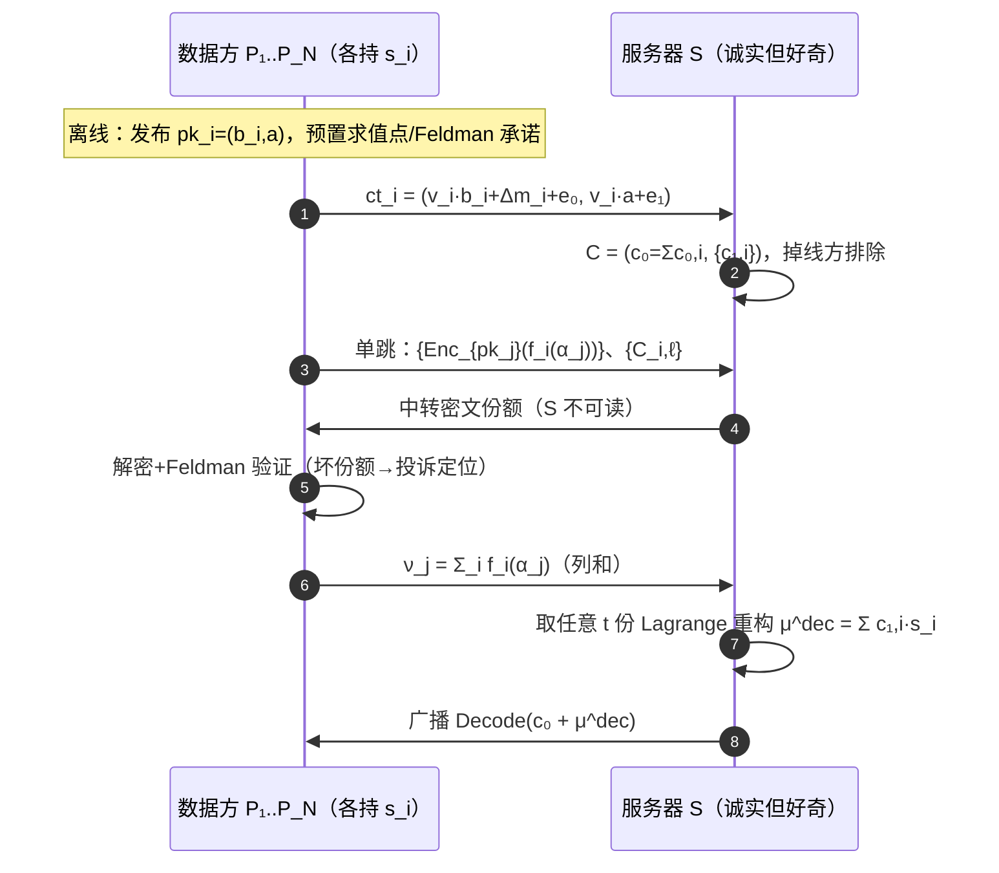
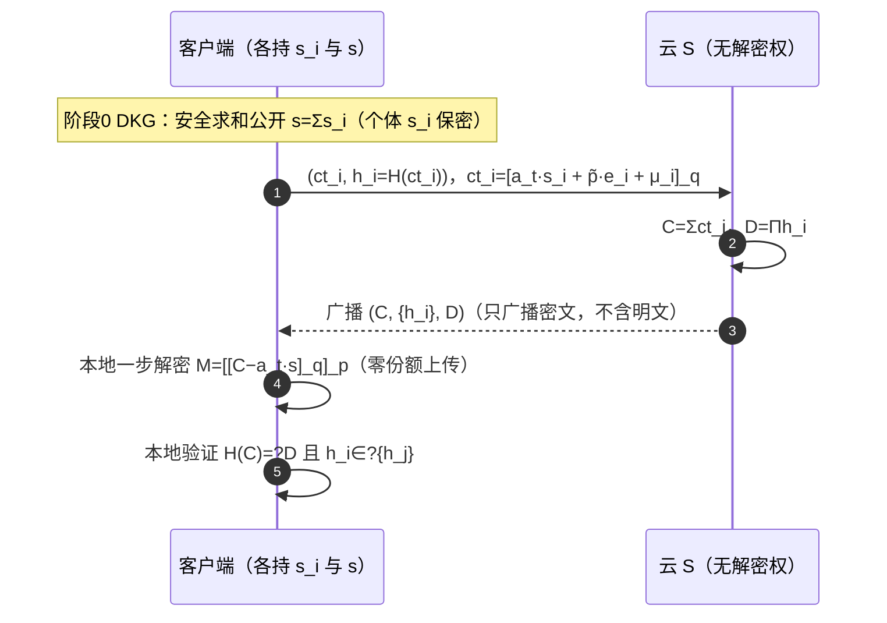
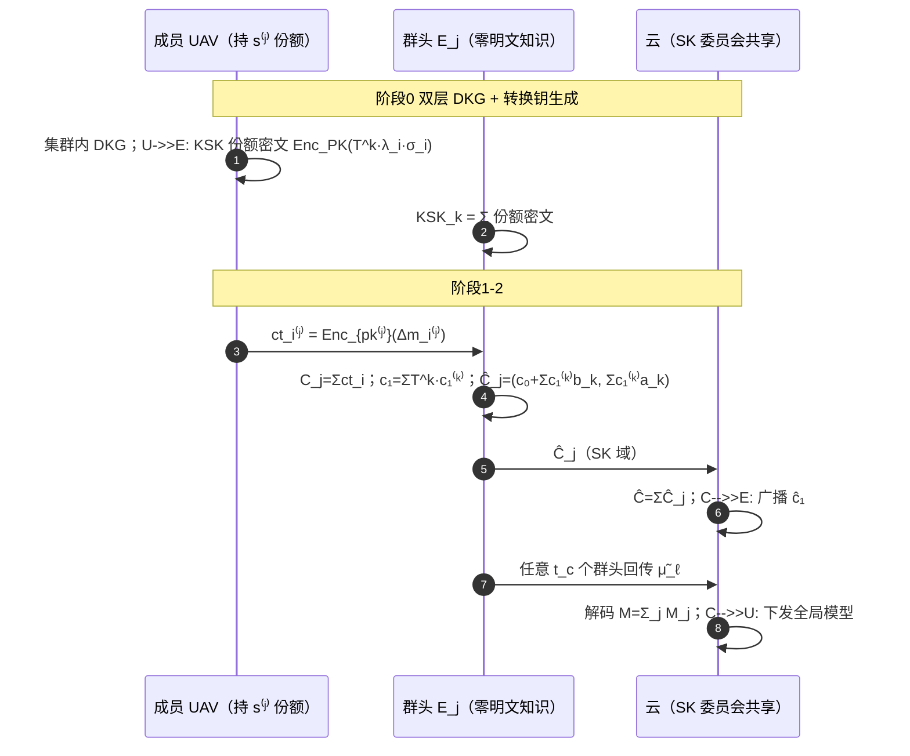
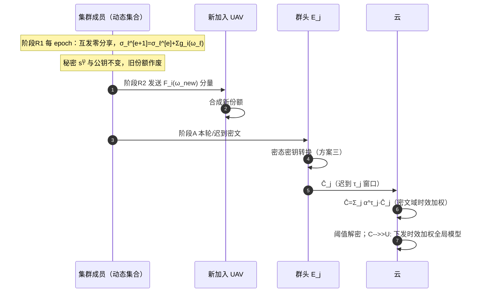

# 同态加密 × 联邦学习：文献阅读报告与五个新方案设计

**—— 面向 UAV-Assisted / Edge-Assisted 场景的安全联邦学习**

> **阅读基础**：直接抽取并通读本目录 18 份 PDF 正文（16 篇英文论文 + 2 份中文基础材料），未依赖任何第三方解读。下文所有"模式归纳 / 演进链条 / 缺陷定位"均来自论文原文的摘要、引言与技术章节。
> **报告结构**：第一部分（第 1–4 章）文献模式总结与循序渐进演进脉络 + UAV/边缘挑战；第二部分（第 5–9 章）基于文献缺陷重构的 5 个新方案（**2 标准 FL + 3 层次 FL**）。每个方案按 **x.1 场景 → x.2 要解决的问题 → x.3 创新点/设计目标 → x.4 威胁模型 → x.5 符号系统 → x.6 方案设计（RLWE 加解密展开 + 实体交互时序图）→ x.7 安全性分析证明** 组织。

---

# 第一部分　文献模式总结

## 1　文献总览与模式归纳

### 1.1 总览表

| 文献 | 年份/出处 | 密钥模式 | FL 架构 | 可信机构 | 安全目标 / 关键事实 |
|---|---|---|---|---|---|
| **SecAgg** (Bonawitz 等) | CCS'17 | 无 HE（成对掩码 + Shamir 托管） | 标准 FL | 无 | 隐私聚合；容忍掉线；O(n²) 掩码协商 |
| **CDKS** (Chen-Dai-Kim-Song) | CCS'19 | **多密钥** MK-CKKS/MK-BFV（打包） | 密码原语 | 无（CRS） | 外包推理保密；**部分解密 μ_i=c_{i,1}·s_i 须公开上传** |
| **ELSA** (Rathee 等) | S&P'23 | 双服务器 2-of-2 秘密分享（无 HE） | 标准 FL（双服务器） | 分布式信任 | 隐私 + 恶意客户端 ℓ₂ 范数防御；客户端作不可信经销商 |
| **SecFed** (Cai 等) | TDSC'24 | **多密钥** EMK-BFV | 标准 FL | **TEE** | 隐私；TEE 代理重线性化/密钥管理/掉线兜底 |
| **BPVFL** (Liu 等) | '24 | **单密钥** Paillier + 同态哈希 | 标准 FL（双云） | 无 TTP（S1 持 sk） | 双向可验证；三方 ZK |
| **ResFed** (Song 等) | IoT-J'24 | 无（残差压缩，非密码） | 标准 FL | 无 | 通信效率（残差 + 有损压缩，背景） |
| **ESAFL** (Wu 等) | TDSC'25 | **集合密钥** s=Σsᵢ（ESHE，单分量对称） | 标准 FL（cross-silo） | 可选 AS | 一步解密、免份额交换；**零掉线容忍 + 合谋界 κ<N−1 + 解密钥 s 明文全量分发** |
| **FedPHE** (Li 等) | TDSC'25 | **单密钥** CKKS 打包 + Shamir 混淆 | 标准 FL | **KDC** | 隐私 + 贡献加权 + 抗掉队客户端选择 |
| **MaskCrypt** (Hu & Li) | TDSC'25 | 每客户端独立密钥（选择性加密） | 标准 FL | 无 | 梯度引导掩码 + 掩码共识；只加密小部分更新 |
| **SKHE-FL** (Liu 等) | IoT-J'25 | **单密钥** CKKS + ECC 封装 | **层次型**（云-边-端） | **TA + TEE** | ECC 分享 HE 私钥给边节点、TEE 内解密 + 哈希校验 |
| **VeSAFL** (Bouamama 等) | TDSC'25 | Pedersen VSS + BLS（非格 HE） | 标准 FL（多聚合器） | 无（公告板） | 可验证安全聚合；边节点去中心化 |
| **MASER** (Al Omar 等) | arXiv'25 | **多密钥** MK-CKKS + 共识剪枝 | 标准 FL | 可信 key manager | 共识剪枝 + 切片降 MKHE 开销 |
| **CDKS-LSS** (Wang 等) | Inf.Sci.'26 | **多密钥** CDKS + Shamir LSS **阈值** | 标准 FL | 无 TTP | 解密阶段信息论安全 + t-of-N；**O(N²) P2P 广播(~98.9MB/人) + 仅半诚实** |
| **DSVFL/Ftop-k** (Li 等) | TMC'26 | **阈值** Paillier + Shamir | 标准 FL（边缘，单云） | **在线 TA** | top-k 稀疏 + 单云安全聚合 + 可信验证 |
| **PPBR** (He 等) | TMC'26 | PLHE(BFV) + CLDP | **层次型 EHFL** | 无 | 符号统计聚类 + 范数裁剪抗 Byzantine；**CLDP 损精度 + 边见扰动统计** |
| **VLSFL** (Li 等) | TDSC'26 | DH 双重掩码 + Shamir + 同态哈希 | 标准 FL（大规模） | 离线 TA | 轻量可验证 + 掉线容忍 |
| 联邦学习基本架构 | — | — | 标准 FL | — | FedSGD/FedAvg/FedProx/FedNova 推导（背景） |
| 联邦学习的加权方式 | — | — | 加权聚合 | — | 7 类加权语义（样本量/均等/质量/贡献/可信/公平/自适应） |

### 1.2 密钥模式谱系（依据原文）

**（1）单密钥（SKHE）**：全体共享一对 $(pk,sk)$，$sk$ 由一方持有（BPVFL 的 S1、FedPHE 的 KDC、SKHE 的 TEE）。优点：密文紧凑、聚合零交互。缺陷（原文反复强调）：**"all clients share the same encryption and decryption keys" → 任一诚实但好奇客户端即可解密他人密文**。FedPHE 用 Shamir 混淆补、SKHE 用 ECC+TEE 补，都是补丁。

**（2）多密钥（MKHE，CDKS 系）**：各客户端独立密钥对（CDKS、SecFed、MASER、CDKS-LSS）。根治共享密钥问题，但引入两个代价（原文确认）：① 密文随参与者数膨胀为 $N+1$ 分量；② 解密须**两轮交互**（部分解密 + 合并），且**部分解密值 $\mu_i=c_{i,1}\cdot s_i$ 在公开信道构成新泄漏面**——任何人收齐即可 Merge 出明文。

**（3）集合密钥（ESHE）**：ESAFL 独有——每个客户端持独立加密钥 $s_i$，但**全体共享解密钥 $s=\sum_i s_i$**，密文为**单分量** $ct_i=[a_t\cdot s_i+\tilde p\cdot e_i+m_i]_q$，聚合后**一步解密** $M=[[C-a_t\cdot s]_q]_p$。优点：免份额交换、单分量、一步解密（较 SKHE 提速 11–14×，较 MKHE 提速 204–953×）。致命代价：**零掉线容忍**（$s=\sum_i s_i$ 需全体 $N$ 个 $s_i$ 都在）、**合谋界 $\kappa<N-1$**（需 ≥2 诚实方）、**解密钥 $s$ 以明文分发给全体客户端**。

**（4）阈值**：CDKS-LSS 把 CDKS 的解密份额再做 Shamir LSS（$R_q$ 上 exceptional sequence），得到 t-of-N 阈值。

### 1.3 FL 架构谱系

- **标准 FL**：绝大多数（SecAgg、ESAFL、CDKS-LSS、FedPHE、MaskCrypt、MASER、VLSFL、DSVFL、BPVFL、SecFed…）。
- **层次型 FL**：仅 **SKHE**（云-边-端，信任 TA+TEE）与 **PPBR**（端-边-云，信任半诚实边缘）真正落地；**UAV 作空中聚合器的特化设计在 16 篇中缺位**（PPBR 仅把 UAV 列为设备举例）。

### 1.4 可信机构谱系

- **无 TTP**：SecAgg、CDKS、ESAFL（可选 AS/MPC）、MaskCrypt、CDKS-LSS、VeSAFL、PPBR。
- **分布式信任**：ELSA（双服务器任一诚实）、VeSAFL（多聚合器）。
- **TEE**：SecFed、SKHE（效率高，引入侧信道/厂商信任，轻量终端常无 TEE）。
- **显式 TA/KDC**：DSVFL 在线 TA、FedPHE KDC、VLSFL 离线 TA、MASER key manager。

**趋势**：UAV/边缘需要**免 TA / 轻量 TA**（在线 TA 是时延与单点瓶颈）。

### 1.5 能力维度谱系

纯隐私（SecAgg、CDKS、ESAFL、CDKS-LSS、SecFed、SKHE、FedPHE）→ 可验证（BPVFL、VeSAFL、DSVFL、VLSFL）→ 鲁棒（ELSA 防恶意输入、PPBR 防 Byzantine）→ 效率（ResFed、MaskCrypt、MASER、FedPHE、Ftop-k）。**尚无方案同时占据 ≥3 个维度**，且**RLWE/MKHE 世界缺可验证性**。

---

## 2　技术演进脉络：循序渐进的问题驱动链条

### 2.1 主线一：密钥/解密结构演化（最核心，依据原文重建）

```
CDKS (19)：多密钥 MKHE 根治"共享密钥合谋"
   但解密须各方上传部分解密值 μ_i = c_{i,1}·s_i
   ── 明文级泄漏：任何人收齐 μ_i 即可 Merge 出明文
            │
            ▼
xMK-CKKS：聚合公钥 pk = Σ pk_i 加密，消除份额上传
   但"聚合公钥由全体生成"→ 任一方掉线即解密死锁 (k-of-k)
            │
            ▼
CDKS-LSS (26)：把 μ_i 再做 Shamir LSS (R_q, exceptional sequence)
   → t-of-N 阈值、无 TTP、解密阶段信息论安全
   但：① 再分享是 O(N²) P2P 广播 (N=20 时约 98.9MB/人)
       ② 仅半诚实 (坏份额可投毒解密且不可追责)
            │
            ▼
ESAFL (25)：釜底抽薪——ESHE 集合密钥 s=Σs_i、单分量密文
   → 一步解密、免份额交换、效率最高
   但：① 零掉线容忍 (s=Σs_i 需全体 N)
       ② 合谋界 κ<N-1 (非阈值)
       ③ 解密钥 s 明文全量分发 (任一客户端持 s)
```

**内在逻辑**：每一步都在压缩"解密交互面"，但每一步都留下新代价——CDKS 泄漏份额 → xMK-CKKS 免份额但绑死全员在线 → CDKS-LSS 阈值化但 O(N²) P2P + 半诚实 → ESAFL 免份额但零掉线 + 依赖可信 AS + 无验证。**关键结论：免份额上传与掉线/抗合谋不可兼得**——方案一（阈值路线，掉线容错）与方案二（免份额路线，零交互）正是这条主线的两个互补收口。

### 2.2 主线二：可验证与鲁棒

- **可验证**：BPVFL（Paillier+哈希双向验证）→ VeSAFL（Pedersen VSS+BLS 三层验证）→ VLSFL（双重掩码+同态哈希）→ DSVFL（阈值 Paillier+在线 TA）。**缺陷**：验证依赖在线 TA（DSVFL）或停留在掩码/Paillier 世界，**无人在 RLWE 多密钥+阈值解密框架下做聚合正确性验证**。
- **鲁棒**：ELSA（MPC 内逐客户端 ℓ₂ 范数防御，但排除跨客户端统计、要求双服务器非合谋）→ PPBR（CLDP 扰动符号统计 + PLHE 加密边级动量）。**缺陷**：PPBR 的过滤前提是"边缘能看见扰动后的符号统计"（CLDP 只是噪声掩盖），且**成批同向劫持可使符号聚类把投毒方向误判为多数派**（原文明言 Byzantine 可跨轮合谋优化攻击）。

### 2.3 主线三：层次化与 UAV 特化（基本空白）

SKHE 首个云-边-端层次 HE-FL，但信任 TA+TEE；PPBR 首个层次 EHFL 隐私+Byzantine，但 CLDP 损精度、边缘被信任、无可验证性。**二者都未处理 UAV 移动性、物理捕获、能量约束**。

### 2.4 尚未闭环的缺口（第二部分方案的问题来源）

1. **免 P2P + 抗坏份额的阈值解密**：CDKS-LSS 的 O(N²) P2P 在 UAV/移动链路不可行（原文自报每轮每方约百 MB），且半诚实无份额验证。
2. **免份额路线的可验证增强**：ESAFL 的单分量 + 本地一步解密 + 零份额上传是其招牌，但依赖可信 AS、聚合无验证——"免 AS + 可验证"的增强尚无；同时须诚实厘清：免份额上传与掉线/抗合谋不可兼得。
3. **层次 FL 端到端密态聚合**：无方案做到"UAV→边→云"全程 RLWE 密文、边云互不信任、边掉线不死锁。
4. **密文域 Byzantine 鲁棒**：鲁棒过滤需"看"更新，密文抗拒检查，加密与投毒防御互斥未解。
5. **高动态拓扑与密钥生命周期**：全部 16 篇（含 2026 最新）隐含静态参与者集合假设，无前摄刷新、无捕获弹性。

---

## 3　UAV / 边缘场景的挑战与研究点

### 3.1 三种典型部署模式

| 模式 | 拓扑 | 对应文献设定 | 典型应用 |
|---|---|---|---|
| **UAV-as-Client** | 多 UAV ↔ 地面站/云 | 标准 FL（SecAgg、ESAFL、CDKS-LSS…） | 多机协同目标识别、频谱感知 |
| **UAV-as-Edge** | 端设备 ↔ 中继 UAV ↔ 云 | 层次 FL（PPBR）、边缘 FL（VeSAFL、DSVFL） | 灾区空中基站、应急感知 |
| **Swarm 跨群** | 群头 UAV ↔ 群头 UAV | cross-silo FL（ESAFL、MASER、FedPHE） | 多单位蜂群联合训练 |

### 3.2 核心挑战

1. **链路间歇与掉线**：UAV 高速移动，中途掉线是常态；CDKS-LSS 阈值解密、VLSFL 掩码恢复都处理掉线，但**密钥持有者掉线**（xMK-CKKS、ESAFL 的集合密钥）仍是死结。
2. **高动态拓扑**：蜂群分裂/合并使参与集逐轮变化，密钥份额、阈值全部需刷新；现有方案假设集合静态。
3. **资源极度受限**：小型 UAV 算力/电量/带宽极紧张，全量 CKKS 加密在机载 SoC 不可行，选择性加密/稀疏化是必由之路。
4. **广播信道暴露面**：UAV 链路开放，被动窃听者收集全部消息，CDKS 部分解密份额的泄漏风险被放大。
5. **被劫持 UAV 的 Byzantine 威胁**：UAV 可被物理俘获、固件改写；**成批同向劫持**（一片空域同时失陷）使符号聚类整体失效。
6. **Non-IID 加剧**：不同空域/载荷使数据分布差异远大于地面。
7. **验证可行性**：地面站半可信，UAV 需 O(1) 级轻量验证而非重算。

### 3.3 值得研究的切入点（选题依据）

- **R1**（缺口 1）：免 P2P、可验证份额的阈值解密 → 方案一。
- **R2**（缺口 2）：可验证免份额集合密钥（保留零解密份额上传 + 免 AS + 本地可验证）→ 方案二。
- **R3**（缺口 3）：UAV→边→云全程密文、边云互不信任 → 方案三。
- **R4**（缺口 4）：密文友好 Byzantine 鲁棒层次 FL → 方案四。
- **R5**（缺口 5）：前摄刷新 + 捕获弹性 + 异步 → 方案五。

---

## 4　新方案设计总纲

### 4.1 方案定位与递进关系

| 方案 | 名称 | 架构 | 密钥模式 | 安全目标 | 针对的残留问题 |
|---|---|---|---|---|---|
| 方案一 | **VTD-FL** | 标准 FL | 多密钥 + (t,N) | 隐私 + 抗恶意份额 | CDKS-LSS 的 O(N²) P2P、半诚实 |
| 方案二 | **V-ESHE-FL** | 标准 FL | 集合密钥 s=Σsᵢ（本地一步解密） | 隐私 + 可验证 + 零份额上传 | ESAFL 的可信 AS、聚合无验证 |
| 方案三 | **HMK-UAVNet** | 层次 FL | 双层集合钥 + 密态转换钥 | 隐私 + 不可信聚合器 | PPBR 的 CLDP/边信任、SKHE 的 TEE |
| 方案四 | **SkyGuard-HFL** | 层次 FL | 秘密分享 + 云集合钥 | 鲁棒 + 隐私 | PPBR 成批劫持失效、ELSA 平面化 |
| 方案五 | **ProShare-HFL** | 层次 FL | 继承方案三 + 前摄刷新 | 隐私 + 移动攻击者 | 全部文献静态密钥假设 |

递进逻辑：方案一解决"份额分发与掉线的矛盾"（阈值路线，掉线容错）→ 方案二在免份额路线上补"免 AS + 可验证"（与方案一互补，标准 FL 侧收口）→ 方案三推向层次化（不可信聚合器 + 跨簇异构密钥）→ 方案四补层次 Byzantine 鲁棒 → 方案五处理时间维度（捕获、移动、异步）。

### 4.2 通用密码学底座

- 环 $R=\mathbb{Z}[X]/(X^n+1)$，$R_q=R/qR$；$n$ 为 2 的幂，$q$ 为模数；$\chi$（小系数秘密分布）、$\psi$（离散高斯错误）、$\phi$（涂抹噪声，标准差远大于 $\psi$）；$a\xleftarrow{\$}R_q$。
- **BFV**：缩放因子 $\Delta=\lfloor q/p\rfloor$，精确算术；**CKKS**：scale $\Delta_c$，近似算术 + SIMD。
- **RLWE 假设** ⇒ IND-CPA；阈值层依赖 Shamir 秘密分享（$R_q$ 上 exceptional sequence 求值点，Mouchet et al.）。
- **标准 RLWE 公钥加密**（多分量，方案一/三/四用）：$sk=s$，$pk=(b,a)$，$b=-a\cdot s+e$；加密 $ct=(c_0,c_1)=(v\cdot b+\Delta m+e_0,\ v\cdot a+e_1)$；解密 $c_0+c_1 s=\Delta m+\varepsilon$。
- **ESHE 单分量对称加密**（方案二用，ESAFL 原文）：加密钥 $s_i$、解密钥 $s=\sum_i s_i$（DKG 只公开"和"），$ct_i=[a_t\cdot s_i+\tilde p\cdot e_i+m_i]_q$，聚合 $C=\sum_i ct_i$，本地解密 $M=[[C-a_t\cdot s]_q]_p$。

### 4.3 通用威胁模型框架

- **HBC**（诚实但好奇）：忠实执行、试图从视图推断。
- **Malicious**（主动）：可偏离协议（坏份额、篡改聚合、选择性丢弃）。
- **Mobile/Physical**：可按轮捕获 UAV/终端并提取存储。

合谋维度：客户端-服务器、客户端-客户端、聚合器-聚合器、跨层（边+云）；掉线维度：随机（信道/能量）与选择性（恶意）。

---

# 第二部分　五个新方案

## 5　方案一：VTD-FL —— 免 P2P 可验证阈值部分解密的多密钥联邦学习（标准 FL）

### 5.1 场景

跨机构/跨边缘节点（cross-silo + 大型 cross-device 混合）隐私联邦训练：$N$ 个数据方（医院、路侧摄像头集群、传感终端）围绕一个云聚合服务器 $\mathcal{S}$ 协作训练。数据方之间**无稳定点对点链路**（NAT、能耗、移动性），所有通信经 $\mathcal{S}$ 中转；存在搭线窃听者与恶意数据方。目标：密文上完成 FedAvg 聚合，解密阶段容忍至多 $N-t$ 方掉线，且坏份额可被检测追责。

### 5.2 要解决的问题

**直接针对 CDKS-LSS（Inf.Sci.'26）的两个原文缺陷**：

1. **O(N²) P2P 再分享不可行**：CDKS-LSS 的 $\mathsf{CDKS.Dec\text{-}LSS}$ 要求每方 $P_i$ 把 $\mu_i=c_{i,1}\cdot s_i$ 的 Shamir 份额 $\tilde\mu_{i,j}=f_i(\alpha_j)$ **点对点发给其余 $N-1$ 方**，再由每方聚合列和后上传。原文自报（N=20）每方每轮出站 $5.205\text{MB}\times 19\approx 98.9\text{MB}$——在 UAV/移动链路无法建立 $N-1$ 条稳定直连，且百 MB 级上行不可承受；
2. **仅半诚实、无份额验证**：原文威胁模型明确"all entities are semi-honest"——恶意方发坏份额即可投毒解密结果，且**不可追责**。

### 5.3 创新点与总体设计目标

1. **服务器单跳中转 + 接收方加密的再分享**：每方把 $N$ 个份额各自用**接收方公钥**加密后打包成**一条消息**发 $\mathcal{S}$，$\mathcal{S}$ 只做路由（无法读取任何份额）——通信从"$N-1$ 条 P2P 直连"降为"1 条上行"，免去 P2P 链路依赖；
2. **Feldman 可验证份额 + 可追责中止**：每份额附 Feldman 承诺，$\mathcal{S}$ 与诚实方可**检测坏份额并唯一定位作恶方**（identifiable abort），把 CDKS-LSS 从半诚实升级到抗恶意份额；
3. **保留 $(t,N)$ 阈值 + 多密钥**：任意 $t$ 份有效份额重构，容忍 $N-t$ 掉线，少于 $t$ 份信息论安全，无 TTP。

设计目标：(G1) 上行 $O(N)$ 条、无 P2P；(G2) 抗恶意份额可追责；(G3) $t$-of-$N$ 掉线；(G4) IND-CPA 隐私。

### 5.4 威胁模型

- **服务器 $\mathcal{S}$**：诚实但好奇（忠实执行，试图从视图恢复个体更新或聚合明文）；至多 $t-1$ 个**恶意**数据方可与 $\mathcal{S}$ 合谋，恶意方可发送任意伪造份额（主动攻击再分享阶段）；公共信道存在被动窃听者。
- **保护目标**：个体更新与未授权聚合结果的机密性；聚合结果正确性（恶意份额必被检测或导致可追责中止）。
- **掉线**：随机/选择性掉线下，只要收集到 $t$ 份有效份额即可解密。
- **不处理**：更新语义投毒（方案四）、物理捕获（方案五）。

### 5.5 符号系统介绍

| 符号 | 含义 |
|---|---|
| $R=\mathbb{Z}[X]/(X^n+1),R_q$ | 多项式环与商环 |
| $\chi,\psi,a$ | 秘密分布；噪声分布；公共随机多项式 $a\xleftarrow{\$}R_q$（CRS） |
| $s_i,\ pk_i=(b_i,a)$ | $P_i$ 的秘密钥/公钥，$b_i=-a\cdot s_i+e_i$ |
| $m_i,\ ct_i=(c_{0,i},c_{1,i})$ | $P_i$ 的明文（$\Delta m_i$ 缩放）与 RLWE 密文 |
| $\mu_i^{\mathrm{dec}}=c_{1,i}\cdot s_i$ | $P_i$ 的部分解密相位 |
| $f_i(X),\ \tilde\mu_{i,j}$ | $P_i$ 的再分享多项式（$f_i(0)=\mu_i^{\mathrm{dec}}$）与份额 $f_i(\alpha_j)$ |
| $\alpha_1..\alpha_N$ | $R_q$ 上 exceptional sequence 求值点 |
| $C_{i,\ell}$ | $f_i$ 系数的 Feldman 承诺（DLP 群 $\mathbb{G}$，系数 NTT 嵌入） |
| $t,N,\lambda_j$ | 阈值、总方数、Lagrange 系数 |

### 5.6 方案设计

**实体**：$N$ 个数据方 $P_1..P_N$ + 单台服务器 $\mathcal{S}$。

**阶段 0（离线一次性）**：预置 $(n,q,\chi,\psi,a)$、求值点 $\{\alpha_j\}$、Feldman 群；各 $P_i$ 生成 $s_i,e_i$，发布 $pk_i=(b_i,a)$；Lagrange 系数离线算好。

**阶段 1（训练与加密）**：$P_i$ 本地训练得更新 $g_i$，明文态吸收权重 $p_i$ 与学习率（Zero-Depth），编码 $\mu_i=\mathsf{Encode}(p_i g_i)$，RLWE 加密（展开）：

$$
ct_i=(c_{0,i},c_{1,i})=\big(v_i\cdot b_i+\Delta\mu_i+e_{0,i},\ v_i\cdot a+e_{1,i}\big),\quad v_i\leftarrow\chi,\ e_{0,i},e_{1,i}\leftarrow\psi
$$

上传 $ct_i$ 与签名。

**阶段 2（同态聚合，在线集合）**：$\mathcal{S}$ 验签后取在线集 $\mathcal{P}$（$|\mathcal{P}|\ge t$，掉线方排除），聚合为 CDKS 多密钥密文：

$$
C=\big(c_0,\ c_{1,1},\dots,c_{1,|\mathcal{P}|}\big),\qquad c_0=\sum_{i\in\mathcal{P}}c_{0,i}
$$

**阶段 3（可验证再分享，单跳）**：各 $P_i$ 计算 $\mu_i^{\mathrm{dec}}=c_{1,i}\cdot s_i$，构造 $f_i(X)=\mu_i^{\mathrm{dec}}+\sum_{\ell=1}^{t-1}a_{i,\ell}X^{\ell}$，向 $\mathcal{S}$ 发**一条消息**：

$$
M_i=\Big(\{\mathsf{Enc}_{pk_j}(\tilde\mu_{i,j})\}_{j\in\mathcal{P}},\ \{C_{i,\ell}\}_{\ell=0}^{t-1}\Big),\qquad \tilde\mu_{i,j}=f_i(\alpha_j)
$$

份额用接收方 $P_j$ 公钥加密，$\mathcal{S}$ 只路由、不可读。

**阶段 4（中转验证 + 列聚合）**：$P_j$ 解密份额后 Feldman 验证 $g^{\tilde\mu_{i,j}}\stackrel{?}{=}\prod_{\ell=0}^{t-1}C_{i,\ell}^{\alpha_j^{\ell}}$；不通过则广播投诉定位作恶方；通过后计算列和 $\nu_j=\sum_{i\in\mathcal{P}}\tilde\mu_{i,j}=F(\alpha_j)$（$F=\sum_i f_i$），上传 $\nu_j$。

**阶段 5（阈值重构与解码）**：$\mathcal{S}$ 取任意 $t$ 个 $j\in T$ 重构：

$$
\mu^{\mathrm{dec}}=\sum_{j\in T}\lambda_j\nu_j=F(0)=\sum_{i\in\mathcal{P}}\mu_i^{\mathrm{dec}}=\sum_{i\in\mathcal{P}}c_{1,i}\cdot s_i
$$

最终 $m_\Sigma=\mathsf{Decode}(c_0+\mu^{\mathrm{dec}})$，广播全局模型。

**闭环正确性推导**（RLWE 解密展开 + 阈值重构）：

对每个 $P_i$，解密相位 $c_{0,i}+c_{1,i}s_i=\Delta\mu_i+\underbrace{(v_i e_i+e_{0,i}+e_{1,i}s_i)}_{=:\varepsilon_i}$（代入 $b_i=-as_i+e_i$ 化简，$v_i a s_i+v_i b_i=v_i e_i$）。求和：

$$
c_0+\sum_{i\in\mathcal{P}}c_{1,i}s_i=\Delta\sum_{i\in\mathcal{P}}\mu_i+\sum_{i\in\mathcal{P}}\varepsilon_i
\;\Rightarrow\;
m_\Sigma=\sum_{i\in\mathcal{P}}p_i g_i,\quad\text{当}\ \Big\|\sum\varepsilon_i\Big\|_\infty<q/(2\Delta)
$$

**实体交互时序图**：



### 5.7 安全性分析证明

**定理 1（隐私性）**：RLWE 困难且 $|A|<t$ 时，敌手视图可模拟，个体更新与未授权聚合明文不可区分。

*证明*：(i) 密文层：$ct_i$ 为 RLWE 加密，IND-CPA 下可替换为随机；(ii) 份额层：$\tilde\mu_{i,j}$ 是 $\mu_i^{\mathrm{dec}}$ 的 Shamir 份额，$|A|<t$ 时信息论独立于 $\mu_i^{\mathrm{dec}}$（exceptional sequence 保证 $R_q$ 插值安全）；$\mathcal{S}$ 只见 $\mathsf{Enc}_{pk_j}(\tilde\mu_{i,j})$（IND-CPA）；(iii) Feldman 承诺计算隐藏。∎

**定理 2（正确性）**：所有份额通过 Feldman 验证时，重构值恒等于 $\sum_i\mu_i^{\mathrm{dec}}$，聚合结果精确（噪声预算内）。

*证明*：Feldman 等式保证 $\tilde\mu_{i,j}=f_i(\alpha_j)$ 与承诺一致，$f_i$ 唯一；$\nu_j=F(\alpha_j)$，Lagrange 重构给出 $F(0)=\sum_i\mu_i^{\mathrm{dec}}$，代入 5.6 闭环。∎

**定理 3（恶意份额检测与可追责）**：恶意方伪造份额通过验证概率 $\le\mathsf{negl}(\lambda)$（DLP/承诺绑定）；投诉后任何第三方可复验并唯一定位作恶方。

*证明*：份额与承诺不一致则以概率 1 被检出（离散对数相等性公开可验）；与承诺一致的坏 $f_i$ 被承诺绑定锁定，重构偏差体现在聚合承诺 $\prod_i C_{i,0}$ 上，可复核定位。∎

**定理 4（掉线容忍）**：任意 $N-t$ 方于解密阶段掉线仍正确完成；掉线方被排除出 $\mathcal{P}$（阶段 2 重算 $c_0$），聚合语义为在线方加权和，安全性不因掉线降低。

**对比定位**：相对 CDKS-LSS，上行从"$N-1$ 条 P2P 直连、每方约百 MB"降为"1 条上行、服务器中转"，并补上其缺失的份额验证；相对 xMK-CKKS，掉线不再死锁；相对 ESAFL，获得 $t$-of-$N$ 掉线容忍（ESAFL 零掉线）。

---

## 6　方案二：V-ESHE-FL —— 可验证免份额集合密钥联邦学习（标准 FL）

### 6.1 场景

金融/医疗等 cross-silo 联合训练：$N$ 个机构（银行、医院）网络稳定、几乎不掉线，但对**带宽/算力/时延敏感**；机构间互不信任（任一机构是诚实但好奇者），服务器可能偷懒或造假。要求：密文上聚合；**解密零交互（本地一步、不上传任何解密份额）**；服务器聚合结果可被客户端**本地验证**。

### 6.2 要解决的问题

1. **正确定位（纠正"阈值化"的方向性错误）**：ESAFL 的招牌是"单分量 + 本地一步解密 + **零解密份额上传**"——其原文正是在批评 MKHE 的 partial decryption 在公开信道可被窃听者合并出明文。若把 ESHE 阈值化（加解密委员会、$t$ 方上传部分解密），就会**重新引入"解密份额上传"**，退回 CDKS 系两轮交互、丢掉 ESAFL 招牌。**因此本方案不走阈值路线**，掉线容错与抗合谋的强化交由方案一（阈值路线）覆盖，二者是同一问题的两条互补路线；
2. **ESAFL 真正遗留、且可在免份额路线上解决的缺陷**：
   - **密钥生成依赖可信 AS / 安全信道**：原文 KeyGen 把 $\{a_0,s_i,s\}$ 经安全信道分发，需要一个可信第三方；
   - **聚合无验证**：服务器可篡改聚合密文或静默丢弃客户端更新，客户端无法察觉（ESAFL 对此无任何机制）。

### 6.3 创新点与总体设计目标

**保留 ESHE 的单分量 + 本地一步解密 + 零解密份额上传，只增强其密钥生成与聚合验证**：

1. **格上 DKG 免 AS 生成集合密钥**：客户端经一轮安全求和协同得到 $s=\sum_i s_i$（**只公开和，个体 $s_i$ 保密**），替代 ESAFL 的可信 AS；每个客户端本地持 $s$，**保留本地一步解密**；
2. **线性同态哈希的可验证聚合**：客户端上传 $(ct_i,H(ct_i))$，服务器公布聚合密文 $C$ 与哈希证据，客户端**本地**验证 $H(C)=\prod H(ct_i)$ 与"含我性"——**零额外解密交互**，检测服务器篡改/丢更新；
3. **形式化权衡定理（诚实声明）**：证明"本地一步解密 ⟺ 客户端持 $s$ ⟹ 零掉线容忍 + 合谋界 $\kappa<N-1$"——**免份额上传与掉线/抗合谋不可兼得**。方案二定位为"高在线率、带宽/算力敏感、需本地验证"场景的最优解，掉线容错场景由方案一（阈值路线）覆盖。

设计目标：(G1) 密文 $O(1)$ 单分量；(G2) **零解密份额上传**（本地一步解密）；(G3) 聚合本地可验证；(G4) 免 AS；(G5) IND-CPA + 训练结果仅客户端本地可见。

### 6.4 威胁模型

- **服务器 $\mathcal{S}$**：诚实但好奇（不持 $s$，无法解密），或主动恶意（篡改聚合密文、静默丢弃更新）——恶意行为被客户端本地验证检出（定理 2/3）。
- **客户端**：诚实但好奇，可合谋共享 $s_i$ 与视图；**合谋界 $\kappa<N-1$（诚实声明）**：$N-1$ 合谋可反推剩余诚实方 $s_k$。
- **掉线**：**零掉线容忍（诚实声明）**——结构性，见创新点 3；本方案适配稳定网络的 cross-silo 场景。
- **目标**：个体更新语义安全（对服务器、外部窃听者、其他客户端）；聚合可验证；训练结果仅客户端本地可见（服务器只广播密文）。

### 6.5 符号系统介绍

| 符号 | 含义 |
|---|---|
| $s_i$ | 客户端 $i$ 的加密钥（$\leftarrow\chi$） |
| $s=\sum_i s_i$ | 集合解密钥（DKG 只公开"和"，个体 $s_i$ 保密） |
| $a_t,\ \tilde p$ | 第 $t$ 轮公开随机多项式；系数全为 $p$ 的多项式（ESHE 参数） |
| $ct_i=[a_t s_i+\tilde p e_i+m_i]_q$ | 客户端 $i$ 的单分量密文（$e_i\leftarrow\psi$） |
| $H(x)=g^{\langle\bar h,x\rangle}$ | 线性同态哈希（$\bar h$ 由公开种子派生，$x$ 按 NTT 坐标嵌入） |
| $h_i=H(ct_i),\ D=\prod_i h_i$ | 客户端密文摘要、聚合摘要 |

### 6.6 方案设计

**实体**：$N$ 个客户端 + 云 $\mathcal{S}$（**无解密委员会**）。

**阶段 0（DKG 免 AS，一次性）**：

1. 客户端 $i$ 采样 $s_i\leftarrow\chi$；
2. **安全求和**：$i$ 把 $s_i$ 加法分享成 $\{\mathrm{share}_{i,j}\}$（$\sum_j\mathrm{share}_{i,j}=s_i$），发 $\mathrm{share}_{i,j}$ 给 $j$；$j$ 广播列和 $col_j=\sum_i\mathrm{share}_{i,j}$；全体算 $s=\sum_j col_j=\sum_i s_i$；
3. 每客户端本地持 $s$（解密钥）+ $s_i$（加密钥）。**个体 $s_i$ 对他人保密**（只公开"和" $s$）。

**阶段 1（训练与加密 + 摘要）**：客户端 $i$ 本地训练得更新 $g_i$，明文吸收权重 $p_i$、编码 $\mu_i$，单分量 RLWE 加密（ESHE 式展开），并计算密文摘要：

$$
ct_i=[a_t\cdot s_i+\tilde p\cdot e_i+\mu_i]_q,\qquad h_i=H(ct_i)
$$

上传 $(ct_i,\ h_i)$。

**阶段 2（密态聚合 + 举证）**：$\mathcal{S}$ 聚合并公布：

$$
C=\sum_i ct_i=\Big[a_t\cdot s+\tilde p\sum_i e_i+\sum_i\mu_i\Big]_q,\qquad \{h_i\},\quad D=\prod_i h_i
$$

**阶段 3（本地一步解密 + 本地验证，零份额上传）**：

1. 每个客户端**本地**解密（不依赖任何其他方，ESAFL 同款一步解密）：

$$
M=\Big[\big[C-a_t\cdot s\big]_q\Big]_p=\sum_i\mu_i
$$

2. 每个客户端**本地**验证（零交互）：

$$
H(C)\stackrel{?}{=}D=\prod_i h_i,\qquad h_i\in\{h_j\}\ (\text{含我性})
$$

**闭环正确性推导**：由 $C$ 定义，

$$
C-a_t s=\tilde p\sum_i e_i+\sum_i\mu_i \pmod q
$$

因 $\tilde p$ 系数全为 $p$，$\tilde p\sum e_i$ 是 $p$ 的倍数，取 $[\cdot]_p$ 消去，得 $\sum_i\mu_i$（噪声预算与 ESHE 相同）。验证环由 $H$ 线性同态性给出 $H(C)=H(\sum_i ct_i)=\prod_i H(ct_i)=D$。

**实体交互时序图**：



### 6.7 安全性分析证明

**定理 1（IND-CPA）**：单分量密文 $ct_i=[a_t s_i+\tilde p e_i+\mu_i]_q$ 在 RLWE$_{n,q,\chi,\psi}$ 下 IND-CPA 安全。

*证明*：$(a_t,\ a_t s_i+\tilde p e_i+\mu_i)$ 是 RLWE 样本（$\tilde p e_i+\mu_i$ 为有界噪声偏移），与均匀分布计算不可区分。∎

**定理 2（聚合可验证性）**：恶意服务器使客户端接受 $C'\neq\sum_i ct_i$ 的概率 $\le\mathsf{negl}(\lambda)$；静默丢弃客户端 $i$ 的更新必被检出。

*证明*：客户端接受当且仅当 $H(C')=D=\prod_i H(ct_i)=H(\sum_i ct_i)$。若 $C'\neq\sum_i ct_i$ 而 $H(C')=H(\sum_i ct_i)$，则构成线性同态哈希的碰撞，归约到 DLP；丢弃更新 $i$ 则 $h_i\notin\{h_j\}$ 或 $H(C')\neq D$，含我性检查以概率 1 检出。∎

**定理 3（本地解密保密性）**：服务器与外部窃听者的视图仅含密文 $\{ct_i\},C$，不持 $s$，无法恢复任何明文；聚合结果 $M$ 仅客户端本地可见。

*证明*：$\{ct_i\},C$ 均为 RLWE 密文（IND-CPA）；$s$ 仅在 DKG 中作为"和"公开给客户端、从不发给服务器；服务器广播的始终是密文 $C$，明文 $M$ 在客户端本地由 $s$ 解出，不经网络。∎

**定理 4（权衡定理，诚实声明）**：设 $s=\sum_i s_i$ 由全体客户端本地持有（本地一步解密的前提），则 (a) $N-1$ 个客户端合谋可恢复剩余诚实方 $s_k$（合谋界 $\kappa<N-1$）；(b) 聚合集合不可变（零掉线容忍）。

*证明*：(a) 合谋方知各自 $s_i$ 与公开的 $s$，故 $s_k=s-\sum_{i\neq k}s_i$；(b) 解密用固定的 $s=\sum_{i=1}^N s_i$，若在线集缩小则 $C-a_t s$ 残留 $-a_t\sum_{掉线}s_i$ 项，无法解码。二者均源于"客户端持 $s$"这一事实，而"客户端持 $s$"又是"本地一步解密"的充要条件——**免份额上传与掉线/抗合谋不可兼得**。∎

**对比定位**：相对 ESAFL，保留其单分量 + 本地一步解密 + 零解密份额上传，去掉可信 AS（DKG）并新增可验证聚合；相对方案一（VTD-FL，阈值路线），明确互补——本方案**零解密交互**但零掉线/κ<N−1，方案一 t-of-N 掉线容错但需解密份额，二者分别适配"高在线率带宽敏感"与"高掉线率需容错"两类场景。

---

## 7　方案三：HMK-UAVNet —— 边云互不信任的双层多密钥层次安全聚合（层次 FL：成员 UAV → 群头边缘 → 云）

### 7.1 场景

大规模空域监视网络（UAV-as-Client + UAV-as-Edge）：若干 UAV 集群分属不同作业区，每集群由一架长航时中继 UAV（群头/边缘）汇聚本群数据，云做跨集群全局聚合。**三方互不信任**：成员不信任群头（可能被俘获）、群头不信任云（第三方运营）、云不应见任何集群级明文（跨单位数据主权）。要求：成员更新对群头保密、集群聚合对云保密，仅最终全局模型公开。

### 7.2 要解决的问题

1. **PPBR（TMC'26）是目录中唯一层次 EHFL 方案，但为让边缘做鲁棒过滤而"看"扰动后的符号统计**——CLDP 只是噪声掩盖（原文明言"acceptable accuracy loss"），且 PLHE 仅线性；边缘被默认为半诚实；
2. **SKHE（IoT-J'25）把层次架构的安全押在 TA+TEE**——UAV/边缘场景无 TEE，TA 是单点；
3. **密文尺寸悖论**：直接用 CDKS 多密钥做层次聚合，密文随参与者数膨胀为 $N+1$ 分量，跨层传递雪上加霜；且 k-of-k 解密使群头掉线即整群失联。

### 7.3 创新点与总体设计目标

1. **密态密钥转换桥（边缘零知识中继）**：集群内用**集群集合密钥** $pk^{(j)}$（阈值分享于成员，复用方案一的 Shamir 份额化）加密；群头持有的是一族 **gadget 转换钥** $\mathsf{KSK}_k=\mathsf{Enc}_{PK}(T^k s^{(j)})$（集群秘密按数字位在云集合公钥 $PK$ 下的密文族，由成员分布式加密、群头同态求和生成，**任何实体都没见过 $s^{(j)}$ 明文**）。群头把集群聚合密文从 $s^{(j)}$ 域**同态平移**到 $SK$ 域——全程密文操作，对内容零知识；
2. **全程 RLWE、零 DP 噪声**：UAV→群头→云每跳都是 RLWE 密文，无 PPBR 式"边缘看扰动明文"的妥协，精度无损；
3. **边缘可替换**：转换桥使群头退化为纯计算中继——掉线时可切换"成员直传云（用 $PK$ 加密）"降级模式，密钥体系不受影响。

设计目标：(G1) 成员更新对群头保密；(G2) 集群聚合对云保密；(G3) 每层密文 $O(1)$；(G4) 群头掉线可降级；(G5) 无 TTP。

### 7.4 威胁模型

- **群头（边缘）**：诚实但好奇；可能被俘获而与外部敌手共享视图（但无法获得任何明文，定理 1）。
- **云 $\mathcal{C}$**：诚实但好奇；**不与群头实时合谋**（跨单位部署现实；合谋由方案四防护）。
- **成员 UAV**：至多 $t_j-1$ 架半诚实合谋。
- **目标**：端到端个体隐私（任一单一非客户端实体只见密文）；全局结果正确；集群密钥生命周期独立于云。

### 7.5 符号系统介绍

| 符号 | 含义 |
|---|---|
| $U_i^{(j)}$ | 集群 $j$ 第 $i$ 个成员；$E_j$ 群头；$\mathcal C$ 云 |
| $(pk^{(j)},sk^{(j)}=s^{(j)})$ | 集群 $j$ 集合密钥对（$(t_j,N_j)$ 分享于成员） |
| $(PK,SK=S)$ | 云集合密钥对（$(t_c,J)$ 分享于 $J$ 个群头） |
| $\mathsf{KSK}_k$ | 集群→云 gadget 转换钥（数字基 $T$，$k=0..L-1$） |
| $ct_i^{(j)},C_j,\hat C_j$ | 成员密文、集群聚合密文、平移后云域密文 |
| $M_j=\sum_i m_i^{(j)},\ M=\sum_j M_j$ | 集群和、全局和 |

### 7.6 方案设计

**实体**：$J$ 个集群，集群 $j$ 含 $N_j$ 成员 + 群头 $E_j$；单朵云 $\mathcal C$。

**阶段 0（双层密钥 + 转换钥，一次性）**：

1. 集群内 DKG：$pk^{(j)}=(b^{(j)},a)$，$b^{(j)}=-a s^{(j)}+e^{(j)}$，$s^{(j)}$ 以 $(t_j,N_j)$ Shamir 分享于成员（复用方案一的可验证份额化）；
2. 跨集群 DKG：$PK=(B,A)$，$B=-A S+E$，$S$ 以 $(t_c,J)$ 分享于群头；
3. **转换钥生成（gadget 数字位）**：数字基 $T$、位数 $L=\lceil\log_T q\rceil$。对每个 $k$，成员 $U_i^{(j)}$ 采样 $w_{i,k}\leftarrow\chi$、$f_{i,k,0},f_{i,k,1}\leftarrow\psi$，提交 $PK$ 下加密 $\mathsf{KSK}_{i,k}=(w_{i,k}B+T^k\lambda_i\sigma_i+f_{i,k,0},\ w_{i,k}A+f_{i,k,1})$（$\lambda_i\sigma_i$ 为成员 $i$ 对 $s^{(j)}$ 的份额贡献），群头求和得

$$
\mathsf{KSK}_k=\sum_i\mathsf{KSK}_{i,k}=\big(W_kB+T^k s^{(j)}+F_{k,0},\ W_kA+F_{k,1}\big)
$$

其在 $S$ 下"解"得 $b_k+a_kS=T^k s^{(j)}+\eta_k$（$\eta_k=W_kE+F_{k,0}+F_{k,1}S$ 为小项）——$\mathsf{KSK}_k$ 是 $T^k s^{(j)}$ 在密钥 $S$ 下的合法 RLWE 样本，无人能恢复 $s^{(j)}$。

**阶段 1（集群内聚合）**：$U_i^{(j)}$ 加密（展开）：

$$
ct_i^{(j)}=\big(v_i b^{(j)}+\Delta m_i^{(j)}+e_{i,0},\ v_i a+e_{i,1}\big)
$$

$E_j$ 求和 $C_j=(c_0^{(j)},c_1^{(j)})=\sum_i ct_i^{(j)}$（$O(1)$）。

**阶段 2（密态密钥转换，gadget 分解）**：$E_j$ 对 $c_1^{(j)}$ 数字分解 $c_1^{(j)}=\sum_k T^k c_1^{(j,k)}$（$\|c_1^{(j,k)}\|_\infty\le T/2$），计算平移密文：

$$
\hat C_j=\Big(c_0^{(j)}+\sum_k c_1^{(j,k)}\cdot b_k,\ \sum_k c_1^{(j,k)}\cdot a_k\Big)
$$

（乘数是小系数数字 $c_1^{(j,k)}$ 而非密文分量本身，避免噪声爆炸；$c_0^{(j)}$ 直接并入第一分量，单一 $\Delta$ 刻度。）$\hat C_j$ 是 $SK$ 域密文。

**阶段 3（云聚合 + 阈值解密）**：$\mathcal C$ 求和 $\hat C=\sum_j\hat C_j$；任意 $t_c$ 个群头提交部分解密 $\tilde\mu_\ell=\hat c_1\cdot\Sigma_\ell+\tilde e_\ell^*$（$\Sigma_\ell$ 为 $S$ 份额），云合并解码得 $M=\sum_j M_j$。

**闭环正确性推导**（转换桥不改变明文）：

$$
\mathsf{Dec}_{SK}(\hat C_j)=c_0^{(j)}+\sum_k c_1^{(j,k)}(b_k+a_kS)=c_0^{(j)}+\sum_k c_1^{(j,k)}(T^k s^{(j)}+\eta_k)
=\underbrace{c_0^{(j)}+c_1^{(j)}s^{(j)}}_{=\Delta M_j+\varepsilon_0}+\underbrace{\sum_k c_1^{(j,k)}\eta_k}_{\varepsilon_1}
$$

$\varepsilon_1$ 界 $\le L\cdot n\cdot(T/2)\cdot\|\eta\|_\infty$（$n=2^{13}$、$T=2^4$、$q\approx2^{62}$ 时总噪声 $\approx2^{48}\ll q/2$）。云层 $\hat\mu=\hat c_0+\hat c_1 S=\Delta\sum_j M_j+(\text{有界噪声})$，解码得全局和。**云全程未见任何集群级明文。**

**实体交互时序图**：



### 7.7 安全性分析证明

**定理 1（对群头零知识）**：群头 $E_j$ 视图可由公开参数与输出 $M$ 模拟，对任何成员更新、集群和 $M_j$ 知识为零。

*证明*：$E_j$ 视图 $=\{ct_i^{(j)}\}\cup\{\mathsf{Enc}_{PK}(\lambda_i\sigma_i)\}\cup\{\hat C,\tilde\mu\}$；成员密文 $pk^{(j)}$ 域 IND-CPA；份额密文 $PK$ 域 IND-CPA；$\hat C_j$ 由 $E_j$ 自算；$E_j$ 从不持 $s^{(j)}$ 或 $S$。∎

**定理 2（对云集群级隐私）**：RLWE 假设且云不与 $\ge t_c$ 群头合谋下，云关于单个集群和 $M_j$ 的信息不超过全局和 $M$ 可计算的信息。

*证明*：$\hat C_j$ 是 $SK$ 域 IND-CPA 密文；云不持 $S$（$<t_c$ 份无信息）；$\{\tilde\mu_\ell\}$ 由涂抹噪声可模拟。∎

**定理 3（端到端正确与活性）**：半诚实下云输出 $M=\sum_{j,i}m_i^{(j)}$；群头掉线时其集群切"成员以 $PK$ 直传"降级模式，正确性与安全级别不变。

**对比定位**：相对 PPBR，消除 CLDP 精度损失、边缘从"看扰动明文"变"零知识中继"；相对 SKHE，去除 TA+TEE；相对 CDKS-LSS，每层密文 $O(1)$ 且天然层次拓扑。

---

## 8　方案四：SkyGuard-HFL —— 抗合谋劫持的 Byzantine 鲁棒层次安全聚合（层次 FL：双边缘）

### 8.1 场景

对抗环境 UAV 集群作业（边境巡检、战区侦察）：每集群配备**两架分属不同保障单位的中继**（空中中继 UAV + 地面站，或两厂商中继），构成互不合谋双边缘。威胁真实存在：**成批 UAV 被同一攻击者俘获**后提交高度同向投毒更新——成组同向性使 PPBR 的符号统计聚类把投毒方向误判为多数派；云层只做跨集群聚合。要求：不检查明文更新即拦截范数异常/畸形更新，且被俘获节点无法反推诚实成员更新。

### 8.2 要解决的问题

1. **PPBR 的过滤前提是"边缘看见扰动符号统计"**（信任漏洞）——且原文明言 Byzantine 可跨轮合谋优化攻击，成批同向劫持可使符号聚类整体失效；
2. **ELSA（S&P'23）证明恶意安全聚合可行但平面双服务器**，未层次化、未与 HE 云衔接，ZK 证明按全维向量计，带宽受限 UAV 链路不可行；
3. **方案三"云不与群头合谋"假设在对抗环境过强**——需把鲁棒过滤从"看明文"改为"验证明文满足的性质"。

### 8.3 创新点与总体设计目标

1. **双层异构密码分工**：内层（成员→双边缘）用**加法秘密分享 + 零知识范数界证明**（ELSA 式，证明对象压缩到"共识稀疏坐标 + 范数"两项，$O(k+\log d)$）；外层（边缘→云）切到**云集合公钥 $PK$ 密文域**，双边缘各自把分享值用 $PK$ 加密上传、云密态求和——鲁棒性由分享域获得、跨域隐私由 HE 域获得；
2. **分享域鲁棒聚合**：双边缘在分享值上执行"范数界过滤 + 坐标中位数"，安全比较仅在 $k$ 个稀疏坐标上，成批同向劫持者因无法过范数界证明且在中位数下被天然抑制；
3. **单边缘作恶不破隐私**：任一边缘恶意（含被俘），只要另一台诚实，成员更新信息论隐藏；恶意边缘只能造成本集群拒绝服务，无法污染全局。

设计目标：(G1) 恶意客户端（$\le f<N/3$）投毒被拦截/中和；(G2) 单边缘被俘不泄个体更新；(G3) 云只见密文与全局和；(G4) 证明开销 $O(k\log d)$。

### 8.4 威胁模型

- **成员 UAV**：至多 $f<N/3$ 架**恶意**（缩放攻击、畸形向量、伪造证明）；
- **双边缘 $E_j^{(0)},E_j^{(1)}$**：**至多一台恶意**（被俘），另一台诚实；
- **云**：诚实但好奇，不与被俘边缘实时合谋；
- **目标**：个体更新隐私；输入有效性（恶意客户端无法提交越界更新而不被发现）；输出鲁棒性（全局输出与"仅诚实方"结果 $\ell_2$ 有界接近）。

### 8.5 符号系统介绍

| 符号 | 含义 |
|---|---|
| $E_j^{(0)},E_j^{(1)}$ | 集群 $j$ 双边缘 |
| $\langle x\rangle^{(b)}$ | $x$ 对边缘 $b$ 的加法分享，$\langle x\rangle^{(0)}+\langle x\rangle^{(1)}=x$ |
| $\pi_i$ | $U_i$ 的零知识范数界证明（$\|\tilde m_i\|_2^2\le B^2$ 且支撑 $\subseteq\Omega$） |
| $\mathsf{SNIP}$ | 基于分享的有效性证明（ELSA/Prio 系） |
| $(PK,SK)$ | 云集合密钥；$\mathsf{Med}(\cdot)$ 坐标中位数 |
| $\Omega,k,B$ | 共识稀疏坐标集、稀疏度、公开范数界 |

### 8.6 方案设计

**实体**：每集群 $N_j$ 成员 + 双边缘 + 云。

**阶段 1（稀疏化、分享、证明）**：共识稀疏得 $\Omega$；$U_i$ 量化 $\tilde m_i$（$\Omega$ 外为零），生成加法分享 $(\langle\tilde m_i\rangle^{(0)},\langle\tilde m_i\rangle^{(1)})$ 与范数界证明 $\pi_i$，分别发双边缘。双边缘交互 $\mathsf{SNIP}$ 验证 $\|\tilde m_i\|^2\le B^2$（分享上算内积与 $B^2$ 比较），不通过者丢弃。

**阶段 2（分享域鲁棒聚合）**：对通过集 $\mathcal V_j$，双边缘在分享域求坐标中位数 $\mu_\ell=\mathsf{Med}\{\tilde m_{i,\ell}\}_{i\in\mathcal V_j}$ 的分享（$O(k\log Q)$ 次安全比较），得 $\langle M_j^{rob}\rangle^{(b)}$。

**阶段 3（HE 域跨集群聚合）**：每边缘把分享值用 $PK$ 加密（RLWE 展开）：

$$
ct_j^{(b)}=\big(v_b B+\Delta\,\mathsf{Ecd}(\langle M_j^{rob}\rangle^{(b)})+e_{b,0},\ v_b A+e_{b,1}\big)
$$

云求和 $\hat C=\sum_{j,b}ct_j^{(b)}$，阈值解密得：

$$
M=\sum_j\big(\langle M_j^{rob}\rangle^{(0)}+\langle M_j^{rob}\rangle^{(1)}\big)=\sum_j M_j^{rob}
$$

**闭环推导**：$\mathsf{Dec}_{SK}(\hat C)=\Delta\sum_{j,b}\mathsf{Ecd}(\langle M_j^{rob}\rangle^{(b)})+(\text{有界噪声})$，解码后分享重构 $\sum_b\langle M_j^{rob}\rangle^{(b)}=M_j^{rob}$——分享域鲁棒结果与 HE 域求和**无损衔接**，云始终只见密文。

**实体交互时序图**：

```mermaid
sequenceDiagram
    autonumber
    participant U as 成员 UAV（含 ≤f 恶意）
    participant E0 as 边缘 E⁽⁰⁾
    participant E1 as 边缘 E⁽¹⁾
    participant C as 云
    U->>E0: ⟨m̃_i⟩⁽⁰⁾, π_i⁽⁰⁾
    U->>E1: ⟨m̃_i⟩⁽¹⁾, π_i⁽¹⁾
    E0<->E1: SNIP 验证 ‖m̃_i‖²≤B²（剔除投毒）
    E0<->E1: 安全比较求坐标中位数（k 坐标）
    E0->>C: ct_j⁽⁰⁾=Enc_PK(⟨M_j^rob⟩⁽⁰⁾)
    E1->>C: ct_j⁽¹⁾=Enc_PK(⟨M_j^rob⟩⁽¹⁾)
    C->>C: Ĉ=Σ_{j,b} ct_j⁽ᵇ⁾；阈值解密
    C-->>U: 下发全局鲁棒模型 M=Σ_j M_j^rob
```

### 8.7 安全性分析证明

**定理 1（输入有效性）**：除可忽略概率外，通过双边缘验证的更新满足 $\|\tilde m_i\|_2\le B$ 且支撑 $\subseteq\Omega$。

*证明*：归约到 $\mathsf{SNIP}$ 的 soundness（ELSA 定理同款）：两边缘中至少一台诚实时，作弊客户端伪造证明份额通过概率 $\le1/Q+\mathsf{negl}(\lambda)$；诚实边缘独立核算弃票，单台恶意边缘无法放行非法输入。∎

**定理 2（输出鲁棒性）**：恶意比例 $f/N<1/3$ 且诚实更新关于中位数弱集中时，

$$
\Big\|\sum_j M_j^{rob}-\sum_j\bar M_j^{honest}\Big\|_2\le O\big(\sqrt d\cdot B\cdot f/N\big)
$$

*证明*：坐标中位数崩溃点 $1/2$；范数界 $B$ 限制幸存异常坐标偏差；$f/N<1/3$ 保证每坐标中位数两侧有诚实多数；逐坐标合并得界。**成批同向劫持在中位数下等价于普通离群点**——这是相对 PPBR 符号聚类的关键改进。∎

**定理 3（隐私性）**：(a) 单边缘被俘：对任一诚实成员 $\tilde m_i$ 知识为零（加法分享完美隐私）；(b) 云（不与 $\ge t_c$ 边缘合谋）仅知全局和 $M$（$PK$ 域 IND-CPA）。

**对比定位**：相对 PPBR，过滤依据从"边缘可见扰动统计"变为"密码学证明的性质"；相对 ELSA，从平面双服务器扩展为层次 + HE 云衔接，证明开销 $O(d)\to O(k\log d)$；相对方案三，把"不合谋"假设前移到双边缘层。

---

## 9　方案五：ProShare-HFL —— 高动态拓扑下的前摄份额刷新与时效加权层次聚合（层次 FL：动态拓扑）

### 9.1 场景

长航时多蜂群协同（连续数日大范围搜救/环境监测）：蜂群不断**分裂、合并、换防**——UAV 因电量轮换进出，集群因任务拆分/合编，群头定期更换。攻击者是**移动攻击者**：跨时间逐步渗透不同 UAV（今天俘获甲、明天俘获乙），静态阈值方案下累计份额终将达阈值 $t$。要求：密钥材料随时间"流动"，旧份额作废；迟到/陈旧更新按时效自动降权而非丢弃。

### 9.2 要解决的问题

1. **目录中 16 篇文献（含 2026 最新 CDKS-LSS、PPBR、VLSFL）全部隐含"参与集与密钥材料在一轮/全程内静止"**——UAV 成员变动是常态，静态 $(t,N)$ 分享在成员变动后残留"旧成员份额仍有效"风险；
2. **移动攻击者零防护**：静态分享下跨 epoch 累计 $\ge t$ 份份额即破系统——前摄安全范式**从未被引入 HE-FL**；
3. **陈旧更新处理粗糙**：异步到达更新要么被拒收（浪费算力电量）、要么无差别混入（拉偏收敛），且时效加权必须密文可计算。

### 9.3 创新点与总体设计目标

1. **前摄份额刷新（零分享刷新）**：每 epoch 成员分发常数项为 0 的多项式分享，叠加后各成员份额更新为同一秘密的全新 $(t,N)$ 分享，秘密与公钥不变（密文无需重加密），旧份额即刻作废——移动攻击者跨 epoch 累计份额无法拼合；
2. **成员变动动态重分享**：新成员加入/旧成员退出时由在线定额执行份额重发，$(t,N)$ 平滑迁移到 $(t',N')$，退出者份额永久排除；
3. **密文域时效加权**：对迟到 $\tau$ 窗口的集群密文乘公开衰减系数 $\alpha^\tau$——标量乘是 RLWE 密文的精确同态运算，零成本密文加权，服务器无需见明文。

设计目标：(G1) 前摄安全（跨 epoch 份额积累无意义）；(G2) 成员变动平滑迁移；(G3) 异步更新密文域时效加权；(G4) 刷新开销 $O(N^2)$ 场元素、训练间隙执行；(G5) 与方案三/四即插即用。

### 9.4 威胁模型

- **移动攻击者 $\mathcal A_{mob}$**：每 epoch 内至多腐化 $t-1$ 架成员（跨 epoch 可腐化不同对象、累计超 $t$），腐化者泄漏当前全部份额与状态；腐化在 epoch 边界释放（修复/换防后重新可信）；
- **群头/云**：诚实但好奇（继承方案三）；
- **网络**：弱同步，允许更新迟到若干窗口；
- **目标**：前摄隐私性（跨 epoch 联合视图不泄 $s^{(j)}$）；活性（变动与刷新不阻断训练）；时效一致性（加权规则公开可验证）。

### 9.5 符号系统介绍

| 符号 | 含义 |
|---|---|
| $e,\ \sigma_i^{[e]}$ | epoch 编号；$U_i$ 在 epoch $e$ 的份额 |
| $g_i^{[e]}(X)$ | $U_i$ 生成的零常数项随机多项式（$t-1$ 次，$g_i^{[e]}(0)=0$） |
| $\omega_i$ | exceptional sequence 求值点 |
| $(t_e,N_e)$ | epoch $e$ 生效阈值参数 |
| $\alpha,\tau_j$ | 时效衰减因子；集群 $j$ 密文的迟到窗口数 |
| $\hat C_j^{(\tau_j)}$ | 集群 $j$ 迟到 $\tau_j$ 窗口的密文 |

### 9.6 方案设计

**实体**：继承方案三三层结构（成员 UAV / 群头 / 云），密钥基础设施同方案三。

**阶段 R1（前摄刷新，每 epoch 边界）**：每个在线成员采样 $g_i^{[e]}(X)=\sum_{k=1}^{t-1}\rho_{i,k}X^k$（常数项 0），互发 $g_i^{[e]}(\omega_\ell)$（Feldman 承诺防注入非零常数项），各成员更新：

$$
\sigma_\ell^{[e+1]}=\sigma_\ell^{[e]}+\sum_i g_i^{[e]}(\omega_\ell)
$$

**秘密不变证明**：旧份额对应 $F^{[e]}(X)$（$F^{[e]}(0)=s^{(j)}$），新份额对应 $F^{[e+1]}(X)=F^{[e]}(X)+\sum_i g_i^{[e]}(X)$，故 $F^{[e+1]}(0)=s^{(j)}$。公钥/密文/转换钥全部继续有效；$\{\sigma^{[e]}\}$ 与 $\{\sigma^{[e+1]}\}$ 是独立随机分享，跨 epoch 拼合无意义。

**阶段 R2（动态成员变动）**：加入——现有定额（$\ge t_e$）用新成员求值点求值本地多项式、发分量，新成员合成 $\sigma_{new}$；退出——其余成员立即执行一轮 R1 刷新，退出者旧份额作废；群头更换——云层 $SK$ 份额在群头集合同款刷新。

**阶段 A（异步时效加权聚合）**：集群 $j$ 密文迟到 $\tau_j$ 窗口，云计算 $w_j=\alpha^{\tau_j}$（公开），密文域加权：

$$
\hat C=\sum_j w_j\cdot\hat C_j\qquad(R_q\ \text{上标量-多项式乘，精确无噪声增长})
$$

阈值解密得：

$$
M=\sum_j\alpha^{\tau_j}M_j\;\xrightarrow{\ w_t\leftarrow w_{t-1}-\eta\frac{M}{\sum_j\alpha^{\tau_j}}\ }\;\text{FedAsync 式全局更新}
$$

**闭环推导**：由标量乘同态性 $c\cdot\mathsf{Enc}(m)=\mathsf{Enc}(cm)$，

$$
\mathsf{Dec}_{SK}(\hat C)=\sum_j\alpha^{\tau_j}\mathsf{Dec}_{SK}(\hat C_j)=\sum_j\alpha^{\tau_j}(\Delta M_j+\varepsilon_j)
$$

解码噪声 $\sum_j\alpha^{\tau_j}\varepsilon_j\le\sum_j\varepsilon_j$（$\alpha<1$ 收缩），不恶化方案三噪声预算。**闭环成立：解密结果恰为时效加权明文和。**

**实体交互时序图**：



### 9.7 安全性分析证明

**定理 1（前摄隐私性）**：RLWE 假设下，每 epoch 至多腐化 $t-1$ 架成员的移动攻击者，跨任意多个 epoch 的联合视图在计算上不泄漏 $s^{(j)}$。

*证明*：对 epoch 归纳。基例：单 epoch $<t$ 份 Shamir 份额信息论隐藏 $s^{(j)}$。归纳步：新份额 $\sigma_\ell^{[e+1]}=\sigma_\ell^{[e]}+\sum_i g_i^{[e]}(\omega_\ell)$，其中至少一个诚实方 $g_{i^*}^{[e]}$ 的子份额信息论隐藏，故新份额与"对同一秘密的全新独立分享"统计不可区分；跨 epoch 两组各 $\le t-1$ 份额对应两个独立随机化。Feldman 承诺阻止注入非零常数项破坏秘密完整性。∎

**定理 2（动态成员变动安全性）**：退出成员旧份额在下一轮解密无有效贡献；新成员份额与既有分享同源（同一秘密、同一 exceptional sequence 域）。

*证明*：退出触发 R1 后重构需新多项式 $F^{[e+1]}$ 的 $t$ 点，旧份额是 $F^{[e]}$ 上的点，两多项式独立，旧份额在新体系与均匀随机不可区分；新成员份额由 $\ge t_e$ 诚实定额求值分量合成，分布与经销商直接分享一致（Shamir 线性同态性）。∎

**定理 3（时效加权一致性）**：云输出 $M=\sum_j\alpha^{\tau_j}M_j$ 可由任何参与者用公开 $\{\tau_j,\alpha\}$ 复算验证。

*证明*：权重规则公开；标量乘同态确定性保证"密文加权 ↔ 明文加权"一一对应；恶意云偏离规则即偏离诚实求和，可按方案二哈希校验框架检出。∎

**对比定位**：五个方案中唯一处理**时间维度**的设计——目录全部文献（含 2026 最新）均为静态假设。本方案把门限密码学前摄安全范式首次引入 HE-FL，与方案三/四即插组合；密文域时效加权以零隐私代价实现 FedAsync 类异步聚合。

---

## 10　五方案横向对比与递进总结

| 维度 | 方案一 VTD-FL | 方案二 V-ESHE-FL | 方案三 HMK-UAVNet | 方案四 SkyGuard-HFL | 方案五 ProShare-HFL |
|---|---|---|---|---|---|
| FL 架构 | 标准 | 标准 | 层次 | 层次 | 层次 |
| 密钥模式 | 多密钥 + (t,N) | 单分量集合钥 s=Σsᵢ（本地解密） | 双层集合钥 + 转换钥 | 分享域 + 云集合钥 | 继承方案三 + 前摄刷新 |
| TTP | 无 | 无（DKG 免 AS） | 无 | 无（双边缘） | 无 |
| 对抗服务器 | 半诚实 | 半诚实/可验证 | 半诚实 | 半诚实 | 半诚实 |
| 对抗客户端 | ≤t−1 恶意 | ≤N−2 半诚实（κ<N−1） | ≤t−1 半诚实 | <N/3 恶意 | 移动攻击者 |
| 掉线/动态 | t-of-N | 零掉线（诚实声明） | 群头可替换 | 双边缘冗余 | 分裂合并 + 异步 |
| 可验证/鲁棒 | Feldman 份额验证 | 线性同态哈希可验证 | — | ZK 范数界 + 中位数 | 时效规则公开 |
| 密文尺寸 | O(N)（多密钥） | **O(1) 单分量** | 每层 O(1) | 每层 O(1) | 每层 O(1) |
| 直接对标 | CDKS-LSS | ESAFL | PPBR / SKHE | PPBR / ELSA | 全部文献 |

**递进闭环**：以"CDKS 份额上传泄漏 → xMK-CKKS 免份额但 k-of-k → CDKS-LSS 阈值化但 O(N²) P2P + 半诚实 → ESAFL 免份额但零掉线 + κ<N−1 + 密钥明文分发"为起点，五方案依次收口：**方案一**（免 P2P + 抗坏份额 + t-of-N，活的隐私）→ **方案二**（单分量 + 本地一步解密 + 零份额上传 + 免 AS + 可验证，紧凑且免交互的隐私，与方案一互补）→ **方案三**（层次化 + 不可信聚合器 + 跨簇异构密钥，结构化的隐私）→ **方案四**（双边缘 + 密文友好 Byzantine 鲁棒，鲁棒的隐私）→ **方案五**（前摄刷新 + 捕获弹性 + 异步，时间维度的隐私）。每个方案对应第 3.3 节明确的文献缺口（R1–R5），并给出与威胁模型匹配的形式化安全论证。

**后续工作建议**：① 方案一/三的关键协议（可验证阈值再分享、密态密钥转换）可用 OpenFHE/SEAL 原型，方案二的单分量 ESHE + 线性同态哈希可直接复现，先验证噪声预算与通信开销；② 方案四的安全比较是性能瓶颈，可探索 CKKS SIMD 批量比较替代逐坐标比特分解；③ 阈值 $t$、衰减因子 $\alpha$ 应依据真实 UAV 链路中断统计标定，形成"密码参数 ← 信道模型"协同设计；④ 五个方案均可在其上叠加 ResFed 残差压缩、MASER 共识剪枝等正交通信层，形成"安全 × 效率"积。

---

*报告完。*


