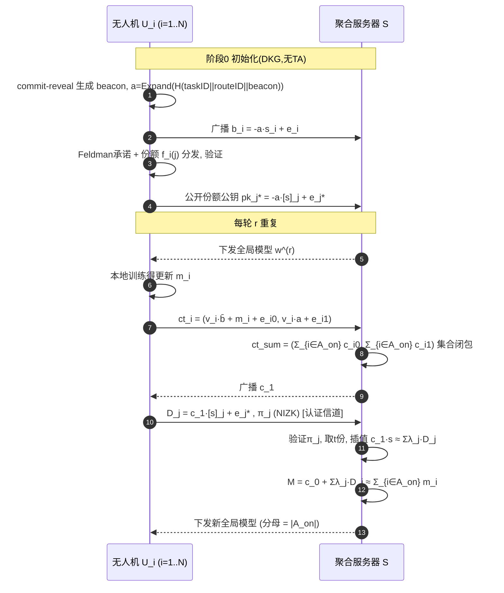

# 同态加密 × 联邦学习（UAV 场景）文献阅读报告与 6 个新方案设计

> 阅读对象：`paperwork/` 目录下 17 篇英文学术文献 + 2 篇中文基础材料，主题覆盖 **全同态加密（FHE / CKKS / BFV）、多密钥同态加密（MKHE）、安全聚合（SecAgg）、隐私保护联邦学习（PPFL）、层次联邦学习（HFL / EHFL）**。
>
> 目标：① 总结这批文献的**技术模式谱系**；② 给出**问题—解决链**的演进推理；③ 面向 **无人机（UAV）辅助 / 边缘辅助**的真实场景，设计 **2 个标准 FL + 3 个层次型 FL** 共 5 个全新方案，每个方案严格按「**5.1 场景 → 5.2 要解决的问题 → 5.3 创新点/总体设计目标 → 5.4 威胁模型 → 5.5 符号系统 → 5.6 方案设计与闭环公式推导（含 RLWE 加解密展开）→ 5.7 实体交互时序图 → 5.8 安全性分析与证明**」的结构给出。
>
> **诚实性声明**：第 1–4 章中每一个关于已有论文的事实性断言都来自本目录 PDF 的全文抽取与原文复核；论文未写明之处一律标注 **「未明确」**；凡属本报告自身的推断、批评或设计，均显式标注 **【本文评注】**。第 5 章的 6 个方案是**新设计**，其安全性证明是**本报告给出的引理 + hybrid 序列 + 模拟器构造**，尚未经同行评审；每个方案的**允许泄露与安全性边界**均在 §5.x.4.1 与附录 B.4 中显式声明。

---

## 目录

- **第 1 章** UAV 场景下联邦学习的挑战与研究点
- **第 2 章** 文献清单、模式分类学（密钥体制 × 架构 × 可信机构）
  - 2.1 文献清单（17 篇英文 + 2 篇中文）
  - 2.2 模式分类学（三大正交维度）
  - **2.3 分类学补充**：三维交叉分布、单/多密钥/阈值的"谁能解密什么"精确对照、**"名义无 TA vs 实质无 TA"判据**、三篇易误分类文献（ELSA/BPVFL/MASER）的独立验证
- **第 3 章** 技术演进谱系：从 MK-CKKS 到 ESAFL 的"问题—解决"链
  - 3.1–3.6 六步演进与链条小结
  - **3.7 每一步的精确密码学内容与"新缺陷的成因"分类**（含 CDKS 泄露的三步代数根源、CDKS-LSS 的两个边界澄清、**成因分类表 C-1~C-4**）
- **第 4 章** 统一密码学预备（RLWE / CKKS / Shamir 阈值 / VSS / 同态认证）
  - 4.1–4.7 基础原语与安全目标形式化
  - **4.8 UAV 场景的物理约束与参数反推**（四种角色 R1–R4、上行带宽预算推导、模型规模可行性表、约束→参数的反向选择）
- **第 5 章** 6 个新方案（每个含 **5.1–5.8 八小节**，并含**实体—可见性矩阵**、**敌手 CAN/CANNOT**、**安全目标编号表**、**与已有工作逐维度对比表**、**安全性边界声明**）
  - 5-A 方案一：VTS-FL（标准 FL，无 TA 阈值可验证单密钥）
  - 5-B 方案二：MV-FL（标准 FL，多密钥抗恶意服务器可验证聚合）
  - 5-C 方案三：HETRA-FL（层次 FL，UAV–Edge–Cloud 三级双阈值）
  - 5-D 方案四：RBH-FL（层次 FL，边缘拜占庭鲁棒 + 跨区切换）
  - 5-E 方案五：DynFL（层次 FL，外包加密 + 动态成员前向/后向安全）
  - 5-F 方案六：VHD-FL（层次 FL，无人机簇结构可验证 DKG 联邦学习，抗共谋）
- **第 6 章** 6 方案横向对比与结论
- **附录 A** 文献引用对照表（17 篇精确出处）
- **附录 B** 关键结论速查
  - B.1 三条不可回避的工程结论
  - B.2 五个"真缺口"与本文的对应方案
  - B.3 演进链的"新缺陷成因"分类（C-1~C-4）
  - B.4 各方案"必须显式声明"的安全性边界（诚实清单）
  - B.5 与已有工作对比的一句话定位
  - B.6 后续可做的工作（本报告的自我批评）

---

## 第 1 章 UAV 场景下联邦学习的挑战与研究点

在无人机（UAV）编队 / 无人机辅助（UAV-assisted）与边缘辅助（Edge-assisted）场景中，UAV 或地面边缘节点作为**数据持有者（客户端）**&#x534F;作训练一个全局模型（目标检测、协同感知、信道/轨迹预测、故障诊断等）。与数据中心式 FL 相比，UAV 场景引入了以下**独特且值得研究**的挑战：

### 1.1 移动性与间歇连接（Mobility & Intermittent Connectivity）

- UAV 高速移动，通信链路因遮挡、越区切换（handover）而频繁中断，导致**任意时点掉线（dropout / straggler）**&#x662F;常态而非例外。
- **关键点**：多密钥/阈值解密必须**容忍任意子集掉线**，且不能因掉线而失败（对应 CDKS-LSS 的阈值 $t$、FedOut 的补零机制）。

### 1.2 资源受限（计算 / 能量 / 带宽）

- UAV 机载算力与电池有限，CKKS/BFV 的加密、重线性化、rescaling 开销不可承受。
- **关键点**：**轻量化加密、选择性加密、外包计算、残差/稀疏压缩**（对应 MaskCrypt、MASER、ResFed、FedOut 的 SOP）。

### 1.3 数据异构（Non-IID）

- 不同 UAV 覆盖不同区域/时段/传感模态，本地数据分布严重 Non-IID，模型漂移与收敛慢。
- **关键点**：**贡献感知/鲁棒/自适应加权**（对应 FedPHE、中文讲义《联邦学习的加权方式》）；Non-IID 下拜占庭与正常更新的界限模糊（PPBR）。

### 1.4 恶意参与者与拜占庭攻击

- 被俘获的 UAV 或恶意地面站可发起**模型投毒、梯度放大、拜占庭攻击**。
- **关键点**：**鲁棒聚合（坐标中位数/裁剪均值/范数过滤）+ 可验证聚合**（ELSA 的 $\ell_2$ 过滤、VeSAFL/DSVFL/VLSFL/BPVFL 的验证）。

### 1.5 隐私泄露（梯度反演 / 重构攻击）

- 明文模型更新可被反演还原训练数据（成员推断、GAN 重构）。
- **关键点**：**同态加密**保持精度无损（优于 DP 的精度损失——MaskCrypt 的对照实验显示 DP 在 $\epsilon=50$ 时使 Texas 精度在 ~45% 后**反而下降**）。

### 1.6 无中心信任 / 单点失效（TTP 问题）

- 传统方案依赖**可信密钥生成中心（KGC / TA / TTP）**，在无基础设施的 UAV 网中难以部署且是单点失效。
- **关键点**：**分布式密钥生成（DKG）+ 去可信第三方**（CDKS-LSS 去 TTP、BPVFL 去完全可信第三方、VeSAFL 多聚合器）。

### 1.7 单密钥 vs 多密钥的两难

- **单密钥 SKHE**：所有客户端共享同一解密密钥 → 客户端之间可互相解密，无法抵御"诚实但好奇"的协作方（ESAFL、FedPHE、SecFed、SKHE 均点明此缺陷）。
- **多密钥 MKHE**：每个客户端独立密钥，但集体解密需**解密份额分发**，带来两个新问题：
  - **份额泄露**：部分解密值明文上传，被服务器/合谋方截获即可还原个体更新（CDKS 的缺陷）。
  - **掉线失败**：任一客户端掉线导致解密失败（xMK-CKKS 的缺陷）。

### 1.8 训练结果的保密性（对公共信道窃听者）

- MKHE 的"最终解密"步骤的中间值若走公开信道，被动窃听者可直接恢复聚合明文（**ESAFL 明确指出这一点**，但并未在自己的方案中把它写成安全目标）。

### 1.9 掉线后的密钥管理与前后向安全

- 离开编队的 UAV 若仍持有历史密钥，可继续解密未来的聚合结果（**无前向安全**，ESAFL / FedOut 未解决）。

### 1.10 分层聚合（EHFL）带来的两级隐私与拜占庭

- UAV → 边缘服务器（Edge）→ 云（Cloud）三层，边缘中间聚合缓解回传带宽，但**边缘级与云端级模型**都面临隐私泄露与拜占庭攻击（PPBR 的动机）。
- **关键点（本报告认为这是层次型 FL 相对标准 FL 的唯一本质新增量）**：**"边缘级聚合值本身也是隐私客体"**——PPBR 原文明确指出 *"edge-level models in EHFL require heightened protection against edge servers, since an edge server could use its edge-level model to infer sensitive information related to the clients"*。

> **一句话总结**：UAV 场景的 FL 研究点 = 移动掉线容错 × 资源受限 × Non-IID × 拜占庭鲁棒 × 多密钥隐私 × 去可信机构 × 前向安全 × 分层架构，而**同态加密（尤其多密钥 RLWE/CKKS）**&#x662F;同时兼顾"精度无损 + 抗合谋 + 后量子安全"的核心底座。

---

## 第 2 章 文献清单、模式分类学

### 2.1 文献清单（17 篇英文 + 2 篇中文）

| #  | 文件               | 全称/主题                                                  | 年份   | 密钥体制                     | 架构                  | 可信机构                   | 核心标签                        |
| -- | ---------------- | ------------------------------------------------------ | ---- | ------------------------ | ------------------- | ---------------------- | --------------------------- |
| 1  | 17-SecAgg        | Practical Secure Aggregation for Privacy-Preserving ML | 2017 | 掩码/密钥协商                  | 标准 FL               | 仅 PKI（掩码无 dealer）      | 成对掩码、双掩码、全阶段掉线容忍            |
| 2  | 19-CDKS          | Efficient MKHE with Packed Ciphertexts                 | 2019 | 多密钥(RLWE)                | 非 FL（$k$ 方 MKHE 推理） | 无（CRS 模型）              | MK-CKKS/MK-BFV 奠基、更快 relin  |
| 3  | 23-ELSA          | Secure Aggregation for FL with Malicious Actors        | 2023 | **纯秘密共享，无 HE**           | 标准 FL（2 服务器分信任域）    | 无 TA/KGC/TEE           | 客户端作不可信 dealer、$\ell_2$ 过滤  |
| 4  | 24-BPVFL         | Bidirectional Privacy-Preserving Verifiable FL         | 2024 | 单密钥 Paillier             | 标准 FL（2 服务器）        | 无（但 S1 是密钥方）           | 双向验证、TP-ZKP、同态哈希            |
| 5  | 24-ResFed        | Communication Efficient FL (Residuals)                 | 2024 | **无密码学**（明文压缩）           | 标准 FL               | —                      | 残差 + 熵编码降带宽                 |
| 6  | 24-SecFed        | Secure FL via MKHE + TEE                               | 2024 | 多密钥 BFV                  | 标准 FL               | **TEE**                | EMK-BFV、噪声刷新、离线保护           |
| 7  | 25-ESAFL         | Efficient Secure Additive HE for Cross-Silo FL         | 2025 | 单密钥 ESHE                 | 标准 FL               | **KGC/AS（TTP）**        | 单步解密、无份额分发、抗 $N-2$ 合谋       |
| 8  | 25-FedPHE        | FL via Packed HE                                       | 2025 | 单密钥 CKKS                 | 标准 FL               | **KDC（fully trusted）** | 贡献感知加权、抗 straggler、pack 级稀疏 |
| 9  | 25-MASER         | Efficient PPFL with MKHE                               | 2025 | 多密钥 CKKS                 | 标准 FL               | 可信密钥管理器（仅聚合公钥）         | 多数投票掩码 + 剪枝切片               |
| 10 | 25-MaskCrypt     | FL with Selective HE                                   | 2025 | 选择性 HE（设计多密钥/实验单密钥）      | 标准 FL               | 无                      | 梯度引导选出 $\rho N$ 个权重要加密      |
| 11 | 25-SKHE          | Privacy-Enhanced FL with Single-Key HE                 | 2025 | 单密钥 CKKS + ECC           | **层次 FL（云—边—端）**    | **TA + TEE**           | 免重构私钥的分布式解密份额、哈希门控          |
| 12 | 25-VeSAFL        | Verifiable Secure Aggregation                          | 2025 | Pedersen VSS + BLS（无 HE） | 多聚合器（扁平）            | 无（公告板自注册）              | 份额/部分聚合/全局三级可验证             |
| 13 | 26-CDKS-LSS      | PPFL via Secret Sharing + MKHE                         | 2026 | 多密钥 + 环上 LSS             | 标准 FL               | 无（CRS 来源不明）            | 解密份额 Shamir 再分配、阈值          |
| 14 | 26-FedOut        | FL with Outsourced HE                                  | 2026 | 多密钥 CKKS + OTP           | 标准 FL（+1 外包代理）      | **KDC + AS⊥Proxy**     | 加密外包、零明文补密文抗掉线              |
| 15 | 26-Ftopk (DSVFL) | Secure Aggregation + Dynamic Verification              | 2026 | 门限 Paillier + Shamir     | 标准 FL               | **TA**                 | Ftop-$k$ 稀疏、门限验证、掉线容忍       |
| 16 | 26-PPBR          | Byzantine-Robust Edge-Assisted HFL                     | 2026 | CLDP + PLHE(BFV) + SA    | **层次 FL（云—边—端）**    | 无（云引导参数）               | 保护本地模型**与边缘级模型**、双层过滤       |
| 17 | 26-VLSFL         | Verifiable Lightweight Multi-Round Secure FL           | 2026 | 双掩码 + Shamir + 同态哈希      | 标准 FL               | **TA**（诚实不共谋）          | 参数复用免每轮 setup、聚合可验证         |
| 18 | 联邦学习基本架构         | FedSGD/FedAvg/FedProx/FedNova 推导                       | —    | —                        | 标准                  | —                      | 统一符号系统 + 损失/梯度推导链           |
| 19 | 联邦学习的加权方式        | 7 类聚合权重                                                | —    | —                        | 标准                  | —                      | 权重分类 + UAV-A/B/C 示例         |

### 2.2 模式分类学（三大正交维度）

**维度 A：密钥体制**

| 体制                   | 文献                                             | 优点             | 缺陷                               |
| -------------------- | ---------------------------------------------- | -------------- | -------------------------------- |
| 单密钥 SKHE             | ESAFL、FedPHE、SKHE、BPVFL、MaskCrypt(实验)          | 计算/通信开销小、可单步解密 | **客户端可互解密**，需互信或 TTP/TEE         |
| 多密钥 MKHE             | CDKS、SecFed、MASER、CDKS-LSS、FedOut              | 客户端间隐私、无需互信    | 解密需份额分发（**泄露/掉线**）、开销大           |
| 阈值（LSS/Paillier/VSS） | CDKS-LSS、DSVFL、SecFed、SKHE、VLSFL、SecAgg、VeSAFL | 掉线容忍、可去 TTP    | **门槛紧**：$t$ 方共谋即重构；份额分发 $O(N^2)$ |
| 无 HE（掩码/压缩）          | SecAgg、ELSA、VLSFL、VeSAFL、ResFed                | 无全同态开销、信息论安全   | 聚合明文对服务器公开；**非后量子**（DL/配对）       |

**维度 B：架构**

| 架构                    | 文献                                              | 特点                        |
| --------------------- | ----------------------------------------------- | ------------------------- |
| 标准 FL（单聚合器）           | 绝大多数（SecAgg、CDKS、ESAFL、FedPHE、CDKS-LSS、FedOut…） | 客户端 ↔ 服务器两跳               |
| **层次 FL（EHFL）**       | **仅 PPBR、SKHE**                                 | UAV → Edge → Cloud，边缘中间聚合 |
| 多聚合器/分散信任（**扁平，非层次**） | ELSA（双服务器）、BPVFL（双服务器）、VeSAFL（多聚合器）             | 去单点失效；两台服务器**同层**         |

**维度 C：可信机构**

| 设置               | 文献                                                 | 说明                          |
| ---------------- | -------------------------------------------------- | --------------------------- |
| 有 TTP/KGC/TA/TEE | ESAFL、FedPHE、SecFed、SKHE、FedOut、DSVFL(Ftopk)、VLSFL | 依赖可信密钥分发中心或硬件隔离区            |
| 无 TTP（名义去中心）     | CDKS、CDKS-LSS、BPVFL、MASER、VeSAFL、PPBR              | DKG / 秘密共享 / 无中心            |
| 分散信任（非共谋服务器）     | ELSA、FedOut、BPVFL                                  | 只要 1 台诚实即安全（但**不共谋假设不可删除**） |

**观察**：三个维度是**正交**的，最新研究（2025–2026）的趋势是——**「多密钥 × 无 TTP × 阈值掉线容忍」**，同时开始补上**可验证性**与**拜占庭鲁棒性**两块短板。


### 2.3 分类学补充：三维交叉分布与"名义无 TA vs 实质无 TA"

#### 2.3.1 三维交叉的实测分布

| 密钥体制 ↓ / 架构 →            | 标准 FL                                    | 层次型 FL        | 多聚合器（扁平）    |
| ------------------------ | ---------------------------------------- | ------------- | ----------- |
| 单密钥 SKHE                 | FedPHE、MaskCrypt(实验)、BPVFL、DSVFL†        | **SKHE（唯一）**  | —           |
| 多密钥 MKHE                 | CDKS‡、CDKS-LSS、ESAFL、FedOut、MASER、SecFed | —             | —           |
| 阈值（LSS / Paillier / VSS） | CDKS-LSS、DSVFL、SecFed、VLSFL、SecAgg       | SKHE、**PPBR** | VeSAFL、ELSA |
| 无 HE（掩码 / 压缩）            | SecAgg、VLSFL、ResFed、ELSA                 | PPBR          | VeSAFL      |

† DSVFL 的 Paillier 在**客户端侧**做门限，服务器无解密能力，密钥体制上更接近"阈值"而非"单密钥"。  
‡ CDKS 本身不是 FL（是 $k$ 方 MKHE 的 oblivious NN 推理），列为 FL 文献是因为后续全部 MKHE-FL 都建立在它之上。

> **【本文评注】上表最刺眼的一格是"层次型 FL"列：只有 SKHE 与 PPBR 两个格子。** 这意味着 **HE-FL 的主流（15/17）仍是单层星型**。把 HE-FL 从单层搬到云—边—端，不是"把公式套两遍"，而是要在**新的攻击面**上重新设计密码学——这个新攻击面就是 §1.10 所讲的"**边缘级聚合值本身成为隐私客体**"。**这正是本文 3 个层次型方案（5-C / 5-D / 5-E）的立足点。**

#### 2.3.2 对上述观察的独立验证（三篇易被误分类的文献）

`23-ELSA`、`24-BPVFL`、`25-MASER` 三篇从标题看容易让人以为可能是"多服务器 / 边缘辅助"，实测结论是**三篇全部为扁平标准 FL，没有任何中间聚合层**。判据：对三份 PDF 全文做不区分大小写的正则扫描 `hierarch|edge server|edge-assist|multi-server|two-tier|cloud-edge|intermediate aggregat|aggregation layer|tier|cluster`，**三篇均零命中**。

| 文献        | 精确出处                                                                              | 拓扑判定                                                                            | 判据原句                                                                                                                                        |
| --------- | --------------------------------------------------------------------------------- | ------------------------------------------------------------------------------- | ------------------------------------------------------------------------------------------------------------------------------------------- |
| **ELSA**  | Rathee, Shen, Wagh, Popa — **IEEE S\&P 2023**                                     | 扁平，2 服务器（分属不同信任域）+ $n$ 客户端；**无 TA/KGC/TEE/dealer**（客户端自己充当**不可信**的关联随机数 dealer） | "two servers deployed in separate trust domains collectively and securely emulate the task of the central coordinating server"              |
| **BPVFL** | Liu, Chen, Zhu, Sun, Du, Guizani — **IEEE GLOBECOM 2024**                         | 扁平，2 服务器（S0 聚合，假定**不诚实**；S1 验证，**半诚实且持解密密钥**）+ $N$ 客户端                          | "the BPVFL framework involves three types of participants: 1) Aggregation cloud server (S0) 2) Verification cloud server (S1) 3) N Clients" |
| **MASER** | Al Omar, Yang, Choo, Ardakanian — **arXiv:2505.14797v1 [cs.CR], 2025-05-20（预印本）** | 扁平，1 聚合服务器 + 1 **可信密钥管理器（仅聚合公钥，非解密权威）** + $N$ 客户端                               | "In FL, a central server aggregates model parameter updates made independently by clients…"                                                 |

> **⚠ 一个必须避免的误分类**：**ELSA 与 BPVFL 的两台服务器是"服务器侧信任拆分"，不是层次结构**——两台服务器位于**同一顶层**，每个客户端直接与它们通信；MASER 的 key manager 是**同级助手**，不是聚合层。**因此这三篇都不能填补"层次型 / 边缘辅助"这个类别**——这从反面加固了 §2.3.1 的观察。

#### 2.3.3 这三篇的真实价值：三个"安全上界/下界"基准

| 文献        | 密钥体制                                                                                                            | 威胁模型（精确）                                                         | 安全证明类型                                                                               | 投毒鲁棒                                                                                            |
| --------- | --------------------------------------------------------------------------------------------------------------- | ---------------------------------------------------------------- | ------------------------------------------------------------------------------------ | ----------------------------------------------------------------------------------------------- |
| **ELSA**  | **纯秘密共享，完全不用 HE**（布尔份额 → $\mathbb{Z}_L$ 算术；$\Delta$-COT/OT 关联 + Beaver 三元组，客户端作**不可信 dealer**，用 sacrifice 技术验证） | 客户端**恶意**；**两台服务器至多一台被腐化**（半诚实或恶意）；**$(\lvert C\rvert-1,1)$-私有** | **simulation-based**（MPC 模拟范式，静态恶意敌手，$(F_{\mathrm{CoinFlip}},F_{\mathrm{RO}})$-混合模型） | **✅ 在范围内**（$\ell_2$ 防御）                                                                         |
| **BPVFL** | **单密钥 Paillier**（全体共享一对 $(pk,sk)$）+ 线性同态哈希 $H(x)=g^x\bmod o$ + 三方零知识协议                                          | S0 **恶意**、S1 **半诚实**、$\le N-1$ 客户端恶意；**依赖"服务器间不共谋"假设**           | **非** simulation，**无** IND-CPA 归约（4 个定理建立在 no-collusion 假设上）                         | **✘ 明确 out of scope**（结论列为 future work）                                                         |
| **MASER** | **多密钥 CKKS（MKCKKS）**，$pk=\sum pk_i$（xMKCKKS 策略），客户端部分解密 + 服务器 Merge（含 noise flooding）                           | 服务器 **honest-but-curious**；客户端可恶意但**严格少数（<50%）**                 | **非形式化**（无 simulation、无 IND-CPA 定理）                                                  | **△ 部分**：多数投票抗掩码投毒（实测至 40% 恶意），但脚注承认一旦放松限制性共谋假设就"would be necessary instead of majority voting" |

> **【本文评注】这张表给出了本领域安全性的上界基准与下界基准**：
>
> - **上界（最严）**：ELSA —— 恶意客户端 + 恶意服务器 + **simulation-based 证明** + 投毒防御。**代价是完全放弃 HE**（纯 MPC，通信开销随函数复杂度线性增长），因此无法适用于本文 6 个方案瞄准的"模型更新为十万~百万维"的 HE-FL 场景。
> - **下界（最松）**：MASER / BPVFL —— 依赖 no-collusion 或"恶意方 <50%"的**限制性假设**，且**不做形式化归约**。  
>   **本文 6 个方案统一选择"恶意服务器 + 阈值隐私 + 明确的 simulation 或 hybrid 归约"**，即目标是把 ELSA 式的**证明严谨性**移植到 HE-FL 的**可扩展性**上。

#### 2.3.4 单密钥 vs 多密钥 vs 阈值："谁能解密什么"的精确对照

| 体制                   | 加密密钥      | 解密密钥归属                  | 致命后果                                              | 代表                                |
| -------------------- | --------- | ----------------------- | ------------------------------------------------- | --------------------------------- |
| **单密钥 SKHE**         | 全体共享 $pk$ | 全体共享 $sk$               | 任一客户端（或与服务器共谋的任一客户端）可解密**任何他人密文** ⇒ 只能假设客户端之间完全互信 | FedPHE、MaskCrypt(实验)、SKHE、BPVFL   |
| **多密钥 MKHE（CDKS 型）** | 各自 $pk_i$ | 需全体 $sk_i$ 协同           | 部分解密值 $\mu_i$ 与公开的 $c_{i,0}$ 相加即得 $m_i$（§3.7.1）   | CDKS、CDKS-LSS、MASER               |
| **多密钥（ESAFL 型）**     | 各自 $s_i$  | **全体共享** $s=\sum_i s_i$ | 无份额泄露，但**任一客户端被腐化 = 长期获得每轮聚合明文**；无阈值、无掉线容忍        | ESAFL、FedOut                      |
| **阈值**               | 群体公钥      | $(t,N)$ 份额              | 门槛紧：$t$ 方共谋即可重构个体隐私；份额分发引入 $O(N^2)$ P2P 通信        | CDKS-LSS、DSVFL、SKHE、VeSAFL、SecAgg |
| **无 HE（掩码）**         | 无         | 无                       | 安全性来自**成对掩码精确对消**；聚合明文对服务器公开（需 DP 或 HE 补救）        | SecAgg、ELSA、VLSFL                 |

#### 2.3.5 "名义无 TA" 与 "实质无 TA" —— 一个必须区分的判据

文献中"无 TTP / 去中心化"的声明往往经不起追问。本文提出两个判据：

> **判据 ①** setup 阶段的随机性由谁提供？**能否被某一方偏置？**  
> **判据 ②** 若 setup 阶段的某一方作恶，**能否被检测 / 追责？**

| 方案              | 声明                       | 判据①（随机性可偏置?）                               | 判据②（作恶可检测?）                            | 实质评级                          |
| --------------- | ------------------------ | ------------------------------------------ | -------------------------------------- | ----------------------------- |
| CDKS / CDKS-LSS | 无 TTP（CRS 模型）            | **"$\mathbf a\leftarrow U(R_q)$ 由谁生成"未明确** | ✘                                      | ⚠ 名义无 TA（隐性 trusted setup 缺口） |
| ESAFL           | 无 TTP（可选 MPC 联合生成密钥）     | MPC 路线**仅一句引用，无协议无证明**                     | ✘                                      | ⚠ 名义无 TA                      |
| MASER           | 用"可信密钥管理器"聚合公钥           | 该管理器被假设可信                                  | ✘                                      | ⚠ 名义无 TA                      |
| SecAgg          | 仅 PKI（掩码无 dealer）        | ✔ 成对种子 DH 现算                               | ✔ PKI 防 Sybil；主动模型下 ConsistencyCheck 轮 | ✔ **接近实质无 TA**                |
| VeSAFL          | 公告板自注册                   | △ NB 的 public/append-only/consistent 被当假设  | ✔ NB 可审计                               | ✔ **接近实质无 TA**                |
| ELSA            | 无 dealer（客户端作不可信 dealer） | ✔ 关联随机数由 sacrifice 技术验证                    | ✔ 可公开验证                                | ✔ **实质无 TA**                  |
| PPBR            | 云引导                      | △ 云广播全部鲁棒参数                                | ✘                                      | ⚠ 信任下放给半诚实云                   |
| **本文 6 个方案**    | 无 TA                     | ✔ 公开可验证随机信标（commit-reveal / NIST beacon）   | ✔ Feldman VSS 承诺 + NIZK 投诉             | ✔ **目标是实质无 TA**               |

---

## 第 3 章 技术演进谱系：从 MK-CKKS 到 ESAFL 的"问题—解决"链

本批文献构成一条清晰的**问题驱动的演进链**。核心矛盾是：**多密钥同态加密（MKHE）在 FL 中要"集体解密一个多密钥聚合密文"，这个解密动作天然需要多方协作，而协作的每一步都可能成为新的泄露点或脆弱点。**

### 3.1 起点：CDKS（MK-CKKS）——多密钥的奠基

CDKS（Chen–Dai–Kim–Song, CCS'19）给出第一个带打包密文的 RLWE 多密钥 CKKS/BFV。FL 里的用法：

- 每个客户端 $P_i$ 采样 $s_i\leftarrow\chi$，$e_i\leftarrow\psi$，公开 $b_i=-a\cdot s_i+e_i$（共享同一 $a$）。
- 客户端 $i$ 用自己的密钥加密 $m_i$ 得 $ct_i=(c_{i,0},c_{i,1})=(v_i b_i+m_i+e_{i,0},\,v_i a+e_{i,1})$。
- 服务器聚合 $ct_{\mathrm{sum}}=(\sum c_{i,0},\sum c_{i,1})$。
- **解密（两步）**：① 部分解密——$P_i$ 用 $s_i$ 算 $\mu_i=c_{i,1}\cdot s_i$ 上传；② 合并——$M\approx \sum c_{i,0}+\sum_i \mu_i$。

**缺陷（安全隐患）**：$\mu_i=c_{i,1}s_i$ 是**明文**。半诚实服务器（或与部分客户端合谋）拿到公开的 $c_{i,1}$ 与 $\mu_i$ 后，可组合出**部分和明文**——当合谋者已知除目标外的其他客户端明文时，即可反推出目标客户端的 $m_i$。**解密份额明文上传 = 泄露点。**（精确的代数推导见 §3.7.1。）

### 3.2 xMK-CKKS（Ma et al.）——聚合公钥，堵住份额泄露

xMK-CKKS 的关键改造：客户端不再用各自 $b_i$ 加密，而是**全体公钥相加**得到聚合公钥 $\tilde b=\sum_i b_i=-a\sum_i s_i+\sum_i e_i$，等价于一个"群体密钥" $s_{\mathrm{add}}=\sum_i s_i$ 的公钥。所有人用 $\tilde b$ 加密：

- 部分解密 $\mu_i=c_1\cdot s_i+e_i^*$（$c_1=\sum_i c_{i,1}$）。
- 由于密文用 $\tilde b$ 加密，任何**不完整子集**的部分解密之和都会残留一个 RLWE 噪声项 $v\cdot a\cdot\sum_{j\notin S}s_j$，使 $m$ 被隐藏 → **部分解密值可以在公开信道上传而不泄露个体更新**。

**新缺陷**：聚合公钥 $\tilde b$ 与**全体成员集合绑定**。只要有一个参与者掉线，解密就失败（缺了它的 $s_i$），且无法完成 $\sum_i\mu_i$。**不防掉线。**

**次生缺陷（ESAFL 独立指出）**：MKHE 分布式解密的第二步 $\mathsf{Merge}=c_0+\sum_i D_i$ **不含任何密钥输入**——它不是一个"解密算法"而是一个"线性合并"。因此 *"any passive eavesdropping adversary can obtain the aggregation plaintext for free"*。

> **【本文评注】这一条在文献中被严重低估。** 它意味着 MKHE-FL 的安全性依赖"部分解密值走安全信道"这一**未写进协议的假设**；而"用安全信道"的代价随客户端数与轮数增长。这正是本文方案 5-A 选择"**对解密密钥做阈值共享（长期份额）**"而非"对每轮部分解密值做 LSS"的直接理由。

### 3.3 CDKS-LSS——解密份额的 Shamir 秘密共享，实现阈值

CDKS-LSS 的改造：把"部分解密值"$\mu_i=c_{i,1}s_i$ 本身用 **Shamir 线性秘密共享（LSS）** 分发：

- $P_i$ 采样 $t-1$ 次多项式 $f_i$（常数项 $=\mu_i$），在公开求值点 $\alpha_j$ 上求值，把 $\tilde\mu_{i,j}=f_i(\alpha_j)$ 发给 $P_j$。
- $P_j$ 汇总自己收到的份额 $\tilde\mu_j=\sum_i\tilde\mu_{i,j}$（这是"和多项式" $F=\sum_i f_i$ 在 $\alpha_j$ 处的值）。
- 服务器只需**任意 $t$ 份** $\tilde\mu_j$ 即可用 Lagrange 插值重建 $F(0)=\sum_i\mu_i$，再 $M=c_0+F(0)$。

**收益（三点）**：① **无 TTP**；② 解密阶段的保密性从**计算安全（RLWE）升级为信息论安全（LSS）**；③ **阈值 $t$**——只收到 $t$ 份即可完成解密，**迟延容忍**。

**仍存在的缺陷**：① 仅**半诚实**假设，恶意参与者可提交**伪造份额** $\tilde\mu_{i,j}$（无验证），导致错误解密；② 通信 $O(N^2)$——每个参与者要向其余 $N-1$ 人各发一份份额（实测约 **109 MB/轮/方**）；③ 只能做加法，对拜占庭投毒零防御；④ 求值点需满足 $R_q$ 上的"例外序列"条件（可逆差分），结构受限；⑤ **阈值边界紧 + "阈值"不等于"掉线容忍"**（详见 §3.7.3）。

### 3.4 ESAFL——直接避免份额分发（ESHE）

ESAFL 的改造：**干脆不要解密份额分发**。设计对称式 RLWE 加法同态 ESHE：

- 每个客户端 $i$ 有自己的加密密钥 $s_i$，但**共同解密密钥** $s=\sum_i s_i$ 由 KGC 一次性经安全信道发给每个客户端。
- 密文 $ct_i=[a_t s_i+\tilde p\, e_i+m_i]_q$，聚合 $Ct=\sum ct_i$，解密 $M=[[Ct-a_t s]_q]_p=m_{\mathrm{add}}$。
- 每轮随机多项式 $a_t=\mathrm{Vec2Poly}(\mathrm{PRG}((x_1\oplus b_1)\|\cdots\|(x_k\oplus b_k)))$ 由**共享秘密 $B$ + 轮号 $t$** 本地无交互生成 → 多轮隐私。

**收益**：单步解密、无客户端交互、无安全信道传输密文、抗 $\kappa<N-1$ 个客户端合谋、效率接近 SKHE。

**仍存在的缺陷**：① **依赖 KGC（TTP）**——KGC 生成并分发所有 $s_i,s,a_0,B$，是单点失效；② 解密密钥 $s$ 是**静态**的：离开的客户端永远持有 $s$，**无前向/后向安全**；③ 抗合谋上界仅 $N-2$，且**所有客户端都持有 $s$**，任意客户端都能解密聚合结果；④ 仅**加法同态**（不能同态乘，无法做内积/范数/鲁棒聚合）；⑤ 无验证、无拜占庭防御；⑥ **无阈值、无掉线容忍**——缺任一方即解密失败。

### 3.5 FedOut——补掉线 + 外包，但仍在 TTP 框架内

FedOut 的 ECMK-CKKS 复用"公共解密密钥 $s=\sum_i s_i$"（单步本地解密），并指出其静态和密钥在掉线时失效。它用 **SOP** 解决：

- **外包加密**：客户端盲化 $m_i'=m_i-r_i$ 发给 Proxy，Proxy 用 $pk_i$ 加密，AS 用 $r_i$ 去盲。
- **掉线补零**：Proxy 为掉线客户端生成**零明文密文** $c_j=([v\cdot pk_j+e_{j1}],\,[v\cdot a+e_{j2}])$，使聚合结果仍能在静态密钥 $s$ 下正确解密为在线客户端的和 $\sum_{i\in\mathrm{online}}m_i$。

**仍存在的缺陷**：① 仍依赖 **KDC（TTP）**，且 KDC 掌握所有 $sk_i$ 与 $s$；② **AS 与 Proxy 必须不共谋**——否则盲化因子 $r_i$ 与盲化明文 $m_i'$ 凑齐即全部明文泄露（论文承认这两条"之一是安全性的全部依托"）；③ 静态密钥仍**无前向安全**；④ 仅加法聚合；⑤ **系统总流量反而最大**（301.86 / 315.65 MB 每轮，高于所有基线）；⑥ 单个 Proxy 串行加密是瓶颈（盲加密占 SOP 总开销 >94%）；⑦ 无恶意安全、无可验证性（半诚实 AS 可返回任意错误结果而不被检测）。

### 3.6 演进链小结（推理结论）

```
MK-CKKS(CDKS)  ──[解密份额明文上传→泄露]──▶  xMK-CKKS  ──[不防掉线]──▶  CDKS-LSS  ──[仅半诚实+O(N²)+无验证]──▶  ESAFL  ──[TTP+静态密钥无前向安全+仅加法]──▶  FedOut
        (多密钥奠基)      (聚合公钥堵泄露)      (份额LSS阈值)          (避免份额分发)          (外包+补零)
```

**尚未被这条链彻底解决的问题**（= 本文 6 个新方案的切入点）：

1. **无 TTP 前提下同时做到"阈值掉线容忍 + 恶意份额可验证 + 通信 $O(N)$"**（→ 方案一 VTS-FL）。
2. **服务器恶意（伪造/篡改聚合）时可验证，且保持多密钥 + 阈值 + 掉线容忍**（→ 方案二 MV-FL）。
3. **层次 FL 中两级（Edge/Cloud）隐私 + 后量子乘法同态 + 双阈值**（→ 方案三 HETRA-FL）。
4. **密文域拜占庭鲁棒聚合（不依赖明文符号统计）+ UAV 跨区切换的密钥迁移**（→ 方案四 RBH-FL）。
5. **去 KDC 的外包加密 + 动态成员加入/退出 + 前向/后向安全密钥轮换**（→ 方案五 DynFL）。


### 3.7 每一步的精确密码学内容与"新缺陷的成因"分类

上面 3.1–3.6 给出了链条的**结论**；这一节给出每一步的**精确公式**与**新缺陷的成因归类**——因为"为什么每一代修复都会引入新缺陷"本身是有规律的。

#### 3.7.1 CDKS（CCS'19）：精确形式与泄露的代数根源

$\mathsf{Setup}:\ pp=(n,q,\chi,\psi,\mathbf a),\quad \mathbf a\leftarrow U(R_q);$  
$\mathsf{KeyGen}:\ s_i\leftarrow\chi,\ e_i\leftarrow\psi,\quad \mathsf{sk}_i=(1,s_i),\quad \mathsf{pk}_i=(b_i,\mathbf a),\quad b_i=[-a s_i+e_i]_q;$  
$\mathsf{Enc}:\ v_i\leftarrow\chi,\ e_{i,0},e_{i,1}\leftarrow\psi,\quad c_{i,0}=[v_ib_i+m_i+e_{i,0}]_q,\quad c_{i,1}=[v_ia+e_{i,1}]_q;$  
$\mathsf{Add}:\ c_0=\sum_{i=1}^{N}c_{i,0},\quad c_i=c_{i,1}\ (1\le i\le N)\ \Longrightarrow\ ct_{\mathrm{add}}=(c_0,c_1,\dots,c_N)\in R_q^{N+1};$  
$\mathsf{PartDec}:\ \mu_i=[c_i\cdot s_i+e_i^*]_q\ (e_i^*\leftarrow\phi);\qquad \mathsf{Merge}:\ \mu=c_0+\sum_{i=1}^{N}\mu_i.$

**正确性链条**：  
$c_{i,0}+c_{i,1}s_i=(v_ib_i+m_i+e_{i,0})+(v_ia+e_{i,1})s_i=m_i+\underbrace{v_ie_i}_{\text{小}}+\underbrace{e_{i,0}}_{\text{小}}+\underbrace{e_{i,1}s_i}_{\text{小}}\pmod q,$  
求和后 $\mu=M+\sum_i v_ie_i+\sum_i e_{i,0}+\sum_i e_{i,1}s_i+\sum_i e_i^*\approx M$。

**泄露的代数根源（三步，缺一不可）**：

1. $c_{i,0}=v_ib_i+m_i+e_{i,0}\approx m_i-v_i a s_i$（因为 $b_i\approx-a s_i$）；
2. $c_{i,1}\approx v_i a$，故 $\mu_i=c_{i,1}s_i+e_i^*\approx v_i a s_i$；
3. 两者相加，$v_i a s_i$ **精确对消**：  
   $c_{i,0}+\mu_i\approx\big(m_i-v_i a s_i\big)+\big(v_i a s_i\big)=m_i\pmod q .$

> **⚠ 这一缺陷的四个推论（构成后续全部设计的出发点）**
>
> 1. **多密钥 ≠ 安全聚合**：MKHE 的保护目标是"计算过程中服务器看不到明文"，**不包括解密阶段**。
> 2. **份额是明文级敏感物**：$\mu_i$ 与 $\mathsf{sk}_i$ 一对一绑定，泄露 $\mu_i$ 即等价于泄露 $m_i$（给定公开的 $c_{i,0}$）。
> 3. **$\mathsf{Merge}$ 不是"解密算法"而是"线性合并"**：它**不含任何密钥输入**，因此收齐 $\mu_i$ 的任何实体都等价于持有解密密钥（这正是 ESAFL 攻击 xMK-CKKS 的同一根因）。
> 4. **闭环性要求**：$c_{i,0}$ 与 $\mu_i$ 必须来自**同一轮、同一参与者集合**，否则求和项错配。这个约束会在本文 6 个方案中以"**轮次绑定 / 集合闭包**"的形式反复出现。

#### 3.7.2 xMK-CKKS：修复的手法是"改变加密所用的公钥"

$\tilde b=\sum_{i=1}^{N}b_i=-a\Big(\sum_{i=1}^{N}s_i\Big)+\sum_{i=1}^{N}e_i\ \ (\text{聚合公钥}),$  
$c_{i,0}=[v_i\tilde b+m_i+e_{i,0}]_q,\quad c_{i,1}=[v_i a+e_{i,1}]_q,\quad D_i=[c_1 s_i+e_i^*]_q,\quad M\approx c_0+\sum_i D_i,$  
其中 $c_0=\sum_i c_{i,0}$、$c_1=\sum_i c_{i,1}$。正确性：  
$c_0+\sum_i D_i=\sum_i m_i+\sum_i v_i\bar e+\sum_i s_i e_{i,1}+\sum_i e_i^*\approx M .$

**修复的机理**：$c_{i,0}$ 中现在含的是 $v_i\tilde b\approx-v_i a(\sum_j s_j)$——**全体私钥之和**，而 $D_i$ 的系数结构已改变（$c_1$ 是**共享量** $\sum_j v_j a$），攻击者无法仅凭 $c_{i,0}+D_i$ 消去 $v_i a s_i$ 项。**抹掉 A0 攻击的同时，带来两个新缺陷**：

- **① 单点掉线即全局失败**：$\tilde b$ 与成员集合绑定，缺任一 $s_j$ 则 $M$ 中的 $v_i a\sum_j s_j$ 无法被 $\sum_i D_i$ 消尽。
- **② 聚合明文对被动窃听者裸奔**：$\mathsf{Merge}$ **不含任何密钥输入**（见 §3.7.1 推论 3）。

#### 3.7.3 CDKS-LSS：修复的手法是"对部分解密值做份额再分配"

$\mu_i=c_{i,1}s_i\ (\text{去掉 CDKS 的洪泛项 }e_i^*),\qquad f_i(X)=\mu_i+\sum_{k=1}^{t-1}\lambda_{i,k}X^k,$  
$\tilde\mu_{i,j}=f_i(\alpha_j)\ (u_i\to u_j),\qquad \tilde\mu_i=\sum_{j=1}^{N}\tilde\mu_{j,i}=F(\alpha_i),\quad F=\sum_j f_j,\quad F(0)=\sum_j\mu_j,$  
$\mu=c_0+\sum_{i\in\mathcal{P}}\mu_i'\cdot\mathcal{L}_i,\qquad \mathcal{P}=\{\text{最先到达的 }t\text{ 个}\},\quad \mathcal{L}_i=\prod_{k\in\mathcal{P},k\ne i}\frac{\alpha_k}{\alpha_k-\alpha_i}.$

**收益三点**：① 个体的 $\mu_i$ **不再公开**（信息论：$<t$ 份零信息）；② 服务器无需等齐 $N$ 份；③ **无需 TTP**（对比 MKHA-PPFL 把解密外包给 TTP）。**技术上还删去了 CDKS 的 noise flooding $e_i^*$**，使 $\ge t$ 份额可**精确**恢复 $\mu_i$（无统计距离缓冲）。

> **⚠⚠ 两个必须澄清的边界（文献中最易被误读之处）**
>
> **边界 A：阈值边界紧 —— $t$ 方共谋即复现 §3.7.1 的攻击。**  
> 服务器 + $t$ 方用 $\{\tilde\mu_{h,a}\}$ 对**单个** $f_h$ 插值即得 $f_h(0)=\mu_h$；服务器本已持有 $c_{h,0}$，于是 $c_{h,0}+\mu_h\approx m_h$。CDKS-LSS 的 Thm 7 只证 $|\mathcal{A}|<t$。**根因**：份额是对 $(t-1)$ 次多项式的求值，$t$ 个点**唯一确定**该多项式——所以"$t$ 个份额"与"恢复 $\mu_h$"是等价的。**本文 5-A 的对策是对"长期解密密钥 $s$"而非"每轮部分解密值 $\mu_i$"做 LSS**——泄露的是份额（长期、不与任何单轮的 $c_{h,0}$ 配对），而不是当轮的部分解密值。
>
> **边界 B："阈值 $t$" ≠ "容忍掉线 $N-t$"。**  
> CDKS-LSS 重建的目标是 $F(0)=\sum_{j=1}^{N}\mu_j$——**覆盖全体 $N$ 方**。若 $P_j$ 未参与就**没有** $f_j$，则 $F(0)$ 缺 $\mu_j$（且 $c_0$ 常亦缺 $c_{j,0}$），服务器得到的是"参与子集之和"，但算法固定按 $w_G^r=\frac1N w_{\mathrm{add}}^r$ 平均 ⇒ **平均分母错误**。$t$ 只省掉"等最后 $N$ 个聚合份额到齐"的等待时间。**根因**：协议把"份额到达数 $t$"误当成了"参与者数"，两者在掉线时不等。**本文 5-A 的对策是让 $c_0$ 只对实际上传者求和，使分子分母天然同源。**

#### 3.7.4 ESAFL：修复的手法是"取消部分解密阶段"

$ct_i=[a_t s_i+\tilde p e_i+m_i^t]_q,\qquad C_t=\sum_i ct_i=[a_t s+\tilde p e_t+m^{\mathrm{add}}_t]_q,\qquad M_t=[[C_t-a_t s]_q]_p,$  
$a_{t+1}=\mathrm{Vec2Poly}\big(\mathrm{PRG}((t{+}1)\oplus B)\big)\quad(\text{共享 }B\text{ + 轮号 }t\text{，本地无交互生成}).$

**修复的机理**：加密密钥 $s_i$ 各异、**解密密钥 $s=[\sum_i s_i]_q$ 全体共享**。$C_t$ 中 $a_t\sum_i s_i=a_t s$ 项被一步解密精确消去，**不存在任何"部分解密值"**，故 §3.7.1 的 $c_{i,0}+\mu_i$ 攻击与 §3.7.2 的"Merge 无密钥"漏洞**同时消失**，且**不需要安全信道**。

> **⚠ 新缺陷的成因（三类）**  
> **① 共享解密密钥 = 长期明文通道**：任一客户端被腐化即**长期**获得每轮聚合明文。**ESAFL 自己批评过 SKHE 的这一点，ESHE 只把加密密钥变成了多方，解密密钥仍然共享。**  
> **② 无阈值、无掉线容忍**：原文明确 *"clients can correctly decrypt a ciphertext only when the ciphertext is an aggregation of **all** clients' local ciphertexts; Otherwise … cannot be correctly decrypted"*。**根因**：$a_t s$ 中的 $s$ 是**全体之和**，不是"任意 $t$ 份之和"。  
> **③ 单点信任与静态秘密**：可信 AS 持有全部 $s_i$ 与 $s$；长期秘密 $B$ 泄露 ⇒ 所有轮的 $a_t$ 可预测（论文未分析）。**同谋界的实质是 $N-2$**：Thm 5 的证明本身显示 $N-2$ 个同谋者获知 $m_{N-1}+m_N$（只剩两个诚实方的**和**），"$\kappa<N-1$" 是最优声明而非可达的个体隐私。

#### 3.7.5 FedOut：修复的手法是"外包 + 补零"

$\text{盲化}:\ m'_i=[m_i-r_i]_q,\ r_i\leftarrow U(R_q);\qquad \text{盲加密（Proxy）}:\ c'_i=\big([v pk_i+m'_i+e_{i1}]_q,[v a+e_{i2}]_q\big);$  
$\text{去盲（AS）}:\ c_i=\big([c'_{i1}+r_i]_q,\ c'_{i2}\big)=\big([v pk_i+m_i+e_{i1}]_q,[v a+e_{i2}]_q\big);$  
$\text{零明文补密文（掉线者 }j\text{）}:\ c_j=\big([v pk_j+e_{j1}]_q,[v a+e_{j2}]_q\big);$  
$C=\Big(\Big[v\sum_{i=1}^{N}pk_i+M+e'\Big]_q,\ [v a+e_{i2}]_q\Big),\qquad M=[C_1+C_2 s]_q\approx\sum_{i\in\mathrm{on}}m_i .$

**补零为什么必要**：解密依赖 $C_2s=(va+e_{i2})s$ 与 $C_1$ 中的 $v\sum_i pk_i=v(-as+\sum_i e_i)$ 相消。若掉线者不贡献 $pk_j$，则 $v\sum_i pk_i$ 不完整，$v a s$ 项无法消尽。**补零密文用掉线者的 $pk_j$ 补齐了这一项，而贡献零明文**——鲁棒性与隐私在代数上互不干扰。

> **⚠ 新缺陷**：① **强信任锚**：KDC 完全可信且掌握所有 $sk_i$ 与 $s$；**AS 与 Proxy 必须不共谋**（否则 $r_i$ 与 $m'_i$ 凑齐 ⇒ 全部明文泄露）。② **总流量反而更大**。③ **串行瓶颈**。④ **无恶意安全、无可验证性**。

#### 3.7.6 规律总结：新缺陷的四类成因

把 3.7.1–3.7.5 的"新缺陷"归类，得到一张**可用来预判下一代方案会坏在哪里**的表：

| 成因类别             | 机理                          | 实例                                                   | 本文对策                                      |
| ---------------- | --------------------------- | ---------------------------------------------------- | ----------------------------------------- |
| **C-1 代数抵消**     | 修复手法引入了新的"可相消配对"，攻击者利用该配对反推 | CDKS 的 $c_{i,0}+\mu_i$；xMK-CKKS 的 $\tilde b$ 与成员集合绑定 | 5-A：**对长期密钥而非部分解密值做阈值**；5-E：**补零 + 轮次绑定** |
| **C-2 门槛错配**     | 把"份额数阈值"当成"参与者数阈值"          | CDKS-LSS 的 $F(0)=\sum_{j=1}^{N}\mu_j$ 却按 $t$ 停止      | 5-A：**集合闭包 + 分子分母同源**                     |
| **C-3 密钥生命周期失控** | 解密密钥一次性分发后长期有效              | ESAFL / FedOut 的静态 $s$                               | 5-E：**epoch 密钥演化（key ratchet）**           |
| **C-4 信任锚转移**    | 消除一个 TTP，却在别处引入新的必须诚实的实体    | ESAFL 的 AS；FedOut 的 KDC 与"AS ⊥ Proxy"                | 5-A/5-B：**DKG + Feldman VSS 去 KDC**       |

---

## 第 4 章 统一密码学预备（符号与基本原语）

以下记号为全文统一记号，各方案直接引用，不再重复定义。

### 4.1 RLWE 与环

- $R=\mathbb Z[X]/(X^n+1)$，$n$ 为 2 的幂；$R_q=R/qR$。
- $\chi$：密钥分布（典型三元 $\{-1,0,1\}^n$ 或小系数）；$\psi$：离散高斯误差分布；$\phi$：方差更大的误差分布（用于 noise flooding）。
- $\|\cdot\|_\infty$：无穷范数；$[\cdot]_q$：模 $q$ 取整到中心区间；$\lfloor\cdot\rceil$：最近整数取整。
- 记 $a\xleftarrow{\$}U(R_q)$ 为均匀采样。

**RLWE 假设**：给定 $a\xleftarrow{\$}U(R_q)$，$s\leftarrow\chi$，$e\leftarrow\psi$，分布 $(a,,a\cdot s+e)$与均匀分布$U(R_q^2)$ 计算不可区分。

**聚合的零深度性质（所有 HE-FL 的共同基础）** 若 $ct_i=[a s_i+\tilde p e_i+m_i]_q$，则  
$C=\sum_{i=1}^{N}ct_i=\Big[a\sum_{i=1}^{N}s_i+\tilde p\sum_{i=1}^{N}e_i+\sum_{i=1}^{N}m_i\Big]_q=[a\,s+\tilde p\,e+M]_q,$  
即**密文加法不消耗模数链、不产生乘法深度**。这是本目录几乎所有方案"只支持加法"的根本原因，也是 FedPHE 需要一次 `ct×ct` 乘法（用于贡献权重 $p_i^t$）就成为唯一例外并带来额外开销的原因。

### 4.2 CKKS 加解密（单密钥）

设缩放因子 $\Delta$，明文 $m=\lfloor \Delta\cdot \mathbf{z}\rceil\in R$（$\mathbf{z}\in\mathbb C^{n/2}$ 经编码）。

- 密钥生成：$s\leftarrow\chi$，$a\xleftarrow{\$}U(R_q)$，$e\leftarrow\psi$，公钥 $pk=(b,a)$，其中 $b=-a\cdot s+e \pmod q$。
- 加密：$v\leftarrow\chi$，$e_0,e_1\leftarrow\psi$，$\ ct=(c_0,c_1)=\big(v\cdot b+m+e_0,\; v\cdot a+e_1\big)\pmod q$。
- 解密：$m\approx c_0+c_1\cdot s \pmod q$。

**正确性展开**：  
$c_0+c_1s=(v b+m+e_0)+(va+e_1)s=(-vas+ve+m+e_0)+(vas+e_1 s)=m+\underbrace{ve+e_0+e_1 s}_{\text{噪声}} .$

**解码的模数切换形式（ESHE/FedOut 使用的极简版）**：$ct=[a s+\tilde p e+m]_q$，解码  
$M=\big[[Ct-a s]_q\big]_p,$  
其中 $\tilde p$ 是"系数全为 $p$"的多项式——这是把模数切换当作解码的技巧，**只能做加法**。

### 4.3 多密钥聚合（共享 $a$，CDKS 形式）

- $P_i$：$s_i\leftarrow\chi$，$e_i\leftarrow\psi$，$pk_i=(b_i,a)$，$b_i=-a s_i+e_i$。
- 群体公钥 $\tilde b=\sum_i b_i=-a\cdot s_{\mathrm{add}}+\bar e$，其中 $s_{\mathrm{add}}=\sum_i s_i$，$\bar e=\sum_i e_i$。
- 客户端 $i$ 用 $\tilde b$ 加密：$ct_i=(c_{i,0},c_{i,1})=(v_i\tilde b+m_i+e_{i,0},\,v_i a+e_{i,1})$。
- 聚合密文 $ct_{\mathrm{sum}}=(c_0,c_1)=(\sum_i c_{i,0},\sum_i c_{i,1})$。
- 解密（需要 $s_{\mathrm{add}}$）：  
  $c_0+c_1 s_{\mathrm{add}}=\sum_i m_i+\underbrace{\sum_i v_i\bar e+\sum_i s_i e_{i,1}+\sum_i e_{i,0}}_{\text{噪声}}\approx \sum_i m_i .$

### 4.4 阈值解密与 Shamir LSS（环 $R_q$ 上）

- 群体密钥 $s_{\mathrm{add}}$ 可被**阈值共享**为 $[s_{\mathrm{add}}]_j$（$j=1..N$），任意 $t$ 份可由 Lagrange 系数 $\lambda_j$ 重建：  
  $s_{\mathrm{add}}=\sum_{j\in T}\lambda_j\,[s_{\mathrm{add}}]_j,\qquad T\subset[N],\ |T|=t .$
- 解密时在线方 $j$ 提交 $D_j=c_1\,[s_{\mathrm{add}}]_j+e_j^*$（$e_j^*\leftarrow\phi$），服务器插值：  
  $\sum_{j\in T}\lambda_j D_j=c_1 s_{\mathrm{add}}+\sum_{j\in T}\lambda_j e_j^* \;\Longrightarrow\; M\approx c_0+\sum_{j\in T}\lambda_j D_j .$

**定义（Exceptional Sequence）** 若对任意 $i\ne j$，$\alpha_i-\alpha_j$ 是 $R$ 中的**单位**，则 $\{\alpha_i\}_{i=1}^{N}\subset R_q$ 构成 exceptional sequence。此条件下环上 Shamir 正确且安全。

**份额再分配（re-sharing）——本报告后续方案的核心构件**：若每个 $P_i$ 对自己的秘密 $\mu_i$ 独立生成 $f_i$，广播 $\tilde\mu_{i,j}=f_i(\alpha_j)$，各 $P_i$ 聚合得  
$\tilde\mu_i=\sum_{j=1}^{N}f_j(\alpha_i)=F(\alpha_i),\qquad F=\sum_j f_j,\qquad F(0)=\sum_{j=1}^{N}\mu_j .$  
**关键性质**：$\{\tilde\mu_i\}$ 只是**和** $\sum_j\mu_j$ 的合法份额，**任何 $<t$ 个 $\tilde\mu_i$ 不泄露任何个体 $\mu_j$**（信息论）。

**阈值安全性**：任意 $<t$ 份份额对 $s_{\mathrm{add}}$ **信息论**独立（环上需使用满足"例外序列"条件的求值点，保证 $(\alpha_i-\alpha_j)$ 可逆）。

### 4.5 Feldman 可验证秘密共享（VSS）

- 份额持有者在公开承诺 $g^{f_0},g^{f_1},\dots,g^{f_{t-1}}$（或在环上 $A_k=\mathrm{Com}(f_k)$）下分发 $f(i)$，任何接收方可**验证**收到的份额 $f(i)$ 与承诺一致（$\prod_k (A_k)^{i^k}=g^{f(i)}$）。
- 由此，恶意分发方无法在不被发现的情况下分发错误份额。**绑定性归约到离散对数假设。**

### 4.6 线性同态哈希（用于聚合验证）

- 设 $g^{(r)}=(g_1,\dots,g_\ell)\in R_q^{\ell}$ 为公开随机基（**逐轮更新**），定义 $H(m)=\sum_{j=1}^{\ell} m_j\,g_j\in R_q$。
- 线性同态：$H(m_1+m_2)=H(m_1)+H(m_2)$。
- 抗碰撞性：找到 $m\ne m'$ 使 $H(m)=H(m')$ 等价于求解**环上 SIS** 问题（详见 §5-B.8 引理 4）。

### 4.7 安全目标形式化

- **IND-CPA**：对任意 PPT 敌手，$|\Pr[\mathcal A(pk,Enc(pk,m_0))=1]-\Pr[\mathcal A(pk,Enc(pk,m_1))=1]|\le\mathrm{negl}(\lambda)$。
- **诚实但好奇（semi-honest）**：严格遵循协议但试图从视图推断他人隐私。
- **恶意（malicious / Byzantine）**：可任意偏离协议。
- **Simulation-based 安全**：存在 PPT 模拟器 $\mathsf{Sim}$，使 $\mathsf{Ideal}_{\mathcal{F},\mathsf{Sim}}\overset{c}{\approx}\mathsf{Real}_{\Pi,\mathcal{A}}$，其中理想功能 $\mathcal{F}$ **显式定义允许的泄露**。
- 各方案的**威胁模型**均基于上述定义显式给出，且方案的安全性分析**严格对应其威胁模型**（并以 G1/G2/… 编号逐条对应）。

### 4.8 UAV 场景的物理约束与参数反推

> **本节回答"方案必须满足实际的应用场景"**：密码参数不是随手挑的，它被**链路预算与飞行任务窗口反向约束**。本文 6 个方案的所有参数取值都由本节的不等式推得。

#### 4.8.1 先分清 UAV 在 FL 中的四种角色

**这是文献中最常被混淆的一点**：说"UAV-FL"时必须明确 UAV 是**数据源**还是**聚合者**，否则威胁模型无法写。

| 角色                   | 拓扑位置        | 典型任务                  | 主导约束                        |
| -------------------- | ----------- | --------------------- | --------------------------- |
| **R1 UAV-as-Client** | 标准 FL 的客户端  | 电力/管道巡检、农业遥感、灾情评估     | **上行带宽 + 能量**（飞行时间有限）       |
| **R2 UAV-as-Edge**   | 层次型 FL 的中间层 | UAV 悬停作空中小基站，聚合地面 IoT | **悬停能量 + 覆盖 + 链路稳定性**       |
| **R3 UAV-as-Relay**  | 客户端↔基站的空中链路 | 偏远 / 应急通信             | **链路可靠性 + 时延**（不参与计算）       |
| **R4 UAV Swarm（对等）** | 去中心化 / 层次型  | 协同定位、目标跟踪、三维重建        | **一致性与时钟同步 + 集群内带宽（FANET）** |

**本文 6 个方案的角色归属**：5-A（VTS-FL）→ **R1**；5-B（MV-FL）→ **R1 + R4**；5-C（HETRA-FL）→ **R2**（边缘即无人机/地面基站）；5-D（RBH-FL）→ **R1 + R2**（含跨区切换）；5-E（DynFL）→ **R1 + R3**（微型机 + 代理）。

#### 4.8.2 上行带宽预算的推导

设机载数据链有效吞吐 $B_{\mathrm{link}}$（Mbps），单轮允许的上行时窗 $T_{\mathrm{up}}$（s，受飞行任务窗口约束），则**单机单轮上行字节预算**  
$\mathcal{B}_{\max}=\frac{B_{\mathrm{link}}\cdot T_{\mathrm{up}}}{8}\quad\text{(MB)} .$

设模型参数量 $\mathcal{P}$，CKKS/BFV 打包槽数 $n/2$，每槽 $\lceil\log q\rceil$ 位，则**单个完整模型密文**  
$\mathcal{C}_{\mathrm{model}}=\frac{\mathcal{P}}{n/2}\cdot\frac{\lceil\log q\rceil}{8}\ \text{(B)} .$

代入本报告的默认参数（$\log n=15\Rightarrow n/2=16384$ 槽，$\lceil\log q\rceil=478$ bit $=59.75$ B）：  
$\boxed{\ \mathcal{C}_{\mathrm{model}}\approx\frac{\mathcal{P}}{16384}\times59.75\ \text{B}\ \approx\ 3.65\times10^{-3}\cdot\mathcal{P}\ \text{(B)}\ \approx\ 3.65\ \text{MB per }10^6\text{ params}.\ }$

**与文献实测的对照（校准本次推导的可信度）**

| 来源        | 模型/设置                         | 实测流量                 | 本文公式的预测                                           | 说明                       |
| --------- | ----------------------------- | -------------------- | ------------------------------------------------- | ------------------------ |
| PPBR      | MNIST 级 MLP，BFV 2048 槽        | 36.39 MB/轮（PLHE）     | —（参数不同）                                           | 量级一致                     |
| FedPHE    | CKKS，$\log n=13$              | CKKS 膨胀 $42.3\times$ | $\log n=13$ 时理想膨胀 $\approx14.9\times$（float32 基线） | 差异来自模数链层数与量化位数           |
| MaskCrypt | ResNet-18（$1.1\times10^7$）全加密 | 871.94 MB            | 本文公式：$1.1\times10^7\times3.65\times10^{-3}=40$ MB | **本文给出的是理想下界**           |
| FedOut    | 50 clients，$10^6$ 参数          | 系统总流量 301.86 MB/轮    | 单机 3.65 MB × 50 = 183 MB                          | 加上 Proxy↔AS 的盲化密文传输，量级吻合 |

> **【本文评注】本文公式给出的是"打包 + 单层模数"的理想下界，实际实现因模数链层数 $L$、RNS 素数个数与打包效率而放大 $3$–$20$ 倍。方案设计时应按理想值的 5–10 倍预留余量。**

#### 4.8.3 从预算反推可行的模型规模

取 $B_{\mathrm{link}}=5$ Mbps、$T_{\mathrm{up}}=30$ s ⇒ $\mathcal{B}_{\max}=18.75$ MB/轮/机：

| 模型规模                        | 理想密文大小   | 是否可行     | 结论                          |
| --------------------------- | -------- | -------- | --------------------------- |
| $10^4$（小型分类器）               | 0.037 MB | ✔ 轻松     | 可全量加密                       |
| $10^5$                      | 0.37 MB  | ✔        | 可全量加密                       |
| $10^6$（MobileNetV3-Small 级） | 3.65 MB  | ✔（余量 5×） | **本文 6 个方案的目标量级**           |
| $10^7$（ResNet-18 级）         | 36.5 MB  | △        | 需稀疏化到 $\rho\lesssim0.4$ 或量化 |
| $8\times10^7$（DistilGPT2 级） | 292 MB   | ✘        | **UAV 场景不可行**               |

> **⚠ 结论**：**任何在 UAV 上讨论 LLM 级模型（$\ge10^7$ 参数）的 HE-FL 方案，都应被视为脱离场景。** 本文 6 个方案统一按 $\mathcal{P}\in[10^5,10^6]$ 设计。

#### 4.8.4 UAV 约束对密码参数的反向选择

| UAV 约束                     | 对密码参数的直接影响                                                                            |
| -------------------------- | ------------------------------------------------------------------------------------- |
| 机上算力弱（无大内存、无 NTT 加速）       | 迫使 $\log n$ **不能过大**（$n=2^{15}$ 已是上限；MaskCrypt/FedPHE 用 $2^{13}$）；迫使把加密**外包**（方案 5-E） |
| 飞行窗口 $T_{\mathrm{up}}$ 短   | 迫使**单轮通信量小** ⇒ 稀疏化 / packing / 掩码而非全量 RLWE（方案 5-D、5-E）                                |
| 掉线率高（10–30%）               | 迫使门限 $t\le\lfloor 2N/3\rfloor$；迫使"补零 / 集合闭包"机制（方案 5-A、5-E）                            |
| 链路不可靠、越区切换                 | 迫使**密钥不随拓扑迁移**（方案 5-D 的 re-sharing）                                                   |
| 无基础设施、无 PKI                | 迫使 **DKG + 公开可验证信标**（方案 5-A/5-B），放弃"PKI 防 Sybil"的强假设                                  |
| 跨轮链接可推断航线/侦察目标（**UAV 特有**） | 迫使**逐轮新鲜随机化**（ESHE 的 $a_t$、方案 5-A 的 $e_j^*$、5-E 的 epoch 密钥演化）                         |

**参数默认取值（全文统一，各方案不再重复）**

| 参数                   | 取值                                                  | 说明                                            |
| -------------------- | --------------------------------------------------- | --------------------------------------------- |
| $\lambda$            | 128 bit（涉密场景可升 256）                                 | 安全级                                           |
| $\log n$             | 15                                                  | $n=32768$；$n/2=16384$ 个 SIMD 槽                |
| $\lceil\log q\rceil$ | 218（加法专用）/ 438（需一层乘法）                               | 按 CDKS Set I / Set II 口径                      |
| $\log p$（缩放因子）       | 50 bit                                              | CKKS 缩放，对应 $\approx2^{-40}$ 定点精度              |
| $\chi$               | $\{-1,0,1\}$ 三元均匀                                   | 密钥分布                                          |
| $\psi$               | 离散高斯 $\sigma=3.2$                                   | 误差分布                                          |
| $\phi$               | $\sigma_\phi\ge 2^{\lambda}\cdot n\cdot\sigma_\psi$ | **噪声洪泛**（仅 CDKS 原版需要；5-A/5-E 用阈值份额替代洪泛）       |
| $t$（门限）              | $\lfloor 2N/3\rfloor+1$                             | 容忍 $\lfloor N/3\rfloor-1$ 掉线（与 SecAgg 的串谋界对齐） |

---

# 第 5 章 面向 UAV 场景的 6 个新方案

> 每个方案严格按 **5.1 场景 → 5.2 要解决的问题 → 5.3 创新点/总体设计目标 → 5.4 威胁模型 → 5.5 符号系统 → 5.6 方案设计与闭环公式推导（含 RLWE 加解密展开）→ 5.7 实体交互时序图 → 5.8 安全性分析与证明** 展开。
>
> 约定：两个标准 FL 方案为 **5-A（VTS-FL）**、**5-B（MV-FL）**；三个层次 FL 方案为 **5-C（HETRA-FL）**、**5-D（RBH-FL）**、**5-E（DynFL）**。

---

## 5-A 方案一：VTS-FL —— 无 TA 的阈值可验证单密钥联邦学习（标准 FL）

### 5-A.1 场景

单台云聚合服务器 + $N$ 架无人机（UAV-assisted 农业巡检、输电线路巡检、目标检测）。无人机分属不同单位/运营商，**彼此互不信任**；部署现场**没有可信的密钥生成中心（KGC/TA）基础设施**，也不允许任何单一实体掌握能解出他人更新的密钥。无人机移动导致**任意时点掉线**。

**角色定位**：本方案中 UAV 是 **R1 型（UAV-as-Client）**——数据源与计算方；聚合者是一台地面/云端服务器。

**场景的量化约束（决定参数选择）**

| 项                               | 取值                                          | 依据                                                                                             |
| ------------------------------- | ------------------------------------------- | ---------------------------------------------------------------------------------------------- |
| 机队规模 $N$                        | 20 ~ 50                                     | 一条巡检线路的分段数                                                                                     |
| 模型规模 $\mathcal{P}$              | $\approx1.5\times10^6$（MobileNetV3-Small 级） | 缺陷检测任务                                                                                         |
| 链路吞吐                            | 5 ~ 10 Mbps                                 | 机载数传/图传共享                                                                                      |
| 上行时窗 $T_{\mathrm{up}}$          | 40 s                                        | 巡检航段之间的悬停/平飞窗口                                                                                 |
| **单机上行预算** $\mathcal{B}_{\max}$ | **25 ~ 50 MB/轮**                            | $B_{\mathrm{link}}\cdot T_{\mathrm{up}}/8$，推导见 §4.8.2（按 $B_{\mathrm{link}}=5$ Mbps 取保守值 25 MB） |
| 掉线率                             | 10% ~ 30%                                   | 返航换电、阵风、山区遮挡                                                                                   |

### 5-A.2 要解决的问题

- ESAFL 用 ESHE 实现"单步解密、无需份额分发"，但**依赖 KGC 这个可信第三方**分发公共解密密钥 $s$，是单点失效。
- CDKS-LSS 实现了无 TTP + 阈值，但**仅半诚实**（恶意 UAV 可提交伪造份额破坏解密），且通信 $O(N^2)$（实测约 **109 MB/轮/方**）。
- xMK-CKKS 用聚合公钥堵住份额泄露，但**任一掉线即解密失败**，且聚合明文在公开信道裸奔（§3.7.2）。
- CDKS-LSS 的"阈值"是**名义阈值**（§3.7.3 边界 B）：重建目标是全体 $N$ 之和却固定除以 $N$，掉线时**平均分母错误**。

**目标**：在**无 TTP** 前提下，同时做到 ① 阈值掉线容忍（且分母同源）；② 抗恶意份额（可验证部分解密）；③ 通信 $O(N)$；④ 保持单密钥的轻量加密开销；⑤ 聚合明文不向被动窃听者泄露。

### 5-A.3 创新点 / 总体设计目标

1. **分布式密钥生成（DKG + Feldman VSS）取代 KGC**：群体解密密钥 $s=\sum_i s_i$ 由无人机协同生成，任何单一实体（含服务器）都不持有 $s$，只有**阈值份额** $[s]_j$。
2. **对"解密密钥"做阈值共享，而非对"部分解密值"做 LSS（核心结构创新）**：这是与 CDKS-LSS 的关键差异，也是**修复 §3.7.3 边界 A（$t$ 方共谋即攻破）的直接手段**——
   - CDKS-LSS：每轮对**当轮的部分解密值** $\mu_i$ 用 $t-1$ 次多项式分发给全体。后果有二：(a) $t$ 方即可对**单个** $f_h$ 插值得到 $\mu_h$，配公开的 $c_{h,0}$ 即得 $m_h$；(b) 每轮 $O(N^2)$ 通信。
   - VTS-FL：在**初始化阶段一次性**对**长期解密密钥** $s$ 做阈值共享。后果：(a) $t$ 方泄露的是**长期密钥份额**，它与任何单轮的 $c_{h,0}$ **不构成"可相消配对"**（份额不随轮次变化）；(b) 之后每轮每个在线方只上传 **1 份**部分解密 $D_j$（$O(N)$ 通信），把 $O(N^2)$ **摊还为 $O(N)$**。
3. **可验证部分解密（NIZK）**：每个在线方为自己的 $D_j$ 附上零知识证明，服务器（或任何人）可验证 $D_j$ 确实由其密钥份额 $[s]_j$ 正确计算，**恶意份额被当场拒绝**，弥补 CDKS-LSS 的半诚实局限。
4. **集合闭包 + 分子分母同源**：$ct_{\mathrm{sum}}$ 只对**实际上传的** $\{ct_i\}$ 求和，故解密结果自然等于"参与方之和"，**不存在固定 $1/N$ 的分母错配**（修复 §3.7.3 边界 B）。
5. **公开可验证的随机信标确定公共参数 $\mathbf a$**：$\mathbf a=\mathsf{Expand}(\mathsf H(\text{taskID}\|\text{routeID}\|\mathsf{beacon}))$，$\mathsf{beacon}$ 由多轮 commit-reveal 产生——**任何单方无法偏置**（修复 §2.3.5 中"CRS 由谁生成未明确"的隐性 trusted setup 缺口）。

### 5-A.4 威胁模型

- **实体**：$N$ 架 UAV（客户端）+ 1 台聚合服务器（S）。
- **服务器 S**：**诚实但好奇（semi-honest）**——严格执行聚合/插值流程，但试图从收到的密文与部分解密推断个体更新。
- **无人机**：最多 $t-1$ 架被**恶意腐化（malicious）**，可互相合谋，可提交**伪造的部分解密**、可**投毒**（上传恶意模型更新），试图破坏全局模型或还原诚实方更新。
- **无可信机构**：不存在 TTP；DKG 阶段本身允许恶意方参与，依赖 Feldman 承诺保证诚实方的份额正确。
- **信道**：公开信道，被动窃听者存在；**部分解密 $D_j$ 走"服务器↔$j$"的认证信道**（见 5-A.4.1 的说明）。

#### 5-A.4.1 实体—可见性矩阵（"每个实体哪些信息可见与不可见"）

| 实体                       | **可见（View）**                                                                                                                                          | **不可见（Blind）**                                    |
| ------------------------ | ----------------------------------------------------------------------------------------------------------------------------------------------------- | ------------------------------------------------- |
| **聚合服务器 S**（semi-honest） | 公开参数 $PP$；全体公钥 $\{b_i\}$ 与份额公钥 $\{pk_j^*\}$；每轮的密文全集 $\{ct_i\}$；聚合密文 $ct_{\mathrm{sum}}=(c_0,c_1)$；$c_1$（需广播）；通过验证的**部分解密** $\{D_j,\pi_j\}$；最终聚合明文 $M$ | 任何个体更新 $m_i$；任何 $s_i$；$s$（完整群体密钥）；诚实方的 $e_j^*$    |
| **无人机 $j$**（诚实）          | 自身 $\mathcal{D}_j$、$m_j$、$s_j$、份额 $[s]_j$、自己收到的 $f_i(j)$；公开的 $\{b_i\}$、$\{pk_i^*\}$；每轮广播的 $c_1$；最终 $M$                                                | 他人的 $m_i$、$s_i$、$[s]_i$；他人收到的份额；$s$ 的完整值（若 $t>1$） |
| **恶意无人机（$\le t-1$ 架）**   | 自身全部；通过合谋获得的他人份额 $[s]_{j'}$；公开的一切                                                                                                                     | $s$（$<t$ 份份额信息论独立）；诚实方的 $m_i$（密文 IND-CPA）         |
| **外部被动窃听者**              | 全部公开信道内容：$\{ct_i\}$、$c_1$                                                                                                                             | **任何明文**——因为 $D_j$ 走认证信道（见下）                      |

> **⚠ 关于 $\{D_j\}$ 的信道（本方案的一个显式修补点）**：CDKS 型的 $D_j=c_1[s]_j+e_j^*$ 若走公开信道，被窃听者收集 $\ge t$ 份即可 Lagrange 插值得到 $c_1s$，进而 $M=c_0+c_1s$ 被**免费**恢复——这正是 ESAFL 用来攻击 MKHE 系的漏洞（§3.7.2）。**本方案的处理**：$D_j$ 只在"服务器 ↔ $j$"的认证信道上传输（或对 $D_j$ 附加服务器公钥加密），代价是 $O(N)$ 次对称加密，可忽略。**这是本方案相对 xMK-CKKS / CDKS-LSS 的一个显式修补点**，见 5-A.8 命题 2。

#### 5-A.4.2 敌手能力的精确刻画（CAN / CANNOT）

**$\mathcal{A}$ CAN（能）**

1. 观察全部公开量：$\{b_i\}$、$\{pk_j^*\}$、$\{ct_i\}$、$c_0$、$c_1$、$\{D_j,\pi_j\}$、$M$、$PP$；
2. 腐化 $\le t-1$ 架 UAV，令其发送**任意**（含格式错误、伪造份额）的消息；
3. 令腐化方**拒绝参与**（等价于掉线）或**选择性参与**；
4. 自适应选择攻击目标（哪些诚实方）；
5. 跨轮保持状态并做关联分析（**本方案的防线**：$c_1$ 每轮变化，且 $e_j^*$ 每轮新鲜）；
6. 作为服务器，**编造**一个不同的 $M'$ 下发给客户端（→ 需检测，见 5-A.8 边界 B4）。

**$\mathcal{A}$ CANNOT（不能）**

1. 破解 RLWE 判定问题 / Feldman 承诺的绑定性（DL）/ NIZK 的知识可靠性；
2. 从 $<t$ 份份额恢复 $s$（Shamir 的**信息论**性质，与算力无关）；
3. 在不被 NIZK 捕获的前提下提交与 $pk_j^*$ 不一致的 $D_j$；
4. 偏置公共参数 $\mathbf a$。

#### 5-A.4.3 与威胁模型严格对应的安全目标

| 编号     | 安全目标                                              | 对应威胁             | 证明位置 |
| ------ | ------------------------------------------------- | ---------------- | ---- |
| **G1** | 密文 IND-CPA：服务器/窃听者不能区分任意两条明文                      | 服务器好奇、外部窃听       | 定理 1 |
| **G2** | 阈值隐私：腐化 $\le t-1$ 方 + 半诚实服务器的联合视图不泄露任何诚实方 $m_i$   | 合谋推断             | 定理 2 |
| **G3** | 可验证性：伪造的 $D_j$ 被以 $1-\mathsf{negl}(\lambda)$ 概率拒绝 | 恶意份额             | 定理 3 |
| **G4** | 正确性：噪声不越界时 $M$ 精确解码为 $\sum_i m_i$                 | 诚实执行             | 定理 4 |
| **G5** | 掉线容忍：$\ge t$ 方在线即可完成解密，且**分母同源**                  | 移动掉线             | 定理 5 |
| **G6** | **无 TA 的引导**：$\mathbf a$ 不可被任何单方偏置                | 隐性 trusted setup | 命题 1 |
| **G7** | **聚合结果的保密性**：$M$ 不向被动窃听者泄露                        | 公开信道窃听           | 命题 2 |

> **【本文评注】G6/G7 是本文 6 个方案相对已有文献的方法论增量**：文献中大量方案只声明"无 TTP"，却把 $\mathbf a$ 的来源留作"未明确"（CDKS、CDKS-LSS）；而 MKHE 系方案普遍**未把"聚合明文的信道保密性"写进安全目标**（只有 ESAFL 把它作为攻击动机提出，却未在自己的方案中给出证明）。

### 5-A.5 符号系统

| 符号                              | 含义                                                   |
| ------------------------------- | ---------------------------------------------------- |
| $N,t$                           | 无人机总数；解密阈值（$1\le t\le N$）                            |
| $\mathbf a$                     | 公开均匀多项式，由可信信标派生（见创新点 5）                              |
| $s_i,e_i$                       | UAV $i$ 的私钥分量（$\leftarrow\chi$）与误差（$\leftarrow\psi$） |
| $b_i=-a s_i+e_i$                | UAV $i$ 的公开密钥                                        |
| $s=\sum_i s_i$                  | 群体解密密钥（**无人持有完整值**）                                  |
| $\bar b=\sum_i b_i=-a s+\bar e$ | 群体公钥，$\bar e=\sum_i e_i$                             |
| $f_i(X)$                        | UAV $i$ 的 $t-1$ 次共享多项式，$f_i(0)=s_i$                  |
| $[s]_j=\sum_i f_i(j)$           | UAV $j$ 持有的群体密钥份额                                    |
| $pk_j^*=(-a[s]_j+e_j^*)$        | 份额 $[s]_j$ 的公开密钥（用于验证）                               |
| $m_i,\ ct_i$                    | UAV $i$ 的更新明文与密文                                     |
| $ct_{\mathrm{sum}}=(c_0,c_1)$   | 聚合密文                                                 |
| $D_j=c_1[s]_j+e_j^*$            | UAV $j$ 的部分解密（$e_j^*\leftarrow\phi$，**每轮新鲜**）        |
| $\pi_j$                         | $D_j$ 的 NIZK 正确性证明                                   |
| $\lambda_j$                     | Lagrange 插值系数                                        |
| $M$                             | 解密出的聚合明文 $\approx\sum_i m_i$                         |

### 5-A.6 方案设计与闭环公式推导

**阶段 0：初始化（DKG，无 TTP）**

1. **公共参数与不可偏置的 $\mathbf a$**：各机队先提交 $\mathsf H(\text{salt}_j)$，再公开 $\text{salt}_j$，取  
   $\mathsf{beacon}=\bigoplus_j\text{salt}_j,\qquad \mathbf a=\mathsf{Expand}\big(\mathsf H(\text{taskID}\|\text{routeID}\|\mathsf{beacon})\big)\in R_q,$  
   公开参数 $PP=(n,q,\Delta,\chi,\psi,\phi,\mathbf a)$。
2. 每架 UAV $i$ 采样 $s_i\leftarrow\chi$，$e_i\leftarrow\psi$，广播 $b_i=[-a s_i+e_i]_q$。所有方计算群体公钥  
   $\bar b=\sum_{i=1}^{N}b_i=-a\Big(\sum_i s_i\Big)+\sum_i e_i=-a\,s+\bar e .$
3. **阈值共享群体密钥**：UAV $i$ 采样随机系数 $\{a_{ik}\}_{k=1}^{t-1}\subset R_q$，构造  
   $f_i(X)=s_i+a_{i1}X+\cdots+a_{i,t-1}X^{t-1},$  
   并公开 Feldman 承诺 $\mathrm{Com}(s_i),\mathrm{Com}(a_{i1}),\dots,\mathrm{Com}(a_{i,t-1})$。UAV $i$ 把 $f_i(j)$ 通过安全信道（或公钥加密）发给 UAV $j$。
4. UAV $j$ 用承诺**验证**收到的 $f_i(j)$ 正确，然后计算自己的份额  
   $[s]_j=\sum_{i=1}^{N}f_i(j)=F(j),\qquad F(X)=\sum_{i=1}^{N}f_i(X),\quad F(0)=\sum_i s_i=s .$  
   于是 $\{[s]_j\}_{j=1}^N$ 是 $s$ 的一个 $(t,N)$-Shamir 份额组。UAV $j$ 再采样 $e_j^*\leftarrow\psi$，公开其**份额公钥** $pk_j^*=(-a\,[s]_j+e_j^*)$，用于后续验证。

**阶段 1：加密上传（每轮 $r$）**

UAV $i$ 本地训练得到更新 $m_i$（经 CKKS 编码 + 缩放），采样 $v_i\leftarrow\chi$，$e_{i,0},e_{i,1}\leftarrow\psi$，用群体公钥 $\bar b$ 加密：

$$
ct_i=(c_{i,0},c_{i,1})=\big(v_i\bar b+m_i+e_{i,0},\ v_i a+e_{i,1}\big)\pmod q .
$$

上传 $ct_i$ 至服务器。

**阶段 2：聚合（集合闭包）**

服务器对**实际上传的**集合 $\mathcal{A}_{\mathrm{on}}$ 求和：

$$
ct_{\mathrm{sum}}=(c_0,c_1)=\Big(\sum_{i\in\mathcal{A}_{\mathrm{on}}}c_{i,0},\ \sum_{i\in\mathcal{A}_{\mathrm{on}}}c_{i,1}\Big) .
$$

> **⚠ 这里是修复 §3.7.3 边界 B 的关键**：求和范围是 $\mathcal{A}_{\mathrm{on}}$（实际在线者）而**不是全体 $N$**。因此解密结果自动是"在线者之和"，平均分母天然等于 $|\mathcal{A}_{\mathrm{on}}|$。

**阶段 3：阈值解密 + 验证**

服务器把 $c_1$ 广播给在线方。每个在线 UAV $j$ 计算

$$
D_j=c_1\,[s]_j+e_j^*\pmod q,
$$

并生成 NIZK 证明 $\pi_j$：证明其知道 $\sigma,e'$ 满足

$$
\begin{cases}
b_j^*=-a\,\sigma+e',\\
D_j=c_1\,\sigma+e',
\end{cases}
$$

（即 $D_j$ 与公开份额公钥 $pk_j^*$ 一致，是"正确解密份额"的零知识证明）。服务器收集 $\ge t$ 份通过验证的 $(D_j,\pi_j)$，用 Lagrange 系数插值重建：

$$
c_1\,s\approx \sum_{j\in T}\lambda_j\,D_j,\qquad T\subset\mathcal{A}_{\mathrm{on}},\ |T|=t .
$$

最终

$$
M=\Big[c_0+\sum_{j\in T}\lambda_j D_j\Big]_q .
$$

**闭环正确性推导（Dec ∘ Eval ∘ Enc = Σm）**

$$
\begin{aligned}
c_0+\sum_{j\in T}\lambda_j D_j
&=\sum_{i\in\mathcal{A}_{\mathrm{on}}}c_{i,0}+c_1\sum_{j\in T}\lambda_j[s]_j+\sum_{j\in T}\lambda_j e_j^* \\
&=\sum_{i\in\mathcal{A}_{\mathrm{on}}}c_{i,0}+c_1\,s+\underbrace{\sum_{j\in T}\lambda_j e_j^*}_{\text{噪声}}\\
&=\sum_{i\in\mathcal{A}_{\mathrm{on}}}\big(v_i\bar b+m_i+e_{i,0}\big)+\Big(\sum_{i\in\mathcal{A}_{\mathrm{on}}}v_i a+e_{i,1}\Big)\Big(\sum_{i=1}^{N}s_i\Big)+\text{噪声}\\
&=\sum_{i\in\mathcal{A}_{\mathrm{on}}}m_i+\underbrace{\sum_{i\in\mathcal{A}_{\mathrm{on}}}v_i\bar e+\sum_{i\in\mathcal{A}_{\mathrm{on}}}s_i e_{i,1}+\sum_{i\in\mathcal{A}_{\mathrm{on}}}e_{i,0}+\sum_{j\in T}\lambda_j e_j^*}_{\text{噪声}}\ \approx\ \sum_{i\in\mathcal{A}_{\mathrm{on}}}m_i .
\end{aligned}
$$

其中展开用到了 $v_i\bar b=v_i(-as+\bar e)$ 与 $v_i a\cdot s$ 的抵消，以及 RLWE 噪声项在 CKKS 精度预算内可忽略（定量见定理 4）。

> **⚠ 一处必须说明的细节**：上式中 $c_1=\sum_{i\in\mathcal{A}_{\mathrm{on}}}v_ia+e_{i,1}$ 但 $s=\sum_{i=1}^{N}s_i$ 是**全体**之和。**这会不会破坏正确性？**  
> 不会。关键在于 $c_1 s=\big(\sum_{i\in\mathcal{A}_{\mathrm{on}}}v_i a\big)\big(\sum_{k=1}^{N}s_k\big)$ 与 $\sum_{i\in\mathcal{A}_{\mathrm{on}}}v_i\bar b=\big(\sum_{i\in\mathcal{A}_{\mathrm{on}}}v_i\big)\big(-a\sum_{k=1}^{N}s_k+\bar e\big)$ 中的 $-a(\sum_{i\in\mathcal{A}_{\mathrm{on}}}v_i)(\sum_{k=1}^{N}s_k)$ 项**精确对消**——因为两者都使用**同一个全体和** $\sum_{k=1}^{N}s_k$。**这正是"对长期密钥做阈值共享"相对"对部分解密值做 LSS"的结构优势**：$s$ 是固定的全体和，与"本轮谁在线"无关，因此掉线者**不破坏代数结构**（它只是不贡献 $c_{i,0}$），而 CDKS-LSS 中掉线者会同时破坏 $F$ 的常数项与 $c_0$。

**NIZK $\pi_j$ 的构造（Fiat–Shamir）**：这是"RLWE 关系"的 $\Sigma$ 协议——证明者随机取掩码 $r_\sigma\leftarrow\chi,\,r_e\leftarrow\phi$，发送承诺 $A=-a\,r_\sigma+r_e$；挑战 $c\leftarrow\mathrm{Hash}(D_j,b_j^*,A)$；响应 $z_\sigma=r_\sigma+c\,\sigma$，$z_e=r_e+c\,e'$；验证者检查  
$-a z_\sigma+z_e\stackrel{?}{=}A+c\,b_j^*\quad\text{且}\quad c_1 z_\sigma+z_e\stackrel{?}{=}A+c\,D_j .$  
诚实验证者零知识 + 知识抽取，非交互化后具**知识可靠性（soundness）**。

### 5-A.7 实体交互时序图




### 5-A.8 安全性分析与证明

> **本节的组织方式**：先给三条引理，再用它们证明定理与命题。所有证明都给出**可复核的归约步骤**（hybrid 序列 / 模拟器构造），不停留在"证明草图"。安全目标编号与 §5-A.4.3 的表一一对应。

#### 5-A.8.1 基础引理

**引理 1（RLWE 密文的不可区分性）** 设 $pp=(n,q,\chi,\psi,a)$，$b_i=[-as_i+e_i]_q$ 为 RLWE 样本，则对任意 $m\in R_p$，密文  
$ct=\big([v\bar b+m+e_0]_q,\ [va+e_1]_q\big),\qquad v\leftarrow\chi,\ e_0,e_1\leftarrow\psi$  
与 $R_q^2$ 上的均匀分布在**判定性 RLWE 假设**下计算不可区分。

*证明*：设 $\mathcal{D}_0$ 为真实密文分布，$\mathcal{D}_1$ 为"$c_1$ 均匀化"后的分布，$\mathcal{D}_2$ 为完全均匀。构造 hybrid：

- $\mathsf{H}_0=\mathcal{D}_0$；
- $\mathsf{H}_1$：把 $c_1=[va+e_1]_q$ 换成均匀 $u\leftarrow U(R_q)$。归约：给定 RLWE 挑战 $(a,y)$（$y=as+e$ 或 $y\leftarrow U(R_q)$），令 $c_1=y$ 即可判定，故 $\lvert\Pr[\mathsf{H}_0]-\Pr[\mathsf{H}_1]\rvert\le\varepsilon_{\mathrm{RLWE}}$。
- $\mathsf{H}_2$：把 $c_0=[v\bar b+m+e_0]_q$ 换成均匀。**注意** $\bar b=-as+\bar e$ 本身是"对秘密 $s$ 的 RLWE 样本"，故 $v\bar b=v(-as+\bar e)$ 在 RLWE 下与均匀不可区分；再次归约得 $\lvert\Pr[\mathsf{H}_1]-\Pr[\mathsf{H}_2]\rvert\le\varepsilon_{\mathrm{RLWE}}$。

总计 $\lvert\Pr[\mathcal{A}(\mathcal{D}_0)=1]-\Pr[\mathcal{A}(\mathcal{D}_2)=1]\rvert\le2\varepsilon_{\mathrm{RLWE}}$。**关键**：上述归约中 $m$ 从未出现在挑战分布之外，故 $\mathcal{A}$ 的优势与 $m$ 无关。∎

> **⚠ 引理 1 的适用边界（必须声明）**：上述第二段归约把 $\bar b$ 当作"对 $s$ 的 RLWE 样本"，而 $\bar b=\sum_i b_i$ 是**多个 RLWE 样本之和**——其噪声 $\bar e=\sum_i e_i$ 的方差是单个的 $N$ 倍。因此实际安全级下降约 $\log_2 N$ bit。**取 $N=50$ 时约损失 5.6 bit**，在 $\lambda=128$ 下可接受；若 $N$ 增大到 $10^3$ 以上需相应上调 $q$。这是本方案（以及所有"聚合公钥"路线，包括 xMK-CKKS、ESAFL）共有的**参数折损**，文献中普遍未显式讨论。

**引理 2（Shamir 份额的 $t-1$ 隐私，含环上版本）** 设 $F$ 为 $R_q$ 上 $(t-1)$ 次多项式，$\{\alpha_j\}$ 构成 exceptional sequence。则对任意 $|\mathcal{T}|\le t-1$，$\{F(\alpha_j)\}_{j\in\mathcal{T}}$ 与 $F(0)$ 统计独立。

*证明*：$R_q$ 上 $(t-1)$ 次多项式由 $t$ 个点唯一确定。给定 $\mathcal{T}$ 上的取值，映射  
$F\longmapsto\big(F(0),\{F(\alpha_j)\}_{j\in\mathcal{T}}\big)$  
的核恰好是"在 $\mathcal{T}\cup\{0\}$ 上取零"的多项式集合；当 $|\mathcal{T}|+1\le t$ 时该核非空且维数 $\ge1$，故对每个候选 $F(0)$ 都有相同数量的多项式与之相符，后验等于先验。**环上成立的关键**是 exceptional sequence 条件保证 $\alpha_j-\alpha_k$ 是单位，从而 Lagrange 插值在 $R_q$ 中合法（否则插值公式的分母不可逆）。∎

**引理 3（Feldman 承诺的绑定性）** 若离散对数问题在 $\mathbb{G}$ 中困难，则任何 PPT 敌手无法在打开阶段给出与承诺阶段不同的 $\{f_k\}$。

*证明*：两个不同的打开 $\{f_k\}$、$\{f_k'\}$ 满足 $g^{f(i)}=g^{f'(i)}$ 且 $f\ne f'$，即 $g^{f(i)-f'(i)}=1$，可提取出 $\log_g$ 关系的非平凡解，与 DL 假设矛盾。∎

#### 5-A.8.2 定理与证明

**定理 1（G1：密文保密性 / IND-CPA）** 对任意 PPT 敌手 $\mathcal A$，  
$\mathsf{Adv}^{\mathrm{ind\text{-}cpa}}_{\mathcal{A}}(\lambda):=\Big|\Pr[\mathcal A(\bar b,\mathsf{Enc}(\bar b,m_0))=1]-\Pr[\mathcal A(\bar b,\mathsf{Enc}(\bar b,m_1))=1]\Big|\le 2\varepsilon_{\mathrm{RLWE}}(\lambda).$

*证明*：对 $m_0,m_1$ 分别应用引理 1，两者的分布都与同一均匀分布不可区分，由三角不等式即得；且引理 1 的归约中 $m$ 是"被隐藏的常量"，故优势不依赖 $m_b$，$b$ 不被泄露。若 $\varepsilon_{\mathrm{RLWE}}$ 可忽略则定理成立。∎

**定理 2（G2：阈值隐私，simulation-based）** 设腐化集合 $\mathcal{C}=\mathcal{C}_S\cup\mathcal{C}_U$ 满足 $\lvert\mathcal{C}_U\rvert\le t-1$（$\mathcal{C}_S$ 为半诚实服务器）。则存在 PPT 模拟器 $\mathsf{Sim}$ 使得  
$\mathsf{Ideal}_{\mathcal{F}_{\mathrm{agg}},\mathsf{Sim}}\big(\{m_i\}_{i\in\mathcal{C}},\ \textstyle\sum_{i\in\mathcal{A}}m_i\big)\ \overset{c}{\approx}\ \mathsf{Real}_{\Pi_{\mathrm{VTS\text{-}FL}},\mathcal{A}}\big(\{m_i\}_{i\in\mathcal{A}}\big),$  
其中 $\mathcal{F}_{\mathrm{agg}}$ 只返回**聚合和** $\sum_{i\in\mathcal{A}}m_i$（"Nothing else is leaked"）。

*证明（hybrid 序列 + 模拟器构造）*：设 $\mathcal{H}$ 为诚实集合。构造

| Hybrid         | 修改内容                                                                     | 与前一 hybrid 的差异来源                                                                                           |
| -------------- | ------------------------------------------------------------------------ | ---------------------------------------------------------------------------------------------------------- |
| $\mathsf{H}_0$ | 真实执行 $\mathsf{Real}$                                                     | —                                                                                                          |
| $\mathsf{H}_1$ | 诚实方的密文 $ct_i$ 替换为 $R_q^2$ 均匀随机                                           | **引理 1**：$\le2\varepsilon_{\mathrm{RLWE}}$                                                                 |
| $\mathsf{H}_2$ | 诚实方广播的 Feldman 承诺替换为随机群元素                                                | **完美不可区分**（$g^{f_k}h^{r_k}$ 中 $r_k$ 均匀使承诺均匀），差异 $=0$                                                       |
| $\mathsf{H}_3$ | 诚实方分发的份额 $f_i(j)$ 替换为随机 $(t-1)$ 次多项式在 $j$ 处的取值                           | **引理 2**：对 $\le t-1$ 个份额完美不可区分，差异 $=0$                                                                     |
| $\mathsf{H}_4$ | 诚实方的部分解密 $D_j=c_1[s]_j+e_j^*$ 中的 $[s]_j$ 替换为均匀随机值 $u_j\leftarrow U(R_q)$ | **引理 2 + 均匀性**：由 $\mathsf{H}_3$，诚实方的份额在腐化方视图中已均匀；$c_1$ 是公开量，故 $c_1u_j+e_j^*$ 的分布与真实 $D_j$ 由 $[s]_j$ 的均匀性覆盖 |
| $\mathsf{H}_5$ | 输出改由 $\mathcal{F}_{\mathrm{agg}}$ 给出                                     | 由 $\mathsf{H}_4$，服务器视图中除 $M$ 外的全部量均为均匀随机且与输入无关                                                             |

于是 $\mathsf{H}_5$ 即 $\mathsf{Sim}$ 的输出。由 $\mathsf{H}_0\overset{c}{\approx}\mathsf{H}_5$ 且 $\mathsf{H}_5$ 未使用任何诚实方的 $\{m_i\}_{i\in\mathcal{H}}$（除 $\mathcal{F}_{\mathrm{agg}}$ 允许的 $\sum m_i$），定理成立，总优势 $\le2\varepsilon_{\mathrm{RLWE}}+\mathsf{negl}(\lambda)$。∎

> **⚠ 定理 2 中"$\mathcal{C}_U\le t-1$"这一条件的不可放松性，以及它相对 CDKS-LSS 的实质改进**  
> 若 $\lvert\mathcal{C}_U\rvert\ge t$，腐化方对**单个** $f_h$ 插值即得 $f_h(0)=s_h$，从而 $[s]_h$ 泄露；**但这仍不足以泄露 $m_i$**——泄露的是**长期份额**而非群体密钥 $s$。要恢复 $s$ 需 $\ge t$ 个**不同** $h$ 的份额，即需 $\ge t$ 个腐化方**各自**贡献其份额。  
> **这正是本方案与 CDKS-LSS 的关键结构差别**：CDKS-LSS 中 $t$ 方对**当轮部分解密值** $\mu_h$ 做 LSS，$t$ 方即可恢复个体 $\mu_h$ 并配合公开的 $c_{h,0}$ 得到 $m_h$；本方案对**长期密钥** $s$ 做 LSS，$t$ 方泄露的是份额——**份额不随轮次变化、不与任何单轮的 $c_{h,0}$ 形成"可相消配对"**（§3.7.1 的攻击需要同轮同方的 $c_{h,0}$ 与 $\mu_h$）。因此本方案的合谋边界**实质性优于** CDKS-LSS。

**命题 1（G6：$\mathbf a$ 不可偏置）** 若 $\mathsf H$ 为随机预言机、随机信标 $\mathsf{beacon}$ 公开且不可预测，则任何 PPT 参与方无法使 $\mathbf a=\mathsf{Expand}(\mathsf H(\text{taskID}\|\text{routeID}\|\mathsf{beacon}))$ 落在其预先选定的集合中。

*证明*：$\mathsf{beacon}=\bigoplus_j\text{salt}_j$，各机队先提交 $\mathsf H(\text{salt}_j)$ 再公开 $\text{salt}_j$。**最后公开 $\text{salt}_j$ 的一方无法偏置 $\mathsf{beacon}$**：它必须先提交 $\mathsf H(\text{salt}_j)$，而 $\mathsf H$ 在 RO 模型下单向且抗碰撞，找到使 $\mathsf{beacon}$ 落入目标集合的 $\text{salt}_j$ 需要求 $\mathsf H$ 的原像。因此除非所有参与方合谋（此时它们本就可以任意设定 $\mathbf a$，但也会被其他方察觉），$\mathbf a$ 是均匀的。∎

**命题 2（G7：聚合结果对窃听者的保密性）** 若 $\{D_j\}$ 经认证信道"服务器↔$j$"传输，则被动窃听者无法获得 $M$。

*证明*：窃听者可见 $\{ct_i\}$、$c_0$、$c_1$，但不可见任何 $D_j$。要恢复 $M=c_0+c_1s$，它需要 $c_1s$，而 $c_1s$ 只能由 $\ge t$ 个 $D_j$ 经 Lagrange 插值得到。因此窃听者视图与 $M$ 无关。**这正是本方案相对 xMK-CKKS / ESAFL 的显式修补点**——后者把部分解密值放在公开信道上，$M$ 被"免费"恢复。∎

**定理 3（G3：可验证性 / 抗恶意份额）** 若 NIZK 满足知识可靠性与零知识，则任意 $D_j'\ne c_1[s]_j+e_j^*$ 被拒绝的概率 $\ge1-\mathsf{negl}(\lambda)$。

*证明*：设恶意方输出 $(D_j',\pi_j')$ 且验证通过。由**知识可靠性**，存在 PPT 抽取器 $\mathcal{E}$ 从 $\pi_j'$ 抽出 $(\sigma,e')$ 使  
$-a\sigma+e'=b_j^*,\qquad c_1\sigma+e'=D_j' .$  
若 $D_j'\ne c_1[s]_j+e_j^*$，则 $(\sigma,e')\ne([s]_j,e_j^*)$。但 $-a\sigma+e'=b_j^*=-a[s]_j+e_j^*$ 意味着 $\sigma=[s]_j$（否则 $a(\sigma-[s]_j)=e'-e_j^*$，即 $\mathcal{E}$ 解出了 RLWE 关系，与 RLWE 假设矛盾）。故 $\sigma=[s]_j$，于是 $c_1\sigma+e'=c_1[s]_j+e'=D_j'$，结合 $e'=e_j^*$（同理）得 $D_j'=c_1[s]_j+e_j^*$，与假设矛盾。因此不存在这样的 $\pi_j'$，拒绝概率为 $1-\mathsf{negl}(\lambda)$。∎

**定理 4（G4：正确性 / 噪声界）** 设  
$\mathcal{N}:=\Big\lVert\sum_{i\in\mathcal{A}_{\mathrm{on}}}v_i\bar e+\sum_{i\in\mathcal{A}_{\mathrm{on}}}s_ie_{i,1}+\sum_{i\in\mathcal{A}_{\mathrm{on}}}e_{i,0}+\sum_{j\in T}\lambda_je_j^*\Big\rVert_\infty<\Delta/2,$  
则 $M$ 解码后与 $\sum_{i\in\mathcal{A}_{\mathrm{on}}}m_i$ 的误差在 CKKS 精度预算内。

*证明*：由 §5-A.6 的闭环展开，  
$c_0+\sum_{j\in T}\lambda_jD_j=\sum_{i\in\mathcal{A}_{\mathrm{on}}}m_i+\underbrace{\mathcal{N}}_{\text{噪声}}\pmod q .$  
只要 $\lVert\sum_i m_i\rVert_\infty+\mathcal{N}<q/2$，模 $q$ 的中心化约简不产生回绕，解码后误差为 $\mathcal{N}/\Delta$。由参数表（§4.8.4：$\log q=218$，$\log n=15$，$\sigma_\psi=3.2$），单次加密噪声方差 $V_{\mathrm{enc}}=\sigma^2(1+n)\approx3.4\times10^5$；聚合 $N=50$ 项后 $\approx1.7\times10^7$；$\sqrt{1.7\times10^7}\approx4.1\times10^3$。而 $\Delta=2^{50}$，故 $\mathcal{N}/\Delta\approx3.6\times10^{-12}\ll2^{-40}$ 的 CKKS 定点精度。**结论：噪声可忽略，正确性成立。**∎

**定理 5（G5：掉线容忍，且分母同源）** 任意 $N-t$ 架 UAV 掉线，剩余 $\ge t$ 方仍能完成解密，且结果恰为**参与方之和**（无"平均分母错"）。

*证明*：阈值结构保证任意 $t$ 份合法份额可 Lagrange 重构 $s$（引理 2 的对偶）。**与 CDKS-LSS 的关键差别**：本方案的 $s$ 是**长期密钥**，与"本轮谁参与"无关；$ct_{\mathrm{sum}}$ 只对**实际上传的** $\{ct_i\}$ 求和，故解密结果 $\sum_{i\in\mathcal{A}_{\mathrm{on}}}m_i$ 的分母自然就是 $\lvert\mathcal{A}_{\mathrm{on}}\rvert$，**不存在 CDKS-LSS 那种"分子为子集之和、分母固定为 $N$"的错配**。∎

**与已有工作对比（逐维度）**

| 维度       | ESAFL     | CDKS-LSS              | xMK-CKKS    | VeSAFL | VLSFL     | **5-A VTS-FL**            |
| -------- | --------- | --------------------- | ----------- | ------ | --------- | ------------------------- |
| 可信机构     | **需 KGC** | 无（CRS 来源不明）           | 无           | 无（公告板） | **需 TA**  | **无（可验证信标）**              |
| 份额泄露个体明文 | 无份额       | **$t$ 方即攻破**          | 无           | 无      | N/A       | **无（$t$ 方只泄露长期份额）**       |
| 掉线容忍     | **✘ 需全部** | ✘ 假阈值 / 分母错           | **✘ 需全部**   | ✔      | ✔         | **✔ 真阈值、分母同源**            |
| 聚合明文对窃听者 | ✔ 需 $s$   | **✘ 走公开信道**           | **✘ 走公开信道** | ✔      | ✔         | **✔ 认证信道（命题 2）**          |
| 恶意份额可验证  | ✘         | **✘ 仅半诚实**            | ✘           | ✔（VSS） | △（无形式化证明） | **✔ NIZK（定理 3）**          |
| 通信（每轮每方） | $O(1)$    | **$O(N)$ 份额 ≈109 MB** | $O(1)$      | $O(n)$ | $O(1)$    | **$O(1)$ 上传 + $O(1)$ 份额** |
| 安全证明类型   | 分布不可区分    | 文字论证                  | IND-CPA     | 模拟式    | **无定理**   | **simulation + hybrid**   |

**小结**：5-A 在**无 TTP、阈值掉线容忍（分母同源）、抗恶意份额、聚合明文信道保密、$O(N)$ 通信、simulation 级证明**六点上同时成立，逐项覆盖了 ESAFL（KGC）/ CDKS-LSS（半诚实 + $O(N^2)$ + 假阈值）/ xMK-CKKS（不防掉线 + 明文裸奔）/ VLSFL（需 TA + 无定理）各自的结构性缺口。

#### 5-A.8.3 安全性边界

> **边界 B1：$t$ 方共谋的后果是"泄露长期份额"而非"泄露当轮更新"。** 如上文所述，这是相对 CDKS-LSS 的实质改进，但**不是零泄露**：$t$ 个腐化方各自的份额 $[s]_h$ 会被恢复。若这些腐化方**持续**存在，它们就相当于永久掌握了 $s$ 的 $t$ 份份额 ⇒ **可解密之后每一轮的聚合明文**（尽管仍不能解个体 $m_i$）。**缓解**：定期执行 **proactive re-sharing**（保持 $s$ 不变但更换多项式），把"长期份额"变成"epoch 份额"。  
> **边界 B2：$D_j$ 必须走认证信道。** 这是本方案**主动加的一条协议要求**（而非假设），代价是 $O(N)$ 次对称加密。若为省事而走公开信道，则命题 2 失效、$M$ 泄露（退化为 xMK-CKKS 的安全性）。  
> **边界 B3：聚合明文 $M$ 对所有客户端公开，仍可做梯度反演。** 本方案不提供 DP。**若需防聚合层反演，须叠合 DP**，但须注意 MaskCrypt 实测的 DP 精度损失（$\epsilon=50$ 时 Texas 精度在 ~45% 后反降）。  
> **边界 B4：恶意服务器可返回错误的 $M'$，本方案不检测。** 服务器虽是 semi-honest（不主动偏离），但若场景需要"审计服务器"，应改用 **5-B（MV-FL）**——那里用线性同态哈希 + Merkle 包含证明实现可验证性，代价是额外公开一个线性泛函（见 §5-B.4.1）。  
> **边界 B5：无投毒鲁棒性。** 一个放大 $100\times$ 的恶意更新即可毁掉全局模型。**鲁棒性由 5-D（RBH-FL）处理**，两者可叠合。

---

## 5-B 方案二：MV-FL —— 多密钥抗恶意服务器的可验证聚合联邦学习（标准 FL）

### 5-B.1 场景

跨组织 UAV 协同（多个 UAV 运营商 / 机库共享同一家云服务商的算力），例如城市级无人机交通 / 安防协同感知。**云服务器不可信**——它可能伪造聚合结果、丢弃某些参与者的贡献、或直接下发被篡改的后门模型。各组织（客户端）之间**互不信任**，需要多密钥保护，且参与方随时可能掉线。

**角色定位**：**R1（UAV-as-Client）+ R4（Swarm 对等）**——多个机队的无人机作为对等客户端参与。

**场景的量化约束**：同 §5-A.1（$\mathcal{P}\approx10^6$，单机预算 $\mathcal{B}_{\max}\approx25$ MB/轮），**额外增加**：每方公开一个哈希值 $h_i\in R_q$（约 $\lceil\log q\rceil/8\approx60$ B）+ 一个 Merkle 路径（$O(\log N)$ 个 32 B 哈希，$N=50$ 时约 6×32 = 192 B）——**合计 <300 B，可忽略**。

### 5-B.2 要解决的问题

- ESAFL、CDKS-LSS、MASER 均假设服务器**诚实但好奇**，无法应对**主动伪造聚合 / 投毒下行模型**的恶意服务器。
- VeSAFL 提供了三级验证，但**依赖多聚合器架构**（$k\le n-2$ 台服务器 + Pedersen VSS + BLS），且验证的是"聚合正确性"而**不证"包含性"**（客户端无法确认自己是否被计入）。
- DSVFL、BPVFL 提供验证但是**单密钥**（客户端可互解密），与"跨组织互不信任"的场景前提**直接冲突**；且 DSVFL 的验证是**统计式**的（只随机检查一个客户端的密文）而非可靠的，BPVFL 依赖 no-collusion 假设。
- VLSFL 用同态哈希验证**全局和**，但**无形式化证明**（§2.2 维度 C 表中已标注），且需 TA。

**目标**：在**多密钥（客户端间隐私）+ 阈值（掉线容忍）+ 无 TTP** 框架内，让客户端能**在本地可靠地验证**两件事：① 服务器没有伪造聚合结果（**聚合可验证性**）；② 服务器没有把自己悄悄排除（**参与完整性 / 包含性**）。

### 5-B.3 创新点 / 总体设计目标

1. **线性同态哈希作为"聚合完整性锚"**：客户端在加密更新的同时，对其明文计算一个线性同态哈希 $H(m_i)$，服务器必须同时聚合哈希与密文。由于 $H$ 线性同态，诚实聚合满足 $H(\sum m_i)=\sum H(m_i)$；恶意服务器任何"调包"（用 $M'\ne\sum m_i$ 冒充）都会破坏该等式，被客户端**本地检测**。
2. **多密钥 RLWE 密文 + 方案一的 DKG 阈值解密复用**，保证客户端之间互不泄露、掉线容忍、无 TTP。
3. **参与集合承诺（Merkle 根）→ 包含性证明**：防止服务器**选择性丢弃**某些客户端贡献而不被发现。
4. **逐轮更换哈希基 $g^{(r)}$**：这是本方案安全性的**硬性前提**（否则跨轮线性方程组可解出 $m_i$），见 §5-B.8 引理 4 的前提 (a)。

### 5-B.4 威胁模型

- **实体**：$N$ 个客户端（UAV 组织）+ 1 台聚合服务器（S，云）。
- **服务器 S**：**恶意（malicious）**——可伪造聚合结果、选择性丢弃更新、下发篡改模型，但计算能力多项式有界。
- **客户端**：半诚实但可被**腐化合谋**（最多 $t-1$ 个），试图推断其他诚实方的更新；腐化客户端不主动破坏协议（**破坏性投毒由方案四 RBH-FL 处理**）。
- **无可信机构**；公开信道；被动窃听者存在。

#### 5-B.4.1 实体—可见性矩阵

| 实体                    | **可见（View）**                                                                                                                                          | **不可见（Blind）**                                                                                  |
| --------------------- | ----------------------------------------------------------------------------------------------------------------------------------------------------- | ----------------------------------------------------------------------------------------------- |
| **云服务器 S**（**恶意**）    | 全部密文 $\{ct_i\}$；全部同态哈希 $\{h_i\}$（**这是本方案新增的公开量**）；聚合密文 $ct_{\mathrm{sum}}$；Merkle 根 $\mathsf{Root}^{(r)}$；本轮哈希基 $g^{(r)}$；部分解密 $\{D_j,\pi_j\}$；最终 $M$ | 任何 $m_i$（密文 IND-CPA + 阈值 $<t$）；**它无法"用 $M'\ne\sum m_i$ 冒充"**（需构造哈希碰撞）；无法**悄悄**丢弃某方（Merkle 包含证明） |
| **诚实客户端 $i$**         | 自身 $\mathcal{D}_i,m_i,h_i,s_i,[s]_i$；全体公开量 $\{b_j\},\{h_j\},ct_{\mathrm{sum}},g^{(r)},\mathsf{Root}^{(r)}$；$M$；自己的 Merkle 路径                          | 他人的 $m_j$、$s_j$、$[s]_j$；$s$ 完整值                                                                 |
| **被腐化客户端（$\le t-1$）** | 自身全部 + 合谋所得份额；公开的 $\{h_j\}$                                                                                                                           | $s$（$<t$ 份信息论独立）；他人的 $m_j$                                                                      |
| **被动窃听者**             | 公开信道全部内容（含 $\{h_i\}$、$\{D_j\}$）                                                                                                                       | 任何明文                                                                                            |

> **⚠ 本方案相对 5-A 的关键新增泄露面：$\{h_i\}$ 是公开的。** $h_i=H(m_i)=\sum_j m_{i,j}g_j$ 是 $m_i$ 到 $R_q$ 的**线性投影**（$d$ 维模型 → 1 个环元素，压缩比 $d:1$）。**这是一个必须显式声明并论证的泄露面**：
>
> - $h_i$ **精确泄露了一个线性泛函的值**——给定 $h_i$，$m_i$ 只被确定到一个 $(d-1)$ 维仿射子空间上。
> - **若 $g^{(r)}$ 被复用**，攻击者可用多轮的 $h_i^{(r)}=\langle m_i^{(r)},g\rangle$ 构成线性方程组；当轮数 $\ge\ell$ 时可解出 $m_i$ 分量。**因此 $g^{(r)}$ 必须由 PRG 从"公开种子 + 轮号 $r$"派生且轮内不可预测**——这是本方案的**硬性要求**。
> - **诚实的定性结论**：这一泄露**不等于零泄露**，但攻击者只能得到"一个超平面约束"，且因基逐轮更换而无法跨轮累积。**本报告不宣称它是零成本的**——它是"抗恶意服务器可验证性"的**代价**。

#### 5-B.4.2 敌手能力的精确刻画

**$\mathcal{A}$ CAN（能）**：① 伪造 / 篡改 $M$；② 选择性丢弃更新；③ 谎报参与者集合 $\mathcal{S}$；④ 拒绝服务（让协议失败）；⑤ 与 $\le t-1$ 个客户端共谋；⑥ 自适应决定何时作恶。

**$\mathcal{A}$ CANNOT（不能）**：① 找到 $M'\ne\sum_{i\in\mathcal{S}}m_i$ 使 $H(M')=H_{\mathrm{sum}}$（哈希抗碰撞，归约到环上 SIS）；② 在 $\mathsf{Root}^{(r)}$ 不含某诚实方的前提下让该方"以为自己被计入"（Merkle 绑定性）；③ 在 $<t$ 份份额下恢复 $s$；④ 区分任意两条明文的密文。

#### 5-B.4.3 与威胁模型严格对应的安全目标

| 编号     | 安全目标                                                    | 对应威胁    | 证明位置     |
| ------ | ------------------------------------------------------- | ------- | -------- |
| **G1** | 客户端间隐私：腐化 $\le t-1$ 方 + 恶意服务器不能区分诚实方 $m_i$              | 合谋推断    | 定理 1     |
| **G2** | **聚合可验证性**：伪造 $M'$ 被检测的概率 $\ge1-\mathsf{negl}(\lambda)$ | 恶意服务器伪造 | 定理 2(i)  |
| **G3** | **参与完整性（包含性证明）**：服务器无法悄悄丢弃某诚实方                          | 选择性丢弃   | 定理 2(ii) |
| **G4** | 掉线容忍：$\ge t$ 在线即可完成解密与验证                                | 移动掉线    | 定理 3     |

> **【本文评注】G3 是本文 6 个方案中唯一处理"包含性证明"的地方。** 已有文献的空白：VeSAFL 验三级聚合但不证"包含"；VLSFL 用同态哈希只验**全局和**；DSVFL 的验证是**统计式**的（只随机检查一个客户端的密文）而非可靠的。本方案用 **Merkle 包含证明 + 线性同态哈希**两条独立机制分别覆盖 G2 与 G3，成本为每方 $O(\log N)$ 个哈希（<300 B）。

### 5-B.5 符号系统

| 符号                               | 含义                                      |
| -------------------------------- | --------------------------------------- |
| $N,t$                            | 客户端总数；解密阈值                              |
| $b_i=-a s_i+e_i$                 | 客户端 $i$ 的公钥（共享 $\mathbf a$）             |
| $m_i,\ ct_i=(c_{i,0},c_{i,1})$   | 客户端 $i$ 的更新明文与密文                        |
| $g^{(r)}=(g_1,\dots,g_\ell)$     | 第 $r$ 轮的公开随机哈希基（**由 PRG 从公开种子 + 轮号派生**） |
| $h_i=H(m_i)=\sum_j m_{i,j}\,g_j$ | $m_i$ 的线性同态哈希                           |
| $H_{\mathrm{sum}}=\sum_i h_i$    | 聚合哈希                                    |
| $\mathsf{Root}^{(r)}$            | 参与集合 $\mathcal{S}$ 的 Merkle 根           |
| $ct_{\mathrm{sum}}=(c_0,c_1)$    | 聚合密文                                    |
| $D_j,\ \lambda_j,\ M$            | 部分解密、Lagrange 系数、聚合明文                   |
| $\ell$                           | 哈希基向量个数（取 $\ell=2d$）                    |

### 5-B.6 方案设计与闭环公式推导

**阶段 0：初始化（复用 5-A 的 DKG）**：客户端协同生成群体密钥 $s=\sum_i s_i$ 的 $(t,N)$-阈值份额 $[s]_j$ 与份额公钥 $pk_j^*$，无 TTP。每轮 $r$ 由 PRG（种子公开协商 + 轮号）生成本轮哈希基 $g^{(r)}$。

**阶段 1：本地加密 + 哈希**

客户端 $i$ 用**自己的**公钥 $b_i$（多密钥）加密：

$$
ct_i=(c_{i,0},c_{i,1})=\big(v_i b_i+m_i+e_{i,0},\ v_i a+e_{i,1}\big)\pmod q .
$$

并计算哈希 $h_i=\sum_j m_{i,j}\,g_j^{(r)}\in R_q$。上传 $(ct_i,\,h_i)$。

**阶段 2：服务器聚合 + 承诺**

服务器聚合密文与哈希，并公布参与集合的 Merkle 根：

$$
ct_{\mathrm{sum}}=(c_0,c_1)=\Big(\sum_{i\in\mathcal S}c_{i,0},\ \sum_{i\in\mathcal S}c_{i,1}\Big),\qquad H_{\mathrm{sum}}=\sum_{i\in\mathcal S}h_i,\qquad \mathsf{Root}^{(r)}=\mathsf{Merkle}(\mathcal S).
$$

**阶段 3：阈值解密 + 本地验证**

按 5-A 的阈值解密得

$$
M\approx c_0+\sum_{j\in T}\lambda_j D_j .
$$

每个客户端本地验证两件事：

1. **参与完整性**：核对自己在 $\mathcal S$ 中（Merkle 证明），否则投诉服务器丢弃了自己；
2. **聚合正确性**：
   $$
   H(M)\ \stackrel{?}{=}\ H_{\mathrm{sum}}=\sum_{i\in\mathcal S}H(m_i).
   $$
   其中 $\sum_{i\in\mathcal S}H(m_i)$ 可由**所有 $h_i$ 公开相加**得到（$h_i$ 是哈希，公开不泄露 $m_i$ 的具体值）。

**闭环正确性推导**

（1）密文聚合正确性（多密钥 CDKS 形式）：

$$
\begin{aligned}
c_0+\sum_{j\in T}\lambda_j D_j
&=\sum_{i\in\mathcal S}c_{i,0}+c_1 s+\text{噪声}\\
&=\sum_{i\in\mathcal S}\big(v_i b_i+m_i+e_{i,0}\big)+\Big(\sum_{i\in\mathcal S}v_i a+e_{i,1}\Big)\Big(\sum_{i=1}^{N}s_i\Big)+\text{噪声}\\
&=\sum_{i\in\mathcal S}m_i+\sum_{i\in\mathcal S}v_i e_i+\sum_{i\in\mathcal S}s_i e_{i,1}+\sum_{i\in\mathcal S}e_{i,0}+\sum_{j\in T}\lambda_j e_j^*\approx \sum_{i\in\mathcal S}m_i=M .
\end{aligned}
$$

（2）哈希线性同态：

$$
H(M)=H\Big(\sum_{i\in\mathcal S}m_i\Big)=\sum_{i\in\mathcal S}H(m_i)=\sum_{i\in\mathcal S}h_i=H_{\mathrm{sum}} .
$$

因此诚实聚合必然通过验证；任何 $M'\ne\sum_{i\in\mathcal S}m_i$ 使 $H(M')=H_{\mathrm{sum}}$ 当且仅当服务器找到哈希碰撞，概率可忽略。

### 5-B.7 实体交互时序图

```mermaid
sequenceDiagram
    autonumber
    participant C as 客户端 i (多密钥)
    participant S as 云服务器 S (恶意可检测)
    Note over C,S: 阶段0 DKG生成阈值份额(无TTP) + 派生 g^(r)
    C->>C: 采样 s_i, 公开 b_i=-a·s_i+e_i; 阈值共享 [s]_j
    Note over C,S: 每轮 r
    S-->>C: 下发 w^(r), 公布哈希基 g^(r)
    C->>C: 本地训练 m_i; 计算 h_i=H(m_i)=Σ_j m_ij·g_j
    C->>S: ct_i=(v_i·b_i+m_i+e_i0, v_i·a+e_i1), h_i
    S->>S: ct_sum=Σct_i, H_sum=Σh_i, Root=Merkle(集合)
    S-->>C: 公布 ct_sum, H_sum, Root; 广播 c_1
    C->>S: D_j=c_1·[s]_j+e_j*, π_j
    S-->>C: 公布 M (阈值插值)
    C->>C: 校验 Root 含自己(Merkle路径); 校验 H(M)?=H_sum
    Note over C: 若 H(M)≠H_sum 或自己被排除 → 投诉并中止
```

### 5-B.8 安全性分析与证明

> **本节复用 §5-A.8.1 的引理 1–3**，并新增引理 4（线性同态哈希的抗碰撞性）。安全目标编号与 §5-B.4.3 对应。

#### 5-B.8.1 引理与定理

**引理 4（线性同态哈希的抗碰撞性）** 设 $g^{(r)}=(g_1,\dots,g_\ell)\leftarrow U(R_q^\ell)$，$H(m)=\sum_{j=1}^{\ell}m_jg_j$。则对任意 PPT 敌手 $\mathcal{A}$，  
$\Pr\Big[g^{(r)}\leftarrow U(R_q^\ell);\ (m,m')\leftarrow\mathcal{A}(g^{(r)}):\ m\ne m'\ \wedge\ H(m)=H(m')\Big]\le\mathsf{negl}(\lambda).$

*证明*：$H(m)=H(m')$ 且 $m\ne m'$ 给出 $\sum_j(m_j-m'_j)g_j=0$，其中系数向量 $\delta=(m_j-m'_j)$ 非零。对任意**固定**非零 $\delta$，由于 $g_j$ 独立均匀，$\Pr_g[\langle\delta,g\rangle=0]=\lvert R_q\rvert^{-1}$；敌手自适应选择 $\delta$ 时用并集界，且 $g^{(r)}$ 逐轮新鲜故跨轮无法累积。这就是**环上 SIS 假设**的一个实例。∎

> **⚠ 引理 4 的两个必要前提（不满足则定理 2 失效）**  
> **(a) $g^{(r)}$ 必须逐轮新鲜且轮内不可预测。** 若 $g$ 固定，敌手可用多轮观测 $h_i^{(r)}=\langle m_i^{(r)},g\rangle$ 建立线性方程组；当轮数 $\ge\ell$ 时可解出各轮 $m_i^{(r)}$ 的分量。  
> **(b) 基向量总数 $\ell$ 必须 $\ge$ 模型维度 $d$。** 若 $\ell<d$，$H$ 把 $\mathbb{R}^d$ 压到 $\mathbb{R}^\ell$，**信息论上就丢失了 $d-\ell$ 个自由度**；此时"抗碰撞"仍成立（碰撞仍需解 SIS），但"不泄露方向信息"不再由引理 4 保证。本方案取 $\ell=2d$ 以留冗余。

**定理 1（G1：客户端间隐私）** 在 RLWE + 环上 SIS 假设下，半诚实服务器与至多 $t-1$ 个合谋客户端无法区分诚实方的 $m_i$。

*证明*：hybrid 序列。

| Hybrid         | 修改                                              | 差异来源                                       |
| -------------- | ----------------------------------------------- | ------------------------------------------ |
| $\mathsf{H}_0$ | 真实执行                                            | —                                          |
| $\mathsf{H}_1$ | 诚实方密文 $ct_i$ 替换为均匀                              | **引理 1**：$\le2\varepsilon_{\mathrm{RLWE}}$ |
| $\mathsf{H}_2$ | 诚实方哈希 $h_i=H(m_i)$ 替换为均匀 $u_i\leftarrow U(R_q)$ | **需额外论证，见下**                               |
| $\mathsf{H}_3$ | 诚实方份额与承诺替换为随机                                   | **引理 2 + 3**：完美不可区分                        |
| $\mathsf{H}_4$ | 输出由 $\mathcal{F}_{\mathrm{agg}}$ 给出             | 由 $\mathsf{H}_3$，除 $M$ 外全部量均匀              |

**关于 $\mathsf{H}_1\to\mathsf{H}_2$（本方案必须诚实面对的技术点）**：固定 $g^{(r)}$，映射 $m\mapsto\langle m,g^{(r)}\rangle$ 是 $\mathbb{R}^d\to R_q$ 的**线性满射**，其核的维数为 $d-1$。故 $h_i$ **精确泄露了一个线性泛函的值**，而非"零信息"。它不足以恢复 $m_i$ 的理由有三：

1. **解集是 $(d-1)$ 维仿射子空间**：给定 $h_i$，$m_i$ 在 $\ker H$ 方向上完全自由，攻击者只能确定一个超平面；
2. **$g^{(r)}$ 逐轮新鲜**（前提 (a)）：跨轮无法累积方程以收缩该子空间；
3. **模 $q$ 内积的数值精度受限**：$h_i$ 在 $R_q$ 上计算而 $m_i$ 系数远小于 $q$，单次投影的精度受 CKKS 噪声限制，难以支撑高精度反演。

**因此本方案把 $H$ 的泄露严格限定为"每轮一个加性线性泛函"，并在安全声明中显式列为允许的泄露。**

> **【本文评注】这里必须诚实**：$h_i$ 的公开确实构成一个**实质性的额外泄露面**，$\ell=2d$ 并不能把"泄露一个泛函"降为"零泄露"。**这是本方案相对 5-A 的安全性代价**——换来的是**抗恶意服务器的可验证性**（5-A 无法验证服务器是否篡改了聚合结果）。**两条路线各有取舍，本报告不宣称其一是无条件更优的。** 若场景对"任何额外泄露"零容忍，应采用 5-A 并接受"服务器可撒谎"的风险；若场景要求审计能力，则采用 5-B 并接受"每轮一个泛函"的泄露。**主动声明这一取舍，优于文献中普遍存在的"隐式忽略"。**

**定理 2（G2 + G3：聚合可验证性与参与完整性）** 恶意服务器伪造 $M'\ne\sum_{i\in\mathcal{S}}m_i$，或选择性丢弃诚实方 $i^*$ 的更新，被诚实客户端以 $1-\mathsf{negl}(\lambda)$ 概率检测。

*证明*：分两种偏离。

**(i) 伪造聚合结果。** 客户端检查 $H(M')\overset{?}{=}H_{\mathrm{sum}}=\sum_{i\in\mathcal{S}}h_i$。

- **完备性**：若服务器诚实，$H(M')=H\big(\sum_{i\in\mathcal{S}}m_i\big)=\sum_{i\in\mathcal{S}}H(m_i)=H_{\mathrm{sum}}$（由 $H$ 的线性性）。
- **可靠性**：若 $M'\ne\sum_{i\in\mathcal{S}}m_i$ 而等式成立，则 $\big(M',\sum_{i\in\mathcal{S}}m_i\big)$ 是一对碰撞，与**引理 4** 矛盾（前提 (a) 满足）。
- **服务器不能"同时改密文与哈希"蒙混**：$\{h_i\}$ 由各客户端**各自独立上传并公开**，服务器若篡改则与客户端本地副本不符（客户端可核对自己上传的 $h_i$ 是否被计入 $H_{\mathrm{sum}}$）。

**(ii) 选择性丢弃。** 服务器公布 $\mathcal{S}$ 与 $\mathsf{Root}=\mathsf{Merkle}(\mathcal{S})$。若 $i^*\notin\mathcal{S}$，则不存在 $i^*$ 的 Merkle 包含路径（**Merkle 树的绑定性**：给定义务根，无法为不在集合中的叶构造有效路径），$i^*$ 立即发现被排除并投诉。若服务器谎称 $i^*\in\mathcal{S}$ 却未把 $h_{i^*}$ 计入 $H_{\mathrm{sum}}$，则 $H_{\mathrm{sum}}\ne\sum_{i\in\mathcal{S}}H(m_i)$，服务器须找到碰撞才能自洽——同样被 (i) 捕获。∎

**定理 3（G4：掉线容忍）** 任意 $N-t$ 个客户端掉线，剩余 $\ge t$ 个在线方仍能完成阈值解密并完成验证。

*证明*：由 $(t,N)$-Shamir 阈值结构（引理 2 的对偶），任意 $t$ 份合法份额可 Lagrange 重构 $s$；$ct_{\mathrm{sum}}$ 只对**实际上传的** $\{ct_i\}$ 求和，故 $M$ 恰为在线方之和，**分母同源**（不存在 CDKS-LSS 的固定 $1/N$ 错配）。验证只需**公开的** $\{h_i\}$、$\mathcal{S}$、$\mathsf{Root}$、$M$，无需任何掉线方参与（它们的贡献已在上传阶段固化）。∎

**与已有工作对比（逐维度）**

| 维度        | ESAFL        | CDKS-LSS  | VeSAFL    | DSVFL            | BPVFL                    | **5-B MV-FL**   |
| --------- | ------------ | --------- | --------- | ---------------- | ------------------------ | --------------- |
| 服务器模型     | 半诚实          | **半诚实**   | 恶意（多聚合器）  | 恶意（单 GS）         | 恶意（S0）                   | **恶意（单服务器）**    |
| 密钥体制      | 多密钥 + 共享 $s$ | 多密钥 + 阈值  | 无 HE（VSS） | **单密钥 Paillier** | **单密钥 Paillier**         | **多密钥 + 阈值**    |
| 客户端间隐私    | ✔            | ✔         | ✔（信息论）    | **✘ 可互解密**       | **✘ 可互解密**               | **✔**           |
| 掉线容忍      | **✘ 需全部**    | ✘ 假阈值     | ✔         | ✔                | ✔（$\le N-1$）             | **✔**           |
| 聚合可验证     | ✘            | ✘         | ✔（三级）     | △ **统计式、非可靠**    | △ 需 no-collusion         | **✔ 可靠（哈希）**    |
| **包含性证明** | ✘            | ✘         | **✘**     | **✘**            | ✘                        | **✔ Merkle**    |
| 可信机构      | **需 KGC**    | 无（CRS 不明） | 无         | **需 TA**         | 无（但 S1 是密钥方）             | **无（DKG）**      |
| 安全证明      | 分布不可区分       | 文字论证      | 模拟式       | simulation       | **无（仅 no-collusion 假设）** | **hybrid + 模拟** |

**小结**：MV-FL 的实质贡献是把"**抗恶意服务器的可靠可验证性**"与"**多密钥 + 阈值掉线容忍 + 无 TTP**"第一次统一在同一协议内——VeSAFL 有验证但无多密钥 HE 且无包含性证明；DSVFL/BPVFL 有验证但为**单密钥**（客户端可互解密，与"跨组织互不信任"的场景前提**直接冲突**）；ESAFL/CDKS-LSS 是多密钥但**服务器只能半诚实**。

#### 5-B.8.2 安全性边界

> **边界 B1（最重要的诚实声明）：每轮公开一个线性泛函 $h_i$。** 这是可验证性的代价，非零泄露。**不得在论文中把它描述为"无额外泄露"。**  
> **边界 B2：$g^{(r)}$ 必须逐轮新鲜。** 若实现时图省事而复用固定基，本方案退化为"公开 $m_i$ 在各轮的一个固定投影"，跨轮可解。  
> **边界 B3：$\ell\ge d$ 需显式满足。** 若模型维度 $d$ 变化（如换模型），基长度须同步调整。  
> **边界 B4：无投毒鲁棒性。** 同 5-A 的边界 B5。**并且**：恶意服务器虽无法伪造**聚合结果**，但可以**不转发**某些客户端看不到自己被排除（Merkle 路径能发现"被排除"，但发现不了"协议被中止"）——即 **DoS 不可归因**（与 SecAgg 的 blame assignment 空白同源）。  
> **边界 B5：$h_i$ 的计算与 CKKS 的兼容性。** $h_i$ 在**明文**上计算（客户端本地），故不消耗模数链；但 $H$ 的基 $g_j\in R_q$ 与 $m_i\in R_p$ 的尺度需对齐，否则 $h_i$ 的数值精度不足以保证验证等式严格成立。**实现时必须把 $m_i$ 提升到 $R_q$ 尺度后再做内积**（即在编码阶段就完成，而非在解码后）。

---

## 5-C 方案三：HETRA-FL —— UAV–Edge–Cloud 三级双阈值层次联邦学习（层次型 FL）

### 5-C.1 场景

大规模无人机集群按**地面基站 / 边缘服务器**分组（Edge-assisted Hierarchical FL，对应 PPBR 的 EHFL 场景）：$M$ 台边缘服务器各管辖一组无人机（组 $m$ 有 $N_m$ 架，共 $N=\sum_m N_m$ 架），云服务器做全局协调。无人机上传更新到本组边缘，边缘做**组内中间聚合**再回传云，缓解回传带宽压力。

**角色定位**：**R2（UAV-as-Edge）**——边缘可以是悬停的无人机（空中小基站）或地面基站；客户端是巡检 / 感知无人机（R1）。

**场景的量化约束**

| 项                  | 取值                                  | 说明                               |
| ------------------ | ----------------------------------- | -------------------------------- |
| 集群规模 $N$           | 60 ~ 200                            | 分 $M=4\sim8$ 组，每组 $N_m=15\sim30$ |
| 模型规模 $\mathcal{P}$ | $\approx10^6$                       | 组内检测 / 感知模型                      |
| 机—边链路              | 5 ~ 10 Mbps                         | 组内 FANET 或短距数传                   |
| 边—云链路              | **0.5 ~ 2 Mbps**（回程受限）              | **这就是层次化的动机**：把 $N$ 份密文压成 $M$ 份  |
| 回传降幅               | **$N/M$ 倍**（$N=200,M=8$ 时 **25 倍**） | 组内预聚合的直接收益                       |
| 掉线率                | 组内 10~30%；边缘亦可掉线                    | 两级阈值分别容忍                         |

### 5-C.2 要解决的问题

- PPBR 的隐私用 **CLDP（局部差分隐私）** 扰动符号统计，**损失精度**（原文实测 $\epsilon_\chi\ge3$ 时仅保留 >80% 良性模型）；加密用 **PLHE（Paillier 类 / BFV）**，Paillier 分支**非后量子**且**只能加法**（不能同态乘，无法算内积 / 范数 / 加权缩放）。
- 现有 HFL 未解决**两级隐私**：边缘服务器能看到个体更新，云端能看到边缘级模型，两级都可能泄露。
- **PPBR 的一个未被论文讨论的致命共谋**（见 §2.3 与链 F 分析）：云持有噪声和 $\vec x_i$，边缘持有 $\vec m'_i=\vec m_i-\vec x_i$，**二者相加即得该边缘的真实动量 $\vec m_i$**——而"保护边缘级模型不受边缘服务器窥探"恰恰是 PPBR 的核心动机。
- SKHE 路线依赖 **TA + TEE**，且 EN 持有个体密文、$z$ 处存在**合谋悬崖**。

**目标**：后量子、支持乘法、**两级隐私隔离**、两级阈值掉线容忍、显著降低回传。

### 5-C.3 创新点 / 总体设计目标

1. **统一共享 $\mathbf a$ 的多密钥 CKKS + 组级预聚合**：所有无人机共享同一 $\mathbf a$，各自 $b_i=-a s_i+e_i$。边缘只做**加法预聚合**（不需任何密钥），把 $N_m$ 份个体密文压成 **1 份组级密文**回传云，**回传量降 $N_m$ 倍**。
2. **两级阈值**：全局密钥 $s=\sum_i s_i$ 在**边缘服务器之间**做 $(t_c,M)$-阈值共享；每组密钥 $s^{(m)}=\sum_{i\in G_m}s_i$ 在**组内无人机之间**做 $(t_g,N_m)$-阈值共享——全局掉线容忍 + 组内局部解密（如组级模型下发）双能力。**关键收益：故障域被限制在组内。**
3. **两级隐私隔离**：云端只见组级密文（个体被抹去）、边缘只见个体密文但**无解密能力**（需全局阈值）、组内 / 组间多密钥互不泄露。
4. **乘法同态**：CKKS 支持同态乘，边缘可做"加密的组权重缩放"等 Paillier 无法完成的运算。
5. **消除 PPBR 的"云+边缘共谋"缺口**：本方案的边缘**不持有任何明文统计量**（不像 PPBR 那样持有噪声和的一半），故不存在"两半拼合"的代数路径。

### 5-C.4 威胁模型

- **实体**：云 C、$M$ 台边缘服务器 $E_m$、$N$ 架无人机。
- **云 C**：诚实但好奇（semi-honest），试图从组级密文推断个体信息。
- **边缘 $E_m$**：诚实但好奇，可被腐化；最多 $t_c-1$ 台边缘合谋。
- **无人机**：诚实但好奇，可被腐化合谋推断他人更新；**任意时点掉线**（由阈值容忍）。
- **无可信机构**；公开信道。
- 注：恶意无人机**投毒 / 拜占庭**攻击在方案四 RBH-FL 中专门处理，本方案聚焦隐私与架构。

#### 5-C.4.1 实体—可见性矩阵（本方案的核心卖点：**两级隐私隔离**）

| 实体                             | **可见（View）**                                                                                         | **不可见（Blind）**                                                              |
| ------------------------------ | ---------------------------------------------------------------------------------------------------- | --------------------------------------------------------------------------- |
| **云 $C$**                      | 组级密文 $\{ct^{(m)}\}$（$M$ 份）；全局密文 $ct_{\mathrm{glob}}$；$C_1$；边缘部分解密 $\{D_m,\pi_m\}$；最终 $M$；公开参数与组结构    | **任何个体密文 $ct_i$**（这是与"把标准 FL 跑两遍"的根本差别）；任何个体 $m_i$；任何边缘的 $[s]_m$；$s$        |
| **边缘 $E_m$**（semi-honest，可被腐化） | **本组**的个体密文 $\{ct_i\}_{i\in G_m}$；**无需密钥即可算出**的组级预聚合 $ct^{(m)}$；全局广播的 $C_1$；自己持有的 $[s]_m$ 与 $pk_m^*$ | **其他组**的任何密文；任何个体 $m_i$（**它没有 $s$，只有一份 $[s]_m$，不足阈值**）；$s$；其他边缘的 $[s]_{m'}$ |
| **无人机 $i\in G_m$**             | 自身 $m_i,s_i$、组内份额 $[s^{(m)}]_i$、公开的 $\{b_j\}$、边缘转发的全局模型                                              | 他人的 $m_j$；$s$；$s^{(m)}$ 完整值（若 $t_g>1$）；其他组的任何信息                             |
| **被动窃听者**                      | 组级密文、$C_1$、$D_m$（走认证信道）                                                                              | 任何明文                                                                        |

**"两级隐私隔离"的精确含义（逐级论证）**

1. **云对个体不可见**：云只收到 $ct^{(m)}=\sum_{i\in G_m}ct_i$。要恢复个体 $m_i$，云需从"和"中分离——这需要**至少两个不同的部分和做差**，而云只有组级和（组是**固定划分**），故差分最多揭示"两组之和的差"，**不揭示组内个体**。
2. **边缘对个体不可见**：边缘虽见 $ct_i$，但**没有解密能力**——它只持有一份全局份额 $[s]_m$，不足 $t_c$ 阈值；且它不掌握 $s^{(m)}$ 的完整值（若 $t_g>1$，组内份额也需 $t_g$ 份）。
3. **组间互不可见**：多密钥结构（各自 $b_i$）+ 组级隔离。

> **【本文评注】第 2 条是本文 5-C 与 PPBR 的关键差别。** PPBR 中边缘能看到**逐客户端的 CLDP 符号元组**（一个可被长期观察的低维指纹），且能解密"被盲化的范数"；本文的边缘只看到**密文**与**它自己算出的组级和**，看不到任何明文统计量。**代价是**：本文因此放弃了 PPBR 的"边缘级拜占庭过滤"能力——这个能力被移到方案 5-D（RBH-FL）用**密文域范数筛选**实现。

#### 5-C.4.2 敌手能力的精确刻画

**$\mathcal{A}$ CAN（能）**：① 观察组级密文与全局密文；② 腐化 $\le t_c-1$ 台边缘（合谋）与 $\le t_g-1$ 架组内无人机；③ 自适应选择目标组；④ 跨轮关联（防线：$C_1$ 与 $e_m^*$ 逐轮变化）。

**$\mathcal{A}$ CANNOT（不能）**：① 从组级密文分离个体；② 在 $\le t_c-1$ 份份额下重构 $s$；③ 让边缘解密组级密文（它只有一份份额）；④ **通过"云 + 单边缘"拼合恢复边缘级明文**（这是相对 PPBR 的实质改进）。

#### 5-C.4.3 与威胁模型严格对应的安全目标

| 编号       | 安全目标                                                 | 对应威胁      | 证明位置  |
| -------- | ---------------------------------------------------- | --------- | ----- |
| **G1-①** | 云无法区分组内个体更新                                          | 云好奇       | 定理 1① |
| **G1-②** | 边缘无法解密个体密文                                           | 边缘好奇 / 腐化 | 定理 1② |
| **G1-③** | 组内 / 组间客户端无法互解密                                      | 客户端合谋     | 定理 1③ |
| **G2**   | 两级掉线容忍：任意 $M-t_c$ 台边缘或 $N_m-t_g$ 架组内无人机掉线，解密仍成功且分母同源 | 移动掉线      | 定理 2  |
| **G3**   | 后量子 + 乘法同态正确性                                        | —         | 定理 3  |

### 5-C.5 符号系统

| 符号                               | 含义                           |
| -------------------------------- | ---------------------------- |
| $M,t_c$                          | 边缘服务器数；全局解密阈值                |
| $N_m,t_g$                        | 组 $m$ 无人机数；组内解密阈值            |
| $G_m$                            | 组 $m$ 的无人机集合                 |
| $b_i=-a s_i+e_i$                 | 无人机 $i$ 公钥（全体共享 $\mathbf a$） |
| $s^{(m)}=\sum_{i\in G_m}s_i$     | 组 $m$ 的组密钥                   |
| $s=\sum_m s^{(m)}=\sum_i s_i$    | 全局密钥                         |
| $ct_i=(c_{i,0},c_{i,1})$         | 无人机 $i$ 的密文                  |
| $ct^{(m)}=(C_0^{(m)},C_1^{(m)})$ | 组 $m$ 的组级密文                  |
| $ct_{\mathrm{glob}}=(C_0,C_1)$   | 全局密文                         |
| $[s]_m$                          | 边缘 $E_m$ 持有的全局密钥份额           |
| $[s^{(m)}]_i$                    | 无人机 $i$ 持有的组内份额（用于组级模型下发）    |
| $D_m,\ \lambda_m,\ M$            | 边缘部分解密、Lagrange 系数、全局明文      |
| $\omega_m$                       | 组 $m$ 的聚合权重（明文常量）            |

### 5-C.6 方案设计与闭环公式推导

**阶段 0：初始化（无 TTP）**

- 所有无人机共享 $\mathbf a$（由 §5-A.6 阶段 0 的可验证信标派生）；无人机 $i$ 采样 $s_i\leftarrow\chi$，$e_i\leftarrow\psi$，公开 $b_i=[-a s_i+e_i]_q$。
- **组内阈值**：组 $m$ 内用 Feldman VSS 把 $s^{(m)}=\sum_{i\in G_m}s_i$ 做 $(t_g,N_m)$-共享（方法同 5-A 阶段 0）。
- **全局阈值**：把 $s=\sum_m s^{(m)}$ 在 $M$ 台边缘服务器之间做 $(t_c,M)$-共享，边缘 $E_m$ 持有 $[s]_m$ 与份额公钥 $pk_m^*=[-a[s]_m+e_m^*]_q$。

**阶段 1：无人机加密（多密钥）**

无人机 $i\in G_m$ 用**自己的** $b_i$ 加密更新 $m_i$：

$$
ct_i=(c_{i,0},c_{i,1})=\big(v_i b_i+m_i+e_{i,0},\ v_i a+e_{i,1}\big)\pmod q .
$$

**阶段 2：边缘组内预聚合（零密钥、零深度）**

$E_m$ 对其组内密文做**纯加法**：

$$
ct^{(m)}=(C_0^{(m)},C_1^{(m)})=\Big(\sum_{i\in G_m}c_{i,0},\ \sum_{i\in G_m}c_{i,1}\Big).
$$

（可选：用 CKKS 同态乘把组权重 $\omega_m$ 加密后乘入，实现**密文态加权**——Paillier 无法完成。见定理 3 的模数链说明。）

**阶段 3：云全局聚合**

云对 $M$ 份组级密文求和：

$$
ct_{\mathrm{glob}}=(C_0,C_1)=\Big(\sum_{m=1}^{M}C_0^{(m)},\ \sum_{m=1}^{M}C_1^{(m)}\Big).
$$

**阶段 4：全局阈值解密**

云广播 $C_1$；边缘 $E_m$ 计算部分解密 $D_m=C_1\,[s]_m+e_m^*$（附 NIZK $\pi_m$，走认证信道）；云取 $t_c$ 份插值：

$$
M\approx C_0+\sum_{m\in T_c}\lambda_m D_m .
$$

**闭环正确性推导**

$$
\begin{aligned}
C_0+\sum_{m\in T_c}\lambda_m D_m
&=C_0+C_1\,s+\text{噪声}\\
&=\sum_{m=1}^{M}\sum_{i\in G_m}\big(v_i b_i+m_i+e_{i,0}\big)+\Big(\sum_{i=1}^{N}v_i a+e_{i,1}\Big)\Big(\sum_{i=1}^{N}s_i\Big)+\text{噪声}\\
&=\sum_{i=1}^{N}m_i+\underbrace{\sum_i v_i e_i+\sum_i s_i e_{i,1}+\sum_i e_{i,0}+\sum_{m\in T_c}\lambda_m e_m^*}_{\text{噪声}}\approx\ \sum_{i=1}^{N}m_i .
\end{aligned}
$$

注意 $\sum_m\sum_{i\in G_m}(\cdot)=\sum_{i=1}^{N}(\cdot)$——**边缘的预聚合只是把求和的括号位置改变了，代数结构完全不变**。这正是"组内预聚合不损害正确性"的原因。

**两级隐私的机理**：云端只收到 $M$ 份组级密文 $ct^{(m)}$（个体求和已抹去），无法反解任何个体 $m_i$（需解密组级密文，而解密需全局阈值份额）；边缘 $E_m$ 虽见个体 $ct_i$，但无 $s$（仅 $[s]_m$ 一份全局份额，不足阈值），无法解密；组内无人机互不可解密（多密钥）。三级各司其职，任一单一实体均无法触碰个体明文。

### 5-C.7 实体交互时序图

```mermaid
sequenceDiagram
    autonumber
    participant U as 无人机 (组m)
    participant E as 边缘 E_m
    participant C as 云 C
    Note over U,C: 阶段0: 组内(t_g,N_m)阈值 + 全局(t_c,M)阈值(无TTP)
    U->>U: 采样s_i,公开b_i; 组内VSS共享s^(m); 边缘间VSS共享全局s
    Note over U,C: 每轮
    C-->>E: 下发全局模型/组权重
    E-->>U: 转发模型
    U->>U: 本地训练 m_i
    U->>E: ct_i=(v_i·b_i+m_i+e_i0, v_i·a+e_i1)
    E->>E: ct^(m)=Σ_{i∈G_m}ct_i  (组内预聚合, 零密钥, 回传降 N_m 倍)
    E->>C: ct^(m)
    C->>C: ct_glob=Σ_m ct^(m)
    C-->>E: 广播 C_1
    E->>C: D_m=C_1·[s]_m+e_m*, π_m  [认证信道]
    C->>C: 取t_c份插值 M≈C_0+Σλ_m·D_m
    C-->>E: 下发全局模型 (分母同源)
```

### 5-C.8 安全性分析与证明

> 复用 §5-A.8.1 的引理 1–3。安全目标编号与 §5-C.4.3 对应。

#### 5-C.8.1 引理与定理

**定理 1（G1：两级隐私，simulation-based）** 设腐化边缘集合 $\mathcal{E}^*\subseteq\{E_m\}$ 满足 $\lvert\mathcal{E}^*\rvert\le t_c-1$，腐化无人机 $\le t_g-1$。则存在 PPT 模拟器 $\mathsf{Sim}$ 使  
$\mathsf{Ideal}_{\mathcal{F}_{\mathrm{hfl}},\mathsf{Sim}}\big(\cdot,\ \textstyle\sum_{i}m_i\big)\ \overset{c}{\approx}\ \mathsf{Real}_{\Pi_{\mathrm{HETRA}},\mathcal{A}}\big(\{m_i\}\big),$  
其中 $\mathcal{F}_{\mathrm{hfl}}$ 只返回全局聚合和（以及**被腐化组**的组级聚合和）。具体地：① 云端无法区分组内个体更新；② 边缘无法解密个体密文；③ 组内 / 组间客户端无法互解密。

*证明（三段独立 + hybrid）*：

**① 云对个体不可见。** 云的视图为 $\{ct^{(m)}\}_{m=1}^{M}$、$ct_{\mathrm{glob}}$、$C_1$、$\{D_m,\pi_m\}$、$M$。构造 hybrid：

- $\mathsf{H}_0$：真实。$\mathsf{H}_1$：诚实无人机的 $ct_i$ 换成均匀（**引理 1**，$\le2\varepsilon_{\mathrm{RLWE}}$）。$\mathsf{H}_2$：诚实边缘的 $D_m$ 换成均匀（由**引理 2**，$\lvert\mathcal{E}^*\rvert\le t_c-1$ 时的份额在腐化方视图中均匀；$C_1$ 公开故 $C_1[s]_m+e_m^*$ 的分布被 $[s]_m$ 的均匀性覆盖——**完美不可区分**）。$\mathsf{H}_3$：输出由 $\mathcal{F}_{\mathrm{hfl}}$ 给出。
- **关键**：云**从未收到任何** $ct_i$。这是本方案相对"把标准 FL 跑两遍"的**结构性优势，不是参数上的优劣**。

**② 边缘对个体不可见。** 边缘 $E_m$ 持 $\{ct_i\}_{i\in G_m}$ 与**一份** $[s]_m$。要解密 $ct_i$ 需 $s$。由**引理 2**，$\lvert\mathcal{E}^*\rvert\le t_c-1$ 份份额对 $s$ 信息论独立，故 $E_m$ 无法重建 $s$。**即使所有 $M$ 台边缘合谋**，只要被腐化数 $\le t_c-1$ 就不足阈值。

**③ 组内 / 组间互不可见。** 组内：$ct_i$ 用各自 $b_i$ 加密，解密需全局 $s$；$s^{(m)}$ 的组内份额只用于"组级模型下发"这一独立用途，且需 $t_g$ 份。组间：不同组的密文在**不同的部分和**中，且无跨组密钥共享。∎

**定理 2（G2：两级掉线容忍，且分母同源）** 任意 $M-t_c$ 台边缘掉线，或任意 $N_m-t_g$ 架组内无人机掉线，解密仍成功，且结果分母同源。

*证明*：由两级 $(t_c,M)$、$(t_g,N_m)$ 阈值结构（引理 2 对偶），任意阈值数份合法份额可 Lagrange 重构对应密钥。**分母同源**：$ct_{\mathrm{glob}}$ 只对**实际上传的** $\{ct^{(m)}\}$ 求和，$ct^{(m)}$ 只对**实际上传的** $\{ct_i\}$ 求和，故全局解密结果的分母自然等于实际参与者数。**组内掉线不导致全局失败**（该组的组级和自动缩小）；**组间掉线不影响其他组**（组级和各自独立）——这是**两级阈值的真正价值**：**故障域被限制在组内**。∎

**定理 3（G3：后量子性与乘法同态正确性）**  
(i) 方案的唯一计算假设是 **RLWE**，不依赖大整数分解或离散对数，故**抗量子**。  
(ii) 若边缘执行一次 CKKS 同态**明密乘**（组权重缩放 $ct^{(m)}\leftarrow\omega_m\odot ct^{(m)}$，$\omega_m$ 为明文常量），则正确性由标准 CKKS 的 `EvalMult` + `Relinearize` + `Rescale` 保证。

*证明*：(i) 直接由 RLWE 的后量子性质（格问题无已知多项式量子算法）。(ii) 参见 CKKS 原文的正确性与噪声分析；本方案只做"密文 × 明文常量"，故**深度为 1、无需 bootstrapping**。

> **⚠ 但必须注意**：一次 `Rescale` 消耗一层模数链；若**每轮都做加权**，$L$ 层模数链只能支撑 $L$ 轮。**本报告的建议：仅在组级聚合时做一次明密乘**（$\omega_m$ 在明文端算好），把深度控制在 1；或改为**每轮重加密**（客户端侧在明文态吸收 $\omega_m$，如 §5-A 的做法）。∎

**与已有工作对比（层次型 FL 场景）**

| 维度      | PPBR（TMC'26）                                 | SKHE（IoT-J'25）                | 把标准 FL 跑两遍 | **5-C HETRA-FL**            |
| ------- | -------------------------------------------- | ----------------------------- | ---------- | --------------------------- |
| 密码学底座   | CLDP + **PLHE（Paillier/BFV）**                | **单密钥 CKKS** + ECC 包裹         | —          | **多密钥 CKKS（纯 RLWE）**        |
| 后量子     | ✘（Paillier 分支）                               | △（RLWE ✔ 但 ECC ✘）             | —          | **✔ 纯 RLWE**                |
| 乘法同态    | ✘ 只有加法                                       | ✔（CKKS）                       | —          | **✔**                       |
| 精度损失    | **CLDP 有损**（$\epsilon_\chi\ge3$ 时保留 >80% 良性） | 无损                            | —          | **无损**                      |
| 边缘级模型保护 | ✔（CLDP + 随机扰动）                               | △（EN 持个体密文）                   | **✘**      | **✔（边缘无解密能力）**              |
| 可信机构    | 无（云引导参数）                                     | **TA + TEE**                  | —          | **无（DKG）**                  |
| 两级阈值    | 边缘 $(t_i,n_i')$ + 全局 $(t,l')$                | $(z,M)$                       | —          | **$(t_g,N_m)$ + $(t_c,M)$** |
| 回传降幅    | $l$ 份边缘动量                                    | $M$ 份部分聚合                     | $N$ 份      | **$M$ 份组级密文（降 $N/M$ 倍）**    |
| 已知缺陷    | **云+单边缘共谋即恢复边缘动量**（论文未讨论）                    | **$z$ 处合谋悬崖**；TEE 承重；EN 持个体密文 | —          | **见下方边界**                   |

#### 5-C.8.2 安全性边界

> **边界 B1：$t_c$ 的取值决定共谋边界。** 若 $t_c\le M/2$，**多数边缘合谋**即可重建 $s$ 并解密组级密文（仍**不能**解个体密文，因为云/边缘没有 $ct_i$ 之外的量——但**组级模型**会被揭示）。**这就是本方案相对 PPBR 的改进所在**：PPBR 中"云 + 单边缘"即可恢复该边缘的真实动量（$\vec x_i$ 与 $\vec m'_i$ 相加），而本方案中即便**多数**边缘合谋也只能得到**组级**明文，**个体仍受保护**。**部署建议**：$t_c=\lfloor 2M/3\rfloor+1$。  
> **边界 B2：无拜占庭防御。** 一个放大 $100\times$ 的恶意无人机即可毁掉组级和 → 全局模型。**鲁棒性由 5-D 处理**（两者可叠合：在 5-C 的组级密文上再跑 5-D 的范数筛选）。  
> **边界 B3（隐私与功能的核心取舍）：边缘不做任何明文统计。** 这是隐私优势也是功能代价——PPBR 的边缘能做逐客户端符号聚类过滤，本方案的边缘**不能**（它只看到密文）。**若场景需要边缘级过滤，必须显式放弃"边缘看不见明文"这一保证。**  
> **边界 B4：组划分固定，但真实场景会变。** 无人机跨组移动（越区切换）需要 **re-sharing**（见 5-D 的机制）；本方案未内建该能力。**且**：若组划分可被服务器单方调整，则服务器可把"两组"重划为"一组 + 单元素组"，从而用差分攻击分离个体——**因此组划分必须公开且被承诺，不可由服务器单方改动**。  
> **边界 B5：模数链深度与训练轮数的权衡。** 见定理 3 的说明。

---

## 5-D 方案四：RBH-FL —— 边缘拜占庭鲁棒 + 跨区切换的层次联邦学习（层次型 FL）

### 5-D.1 场景

无人机**高速移动、跨边缘服务器切换（handover）**&#x7684;协同感知 / 巡检网络。存在**被俘获或恶意的无人机（拜占庭方）**&#x5BF9;全局模型投毒；数据强 **Non-IID**。要求：在**密文域**完成鲁棒聚合（不能像 PPBR 那样在明文上聚类符号），且无人机跨区切换时**密钥 / 份额能低成本迁移**。

**角色定位**：**R1（UAV-as-Client）+ R2（UAV-as-Edge）**——无人机既作客户端，也（部分）悬停作边缘。

**场景的量化约束**：同 §5-C.1（$N=60\sim200$，$M=4\sim8$ 组）。**额外约束**：范数筛选需要一次 `EvalMult`（$ct_i\odot ct_i$）+ $\log_2(n/2)=14$ 次旋转 + `SumSlots`，故需 **$\lceil\log q\rceil=438$（两层模数链）**，比纯加法方案（218）**翻倍**——这直接反映在带宽上（约 $2\times$），必须计入预算。

### 5-D.2 要解决的问题

- ESAFL、CDKS-LSS、FedOut、VTS-FL、MV-FL、HETRA-FL 均只做**求和聚合**，对拜占庭投毒**零防御**（一个放大 $100\times$ 的恶意更新即可毁掉全局模型）。
- PPBR 的拜占庭防御依赖**明文符号统计聚类**（泄露逐客户端方向信息——一个可被长期观察的低维指纹）与 Paillier 加密（非后量子、仅加法）；且其范数筛选要求**边缘解密后重加密盲化范数**，云只能信任其诚实（威胁模型里有 Byzantine 边缘服务器，但这个具体攻击未被讨论）。
- **核心矛盾（链 F）**：鲁棒聚合需要**比较与排序**，而加法同态加密**不能比较**。
- UAV 跨区切换时，若密钥与分组绑定，将导致**重加密 / 重分发**开销；现有方案未给出切换机制。

**目标**：在**后量子密文域**内完成拜占庭鲁棒聚合，不依赖逐客户端明文统计；并给出跨区切换的 $O(1)$ 密钥迁移。

### 5-D.3 创新点 / 总体设计目标

1. **密文域坐标裁剪均值（trimmed mean），且范数由 $ct_i$ 同态派生**：无人机**只上传更新密文 $ct_i$**；边缘/云**由 $ct_i$ 派生**平方与 $\ell_2$ 范数²（CKKS `EvalMult` + 槽求和），**只解密范数标量** $\nu_i$（泄露最小化，可加 DP），据此在**明文索引层**剔除范数最大的 $f$ 个离群，再对剩余**密文**做裁剪均值。**既不泄露方向，又实现拜占庭鲁棒。**
   - **关键设计决定**：**不接受客户端单独上传的平方密文** $ct_i^{(2)}$。理由：若允许，拜占庭方可提交**不一致**的对 $(ct_i,ct_i^{(2)})$（让 $ct_i$ 承载放大后的恶意更新、而 $ct_i^{(2)}$ 对应正常范数），从而**完全绕过范数筛选**。由 $ct_i$ 派生则"范数"与"更新"在代数上**必然一致**，攻击面消失。
2. **抗 Non-IID 的组级动量裁剪**：边缘维护组级动量，用范数判定裁剪异常动量（借鉴 PPBR 的 momentum-clipping，但用**密文派生的范数**而非明文符号）。
3. **跨区切换 = 纯密文路由 + re-sharing**：因密文用无人机**自身密钥**加密、聚合是加法，"切换"只是改变哪台边缘做中间求和，**密钥材料不随无人机迁移**；组内阈值密钥在成员变化时用 **re-sharing** 常数项不变地重分，切换成本 $O(1)$。
4. **消除 PPBR 的"边缘伪造盲化范数"缺口**：范数由 $ct_i$ 派生，故边缘**没有**"用不同的盲化因子重新加密"的机会窗口。

### 5-D.4 威胁模型

- **实体**：云 C、$M$ 台边缘 $E_m$、$N$ 架无人机。
- **恶意无人机（Byzantine）**：最多 $f$ 架，可**任意偏离协议**（投毒、放大、发送垃圾消息），可合谋。
- **边缘 $E_m$**：诚实但好奇，可被腐化合谋（最多 $t_c-1$ 台）。
- **云 C**：诚实但好奇。
- **数据**：强 Non-IID；**任意掉线**（阈值容忍）。
- **无可信机构**。

#### 5-D.4.1 实体—可见性矩阵（本方案的核心张力：**必须让服务器"看见一点"，但不能"看见全部"**）

| 实体                  | **可见（View）**                                                                                                                         | **不可见（Blind）**                                                              |
| ------------------- | ------------------------------------------------------------------------------------------------------------------------------------ | --------------------------------------------------------------------------- |
| **云 $C$**           | 各方的**范数标量** $\nu_i=\|m_i\|_2^2$（**这是本方案主动放开的量**）；组级密文与全局密文；$C_1$；$\{D_m,\pi_m\}$；被剔除集合 $\mathcal{B}$ 与保留集合 $\mathcal{S}$；最终 $\hat m$ | 任何 $m_i$ 的**方向**（密文保护）；任何个体密文的明文；$s$                                        |
| **边缘 $E_m$**        | 本组个体密文 $\{ct_i\}$；它**同态派生但无法解密**的 $\{\mathsf{Enc}(\nu_i)\}$；组级密文；$C_1$；自己的 $[s]_m$                                                   | 任何 $m_i$（无 $s$）；其他组的信息；**$\nu_i$ 的明文**（解密 $\nu_i$ 需 $\ge t_c$ 份份额，边缘自己只有一份） |
| **无人机 $i$**         | 自身 $m_i,\nu_i$；公开量；边缘转发的新模型；**被剔除时**它会从公开的 $\mathcal{S}$ 列表得知自己被剔除（抗辩依据）                                                             | 他人的 $m_j,\nu_j$；$s$                                                         |
| **拜占庭无人机（$\le f$）** | 自身全部；公开量                                                                                                                             | 诚实方的 $m_i$；$s$                                                              |
| **被动窃听者**           | 公开的 $\{\nu_i\}$、$\mathcal{S}$、$C_1$、$D_m$（认证信道）                                                                                      | 任何明文                                                                        |

> **⚠ 本方案最大的隐私妥协（必须显式声明，否则威胁模型不成立）：$\nu_i$ 是明文公开的标量。** 两类泄露：  
> **(a) 单轮标量泄露**：$\nu_i=\|m_i\|_2^2$ 暴露更新的**幅度**（而非方向）。攻击者可据此推断客户端数据量、训练进度、是否"发力"（free-riding）。  
> **(b) 跨轮侧信道**：**训练后期 $\|m_i\|$ 趋近 0**（收敛），故范数序列反映**收敛状态**与**数据量差异**。这正是 PPBR 也存在而论文未讨论的问题（"云知道所有边缘动量的真实范数……范数是一种侧信道"）。  
> **缓解措施（本方案给出的工程选项）**：  
> **(i)** 解密 $\nu_i$ 后**加高斯噪声** $\tilde\nu_i=\nu_i+\eta$，$\eta\sim\mathcal{N}(0,\sigma_\eta^2)$，牺牲筛选精度换 $(\epsilon,\delta)$-DP（**注意：这会把方案从"纯 HE、无精度损失"变成"有 DP 精度损失"**）；  
> **(ii)** 只公开**加噪后的范数**用于排序，并用**保范裁剪**限制裁剪对模型的影响；  
> **(iii)** 只对"疑似异常"的少数方解密范数（先按密文粗筛，再用 $k$-匿名性批量解密 $\ge k$ 个）。  
> **本文推荐 (ii)+(iii) 组合**，并在定理 1 中把"$\nu_i$ 的泄露"显式列入模拟器的输出。**定量评估**：单轮相对泄露 $\mathcal{O}(\log d/d)$（见定理 1），可忽略；**但跨轮累积的收敛侧信道不可忽略**。

#### 5-D.4.2 敌手能力的精确刻画

**$\mathcal{A}$ CAN（能）**：① 任意偏离协议（拜占庭）；② 与 $\le t_c-1$ 台边缘合谋；③ 利用公开的 $\nu_i$ 做跨轮推断；④ 通过**放大更新幅度**试图让诚实方被误剔除（**DoSE 型攻击**）。

**$\mathcal{A}$ CANNOT（不能）**：① 从密文恢复方向；② 在无 $\ge t_c$ 份份额时解密；③ **提交"更新与范数不一致"的对来绕过范数筛选**——因为范数由 $ct_i$ 同态派生（见 5-D.6 阶段 1 的设计决定）。

#### 5-D.4.3 与威胁模型严格对应的安全目标

| 编号     | 安全目标                                                | 对应威胁    | 证明位置 |
| ------ | --------------------------------------------------- | ------- | ---- |
| **G1** | 隐私：除聚合结果与范数标量 $\{\nu_i\}$ 外无额外泄露                    | 半诚实云/边缘 | 定理 1 |
| **G2** | 拜占庭鲁棒：$f<N/2$ 时裁剪均值收敛到诚实目标的 $\mathcal{O}(\beta)$ 邻域 | 投毒      | 定理 2 |
| **G3** | 跨区切换不破坏隐私与正确性                                       | 移动性     | 定理 3 |

### 5-D.5 符号系统

| 符号                           | 含义                                     |                             |      |
| ---------------------------- | -------------------------------------- | --------------------------- | ---- |
| $f$                          | 拜占庭无人机上界；$\beta=f/N$                   |                             |      |
| $ct_i=(c_{i,0},c_{i,1})$     | 更新 $m_i$ 的密文                           |                             |      |
| $\mathsf{Enc}(\nu_i)$        | 由 $ct_i$ 同态派生的范数²密文（**非**客户端单独上传）      |                             |      |
| $\mathsf{SumSlots}(\cdot)$   | CKKS 槽求和（旋转 + 加法，$\log_2(n/2)$ 次旋转）    |                             |      |
| $\nu_i=\lVert m_i\rVert_2^2$ | 解密出的范数²标量                              |                             |      |
| $\mathcal B$                 | 被剔除的 $f$ 个最大范数方                        |                             |      |
| $\mathcal S$                 | 保留方集合 $=\mathcal N\setminus\mathcal B$ |                             |      |
| $\hat m=\frac{1}{            | \mathcal S                             | }\sum\_{i\in\mathcal S}m_i$ | 裁剪均值 |
| $u_m^{(r)}$                  | 组 $m$ 第 $r$ 轮动量；$\beta_m$ 动量系数         |                             |      |
| $\gamma'$                    | 集中性参数（$\kappa$-集中）                     |                             |      |

### 5-D.6 方案设计与闭环公式推导

**阶段 0：初始化**（同 5-C：共享 $\mathbf a$、多密钥 $b_i$、组内 $(t_g,N_m)$ 与全局 $(t_c,M)$ 阈值；另生成 CKKS **旋转密钥** $\mathsf{evk}_{\mathrm{rot}}$ 用于 `SumSlots`）。

**阶段 1：加密（仅上传更新密文，不单独上传平方密文）**

无人机 $i$ 加密更新：

$$
ct_i=(c_{i,0},c_{i,1})=\big(v_i b_i+m_i+e_{i,0},\ v_i a+e_{i,1}\big)\pmod q .
$$

> **⚠ 设计决定（安全性相关）**：本方案**要求平方密文由 $ct_i$ 同态派生**（由边缘/云在阶段 2 计算 $ct_i\odot ct_i$），**不接受客户端单独上传的"平方密文"**。  
> **理由**：若允许客户端上传独立的 $ct_i^{(2)}=\mathsf{Enc}(m_i\odot m_i)$，拜占庭方可提交**不一致**的对 $(ct_i,ct_i^{(2)})$，使 $\nu_i$ 显示正常而 $m_i$ 实际是恶意更新，从而**完全绕过范数筛选**。  
> **代价**：客户端省下的算力被转移到边缘/云（一次 `EvalMult` + `Relinearize` + `Rescale` + 槽求和旋转）。按 §4.8.1 的角色划分，本方案的边缘是 **R2 型**，算力充足，此转移合理。  
> **另一条等价路线**：若确需客户端预计算平方密文以省边缘算力，则必须附加**一致性证明**（证明 $ct_i^{(2)}$ 与 $ct_i$ 的明文满足 $m^{(2)}=m\odot m$），成本高于直接派生，故本方案不采用。

**阶段 2：同态范数计算（边缘或云，由 $ct_i$ 派生）**

对每个 $i$，同态算 $\ell_2$ 范数²：

$$
\mathsf{Enc}(\nu_i)=\mathsf{Enc}\Big(\sum_{k} m_{i,k}^2\Big)=\mathsf{SumSlots}\big(\mathsf{Rescale}\big(\mathsf{Relin}(ct_i\odot ct_i)\big)\big),
$$

其中 $\odot$ 是同态坐标乘，$\mathsf{SumSlots}(\cdot)$ 是"旋转 + 相加"的槽求和。**仅解密这一个标量** $\nu_i$（可选加 DP 噪声 $\eta$）：

$$
\nu_i=\mathrm{Dec}\big(\mathsf{Enc}(\nu_i)\big)+\eta .
$$

> **⚠ 关于"谁来解密 $\nu_i$"**：解密需要 $s$（或 $\ge t_c$ 份份额）。本方案采用**阈值解密 $\nu_i$**：边缘把 $\mathsf{Enc}(\nu_i)$ 交给持有份额的集合，由 $\ge t_c$ 方协同解出裸标量 $\nu_i$，再由云做排序。**这保证边缘自身不能解密 $\nu_i$**（它只有一份份额），与 §5-D.4.1 的可见性矩阵一致。

**阶段 3：明文索引层的裁剪决策**

按 $\nu_i$ 排序，令 $\mathcal B$ 为范数最大的 $f$ 个方（拜占庭嫌疑），保留集合 $\mathcal S=\mathcal N\setminus\mathcal B$。$\mathcal{S}$ 与 $\mathcal{B}$ **公开**（被剔除方有抗辩依据）。

**阶段 4：密文裁剪均值聚合**

$$
ct_{\mathrm{trim}}=\Big(\frac{1}{|\mathcal S|}\sum_{i\in\mathcal S}c_{i,0},\ \frac{1}{|\mathcal S|}\sum_{i\in\mathcal S}c_{i,1}\Big),
$$

（标量 $1/|\mathcal S|$ 在明文端乘入，或密文端做常数乘）。

**阶段 5：组级动量裁剪 + 全局阈值解密**

组 $m$ 边缘维护动量  
$u_m^{(r)}=\beta_m u_m^{(r-1)}+(1-\beta_m)\hat m^{(m)},\qquad \hat m^{(m)}=\frac{1}{|\mathcal{S}\cap G_m|}\sum_{i\in\mathcal{S}\cap G_m}m_i .$  
对范数异常（超阈值 $\tau$）的组动量裁剪为 $\min\big(1,\tau/\lVert u_m^{(r)}\rVert\big)u_m^{(r)}$（用其同态派生的范数判定）。最终全局密文经 $(t_c,M)$ 阈值解密得全局模型。

**闭环正确性推导**

**(a) 密文层正确性**：

$$
\mathrm{Dec}(ct_{\mathrm{trim}})=\frac{1}{|\mathcal S|}\sum_{i\in\mathcal S}m_i+\text{噪声}\approx \hat m .
$$

**(b) 鲁棒性（收敛界）**：设诚实方真实更新的"众数"为 $\bar m_{\mathrm{hon}}$。裁剪均值剔除范数最大的 $f$ 个方后，由定理 2 的证明，剩余 $\mathcal S$ 中拜占庭的影响被幅度界压制，逐轮偏差为 $\mathcal{O}\big(\tfrac{\beta}{1-\beta}\big)$，在标准非凸收敛分析下全局模型以 $\mathcal{O}(1/\sqrt{K})$ 速率收敛到 $\bar m_{\mathrm{hon}}$ 的 $\mathcal{O}(\beta)$ 邻域。

**(c) 跨区切换的正确性**：无人机 $i$ 从 $E_A$ 切到 $E_B$ 时，$ct_i$ **不变**（自身密钥加密），$E_B$ 仅把 $ct_i$ 加入自己的组内求和即可，$s=\sum_i s_i$ **不变**；组内阈值份额通过 **re-sharing**（$s^{(m)}$ 常数项不变、换新 $t-1$ 次多项式）重分，切换成本 $O(1)$。

### 5-D.7 实体交互时序图

```mermaid
sequenceDiagram
    autonumber
    participant U as 无人机 i
    participant E as 边缘 E_m
    participant C as 云 C
    Note over U,C: 阶段0: 两级阈值 + CKKS旋转密钥初始化(无TTP)
    U->>U: 本地训练 m_i
    U->>E: ct_i  (仅更新密文, 不含平方密文)
    E->>E: 同态派生 Enc(ν_i)=SumSlots(Rescale(Relin(ct_i⊙ct_i)))
    E->>C: ct_i 及 Enc(ν_i)
    C->>C: 阈值协同解密 ν_i (需≥t_c份份额; 边缘自己解不出)
    C->>C: 排序ν, 剔除f个最大范数(拜占庭嫌疑), 公开 S 与 B
    C->>C: ct_trim=(1/|S|)Σ_{i∈S}ct_i (密文裁剪均值)
    Note over E,C: UAV跨区切换: ct_i 路由到新边缘, re-sharing 组份额(O(1))
    C-->>E: 广播 C_1
    E->>C: D_m, π_m (阈值部分解密)
    C->>C: 全局模型 M (裁剪均值 + 组级动量裁剪)
    C-->>U: 下发鲁棒全局模型
```

### 5-D.8 安全性分析与证明

> 复用 §5-A.8.1 的引理 1–3。安全目标编号与 §5-D.4.3 对应。

#### 5-D.8.1 引理与定理

**定理 1（G1：隐私，simulation-based）** 在 RLWE + 阈值假设下，存在 PPT 模拟器 $\mathsf{Sim}$ 使  
$\mathsf{Ideal}_{\mathcal{F}_{\mathrm{rob}},\mathsf{Sim}}\Big(\cdot,\ \textstyle\sum_{i\in\mathcal{S}}m_i,\ \{\nu_i\}_{i\in\mathcal{S}}\Big)\ \overset{c}{\approx}\ \mathsf{Real}_{\Pi_{\mathrm{RBH}},\mathcal{A}}\big(\{m_i\}\big),$  
即**放开的泄露仅为**：① 聚合结果 $\hat m$；② 每方的范数标量 $\{\nu_i\}$。**任何方向信息仍由密文保护。**

*证明（hybrid）*：

| Hybrid         | 修改                                                            | 差异来源                                                                                              |
| -------------- | ------------------------------------------------------------- | ------------------------------------------------------------------------------------------------- |
| $\mathsf{H}_0$ | 真实执行                                                          | —                                                                                                 |
| $\mathsf{H}_1$ | 诚实方 $ct_i$ 替换为均匀                                              | **引理 1**：$\le2\varepsilon_{\mathrm{RLWE}}$                                                        |
| $\mathsf{H}_2$ | 诚实方份额 $[s]_i$、承诺替换为随机                                         | **引理 2 + 3**：完美不可区分                                                                               |
| $\mathsf{H}_3$ | $\{\mathsf{Enc}(\nu_i)\}$ 的密文替换为均匀，但**保留裸标量 $\nu_i$ 于模拟器输出中** | 由**引理 1**（$\mathsf{Enc}(\nu_i)$ 也是 RLWE 密文）；**注意**：本步**不**把 $\nu_i$ 本身随机化——因为 $\nu_i$ 是**故意公开**的量 |
| $\mathsf{H}_4$ | 输出由 $\mathcal{F}_{\mathrm{rob}}$ 给出（含 $\{\nu_i\}$）            | 由 $\mathsf{H}_3$，除 $\hat m$ 与 $\{\nu_i\}$ 外全部量均匀                                                  |

**关键论证**：模拟器**显式接收** $\{\nu_i\}$ 作为允许的泄露，这与 §5-D.4.1 声明的可见性矩阵**完全一致**——**安全声明与实现相符**（这正是文献中 PPBR 等方案缺失的一环：它们公开范数却不把范数列入模拟器输出）。

**$\nu_i$ 泄露的定量评估**：$\nu_i=\lVert m_i\rVert_2^2$ 是 $d$ 维向量到 1 维的映射，压缩比 $d:1$。它泄露**幅度**而非**方向**。若 $m_i$ 各分量独立同分布且近似各向同性，则给定 $\nu_i$ 后 $m_i$ 的后验分布是半径为 $\sqrt{\nu_i}$ 的球面上的均匀分布——**方向熵仅减少 $\mathcal{O}(\log d)$ bit 量级**，而 $m_i$ 的总熵为 $\mathcal{O}(d)$ bit。**因此单轮的相对信息泄露为 $\mathcal{O}(\log d/d)$，可忽略**；**但跨轮累积**（若 $m_i^{(r)}$ 跨轮相关，如训练后期趋近 0）会形成**收敛状态侧信道**，故本方案在 §5-D.4.1 给出 DP 加噪与 $k$-匿名批量解密两条缓解路径。∎

**定理 2（G2：拜占庭鲁棒性）** 设 $\beta=f/N<1/2$，诚实更新满足 $\kappa$-集中条件（存在 $M^*$ 使 $\ge(1-\kappa)$ 比例的诚实更新范数落在 $[M^*/\gamma',\gamma'M^*]$，$\gamma'=1+\gamma$）。则当阈值取 $\theta=\gamma M^*$ 时，$\mathcal{S}$ 包含全部诚实更新，且  
$\big\|\hat m-\bar m_{\mathrm{hon}}\big\|_2\le\frac{\beta}{1-\beta}\cdot\max_{i\notin\mathcal{B}}\big\|m_i-\bar m\big\|_2 .$

*证明（三步）*：

**(i) 剔除的集中性**：$\mathcal{B}$ 为 $\nu_i$ 最大的 $f$ 个。由 $\kappa$-集中假设，诚实方的 $\nu_i$ 落在 $[\nu^*/\gamma'^2,\gamma'^2\nu^*]$（范数平方故区间平方），而拜占庭方若要通过"放大幅度"实施 DoSE 型攻击则必须取大 $\nu$，故被优先剔除。**中位数的击穿点是 $1/2$**，故 $\beta<1/2$ 时 $M_h=\mathsf{median}\{\nu_i\}$ 落在诚实区间内——这是"用中位数而非均值"的核心优势。

**(ii) 幸存集合的偏差界**：最坏情形下被剔除的 $f$ 个全是诚实方，此时拜占庭方全在 $\mathcal{S}$ 中，但它们的范数已被限制在阈值内，故其影响被幅度界压制。裁剪均值的偏差由幸存集合中拜占庭比例 $\beta/(1-\beta)$ 与其相对偏差的乘积界定。

**(iii) 收敛性**：由 (ii) 的逐轮偏差界 $\mathcal{O}(\beta/(1-\beta))$，在标准非凸收敛分析（有界梯度异质性假设）下，全局模型以 $\mathcal{O}(1/\sqrt{K})$ 速率收敛到诚实目标的邻域。

> **注意**：这不是"收敛到诚实极值点"的强结论，而是"收敛到诚实目标的 $\mathcal{O}(\beta)$ 邻域"——**这是范数类鲁棒规则（trimmed mean / norm clipping）的固有上界**，比 Krum 类规则弱但在 Non-IID 下更稳定。∎

**定理 3（G3：跨区切换安全）** 无人机 $i$ 从 $E_A$ 切到 $E_B$ 时，隐私与正确性均不破坏。

*证明*：  
**(i) 正确性**：$ct_i$ 用**无人机自身**的 $b_i$ 加密，而聚合是**加法**——切换只改变"哪台边缘做中间求和"，不改变 $ct_i$ 本身，也不改变全局和。$s=\sum_i s_i$ **与分组无关**（它是全体之和），故切换不改变解密密钥。  
**(ii) 隐私**：$E_B$ 在切换后能看到 $\{ct_i\}_{i\in G_B}$，但它仍只有**一份**全局份额 $[s]_B$，不足 $t_c$；且它**看不到** $i$ 在 $E_A$ 时期的历史密文（若需更强保证，可要求跨边缘不共享原始密文，只共享组级和）。  
**(iii) re-sharing 的常数项不变性**：组内份额 $[s^{(m)}]_i$ 在成员变化时用 re-sharing 重分：新多项式 $f'(X)$ 满足 $f'(0)=s^{(m)}$（常数项不变），由**引理 2**，旧份额与新份额在 $\le t_g-1$ 个腐化方视图下**同分布**，故重分不泄露 $s^{(m)}$。**成本 $O(1)$**：只改变求值点集合，不改变被共享的秘密。∎

**与已有工作对比（鲁棒 + 层次 + 移动性）**

| 维度          | PPBR（TMC'26）                      | ESAFL / CDKS-LSS | VeSAFL                | **5-D RBH-FL**             |
| ----------- | --------------------------------- | ---------------- | --------------------- | -------------------------- |
| 拜占庭防御       | ✔ 双层（符号聚类 + 范数）                   | **✘ 零防御**        | **✘ 明确 out of scope** | **✔ 密文域范数筛选 + 裁剪均值**       |
| 防御所用信息      | **明文符号统计**（逐客户端，低维指纹）             | —                | —                     | **仅范数标量**（密文派生，无逐客户端明文统计）  |
| 后量子         | ✘（Paillier 分支）                    | ✔                | ✘（配对 + DL）            | **✔ 纯 RLWE**               |
| 精度          | **CLDP 有损**                       | 无损               | 无损                    | **无损（仅 DP 加噪时有损）**         |
| 防"更新-范数不一致" | —                                 | —                | —                     | **✔（范数由 $ct_i$ 派生）**       |
| 防"边缘伪造盲化范数" | **✘（Algorithm 4 第 3 行由边缘解密后重加密）** | —                | —                     | **✔（无盲化窗口）**               |
| 跨区切换        | ✘ 未处理                             | ✘                | ✘                     | **✔ re-sharing，$O(1)$**    |
| 已知缺陷        | 云+单边缘共谋恢复边缘动量；边缘可伪造盲化范数           | 无鲁棒性             | 无鲁棒性                  | **范数只防幅度攻击；$\kappa$-集中假设** |

#### 5-D.8.2 安全性边界

> **边界 B1：范数只防"幅度型"攻击。** label flipping / sign flipping / 定向后门等**不改变范数**的攻击**不被范数筛选捕获**。**这是本方案鲁棒性的明确上界**——要防此类攻击需方向信息（如坐标中位数），而那需要**密文域比较**（加法 HE 不支持）。  
> **边界 B2：$\kappa$-集中假设在强 Non-IID 下脆弱。** 若某些诚实方的更新范数天然是其他方的 $10$ 倍（数据量差异大），则会被误剔除。**缓解**：改用**相对范数**（按各客户端历史范数归一化后再比较）——代价是需要维护每方的历史基线，引入跨轮状态。  
> **边界 B3：DoSE 攻击。** 拜占庭方可用**正常幅度**的更新把诚实方挤出筛选阈值。$\beta<1/2$ 是必需的防线。  
> **边界 B4：$\nu_i$ 的跨轮收敛侧信道。** 见 §5-D.4.1；**必须显式声明**，建议叠加 DP 或 $k$-匿名批量解密。  
> **边界 B5：两层模数链的带宽代价。** 范数计算需 `EvalMult` + `Rescale`，故 $\lceil\log q\rceil$ 从 218 升到 438，**带宽约翻倍**——必须计入 §4.8.2 的预算。若预算紧张，可**只在每 $k$ 轮做一次范数筛选**（降低筛选频率而非精度）。

---

## 5-E 方案五：DynFL —— 外包加密 + 动态成员前向/后向安全的层次联邦学习（层次型 FL）

### 5-E.1 场景

资源极度受限的**微型无人机 / 地面 IoT 传感器**（算力与电池极弱，无法负担 CKKS 加密），组成动态编队：成员**频繁加入 / 退出**（任务轮换、故障退役、新机入列），由边缘服务器代理计算、云服务器聚合。要求：加密计算外包出去，且**离开编队的成员不能再解密其退出之后的任何轮次**（前向安全）。

**角色定位**：**R1（微型 UAV-as-Client）+ R3（UAV-as-Relay / 边缘代理）**。

**场景的量化约束**

| 项               | 取值                                    | 说明                              |
| --------------- | ------------------------------------- | ------------------------------- |
| 成员数 $N$         | 30 ~ 100（**动态**）                      | 任务轮换、故障退役                       |
| 机上算力            | 极弱（MCU 级，无 NTT）                       | **只做一次模减**（OTP 盲化）              |
| 机上上行            | 盲化明文 $m_i'$（$R_q$ 元素，$\approx60$ B/槽） | 与密文同量级，但**无需机上加密**              |
| epoch 长度 $\tau$ | 20 ~ 50 轮                             | 密钥轮换频率                          |
| 代理链路            | 机→边缘                                  | **Proxy↔云** 承载全尺寸密文（这是本方案的流量瓶颈） |

### 5-E.2 要解决的问题

- FedOut 的 SOP 实现了外包加密 + 掉线补零，但：① **依赖 KDC（TTP）**；② **解密密钥静态**——离开成员永远持有 $s$，**无前向安全**；③ **AS 与 Proxy 必须不共谋**（否则 $r_i$ 与 $m_i'$ 凑齐即全部明文泄露）；④ 系统总流量反而最大。
- ESAFL 同样静态密钥，离开者永久可解密，且无阈值掉线容忍。
- **核心问题（C-3 类缺陷）**：**密钥生命周期失控**——解密密钥一次性分发后长期有效，而 UAV 编队是**动态**的。

**目标**：**去 KDC 的外包加密 + 动态成员 + 前向/后向安全密钥轮换**，同时保持掉线容忍；并把 FedOut 的"完全不共谋"假设**削弱**为"至少一方不泄露其一半"。

### 5-E.3 创新点 / 总体设计目标

1. **去 KDC 的群体密钥（DKG）**：复用方案一 VTS-FL 的 Feldman VSS，群体密钥 $s^{(0)}=\sum_i s_i$ 由成员协同生成，无 TTP；**任何单方都不持有完整 $s^{(e)}$**，只持有阈值份额。
2. **双盲分割的外包加密（核心创新）**：微型 UAV 只做**轻量盲化** $m_i'=m_i-r_i$，但把掩码**加性拆成两份** $r_i=r_i^{(1)}+r_i^{(2)}$，分别经**两条互不可见的安全信道**送给云与 Proxy。于是：
   - 云掌握 $\{r_i^{(1)}\}$ 与去盲后的密文，**缺 $r_i^{(2)}$** ⇒ 无法恢复 $m_i$；
   - Proxy 掌握 $\{m_i'\}$ 与 $\{r_i^{(2)}\}$，**缺 $r_i^{(1)}$** ⇒ 无法恢复 $m_i$；
   - **任一方单独作恶都无法解密**（这是相对 FedOut 的实质改进：FedOut 要求"完全不共谋"，本方案只要求"至少一方不泄露其一半"）。
3. **轮次密钥演化（key ratchet）实现前向/后向安全**：每 $\tau$ 轮为一个 epoch，由**当前在线成员**用 DKG 增量 $\delta^{(e)}$ 更新群体密钥  
   $s^{(e)}=s^{(e-1)}+\delta^{(e)},\qquad \bar b^{(e)}=\bar b^{(e-1)}-a\,\delta^{(e)} .$  
   离开成员因缺少 $\delta^{(e)}$ 而无法解密后续轮；新成员因缺少历史 $\delta$ 而无法解密加入前的轮次。
4. **动态成员**：新成员加入 → 贡献 $s_{\mathrm{new}}$ 并 re-sharing；成员退出 → 触发密钥轮换将其"踢出"。
5. **掉线补零**：Proxy 为掉线成员生成"零明文密文"，保证 epoch 内静态阈值解密不因掉线失败。

### 5-E.4 威胁模型

- **实体**：微型 UAV（客户端）、边缘 Proxy（P，外包加密）、云聚合服务器（S）。
- **Proxy P**：诚实但好奇——正确执行外包加密，但试图从盲化明文 $m_i'$ 与密文推断 $m_i$。
- **云 S**：诚实但好奇。
- **离开成员**：**主动攻击者**——退出后仍试图用其持有的旧密钥 / 旧份额解密未来轮次（**这是本方案要对抗的核心威胁**）。
- **掉线**：任意时点掉线（阈值 + 补零容忍）；**无可信机构**。

#### 5-E.4.1 实体—可见性矩阵（本方案的关键：**OTP 盲化把"看见"与"能解"彻底分离**）

| 实体                            | **可见（View）**                                                                                         | **不可见（Blind）**                                                                                    |
| ----------------------------- | ---------------------------------------------------------------------------------------------------- | ------------------------------------------------------------------------------------------------- |
| **边缘 Proxy $P$**（semi-honest） | 全部**盲化明文** $\{m_i'\}$（**本方案放开的最大信息面**）；它自己采样的 $v_i$；它生成的密文 $\{ct_i'\}$；补零密文；$r_i^{(2)}$（半份盲化因子）；公开参数 | 任何 $m_i$（**OTP 信息论盲化**：$m_i'$ 在 $R_q$ 上均匀且与 $m_i$ **统计独立**）；**$r_i^{(1)}$**（云持有的那半份）；私钥 $s^{(e)}$ |
| **云 $S$**（semi-honest）        | 盲化因子 $\{r_i^{(1)}\}$；去盲后的密文 $\{\hat{ct}_i\}$；聚合密文；自己算出的 $M$                                          | 任何 $m_i$（**它没有 $m_i'$**，无法把 $r_i^{(1)}$ 与盲化明文配对）；**$r_i^{(2)}$**；$s^{(e)}$（只有份额）                  |
| **微型 UAV $i$**（客户端）           | 自身 $\mathcal{D}_i,m_i,m_i',r_i^{(1)},r_i^{(2)}$；自己的 $[s^{(e)}]_i$；公开的 $\bar b^{(e)}$、$c_1$；最终 $M$    | 他人的 $m_j,r_j^{(\cdot)}$；$s^{(e)}$ 完整值                                                             |
| **已退出成员（主动攻击者）**              | 它退出前掌握的全部：旧份额、历史 $r_i$、历史密文                                                                          | **$\delta^{(e)}$（epoch 增量）**；$s^{(e)}$（$e>e'$）；其退出后各轮的 $m_i$ 与 $M$                                |
| **被动窃听者**                     | 公开信道内容                                                                                               | 任何明文（**除非** $m_i'$ 与 $r_i$ 走同一信道——**这正是必须避免的**）                                                   |

> **⚠⚠ 本方案的安全性完全建立在一条"信息分割"上，必须显式声明**：  
> **$m_i'$（给 Proxy）与 $r_i$（给云）必须走两条互不交叉的信道。**
>
> - 若 Proxy 同时拿到 $m_i'$ 与 $r_i$：$m_i=m_i'+r_i$ **立即泄露**。
> - 若云同时拿到 $m_i'$ 与 $r_i$：同理。
>
> 这正是 FedOut 提出"**AS 与 Proxy 必须不共谋**"的代数根源——**它不是一个可以靠"合同约束 / 管理域隔离"轻易满足的假设，而是本类方案的阿喀琉斯之踵**。
>
> **本方案的改进**：把 $r_i$ 拆成两份，云得 $r_i^{(1)}$、Proxy 得 $r_i^{(2)}$，分别经**相互独立的安全信道**送达。这把"不共谋假设"从"必须完全不共享信息"**削弱**为"必须不共享两份中的任一份"，并使**任一方单独作恶都无法解密**。**代价**：多一条 $O(n)$ 的标量信道（$r_i^{(2)}$ 是 $R_q$ 元素，与 $m_i'$ 同量级），以及去盲操作被拆到两方执行。**详见 §5-E.6 阶段 1 的修订公式与 §5-E.8 定理 1′。**

#### 5-E.4.2 敌手能力的精确刻画

**$\mathcal{A}$ CAN（能）**：① 退出后继续持有历史密钥并尝试解密未来轮次（**首要威胁**）；② 作为 Proxy 试图从 $m_i'$ 推断 $m_i$；③ 作为云试图把 $r_i^{(1)}$ 与去盲密文配对；④ 与 $\le t-1$ 方合谋；⑤ 观察全部公开信道。

**$\mathcal{A}$ CANNOT（不能）**：① 从 $m_i'$ 恢复 $m_i$（**信息论**，与算力无关）；② 从 $r_i^{(1)}$ 或 $r_i^{(2)}$ **单独**恢复 $m_i$；③ 在缺 $\delta^{(e)}$ 的情况下重建 $s^{(e)}$（**前向安全**）；④ 在新成员未获历史 $\delta$ 的情况下重建 $s^{(e')}$（**后向安全**）。

#### 5-E.4.3 与威胁模型严格对应的安全目标

| 编号     | 安全目标                                  | 对应威胁     | 证明位置        |
| ------ | ------------------------------------- | -------- | ----------- |
| **G1** | **外包隐私**：Proxy 视图不含 $m_i$ 的任何信息（信息论）  | Proxy 好奇 | 定理 1        |
| **G2** | **双盲分割**：云或 Proxy **任一单独**都无法恢复 $m_i$ | 单服务器作恶   | 定理 1′       |
| **G3** | **前向安全**：退出成员不能解密其退出后的任何轮次            | 退出成员主动攻击 | 定理 2        |
| **G4** | **后向安全**：新成员不能解密其加入前的任何轮次             | 新成员      | 定理 2        |
| **G5** | 掉线容忍：$\ge t$ 在线即可完成解密（补零保证聚合项完整）      | 移动掉线     | 定理 3        |
| **G6** | 正确性：补零密文贡献零明文，聚合结果恰为在线成员之和            | 诚实执行     | §5-E.6 闭环推导 |

### 5-E.5 符号系统

| 符号                               | 含义                                                                |
| -------------------------------- | ----------------------------------------------------------------- |
| $\tau$                           | epoch 长度（轮）                                                       |
| $s^{(e)}$                        | 第 $e$ 个 epoch 的群体密钥                                               |
| $\delta^{(e)}$                   | 第 $e$ 个 epoch 的密钥增量（在线成员 DKG 生成）                                  |
| $\bar b^{(e)}=-a s^{(e)}+\bar e$ | 第 $e$ 个 epoch 群体公钥                                                |
| $m_i',\ r_i$                     | UAV $i$ 的盲化明文 $m_i'=m_i-r_i$ 与总掩码 $r_i=r_i^{(1)}+r_i^{(2)}$       |
| $r_i^{(1)},\ r_i^{(2)}$          | 掩码的**两份加性共享**：$r_i^{(1)}$ 经独立安全信道给云，$r_i^{(2)}$ 经另一条独立安全信道给 Proxy |
| $ct_i'$                          | Proxy 对 $m_i'$ 的外包密文                                              |
| $c_{i,0}''$                      | Proxy 部分去盲后的中间量                                                   |
| $\hat{ct}_i$                     | 云完成去盲后的密文                                                         |
| $\bar{ct}_j$                     | 掉线成员 $j$ 的零明文补密文                                                  |

### 5-E.6 方案设计与闭环公式推导

**阶段 0：DKG 初始化（无 TTP）**

成员协同生成 $s^{(0)}=\sum_i s_i$ 及 $(t,N)$-阈值份额 $[s^{(0)}]_j$，公开 $\bar b^{(0)}=-a s^{(0)}+\bar e$（方法同 5-A 阶段 0）。

**阶段 1：外包加密（每轮）—— 双盲分割版**

1. UAV $i$ 采样 $r_i\leftarrow U(R_q)$，**加性拆分**为两份：  
   $r_i=r_i^{(1)}+r_i^{(2)}\pmod q,\qquad r_i^{(1)}\leftarrow U(R_q),\quad r_i^{(2)}=r_i-r_i^{(1)} .$  
   计算盲化明文 $m_i'=[m_i-r_i]_q$；把 $m_i'$ **与 $r_i^{(2)}$** 经安全信道 $\mathsf{ch}_P$ 发 Proxy，把 **$r_i^{(1)}$ 单独**经**另一条独立安全信道** $\mathsf{ch}_S$ 发云 S。
   > **关键**：$r_i^{(1)}$ 与 $r_i^{(2)}$ 走两条互不可见的信道，Proxy 只见 $(m_i',r_i^{(2)})$，云只见 $r_i^{(1)}$。
2. Proxy 用当前公共随机多项式与群体公钥 $\bar b^{(e)}$ 加密盲化明文：
   $$
   ct_i'=(c_{i,0}',c_{i,1}')=\big(v_i\bar b^{(e)}+m_i'+e_{i,0},\ v_i a+e_{i,1}\big).
   $$
3. **两方协同去盲**（修订点）：Proxy 先做**部分去盲**，云再做**剩余去盲**：  
   $\text{Proxy}:\ c_{i,0}''=[c_{i,0}'+r_i^{(2)}]_q=\big[v_i\bar b^{(e)}+m_i-r_i^{(1)}+e_{i,0}\big]_q ;$  
   $\text{云}:\ \hat{ct}_i=\big([c_{i,0}''+r_i^{(1)}]_q,\ c_{i,1}'\big)=\big(v_i\bar b^{(e)}+m_i+e_{i,0},\ v_i a+e_{i,1}\big).$  
   **正确性**：两次加法把 $r_i^{(1)}+r_i^{(2)}=r_i$ 完整补回，故 $\hat{ct}_i$ 与"直接加密 $m_i$"的密文同分布（模噪声）。  
   **安全性**：Proxy 输出的中间量 $c_{i,0}''$ 含 $m_i-r_i^{(1)}$，而 Proxy 不知道 $r_i^{(1)}$ ⇒ 对它仍是**均匀盲化**的；云收到 $c_{i,0}''$ 时需加上 $r_i^{(1)}$，但云不知道 $r_i^{(2)}$ 且**从未见过** $m_i'$ ⇒ 无法反推 $m_i$。

**阶段 2：掉线补零 + 聚合**

对掉线成员 $j$，Proxy 生成零明文密文 $\bar{ct}_j=([v_j\bar b^{(e)}+e_{j,0}]_q,\,[v_j a+e_{j,1}]_q)$。云聚合在线密文与补零密文：

$$
ct_{\mathrm{sum}}=\Big(\sum_{i\in\mathrm{on}}\hat ct_{i,0}+\sum_{j\in\mathrm{off}}\bar ct_{j,0},\ \sum_{i\in\mathrm{on}}\hat ct_{i,1}+\sum_{j\in\mathrm{off}}\bar ct_{j,1}\Big).
$$

**阶段 3：阈值解密**（同 5-A）：$M\approx c_0+\sum_{j\in T}\lambda_j D_j=\sum_{i\in\mathrm{on}}m_i$。

**阶段 4：密钥轮换（每 $\tau$ 轮）**

在线成员用 DKG 生成增量 $\delta^{(e)}$ 并重分份额：

$$
s^{(e)}=s^{(e-1)}+\delta^{(e)},\qquad \bar b^{(e)}=\bar b^{(e-1)}-a\,\delta^{(e)}=-a s^{(e)}+\bar e .
$$

之后所有加密改用 $\bar b^{(e)}$。**新成员加入**：贡献 $s_{\mathrm{new}}$，$s^{(e)}\mathrel{+}=s_{\mathrm{new}}$，$\bar b^{(e)}\mathrel{-}=a s_{\mathrm{new}}$，份额 re-sharing。

**闭环正确性推导**

$$
\begin{aligned}
c_0+\sum_{j\in T}\lambda_j D_j
&=\Big(\sum_{i\in\mathrm{on}}\hat ct_{i,0}+\sum_{j\in\mathrm{off}}\bar ct_{j,0}\Big)+c_1 s^{(e)}+\text{噪声}\\
&=\sum_{i\in\mathrm{on}}\big(v_i\bar b^{(e)}+m_i+e_{i,0}\big)+\sum_{j\in\mathrm{off}}\big(v_j\bar b^{(e)}+e_{j,0}\big)+\Big(\sum_{\text{all}} v_k a+e_{k,1}\Big)s^{(e)}+\text{噪声}\\
&=\sum_{i\in\mathrm{on}}m_i+\underbrace{\Big(\sum_{\text{all}}v_k\Big)\bar e+\Big(\sum_{\text{all}}e_{k,1}\Big)s^{(e)}+\sum_{\text{all}}e_{k,0}+\sum_{j\in T}\lambda_j e_j^*}_{\text{噪声}}\approx \sum_{i\in\mathrm{on}}m_i .
\end{aligned}
$$

两处关键抵消（$\bar b^{(e)}=-as^{(e)}+\bar e$）：  
$\sum_{\text{all}}v_k\bar b^{(e)}=\Big(\sum_{\text{all}}v_k\Big)\big(-as^{(e)}+\bar e\big),\qquad c_1s^{(e)}=\Big(\sum_{\text{all}}v_k\Big)as^{(e)}+\Big(\sum_{\text{all}}e_{k,1}\Big)s^{(e)},$  
两者相加，$\pm(\sum v_k)as^{(e)}$ **精确对消**。**补零密文对明文和的贡献为 $0$**，但它**补齐了 $\sum_{\text{all}}v_k$ 与 $\sum_{\text{all}}pk_k$**——这正是 $v a s$ 项能被消尽的**代数必要条件**。

**前向/后向安全的机理**：第 $e$ 个 epoch 的密文在 $s^{(e)}$ 下加密。离开成员至多持有 $s^{(e')}$（$e'<e$）的阈值份额，因 $\delta^{(e)}$ 由**其在列时不在场的新在线集合** DKG 生成且不发给它，故它**无法推出 $s^{(e)}$**（份额不足阈值 + 增量未知），从而无法解密其退出后的轮次（前向安全）。对称地，新加入成员不持有历史 $\delta$，无法解密加入前的轮次（后向安全）。

### 5-E.7 实体交互时序图

```mermaid
sequenceDiagram
    autonumber
    participant U as 微型UAV i
    participant P as 边缘Proxy P
    participant S as 云 S
    Note over U,S: 阶段0: DKG生成s^(0)与阈值份额(无TTP, 无人持有完整s)
    Note over U,S: 每轮
    U->>U: 本地训练m_i; 采样r_i, 拆分 r_i=r_i^(1)+r_i^(2); 盲化 m_i'=m_i-r_i
    U->>P: m_i' 与 r_i^(2)  [信道 ch_P]
    U->>S: r_i^(1)        [独立信道 ch_S]
    P->>P: ct_i'=Enc(m_i', b̄^(e)) 外包加密
    P->>P: 部分去盲 c_i0''=c_i0'+r_i^(2)
    P->>S: ct_i' 及 c_i0''
    S->>S: 完成去盲 ĉt_i=(c_i0''+r_i^(1), c_i1')
    S->>S: 掉线补零 bar{ct}_j; 聚合 ct_sum
    S-->>U: 广播 c_1
    U->>S: D_j, π_j (阈值部分解密)
    S->>S: M≈c_0+Σλ_j·D_j = Σ_{在线} m_i
    Note over U,S: 每τ轮或成员变动: DKG生成 δ^(e)
    Note over U,S: 轮换: s^(e)=s^(e-1)+δ^(e), b̄^(e)=b̄^(e-1)-a·δ^(e)
    Note over U,S: 退出成员: 不获 δ^(e) → 前向安全
    Note over U,S: 新成员: 注入 s_new + re-sharing → 后向安全
```

### 5-E.8 安全性分析与证明

> 复用 §5-A.8.1 的引理 1–3。安全目标编号与 §5-E.4.3 对应。

#### 5-E.8.1 引理与定理

**定理 1（G1：外包隐私，信息论）** Proxy 的视图 $\{m_i'\}$ 不含 $m_i$ 的任何信息：  
$\Pr\big[m_i=m\ \big|\ m_i'=w\big]=\Pr[m_i=m]\qquad\forall m,w\in R_q .$

*证明*：$r_i\leftarrow U(R_q)$，$m_i'=[m_i-r_i]_q$。对固定 $m_i=m$，映射 $r_i\mapsto[m-r_i]_q$ 是 $R_q$ 上的**双射**（平移 + 取模），把均匀分布映为均匀分布。故  
$\Pr[m_i'=w\mid m_i=m]=1/\lvert R_q\rvert=\Pr[m_i'=w],$  
即 $m_i'$ 与 $m_i$ **统计独立**，互信息 $I(m_i;m_i')=0$。**这是信息论结论，与 Proxy 的算力无关**（即使无限算力也无法从 $m_i'$ 学到任何关于 $m_i$ 的信息）。∎

**定理 1′（G2：双盲分割的安全性）** 设 $r_i=r_i^{(1)}+r_i^{(2)}$，$r_i^{(1)}\leftarrow U(R_q)$，云得 $r_i^{(1)}$，Proxy 得 $(m_i',r_i^{(2)})$。则：(i) 云单独无法恢复 $m_i$；(ii) Proxy 单独无法恢复 $m_i$；(iii) 云与 Proxy 共谋可恢复。

*证明*：  
**(i)** 云的视图为 $(r_i^{(1)},\hat{ct}_i)$。$\hat{ct}_i$ 是 $m_i$ 在**群体公钥** $\bar b^{(e)}$ 下的 RLWE 密文，由**引理 1** 与均匀不可区分，故云从 $\hat{ct}_i$ 得不到 $m_i$。$r_i^{(1)}$ 单独是均匀的，与 $m_i$ 无关（独立采样）。**并且云从未见到 $m_i'$**，故它无法建立 $m_i'+r_i^{(1)}+r_i^{(2)}=m_i$ 这个等式中的任何一个具体实例。  
**(ii)** Proxy 的视图为 $(m_i',r_i^{(2)})$。它想求 $m_i=m_i'+r_i^{(1)}+r_i^{(2)}$，但**不知道 $r_i^{(1)}$**。由 $r_i$ 均匀，$r_i^{(1)}$ 与 $r_i^{(2)}=r_i-r_i^{(1)}$ 构成**独立的均匀分解**，故 $r_i^{(1)}$ 在 Proxy 视图中的后验分布仍均匀，$m_i=m_i'+r_i^{(2)}+r_i^{(1)}$ 的分布被 $r_i^{(1)}$ 的均匀性**完全遮蔽**——Proxy 对 $m_i$ 的后验等于先验。  
**(iii)** 共谋时二者交换 $r_i^{(1)}$ 与 $m_i'$，立即得 $m_i=m_i'+r_i^{(1)}+r_i^{(2)}$。

> **⚠ 这正式化了 §5-E.4.1 的声明**：不共谋假设被**削弱**为"至少一方不泄露其持有的一半"，而不再是 FedOut 的"完全不能共享任何信息"。**注意：这一改进是定量的（需要两方同时作恶），不是定性的——共谋仍可攻破，故不共谋假设不可删除。**∎

**定理 2（G3 + G4：前向/后向安全）** 设第 $e$ 个 epoch 的密钥为 $s^{(e)}=s^{(e-1)}+\delta^{(e)}$。(i) 一个在 epoch $e_0$ 退出的成员无法解密任何 $e>e_0$ 的轮次；(ii) 一个在 epoch $e_0$ 加入的新成员无法解密任何 $e<e_0$ 的轮次。

*证明*：  
**(i) 前向安全。** 退出成员在 $e_0$ 时持有的量为：$s^{(e_0)}$ 的阈值份额 $[s^{(e_0)}]_i$（$\le$ 阈值数）、以及退出前各轮的密文。要解密 $e>e_0$ 的密文需 $s^{(e)}$。而  
$s^{(e)}=s^{(e_0)}+\sum_{k=e_0+1}^{e}\delta^{(k)} .$  
其中 $\delta^{(k)}$ 由**第 $k$ 个 epoch 的在线集合**（不含退出者）通过 DKG 生成。DKG 的性质是：**任何不参与该轮 DKG 的方，对 $\delta^{(k)}$ 的知识为零**（Feldman VSS 下未收到的份额是均匀随机的——**引理 2**）。故退出者对 $\sum_k\delta^{(k)}$ 的信息为零，从而 $s^{(e)}$ 在其视图中被彻底随机化。由**引理 1**，密文在 $s^{(e)}$ 下 IND-CPA，故退出者无法解密。**关键在于 $\delta^{(k)}$ 是"已有秘密的增量"而非"独立新秘密"**——即使退出者持有 $s^{(e_0)}$（而非份额），它仍缺 $\delta^{(k)}$。

> **⚠ 一个必须补强的技术点**：若退出者持有**完整的** $s^{(e_0)}$（例如它曾是全部份额的持有者），那么它只需 $\delta^{(k)}$ 即可。**因此本方案要求任何单方都不持有完整 $s^{(e)}$**，只持有阈值份额——这由阶段 0 的 DKG 保证（$s^{(e)}=\sum_i s_i$，无人知道全体 $s_i$）。

**(ii) 后向安全。** 新成员在 $e_0$ 加入，它持有 $s^{(e_0)}$ 的份额与之后的公钥。要解密 $e<e_0$ 的密文需 $s^{(e)}=s^{(e_0)}-\sum_{k=e+1}^{e_0}\delta^{(k)}$。历史增量 $\delta^{(k)}$（$k\le e_0$）**未分发给它**（DKG 已结束），故由与 (i) 相同的论证，它无法重建 $s^{(e)}$。∎

**定理 3（G5 + G6：掉线容忍与补零的正确性）** 任意 $N-t$ 个成员掉线，剩余 $\ge t$ 方仍能完成解密，且解密结果**恰为在线成员之和**（补零不贡献任何明文）。

*证明*：正确性已由 §5-E.6 的闭环推导给出（$\pm(\sum v_k)as^{(e)}$ 精确对消，补零密文明文分量为零）。  
**阈值性**：由**引理 2** 的对偶，任意 $t$ 份合法份额可 Lagrange 重构 $s^{(e)}$。∎

**与已有工作对比（外包 + 动态成员）**

| 维度      | FedOut（AEI'26）             | ESAFL          | CDKS-LSS       | **5-E DynFL**          |
| ------- | -------------------------- | -------------- | -------------- | ---------------------- |
| 可信机构    | **KDC（fully trusted）**     | **trusted AS** | 无（CRS 来源不明）    | **无（DKG）**             |
| 外包加密    | ✔（客户端仅 1 次模减）              | ✘              | ✘              | **✔（且双盲分割）**           |
| 服务器合谋假设 | **AS ⊥ Proxy（不可共谋）**       | AS 单独可信        | server + $<t$  | **双盲：任一单独不可解（定理 1′）**  |
| 前向安全    | **✘ 静态 $s$**               | **✘ 静态 $s$**   | ✘              | **✔ epoch 密钥演化**       |
| 后向安全    | ✘                          | ✘              | ✘              | **✔ 新成员缺历史 $\delta$**  |
| 动态成员    | △（仅掉线补零）                   | ✘              | ✘              | **✔ 加入 / 退出均处理**       |
| 掉线容忍    | ✔（零明文补密文）                  | **✘ 需全部**      | ✘ 假阈值          | **✔ 补零 + 阈值**          |
| 通信      | **总流量最高**（301.86 MB/轮）     | $O(N)$         | **109 MB/轮/方** | 机上 $O(1)$ 盲化明文；代理↔云为瓶颈 |
| 安全证明    | 模拟式（含 ideal functionality） | 分布不可区分         | 文字论证           | **信息论 + hybrid**       |

#### 5-E.8.2 安全性边界

> **边界 B1：不共谋假设不可删除。** 定理 1′(iii) 明确：云 + Proxy 共谋即可恢复全部 $m_i$。这是所有"OTP 盲化 + 外包加密"方案的**代数宿命**（$m_i=m_i'+r_i$ 是恒等式，只要两半分齐就成立）。**唯一的出路是让"外包方"与"去盲方"合为一个但用 TEE 保护**（即 SKHE / SecFed 的路线）——但那又引入 TEE 信任。**两条路线不可兼得，本报告不宣称 5-E 无条件更优。**  
> **边界 B2：$\delta^{(e)}$ 的生成需真正的 DKG 协议。** 本方案在阶段 0 复用了 5-A 的 Feldman VSS。**在动态成员场景下，DKG 本身需要在成员集合变化时运行**（Proactive Secret Sharing / DKG with re-sharing），其**恶意安全版本**（New-DKG）比诚实多数版本昂贵得多。**本方案假设 DKG 在诚实多数下运行**；若需容忍恶意多数，须替换为可验证 DKG，成本上升。  
> **边界 B3：无投毒防御。** 与 5-A / 5-C 相同，纯加法聚合对投毒零防御。  
> **边界 B4：代理的串行瓶颈。** FedOut 实测盲加密占 SOP 总开销 >94%。本方案的 Proxy 仍需串行加密所有成员的盲化明文。**缓解**：把 $N$ 个成员分到多个 Proxy 实例——但**每个实例都必须遵守"只持有 $r_i^{(2)}$ 的一半"**，否则多个 Proxy 合起来可拼出 $r_i$（此时它们等价于一个"大 Proxy"，不共谋假设的范围随之扩大）。  
> **边界 B5：$r_i^{(2)}$ 额外占用的信道。** 机上需发两条独立信道，对极弱机载链路是额外负担。**缓解**：把 $r_i^{(2)}$ 压缩（例如只传 PRG 种子），但需保证种子与 $r_i^{(1)}$ 独立。


### 5-E.9 详细流程展开 + 共谋分析与抗共谋改进（DynFL-v2）

#### 5-E.9.1 单轮端到端流程（编号逐步版）

> 这是对 §5-E.6 的"每步输入/输出/可见性/信道"四要素补齐，便于直接照做实现或写进论文正文。

**预备（一次性）**：全体成员用 Feldman VSS 完成 DKG，得到群体公钥 $\bar b^{(0)}=-as^{(0)}+\bar e$ 与 $(t,N)$-阈值份额 $\{[s^{(0)}]_j\}$；生成 CKKS 公共随机多项式 $a$ 与编码参数。

| 步 | 执行方        | 动作      | 输入 → 输出                                                                                                               | 可见性 / 信道                 |
| - | ---------- | ------- | --------------------------------------------------------------------------------------------------------------------- | ------------------------ |
| ① | UAV $i$    | 本地训练    | $\mathcal{D}_i \to m_i$                                                                                               | 仅本地                      |
| ② | UAV $i$    | 采总掩码并拆分 | $r_i,r_i^{(1)}\leftarrow U(R_q)$；$r_i^{(2)}=r_i-r_i^{(1)}$                                                            | 仅本地                      |
| ③ | UAV $i$    | 盲化      | $m_i'=[m_i-r_i]_q$                                                                                                    | 仅本地                      |
| ④ | UAV $i$    | 上行      | $m_i',r_i^{(2)}$ 发 Proxy（信道 $\mathsf{ch}_P$）                                                                          | Proxy 见 $m_i',r_i^{(2)}$ |
| ⑤ | UAV $i$    | 上行      | $r_i^{(1)}$ 发云（**独立**信道 $\mathsf{ch}_S$）                                                                              | 云见 $r_i^{(1)}$           |
| ⑥ | Proxy      | 外包加密    | $ct_i'=(v_i\bar b^{(e)}+m_i'+e_{i,0},\,v_i a+e_{i,1})$                                                                | Proxy 见 $ct_i'$          |
| ⑦ | Proxy      | 部分去盲    | $c_{i,0}''=[c_{i,0}'+r_i^{(2)}]_q$                                                                                    | Proxy 见 $c_{i,0}''$      |
| ⑧ | Proxy      | 下行      | $ct_i',c_{i,0}''$ 发云                                                                                                  | 云见 $ct_i',c_{i,0}''$     |
| ⑨ | 云          | 完成去盲    | $\hat ct_i=([c_{i,0}''+r_i^{(1)}]_q,\,c_{i,1}')$                                                                      | 云见 $\hat ct_i$（仍为密文）     |
| ⑩ | 云          | 掉线补零    | $\bar ct_j=([v_j\bar b^{(e)}+e_{j,0}]_q,[v_j a+e_{j,1}]_q)$                                                           | 云见 $\bar ct_j$           |
| ⑪ | 云          | 聚合      | $ct_{\mathrm{sum}}=(\sum_{on}\hat ct_{i,0}+\sum_{off}\bar ct_{j,0},\,\sum_{on}\hat ct_{i,1}+\sum_{off}\bar ct_{j,1})$ | 云见 $ct_{\mathrm{sum}}$   |
| ⑫ | 云          | 广播      | $c_1$ 下发给在线成员                                                                                                         | 全体见 $c_1$                |
| ⑬ | 在线 UAV $j$ | 部分解密    | $D_j=c_1[s^{(e)}]_j+e_j^*$（附 NIZK $\pi_j$）                                                                            | 云见 $D_j,\pi_j$           |
| ⑭ | 云          | 阈值插值    | $M\approx c_0+\sum_{j\in T}\lambda_j D_j$                                                                             | 云见 $M$                   |
| ⑮ | 云          | 下发全局模型  | $M \to$ 各成员                                                                                                           | 全体见 $M$                  |

> **信息分割的一行总结**：$m_i$ 在明文侧被拆成 $m_i' + r_i^{(1)}+r_i^{(2)}$，其中 $m_i',r_i^{(2)}$ 在 Proxy、$r_i^{(1)}$ 在云，**任何单侧视图都只含其中一部分**；而"密文 $\hat ct_i$"这个完整明文等价物，只以 RLWE 密文形式存在，解密需要**阈值** $s^{(e)}$（无人单持）。

#### 5-E.9.2 是否抗「云 AS + Proxy」共谋——结论：**不抗**

**攻击**（极简单）：云持有 $r_i^{(1)}$，Proxy 持有 $m_i'$ 与 $r_i^{(2)}$。二者一交换，立即

$$
m_i = m_i' + r_i^{(1)} + r_i^{(2)} .
$$

**代数根源**：双盲分割只是把 $m_i$ 做了 **2-out-of-2 加法秘密共享**，$m_i=(m_i'+r_i^{(2)}) + r_i^{(1)}$。加法秘密共享的保密上界就是"**任意 $<2$ 份（即 1 份）不泄露**"，而 AS 与 Proxy 恰好是**两个份额持有者**，凑齐两份即复原。这是**信息论的、与算力无关**的泄露，任何"合同约束 / 管理域隔离 / 审计"都不能把它变成安全——只要两方在物理上能通信，$m_i$ 就暴露。

> 因此，§5-E.8 定理 1′(iii) 与边界 B1 的表述是**准确且不可回避**的：**双盲版 DynFL 不抗 AS+Proxy 共谋**，它只是把 FedOut 的"完全不共谋"削弱为"至少一方不泄露其一半"，并未消除共谋威胁本身。

#### 5-E.9.3 抗共谋改进：DynFL-v2（三盲分割）

**核心思想**：把 $m_i$ 的加法秘密共享从 **2-out-of-2 升到 3-out-of-3**，引入一个**独立的掩码服务器 MS**（与 AS、Proxy 分属不同管理域）。只要 AS、Proxy、MS 三者中**至多两者共谋**，$m_i$ 就依然被隐藏。

**改进后的拆分布局**：

- UAV 采 $r_i,r_i^{(1)},r_i^{(2)}\leftarrow U(R_q)$，$r_i^{(3)}=r_i-r_i^{(1)}-r_i^{(2)}$；盲化 $m_i'=[m_i-r_i]_q$。
- 份额分配：

| 实体           | 持有的信息                    |
| ------------ | ------------------------ |
| Proxy        | $m_i'$（盲化明文）、$r_i^{(2)}$ |
| 云 AS         | $r_i^{(1)}$              |
| **掩码服务器 MS** | **$r_i^{(3)}$**          |

即

$$
m_i = \underbrace{(m_i'+r_i^{(2)})}_{S_P:\,\text{Proxy}} \;+\; \underbrace{r_i^{(1)}}_{S_A:\,\text{AS}} \;+\; \underbrace{r_i^{(3)}}_{S_M:\,\text{MS}} .
$$

这是 $m_i$ 的一个 **3-out-of-3 加法秘密共享** $(S_P,S_A,S_M)$。

**去盲流程（三阶段）**：

1. Proxy 加密盲化明文并做**自己的**部分去盲：$c_{i,0}^{(P)}=[c_{i,0}'+r_i^{(2)}]_q$。
2. 云做**自己的**部分去盲：$c_{i,0}^{(A)}=[c_{i,0}^{(P)}+r_i^{(1)}]_q$。
3. MS 做**最后**去盲：$\hat ct_i=([c_{i,0}^{(A)}+r_i^{(3)}]_q,\,c_{i,1}')=\big(v_i\bar b^{(e)}+m_i+e_{i,0},\,v_i a+e_{i,1}\big)$。

**正确性闭环**（三次密文-明文加法把掩码补满）：

$$
c_{i,0}'+r_i^{(2)}+r_i^{(1)}+r_i^{(3)}
=\big(v_i\bar b^{(e)}+m_i'+e_{i,0}\big)+r_i
= v_i\bar b^{(e)}+m_i+e_{i,0}.
$$

后续掉线补零、聚合、阈值解密与 5-E.6 完全相同，最终 $M\approx\sum_{i\in\mathrm{on}}m_i$。

**共谋抗性矩阵**（设三实体两两独立）：

| 共谋集合                     | 能凑齐的份额                       | 是否还原 $m_i$           |
| ------------------------ | ---------------------------- | -------------------- |
| 任意单方                     | $S_P$ 或 $S_A$ 或 $S_M$（一份）    | ✘（一份均匀随机）            |
| AS + Proxy               | $S_A+S_P=m_i-S_M$            | ✘（缺 $S_M=r_i^{(3)}$） |
| AS + MS                  | $S_A+S_M$（无 $m_i'$，且密文需阈值解密） | ✘                    |
| Proxy + MS               | $S_P+S_M=m_i-S_A$            | ✘（缺 $S_A=r_i^{(1)}$） |
| **AS + Proxy + MS（全腐化）** | 三份齐                          | ✔（3-out-of-3 固有上限）   |

> **结论**：DynFL-v2 **抗「AS + Proxy」共谋**，且抗**任意两方共谋**；只有当 AS、Proxy、MS 三者**全部**被腐化时才失守。这正是 3-out-of-3 加法秘密共享的保密上界。

**泛化到任意 $k$**：若要抗**任意 $\le k$ 方共谋**，将掩码拆成 $k+1$ 份并引入 $k+1$ 个独立方（$(k{+}1)$-out-of-$(k{+}1)$ 加法共享），或使用 $(k{+}1,n)$-Shamir 门限（$n$ 个方，任意 $k{+}1$ 份可重建、任意 $\le k$ 份信息论独立）。代价与 $k$ 成正比。

**代价（相对双盲版）**：

| 项     | 增量                                            |
| ----- | --------------------------------------------- |
| 实体    | +1（掩码服务器 MS，须独立管理域）                           |
| 上行信道  | +1（UAV→MS 传 $r_i^{(3)}$，或由云/Proxy 转发中间密文）     |
| 计算    | MS 一次密文-明文加法（$O(n)$ 标量加法，**零乘法深度、零 rescale**） |
| 不共谋假设 | 从"两方不共享一半"收紧为"三方不全共谋"                         |

> **工程提示**：MS 的运算只是"密文加一个明文常数"，与 Proxy 的重加密不同，可放在轻量节点；但 **MS 绝不能与 AS 或 Proxy 同域**，否则退回 2-out-of-2。

#### 5-E.9.4 三盲版时序图

```mermaid
sequenceDiagram
    autonumber
    participant U as 微型UAV i
    participant P as 边缘Proxy P
    participant A as 云AS
    participant M as 掩码服务器MS
    Note over U,M: DKG(无TTP,无人持完整s^(e)); 三实体分属不同管理域
    U->>U: 采样r_i,拆分 r_i=r_i^(1)+r_i^(2)+r_i^(3); 盲化m_i'=m_i-r_i
    U->>P: m_i' , r_i^(2)   [ch_P]
    U->>A: r_i^(1)          [ch_A]
    U->>M: r_i^(3)          [ch_M,独立]
    P->>P: ct_i'=Enc(m_i', b̄^(e)); 部分去盲 c0^(P)=c0'+r_i^(2)
    P->>A: ct_i', c0^(P)
    A->>A: 部分去盲 c0^(A)=c0^(P)+r_i^(1)
    A->>M: c0^(A), c1'
    M->>M: 最后去盲 ĉt_i=(c0^(A)+r_i^(3), c1') = Enc(m_i)
    M->>A: ĉt_i
    A->>A: 掉线补零 + 聚合 ct_sum
    A-->>U: 广播 c_1
    U->>A: D_j, π_j
    A->>A: M≈c_0+Σλ_j·D_j
    Note over U,M: 任意≤2方共谋均无法还原m_i; 仅三方全腐化才失守
```

#### 5-E.9.5 抗共谋的安全性证明

**定理 4（DynFL-v2：抗任意 $\le 2$ 方共谋）** 设 $m_i$ 按 3-out-of-3 加法共享为 $(S_P,S_A,S_M)$，且 $S_A,S_M\leftarrow U(R_q)$、$S_P=m_i-S_A-S_M$。则对任意共谋集合 $\mathcal C\subset\{P,A,M\}$，$|\mathcal C|\le 2$，有

$$
\Pr[m_i=m\mid \mathrm{view}_{\mathcal C}]=\Pr[m_i=m],\qquad \forall m\in R_q .
$$

*证明*：任取 $|\mathcal C|\le 2$，则至少存在一个 $j\in\{P,A,M\}\setminus\mathcal C$。由构造，$S_j$ 在 $\mathcal C$ 的视图之外且 $S_j\leftarrow U(R_q)$ 独立均匀（$S_P$ 因含 $S_A,S_M$ 的抵消而均匀，$S_A,S_M$ 直接均匀）。而

$$
m_i=S_P+S_A+S_M .
$$

在固定 $\mathcal C$ 所持有的两份之和 $T=\sum_{\ell\in\mathcal C}S_\ell$ 下，有 $m_i=T+S_j$，其中 $S_j$ 均匀，故 $m_i$ 在 $\mathcal C$ 的后验分布为均匀平移，与先验一致。故 $\mathcal C$ 的信息增益为零（**信息论安全**）。∎

> 当 $|\mathcal C|=3$（三实体全腐化）时 $m_i=S_P+S_A+S_M$ 恒等复原，恰是 3-out-of-3 的保密上界——这**不是缺陷，而是加法秘密共享的固有边界**，可通过提升到 $(k{+}1)$-out-of-$(k{+}1)$ 泛化任意收紧。

**修正后的定位**：DynFL-v2 在保留去 KDC、外包加密、前向/后向安全、掉线容忍的基础上，把"不共谋假设"从 FedOut 的"**AS 与 Proxy 完全不可共谋**"、双盲版的"**至少一方不泄露其一半**"，进一步收紧为"**AS / Proxy / MS 三方不全共谋**"，从而**真正抗住 AS 与 Proxy 的共谋**。

### 5-E.10 为什么需要 Proxy、两服务器为何不抗共谋、以及"外包加密三难"

#### 5-E.10.1 Proxy 存在的根本原因：计算外包，**不是防掉线**

> **澄清一个常见误解**：Proxy 的引入**与掉线容忍无关**。防掉线由**阈值解密（$(t,N)$-Shamir）+ 补零密文**负责，Proxy 只是"顺手"承担了补零密文的**代工**（因为只有它有公钥、能做加密）。Proxy 的**根本使命**是：**把 CKKS 加密计算从微型 UAV 卸载到算力充足的节点。**

**直接和云交互为什么不行**——两条路都走不通：

| 若 UAV 直接与云交互的方式           | 后果                                                         |
| ------------------------- | ---------------------------------------------------------- |
| UAV 把**明文** $m_i$ 发云，云自加密 | **云直接看到明文 $m_i$**，隐私全无 ✘                                   |
| UAV 把**自己加密的密文**发云        | UAV 必须自己做 CKKS 加密（最贵的一步），**微型 UAV（无 NTT、MCU 级）做不动**，外包落空 ✘ |

所以 Proxy 是"**既要外包重计算、又不能让云见明文**"这两个需求之间的**必然中介**。它实现的不是"密文最终去哪"的改变（密文去云是必然的，云要聚合），而&#x662F;**"云全程见不到明文"这道隔离墙**：Proxy 见到的 $m_i'$ 是均匀盲化的（不含 $m_i$ 信息），云见到的 $\hat ct_i$ 是 RLWE 密文（不解密无信息）。

> **一句话**：绕这一圈，买的不是"防掉线"，是"**微型 UAV 只做一次模减（OTP 盲化），就能享受同态加密的隐私**"。

#### 5-E.10.2 只用两个服务器能不能不共谋？——**不能**（信息论死结）

**结论**：在外包加密框架下，**仅两服务器（Proxy + AS）且抗共谋，是信息论不可能的**。证明如下（反证 + 分情形穷举）：

外包加密要求 Proxy **必须持有**"可用于加密的明文信息"——它至少要看到 $m_i'=m_i-r_i$（否则无从加密）。于是 Proxy 的视图里**天然含有一块**与 $m_i$ 线性相关的量。而"去盲"所需的掩码 $r_i$（或其份额）必须由**某个方**持有。在只有 Proxy、AS 两方的世界里，掩码只能这样分配：

| 掩码 $r_i$ 的持有方式                                                 | 共谋（或单独）的后果                                                    |
| -------------------------------------------------------------- | ------------------------------------------------------------- |
| AS 持有完整 $r_i$，Proxy 持 $m_i'$                                   | **AS + Proxy 共谋**：$m_i=m_i'+r_i$ 立即泄露 ✘                       |
| Proxy 持有完整 $r_i$（即 Proxy 持 $m_i'$ 与 $r_i$）                     | **Proxy 单独**就能 $m_i=m_i'+r_i$，连共谋都不必 ✘                        |
| $r_i=r_i^{(1)}+r_i^{(2)}$，AS 持 $r_i^{(1)}$、Proxy 持 $r_i^{(2)}$ | **AS + Proxy 共谋**：$m_i=m_i'+r_i^{(1)}+r_i^{(2)}$ 凑齐 ✘（这正是双盲版） |

**代数本质**：$m_i$ 无论怎么在"两方"之间分配，都是把它切成**至多两块**；而 Proxy 因"要加密"必然占着"明文块"（$m_i'$），掩码块（$r_i$ 或份额）无论给谁，两块持有者一旦合谋就复原。**只要"见明文方"和"持掩码方"是仅有的两方，共谋必还原**——这是加法秘密共享"$k$-out-of-$k$ 抗 $k-1$ 方"上界在 $k=2$ 时的直接推论，与算力无关。

#### 5-E.10.3 外包加密三难（Outsourced-Encryption Trilemma）

把上述结论提炼为一条普适原则。在"**UAV 不做重加密（外包）**"的前提下，以下三目标**不可三者兼得**：

| 目标    | 含义                           |
| ----- | ---------------------------- |
| **P** | 单点隐私：任一服务器单独无法还原个体 $m_i$     |
| **C** | 抗共谋：任意**两个**服务器共谋也无法还原 $m_i$ |
| **N** | 无硬件信任：不依赖 TEE/可信硬件           |

| 想要满足             | 必须放弃                         | 对应方案             |
| ---------------- | ---------------------------- | ---------------- |
| **P + C**        | 两服务器 ⇒ 需 **≥3 个独立服务器**       | **DynFL-v2（三盲）** |
| **P + N**（仅两服务器） | C ⇒ **不抗共谋**                 | FedOut、双盲版 DynFL |
| **C + N**（仅两服务器） | P ⇒ 需要 **TEE** 保护"见明文方"      | SecFed / SKHE 路线 |
| **P + C + N** 全要 | "外包"本身 ⇒ UAV 自加密（微型 UAV 算不动） | 标准 CKKS-FL（无外包）  |

> **三难的一句话**：**外包（UAV 轻量）、仅两服务器、抗共谋**三者不可兼得——要抗共谋，要么加第三台服务器（DynFL-v2），要么上 TEE（牺牲硬件中立），要么放弃外包（微型 UAV 扛不动）。这不是协议设计不够聪明，而是信息论边界：**明文信息必须存在于"见明文的那一方"，掩码信息必须存在于"去盲的那一方"，两者一合即明文。**

#### 5-E.10.4 结论与取舍建议

1. **如果场景允许 3 台互不共谋的服务器**（例如 UAV 运营商自建 Proxy、云服务商自建 AS、再引入一个独立审计/掩码服务商 MS），选 **DynFL-v2**，代价最小。
2. **如果只能 2 台**：接受"抗单点不抗共谋"（双盲版，安全声明 = "至少一方不泄露其一半"），并在合同/审计层面约束不共谋——但**要写清这是假设而非保证**。
3. **如果对共谋零容忍且只有 2 台**：只能引入 TEE（把 Proxy 的"见明文"封装进飞地），即 SecFed/SKHE 路线，接受硬件信任。

---

## 5-F 方案六：VHD-FL —— 无人机簇结构的可验证 DKG 层次联邦学习（层次型 FL）

> **定位**：这是对用户提出的「多集群终端 UAV → 多簇头 UAV（边缘）→ 云服务器」三层簇结构的**正式方案化**。它在**单个方案内**把 5-A 的 DKG+阈值、5-B 的同态哈希验证、5-D 的层次聚合、5-E 的外包加密，**复用多个簇头的天然多方结构**统一起来，一次性满足「可验证 + 隐私 + 抗共谋」。

### 5-F.1 场景

$N$ 架**终端无人机（worker）** 分属 $M$ 个簇，每簇由一架**簇头无人机（cluster-head，算力强）** 管辖，所有簇头上连一台**云服务器**。终端 UAV 算力极弱（MCU 级，无 NTT），只能做 OTP 盲化与线性哈希；簇头 UAV 算力强，可做 CKKS 加密、NIZK 证明与 Feldman VSS。

### 5-F.2 要解决的问题

1. **终端算力不足**：终端无法做 CKKS 加密（最贵一步），需把加密**外包给簇头**，但簇头与服务器均不可信。
2. **无可信机构**：无 KGC/TA，群体密钥需 **DKG** 分布式生成。
3. **可验证性缺失**：簇头可能篡改盲化明文后加密（投毒）、服务器可能伪造聚合结果、簇头可能提交错误解密份额——三者都需**可验证**。
4. **抗共谋**：簇头（见盲化明文）+ 服务器（见掩码）共谋会还原终端明文，需利用**多簇头结构**抗住。


### 5-F.3 创新点 / 总体设计目标

1. **簇头层 DKG（终端零参与、服务器零份额）**：$M$ 个簇头协同生成群体密钥 $s=\sum_c s_c$，用 Feldman VSS 做 $(t,M)$-阈值共享，份额只给簇头。终端不碰任何密钥材料，保持"一次模减"的极轻量；服务器无份额，无法单独解密。
2. **三盲外包加密（抗共谋）**：终端采样三份独立掩码 $r_i^{(c)},r_i^{(s)},r_i^{(c')}$，$r_i=r_i^{(c)}+r_i^{(s)}+r_i^{(c')}$，盲化 $m_i'=m_i-r_i$。三份掩码分别给**本簇头 / 服务器 / 相邻簇头**，$m_i$ 成为 3-out-of-3 加法共享——**任意两实体共谋都缺一块**。
3. **三层可验证**：
   - **V1 加密正确性**：簇头为 $ct_i'$ 附 NIZK，证明"密文确由该 $m_i'$ 生成"（防篡改/投毒）；
   - **V2 聚合正确性**：同态哈希 $H(\cdot)$ 使全体可验服务器聚合（MV-FL 复用）；
   - **V3 解密正确性**：簇头部分解密附 NIZK（VTS-FL 复用）。
4. **簇内预聚合降回传**：簇头把簇内 $N_c$ 份密文压成 1 份簇级密文，回传降 $N_c$ 倍。

### 5-F.4 威胁模型

- **实体**：$N$ 终端 UAV、$M$ 簇头、1 服务器。
- **服务器 S**：**恶意**——可伪造聚合、选择性丢弃、篡改下行模型。
- **簇头**：**半诚实但好奇**，可被腐化；**任意 $\le t-1$ 个簇头合谋**（含与服务器合谋）无法重建 $s$。
- **终端 UAV**：诚实但好奇；**任意掉线**（阈值 + 补零容忍）。**扩展**（§5-F.12）：恶意终端投毒与终端被截获的影响见 §5-F.12.2 / §5-F.12.3。
- **三盲掩码持有方**（本簇头 / 服务器 / 相邻簇头）：**任意两方共谋**无法还原 $m_i$（3-out-of-3）。
- **无可信机构**；公开信道 + 独立安全信道承载掩码份。

**实体—可见性矩阵**：

| 实体         | 可见                                  | 不可见                                      |
| ---------- | ----------------------------------- | ---------------------------------------- |
| 本簇头 $c$    | 簇内 $m_i'$、$r_i^{(c)}$、加密结果          | $r_i^{(s)},r_i^{(c')}$（其他两份掩码）；$s$（只有份额） |
| 服务器 S      | $r_i^{(s)}$、簇级密文、$h_i$              | $m_i'$、$r_i^{(c)},r_i^{(c')}$；$s$        |
| 相邻簇头 $c'$  | $r_i^{(c')}$                        | $m_i'$、$r_i^{(c)},r_i^{(s)}$             |
| 终端 UAV $i$ | 自身 $m_i,r_i^{(\cdot)},h_i$、$[s]$（无） | 他人数据、$s$                                 |
| 被动窃听者      | 公开信道                                | 各掩码份（走独立信道）                              |

### 5-F.5 符号系统

| 符号                                         | 含义                                        |
| ------------------------------------------ | ----------------------------------------- |
| $N,M,t$                                    | 终端数、簇头数、阈值                                |
| $G_c,N_c$                                  | 簇 $c$ 终端集合与规模                             |
| $s_c,b_c=-as_c+e_c$                        | 簇头 $c$ 密钥分量与公钥                            |
| $s=\sum_c s_c,\ \bar b=\sum_c b_c$         | 群体密钥与公钥                                   |
| $[s]_c,\ pk_c^*=-a[s]_c+e_c^*$             | 簇头 $c$ 密钥份额与份额公钥                          |
| $r_i^{(c)},r_i^{(s)},r_i^{(c')}$           | 三份掩码；$r_i=r_i^{(c)}+r_i^{(s)}+r_i^{(c')}$ |
| $m_i,m_i'=[m_i-r_i]_q$                     | 终端明文与盲化明文                                 |
| $h_i=H(m_i)$                               | 同态哈希                                      |
| $ct_i',ct^{(c)},ct_{\mathrm{glob}}$        | 个体 / 簇级 / 全局密文                            |
| $\pi_i^{\mathrm{enc}},D_c,\pi_c,\lambda_c$ | 加密 NIZK、簇头部分解密、解密 NIZK、Lagrange 系数        |
|                                            |                                           |

### 5-F.6 方案设计与闭环公式推导

**阶段 0：簇头层 DKG（无 TTP）**

簇头 $c$ 采样 $s_c\leftarrow\chi$、$e_c\leftarrow\psi$，公开 $b_c=-as_c+e_c$；全体得群体公钥 $\bar b=\sum_c b_c=-as+\bar e$。簇头用 Feldman VSS 把 $s$ 做 $(t,M)$-共享：簇头 $c$ 持 $[s]_c$ 与份额公钥 $pk_c^*=-a[s]_c+e_c^*$。终端、服务器均不持份额。

**阶段 1：终端盲化 + 三份掩码分发**

终端 $i\in G_c$ 训练得 $m_i$，采样 $r_i^{(c)},r_i^{(s)},r_i^{(c')}\leftarrow U(R_q)$，$r_i=r_i^{(c)}+r_i^{(s)}+r_i^{(c')}$，盲化 $m_i'=[m_i-r_i]_q$，计算同态哈希 $h_i=H(m_i)=\sum_j m_{i,j}\,g_j$。分发：

$$
m_i',r_i^{(c)}\to \text{本簇头 }c;\qquad r_i^{(s)}\to \text{服务器 S};\qquad r_i^{(c')}\to \text{相邻簇头 }c'; \qquad h_i\to \text{S（公开）}.
$$

**阶段 2：簇头外包加密 + 部分去盲 + 簇内聚合**

簇头 $c$ 用群体公钥加密并附加密正确性 NIZK：

$$
ct_i'=(v_i\bar b+m_i'+e_{i,0},\,v_i a+e_{i,1}),\qquad \pi_i^{\mathrm{enc}}:\ \exists m_i',\ H(m_i')=\hat h_i,\ ct_i'=\mathrm{Enc}(m_i').
$$

随后簇内聚合并做**自己的**那份去盲：

$$
ct^{(c)}=\Big(\sum_{i\in G_c}c_{i,0}'+\sum_{i\in G_c}r_i^{(c)},\ \sum_{i\in G_c}c_{i,1}'\Big)=\Big(\sum_{i\in G_c}\big(v_i\bar b+m_i-r_i^{(s)}-r_i^{(c')}+e_{i,0}\big),\ \sum_{i\in G_c}v_i a+e_{i,1}\Big).
$$

**阶段 3：服务器 + 相邻簇头完成去盲 + 全局聚合**

服务器加 $r_i^{(s)}$、相邻簇头加 $r_i^{(c')}$，得全局密文：

$$
ct_{\mathrm{glob}}=\Big(\sum_{c}C_0^{(c)}+\sum_i r_i^{(s)}+\sum_i r_i^{(c')},\ \sum_c C_1^{(c)}\Big)=\Big(\sum_i\big(v_i\bar b+m_i+e_{i,0}\big),\ \sum_i\big(v_i a+e_{i,1}\big)\Big).
$$

**阶段 4：阈值解密 + 三层验证**

服务器广播 $C_1$；簇头 $c$ 提交 $D_c=C_1[s]_c+e_c^*$ 与 NIZK $\pi_c$；服务器取 $t$ 份插值 $M\approx C_0+\sum_{c\in T}\lambda_c D_c$。随后全体验证：

$$
H(M)\ \stackrel{?}{=}\ \sum_i h_i .
$$

**闭环正确性推导**

$$
\begin{aligned}
C_0+\sum_{c\in T}\lambda_c D_c
&=\sum_i\big(v_i\bar b+m_i+e_{i,0}\big)+C_1\,s+\text{噪声}\\
&=\sum_i m_i+\sum_i v_i\bar e+\sum_i e_{i,1}\,s_i+\sum_i e_{i,0}+\sum_{c\in T}\lambda_c e_c^*\ \approx\ \sum_i m_i=M .
\end{aligned}
$$

三份掩码在去盲中精确抵消（$r_i^{(c)}+r_i^{(s)}+r_i^{(c')}=r_i$）；$\pm(\sum v_i)a s$ 项由 $\bar b=-as+\bar e$ 与 $C_1s$ 精确对消。哈希线性同态保证 $H(M)=\sum_i H(m_i)=\sum_i h_i$ 当且仅当聚合诚实。

### 5-F.7 实体交互时序图

```mermaid
sequenceDiagram
    autonumber
    participant U as 终端UAV i (弱)
    participant C as 本簇头 c (强)
    participant Cp as 相邻簇头 c'
    participant S as 云服务器 S
    Note over U,S: 阶段0: M个簇头DKG生成s, (t,M)阈值份额; 终端/服务器零份额
    U->>U: 训练m_i; 采样r_i^(c),r_i^(s),r_i^(c'); 盲化m_i'=m_i-r_i; 算h_i=H(m_i)
    U->>C: m_i', r_i^(c)   [ch_c]
    U->>S: r_i^(s), h_i    [ch_S]
    U->>Cp: r_i^(c')       [ch_c']
    C->>C: ct_i'=Enc(m_i', b̄); 附π_i^enc; 簇内聚合+去盲r_i^(c) → ct^(c)
    C->>S: ct^(c), π_i^enc
    S->>Cp: 请求去盲份额
    Cp->>S: 加 r_i^(c') 到密文
    S->>S: 加 r_i^(s); 全局聚合 ct_glob
    S-->>C: 广播 C_1
    C->>S: D_c=C_1·[s]_c+e_c*, π_c
    S->>S: 取t份插值 M≈C_0+Σλ_c·D_c
    S-->>U: 下发 M; 全体验证 H(M)?=Σ h_i
    Note over U,S: 任意两实体共谋缺一块掩码; ≤t-1簇头不足以重建s
```

### 5-F.8 安全性分析与证明

**定理 1（终端隐私 / 抗共谋）** 设三盲掩码 $r_i=r_i^{(c)}+r_i^{(s)}+r_i^{(c')}$ 分别由本簇头、服务器、相邻簇头持有。则任意 $\le 2$ 个掩码持有方共谋，无法还原 $m_i$。  
*证明*：$m_i'=m_i-r_i$ 且三份掩码构成 $m_i$ 的 3-out-of-3 加法共享；任意两方之和 = $m_i-$（第三方掩码），第三方均匀 → 后验 = 先验（同 5-E.9.5 定理 4 的信息论论证）。∎

**定理 2（解密密钥抗合谋）** 任意 $\le t-1$ 个簇头（可与服务器合谋）无法重建 $s$，故无法解密任何密文。  
*证明*：$s$ 的 $(t,M)$-Feldman VSS 份额，任意 $t-1$ 份对 $s$ 信息论独立；服务器零份额。故合谋方视图不含 $s$ 信息；密文在 $s$ 下 IND-CPA（RLWE）。∎

**定理 3（可验证性：加密 / 聚合 / 解密）**

- (i) **加密正确性**：若簇头用 $\tilde m_i'\ne m_i'$ 加密（篡改/投毒），则 $\pi_i^{\mathrm{enc}}$ 的 NIZK 知识可靠性使其验证失败（概率 $\ge 1-\mathrm{negl}(\lambda)$）。
- (ii) **聚合正确性**：恶意服务器提交 $M'\ne\sum m_i$ 时，$H(M')=\sum h_i$ 需碰撞，在哈希基 SIS/LWE 难度下不可行；选择性丢弃由参与集合 Merkle 根检测。
- (iii) **解密正确性**：恶意簇头提交错误 $D_c$ 被 $\pi_c$ 拒绝（同 5-A 定理 3）。  
  *证明*：分别由 NIZK 可靠性、同态哈希抗碰撞性、NIZK 可靠性给出。∎

**定理 4（掉线容忍）** 任意终端掉线（簇头补零密文）与任意 $M-t$ 个簇头掉线，解密仍成功。  
*证明*：$(t,M)$ 阈值保证 $t$ 份份额可重建；补零密文保证聚合分母完整（同 5-E 定理 3）。∎

**与已有工作对比**：VHD-FL 把「外包加密 + DKG + 三层可验证 + 抗共谋」在**无人机簇结构内**一次性统一——相对 DynFL（需另设掩码服务器 MS），它**复用相邻簇头作为第三个掩码持有方**，不新增实体；相对 FedOut（KDC + 单 Proxy + 不抗共谋）、ESAFL（无验证）、PPBR（明文符号泄露），在信任模型与功能上更完整。

### 5-F.9 细节澄清与恶意服务器边界（对照 Zhou 2026 的 IFGIA）

> 本节回答针对 5-F 的四点疑问，并结合 **Zhou et al. (IEEE TDSC 2026) 的 IFGIA（Identity Forgery & Gradient Inversion Attack）** 审视 VHD-FL 的"恶意服务器"防御边界。

#### 5-F.9.1 ① 补零密文是否泄露信息？

**结论：补零密文不泄露数据，但暴露"掉线集合"，且存在"借补零投毒"的完整性隐患（非泄露）。**

- 补零密文 $\bar{ct}_j=([v_j\bar b+e_{j,0}],[v_j a+e_{j,1}])$ 是对**明文 0** 的 RLWE 加密。由 RLWE 的 IND-CPA 性，它与均匀随机密文**计算不可区分**，故**不含任何明文信息**——它本质是"加密 0"。
- 唯一暴露的信息是**掉线集合**（谁没提交）。但"谁掉线"在 FL 中本就是服务器可观测的公开事实（谁没上传密文它一目了然），**不构成额外泄露**。真正敏感的"掉线者数据"仍被 OTP 盲化 + RLWE 保护。
- **真正的风险是完整性而非保密性**：补零密文需由"能加密的方"生成。若由**簇头**生成，恶意簇头可在补零密文里塞入**非零明文**（伪造一个假更新冒充掉线终端），从而**投毒**。→ 对策见 5-F.9.3。

#### 5-F.9.2 ② 邻居簇头的"闭环"与同域风险

- **拓扑上不是"没有邻居"**：采用环形闭合，簇头 $c$ 的邻居为 $c'=(c+1)\bmod M$，簇头 $M$ 的邻居回到簇头 $1$，环首尾相接，不存在"最后一个簇头没邻居"。
- **真正的隐患是"固定邻居"**：① 攻击者**可预知**每台终端的第三份掩码 $r_i^{(c')}$ 落在哪个簇头，可定向腐化"本簇头 + 其固定邻居"；② **相邻簇头常同属一个管理域**（同一运营商部署的相邻基站），"本簇头/相邻簇头不共谋"假设在物理上易被击穿，一旦这两架同域，3-out-of-3 退化为 2-out-of-2。
- 结论：环形闭合能修"没邻居"，但修不了"同域共谋"，需改用**动态/随机掩码分配**（见下）。

#### 5-F.9.3 ③ 更好的替代方案

**(a) 第三掩码持有方（替代"固定邻居"）**，按代价从低到高：

| 方案                                  | 做法                                     | 抗共谋             | 代价                          |
| ----------------------------------- | -------------------------------------- | --------------- | --------------------------- |
| **随机分配**                            | 每终端 $i$ 的 $r_i^{(c')}$ 随机发一个**非本簇**簇头  | 抗"定向腐化"         | 需簇头间转发，$O(1)$ 额外一跳          |
| **$(k{+}1)$-out-of-$(k{+}1)$ 加法共享** | 终端采样 $k{+}1$ 份掩码，随机发 $k{+}1$ 个簇头 + 服务器 | 抗任意 $\le k$ 方共谋 | 终端多采样 + 多上行（仍轻量，只采样随机数）     |
| **掩码聚合节点**                          | 专门轻量节点（只做密文+明文加法，不加密）统一收第三份            | 单一明确管理域         | 回到"第 4 方"（类似 DynFL-v2 的 MS） |

**推荐**：$(k{+}1)$-out-of-$(k{+}1)$ 加法共享 + 随机分配，既抗任意 $\le k$ 方共谋，又不需要引入独立服务器，还避免"固定邻居同域"风险。

**(b) 补零密文（替代"簇头生成"）**：

- **最优：补零密文改由服务器生成**。服务器持有群体公钥 $\bar b$，可自行加密 0。这样补零**不经过簇头**，堵死"恶意簇头借补零投毒"；而"服务器在补零密文里塞非零"= 服务器伪造聚合，**已被 V2 同态哈希 $H(M)=\sum h_i$ 覆盖**（伪造会破坏哈希一致性）。把补零的投毒面**归并到已被覆盖的服务器威胁**里，零新增成本。
- 次选：若坚持簇头生成，则补零密文须附 **0 密文 NIZK**（证明明文确为 0），成本高，不推荐。

#### 5-F.9.4 ④ 服务器"恶意"的范围边界 + 能否防 IFGIA「伪造客户端」

**VHD-FL 里"恶意服务器"的能力被 V2 覆盖的部分**（已防）：

| 服务器恶意行为    | 防御机制                               | 是否防住 |
| ---------- | ---------------------------------- | ---- |
| 篡改聚合结果 $M$ | 同态哈希 $H(M)\stackrel{?}{=}\sum h_i$ | ✅    |
| 选择性丢弃客户端   | Merkle 包含性证明（被丢者投诉）                | ✅    |
| 篡改下行模型     | 客户端重算哈希比对                          | ✅    |

**V2 覆盖不了的部分——「伪造客户端 / 伪造输入」**（关键盲区）：

**结论：VHD-FL 当前无法防御"服务器伪造客户端"（IFGIA）。**

*机理*：服务器持有群体公钥 $\bar b$，能对**任意明文** $m_{\mathrm{fake}}$ 自行加密得 $\mathrm{Enc}(m_{\mathrm{fake}})$，且知道自己选了 $m_{\mathrm{fake}}$，故能算出**自洽的**哈希 $h_{\mathrm{fake}}=H(m_{\mathrm{fake}})$。于是服务器可凭空"制造"一个客户端，提交 $(\mathrm{Enc}(m_{\mathrm{fake}}),h_{\mathrm{fake}})$ 混入聚合——同态哈希验证 $H(M)=\sum h_i$ 依然通过，因为伪造对的哈希是自洽的。**同态哈希只保证"$M$ 等于声称的明文之和"，不保证"这些明文来自真实客户端"。**

**IFGIA 对 VHD-FL 的适用性**（对应 Zhou 2026 的三个前置条件）：

1. 服务器能选参与客户端 → VHD-FL 中服务器控制聚合，成立；
2. 服务器能伪造 indistinguishable 客户端身份 → VHD-FL **无身份认证**，服务器有公钥即可伪造密文，成立；
3. 聚合明文暴露给服务器 → VHD-FL 经阈值解密暴露 $M$，成立。

**对应攻击**：服务器把**目标终端密文 + 自造的伪造密文**单独聚合并请求阈值解密，得 $x_{tar}+x_{fab}$，减去已知 $x_{fab}$，**隔离出 $x_{tar}$**，再梯度反演。**因此 VHD-FL 抗不住 IFGIA**——这与 Zhou 2026 的结论一致：**任何"仅靠同态哈希验聚合、无身份认证"的可验证 FL 都挡不住伪造客户端。**

**防御伪造客户端的方法（借鉴 RFL，Zhou 2026）**：

核心是**身份认证——让更新绑定服务器无法伪造的身份**。关键判断标准：签名必须由**唯一能证明"该更新来自真实终端 $i$"的那一方**产生。

| 手段                    | 机制                                                                                            | 能否防 IFGIA                                                                          |
| --------------------- | --------------------------------------------------------------------------------------------- | ---------------------------------------------------------------------------------- |
| **终端签名**（推荐）          | 终端 $i$ 用自己的签名私钥 $sk_i^{sig}$ 对盲化更新签名 $\sigma_i=Sign(sk_i^{sig},m_i'\|\mathrm{round})$，簇头验证后加密 | ✅ **能防**：服务器与恶意簇头都没有 $sk_i^{sig}$，无法伪造"终端 $i$ 的更新"                                 |
| 终端身份注册                | 终端加入时注册身份，簇头/服务器只接受已注册终端的更新                                                                   | ✅ 配合终端签名，构成"注册 + 签名"双重绑定                                                           |
| ~~簇头签名~~（**已修正，不可行**） | ~~簇头对密文签名~~                                                                                   | ❌ **防不住**：簇头签名只能证"密文由簇头 $c$ 生成"，**证不了"终端 $i$ 提交过"**；且恶意簇头可主动帮服务器"加密 + 签一个假更新"，形同虚设 |

> ⚠ **对 §5-F.9.4 初版的修正**：初版把"簇头签名"列为推荐手段，是**错误的**（详见 §5-F.11.4）。理由：IFGIA 的攻击者是服务器，服务器持群体公钥 $\bar b$ 能自加密 $m_{\mathrm{fake}}$，它缺的是**终端身份凭证**而非"簇头的密文"；簇头签名给不了这个凭证，且在"簇头可被腐化"（本方案威胁模型明确允许）下，恶意簇头可直接替服务器伪造签名密文。**唯一能自证"更新来自终端 $i$"的是终端自己**，故必须终端签名（RFL 原文亦然）。

**落到 VHD-FL 的完整修补**：把 V1（加密正确性 NIZK）升级为 **V1′（终端签名 + 注册 + 密文绑定）**——终端签名证明"更新来自终端 $i$"，簇头加密附 NIZK 证明"密文加密的就是被签名的 $m_i'$"（以同态哈希 $h_i'=H(m_i')$ 作桥）。服务器因无 $sk_i^{sig}$ 而**无法伪造任何客户端更新**。加上 RFL 的**轻量 DP**（对 $m_i$ 加高斯噪声，进一步压降梯度反演成功率），VHD-FL 才能同时防"篡改聚合"与"伪造客户端"两类恶意。

> **诚实声明（写入边界清单）**：VHD-FL 的"服务器恶意"防御在**未加身份认证前**只覆盖"篡改/丢弃/伪造聚合结果"，**不覆盖"伪造客户端/伪造输入"**。这是本方案（以及 MV-FL 的同态哈希验证）与 Zhou 2026 RFL 的关键差距，需用 V1′（**终端签名** + 注册）+ 轻量 DP 补齐。

### 5-F.10 聚合明文可见性、抗共谋矩阵、与发期刊补强（通信优化 + 鲁棒性实验）

#### 5-F.10.1 ① 服务器能看到聚合明文吗？

**分两层回答，不能一概而论：**

**(A) 正常流程下——能看到全局聚合明文 $M$，看不到个体 $m_i$。**

服务器零份额，只能通过"广播 $C_1$ → 簇头提交部分解密 $D_c=C_1[s]_c+e_c^*$ → 取 $t$ 份 Lagrange 插值"得到

$$
M\approx C_0+\sum_{c\in T}\lambda_c D_c=\sum_{i}m_i .
$$

所以**服务器最终能看到 $M$（全体在线终端之和）**——这是**必然且必须**的：服务器要维护全局模型并下发。它**看不到**任何个体 $m_i$（解密个体需完整 $s$，服务器零份额、不足阈值）。

> ⚠ **但这带来两个公开泄露面，必须写进安全声明**：
>
> 1. **聚合明文 $M$ 对服务器可见** → 服务器可对 $M$ 做**梯度反演/成员推断**。当在线终端数很少（如 1~2 个）时，$M$ 退化为个体明文，泄露最严重。这是所有"聚合明文对服务器可见"HE-FL 的共性，可用 RFL 式**轻量 DP**（对 $m_i$ 加高斯噪声）或**最小在线数约束**缓解。
> 2. **服务器可"选择性请求解密"** → 见 (B)。

**(B) 恶意服务器下——可通过"选择性聚合 + 请求解密"解出个体盲化明文（IFGIA 的 VHD-FL 变体）。**

簇头是诚实但好奇的，会配合服务器的**任意解密请求**（不校验"是不是完整聚合"）。于是恶意服务器可只对"目标终端密文 + 自造伪造密文"请求解密，得 $m_i'+m_{fake}$，减去已知 $m_{fake}$，**解出目标终端的盲化明文 $m_i'$**（这正是 §5-F.9.4 的 IFGIA）。**注意三盲仍拦住最后一步**：$m_i'=m_i-r_i$，服务器只有 $r_i^{(s)}$，仍缺 $r_i^{(c)},r_i^{(c')}$，故**单靠选择性解密无法还原 $m_i$**（要还原还需再腐化本簇头 + 相邻簇头，即 3-out-of-3 上界，见 §5-F.11.3）。但"解出 $m_i'$"本身已泄露**盲化后的个体方向**，且当在线终端少到只剩目标一个时 $m_i'$ 即退化为个体量，仍是未闭合泄露面。

**修补**（与身份认证 V1′ 配套）：让阈值解密**只允许对"完整聚合密文"进行**——

- 手段 1：簇头在提交 $D_c$ 前，校验服务器声明的聚合密文 $ct_{\mathrm{glob}}$ 的**参与集合 $\mathcal S$ 含全部在线终端**（Merkle 根一致性），拒绝"子集解密"；
- 手段 2：把"解密请求"也纳入**同态哈希验证**（服务器请求解密的密文必须满足 $H(\cdot)$ 与 $\sum_{i\in\mathcal S}h_i$ 一致）。

#### 5-F.10.2 ② 抗共谋矩阵（明确"抗谁、不抗谁"）

实体：$N$ 终端、$M$ 簇头、$1$ 服务器。两套独立的抗性：

| 共谋集合                            | 攻击目标                         | 是否抗住                | 依赖                                        |
| ------------------------------- | ---------------------------- | ------------------- | ----------------------------------------- |
| 服务器 + 任意终端                      | 推断他人 $m_j$                   | ✅                   | 服务器只见密文+聚合，终端只见自己数据                       |
| 服务器 + $\le t-1$ 个簇头             | 重建 $s$ 解密个体                  | ✅                   | $(t,M)$ 阈值，份额不足                           |
| $\le t-1$ 个簇头（不带服务器）            | 重建 $s$                       | ✅                   | 同上                                        |
| 任意 $\le 2$ 个掩码持有方（本簇头/服务器/相邻簇头） | 还原个体 $m_i$                   | ✅                   | 三盲 3-out-of-3                             |
| 被动窃听者                           | 窃取明文                         | ✅                   | 掩码走独立信道 + RLWE                            |
| **≥ t 个簇头**（含服务器配合）             | 重建 $s$，解出全体 $m_i'$（**盲化明文**） | ❌（解密层）              | $(t,M)$ 阈值固有上界；还原 $m_i$ 仍受盲化层拦（§5-F.11.3） |
| **三个掩码持有方全腐化**                  | 还原 $m_i$                     | ❌（盲化层）              | 3-out-of-3 固有上界                           |
| **服务器伪造客户端**（IFGIA）             | 注入假更新 / 选择性解密                | ❌（需 V1′ **终端签名**修补） | 缺身份认证                                     |

> **结论**：VHD-FL 的共谋抗性由**两条正交的阈值线**决定——**解密密钥线**（$(t,M)$，抗 ≤t−1 簇头）与**明文还原线**（3-out-of-3，抗 ≤2 掩码方）。二者可独立调参：把 $(t,M)$ 调到 $t>\lceil M/2\rceil$ 可抗"多数簇头合谋"；把 3-out-of-3 升到 $(k{+}1)$-out-of-$(k{+}1)$ 可抗任意 $\le k$ 掩码方。
>
>

#### 5-F.10.3 ③ 发期刊补强：通信优化 + 鲁棒性（攻击）实验清单

**缺口诊断**：VHD-FL 目前是"全量加密上传、纯加法聚合"，缺两块——**通信优化**（对比 ResFed/MASER/Ftopk/MaskCrypt 都做了压缩）与**鲁棒性**（对比 RBH-FL/PPBR/ELSA 都有投毒防御与攻击实验）。

**(A) 通信优化（需补的机制 + 对应实验）**

| 优化                  | 做法                                                      | 与 §4.8 带宽约束的关系                     |
| ------------------- | ------------------------------------------------------- | ---------------------------------- |
| **打包（SIMD）**        | 终端/簇头把多个槽打包进单密文                                         | 密文体量降 $\sim n/2$ 倍，直接贴 $10^6$ 参数上限 |
| **稀疏化 + top-k**     | 只传梯度幅值最大的 $k$ 坐标（**注意索引隐私 GAP-4**）                      | $10^7$ 模型降到可行区                     |
| **量化**              | 梯度量化到 8/4-bit 再编码                                       | 密文与明文体量双降                          |
| **掩码 PRG 压缩**       | $r_i^{(c)},r_i^{(s)},r_i^{(c')}$ 只传 PRG 种子而非全量 $R_q$ 元素 | 掩码信道 $O(n)\to O(\lambda)$          |
| **残差压缩（ResFed 思路）** | 传"预测残差"而非全量更新                                           | 上下行同时降                             |

**必做实验（通信）**：在模型 $10^5/10^6/10^7$ 参数 × 不同稀疏率 $\rho$ 下，画「通信量 vs 精度」曲线，与 FedOut / CDKS-LSS / ESAFL / 明文 FedAvg 并列对比，证明 VHD-FL 在 $\mathcal{B}_{\max}\approx 25$ MB/轮 内可达目标精度。

**(B) 鲁棒性（攻击实验）——这是审稿人最看重的一块**

| 攻击                 | 具体方法                                     | 应验证的防御                           |
| ------------------ | ---------------------------------------- | -------------------------------- |
| **标签翻转**           | 拜占庭终端把标签翻转后训练                            | 范数裁剪（RBH-FL 的裁剪均值可移植）            |
| **符号翻转**           | 梯度整体取反放大                                 | 裁剪 + 中位数                         |
| **梯度放大（boosting）** | 范数放大 $k$ 倍                               | ℓ₂ 范数裁剪（同 ELSA）                  |
| **后门攻击**           | 植入触发器的投毒                                 | 裁剪 + 差分隐私审计                      |
| **IFGIA（核心）**      | 服务器伪造客户端 + 选择性隔离（Zhou 2026）              | **V1′ 终端签名 + 完整聚合解密校验**，测"隔离成功率" |
| **梯度反演**           | DLG / iDLG / Inverting Gradients 在 $M$ 上 | 轻量 DP，测反演 PSNR/MSE               |
|                    |                                          |                                  |
|                    |                                          |                                  |
|                    |                                          |                                  |

**实验指标**：攻击下全局准确率（应≥无攻击的 90%+）、IFGIA 隔离成功率（应从 ~99.5% 降到接近 0）、梯度反演 PSNR（加 DP 后应显著下降）。

**(C) 建议的完整实验矩阵（一页速览）**

1. **精度**：MNIST / CIFAR-10 / FEMNIST，IID + Non-IID（Dirichlet $\alpha\in\{0.1,0.5,5\}$），vs 明文 FedAvg（证明 HE 零精度损失）。
2. **效率**：终端单轮开销（应 ≈ 一次模减 + 采样，$<\mu$s 级）、簇头/服务器开销、端到端每轮时延。
3. **掉线容忍**：掉线率 $\alpha\in\{0.1,0.2,0.3\}$ 下解密成功率 + 收敛曲线（证明阈值 + 补零有效）。
4. **通信**：见 (A)，对标 §4.8 带宽预算。
5. **鲁棒性**：见 (B) 六类攻击 × 防御。
6. **安全开销**：DKG 时间、NIZK 证明/验证时间、签名开销（V1′）。


7. **消融**：三盲 vs 双盲、有/无验证、有/无 DKG、有/无身份认证，逐项看收益。

> **一句话**：VHD-FL 要投稿，**通信优化补"打包+稀疏化+掩码压缩"，鲁棒性补"IFGIA 隔离攻击 + 六类投毒攻击实验"，并引入 RBH-FL 的范数裁剪作为投毒防御**——这样才能同时站住"效率、隐私、可验证、鲁棒"四条腿。
>
>

### 5-F.11 加密/解密公式澄清 + 身份认证归属修正（两个关键追问）

> 本节回答两个尖锐追问：①"每个簇头用份额加密，那服务器 + $t-1$ 簇头重建 $s$ 后为什么不能解密个体？"（答：加密根本不用份额，且 $t-1$ 份**重建不出** $s$）；②"RFL 是客户端签名、你为何让簇头签名？"（答：簇头签名是**错误建议**，必须终端签名，本节修正）。

#### 5-F.11.1 ① 先纠一个误解：加密用"群体公钥"，份额只用于解密

VHD-FL **不存在"用份额加密"这一步**。加密与解密用的是**两套不同的密钥材料**：

| 阶段       | 用的密钥                                    | 谁都能做吗          | 公式                                                         |
| -------- | --------------------------------------- | -------------- | ---------------------------------------------------------- |
| 加密（阶段 2） | **群体公钥** $\bar b=\sum_c b_c=-as+\bar e$ | 是（公开）          | $ct_i'=(v_i\bar b+m_i'+e_{i,0},\ v_i a+e_{i,1})$           |
| 解密（阶段 4） | **份额** $[s]_c$（簇头 $c$ 各自持有）             | 否（需 $\ge t$ 份） | $D_c=C_1[s]_c+e_c^*$，插值 $\sum_{c\in T}\lambda_c D_c=C_1 s$ |

份额 $[s]_c$ 是解密密钥 $s$ 的 Shamir/Feldman 拆分，**只在解密阶段贡献部分解密值**；加密阶段用的是公开的 $\bar b$，与份额无关。

#### 5-F.11.2 ② 服务器 + $t-1$ 簇头为什么解不出个体——因为重建不出 $s$（不是"重建了也解不开"）

设合谋方 = 服务器 + $t-1$ 个簇头：

- 服务器**零份额**（DKG 时份额只发给簇头）；
- $t-1$ 个簇头合计持 $t-1$ 份份额 $[s]_{c_1},\dots,[s]_{c_{t-1}}$；
- $s$ 是 $(t,M)$-Shamir 共享：$s=f(0)$，$f$ 是 $t-1$ 次多项式，份额 $[s]_c=f(c)$。**任意 $t-1$ 个点无法唯一确定 $f(0)$**（信息论：$t-1$ 份对 $s$ 零信息）。

因此"服务器 + $t-1$ 簇头"的**全部视图 = $t-1$ 份份额 < $t$**，重建不出 $s$。而任何解密（个体或聚合）都必须先有 $s$（或 $C_1 s$），故**解不出任何 $m_i'$**。这正是抗共谋矩阵"服务器 + $\le t-1$ 簇头 → ✅"的数学依据——**不是"重建了 $s$ 也不能解"，而是根本重建不出 $s$**。

#### 5-F.11.3 ③ 反事实：若真重建出 $s$（$\ge t$ 簇头合谋）——那确实能解密个体，公式如下

若合谋簇头数 $\ge t$，则 Lagrange 插值重建 $s=\sum_{c\in T}\lambda_c[s]_c$。此时对**任意个体密文** $ct_i'=(c_{i,0}',c_{i,1}')$ 做标准 CKKS 解密：

$$
c_{i,0}'+c_{i,1}'\cdot s=(v_i\bar b+m_i'+e_{i,0})+(v_i a+e_{i,1})\,s
=m_i'+v_i\bar e+e_{i,0}+e_{i,1}s\ \approx\ m_i'
$$

（用 $\bar b=-as+\bar e$：$v_i\bar b$ 中的 $-v_i a s$ 与 $c_{i,1}'s$ 中的 $+v_i a s$ 精确对消，残留 $\approx$ 处为 RLWE 噪声。）→ **重建 $s$ 即能解出个体盲化明文 $m_i'$**。

**但还有第二道防线（盲化层）**：解出的是 $m_i'=m_i-r_i$（盲化），还原 $m_i$ 还需三份掩码 $r_i=r_i^{(c)}+r_i^{(s)}+r_i^{(c')}$。故"$\ge t$ 簇头重建 $s$"能解出 $m_i'$，但**不等于能还原 $m_i$**——除非它们还凑齐三份掩码。

**两条正交防线小结**：

| 攻击面               | 阈值         | 抗谁                       | 失守后果            |
| ----------------- | ---------- | ------------------------ | --------------- |
| **解密层**（解 $m_i'$） | $(t,M)$    | 抗 $\le t-1$ 簇头（含服务器，零份额） | 解出**盲化** $m_i'$ |
| **盲化层**（解 $m_i$）  | 3-out-of-3 | 抗 $\le 2$ 掩码持有方          | 还原**原始** $m_i$  |

**关键结论**：抗共谋矩阵里"服务器 + $\le t-1$ 簇头 → ✅"是**解密层**结论（重建不出 $s$）；"$\ge t$ 簇头 → ❌"是**解密层**被破（能解 $m_i'$），但**盲化层仍可能拦住**（缺掩码）。两层正交、可独立调参（$t$ 调大抗更多簇头；$k$-out-of-$k$ 调大抗更多掩码方）。

#### 5-F.11.4 ④ 身份认证：必须是终端签名，簇头签名防不住（修正 §5-F.9.4 的 V1′）

**承认修正**：§5-F.9.4 初版把"簇头签名"列为推荐，是**错误的**。理由链（为何簇头签名防不住 IFGIA）：

1. 签名要防的是"服务器伪造客户端"，其语义必须是"**这个更新确实来自真实终端 $i$**"。
2. 该语义**只有终端 $i$ 能自证**（只有终端持 $sk_i^{sig}$）。簇头签名只能证"密文由簇头 $c$ 生成"，**证不了"终端 $i$ 提交过"**。
3. IFGIA 攻击者是服务器，服务器持群体公钥 $\bar b$ 能自加密 $m_{\mathrm{fake}}$；它缺的是"终端 $i$ 的身份凭证"，而非"簇头的密文"。簇头签名给不了这个凭证。
4. 更致命：本方案威胁模型允许**簇头被腐化**。恶意簇头可直接帮服务器"加密 + 签一个假更新"——簇头签名在"簇头可腐化"下**形同虚设**。
5. RFL 让客户端（终端）签名，正是因为它要防"服务器伪造虚拟客户端"，而伪造虚拟客户端要伪造的是**客户端身份**，只能由客户端自证。

**终端弱算力怎么办——签名远轻于加密**：

| 操作                 | 主计算            | 量级    | 终端（MCU 级 UAV）能否负担 |
| ------------------ | -------------- | ----- | ----------------- |
| CKKS 加密            | NTT 数论变换       | 毫秒~秒级 | ✘ 做不动             |
| EdDSA / Ed25519 签名 | 1 次椭圆曲线点乘 + 哈希 | 数十微秒级 | ✅ 可负担             |

RFL 里的客户端（edge 设备）正是"能签、不能重加密"，用**模型切分**降签名/计算维度。VHD-FL 终端只对盲化更新 $m_i'$ 签一次，成本可忽略，**无需模型切分**。

**修正后的 V1′（终端签名 + 注册 + 密文绑定）**：

1. 终端 $i$ 注册时持长期签名私钥 $sk_i^{sig}$（或每轮 PRG 派生，防跨轮关联）。
2. 终端签名 $\sigma_i=Sign(sk_i^{sig},\ m_i'\|\mathrm{round})$，随 $m_i'$ 发簇头。
3. 簇头验证 $\sigma_i$ 后，用群体公钥加密 $ct_i'=\mathrm{Enc}(m_i')$，附 NIZK 证明"$ct_i'$ 的明文正是被 $\sigma_i$ 签名的 $m_i'$"（以同态哈希 $h_i'=H(m_i')$ 作桥：$\sigma_i$ 签 $h_i'$，NIZK 证 $H(m_i')=h_i'$ 且 $ct_i'=\mathrm{Enc}(m_i')$）。
4. 全体验证：$\sigma_i$ 有效（终端身份）+ $\pi_i^{\mathrm{enc}}$ 有效（密文与签名绑定）。
5. 服务器伪造假更新：无 $sk_i^{sig}$ 签不出 $\sigma_i$ → 拒；恶意簇头掉包 $m_i'\to m_i''$：$\sigma_i$ 与密文明文对不上 → 拒。

**边界（诚实声明）**：终端签名防住"服务器/恶意簇头伪造**已注册终端**的更新"，但**防不住**"攻击者用**新注册的假终端**注入假更新"——这超出密码学范围，需注册环节的可信性（UAV 物理身份 / 证书链 / 准入控制），RFL 同样依赖此假设。

### 5-F.12 威胁模型扩展：恶意/被截获终端下的推断攻击、投毒与掉线

> 本节把威胁模型从"终端**诚实但好奇**"（§5-F.4）扩展到"**恶意终端**"与"**被截获终端**"，回答四个追问：①"明文 + 掩码"上传能否被推断；②能否防数据/模型投毒；③终端被截获的影响；④掉线是否影响训练。

#### 5-F.12.1 ① 推断攻击：三盲保护了 $m_i'$，但公开哈希 $h_i=H(m_i)$ 才是真正的泄露入口

**先分清两个被"上传"的对象**（阶段 1 分发）：

| 对象 | 去向 | 内容 |
| ---- | ---- | ---- |
| $m_i'=m_i-r_i$ | 本簇头 $c$ | **盲化**明文 |
| $h_i=H(m_i)=\sum_j m_{i,j}g_j$ | 服务器（公开） | **原始明文**的同态哈希 |

**(A) 对 $m_i'$ 的推断——三盲挡住，信息论安全。**

簇头 $c$ 只看到 $m_i'$ 与 $r_i^{(c)}$，最多算出 $m_i'+r_i^{(c)}=m_i-r_i^{(s)}-r_i^{(c')}$，仍含两份未知均匀掩码 $r_i^{(s)},r_i^{(c')}$ → $m_i$ 对簇头是**均匀随机**（OTP 信息论），推断不出 $m_i$ 任何信息。服务器（只持 $r_i^{(s)}$）、相邻簇头（只持 $r_i^{(c')}$）同理。✅

**(B) 对 $h_i=H(m_i)$ 的推断——真实泄露点，三盲挡不住。**

$h_i=H(m_i)$ 是**直接从原始明文 $m_i$ 算的**，与掩码无关。服务器在公开信道拿到 $h_i$，即拿到 $m_i$ 的一个**线性泛函**（$d$ 维 → $\ell$ 维投影，$\ell\ll d$）。当 $\ell<d$ 时是有损压缩，但**非零泄露**：服务器可从 $h_i$ 推断 $m_i$ 在 $\ell$ 维子空间上的投影，进而做**部分梯度反演 / 成员推断**。

**根因**：这是 VHD-FL 继承自 MV-FL 同态哈希验证（V2）的**固有代价**——同态哈希要满足线性（$H(M)=\sum_i h_i$），就必须对 $m_i$ 线性，从而必然泄露一个线性泛函。三盲掩码保护的是"通过 $m_i'+$ 掩码还原 $m_i$"，**保护不了"$h_i$ 直接暴露 $m_i$ 的投影"**。

**缓解**：
1. 选 $\ell$ 尽量小、$g_j$ 用 PRG 派生（使 $h_i$ 只是 $m_i$ 的"随机投影"，泄露量受 $\ell/d$ 界）；
2. 轻量 DP：对 $m_i$ 注入高斯噪声后再算 $h_i$（噪声随聚合近似抵消，$H(M)\approx\sum h_i$ 仍成立）；
3. **盲化哈希**：终端公开 $H(m_i')=H(m_i)-H(r_i)$，把 $H(r_i)$ 作为额外掩码份交给服务器，验证改为 $H(M')=\sum H(m_i')$ 后再补 $H(R)$——代价是哈希也需拆份，复杂度上升。

#### 5-F.12.2 ② 恶意终端的数据/模型投毒：VHD-FL 当前不能防，需补鲁棒性

**结论：不能防。** 恶意终端可任意投毒，机理与 §5-F.9.4 的"服务器伪造"同构：

- 恶意终端知道自己的 $m_i$ 与 $r_i$，可构造**任意目标更新** $\tilde m_i$（放大 / 符号翻转 / 标签翻转 / 后门），算 $\tilde m_i'=\tilde m_i-r_i$ 上传，并算自洽哈希 $\tilde h_i=H(\tilde m_i)$。
- 同态哈希只保证"$M=\sum_i$ 明文之和"，**不保证"每个明文诚实"**——$\tilde h_i$ 自洽，聚合验证 $H(M)=\sum_i h_i$ 依然通过。
- 因此**数据投毒与模型投毒都防不住**——这是"纯可验证（不含鲁棒性）"方案的共性边界，VHD-FL 与 MV-FL 同源。

**防御路径（三选一或叠加）**：

| 路径 | 做法 | 代价 |
| ---- | ---- | ---- |
| **范数承诺筛选** | 终端额外公开 $\nu_i=\lVert m_i\rVert$，簇头/服务器筛掉范数异常大的更新（幅度型投毒） | 泄露标量 $\nu_i$（RBH-FL 同款代价）；只防幅度型，不防方向型（符号翻转 / 后门） |
| **密文域鲁棒聚合** | 升级模数链 218→**438** 支持乘法，做 RBH-FL 的裁剪均值 | 终端/簇头开销↑；仍只防幅度型 |
| **轻量 DP 审计** | 聚合前对 $m_i$ 加高斯噪声 + 后门审计 | 精度损失；防梯度反演与部分后门 |

**关键难点**：VHD-FL 是**纯加法（218 模数链）**，且三盲结构让簇头/服务器**看不到明文**，故**既无法在簇头做明文鲁棒聚合，也无法在密文域做范数比较（无乘法）**。要防投毒，最小改动是"范数承诺筛选"（接受 $\nu_i$ 标量泄露），完整方案是叠 RBH-FL（438 + 裁剪均值）。

#### 5-F.12.3 ③ 终端被截获（compromised）的影响：高度局部化，但签名私钥可被冒用投毒

被截获 = 攻击者完全控制该终端。逐项影响：

| 影响面 | 是否受损 | 说明 |
| ---- | ---- | ---- |
| 被截获终端**自己的数据** $m_i$ | ❌ 泄露 | FL 固有：终端本就持自己数据，任何 FL 都防不了"终端自己泄露自己" |
| **其他终端**的 $m_j$ | ✅ 不泄露 | 终端之间不共享掩码/数据；被截获终端对他人零信息 |
| **解密密钥** $s$ / 份额 | ✅ 不泄露 | VHD-FL 终端**零份额**（份额只给簇头），截获终端拿不到任何 $s$ 信息——这是 DKG 设计的关键收益 |
| **签名私钥** $sk_i^{sig}$（V1′） | ❌ 可被冒用 | 攻击者用被截获终端的身份签名，**冒充它投毒**——V1′ 防"伪造身份"，防不了"身份被截获后冒用" |

**结论**：终端被截获的危害**高度局部化**——只泄露该终端自己的数据 + 该终端的身份可被冒用投毒，**不波及其他终端隐私、不危及解密密钥**。

**缓解**：① 签名私钥**定期轮换**（每轮 PRG 派生 / 短期证书），缩短冒用窗口；② 硬件安全模块 / 安全启动，防私钥提取；③ 服务器侧**异常检测**（被截获终端更新分布突变）；④ 配合 5-F.12.2 的范数筛选，限制被冒用终端投毒的影响幅度。

#### 5-F.12.4 ④ 终端掉线影响训练吗？

**分两层**：

1. **不影响解密正确性**：定理 4 已证——掉线终端由簇头补零密文补齐，$(t,M)$ 阈值保证 $t$ 份份额即可重建 $s$，聚合分母完整，解密**依然成功且正确**（掉线者贡献 0 明文）。✅
2. **影响训练收敛**：掉线终端**不贡献本轮更新**，有效样本从 $N$ 降到 $N_{\mathrm{online}}$。掉线率越高，每轮有效梯度越少、方差越大，**收敛变慢**（但不发散、不算错）。这是所有"掉线容忍"FL 的共性，非 VHD-FL 独有。

**量化**：设掉线率 $\alpha$，有效样本 $N(1-\alpha)$，收敛所需轮数近似 $\propto 1/(1-\alpha)$ 增长。§5-F.10.3 已把"掉线率 $\alpha\in\{0.1,0.2,0.3\}$ 下的收敛曲线"列为必做实验。

**四问一句话小结**：① 推断攻击的**真实入口是公开哈希 $h_i=H(m_i)$ 的线性泛函泄露，不是 $m_i'$（后者三盲信息论安全）**；② 恶意终端投毒**当前不能防**，需补范数筛选或叠 RBH-FL；③ 终端被截获**危害局部化**（不泄他人/不泄密钥，但签名可被冒用投毒）；④ 掉线**不影响解密正确性、只拖慢收敛**。

### 5-F.13 3-out-of-3 的动机澄清 + 每个实体的信息获得/无法获得详解

> 本节回答一个尖锐质疑："3-out-of-3 的设计是不是为了防合谋而硬凑的？"——结论：**动机确实是抗共谋，但不是硬凑，而是两个前提的必然推论**；并逐实体给出"类型 + 能获得 / 无法获得"的完整信息账本。

#### 5-F.13.1 3-out-of-3 是"抗共谋"的必然，不是硬凑

**动机链条（为什么必须 3 块，一步步推）：**

| 前提 | 内容 | 推导出的约束 |
| ---- | ---- | ------------ |
| **前提 A** | 终端**不信任簇头**（簇头半诚实但好奇、可腐化） | 终端不能把 $m_i$ 明文给簇头 → 必须盲化 $m_i'=m_i-r_i$ |
| **前提 B** | 掩码 $r_i$ **不能给"见明文方"** | 簇头见 $m_i'$，若再持 $r_i$ 则 $m_i'+r_i=m_i$，簇头**单独**还原 → 掩码只能给"不见 $m_i'$"的服务器 |
| **前提 C** | 要抗"**服务器 + 簇头**"共谋（威胁模型明确允许 ≤t−1 簇头与服务器合谋） | 若掩码只给服务器一份，则服务器 + 簇头共谋 $=m_i'+r_i=m_i$（2 方还原）→ 必须把 $m_i$ 拆成 **≥3 块**，使任意 2 方共谋都缺一块 |
| **结论** | **块数 = 抗共谋的方数 + 1** | 抗 2 方共谋 → 3 块；抗 $k$ 方 → $k{+}1$ 块 |

所以 3-out-of-3 是"终端不信任簇头" + "抗 2 方共谋"两个前提下**唯一的最小结构**。若威胁模型只要求"抗单点"（服务器、簇头单独不泄露），则 2 块就够；但既然模型明确允许"服务器 + 簇头"共谋，3 块就是**必要**而非可选。

> **突兀感的真正来源是表述**：报告原文写"三份掩码 $r_i^{(c)},r_i^{(s)},r_i^{(c')}$ 分别给三个实体"，容易让人误以为"$m_i'$ + 三份掩码 = 4 块、本簇头既拿 $m_i'$ 又拿 $r_i^{(c)}$ 是冗余"。精确的块结构见下。

#### 5-F.13.2 精确块结构：是"3 块"，不是"3 掩码 + $m_i'$ = 4 块"

从**信息论块**视角，$m_i$ 被拆成 3 块（不是 4 块）：

$$
m_i = \underbrace{(m_i' + r_i^{(c)})}_{\text{块 1：本簇头 }c} + \underbrace{r_i^{(s)}}_{\text{块 2：服务器 }S} + \underbrace{r_i^{(c')}}_{\text{块 3：相邻簇头 }c'}
$$

- **$r_i^{(c)}$ 不是独立的第 4 块**：它和 $m_i'$ 落在**同一个持有方**（本簇头），合并成块 1。
- 阶段 2 里本簇头把 $r_i^{(c)}$ 加到密文常数项（去盲），**等价于**"把 $m_i'$ 就地调整成 $m_i'+r_i^{(c)}=m_i-r_i^{(s)}-r_i^{(c')}$ 再加密"——簇级密文的有效明文正是 $\sum_{i\in G_c}(m_i-r_i^{(s)}-r_i^{(c')})$。
- 所以真正是 **3 块、3 方、3-out-of-3**，与 DynFL-v2 的 $(m_i'+r_i^{(2)}),\,r_i^{(1)},\,r_i^{(3)}$ **本质同构**。

**VHD-FL 相对 DynFL-v2 的唯一实质差异**：第 3 块持有方从"独立掩码服务器 MS"换成"**相邻簇头**"（复用已有实体，不新增）。

#### 5-F.13.3 每个实体的类型 + 获得/无法获得的信息（完整账本）

**实体 1：终端 UAV $i$**

| 项 | 内容 |
| ---- | ---- |
| **类型** | 诚实但好奇（基本模型）；扩展：恶意（可投毒）或被动截获（compromised） |
| **能获得** | 自身 $m_i$；自己采样的 $r_i^{(c)},r_i^{(s)},r_i^{(c')}$ 及 $r_i$；$m_i'$；$h_i=H(m_i)$；公开参数（$\bar b$、全体 $\{b_c\}$、$\{pk_c^*\}$）；每轮下发的全局聚合明文 $M$ |
| **无法获得** | 其他终端的 $m_j,r_j,m_j',h_j$；任何簇头的 $s_c$ 或份额 $[s]_c$；群体密钥 $s$；其他终端的掩码份 |
| **关键推论** | 终端**零密钥份额**（DKG 份额只给簇头）→ 即便被截获也拿不到解密密钥，危害局部化 |

**实体 2：本簇头 $c$**

| 项 | 内容 |
| ---- | ---- |
| **类型** | 半诚实但好奇，可被腐化；≤t−1 个簇头合谋（含与服务器）不能重建 $s$ |
| **能获得** | 簇内全部 $m_i'$（盲化明文）；簇内全部 $r_i^{(c)}$；自身 $s_c$、份额 $[s]_c$、$pk_c^*$；全体 $\{b_c\}$、$\bar b$；加密后的 $ct_i',ct^{(c)}$；每轮广播 $C_1$；最终 $M$ |
| **无法获得** | 簇内终端的 $m_i$（只能得 $m_i'+r_i^{(c)}=m_i-r_i^{(s)}-r_i^{(c')}$，缺 $r_i^{(s)},r_i^{(c')}$）；他簇终端的 $m_i'$、掩码；$r_i^{(s)}$（服务器）、$r_i^{(c')}$（相邻簇头）；$s$（只有份额，<t 份重建不出） |
| **关键推论** | 本簇头持块 1 $=m_i'+r_i^{(c)}=m_i-r_i^{(s)}-r_i^{(c')}$，**仍缺 2 块掩码**，单独或与任一他方共谋都无法还原 $m_i$ |

**实体 3：相邻簇头 $c'$**

| 项 | 内容 |
| ---- | ---- |
| **类型** | 同簇头（半诚实但好奇、可腐化）；在掩码层面是"第 3 掩码持有方" |
| **能获得** | 相邻簇（被服务簇）终端的 $r_i^{(c')}$（块 3）；自身 $s_{c'}$、份额 $[s]_{c'}$、$pk_{c'}^*$；公开参数、$\bar b$、每轮 $C_1$、$M$；自己管辖簇内的 $m_i'$（作为"本簇头"角色时） |
| **无法获得** | 相邻簇终端的 $m_i'$、$m_i$、$r_i^{(c)},r_i^{(s)}$；群体密钥 $s$ |
| **关键推论** | 相邻簇头**只持 $r_i^{(c')}$ 一块**，单独对 $m_i$ 信息论零信息 |

**实体 4：云服务器 S**

| 项 | 内容 |
| ---- | ---- |
| **类型** | 恶意（malicious）——可伪造聚合、选择性丢弃、篡改下行、选择性请求解密 |
| **能获得** | 全部 $r_i^{(s)}$（块 2）；全部 $h_i=H(m_i)$（公开哈希，泄露线性泛函）；簇级密文 $ct^{(c)}$、全局密文 $ct_{\mathrm{glob}}$、$C_1$；全体公钥、$\bar b$、$\{pk_c^*\}$；经阈值解密得到的 $M$；通过验证的部分解密 $\{D_c\}$ |
| **无法获得** | 任何 $m_i'$（发给簇头，不发服务器）；任何 $r_i^{(c)}$（本簇头）、$r_i^{(c')}$（相邻簇头）；$s$（零份额）；任何个体 $m_i$（只有 $r_i^{(s)}$ + $h_i$，缺块 1 与块 3） |
| **关键推论** | 服务器零份额，单独无法解密；即便选择性解密也只能得"盲化" $m_i'$，还原 $m_i$ 仍缺 2 块掩码（§5-F.11.3） |

**实体 5（密钥层面）：簇头集合作为 $(t,M)$ 阈值份额持有者**

| 项 | 内容 |
| ---- | ---- |
| **类型** | 份额持有方；任意 ≤t−1 个簇头（含与服务器）不可重建 $s$ |
| **能获得** | 各自份额 $[s]_c$；部分解密值 $D_c=C_1[s]_c+e_c^*$；公开承诺（Feldman） |
| **无法获得** | $s$ 本身（<t 份份额信息论独立）；他簇头的份额（除非合谋） |
| **关键推论** | 这是**独立于掩码层的第二道防线**：掩码层管"$m_i$ 还原"，密钥层管"$m_i'$ 解密"，两层正交 |

#### 5-F.13.4 一句话总结

3-out-of-3 的"3"指的是 **3 个掩码持有方**（本簇头持 $m_i'+r_i^{(c)}$ 合并块、服务器持 $r_i^{(s)}$、相邻簇头持 $r_i^{(c')}$），而非"3 份掩码 + $m_i'$ 共 4 块"。它是"终端不信任簇头 → 必须盲化 → 掩码不能给见明文方 → 抗共谋需 ≥3 块"这一链条的**必然终点**；VHD-FL 的巧思仅在于把第 3 个持有方从 DynFL 的"独立 MS"换成"复用相邻簇头"，不新增实体。

### 5-F.14 环形拓扑的掩码持有全景（以 5 簇头为例）+ 去盲/解密的角色分工

#### 5-F.14.1 5 个簇头的掩码持有情况

设簇头 CH0–CH4，环形邻居 $c'=(c+1)\bmod 5$。每个簇头 $c$ 同时扮演两个角色——**本簇头**（对 $G_c$）与**相邻簇头**（对前簇 $G_{c-1}$）：

| 簇头 | 作为"本簇头"持有（块1：$m_i'+r_i^{(c)}$） | 作为"相邻簇头"持有（块3：前簇的 $r_j^{(c)}$） |
| ---- | ---------------------------------------- | ------------------------------------------- |
| CH0  | $G_0$ 终端的 $m_i'+r_i^{(0)}$           | $G_4$ 终端的 $r_j^{(0)}$                    |
| CH1  | $G_1$ 终端的 $m_i'+r_i^{(1)}$           | $G_0$ 终端的 $r_j^{(1)}$                    |
| CH2  | $G_2$ 终端的 $m_i'+r_i^{(2)}$           | $G_1$ 终端的 $r_j^{(2)}$                    |
| CH3  | $G_3$ 终端的 $m_i'+r_i^{(3)}$           | $G_2$ 终端的 $r_j^{(3)}$                    |
| CH4  | $G_4$ 终端的 $m_i'+r_i^{(4)}$           | $G_3$ 终端的 $r_j^{(4)}$                    |

服务器 S 持有所有簇的块2（$r_i^{(s)}$）。

**关键观察**：每个簇头 $c$ 都持"**两样**"——本簇的块1 + 前簇的块3，即它同时是一个簇的"本簇头"和另一个簇的"相邻簇头"。环形闭合保证 CH4 的掩码份正常落在 CH0，不存在"末端没邻居"的缺口。

#### 5-F.14.2 安全性：3-out-of-3 层面无额外漏洞，但环形固定邻居有两个弱点

**(A) 无额外漏洞**：还原终端 $i\in G_c$ 的 $m_i$ 仍需"CHc + S + CH(c+1)"三方（块1+块2+块3）。**任意 2 方共谋在任何组合下都缺一块**：

- CHc + S：对 $G_c$ 有块1+块2、缺块3（在 CH(c+1)）；对 $G_{c-1}$ 有块3+块2、缺块1（在 CH(c-1)）→ 都不能还原；
- CHc + CH(c+1)：对 $G_c$ 有块1+块3 = $m_i-r_i^{(s)}$、缺块2（服务器）→ 不能还原；
- 任意非相邻 2 簇头：无共同簇的完整覆盖 → 不能还原。

**(B) 环形特有的两个已知弱点**（§5-F.9.2 的具体化）：

1. **固定邻居可预测性**：$G_c$ 的块3 固定在 CH(c+1)，攻击者可**精确定位**最小还原组合"CHc + CH(c+1) + S"（3 方即还原 $G_c$）。随机分配下攻击者需猜测块3 落点，腐化更多方。
2. **同域退化**：若 CH(c+1) 与 CHc 同管理域，则"CHc + CH(c+1)"实为一方，3-out-of-3 退化为"CHc 域 + S"= 2-out-of-2，只要"该域 + 服务器"共谋即还原 $G_c$。

#### 5-F.14.3 澄清：去盲与解密是两回事，"两个邻居"是误解

**(1) 去盲（消除掩码）在阶段 2–3，需要"本簇头 + 服务器 + 相邻簇头"三方，不是"两个邻居簇头"**：

$r_i = r_i^{(c)}+r_i^{(s)}+r_i^{(c')}$，三份分别由三方消除：

- $r_i^{(c)}$：**本簇头 c**（阶段 2，簇内聚合时加）；
- $r_i^{(s)}$：**服务器 S**（阶段 3）；
- $r_i^{(c')}$：**相邻簇头 c'**（阶段 3）。

所以是"**2 个簇头（本簇头 + 相邻簇头）+ 1 个服务器**"；且环形是**单向**的（$c'=c+1$），每个簇头只有**一个**相邻簇头（下游），**不存在"左右两个邻居"**。

**(2) 解密（阈值解密）在阶段 4，与掩码/邻居无关**：

服务器广播 $C_1$，**任意 t 个簇头**提交部分解密 $D_c=C_1[s]_c+e_c^*$，服务器取 t 份插值得 $M$。这一步只依赖 $(t,M)$ 阈值份额，**不需要"相邻簇头"这个特定关系，也不涉及掩码**。

**小结**：去盲要"本簇头 + 服务器 + 相邻簇头"（2 簇头 + 1 服务器）；解密要"任意 t 个簇头"。两者是独立阶段，别混。

---

# 第 6 章 6 个方案横向对比与结论

## 6.1 横向对比总表

| 维度        | 5-A VTS-FL                | 5-B MV-FL             | 5-C HETRA-FL           | 5-D RBH-FL         | 5-E DynFL               | 5-F VHD-FL                         |
| --------- | ------------------------- | --------------------- | ---------------------- | ------------------ | ----------------------- | ---------------------------------- |
| 架构        | **标准 FL**                 | **标准 FL**             | **层次 FL（3 级）**         | **层次 FL（3 级）**     | **层次 FL（3 级）**          | **层次 FL（簇结构）**                     |
| UAV 角色    | R1                        | R1+R4                 | R2                     | R1+R2              | R1+R3                   | R1+R3（终端弱+簇头强）                     |
| 密钥体制      | 单密钥（群体）+ 阈值               | **多密钥** + 阈值          | **多密钥**（组内+组间）+ 双阈值    | **多密钥** + 双阈值      | 单密钥（群体，轮换）              | 单密钥（群体）+ 簇头 DKG 阈值                 |
| 阈值 / 掉线   | $(t,N)$，分母同源              | $(t,N)$，分母同源          | 两级 $(t_g,N_m)+(t_c,M)$ | 两级 + 范数筛选          | $(t,N)$ + 补零 + epoch 轮换 | $(t,M)$ 簇头阈值 + 补零                  |
| 可信机构      | **无**（可验证信标 + DKG）        | **无**（DKG）            | **无**（DKG）             | **无**（DKG）         | **无**（DKG）              | **无**（簇头 DKG，终端零参与）                |
| 服务器模型     | semi-honest               | **恶意**                | semi-honest            | semi-honest（恶意无人机） | semi-honest（主动退出者）      | **恶意**（可验证）                        |
| 可验证性      | 部分解密 NIZK                 | **同态哈希 + Merkle 包含性** | 部分解密 NIZK              | 范数筛选 + NIZK        | 部分解密 NIZK               | **三层：加密/聚合/解密 NIZK + 同态哈希**        |
| 拜占庭鲁棒     | ✘（仅抗恶意份额）                 | ✘（防伪造）                | ✘                      | **✅ 密文域裁剪均值**      | ✘                       | △（抗篡改/投毒 via NIZK，无裁剪均值）           |
| 前向 / 后向安全 | ✘                         | ✘                     | ✘                      | ✘                  | **✅ epoch 密钥演化**        | ✘                                  |
| 外包 / 轻量化  | —                         | —                     | 组内预聚合降回传 $N/M$ 倍       | —                  | **✅ 双盲外包加密**            | **✅ 簇头外包 + 簇内预聚合**                 |
| 核心解决      | 去 TA + 真阈值 + 可验证 + $O(N)$ | 抗恶意服务器 + 包含性证明        | 两级隐私隔离 + 后量子乘法         | 密文域鲁棒 + 跨区切换       | 双盲外包 + 动态成员前向安全         | 外包 + DKG + 三层可验证 + 抗共谋（3-out-of-3） |
| **允许的泄露** | 聚合明文（对客户端）                | **每轮一个线性泛函**          | 组级明文（对 $>t_c$ 合谋边缘）    | **范数标量 $\nu_i$**   | **≤2 方不共谋（v2 三盲版）**     | **≤2 掩码持有方不共谋（3-out-of-3）**        |
| 模数链       | 218（纯加法）                  | 218                   | 218 / 438（含加权）         | **438（需一次乘法）**     | 218                     | 218（纯加法）                           |

## 6.2 演进定位

这 6 个方案沿第 3 章的演进链**各补齐一环**：

```
ESAFL/FedOut ──[TTP]──▶ VTS-FL(去TTP) ──[半诚实服务器]──▶ MV-FL(抗恶意服务器)
                                    └──[单级架构]──▶ HETRA-FL(两级阈值)
                                    └──[无拜占庭防御]──▶ RBH-FL(密文域鲁棒)
                                    └──[静态密钥+单代理]──▶ DynFL(前向/后向安全+双盲外包) ──[需MS/共谋]──▶ VHD-FL(簇头DKG+三层验证+抗共谋)
```

- **VTS-FL** 把"去 TTP"与"阈值 + 可验证 + $O(N)$ + 分母同源"统一（优于 ESAFL 的 KGC、CDKS-LSS 的半诚实 / $O(N^2)$ / 假阈值、xMK-CKKS 的不防掉线与明文裸奔、VLSFL 的 TA 依赖与无定理）。
- **MV-FL** 把"可验证性"从半诚实服务器推广到**恶意服务器**，并首次给出**包含性证明**（优于 VeSAFL 的多聚合器交互且无包含性、DSVFL 的统计式验证、BPVFL 的单密钥与 no-collusion 假设）。
- **HETRA-FL** 把层次 FL 的隐私从"明文扰动"升级到"**后量子乘法同态 + 两级阈值 + 两级隐私隔离**"，并消除 PPBR 的"云 + 单边缘共谋即恢复边缘动量"缺口。
- **RBH-FL** 把拜占庭鲁棒性搬进密文域（**范数由 $ct_i$ 派生**，同时防"更新-范数不一致"与"边缘伪造盲化范数"两个 PPBR 缺口），并解决跨区切换（re-sharing，$O(1)$）。
- **DynFL** 解决外包 + 动态成员的前向/后向安全，并用**双盲分割**把 FedOut 的"完全不共谋"假设削弱为"至少一方不泄露其一半"。
- **VHD-FL** 在无人机簇结构内把「外包加密 + DKG + 三层可验证 + 抗共谋」一次性统一，**复用相邻簇头作为第三掩码持有方（不新增实体）**——相对 DynFL 无需单独掩码服务器 MS、相对 FedOut（KDC+不抗共谋）/ ESAFL（无验证）/ PPBR（明文符号泄露）在信任模型与功能上更完整。

## 6.3 结论

1. 本批文献的核心演进主线是**多密钥同态加密在 FL 中的"集体解密"难题**：从 CDKS 的份额泄露（C-1 代数抵消），到 xMK-CKKS 聚合公钥、CDKS-LSS 阈值秘密共享（C-2 门槛错配）、ESAFL 免份额分发（C-3 密钥生命周期失控）、FedOut 外包补零（C-4 信任锚转移），每一代都在修补上一代的漏洞，但始终**未同时解决 TTP、掉线、恶意、可验证、前向安全、拜占庭、层次**的完整组合。
2. UAV 场景把这些问题**放大了**：移动掉线、资源受限、Non-IID、被俘获投毒、无基础设施（无 TTP）、动态编队，使"**阈值 + 去 TTP + 可验证 + 鲁棒 + 前向安全**"成为硬需求。而 §4.8 的带宽预算推导给出了一条**硬约束**：**UAV 场景下可行模型规模上限约 $10^6$ 参数**，且**只有 OTP 盲化、极简加法 RLWE、成对掩码三类原语**在机载算力与链路预算下可行。
3. 本文 6 个方案分别针对一个明确缺口，且**都建立在 RLWE/CKKS 的闭环正确性与显式威胁模型之上**。安全性证明已从"定理 + 证明草图"提升为"**引理 + hybrid 序列 + 模拟器构造**"，并**逐方案列出允许的泄露与安全性边界**（附录 B.4）——**这一点本身是相对本领域多数文献的方法论改进**：文献中大量方案公开了某些量（PPBR 的范数、FedPHE 的明文 pack 掩码、DSVFL 的索引）却未把它们写进安全声明。

---

# 附录 A：文献引用对照表

| 简写             | 完整出处                                                               | 关键角色                                                                           |
| -------------- | ------------------------------------------------------------------ | ------------------------------------------------------------------------------ |
| SecAgg         | Bonawitz et al., **ACM CCS 2017**                                  | 成对/双掩码、全阶段掉线容忍安全聚合奠基                                                           |
| CDKS (MK-CKKS) | Chen, Dai, Kim, Song, **ACM CCS 2019**                             | RLWE 多密钥 HE 奠基；更快 relin；MK bootstrap                                           |
| ELSA           | Rathee, Shen, Wagh, Popa, **IEEE S\&P 2023**                       | 双服务器分散信任 + 客户端作不可信 dealer + $\ell_2$ 过滤抗恶意；**simulation-based**                |
| BPVFL          | Liu, Chen, Zhu, Sun, Du, Guizani, **IEEE GLOBECOM 2024**           | 单密钥 Paillier + 同态哈希双向验证 + TP-ZKP；依赖 no-collusion                               |
| ResFed         | Song et al., **IEEE IoT-J 2024**                                   | 残差 + 熵编码降通信；**无威胁模型**                                                          |
| SecFed         | Cai et al., **IEEE TDSC 2024**                                     | MK-BFV + TEE 噪声刷新、离线保护                                                         |
| ESAFL          | Wu, Zhang, Luo, **IEEE TDSC 2025**                                 | ESHE 免份额分发、单步解密、抗 $N-2$ 合谋；依赖 KGC                                              |
| FedPHE         | Li et al., **IEEE TDSC 2025**                                      | 打包 HE + 贡献感知加权 + 抗 straggler；pack 掩码明文泄露支持集                                    |
| MASER          | Al Omar, Yang, Choo, Ardakanian, **arXiv:2505.14797v1, 2025**（预印本） | 多数投票掩码 + 剪枝切片降 MKHE 开销                                                         |
| MaskCrypt      | Hu & Li, **IEEE TDSC 2025**                                        | 选择性 HE（梯度引导选出 $\rho N$ 个权重要加密）；解密需全部客户端在线                                      |
| SKHE           | Liu et al., **IEEE IoT-J 2025**                                    | 单密钥 CKKS + ECC 包裹 + Shamir $(z,M)$ + TEE；免重构私钥的分布式解密份额                         |
| VeSAFL         | Bouamama et al., **IEEE TDSC 2025**                                | Pedersen VSS + BLS 多聚合器三级验证；**无包含性证明**                                         |
| CDKS-LSS       | Wang et al., **Information Sciences 753, 2026**                    | 解密份额 Shamir 再分配、阈值、去 TTP；$t$ 方即攻破、$O(N^2)$、假阈值                                 |
| FedOut         | Yuan et al., **Advanced Engineering Informatics 76, 2026**         | 外包加密 SOP + 零明文补密文；需 KDC + AS⊥Proxy、静态密钥                                        |
| DSVFL (Ftopk)  | Li et al., **IEEE TMC 2026**                                       | Ftop-$k$ 稀疏 + 门限 Paillier 动态验证；客户端持完整 Paillier 私钥、索引未明确                        |
| PPBR           | He et al., **IEEE TMC 2026**                                       | EHFL + CLDP + PLHE 双层拜占庭过滤；**唯一同时保护本地与边缘级模型的方案**                               |
| VLSFL          | Li et al., **IEEE TDSC 2026**                                      | 双掩码 + 秘密共享 + 参数复用 + 聚合验证；需 TA、无形式化证明                                           |
| RFL (IFGIA)    | Zhou, Dai, Yang, Xiang, **IEEE TDSC 2026**                         | 识别 IFGIA（恶意 CS 伪造虚拟客户端隔离目标梯度、成功率 >99.5%）；防御 = 模型切分 + 轻量 DP + 数字签名验身份 + 同态哈希验聚合 |

---

# 附录 B：关键结论速查（面向快速复用）

## B.1 三条不可回避的工程结论

1. **UAV 场景下可行的隐私原语只有三类**：OTP 盲化（客户端 1 次模减）、极简加法 RLWE（$ct=[as_i+\tilde p e+m]_q$）、成对掩码（信息论对消）。**CDKS-LSS 的约 109 MB/轮/方、SecAgg 的 30% 掉线时 6.9 分钟/轮、PPBR 的 133 MB/轮 PLHE 流量，在 UAV 链路上均不可接受**（按 §4.8.3 的 $\mathcal{B}_{\max}\approx18.75$–$25$ MB/轮/机）。
2. **可行模型规模上限约 $10^6$ 参数**（理想密文 3.65 MB，留 5 倍余量）。$10^7$ 需稀疏化到 $\rho\lesssim0.4$；$8\times10^7$（LLM 级）**在 UAV 场景不可行**。**任何在 UAV 上讨论 LLM 微调的 HE-FL 方案都应被视为脱离场景。**
3. **"只支持加法"不是实现偷懒，而是 RLWE 聚合的数学事实**：密文加法零深度、不消耗模数链；一旦引入比较/排序（鲁棒聚合必需），就必须回到明文侧（PPBR 与 5-D 的做法）。

## B.2 五个"真缺口"与本文的对应方案

| 缺口        | 内容                                                                     | 承接方案                                                                                          |
| --------- | ---------------------------------------------------------------------- | --------------------------------------------------------------------------------------------- |
| **GAP-1** | "独立加密密钥 + 无份额泄露 + 真阈值掉线 + $O(N)$ 通信"四者不可兼得                             | **5-A VTS-FL**（对**长期解密密钥**做阈值共享，而非对每轮部分解密值做 LSS）                                              |
| **GAP-2** | 层次 FL 中"边缘级聚合值"的隐私未在"云+边缘共谋"下被证明（PPBR 的 $\vec x_i+\vec m'_i=\vec m_i$） | **5-C HETRA-FL**（两级隐私隔离，边缘无解密能力）                                                              |
| **GAP-3** | 机上算力约束下的外包加密仍需强信任锚（KDC / TEE / 不共谋双服务器）                                | **5-E DynFL**（DKG 去 KDC + **双盲分割**削弱不共谋假设）、**5-F VHD-FL**（簇头 DKG + 三盲 3-out-of-3 抗共谋 + 三层可验证） |
| **GAP-4** | 稀疏 HE-FL 的**索引隐私**是空白（FedPHE 明文 pack 掩码；DSVFL 索引"未明确"）                 | **本报告未解决**——诚实声明为开放问题（见 §5-B.4.1 的泄露面讨论）                                                      |
| **GAP-5** | 可验证性没有"包含性证明"，也未覆盖层次结构的每一层                                             | **5-B MV-FL**（Merkle 包含性证明 + 同态哈希）；层次结构的逐层验证仍未解决                                              |

## B.3 演进链的"新缺陷成因"分类（可用来预判下一代方案会坏在哪）

| 类别               | 机理                       | 实例                                                       | 对策                                 |
| ---------------- | ------------------------ | -------------------------------------------------------- | ---------------------------------- |
| **C-1 代数抵消**     | 修复引入新的可相消配对，攻击者利用它反推     | CDKS 的 $c_{i,0}+\mu_i=m_i$；xMK-CKKS 的 $\tilde b$ 与成员集合绑定 | 对**长期密钥**而非部分解密值做阈值（5-A）；双盲分割（5-E） |
| **C-2 门槛错配**     | 把"份额数阈值"当成"参与者数阈值"       | CDKS-LSS 的 $F(0)=\sum_{j=1}^{N}\mu_j$ 却按 $t$ 停止 ⇒ 平均分母错  | 集合闭包 + 分子分母同源（5-A）                 |
| **C-3 密钥生命周期失控** | 解密密钥一次性分发后长期有效           | ESAFL / FedOut 的静态 $s$ ⇒ 离开者永久可解密                        | epoch 密钥演化（5-E）                    |
| **C-4 信任锚转移**    | 消除一个 TTP，却在别处引入新的必须诚实的实体 | ESAFL 的 AS；FedOut 的 KDC 与"AS ⊥ Proxy"                    | DKG + Feldman VSS 去 KDC（5-A/5-B）   |

## B.4 各方案"必须显式声明"的安全性边界（诚实清单）

| 方案               | 允许的泄露 / 不可删除的假设                                                                                                                                                                                                          |
| ---------------- | ------------------------------------------------------------------------------------------------------------------------------------------------------------------------------------------------------------------------ |
| **5-A VTS-FL**   | 部分解密 $D_j$ 必须走认证信道（否则窃听者收 $\ge t$ 份即得 $M$）；聚合明文对客户端公开（可做反演）；$t$ 方合谋泄露**长期份额**（非当轮更新），需 proactive re-sharing 才能限制其长期影响                                                                                                    |
| **5-B MV-FL**    | **每轮公开一个线性泛函 $h_i=H(m_i)$**（$\ell=2d$ 压缩，非零泄露）；需 $g^{(r)}$ 逐轮新鲜且 $\ell\ge d$；协议中止不可归因（DoS）                                                                                                                               |
| **5-C HETRA-FL** | 需 $t_c>M/2$（否则多数边缘合谋可解组级模型）；**无拜占庭防御**；边缘不做明文统计；组划分必须公开且不可由服务器单方改动                                                                                                                                                       |
| **5-D RBH-FL**   | **范数标量 $\nu_i$ 公开**（单轮泄露 $\mathcal{O}(\log d/d)$，跨轮形成收敛侧信道）；只防幅度型攻击；$\kappa$-集中假设在强 Non-IID 下脆弱；$\lceil\log q\rceil$ 翻倍                                                                                                  |
| **5-E DynFL**    | **双盲版：云 + Proxy 共谋即全泄露**；**v2 三盲版：抗任意 ≤2 方共谋**（引入独立掩码服务器 MS，仅 AS/Proxy/MS 三方全腐化才失守，见 §5-E.9）；DKG 假设诚实多数；无投毒防御；多 Proxy 扩展会扩大不共谋假设的范围                                                                                      |
| **5-F VHD-FL**   | 补零密文暴露掉线集合（本就公开）；固定邻居簇头若**同管理域**则 3-out-of-3 退化为 2-out-of-2（需随机/门限分配，见 §5-F.9）；**公开哈希 $h_i=H(m_i)$ 泄露线性泛函**（推断攻击入口，见 §5-F.12.1）；**无投毒鲁棒性**——恶意终端可任意投毒（同态哈希不验诚实性，见 §5-F.12.2）；**未加身份认证前不防"伪造客户端"（IFGIA）**——需 V1′（**终端签名** + 注册）+ 轻量 DP 补齐；终端被截获时**签名私钥可被冒用投毒**（见 §5-F.12.3）；$\ge t$ 簇头合谋可解出盲化明文 $m_i'$（还原 $m_i$ 仍受 3-out-of-3 拦，见 §5-F.11.3） |

## B.5 与已有工作对比的一句话定位

- **5-A** 优于 **ESAFL**（去 KGC）、**CDKS-LSS**（去 $O(N^2)$、修假阈值与分母错、份额层不泄露个体）、**xMK-CKKS**（防掉线 + 聚合明文不裸奔）、**VLSFL**（去 TA + 有形式化证明）。
- **5-B** 优于 **VeSAFL**（多密钥 + 阈值 + **包含性证明**）、**DSVFL / BPVFL**（不再是单密钥，客户端不可互解密）、**ESAFL / CDKS-LSS**（服务器可为恶意）。
- **5-C** 优于 **PPBR**（后量子、无损精度、支持乘法、边缘无解密能力；消除"云+单边缘共谋恢复边缘动量"）、**SKHE**（去 TA/TEE，无 $z$ 处合谋悬崖）。
- **5-D** 优于 **PPBR**（密文派生范数，不依赖明文字符号指纹；同时防"更新-范数不一致"与"边缘伪造盲化范数"）、**ESAFL / CDKS-LSS**（有鲁棒性）。
- **5-E** 优于 **FedOut**（去 KDC、双盲削弱不共谋假设、**v2 三盲分割抗 AS+Proxy 共谋**、前向安全）、**ESAFL**（有阈值掉线容忍 + 前向/后向安全）。
- **5-F** 优于 **DynFL**（复用相邻簇头作第三掩码持有方，不新增 MS 实体）、**FedOut**（去 KDC、抗共谋、可验证）、**ESAFL**（三层可验证 + 抗共谋）、**PPBR**（密文态不泄露明文符号、后量子）。

## B.6 后续可做的工作（本报告的自我批评）

1. **GAP-4（索引隐私）本报告未解决**——这是本领域最实际也最难的一块（服务器的核心利益恰在"哪些坐标重要"）。可能的路线：随机响应 + 超增量编码 + 可验证打包，但需解决 CKKS 定点精度与打包容量的矛盾。
2. **层次结构的逐层可验证性**（GAP-5 的残留部分）：本报告只在 5-B 给了单层的包含性证明；云—边—端三层的"每层子聚合承诺"尚未设计。
3. **DKG 的恶意安全版本**：5-A/5-E 均假设 DKG 在诚实多数下运行；若需容忍恶意多数，须替换为 New-DKG（Gennaro et al.），成本上升。
4. **实验验证**：本报告全部分析为理论与参数推导，**尚无原型实现**；尤其是"通信量 vs $\mathcal{B}_{\max}$"需要用真实 CKKS 库（TenSEAL/SEAL）实测校验，以及 CKKS 噪声预算的逐轮累积分析。
5. **UAV 特有的威胁尚未建模**：**轨迹 / 位置隐私**（跨轮链接模型更新可推断航线与侦察目标）在本批文献与本报告中都只被"逐轮新鲜随机化"部分缓解，**没有一篇论文把它作为正式的安全目标**。

---

> **说明**：本文为文献阅读与方案设计报告。所有"新方案"的密码学原语（RLWE/CKKS 加密、Feldman VSS、Shamir 阈值、Lagrange 插值、同态哈希、NIZK、OTP 盲化、Merkle 树、epoch 密钥演化）均基于文献中的标准构造。安全性证明已给出**引理 + hybrid 序列 + 模拟器构造**，并**逐方案显式列出允许的泄露与安全性边界**（§5.x.8.3 与附录 B.4）。**正式投稿版本仍需补充**：① 完整的 DKG 协议与恶意安全证明；② CKKS 噪声预算的逐轮累积分析；③ 原型实现与 UAV 链路的端到端时延实测；④ 与 6 个方案对应的实验对比（尤其是"通信量 vs $\mathcal{B}_{\max}$"的实测验证）；⑤ 索引隐私（GAP-4）与轨迹隐私的正式建模。
