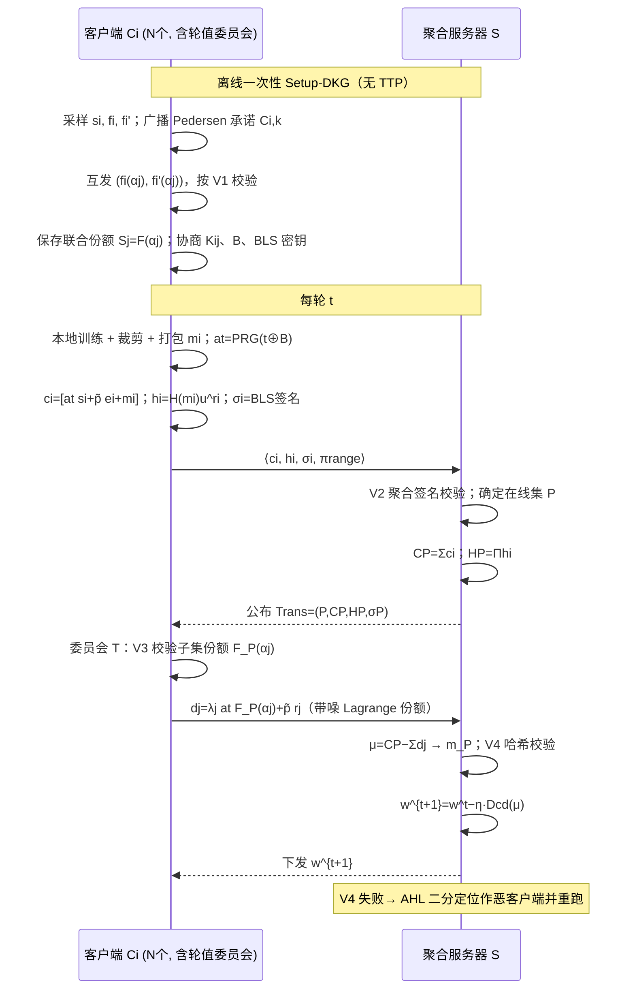
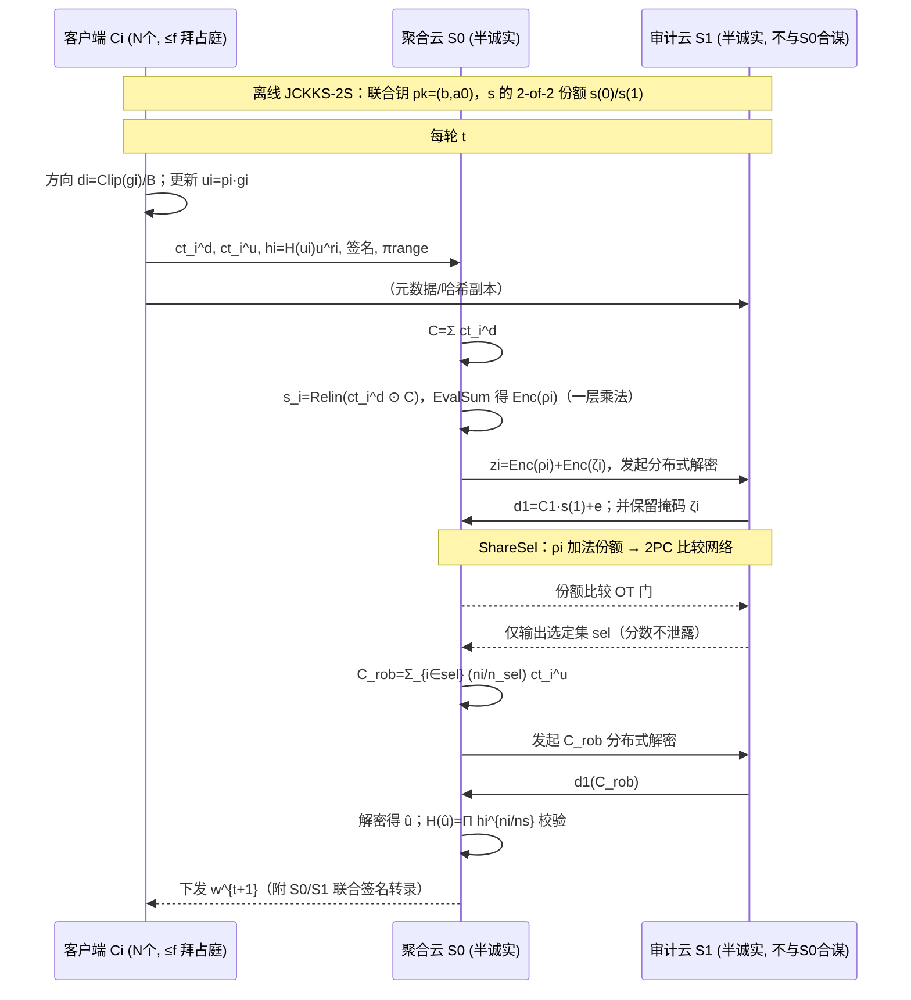
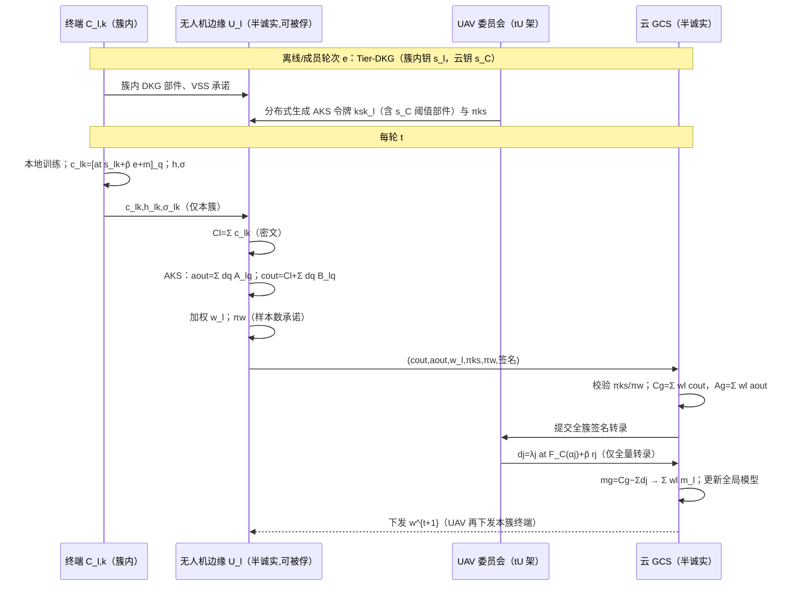
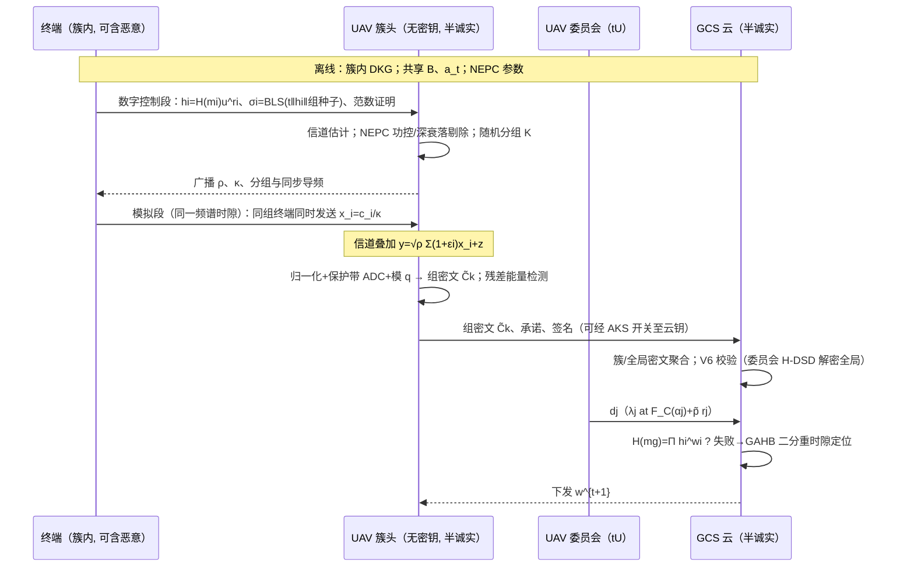
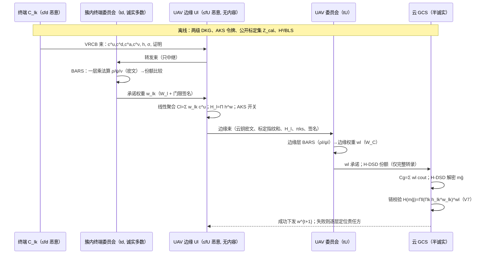

# 联邦学习（FHE/FL）交叉领域论文阅读报告与五个创新方案构建

> 阅读范围：本目录 42 篇学术论文（含 3 份中文背景材料），覆盖同态加密安全聚合、多密钥/阈值密码学、可验证聚合、鲁棒聚合、层次型联邦学习（HFL）、无人机（UAV）使能 FL 与空中计算（AirComp）等方向。
> 报告目标：① 梳理全部方案的**架构、密钥体系、信任根、验证与鲁棒机制**；② 给出密码学方案的**渐进演进脉络**；③ 厘清 UAV 场景的关键挑战与研究空白；④ 基于空白构建 **2 个标准 FL 方案 + 3 个层次型 FL 方案**，每个方案均给出架构、威胁模型、符号系统、闭环公式推导（含 RLWE 加解密）、时序图、安全性证明、≥3 个算法伪代码与 ≥3 个 CCF-A/开创性基线。

---

# 第一部分　论文模式梳理

## 1. 总体分类总表

> 架构：标准 FL（单服务器 / 双服务器（非合谋））、层次型 FL（client–edge–cloud）、去中心化（无中心服务器）；密钥：单密钥 SK / 多密钥 MK / 阈值 Th / 掩码 SS（无 HE）；信任根：需要 TTP/TEE 或 TTP-free；验证：聚合正确性/完整性验证；鲁棒：抗投毒/拜占庭/后门。

### 1.1 标准 FL（Centralized/单聚合服务器）

| 论文 | 年份/出处 | 密钥体系 | 信任根 | 验证 | 鲁棒 | 核心机制与可见性结论 |
|---|---|---|---|---|---|---|
| **FedAvg**（开创性基线） | 2017 | 无密码 | 服务器可信 | ✗ | ✗ | 服务器看到全部明文本地更新 |
| **Bonawitz SecAgg** | 2017/CCS（CCF-A） | 掩码 SS（成对 PRG 双掩码 + Shamir 恢复） | **TTP-free**（服务器只协调） | ✗ | 部分 | 服务器只见聚合和；天然阈值（t-of-N）与容错；每轮 O(N²) 成对掩码协商 |
| **CDKS / MK-CKKS** | 2019/CCS（CCF-A） | **多密钥**（每人独立 pk_i） | TTP-free | ✗ | ✗ | 聚合密文 N+1 个多项式；**两步分布式解密**，部分解密值 μ_i 直接公开导致 c_i0+μ_i≈m_i 泄露（见 §3.1） |
| **xMK-CKKS**（Ma 等，MSC 实现） | 2022 | 多密钥（聚合公钥 b̃=Σb_i） | TTP-free | ✗ | ✗ | 所有人在**聚合公钥**下加密，服务器只能解密聚合；**全员在线才可解密，无容错**；仍需两步解密 |
| **Scooby (HEDS)** | 2024/INFOCOM | **同态秘密共享 HSS**（伪随机相关随机性） | TTP-free | ✗ | ✗ | 服务器/客户端划分秘密份额，服务器只见聚合；两方计算，无全同态负担 |
| **SecFed (EMK-BFV)** | 2024/TPDS（CCF-A） | **多密钥 BFV + TEE** | **TEE**（SGX 飞地） | 部分 | ✗ | 密钥/重线性化与部分运算放入 TEE；离线保护；依赖专用硬件，存在侧信道与飞地容量限制 |
| **SKHE** | 2025/IoT-J | **单密钥 HE + ECC + TEE** | **TEE** | 哈希校验 | ✗ | ECC 保护 HE 私钥分发、秘密共享拆分 ECC 私钥，聚合/解密在 TEE；单密钥防合谋弱 |
| **ESAFL (ESHE)** | 2025/TDSC（CCF-A） | **对称多密钥加法 HE**（加密钥 s_i，解密钥 s=Σs_i） | 可信 AS（附 DKG 可去 TTP） | ✗ | ✗ | **单多项式密文 c=a_t·s_i+p̃e_i+m_i**，**一步解密**，PRG 复用 a_t 免每轮交互；但**必须全员密文在场，不掉线、无验证、无筛选** |
| **FedPHE** | 2025/TPDS（CCF-A） | **打包单密钥 HE**（BFV/CKKS）+ 稀疏化 + 客户端选择 | 服务器持钥 | ✗ | 客户端选择（明文） | 打包降低密文量；私钥在服务器侧则服务器可解密单更新 |
| **FedSHE** | 2025 | 分段 CKKS（segmented） | 单密钥 | ✗ | ✗ | 按模型段独立加密，降低单次密文规模 |
| **MaskCrypt** | 2025/ECML | **选择性 HE**（部分层加密）+ DP | 单密钥 | ✗ | DP | 只加密敏感层、其余明文，以隐私换效率 |
| **HHE** | 2025/IoT-J | **混合 HE（PASTA+BFV）** | 单密钥 | ✗ | ✗ | 算术/布尔电路混合；单密钥信任集中 |
| **RhycheeFL** | 2025/Neurocomputing | FHE（CKKS）+ 超维计算 HDC | 单密钥 | ✗ | ✗ | 高维表示压缩 + FHE |
| **MASER** | 2025/Applied Soft Comp | **xMKCKKS 多密钥 + 模型剪枝** | TTP-free | ✗ | 剪枝（非安全筛选） | 沿用 xMKCKKS 公钥聚合；无容错；剪枝在加密前/后 |
| **FedOut (ECMK-CKKS+SOP)** | 2026/NeurComp | **多密钥 CKKS + 安全外包代理 AS** | 代理 AS（半可信） | ✗ | **补充密文覆盖掉线者** | 一步本地解密；SOP 把重加密外包给代理、代理为掉线者**补零密文**；软件容错但依赖代理掌握的补充材料 |
| **CDKS-LSS** | 2026/Information Sciences | **多密钥 + Shamir 线性秘密共享阈值** | **TTP-free** | ✗ | 阈值容错 | 把每轮部分解密值 μ_i 用 R_q 上 (t,N)-Shamir 重新共享；**每轮 O(N²) 份额**；仅半诚实模型，无恶意客户端防御 |
| **PMSA** | 2026/NeurComp | **多私钥 BCP 加同态**（非 RLWE FHE） | TTP-free | **线性同态哈希 LHH** | 裁剪感知打包 | 每人独立私钥，无需分发私钥份额；LHH 校验聚合正确性；**只验"和"不验"人"、不筛毒** |
| **ProFL** | 2025/CNI | LHE + 曼哈顿距离鲁棒聚合 | 单密钥 | ✗ | **拜占庭鲁棒（加密下曼哈顿）** | 线性范围 + 曼哈顿分数筛选；非线性排序开销与非 IID 偏差 |
| **BPFLH** | 2026/Ad Hoc Networks | CKKS + **Bray-Curtis 相异度** | 单密钥 | ✗ | **拜占庭鲁棒** | 加密下用 Bray-Curtis 打分；单密钥信任集中 |
| **HEFLGuard** | 2026/Neurocomputing | CKKS（HEFL）+ 后门检测 | 单服务器 | ✗ | **后门检测**（一致性+边缘样本） | 单服务器框架，在密文/部分解密统计上识别后门；依赖额外检测数据 |
| **TDPPFL** | 2026/Comput. Networks | CKKS + **二维 KDE + 欧氏距离检测** | 单密钥 | ✗ | **数据投毒检测** | 加密异常检测；统计检测在非 IID 下误报 |
| **AHE** | 2026/IoT-J | **自适应 CKKS（异构客户端分簇选参）+ 并行键交换** | 单密钥 | ✗ | 分簇（非安全筛选） | 按算力/隐私需求分组选参数；密钥仍是中心化的 |
| **RCFL** | 2025 | 差分隐私 MPLA | 无 HE | ✗ | DP | 噪声抗推断，损失精度 |
| **ResFed** | 2024/Computer Networks | 通信高效（残差压缩）+ 密码选项 | 单密钥 | ✗ | ✗ | 只传残差/稀疏部分；密码非主线 |
| **SMTFL** | 2026 | 动态分组 + 遗忘（无 HE 或轻量） | 服务器 | ✗ | 分组制衡 | 梯度在组间分配、可遗忘；服务器被假设可信 |
| **RPPFL** | 2026 | 模型拆分（model splitting）+ 对抗 IFGIA 攻击 | 单服务器 | ✗ | 数据投毒/伪造梯度防御 | 模型拆分为公有/私有部分；本质仍需服务器配合 |
| **VLSFL** | 2026/Comput. Networks | **双掩码（Bonawitz 式）+ 可验证** | TTP-free | **可验证** | 轻量 | 掩码聚合 + 证明聚合无篡改；非线性筛选弱 |
| **Ftopk/DSVFL** | 2026/IoT-J | **top-k 稀疏化 + Shamir + 验证** | TTP-free | **可验证** | 稀疏（非安全排序） | 客户端侧 top-k 与 Shamir 容错；服务器无法安全选 k |
| **MKHSS** | 2026/Comput. Security | **多密钥同态秘密共享** | TTP-free | ✗ | 抗合谋 | 多密钥 + HSS 杂交；解决 HSS 单密钥合谋问题 |

### 1.2 标准 FL（双/多服务器，非合谋）

| 论文 | 年份/出处 | 密钥体系 | 信任根 | 验证 | 鲁棒 | 核心机制与可见性结论 |
|---|---|---|---|---|---|---|
| **LSFL** | 2023/TPDS（CCF-A） | 加法秘密份额 + 掩码（无完整 FHE） | **两非合谋服务器** | ✗ | **拜占庭鲁棒**（两服务器变体） | 每客户端把份额分别送两服务器；见和不见单更新；第三方力量平衡 |
| **ELSA** | 2023/USENIX Security（CCF-A） | 加法秘密份额（GPU 服务器可恶意） | **两非合谋服务器**（聚合+GPU 计算） | ✗ | 聚合规则自由（可用 Krum/trimmed） | 强威胁模型（服务器可恶意）；私密信息拆成两份；非 RLWE |
| **PEFL-24** | 2024 | **ECC + 双 CSP** | 两非合谋 CSP | ✗ | ✗ | ECC 运算轻量；信任建立在"不合谋"强假设上 |
| **VeSAFL** | 2025/IoT-J | **Pedersen VSS + BLS 聚合签名** | 多服务器 | **双向可验证（VSS+BLS）** | 部分 | 服务器与节点都可恶意；Pedersen 线性支持聚合，BLS 压缩为一签名；隐私层靠 SS |
| **HPRE** | 2026/JPDC | **同态代理重加密 H-PRE + LHH + BLS** | 两非合谋半可信服务器 | **LHH+BLS 可验证** | ✗ | 一重加密把单更新转换到统一服务器钥；两服务器都不解密单更新；**不筛毒** |
| **PDFL** | 2026 | **两方计算 2PC**（投毒检测） | 两非合谋方 | 检测 | **投毒检测** | 两方持有互补信息做异常检测；不做 FHE 聚合 |

### 1.3 层次型 FL（client–edge–cloud，HFL）

| 论文 | 年份/出处 | 密钥体系 | 信任根 | 验证 | 鲁棒 | 场景/核心结论 |
|---|---|---|---|---|---|---|
| **PrivHFL** | 2025/Computer Networks | **阈值 HE（tMK-CKKS）** | **KGC** | 边缘层校验机制 | 部分 | 三层 client–edge–cloud；抗半诚实边缘/云；**信任 KGC**，边缘见边缘聚合、密钥未跨层解耦 |
| **PPBR** | 2026/INFOCOM（CCF-A） | **PLHE（Paillier）+ 压缩本地差分隐私 CLDP** | 无需 KGC（云/边缘半诚实） | ✗ | **符号统计聚类 + 范数裁剪** | 边缘/云两级聚合都加随机扰动；CLDP 保护符号统计；单边缘/单云场景随机扰动覆盖；**Paillier 只能加，跨层加权与精度受限** |
| **PEFL-26 (MECS)** | 2026/Comput. Networks | 加密 + DP | 边缘节点半诚实 | 检测 | **后门识别 + 抗合谋** | 移动群智感知边缘场景；后门模型可区分；DP 损失精度 |
| **AchiFL** | 2026/Computer Networks | **无密码**（明文） | 假设可信 | ✗ | **聚类梯度剪枝 + 动态边缘权重** | UAV 边缘异步 HFL；解决梯度冲突与边缘数据异构；**无任何隐私保护** |
| **OAFL** | 2026/Computer Networks | **无密码**（AirComp 模拟聚合） | 假设可信 | ✗ | ✗ | UAV 作为 PS 空中层次聚合，联合轨迹/设备选择优化；**AirComp 明文叠加，UAV 直接见和** |
| **UAV-AFL** | 2025/Comput. Networks | 无密码 | 假设可信 | ✗ | 异步（stale 加权） | UAV 辅助异步 FL；无隐私层 |
| **HEFLGuard 也可部署于 HFL** | 2026 | CKKS | 单中心 | — | 后门 | 见 §1.1 |

### 1.4 去中心化/无中心（DFL）

| 论文 | 年份/出处 | 密钥体系 | 信任根 | 验证 | 鲁棒 | 场景 |
|---|---|---|---|---|---|---|
| **PriDFL** | 2026 | **NTT 友好的秘密共享 + 高效同态** | TTP-free，点对点 | ✗ | ✗ | 完全去中心化 FL，无聚合服务器 |
| **FedHRA** | 2026/Comput. Networks | 秘密共享/同态 | 卫星协作（无固定 PS） | ✗ | ✗ | LEO 卫星网络动态拓扑，多星协作聚合 |
| **PPDO (TCKKS)** | 2026/Eng. Applications AI | **(t,n)-阈值 CKKS** | 去中心密钥管理 | ✗ | ✗ | 多 UAV 分布式优化（协同定位）；**扁平多智能体、非 FL 聚合，也无验证/鲁棒** |

---

## 2. 四种架构模式：实体、可见性与不可见性

### 2.1 模式 A：传统 FL（单服务器）

- **实体**：N 个客户端 C_i（持数据 D_i、训练更新 g_i）、1 个聚合服务器 S（可能含 TEE 或 TTP/AS/KGC）。
- **可见**：服务器（或 TEE/TTP）在单密钥方案中**可见所有明文更新**（FedAvg、FedPHE、ProFL 等）；在多密钥/掩码方案中**只见密文和/或聚合明文**。
- **不可见**：多密钥/SS 方案中，服务器永远见不到单个 g_i；客户端互相不见数据与更新。
- **密码学形态**：
  - 单密钥（BFV/CKKS/Paillier/BCP）：一把公钥加密，私钥在服务器（服务器可解密一切）或在 TEE；
  - 多密钥（CDKS/xMKCKKS/ESHE/ECMK）：每人独立密钥，密文求和后分布式/一步解密；
  - 掩码 SS（Bonawitz/VLSFL/Ftopk）：零和掩码 + Shamir 恢复，无 HE。

### 2.2 模式 B：传统 FL（双服务器（非合谋））

- **实体**：N 客户端、**两个非合谋半可信服务器 S_0、S_1**（LSFL/ELSA/PEFL-24/HPRE）；VeSAFL 扩展为多服务器。
- **可见**：单服务器只拿到一个秘密份额（或一重加密），**单独不可恢复任何更新**；两服务器合谋才可破坏隐私。
- **不可见**：只要不合谋，单更新与聚合都不对单个服务器可见；ELSA 允许服务器恶意但客户端拆分完整。
- **代价**：依赖"永不合谋"的强假设（多为不同云厂商/监管方）；跨服务器带宽与同步。

### 2.3 模式 C：层次型 FL（带边缘节点，client–edge–cloud）

- **实体**：M 个簇（cluster），每簇 1 个边缘节点 E_l（基站/MEC 服务器/UAV），簇内 K_l 个终端 C_{l,k}；顶层 1 个云/地面控制站 GCS。
- **两级聚合**：边缘聚合 w_l = Σ_{k} p_{l,k} w_{l,k}（局部模型）；全局聚合 w = Σ_l p_l w_l。
- **可见**：明文方案（AchiFL/OAFL）中 **UAV 看到簇内所有更新与簇模型，云看到各簇模型**——两级泄露点；PrivHFL 中边缘/云只在阈值满足时见相应聚合；PPBR 用 CLDP+PLHE 让边缘/云只见加噪/加密值。
- **不可见**：理想方案中边缘**只见密文簇和、不见单终端更新、也不见簇模型明文**；云**只见全局模型、不见单簇模型**。
- **新问题**：两级掉线（终端掉线 + UAV 飞出/被击落）、簇动态变化（UAV 机动导致终端跨簇切换）、跨层密钥体系、边缘权重 p_l 如何在密文上施加。

### 2.4 模式 D：去中心化（DFL）

- **实体**：对等节点（UAV/卫星），无中心 PS；共识/邻居聚合。
- **可见**：节点只见邻居信息；阈值 CKKS 保证需 t 方才能解密。
- **适用**：UAV 集群、卫星网络（无固定基础设施）。

---

## 3. 密码学方案的渐进演进脉络（重点）

### 3.1 多密钥同态加密与解密份额这条主线（与用户示例对齐并补全）

**第一代：单密钥 HE（Phong 式加法 HE、BFV/CKKS、Paillier）**
- 客户端用服务器公钥加密，服务器持私钥。服务器**可以解密任意单个更新**，隐私完全依赖"服务器诚实"；多轮训练中服务器是单点泄露与单点信任。

**第二代：MK-CKKS / CDKS（CCS'19，多密钥）**
- 每客户端独立密钥，密文 (c_i0, c_i1)，聚合后保留全部 N 个第二分量 c_i1，密文随 N 线性膨胀。
- 两步分布式解密：每人算部分解密值 μ_i = c_i·s_i + e_i*，服务器 Merge。
- **致命缺陷（解密份额泄露）**：c_i0 ≈ m_i − v_i·a·s_i，而 μ_i ≈ v_i·a·s_i，于是 c_i0 + μ_i ≈ m_i。**任何人**用公开的 c_i0 与公开的 μ_i 就能还原单个客户端明文。CDKS 直接用于 FL 不提供隐私。

**第三代：xMK-CKKS（聚合公钥）**
- 聚合公钥 b̃ = Σ b_i，所有人在 b̃ 下加密，服务器只能解密"聚合"。
- 解决了 CDKS 单份解密值泄露问题；**但聚合公钥由全员构造，任一人掉线，聚合公钥/解密都不成立——不防掉线**；仍是两步解密、每人都要回传部分解密值。

**第四代（路线分叉）：**
- **tMK-CKKS（Du 等）**：阈值变体，只需 t 个子集即可解密，容忍掉线；但每轮需要两轮通信、仍是两步解密。
- **CDKS-LSS（2026）**：把**每轮的部分解密值 μ_i** 用 R_q 上异常序列 (t,N)-Shamir 再共享，服务器只取前 t 个聚合份额重构。无 TTP、信息论意义上的阈值。**代价是每轮 O(N²) 份额交互**（每人给每人生成份额），且只防半诚实、无法识别恶意份额，也无聚合验证。
- **ESAFL/ESHE（TDSC'25）**：换思路，设计**对称加法 HE**：c_i = a_t·s_i + p̃e_i + m_i，s=Σs_i，聚合 C = a_t·s + p̃e + Σm_i，**一步解密** [C−a_t·s]_q mod p；a_t 由 PRG 本地生成，**彻底取消解密份额分发**。代价：① **必须全员密文在场**（部分聚合解不出也不允许解，这恰是隐私但也意味着无容错）；② 依赖可信 AS（虽附 DKG 可去 TTP）；③ 无任何验证与鲁棒性，恶意客户端可注入任意值。
- **FedOut（2026）**：ECMK-CKKS 继承一步解密，SOP 把重加密外包给代理并由代理**为掉线者补零密文**，软件容错；但补充材料依赖代理、且仍无验证/鲁棒。
- **SecFed（2024）**：EMK-BFV 多密钥 + TEE，把重线性化/密钥运算放进飞地，硬件容错但依赖 SGX。

**第五代（本文方案的出发点）**：把 ESHE 的"一步解密"、CDKS-LSS 的"阈值容错"、Pedersen/BLS 的"可验证"与鲁棒聚合**在同一密码学闭环内统一**，并把秘密共享从"每轮解密值层"下沉到"一次性密钥层"（见方案 1 的 DSD）。

### 3.2 单密钥 + 硬件 / 双服务器这条主线

- **单密钥+TEE（SecFed、SKHE）**：用硬件把私钥/重线性化关进飞地，效率高，但信任硬件、有侧信道、飞地容量受限。
- **双服务器非合谋（LSFL、ELSA、PEFL-24）**：秘密份额拆分，ELSA 甚至允许服务器恶意；强假设是"两服务器永不合谋"。
- **代理重加密（HPRE）**：两服务器模型 + H-PRE，把不同客户端密钥的密文重加密到统一钥，配合 LHH+BLS 做验证；但只解决隐私与完整性，不解决投毒。
- **同态秘密共享（Scooby、MKHSS）**：用相关随机性把"同态计算"和"秘密共享"融合，规避全同态的乘法噪声；MKHSS 进一步多密钥抗合谋。

### 3.3 可验证聚合这条主线

- **LHH 线性同态哈希（PMSA、BPVFL、HPRE）**：h(x)=Π_j g_j^{x_j}，天然满足 h(Σα_i x_i)=Π h_i^{α_i}，可校验"服务器是否按声明做了线性求和"。
- **Pedersen VSS + BLS（VeSAFL）**：份额可验证、签名可聚合，抗恶意份额与恶意服务器。
- **三方零知识（BPVFL）**：双向验证（服务器验客户端、客户端验服务器）。
- **共同短板**：验证的对象是**线性聚合的正确性**（"和有没有算错、有没有漏人"），**不能判断内容好坏**（不防投毒）；且标准 LHH 对低熵更新并非完美隐藏（h_i 是承诺而非完全隐藏）。

### 3.4 鲁棒聚合（抗投毒/拜占庭/后门）这条主线

- 明文鲁棒规则：Krum/Multi-Krum、trimmed mean、median（NeurIPS 系列）、FLTrust（S&P'21，用服务器干净锚点做余弦）。
- 加密下的鲁棒：ProFL（曼哈顿）、BPFLH（Bray-Curtis）、LSFL/ELSA（两服务器份额下自由聚合）、PDFL（2PC 检测）、TDPPFL（二维 KDE + 欧氏）、HEFLGuard（后门一致性）、PPBR（符号聚类 + 裁剪）、PEFL-26（后门识别）。
- **核心矛盾**：鲁棒规则本质是**非线性**的（排序、距离、取中位数），而加法 HE 只擅长**线性**运算；现有方案要么把数据转成秘密份额做 MPC（脱离 FHE、通信重），要么只做近似统计（误报/漏报），要么干脆解密后检测（隐私让步）。**"加密下的鲁棒筛选"与"线性可验证"如何统一，是明确空白**。

### 3.5 通信效率与硬件友好这条主线

- CKKS 打包（FedPHE、ESAFL）、分段（FedSHE）、选择性加密（MaskCrypt）、稀疏 top-k（Ftopk、MASER、ResFed）、残差压缩（ResFed）、混合 HE（HHE）、自适应参数（AHE）、安全外包（FedOut）。
- 物理层新范式：**AirComp 空中模拟叠加**（OAFL、UAV-AFL）——但全部是明文叠加，**"加密密文能否空中叠加"是一个尚未被回答的跨层问题**（见方案 4）。

### 3.6 层次型 / UAV 这条主线

- PrivHFL（阈值 HE + KGC）、PPBR（CLDP+PLHE+鲁棒）、PEFL-26（边缘后门）、AchiFL（异步鲁棒无密码）、OAFL（AirComp 无密码）、UAV-AFL（异步）、PPDO（多 UAV 阈值 CKKS 优化）、FedHRA（卫星 DFL）。
- **共性缺口**：① 跨层密钥未解耦（边缘要么看不见簇模型导致无法边缘聚合，要么能看导致泄露）；② UAV 高机动导致的**簇成员动态变化与两级掉线**；③ 恶意 UAV（被击落/俘获）作为边缘节点的威胁几乎没有与 FHE 闭环结合；④ AirComp 与 HE 冲突；⑤ UAV 算力/带宽受限，现有多密钥两步解密与 O(N²) 份额无法承载。

---

## 4. UAV 场景（UAV-Assist / Edge-assist）的挑战与值得研究的点

UAV 使能 FL 通常分两类：**UAV 作为飞行边缘/参数服务器（UAV-as-edge/PS）** 服务地面终端；**UAV 本身作为协作智能体（UAV-as-client）** 做协同感知/定位/打击。结合论文，关键挑战：

1. **无线链路与带宽瓶颈**：多密钥密文（CDKS 为 N+1 多项式、CKKS 单个密文数十~数百 KB）在低带宽、高误码无线链路上不堪重负；AirComp 能"免费叠加"但与加密不兼容。
2. **高机动性与拓扑时变**：UAV 航迹导致簇成员频繁切换、链路间歇连通（straggler）、终端跨簇切换；每轮重新 DKG/重密钥不可行。
3. **两级掉线/失联**：终端可能失联，UAV 可能飞出服务区或被击落；阈值机制必须同时覆盖终端级与 UAV 级，且掉线处理不能依赖 TTP。
4. **不可信的飞行边缘**：UAV 比固定基站更容易被物理俘获、逆向、接管，**边缘节点可能是恶意的**（丢包、篡改、注入、与云合谋）；但现有 HFL 密码方案多假设边缘半诚实。
5. **两级隐私泄露点**：UAV 可见簇内更新与簇模型（位置、编队、战术意图高度敏感）；云可见各簇模型。
6. **数据异构（Non-IID）与投毒/后门**：不同区域 UAV 数据分布差异大；被俘获终端可数据投毒、模型投毒、边缘-case 后门；加密让异常检测更难。
7. **算力/能耗受限**：UAV 端 NTT、重线性化、签名验签预算有限；重运算应下沉或外包，但外包不能泄露密钥。
8. **同步困难**：严格同步代价高，异步带来 stale 更新，需要异步/半异步安全聚合与版本绑定。
9. **公共信道与物理暴露**：无线广播天然被窃听，方案不能假设安全信道（ESAFL 明确放弃安全信道假设的方向是对的）。
10. **聚合权重与公平性**：边缘样本数 n_l、终端数变化，密文上加权与权重保密、权重证明是新问题。

**由此提炼出五个方案的设计切入点（Gap Map）**：

| 缺口 | 现有最接近方案 | 不足 | 本文方案 |
|---|---|---|---|
| ESHE 一步解密但无阈值/无验证/无容错；CDKS-LSS 阈值但每轮 O(N²) 且只半诚实 | ESAFL、CDKS-LSS、FedOut | 要么全在线，要么每轮 O(N²)，要么依赖代理/TEE | **方案 1 VTFL**：一次性密钥层 VSS + 动态子集一步阈值解密 + 隐藏式同态哈希 |
| 加密下鲁棒筛选与 HE 线性冲突 | ProFL、BPFLH、ELSA、FLTrust | 转 MPC/解密/近似统计 | **方案 2 ROD-FL**：双服务器、单层乘法深度的自参照方向分数 + 掩码选择 |
| HFL 跨层密钥未解耦、簇动态、UAV 半诚实 | PrivHFL、PPBR、HPRE | KGC 信任、边缘可见、重密钥 | **方案 3 HiSOKE**：簇独立密钥 + 不可信 UAV 聚合重加密开关（新 gadget）+ 加权证明 |
| AirComp 与 HE 不兼容 | OAFL、UAV-AFL | 明文叠加 | **方案 4 AirSAFE**：Air-RLWE 密文空中叠加（信道噪声计入噪声预算）+ 哈希分组定位 |
| 恶意 UAV + 投毒 + 后门全链路 | HEFLGuard、VeSAFL、PPBR | 单层、解密检测、未闭环 | **方案 5 SHIELD-HFL**：可审计线性化鲁棒算子 + 良性锚点表征分数 + 跨层哈希链 |

---

# 第二部分　统一预备知识

为避免五个方案重复，先固定 RLWE/CKKS、ESHE、Shamir、Pedersen VSS、LHH、BLS 的统一记号。

## P.1 环与 RLWE

令 $n=2^\kappa$，环 $R=\mathbb Z[x]/(x^n+1)$，$R_q=R/qR$。$R_q$ 中元素为 $a(x)=\sum_{j=0}^{n-1}a_jx^j$。秘密分布 $\chi_s$（稀疏小多项式）、误差分布 $\chi_e$（离散高斯，界 $B_e$）。$a\gets R_q$ 记均匀采样。

**RLWE 判定假设**：对 $s\gets\chi_s$、$e\gets\chi_e$、$a\gets R_q$，样本 $(a,\ b=[-a s+e]_q)$ 与 $R_q^2$ 上均匀分布计算不可区分。

## P.2 CKKS 编码与加解密

- 编码：$\mathsf{Ecd}(z;\Delta)=\lfloor\Delta\cdot\varphi^{-1}(z)\rceil=m\in R$；解码 $\mathsf{Dcd}(m)=\Delta^{-1}\varphi(m)\approx z$，$\Delta$ 为缩放因子。
- 单钥 CKKS：密钥 $s$；公钥 $\mathsf{pk}=(b,a_0)$，$b=[-a_0 s+e]_q$。
  - 加密（$v\gets\chi_s,\ e_0,e_1\gets\chi_e$）：
    $$c_0=[v\,b+m+e_0]_q,\qquad c_1=[v\,a_0+e_1]_q,\qquad \mathsf{ct}=(c_0,c_1).$$
  - 解密：$[\,c_0+c_1 s\,]_q = m + v e + e_0 + e_1 s \approx m$。
- 同态加法：$\mathsf{ct}_\Sigma=(\sum c_{i0},\sum c_{i1})$，解密为 $\sum m_i$（噪声相加，需留噪声预算）。
- 打包：一条 $n/2$ 维实向量打包进一个明文多项式（SIMD 槽位）。

## P.3 ESHE（ESAFL）对称加法 HE（方案 1 的起点）

- 加密钥 $s_i$（每客户端），解密钥 $s=\sum_{i=1}^N s_i$；公共随机多项式 $a_t$（第 t 轮由 PRG 与共享种子 B 本地确定性生成，$a_t=\mathsf{Vec2Poly}(\mathsf{PRG}(t\oplus B))$）。
- 加密：$\displaystyle c_i=[a_t s_i+\tilde p\, e_i+m_i]_q$，$\tilde p=p\cdot(1,\dots,1)$ 为系数全 p 的多项式。
- 聚合：$\displaystyle C=[\sum_i c_i]_q=[a_t s+\tilde p\, e+\sum_i m_i]_q$。
- 一步解密：$\displaystyle M=[\,C-a_t s\,]_q\bmod p=\sum_i m_i$。
- 性质：① 只有"全员密文之和"才可被 s 正确解密，部分聚合既不可解（密钥不匹配）也不允许解；② 只要少于 N−1 人合谋，诚实方明文不可区分；③ 不支持任意子集、不支持验证。

## P.4 Shamir 秘密共享与 R_q 上异常序列

- 秘密 $s$，门限 t： dealer 取 t−1 次多项式 $f(X)=s+\sum_{k=1}^{t-1}\lambda_k X^k$，份额 $s_i=f(\alpha_i)$；t 个份额用拉格朗日重构 $s=\sum_{j\in T}\lambda_j s_j$，$\lambda_j=\prod_{k\in T,k\ne j}\frac{\alpha_k}{\alpha_k-\alpha_j}$。
- 在环 $R_q$ 上要求评估点 $\{\alpha_i\}$ 构成**异常序列**（任意 $\alpha_i-\alpha_j$ 为 $R_q$ 中的单位），则插值正确且完美保密。
- 份额重共享：每人对自己的秘密 $s_i$ 取多项式 $f_i$，则 $\tilde s_j=\sum_i f_i(\alpha_j)=F(\alpha_j)$，$F=\sum_i f_i$，$F(0)=\sum_i s_i$。

## P.5 Pedersen 可验证秘密共享（VSS）

群 $\mathbb G=\langle g\rangle$，阶为大素数 $r$，另一生成元 $h$（$\log_g h$ 未知）。对 $f_i$ 与随机遮蔽多项式 $f_i'$，广播承诺 $C_{i,k}=g^{a_{i,k}}h^{a'_{i,k}}$（$k=0,\dots,t-1$）。份额校验：
$$g^{f_i(\alpha_j)}h^{f_i'(\alpha_j)}=\prod_{k=0}^{t-1}C_{i,k}^{\alpha_j^k}.$$
承诺在离散对数假设下具计算约束力（binding）与完美隐藏（hiding）。

## P.6 线性同态哈希（LHH）

公开随机生成元 $g_1,\dots,g_d$（相互间离散对数未知），对向量 $x=(x_1,\dots,x_d)$：
$$H(x)=\prod_{\ell=1}^{d} g_\ell^{x_\ell}\in\mathbb G,\qquad
\mathsf{Eval}\big(\{H(x_i)\},\{\alpha_i\}\big)=\prod_i H(x_i)^{\alpha_i}=H\Big(\sum_i\alpha_i x_i\Big).$$
安全性为抗碰撞（求 $x\ne x'$ 使 $H(x)=H(x')$ 规约到离散对数）。

## P.7 BLS 聚合签名

$\sigma_i=\mathsf{Sign}_{sk_i}(M)$（$\mathbb G_1$）；聚合 $\sigma=\prod_i\sigma_i$；一次配对校验 $\mathsf{Verify}(\{pk_i\},M,\sigma)$。不可伪造性基于 co-CDH；天然支持"一条签名覆盖多客户端"。

## P.8 FedAvg 的密文化基线（闭环记号）

明文：$w^{t+1}=w^t-\eta\sum_i p_i g_i^t$，$p_i=n_i/\sum n_j$。客户端做预加权明文乘法后加密 $\mathsf{ct}_i=\mathsf{Enc}(\mathsf{Ecd}(p_i g_i^t))$；服务器零深度求和 $\mathsf{CT}=\sum_i\mathsf{ct}_i$；解密得 $\sum_i p_i g_i^t$，再更新 $w$。各方案都以该闭环为隐私聚合目标，差别只在密钥、聚合层级、验证与筛选。

---

# 第三部分　五个创新方案的构建

> 每个方案严格按：**场景 → 待解决问题 → 创新点/总体目标 → 威胁模型 → 符号系统 → 方案设计（闭环公式推导 + RLWE 加解密）→ 时序图 → 安全性分析 → 算法伪代码 → 基线对比**。

---

# 方案 1（标准 FL，单服务器）：VTFL —— 可验证、阈值化、一步解密的多密钥联邦学习

> Verifiable Threshold Federated Learning over a one-step ESHE core（密码核：VT-ESHE；子算法：**DSD** 动态子集一步阈值解密、**H³** 隐藏式同态哈希、**Setup-DKG** 无 TTP 密钥生成、**AHL** 审计定位）。

## 1.1 场景

跨机构（cross-silo）标准 FL：N 个机构客户端（医院、银行、战区数据节点）在**单个聚合云服务器** S 上协作训练一个模型，公开信道通信（不假设逐跳安全信道）。客户端数量中等、相对稳定但每轮有 0~40% 的掉线/迟滞；S 由商业云提供。所有客户端既要防 S，也要防彼此，且不允许部署 TTP/TEE。

## 1.2 待解决的问题（针对现有方案的精确缺口）

1. **CDKS（MK-CKKS）**：部分解密值公开 → c_i0+μ_i≈m_i，单更新直接泄露。
2. **xMK-CKKS**：聚合公钥绑定全员，**一人掉线整轮解密失败**；仍两步解密。
3. **CDKS-LSS**：实现阈值，但**每轮都要对部分解密值做 O(N²) 的份额重共享**；且只抗半诚实，恶意份额无法识别，也无聚合正确性验证。
4. **ESAFL（ESHE）**：一步解密、免份额分发，但**必须全员密文在场（无阈值）**，无可验证性、无鲁棒性，依赖可信 AS。
5. **FedOut**：靠外包代理补零密文容错，依赖代理持有的补充材料；SecFed/SKHE 依赖 TEE。
6. **PMSA/VeSAFL/HPRE 的 LHH**：只校验"和"，且标准 LHH 对低熵更新不是完全隐藏。

**目标**：在**无 TTP、无 TEE、单服务器、公开信道**下，同时获得：① 多密钥隐私（S 只见密文）；② 任意 t-of-N 子集的**一步**阈值解密（掉线容忍，每轮 O(N) 而非 O(N²)）；③ 对恶意服务器（漏人/重排/加权/重放）与恶意客户端（伪造份额）的**公开可验证**；④ 轻量范数约束（为方案 2/5 的重度鲁棒筛选打基础）。

## 1.3 创新点与总体目标

- **创新点 1（总体框架）**：We propose **VTFL**, which, to the best of our knowledge, is the first TTP-free, single-server, single-channel FL framework that simultaneously delivers multi-key privacy, **one-step threshold decryption over an arbitrary live subset**, and public verifiability on a single RLWE additively-homomorphic core — inheriting ESHE's one-polynomial ciphertext and one-step decryption while removing its all-clients-online requirement.
- **创新点 2（新解密算法 DSD）**：We design **Dynamic-Subset Decryption (DSD)**, which shifts secret sharing from the *per-round partial-decryption-value layer* (as in CDKS-LSS, O(N²) interactions every round) down to a *one-time key-setup layer*. A threshold committee reconstructs, via noise-masked Lagrange shares, the joint key of **exactly the live subset** for that round without ever materializing the key; per-round communication drops from O(N²) to O(N), and malformed shares are publicly rejected by Pedersen commitments.
- **创新点 3（新验证算法 H³）**：We propose **Hiding Homomorphic Hash (H³)**, which converts the collision-resistant linear homomorphic hash into a *hiding* commitment by cancelling pairwise-PRG zero-sum blinds in the aggregate, and binds it with an aggregate BLS signature. H³ pins the tuple **identity → round → ciphertext → plaintext vector**, so a malicious server cannot silently drop, duplicate, reorder, reweight or replay a ciphertext, while each per-client commitment hides even low-entropy updates.
- **创新点 4（安全与实验）**：We prove confidentiality under the decisional RLWE assumption, share robustness under Pedersen's binding/discrete-log assumption and unforgeability under co-CDH, and tolerate up to t−1 colluding clients colluding with the server. Experiments on MNIST/FEMNIST/CIFAR-10 under 0–40% dropout and non-IID partitions show VTFL preserves FedAvg accuracy, cuts per-round client communication by an order of magnitude versus CDKS-LSS, and adds verification overhead below that of two-step MKHE.

## 1.4 威胁模型

**实体**：客户端 {C_i}_{i=1}^N、单聚合服务器 S。**无 TTP/TEE**。

1. **S 半诚实且可主动偏离聚合**：S 诚实执行协议主流程，但好奇单更新内容；并可能尝试漏聚合、重复、重排、错误加权、跨轮重放密文（这些主动偏差是"验证"要抓的）。S 不能伪造 BLS 签名。
2. **客户端最多 t−1 个合谋且可恶意**：合谋客户端试图推断其余诚实客户端的更新；恶意客户端可提交异常更新（方案 1 以强制裁剪 + 范数范围证明约束其幅度；定向投毒/后门的筛选由方案 2、5 承担）。
3. **S 可与至多 t−1 个客户端合谋**。
4. **外部窃听者**：可在公开信道获取全部消息。
5. 诚实客户端 ≥ t（含 t 个在线），否则该轮不构成合法聚合。

**安全目标**：
- G1 单更新保密：任何 PPT 的 S、合谋客户端（<t）、窃听者，无法区分诚实客户端的更新明文（IND-CPA）。
- G2 聚合唯一输出：S 最终只能得到 $\sum_{i\in P}m_i$（或其加权平均），无法获得任何真子集的明文。
- G3 聚合完整性：若 S 对 $P$ 中密文做了声明以外的增删改/加权/重放，验证以压倒性概率失败。
- G4 份额鲁棒：恶意委员会成员伪造的解密份额以压倒性概率被拒。
- G5 掉线容忍：任意在线集合 $P$（$|P|\ge t$）可完成解密。
- G6 跨轮不可拼接：不同轮密文不能被 S 拼出有效混合解密。

## 1.5 符号系统

| 符号 | 含义 |
|---|---|
| $N$、$t$、$P_t$ | 客户端总数、门限、第 t 轮在线集合（$P_t\subseteq[N], |P_t|\ge t$） |
| $R,R_q,n,p,\Delta$ | 格环、模 q 环、环维度、明文模、CKKS 缩放因子 |
| $\chi_s,\chi_e,B_s,B_e$ | 秘密/误差分布及其界 |
| $s_i,\ s=\sum_i s_i$ | 客户端 i 的加密钥、联合解密钥 |
| $f_i,f_i'$ | 客户端 i 的 VSS 多项式（t−1 次）及其 Pedersen 遮蔽多项式 |
| $\alpha_j$ | 公开评估点（构成 $R_q$ 上异常序列），$\alpha_j$ 为单位 |
| $C_{i,k}$ | 对 $f_i$ 第 k 个系数的 Pedersen 承诺 |
| $F_P(\alpha_j)$ | 在线集合 P 的联合多项式在 $\alpha_j$ 的份额（$F_P(0)=s_P$） |
| $a_t$ | 第 t 轮公共随机多项式，PRG 本地生成 |
| $m_i,\ c_i,\ C_P$ | 编码更新、单密文、在线聚合密文 |
| $\tilde p$ | 系数全为 p 的多项式 |
| $h_i,\sigma_i,\sigma_P$ | H³ 哈希、BLS 签名、聚合签名 |
| $q_{i,j}^t,\ r_i^t$ | 成对 PRG 值、零和哈希盲化因子 |
| $\lambda_j^{(T)}$ | 委员会 T 在 0 点的拉格朗日系数 |
| $d_j$ | 委员会成员 j 的带噪 Lagrange 解密份额 |

## 1.6 方案设计（闭环公式推导）

### 1.6.1 离线一次性初始化（Setup-DKG，无 TTP）

**环与密钥**：公布 $pp=(R_q,n,p,\chi_s,\chi_e,\alpha_1,\dots,\alpha_N)$；Pedersen 群 $(\mathbb G,g,h)$，LHH 生成元 $g_1,\dots,g_d,u$；BLS 三元组 $(\mathbb G_1,\mathbb G_2,\mathbb G_T)$；哈希 $\mathcal H$。

1) 每个客户端 $C_i$ 采样 $s_i\gets\chi_s$ 与两个 t−1 次多项式（系数在 $R_q$，承诺时系数映射到 $\mathbb Z_r$）：
$$f_i(X)=s_i+\sum_{k=1}^{t-1}a_{i,k}X^k,\qquad
f_i'(X)=s_i'+\sum_{k=1}^{t-1}a_{i,k}'X^k,\quad a_{i,k},a_{i,k}'\gets R_q.$$
广播 **Pedersen 承诺** $C_{i,k}=g^{a_{i,k}}h^{a_{i,k}'}\ (k=0,\dots,t-1)$，其中 $a_{i,0}=s_i$。
2) $C_i$ 经一次性认证信道把 $(f_i(\alpha_j),f_i'(\alpha_j))$ 发给 $C_j$。$C_j$ 对每个 i 校验：
$$g^{f_i(\alpha_j)}h^{f_i'(\alpha_j)}=\prod_{k=0}^{t-1}C_{i,k}^{\alpha_j^k}. \tag{V1}$$
不通过则公开指控并剔除 $C_i$（其承诺与份额矛盾，可公开举证）。
3) 校验通过后，$C_j$ 保存**联合份额**与遮蔽联合份额：
$$S_j=\sum_{i=1}^{N}f_i(\alpha_j)=F(\alpha_j),\qquad S_j'=\sum_{i=1}^{N}f_i'(\alpha_j)=F'(\alpha_j),$$
其中 $F=\sum_i f_i$，$F(0)=\sum_i s_i=s$ 为**联合解密钥**，$s$ 永不被任何单方重构。
4) 成对 PRG 密钥：$C_i,C_j$ 经一次 DH 协商对称密钥 $K_{i,j}$（$K_{i,j}=K_{j,i}$）；约定公共 PRG 种子 B（用于 $a_t$）。
5) BLS：$C_i$ 生成 $(\mathsf{vk}_i,\mathsf{sk}_i)$，公布 $\mathsf{vk}_i$。

> **关键结构性创新**：秘密共享只发生在**一次性离线密钥层**；在线阶段不再对任何"每轮解密值"做重共享。这是与 CDKS-LSS 的根本区别。

### 1.6.2 在线训练轮（闭环，逐步推导）

**Step 1 本地训练与编码。** $C_i$ 收到 $w^t$，在本地数据 $D_i$ 上训练，做**强制 L2 裁剪**（界 $B_m$，鲁棒性的第一层）与定点量化，按样本数预加权后 CKKS 打包：
$$\bar g_i^t=\frac{n_i}{\sum_{j\in P_t}n_j}\,\mathsf{Clip}\big(\nabla F_i(w^t)\big),\qquad
m_i=\mathsf{Ecd}(\bar g_i^t;\Delta)\in R.$$
同时对 $\|m_i\|_2^2$ 做 Pedersen 承诺并附标准 **ZK 范围证明** $\pi_i^{\mathsf{range}}$（证明范数 $\le B_m^2$，不泄露范数）。

**Step 2 公共随机性与加密（VT-ESHE）。** 各方本地计算
$$a_t=\mathsf{Vec2Poly}\big(\mathsf{PRG}(t\oplus B)\big)\in R_q,$$
$C_i$ 采 $e_i\gets\chi_e$，输出**单多项式密文**：
$$c_i=[a_t s_i+\tilde p\,e_i+m_i]_q. \tag{E1}$$

**Step 3 H³ 隐藏式同态哈希与签名。** 令 $q_{i,j}^t=\mathsf{PRG}_{K_{i,j}}(t)$（环上随机标量），定义**零和盲化因子**（下标按 N 循环）：
$$r_i^t=q_{i,i+1}^t-q_{i-1,i}^t,\qquad \sum_{i=1}^{N}r_i^t=0. \tag{H3-0}$$
（求和中每项成对出现、符号相反，恒为零；对任何不掌握相邻两密钥的方，$r_i^t$ 是伪随机的。）
对 $m_i=(m_{i,1},\dots,m_{i,d})$ 计算
$$h_i=\Big(\prod_{\ell=1}^{d}g_\ell^{m_{i,\ell}}\Big)u^{r_i^t},\qquad
\sigma_i=\mathsf{Sign}_{\mathsf{sk}_i}\big(\mathcal H(t\Vert c_i\Vert h_i)\big). \tag{H3-1}$$
上传 $\langle c_i,h_i,\sigma_i,\pi_i^{\mathsf{range}}\rangle$ 给 S。

**Step 4 S 的公开聚合。** 设 $t$ 轮在线集合 $P$（$|P|\ge t$）。S 先对每个 $\sigma_i$ 做 BLS 聚合校验（验身份、轮次、防重放）：
$$\mathsf{BlsVerify}\big(\{\mathsf{vk}_i\}_{i\in P},\ \prod_{i\in P}\sigma_i\big)=1. \tag{V2}$$
随后零深度求和并计算聚合哈希：
$$C_P=\Big[\sum_{i\in P}c_i\Big]_q
=\Big[a_t\sum_{i\in P}s_i+\tilde p\sum_{i\in P}e_i+\sum_{i\in P}m_i\Big]_q
=\big[a_t s_P+\tilde p\,e_P+m_P\big]_q, \tag{A1}$$
$$H_P=\prod_{i\in P}h_i=\Big(\prod_{\ell=1}^{d}g_\ell^{\sum_{i\in P}m_{i,\ell}}\Big)u^{\sum_{i\in P}r_i^t}
=\prod_{\ell=1}^{d}g_\ell^{(m_P)_\ell}=H(m_P). \tag{A2}$$
S 发布转录 $\mathsf{Trans}=(P,C_P,H_P,\sigma_P,\{\pi_i^{\mathsf{range}}\})$。

**Step 5 DSD 动态子集一步阈值解密。** 任取 $t$ 个在线客户端构成委员会 $T\subseteq P$（可轮换）。

(i) **子集份额**：成员 $j$ 持有初始化时所有 i 发来的 $f_i(\alpha_j)$，对**仅在线集合**求和：
$$F_P(\alpha_j)=\sum_{i\in P}f_i(\alpha_j),\qquad F_P(0)=\sum_{i\in P}s_i=s_P.$$
成员 j 用公开承诺本地校验该子集份额（无须任何在线交互）：
$$g^{F_P(\alpha_j)}h^{F_P'(\alpha_j)}
=\prod_{k=0}^{t-1}\Big(\prod_{i\in P}C_{i,k}\Big)^{\alpha_j^k}. \tag{V3}$$
(ii) **带噪 Lagrange 解密份额**：取 T 在 0 点的拉格朗日系数 $\lambda_j^{(T)}=\prod_{k\in T,k\ne j}\frac{\alpha_k}{\alpha_k-\alpha_j}\in R_q$（异常序列保证分母为单位），采 $r_j\gets\chi_e$，计算
$$d_j=\big[\lambda_j^{(T)}\,a_t\,F_P(\alpha_j)+\tilde p\,r_j\big]_q. \tag{D1}$$
$d_j$ 本身是以 $F_P(\alpha_j)$ 为"秘密"、$\lambda_j a_t$ 为"随机元"的 **RLWE 样本**（$\lambda_j$ 为单位，故 $\lambda_j a_t$ 仍均匀；噪声 $\tilde p r_j$ 遮蔽份额），单看 $d_j$ 不泄露 $F_P(\alpha_j)$。成员 j 把 $d_j$ 交 S（可附 BLS 签名）。

(iii) **一步合并解密**：S 计算
$$D=\sum_{j\in T}d_j
=a_t\sum_{j\in T}\lambda_j^{(T)}F_P(\alpha_j)+\tilde p\sum_{j\in T}r_j
=a_t s_P+\tilde p\,e_T, \tag{D2}$$
$$\mu=\big[C_P-D\big]_q
=\big[m_P+\tilde p(e_P-e_T)\big]_q\ \xrightarrow{\bmod p}\ m_P. \tag{D3}$$
只要 $\|e_P-e_T\|_\infty< p/2$（参数设置满足），解码得 $\mathsf{Dcd}(\mu;\Delta)=\sum_{i\in P}\bar g_i^t$。S 随即 $w^{t+1}=w^t-\eta\,\mathsf{Dcd}(\mu)$。

### 1.6.3 完整性闭环（服务器必被抓到的偏差）

S 对解码出的 $\hat m_P$ 重新计算 H³ 并与 $H_P$ 比对（任一看板方/委员会均可验证）：
$$\prod_{\ell=1}^{d}g_\ell^{(\hat m_P)_\ell}\ \overset{?}{=}\ H_P. \tag{V4}$$
- 漏/增/重/排/错加权任一客户端：由 LHH 的**线性性**，左边对应被篡改后的向量，右边对应已签名集合 P 的和，**碰撞概率可忽略**。
- 跨轮重放：$\sigma_i$ 绑定轮次 t（V2 失败）；即使绕过签名，$a_t$ 各轮不同，跨轮密文相减得到 $a_t s_i-a_\tau s_i+\cdots$ 是不可解的随机多项式（跨轮不可拼接，见安全性 T4）。
- 范数超界：$\pi_i^{\mathsf{range}}$ 失败即剔除。
- **密文与哈希不一致的恶意客户端**（c_i 加密 $m_i'\ne$ h_i 承诺的 $m_i$）：V4 聚合校验失败。进入 **AHL 审计定位**：委员会按承诺集合做随机二分，对每个子集用各自的 DSD 份额**只在阈值内做"聚合哈希 = 重构值哈希"的等值判定**（等值比较由委员会 MPC 完成，不输出任何子集明文，仅输出 0/1），$\lceil\log_2|P|\rceil$ 次定位作恶客户端并剔除、重跑该轮。

### 1.6.4 噪声预算闭环

$\|e_P\|_\infty\le |P|\,B_e$（加 $m_i$ 的打包/量化误差 $B_{\mathsf{enc}}$），$\|e_T\|_\infty\le t\,B_e$，故
$$\big\|\,e_P-e_T\,\big\|_\infty\le (|P|+t)B_e+B_{\mathsf{enc}}<\frac p2,$$
选 $p$ 与 CKKS 缩放 $\Delta$ 使上式在最大在线人数 $N$ 下成立，即可保证解密正确（CKKS 近似精度无损）。

## 1.7 时序图



## 1.8 安全性分析（证明）

**定理 T1（单密文 IND-CPA，G1）**：在参数 $(n,q,\chi_s,\chi_e)$ 的判定 RLWE 假设与 PRG 安全下，对任意两个平文 $m_i^0,m_i^1$，挑战者返回的 $(a_t,c_i)$ 与 $(R_q,R_q)$ 均匀分布计算不可区分。
证明：$a_t$ 由安全 PRG 输出，与均匀不可区分；$c_i=a_t s_i+\tilde p e_i+m_i$ 恰为标准 RLWE 元组 $(a,\ b=a s+e)$ 的形式（明文以 $\tilde p$ 缩放嵌入）。判定 RLWE 直接给出不可区分性。$\square$

**定理 T2（阈值保密与聚合唯一输出，G1/G2）**：当 S 与至多 t−1 个客户端合谋时，任一诚实客户端 $i^\star$ 的 $m_{i^\star}$ 与 S 视角计算不可区分，S 仅能获得 $m_P$。
证明：Shamir 门限下，t−1 个份额 $\{F_P(\alpha_j)\}_{j\in T'}$（$|T'|=t-1$）对 $s_P$ 完美保密（第 t 个自由度缺失）；S 收到的 $d_j$ 是带 $\tilde p r_j$ 噪声的 RLWE 样本（T1），不增加份额信息。因此 S 得不到 $s_P$，也无法从 $C_P$ 剥离 $a_t s_P$；只有集齐 t 个 $d_j$ 才能得到 $s_P$，而此时 $C_P-D$ 恰好只暴露 $m_P$（聚合结果）。对任意真子集的密文和，其对应密钥为 $s_{P'}\ne s_P$，用 T 的份额无法正确解密（拉格朗日系数与多项式不匹配），故得不到真子集明文。$\square$

**定理 T3（份额鲁棒与聚合完整性，G3/G4）**：恶意委员会成员伪造 $d_j$、或 S 篡改聚合，被 V3/V4 以压倒性概率拒绝。
证明：$d_j$ 由 $F_P(\alpha_j)$ 决定，而 $F_P(\alpha_j)$ 由 Pedersen 承诺链 V3 唯一绑定；Pedersen 承诺在离散对数假设下计算绑定，构造错份额须解离散对数。聚合完整性由 LHH 抗碰撞保证：$H(m')=H(m_P)$ 且 $m'\ne m_P$ 规约到离散对数；BLS 聚合签名在 co-CDH 下不可伪造，S 无法自造合法 $(P,\sigma_P)$。$\square$

**定理 T4（跨轮不可拼接，G6）**：S 无法用不同轮密文拼出有效解密。
证明：第 t 轮份额 $d_j$ 含 $a_t$，第 τ 轮含 $a_\tau$；混合 $C_P^{t,\tau}=C_t-c_i^t+c_i^\tau$ 减 $a_t s_P$ 后余项为 $(a_\tau-a_t)s_i+\tilde p(\cdot)+(m_i^\tau-m_i^t)$，$a_\tau-a_t$ 是伪随机非零多项式，该项在 $R_q$ 中统计/计算上掩盖明文（ESHE 跨轮定理的 RLWE 版本）。$\square$

**定理 T5（掉线容忍，G5）**：任意 $|P|\ge t$ 均可完成且仅泄露 $m_P$。
证明：V3 中 $\prod_{i\in P}C_{i,k}$ 只依赖在线集合的公开承诺，子集份额 $F_P(\alpha_j)$ 由本地保存的初始化份额直接求和，无需掉线者参与；D2 的拉格朗日插值只需 T 中 t 个在线成员。故协议对任意 $P$ 自洽，且由 T2 只输出 $m_P$。$\square$

**与最接近工作的严格区别**：
- 对 **CDKS-LSS**：其每轮对部分解密值 $\mu_i$ 重共享，产生 $N(N-1)$ 条在线消息；VTFL 在线阶段每客户端仅 1 条密文 + 委员会 1 条 $d_j$（共 O(N)），秘密共享只在离线一次；且 V1/V3 可拒恶意份额（CDKS-LSS 半诚实模型做不到）。
- 对 **ESAFL**：ESHE 仅在 $P=[N]$ 时可解；VTFL 任意 t 子集可解，并增加 H³ 完整性与范数约束。
- 对 **FedOut**：无需外包代理持有的补充材料，零 TTP/TEE。

## 1.9 算法伪代码

**算法 1：VTFL（总体框架）**
```
输入: pp, N, t, 总轮数 R; 输出: 全局模型 w^R
离线: 调用 Setup-DKG(pp,N,t) -> {si, fi 承诺, 联合份额 Sj, Kij, B, (vk,sk)}
for round t = 1..R:
    at = PRG(t⊕B)
    for each client i (并行):
        gi = Clip(∇Fi(w^t)); mi = Ecd( (ni/Σn)·gi )
        ci = [at·si + p̃·ei + mi]_q
        hi = H(mi)·u^{ri}, ri = PRG_K(i,i+1)(t) − PRG_K(i−1,i)(t)
        σi = BLS.Sign(sk_i, H(t‖ci‖hi)); πrange = RangeProve(‖mi‖² ≤ Bm²)
        send (ci,hi,σi,πrange)
    Server:
        P = {i: 消息有效且到达}; assert |P| ≥ t
        assert BlsVerify({vk_i}, Πσi)=1 且所有 πrange 有效
        CP = Σ_{i∈P} ci; HP = Π_{i∈P} hi
        委员会 T ⊆ P (|T|=t)
        D = Σ_{j∈T} DSD(j, P, at)          // 见算法 2
        mP = [CP − D]_q mod p
        if H(Dcd(mP)) ≠ HP then AHL 定位作恶客户端并 continue
        w^{t+1} = w^t − η·Dcd(mP); 广播 w^{t+1}
```

**算法 2：DSD（动态子集一步阈值解密）**
```
输入: 成员 j、在线集 P、at；输出: 带噪 Lagrange 份额 dj
F_P(αj) = Σ_{i∈P} fi(αj); F_P'(αj) = Σ_{i∈P} fi'(αj)
assert g^{F_P(αj)} h^{F_P'(αj)} == Π_{k} (Π_{i∈P} C_{i,k})^{αj^k}   // V3
λj = Π_{k∈T,k≠j} αk/(αk−αj) ∈ Rq
rj ← χe
dj = [λj·at·F_P(αj) + p̃·rj]_q
return dj
```

**算法 3：H³（隐藏式同态哈希）**
```
KeyGen: 群 G, 生成元 g1..gd 与 u（相互对数未知）；成对密钥 Kij
Blind(i,t): ri = PRG_K(i,i+1)(t) − PRG_K(i−1,i)(t)        // Σi ri = 0
Hash(mi,t): hi = (Π_ℓ g_ℓ^{mi,ℓ})·u^{ri}
Aggregate({hi}i∈P): HP = Π_i hi = H(Σ_i mi)               // 盲化相消
Verify(mP, HP): accept iff H(mP) == HP
```

**算法 4：Setup-DKG（无 TTP 的 Pedersen 联合密钥生成）**
```
each Ci: si ← χs; fi, fi' ← deg-(t−1) 随机多项式 (fi(0)=si)
broadcast Ci,k = g^{a_i,k} h^{a'_i,k} (k=0..t−1)
send (fi(αj), fi'(αj)) to Cj
each Cj: 对所有 i 按 (V1) 校验；不通过则公开举证剔除
Sj = Σ_i fi(αj) = F(αj)        // 联合钥 s=F(0) 的份额，永不重构
```

**算法 5：AHL（哈希审计定位，可选）**
```
输入: 失败集合 P、对应密文与哈希; 输出: 作恶客户端索引
二分集合 P = P0∪P1
for b∈{0,1}: 委员会对 Pb 内部运行 DSD 子集解密（仅阈值内），
             MPC 等值判定 H(Dcd(mP_b)) == Π_{i∈P_b} hi，不输出 mP_b
对失败分支继续二分，直至定位单个 i；剔除 i
```

## 1.10 基线对比（≥3，含 CCF-A/开创性）

| 基线 | 出处 | 密钥/信任 | 容错 | 每轮在线交互 | 可验证 | 抗恶意份额 | 与 VTFL 关系 |
|---|---|---|---|---|---|---|---|
| **FedAvg** | 开创性（McMahan 2017） | 无 | 否（全同步） | 无 | ✗ | ✗ | 精度上界基线 |
| **Bonawitz SecAgg** | **CCS 2017（CCF-A）** | 双掩码 SS，TTP-free | 是（Shamir 恢复） | O(N²) 掩码协商 | ✗ | 部分 | 掩码类代表，VTFL 通信更低 |
| **ESAFL (ESHE)** | **TDSC 2025（CCF-A）** | 多密钥，可信 AS | **否** | O(N) | ✗ | ✗ | VTFL 继承一步解密、补齐阈值/验证 |
| **CDKS-LSS** | Information Sciences 2026 | 多密钥+Shamir，TTP-free | 是 | **O(N²)/轮** | ✗ | ✗ | DSD 把共享下沉到一次性层 |
| **PMSA** | Neurocomputing 2026 | 多私钥 BCP，TTP-free | 部分 | O(N) | LHH（非隐藏） | ✗ | H³ 增加隐藏与身份绑定 |
| **VeSAFL** | IoT-J 2025 | Pedersen VSS+BLS，多服务器 | 是 | 多轮 | 是 | 是 | 依赖多服务器；VTFL 单服务器且以 RLWE 为核 |
| **FedOut** | Neurocomputing 2026 | 多密钥+外包代理 | 是（补密文） | O(N) | ✗ | ✗ | 依赖代理，VTFL 无 TTP |

---


# 方案 2（标准 FL，双服务器）：ROD-FL —— 密文上单层乘法深度的鲁棒拜占庭筛选

> Robust Outlier Dismissal over encrypted Federated Learning（子算法：**JCKKS-2S** 联合钥 CKKS 两服务器分布式解密、**ESDF** 密文自参照方向筛选、**ShareSel** 掩码份额化安全选择）。

## 2.1 场景

两个属于不同利益方、**互不合谋**的半可信服务器（例如：运营商云 $S_0$ + 监管/审计云 $S_1$），N 个客户端在其上做标准 FL。客户端中混入至多 $f$ 个拜占庭节点（标签翻转、符号翻转、缩放、数据投毒、植入后门）。现实要求：**任何单更新都不被解密**，鲁棒筛选在密文上完成，只有最终鲁棒聚合可被两服务器协同解密。

## 2.2 待解决的问题

1. **加法 HE 只擅长线性运算**，而 Krum/trimmed mean/中位数/余弦筛选本质非线性（排序、距离、除法），二者冲突。
2. **FLTrust**（S&P'21）用服务器干净锚点做余弦，依赖私有根数据集且要看到明文更新；**ProFL** 用曼哈顿距离、**BPFLH** 用 Bray-Curtis，都只能在解密后或精度受限的近似统计上排序；**Krum** 要 O(N²) 成对距离与密文排序。
3. **ELSA/LSFL** 用两服务器秘密份额做鲁棒聚合，脱离 FHE（需要把完整更新拆份额、通信与同步重），且没有 RLWE 密文的可验证链。
4. 单服务器若直接拿到鲁棒分数，分数本身泄露"谁与多数一致"（成员关系/分布信息）。

**目标**：两服务器不合谋前提下，在**联合钥 CKKS 密文上**以**恰好一层乘法深度**算出鲁棒信任分数，分数对两服务器保密（安全 2PC 选择），只解密鲁棒聚合，并给出可验证哈希链。

## 2.3 创新点与总体目标

- **创新点 1（总体框架）**：We propose **ROD-FL**, a two non-colluding-server FL framework that performs Byzantine-robust aggregation **directly on RLWE ciphertexts at a single homomorphic-multiplication depth**, never decrypting any individual update and requiring no trusted root dataset, while closing the loop with a homomorphic-hash integrity chain.
- **创新点 2（新筛选算法 ESDF）**：We design the **Encrypted Self-referential Directional Filter (ESDF)**. Its trust score is the packed inner product of a client's equal-norm-clipped update with the encrypted crowd mean. Mandatory equal-norm clipping makes the *un-normalized* projection a strictly monotone function of cosine agreement, which **removes the homomorphic division (norm reciprocal) entirely**; scores are thus evaluated with one CKKS multiplication plus slot rotations, instead of O(N²) pairwise encrypted distances (Krum) or a plaintext root dataset (FLTrust).
- **创新点 3（新选择协议 ShareSel）**：We propose **ShareSel**, which converts encrypted scores to two-server additive shares through a masked ciphertext-to-share conversion and runs a lightweight secure comparison network; only the final selected set and the robust aggregate are recovered, while the individual scores remain hidden from both servers. The selection is anchored by a hiding homomorphic hash, so neither server can alone bias the result.
- **创新点 4（安全与实验）**：We prove confidentiality under decisional RLWE with non-colluding servers, prove robustness under the standard directional-dispersion assumption for $f<(N-1)/2$, and show on MNIST/CIFAR-10/FEMNIST under label-flip, sign-flip, scaling and backdoor attacks that ROD-FL retains ≥FedAvg-accuracy with one multiplication level, markedly outperforming encrypted linear-aggregation and Manhattan/Bray-Curtis baselines under non-IID data.

## 2.4 威胁模型

**实体**：客户端 $\{C_i\}_{i=1}^N$；两非合谋半可信服务器 $S_0$（聚合云）、$S_1$（审计云）。
1. **$S_0,S_1$ 各自半诚实且互不合谋**：各自按协议执行并收集信息，但不交换各自的秘密份额；2PC 在半诚实模型下安全（可用恶意安全 2PC/SPDZ 式 MAC 加强，见 2.8 备注）。任一服务器单独不可解密任何更新。
2. **至多 $f$ 个拜占庭客户端**：可数据/模型投毒、任意缩放、翻转、后门；$f<(N-1)/2$（诚实多数）。客户端其余半诚实。
3. 外部窃听者可见公开信道。
4. 不设 TTP（联合钥由客户端 DKG 产生，私钥以 2-of-2 份额分别给两服务器，永不重构）。

**安全目标**：G1 单更新对任一单服务器保密；G2 鲁棒分数对两服务器保密（仅暴露选定集）；G3 仅鲁棒聚合被解密；G4 在 $f<(N-1)/2$ 与方向离散假设下收敛到良性聚合；G5 聚合完整性、防单服务器篡改/重放。

## 2.5 符号系统

| 符号 | 含义 |
|---|---|
| $S_0,S_1$ | 非合谋聚合/审计服务器；$s^{(0)},s^{(1)}$ 为联合钥 s 的 2-of-2 拉格朗日份额 |
| $s=\sum_i s_i$ | 联合 CKKS 私钥（永不重构）；$a_0$ 公共多项式；$b=-a_0s+e$ 联合公钥 |
| $f_i$（1 次）、$\alpha_0,\alpha_1$、$\lambda_0,\lambda_1$ | 2 份额多项式、评估点、0 点拉格朗日系数 |
| $\mathsf{ct}_i=(c_{i0},c_{i1})$ | 客户端 i 在联合公钥下的 CKKS 密文 |
| $u_i$（预加权更新）、$d_i$（等范数裁剪方向） | 客户端上传的两个打包向量 |
| $B$ | 强制裁剪范数（等范数归一化） |
| $C=\sum_i\mathsf{ct}^{d}_i$ | 方向和密文（加密 $N\bar d$） |
| $\rho_i=\langle d_i,\bar d\rangle$ | 自参照方向信任分数 |
| $\mathsf{Enc}(\rho_i)$ | 分数密文；$(\rho_i)^{(0)},(\rho_i)^{(1)}$ 其 2PC 加法份额 |
| $\mathsf{sel}$、$f$ | 选定客户端集合、拜占庭数上界 |
| $C_{\mathsf{rob}}$ | 鲁棒聚合密文 |

## 2.6 方案设计（闭环公式推导）

### 2.6.1 JCKKS-2S：联合钥与两服务器分布式解密

**联合钥 DKG（无 TTP）**。公布 $a_0\gets R_q$。客户端 i 采 $s_i\gets\chi_s,\ e_i\gets\chi_e$，公布
$$b_i=[-a_0 s_i+e_i]_q,\qquad b=\sum_i b_i=[-a_0s+e]_q,\quad e=\sum_i e_i.$$
联合公钥 $\mathsf{pk}=(b,a_0)$，联合私钥 $s=\sum_i s_i$。

为把 s 以 2-of-2 分给两服务器且永不重构，客户端 i 取一次多项式 $f_i(X)=s_i+a_iX$，按公开承诺（Pedersen）把 $f_i(\alpha_0)$ 给 $S_0$、$f_i(\alpha_1)$ 给 $S_1$。两服务器各自汇总（$\lambda_0=\frac{\alpha_1}{\alpha_1-\alpha_0},\ \lambda_1=\frac{\alpha_0}{\alpha_0-\alpha_1}$）：
$$s^{(0)}=\lambda_0\sum_i f_i(\alpha_0),\qquad s^{(1)}=\lambda_1\sum_i f_i(\alpha_1),\qquad s=s^{(0)}+s^{(1)}. \tag{K1}$$
单服务器只持有 1 个点，对一次多项式的常数项 s **完美保密**（一个自由度）。

**加密（标准 CKKS，联合公钥）**。客户端对向量 $x$（$v_i\gets\chi_s,\ e_{i0},e_{i1}\gets\chi_e$）：
$$c_{i0}=[v_i b+x+e_{i0}]_q,\qquad c_{i1}=[v_i a_0+e_{i1}]_q.$$

**两服务器分布式解密（闭环）**。对聚合密文 $C=(C_0,C_1)$：
- $S_1$ 采 $e^{(1)}\gets\chi_e$，计算并发送 $d^{(1)}=[C_1 s^{(1)}+e^{(1)}]_q$ 给 $S_0$；
- $S_0$ 计算 $d^{(0)}=[C_0+C_1 s^{(0)}]_q$；
- 合并
$$\mu=[d^{(0)}+d^{(1)}]_q=[C_0+C_1(s^{(0)}+s^{(1)})+e^{(1)}]_q=[C_0+C_1s+e^{(1)}]_q.$$
而 CKKS 解密恒等式 $C_0+C_1s = x_\Sigma+ v e_\Sigma+e_{0,\Sigma}+e_{1,\Sigma}s\approx x_\Sigma$，故 $\mathsf{Dcd}(\mu)=x_\Sigma$。
- **单服务器视角**：$S_0$ 拿到 $C_0+C_1s^{(0)}$（缺 $C_1s^{(1)}$，恰为 RLWE 难解项）；$S_1$ 只拿到 $C_1s^{(1)}+e^{(1)}$（一个带噪多项式，无 $C_0$ 无法解）。合谋才可解密。

### 2.6.2 客户端上传：更新与等范数方向

$C_i$ 本地训练得 $g_i$，分别打包两份：
- **方向向量**（用于打分）：$d_i=\mathsf{Clip}(g_i)/B$（强制 L2 归一化到同一范数 B，附 H³ 承诺与范数范围证明，见 2.6.5）；
- **预加权更新**（用于聚合）：$u_i=\frac{n_i}{\sum n_j}g_i$。

分别加密：$\mathsf{ct}_i^d=\mathsf{Enc}(\mathsf{Ecd}(d_i))$，$\mathsf{ct}_i^u=\mathsf{Enc}(\mathsf{Ecd}(u_i))$。

### 2.6.3 ESDF：密文自参照方向分数（一层乘法）

两服务器在密文上计算方向和：
$$C=\sum_{i=1}^{N}\mathsf{ct}_i^d=\mathsf{Enc}\Big(\sum_i d_i\Big)=\mathsf{Enc}(N\bar d),\quad \bar d=\frac1N\sum_j d_j.$$
对每个客户端做**一次密文×密文乘法**（重线性化后深度 1），再用 CKKS 槽位旋转求和 $\mathsf{EvalSum}$ 把坐标内积累加成标量：
$$\mathsf{s}_i=\mathsf{Relin}\big(\mathsf{ct}_i^d\odot C\big),\qquad
\mathsf{Relin\&EvalSum}(\mathsf{s}_i)=\mathsf{Enc}(\rho_i),\quad \rho_i=\langle d_i,\textstyle\sum_j d_j\rangle=N\langle d_i,\bar d\rangle. \tag{S1}$$
**为什么不需要除法（新算法的关键）**：经等范数归一化 $\|d_i\|=B$，
$$\rho_i=N B\,\|\bar d\|\cos\theta_i,\qquad \theta_i=\angle(d_i,\bar d),$$
$N B\|\bar d\|$ 对所有客户端为**同一正因子**，故 $\rho_i$ 的排序与余弦 $\cos\theta_i$ 的排序**严格一致**。鲁棒筛选只需比较 $\rho_i$ 的相对大小/符号，**完全不需要范数倒数的同态除法（那会再花数层乘法深度）**。

**鲁棒判定**：硬拒绝 $\rho_i\le 0$（与人群方向反向）；再在剩余者中剔除 $\rho_i$ 最小的 $f$ 个（安全余量），得到 $\mathsf{sel}$，$|\mathsf{sel}|=N-f$。

### 2.6.4 ShareSel：分数份额化与安全选择

为不让任一服务器看到分数，把 $\{\mathsf{Enc}(\rho_i)\}$ 转为两服务器加法份额：
1. $S_0$ 对每个 i 采掩码 $\zeta_i$，构造 $\mathsf{Enc}(\zeta_i)$（用公钥加密），$\mathsf{z}_i=\mathsf{Enc}(\rho_i)\oplus\mathsf{Enc}(\zeta_i)=\mathsf{Enc}(\rho_i+\zeta_i)$；
2. 两服务器按 2.6.1 分布式解密 $\mathsf{z}_i$ 得 $\rho_i+\zeta_i$（只对 $S_0$ 显示）；$S_1$ 持 $\zeta_i$，于是 $(\rho_i)^{(0)}=\rho_i+\zeta_i$、$(\rho_i)^{(1)}=-\zeta_i$ 构成 $\rho_i$ 的加法份额（$S_0$ 持前者、$S_1$ 持后者）。
3. 两服务器在加法份额上运行**轻量安全比较网络**（基于 OT 的比较/排序门，仅作用于 N 个标量）：判定 $\rho_i\le 0$ 与最小 f 个，仅输出选定集 $\mathsf{sel}$（分数本身始终不离开份额形式）。若需完全隐藏选定集，可在 2PC 内直接产出 0/1 秘密权重 $w_i$，按下式密文加权后仅解密聚合（见 2.6.5）。

### 2.6.5 鲁棒聚合、完整性与闭环

$S_0$（密文在 $S_0$）按选定集以公开样本数做**明文标量乘 + 加法**（CKKS 深度 0）：
$$C_{\mathsf{rob}}=\sum_{i\in\mathsf{sel}}\frac{n_i}{n_{\mathsf{sel}}}\,\mathsf{ct}_i^u,\qquad n_{\mathsf{sel}}=\sum_{i\in\mathsf{sel}}n_i,$$
两服务器分布式解密（2.6.1）得 $\hat u=\sum_{i\in\mathsf{sel}}\frac{n_i}{n_{\mathsf{sel}}}u_i$，更新 $w^{t+1}=w^t-\eta\hat u$。

**完整性哈希链（沿用方案 1 的 H³）**：客户端对 $u_i$ 计算 $h_i=H(u_i)u^{r_i}$（零和盲化），两服务器发布 $(P,\mathsf{sel},C_{\mathsf{rob}},\Pi h_i)$。鲁棒聚合解密后校验：
$$H(\hat u)=\prod_{i\in\mathsf{sel}}h_i^{\,n_i/n_{\mathsf{sel}}},$$
并由 $S_0,S_1$ 分别对选定集与转录做联合签名（单方无法伪造）。漏人/单方篡改/错误选择权重 → 哈希或签名校验失败。

### 2.6.6 鲁棒性闭环（为什么拜占庭被剔）

设良性更新满足**方向离散假设**（sign/cos 防御的标准条件）：良性更新 $b$ 与良性均值 $\bar d_{\mathsf{hon}}$ 满足 $\cos\theta_b>0$ 且其 $\rho$ 一致高于攻击者，诚实数 $N-f\ge 2f+1$。缩放/翻转攻击者的 $\rho_i\le0$ 或落在最低 f 个内；后门更新方向集中在触发器子空间、与人群主方向近似正交，$\rho_i$ 同样落入被剔区间。故 ESDF 至少剔除 f 个攻击更新，且剔除良性更新的概率可忽略（由离散界给定量界）。

## 2.7 时序图



## 2.8 安全性分析

**定理 T1（单服务器保密，G1/G3）**：在判定 RLWE 下，任一单服务器（$S_0$ 或 $S_1$）的视角与均匀分布不可区分，无法解密任何单更新或非授权聚合。
证明：$S_0$ 始终持有联合公钥下的密文与 $C_1 s^{(0)}$，缺 $C_1 s^{(1)}$，其视角等价于少一个 RLWE 秘密项的标准 CKKS 密文（RLWE 判定假设）；$S_1$ 仅有 $C_1 s^{(1)}+e$（自身带噪），连 $C_0$ 都没有。ShareSel 中 $S_0$ 看到的是 $\rho_i+\zeta_i$，$\zeta_i$ 由 $S_1$ 均匀选取，故统计上均匀，不泄露 $\rho_i$；$\zeta_i$ 复用一次性（每轮新采）。两服务器合谋是本模型明文接受的唯一破坏条件。$\square$

**定理 T2（分数保密，G2）**：2PC 结束前，$\rho_i$ 对两服务器均为秘密份额；结束后只暴露 $\mathsf{sel}$。
证明：掩码转换给出 $(\rho_i)^{(0)},(\rho_i)^{(1)}$ 的随机一次性拆分（信息论份额）；安全比较网络在半诚实模型下只输出比较结果（选择性泄露），中间比较线由 OT 保护。$\square$

**定理 T3（鲁棒性，G4）**：在方向离散假设、$f<(N-1)/2$ 下，ESDF 输出的 $\mathsf{sel}$ 仅含良性更新（或至少剔除全部 f 个攻击），鲁棒聚合收敛。
证明：等范数归一化后 $\rho_i$ 与 $\cos\theta_i$ 仅差一个对所有 i 相同的正因子，故选择与按余弦排序等价；硬阈值 $\rho_i\le0$ 去除反向更新，最低 f 剔除覆盖剩余攻击者。良性方向离散界保证良性 $\rho$ 一致高于攻击 $\rho$。收敛性由鲁棒聚合的标准误差有界性（被选更新均为良性、加权和误差有界）得到。$\square$

**定理 T4（完整性，G5）**：任一单服务器对聚合/选定集/权重的篡改被哈希链或联合签名以压倒性概率拒绝。
证明：LHH 抗碰撞（离散对数）+ 零和盲化（方案 1 定理 T3）；联合签名要求两服务器同时签字，半诚实不合谋下任一方无法单方伪造。$\square$

**恶意安全增强备注**：若服务器也可能主动偏离，把 ShareSel 换成恶意安全 2PC（SPDZ 风格 MAC），客户端上传增加对密文良构的一致性证明，其余架构不变。

## 2.9 算法伪代码

**算法 1：ROD-FL（总体框架）**
```
离线: JCKKS-2S 建立联合钥 pk=(b,a0)，s(0)→S0，s(1)→S1；客户端得 H³/BLS 密钥
for round t:
    parfor i: gi=LocalTrain(w^t); di=Clip(gi)/B; ui=(ni/Σn)gi
              ct_i^d=Enc(Ecd(di)); ct_i^u=Enc(Ecd(ui))
              hi=H(ui)u^{ri}; σi=BLS.Sign(t‖ct‖hi); πrange
    S0 收齐: C=Σ ct_i^d
    {Enc(ρi)} = ESDF({ct_i^d}, C)             // 算法 2
    sel = ShareSel({Enc(ρi)}, f)              // 算法 3（与 S1 协同）
    C_rob = Σ_{i∈sel} (ni/n_sel) ct_i^u
    û = JCKKS-Decrypt(C_rob)                  // 两服务器协同
    assert H(û) == Π_{i∈sel} hi^{ni/n_sel} 且联合签名有效
    w^{t+1}=w^t−η·û
```

**算法 2：ESDF（密文自参照方向筛选，一层乘法）**
```
输入: {ct_i^d}, C=Σ ct_i^d, f
for i: ti = Relin(ct_i^d ⊙ C)                 // 1 层乘法
       Enc(ρi) = EvalSum(ti)                 // 槽位旋转求和 = Enc(⟨di,Σ dj⟩)
return {Enc(ρi)}
// 选择规则: 拒绝 ρi≤0，再拒最低 f 个（等范数归一化 ⇒ 排序 = 余弦排序）
```

**算法 3：ShareSel（份额化安全选择）**
```
S0: ζi ← 随机; zi = Enc(ρi) ⊕ Enc(ζi)
(S0,S1) 协同 JCKKS-Decrypt(zi) -> ρi+ζi（只对 S0）
份额: S0 持 (ρi)^(0)=ρi+ζi；S1 持 (ρi)^(1)=−ζi
在份额上运行 2PC 比较网络: 判 ρi≤0 与最低 f
return sel（仅集合；或内部秘密权重 wi）
```

**算法 4：JCKKS-2S（联合钥与两服务器分布式解密）**
```
KeyGen: 公开 a0；bi=−a0 si+ei；b=Σbi
        fi(X)=si+aiX；fi(α0)→S0，fi(α1)→S1（Pedersen 承诺校验）
        s(0)=λ0Σi fi(α0); s(1)=λ1Σi fi(α1)；s=s(0)+s(1)（永不重构）
Enc(x): c0=v b+x+e0; c1=v a0+e1
Dec(C): S1  d1=C1 s(1)+e1'
        S0  μ=C0+C1 s(0)+d1 → Dcd(μ)
```

## 2.10 基线对比（≥3，含 CCF-A/开创性）

| 基线 | 出处 | 隐私机制 | 鲁棒机制 | 与 ROD-FL 关系 |
|---|---|---|---|---|
| **FedAvg** | 开创性 2017 | 无 | 无 | 无防御上界/精度参照 |
| **Krum / Multi-Krum** | **NeurIPS 2017/2018（CCF-A）** | 无（明文） | 成对距离 O(N²) | ESDF 用自参照方向降到 O(N)、一层乘法且密文执行 |
| **FLTrust** | **S&P 2021（CCF-A）** | 无（明文） | 根数据集余弦 | ESDF 不需要私有根数据集，分数全程密文 |
| **Bonawitz SecAgg** | **CCS 2017（CCF-A）** | 掩码 SS | 无 | 只保隐私、不防拜占庭；ROD-FL 同时鲁棒 |
| **ELSA** | **USENIX Security 2023（CCF-A）** | 两服务器秘密份额 | 服务器可跑任意规则 | 脱离 FHE、拆完整份额；ROD-FL 在 RLWE 密文上筛选 |
| **ProFL / BPFLH** | CNI 2025 / Ad Hoc 2026 | LHE/CKKS | 曼哈顿 / Bray-Curtis | 统计近似、非 IID 偏差；ESDF 一层乘法、等范数余弦单调 |
| **LSFL** | TPDS 2023（CCF-A） | 两服务器 SS | 轻量鲁棒 | ROD-FL 增加密文分数与哈希链 |

---


# 方案 3（层次型 FL，UAV 边缘）：HiSOKE —— 簇独立密钥与不可信飞行边缘的聚合密钥开关

> Hierarchical Secure One-step Key-Encryption FL（子算法：**AKS** 聚合密钥开关 gadget（新 RLWE 重加密核）、**Tier-DKG** 两级无 TTP 密钥生成、**H-DSD** 层次动态子集解密、**WAEP** 加权聚合等式证明）。

## 3.1 场景

战术/应急场景：地面终端（士兵终端、车辆、传感器、巡检设备）按区域划分为 L 个簇，每簇由一架**无人机边缘节点 $U_l$（UAV-as-edge）** 提供中继与边缘聚合，所有 UAV 与地面控制站 GCS（云）通过自组网/卫星链路连接。终端只在**本簇内**通信（跨战术单位不互通），UAV 高速机动、终端可能跨簇切换、UAV 可能飞出服务区。典型 **UAV-Assist 层次型 FL**：终端→UAV 边缘聚合→GCS 全局聚合。

## 3.2 待解决的问题

1. **跨层密钥未解耦**：PrivHFL 用单一阈值 HE + KGC，信任 KGC，且边缘能解密簇模型；PPBR 用 PLHE+CLDP，Paillier 只能加、跨层加权受限、精度有损；HPRE 是扁平双服务器重加密，没有层级结构。
2. **边缘权重无法在密文上可信施加**：边缘样本数 $n_l$ 决定权重 $w_l$，恶意 UAV 可通过篡改权重抬升本簇影响。
3. **簇动态变化**：UAV 机动导致终端跨簇切换、UAV 两级掉线；若每轮全局重密钥，终端需跨簇通信，不可行。
4. **不可信飞行边缘**：UAV 比固定基站更易被俘获，绝不能让 UAV 具备解密能力；云也不应看到单簇模型。
5. 现有 HFL 方案要么让边缘"看得到才能聚合"（隐私让步），要么"看不到就无法跨层聚合"（功能让步）。

**目标**：簇内独立密钥、跨簇终端零通信；UAV 只做**不可解密的聚合密钥转换**（把簇钥密文转换为云钥密文，保持明文和不变）；云在阈值 UAV 委员会协助下**只能解密全局聚合**；成员变化与掉线仅在簇内处理，云端密钥与委员会稳定。

## 3.3 创新点与总体目标

- **创新点 1（总体框架）**：We propose **HiSOKE**, a UAV-assisted hierarchical FL framework with **fully cluster-independent device keys** and **two disjoint threshold tiers**. The untrusted flying edge performs a new homomorphic *aggregate key-switch* that converts a cluster-key ciphertext sum into a cloud-key ciphertext without ever decrypting, and the cloud can obtain only the global aggregate under a threshold-UAV policy — while device handover, device dropout and UAV dropout never trigger a cloud re-key.
- **创新点 2（新密码核 AKS）**：We design the **Aggregate KeySwitch (AKS)** gadget for ESHE one-polynomial ciphertexts. Given a per-cluster re-encryption token built from the key difference $\delta_l=s_C-s_l$ via base-$\beta$ digit gadget encryptions (and generated distributively without ever reconstructing $s_l$ or $s_C$), the UAV maps $C_l=a_t s_l+\tilde p e+m_l$ to a two-component cloud-key ciphertext $(c^{out},a^{out})$ satisfying $c^{out}+a^{out}s_C=a_t s_C+m_l+\text{noise}$. AKS fuses proxy re-encryption with an RLWE gadget keyswitch into one *non-decrypting aggregate converter* (A+(B+C)=A+D), with a public gadget well-formedness proof $\pi_l^{ks}$.
- **创新点 3（新配套算法 H-DSD + WAEP）**：We propose **H-DSD**, which assembles present-subset gadget tokens and threshold-decrypts at both the device and UAV tiers without dropout participants, and **WAEP**, a zero-knowledge proof over committed sample counts that forces each edge weight to satisfy $w_l=n_l/\sum n_l$, so a compromised UAV cannot silently over-weight its cluster.
- **创新点 4（安全与实验）**：We prove confidentiality under decisional RLWE against up to $t_U-1$ colluding UAVs plus the cloud, conversion integrity under discrete-log/RLWE gadget proofs, and show on hierarchical non-IID benchmarks (CIFAR-10/FEMNIST partitioned by region, plus UAV trajectory traces) that HiSOKE matches hierarchical FedAvg accuracy, tolerates edge/device churn, and reduces re-keying and cross-tier communication relative to PrivHFL/PPBR/HPRE.

## 3.4 威胁模型

**实体**：L 个簇，簇 l 含终端 $C_{l,k}$（$k=1..K_l$）与 UAV 边缘 $U_l$；地面云 GCS；UAV 中按门限 $t_U$ 构成解密委员会（可轮换）。
1. **UAV 与云均半诚实**：好奇本簇更新、簇模型、其他簇模型；**UAV 可能被物理俘获（被视为半诚实偏主动，可尝试篡改聚合/权重/转换，但无法伪造 VSS/签名/证明）**。
2. **至多 $t_U-1$ 架 UAV 与云合谋**：仍不能重构云钥 $s_C$；单架 UAV 不持有任何可解密密钥。
3. **终端半诚实**（方案 5 再处理终端投毒/后门）；终端可在簇内参与 DKG。
4. **簇间信道隔离**：不同簇终端不互通；外部窃听者可见公开/无线信道。
5. 无 TTP、无 TEE。

**安全目标**：G1 单终端更新对 UAV、云、其他终端保密；G2 簇模型对 UAV 与云保密（UAV 只见簇钥密文、云只见云钥密文且委员会只对全量转录发放份额）；G3 转换正确性与权重正确性可公开验证；G4 终端/UAV 两级掉线容忍；G5 跨簇切换不触发云重密钥。

## 3.5 符号系统

| 符号 | 含义 |
|---|---|
| L、$K_l$、$t_U$、$t_d$ | 簇数、簇 l 终端数、UAV 委员会门限、簇内终端门限 |
| $s_{l,k}$ | 簇 l 终端 k 的加密钥（仅簇内 DKG） |
| $s_l^{(e)}=\sum_{k\in l}s_{l,k}$ | 第 e 成员轮次的簇联合钥 |
| $s_C$ | 云端联合钥（阈值分片给 UAV 委员会） |
| $\delta_l=s_C-s_l^{(e)}$ | 簇 l 密钥差（决定 AKS 令牌） |
| $\beta,\ d_q$ | gadget 基、$a_t$ 的基 β 数字分解（$a_t=\sum_q d_q\beta^q$） |
| $\mathsf{ksk}_l=(A_{l,q},B_{l,q})$ | 簇 l 的聚合密钥开关令牌（gadget 加密 $\beta^q\delta_l$） |
| $c_{l,k}$、$C_l$、$(c_l^{out},a_l^{out})$ | 终端密文、簇聚合密文、开关后云钥密文 |
| $w_l=n_l/n$ | 边缘权重 |
| $F_C$、$\lambda_j$、$d_j$ | 云钥的 UAV 份额多项式、拉格朗日系数、解密份额 |
| $\pi_l^{ks}$、$\pi_l^{w}$ | gadget 良构证明、权重等式证明 |

## 3.6 方案设计（闭环公式推导）

### 3.6.1 Tier-DKG：两级独立密钥生成（无 TTP）

**底层（簇内，跨簇零通信）**：簇 l 在线终端按方案 1 Setup-DKG 做本地 DKG，得第 e 轮次簇钥 $s_l^{(e)}=\sum_k s_{l,k}$，每终端 $s_{l,k}$ 用 t_d 次 Pedersen VSS 多项式在簇内共享，承诺 $\{C_{l,k}^{(\cdot)}\}$ 在簇内公开。

**上层（UAV 委员会）**：全部 L 架 UAV 运行一次 UAV 间 DKG（Pedersen VSS），得稳定云钥
$$s_C=\sum_{l=1}^{L}s_l^{C},$$
UAV j 持有 $F_C(\alpha_j^U)=\sum_l f_l^C(\alpha_j^U)$，任意 $t_U$ 架可阈值解密、少于 $t_U$ 架对 $s_C$ 完美保密。$s_C$ 跨成员轮次稳定。

### 3.6.2 AKS 令牌的分布式生成（任一方不重构 $s_l,s_C$）

对 gadget 基 $\beta$ 与数位 $q=0..\ell_\beta-1$，令牌分量需满足
$$B_{l,q}=[-A_{l,q}s_C+\tilde p\,e_{l,q}+\beta^q\delta_l]_q,\qquad A_{l,q}\gets R_q,\quad \delta_l=s_C-s_l^{(e)}. \tag{K2}$$
生成方式（各方只贡献自己知道的部分）：
- 取公共随机 $A_{l,q}\gets R_q$；
- **UAV 委员会**以阈值方式贡献 $+\beta^q s_C$ 项（每个委员会 UAV 用其 $s_C$ 份额产出加密部件，t_U 合成，$s_C$ 不落地）；
- **簇 l 终端**各自贡献 $-\beta^q s_{l,k}$ 项（终端只知道自己的 $s_{l,k}$，按 gadget 加密部件求和）；
- 求和并加入 $\tilde p e_{l,q}$ 即得 (K2)。每个部件附带与其 VSS 承诺一致的**线性关系证明**，公开可验证 $\Sigma\Rightarrow B_{l,q}$ 良构（$\pi_l^{ks}$）。任何伪造部件被承诺校验拒绝；整个过程无人见到 $s_l^{(e)}$ 或 $s_C$。

> 为处理掉线，令牌按**单终端 gadget 部件**形式保存；簇内只汇总**在线终端**的 $-\beta^q s_{l,k}$ 部件，即令牌自动对应在线集合，无需掉线者参与（H-DSD）。

### 3.6.3 终端加密（ESHE 单多项式，仅簇钥）

第 t 轮公共随机 $a_t=\mathsf{PRG}(t\oplus B)$（B 为跨层公共种子）。终端 k 本地训练、裁剪、打包得 $m_{l,k}$，采 $e_{l,k}\gets\chi_e$：
$$c_{l,k}=[a_t s_{l,k}+\tilde p\,e_{l,k}+m_{l,k}]_q. \tag{E3}$$
附 H³ 哈希 $h_{l,k}$、BLS 签名与范数证明后上传 $U_l$。

### 3.6.4 UAV 边缘聚合（只做密文加法，不可解密）

$$C_l=\Big[\sum_{k\in P_l}c_{l,k}\Big]_q
=\big[a_t s_l^{(e,P)}+\tilde p\,e_l+m_l\big]_q,\quad
s_l^{(e,P)}=\sum_{k\in P_l}s_{l,k},\ m_l=\sum_{k\in P_l}m_{l,k}. \tag{A3}$$
$U_l$ 只拿到 RLWE 密文（无 $s_l$、无 $s_C$），看不到 $m_l$。

### 3.6.5 AKS 聚合密钥开关（新核，闭环验证）

对 $a_t$ 做数字分解 $a_t=\sum_q d_q\beta^q$（$d_q$ 为小系数）。$U_l$ 用令牌计算：
$$a_l^{out}=\Big[\sum_q d_q A_{l,q}\Big]_q,\qquad
c_l^{out}=\Big[C_l+\sum_q d_q B_{l,q}\Big]_q. \tag{AKS}$$
**验证开关正确（逐式推导，无跳跃）**：
$$\sum_q d_q B_{l,q}
=\sum_q d_q\big(-A_{l,q}s_C+\tilde p e_{l,q}+\beta^q\delta_l\big)
=-a_l^{out}s_C+\tilde p\,e_{l,K}+\sum_q d_q\beta^q\delta_l
=-a_l^{out}s_C+\tilde p\,e_{l,K}+a_t\delta_l,$$
其中 $\sum_q d_q\beta^q=a_t$。于是
$$\begin{aligned}
c_l^{out}+a_l^{out}s_C
&=C_l+\sum_q d_q B_{l,q}+a_l^{out}s_C\\
&=C_l+a_t\delta_l+\tilde p\,e_{l,K}\\
&=a_t s_l^{(e,P)}+\tilde p e_l+m_l+a_t(s_C-s_l^{(e,P)})+\tilde p e_{l,K}\\
&=a_t s_C+m_l+\tilde p\,(e_l+e_{l,K}). \tag{V5}
\end{aligned}$$
即 $(c_l^{out},a_l^{out})$ 是在**云钥 $s_C$** 下、明文为簇和 $m_l$ 的标准两分量 RLWE 密文。$U_l$ 全程只做公开的数字分解、加法与标量乘，**没有解密任何东西**。

### 3.6.6 加权与全局聚合（云钥下闭环）

$U_l$ 以公开样本数权重 $w_l$（明文小标量）做 CKKS 明文标量乘：
$$\hat C_l=w_l\,c_l^{out},\qquad \hat a_l=w_l\,a_l^{out},\qquad
\hat C_l+\hat a_l s_C=w_l a_t s_C+w_l m_l+\tilde p\,e_l'.$$
（权重使密钥项变为 $w_l a_t s_C$，故须先开关到统一云钥再加权——这正是不能直接对簇钥密文加权的原因。）
云 GCS 汇总：
$$C_g=\sum_l \hat C_l,\qquad A_g=\sum_l\hat a_l,$$
$$C_g+A_g s_C=\sum_l w_l a_t s_C+\sum_l w_l m_l+\tilde p\,e'
=a_t s_C\underbrace{\sum_l w_l}_{=1}+\tilde p\,e'+\sum_l w_l m_l
=a_t s_C+\tilde p\,e'+m_g. \tag{A4}$$

**UAV 委员会 H-DSD 阈值一步解密**：$t_U$ 架 UAV 对云钥份额 $F_C(\alpha_j^U)$ 计算带噪拉格朗日份额
$$d_j^C=[\lambda_j a_t F_C(\alpha_j^U)+\tilde p r_j]_q,\quad
\sum_{j\in T_U}d_j^C=a_t s_C+\tilde p\,e_C,$$
云（在收到覆盖全部簇的签名转录后）计算
$$m_g=[C_g-\sum_j d_j^C]_q\bmod p=\sum_l w_l m_l,\qquad
w^{t+1}=w^t-\eta\,\mathsf{Dcd}(m_g). \tag{D4}$$
**访问控制**：委员会仅在转录包含全部簇的 $(c_l^{out},a_l^{out},w_l,\pi_l^{ks},\pi_l^w)$ 且各 UAV 签名齐备时才输出 $d_j^C$，故云无法拿到单簇 $C_l$ 的解密份额。

### 3.6.7 WAEP 权重正确性证明

各 UAV 公开本轮样本数 Pedersen 承诺 $E_l=g^{n_l}h^{r_l}$；总数 $n=\sum_l n_l$ 由承诺乘积确定。UAV 用标准零知识乘法关系证明（对 Pedersen 承诺的 $w_l n=n_l$ 关系，Sigma 协议）证明其使用的 $w_l$ 满足 $w_l=n_l/n$，不泄露额外信息（$\pi_l^w$）。云与委员会校验：开关后聚合的密钥项是否仍为 $a_t s_C$（等价于 $\sum_l w_l=1$），权重与承诺是否一致。恶意 UAV 抬权 → 等式或证明失败。

### 3.6.8 动态切换与两级掉线

- **终端跨簇切换**：终端加入新簇下一轮的簇内 DKG（新簇钥、新 AKS 令牌），$s_C$ 与 UAV 委员会不变；云钥密文始终同构。
- **终端掉线**：H-DSD 只汇总在线终端 gadget 部件，令牌对应 $s_l^{(e,P)}$，无掉线者参与。
- **UAV 掉线/被击落**：H-DSD 上层只需 $t_U$ 架存活 UAV；失去 UAV 的簇可由邻近 UAV 临时接管（其终端用临时簇轮次钥重新加密上传）。
- **误差预算**：开关噪声 $\|e_{l,K}\|_\infty$ 由数字分解位数界 $\beta^{-\ell_\beta}\cdot q$ 控制（标准 gadget 噪声），加上加权/聚合误差，参数设置保证 $\|e'+e_C\|_\infty<p/2$。

## 3.7 时序图



## 3.8 安全性分析

**定理 T1（终端更新对 UAV/云保密，G1/G2）**：在判定 RLWE 下，UAV 视角 $\{c_{l,k},C_l,(c_l^{out},a_l^{out}),\mathsf{ksk}_l\}$ 与云视角 $\{(\hat C_l,\hat A_l)\}_{l}$ 均不泄露任何单终端更新或簇模型。
证明：$c_{l,k}$ 是标准 RLWE 元组（方案 1 T1）；$C_l$ 是其和，仍是 $s_l$ 下的 RLWE 密文，UAV 无 $s_l$；AKS 输出 (V5) 是 $s_C$ 下的 RLWE 密文，UAV 无 $s_C$。云虽持 $s_C$ 下密文，但分布式解密须 $t_U$ 份额，委员会仅对全量转录发放份额；少于 $t_U$ 合谋时云与 $t_U-1$ 架 UAV 对 $s_C$ 完美保密（Shamir），单簇密文无法解密。$\square$

**定理 T2（令牌不泄露密钥、转换正确，G3）**：看到 $\mathsf{ksk}_l$ 的任何一方不能恢复 $s_l$ 或 $s_C$；合法 AKS 输出以压倒性概率满足 (V5)。
证明：$\mathsf{ksk}_l$ 分量是 $s_C$ 下对 $\beta^q\delta_l$ 的 RLWE 加密（$B_{l,q}+A_{l,q}s_C=\tilde p e+\beta^q\delta_l$），由 RLWE 判定假设其与均匀不可区分；$s_l,s_C$ 的部件由各方分别贡献、求和前不暴露对方密钥，且阈值合成 $s_C$ 部件只需 $t_U$ 架、不重构 $s_C$。良构证明 $\pi_l^{ks}$ 基于 VSS 承诺的离散对数绑定，使错误部件被拒；(V5) 由 gadget 恒等式确定性成立。$\square$

**定理 T3（权重不可篡改，G3）**：UAV 使用 $w_l\ne n_l/n$ 或 $\sum_lw_l\ne1$ 被 $\pi_l^w$ 或密钥项校验以压倒性概率拒绝。
证明：Pedersen 承诺绑定样本数；Sigma 乘法关系证明在离散对数假设下健全；(A4) 显示密钥项系数恰为 $\sum_l w_l$，若不为 1 则解密密钥项无法被 $a_t s_C$ 抵消，密文不可正确解密，直接暴露。$\square$

**定理 T4（两级掉线与切换，G4/G5）**：任意在线终端集 $P_l$、任意 $t_U$ 架存活 UAV 均可完成，且终端切换不改变 $s_C$。
证明：H-DSD 按在线终端汇总单终端 gadget 部件（$\delta_l$ 部件随 $P_l$ 线性求和），上层 $t_U$ 拉格朗日插值只依赖存活 UAV；簇钥仅在簇内 DKG 中定义，AKS 把任何簇轮次钥的密文统一映射到稳定 $s_C$，故切换无需云重密钥。$\square$

**与最接近工作区别**：PrivHFL 依赖 KGC 且边缘可解簇模型；HPRE 是扁平双服务器、重加密在云侧且无层级加权；PPBR 用 PLHE 只加且有 DP 精度损失。HiSOKE 首次在 UAV-HFL 中实现"边缘只转不解、云只解全局、切换不重钥"。

## 3.9 算法伪代码

**算法 1：HiSOKE（总体框架）**
```
离线: Tier-DKG：簇钥 s_l^(e)（簇内 VSS，门限 td）；云钥 s_C（UAV 委员会，门限 tU）
成员轮次 e: 分布式生成各簇 AKS 令牌 ksk_l（含 πks），按单终端部件存储
for round t:
    parfor 簇 l, 终端 k:
        m_lk=Ecd(加权/裁剪更新); c_lk=[at s_lk+p̃ e+m_lk]
        上传 (c_lk,h_lk,σ_lk)
    UAV l:
        Cl=Σ_{k∈Pl} c_lk
        (aout,cout)=AKS(Cl, ksk_l, at)            // 算法 3
        wl=nl/n；生成 πw；发送 (wl cout,wl aout,πks,πw)
    GCS:
        校验 πks、πw、签名；Cg=Σ wl cout；Ag=Σ wl aout
        取全簇转录 → 委员会 H-DSD 份额 {dj}       // 算法 4
        mg=[Cg−Σdj]_q mod p；w^{t+1}=w^t−η·Dcd(mg)
```

**算法 2：Tier-DKG（两级密钥生成）**
```
底层 (簇 l): 簇内终端运行方案1 Setup-DKG -> s_l^(e)=Σ s_lk（td 门限，承诺公开）
上层 (UAV):  L 架 UAV 运行 DKG -> s_C=Σ s_l^C；UAV j 持 F_C(αj^U)（tU 门限）
AKS 令牌: 对每个 q:
  A_lq ← Rq
  B_lq = −A_lq·s_C + p̃ e_lq + β^q(s_C−s_l)   // 委员会阈值供 s_C 部件、
                                               // 终端各自供 −β^q s_lk 部件，分布式求和
  附 πks（部件与 VSS 承诺一致）
```

**算法 3：AKS（聚合密钥开关，UAV 侧，不可解密）**
```
输入: Cl=[at s_l+p̃ e+m_l]_q, ksk_l=(A_lq,B_lq), at
数字分解 at=Σ_q dq β^q
aout=Σ_q dq A_lq
cout=Cl+Σ_q dq B_lq
return (cout,aout)   // 满足 cout+aout·s_C = at s_C+m_l+noise
```

**算法 4：H-DSD（层次动态子集解密）**
```
设备级: 簇令牌只汇总在线终端部件（掉线者部件不纳入）
UAV 级: 委员会 T_U（tU 架）校验全簇转录
  for j∈T_U: dj=[λj at F_C(αj^U)+p̃ rj]_q
GCS: mg=[Cg−Σ_j dj]_q mod p
```

**算法 5：WAEP（权重等式证明）**
```
UAV l: 承诺 El=g^{nl} h^{r_l}；公开 El
证明: ZK-Prove( wl·n = nl ∧ n=Σ n'_l ) 对承诺 El,{E_l'} -> πw
验证: 校验 πw 且 Σ_l wl=1（由密钥项 at s_C 系数检查）
```

## 3.10 基线对比（≥3，含 CCF-A/开创性）

| 基线 | 出处 | 架构/密钥 | 边缘可见性 | 掉线/切换 | 与 HiSOKE 关系 |
|---|---|---|---|---|---|
| **Hierarchical FedAvg** | 开创性（Liu et al. 2020） | 明文三层 | 全可见 | 弱 | 精度上界 |
| **PPBR** | **INFOCOM 2026（CCF-A）** | 边缘 HFL，PLHE+CLDP | 加噪/加密可见统计 | 随机扰动容错 | 单密钥加法、DP 损精度；HiSOKE 跨层 FHE 无损 |
| **PrivHFL** | Computer Networks 2025 | 三层，阈值 HE | **依赖 KGC** | 阈值 | HiSOKE 无 KGC、边缘不可解密、云只解全局 |
| **HPRE** | JPDC 2026 | 扁平双服务器，H-PRE | 服务器侧重加密 | 无层级 | AKS 是层级聚合转换、含权重证明 |
| **Bonawitz SecAgg** | **CCS 2017（CCF-A）** | 扁平掩码 | — | 阈值 | 无层级密钥转换 |
| **AchiFL / OAFL** | Computer Networks 2026 | UAV 三层/空中，**明文** | 全可见 | 异步/层次 | 无隐私；HiSOKE 补密码层 |
| **VeSAFL** | IoT-J 2025 | 多服务器 VSS+BLS | — | 阈值 | 非 UAV 层级、无密钥转换 |

---


# 方案 4（层次型 FL，UAV 空中计算）：AirSAFE —— Air-RLWE 密文空中叠加的飞行边缘联邦

> Air Secure Aggregation for Flying Edge（新密码核 **Air-RLWE**：把 AirComp 信道当作 RLWE 同态加法器；子算法 **NEPC** 噪声感知误差预算功控、**GAHB** 分组空中聚合哈希二分定位、H-DSD 阈值解密）。

## 4.1 场景

密集地面终端（传感器、单兵终端、车载设备）由少量 UAV 簇头（cluster head）以**空中计算（AirComp / over-the-air）**方式收集，UAV 再经数字链路将簇密文送 GCS。**Edge-assist/UAV-Assist 层次型 FL**：终端→UAV 空中叠加（边缘聚合）→GCS 全局聚合。频谱与 UAV 载荷受限，传统"每终端独占时隙传数十~数百 KB CKKS 密文"不可行；而现有 AirComp-FL（OAFL、UAV-AFL）全部在**明文**上叠加，UAV 直接收到和。

## 4.2 待解决的问题

1. **多密钥密文太大**：CDKS 密文 N+1 多项式、CKKS 密文数十~数百 KB，低带宽无线链路无法承载；正交多址（每终端一时隙）时延随终端数线性增长。
2. **AirComp 与 HE 不兼容**：空中模拟叠加天然完成"求和"，但它对信号做**实数加法并引入信道噪声/衰落**；RLWE 密文对噪声与模运算敏感，直接叠加似乎会破坏解密。
3. **模拟信号无法逐条签名**：AirComp 里 UAV 只收到一个叠加波形，没有"第 i 个终端的可签名消息"，无法用 BLS 逐条绑定；恶意终端可在模拟段篡改/注入， jammer 可干扰。
4. **深衰落、失步、终端掉线**导致信道反转残差与聚合误差。
5. UAV 不应具备解密能力（易被俘）。

**目标**：构造全新的物理层同态原语 **Air-RLWE**，使**信道本身完成密文同态聚合**（一个频谱时隙、零逐终端密文加法），并证明信道噪声可被吸收进 CKKS 噪声预算；UAV 只收到密文聚合、不可解密；同时给出模拟段的完整性与作恶定位机制。

## 4.3 创新点与总体目标

- **创新点 1（总体框架）**：We propose **AirSAFE**, the first UAV-assisted hierarchical FL framework whose *uplink homomorphic aggregation is performed by the wireless channel itself on RLWE ciphertexts*. All devices in a cluster transmit simultaneously in one spectrum slot; the flying edge receives only an encrypted aggregate it cannot decrypt, and the cloud obtains the global model under a threshold-UAV policy — achieving spectrum-slotted aggregation with cryptographic privacy.
- **创新点 2（新原语 Air-RLWE）**：We construct **Air-RLWE**, which maps an AirComp channel into an RLWE homomorphic adder. Channel inversion residual and thermal noise are proved to enter exactly as an additional CKKS error term; we give a closed **noise-budget theorem** (intrinsic RLWE error + inversion residual + thermal/aggregation noise $<p/2$ with probability $1-\delta$), together with an ADC guard-band that converts real analog superposition into the correct modulo-$q$ ciphertext sum.
- **创新点 3（新功控 NEPC）**：We design **Noise-aware Error-budget Power Control (NEPC)**, which jointly scales ciphertext symbols to the power budget, chooses the inversion factor $\rho$ and the per-slot participation set by fade threshold and remaining noise budget, and detects jamming by residual energy.
- **创新点 4（新完整性协议 GAHB）**：Since an analog waveform cannot carry an individual signature, we propose **Grouped Air-aggregation with Hash Bisection (GAHB)**: a narrow digital control phase commits each update with a hiding homomorphic hash and aggregate signature, followed by grouped analog superposition; failed aggregate checks localize a malicious analog contributor in $\lceil\log_2 N\rceil$ encrypted re-slots without exposing any subset plaintext.
- **创新点 5（实验）**：UAV 航迹/信道仿真与 MNIST/CIFAR/FEMNIST 实验表明，AirSAFE 在 0–30% 深衰落/掉线与非 IID 下保持 FedAvg 精度，上行频谱时隙与时延相对数字多址多密钥方案降低近一个数量级，且恶意模拟贡献者被精确定位。

## 4.4 威胁模型

**实体**：簇内终端（含至多 f 个恶意终端）、UAV 簇头（半诚实、易被俘、**无密钥**）、GCS 云（半诚实）、$t_U$ 架 UAV 构成的阈值解密委员会。
1. **UAV 与云半诚实**：好奇单更新/簇模型，但不持有任何解密密钥；UAV 只做接收、归一化、转发与功控。
2. **外部窃听者**：可在任意位置接收空中波形；单天线窃听者只能获得（更嘈杂的）聚合。
3. **恶意终端**：可在模拟段发送偏离承诺的信号（skew/注入）、缩放、重放；可数据投毒（内容级投毒的模型级防御在方案 5 给出；本方案以范数承诺 + 分组定位保证聚合完整性）。
4. **干扰者**：可注入带外/带内噪声；不掌握任何密钥。
5. **UAV 与至多 $t_U-1$ 架其他 UAV 合谋**不能重构云钥；无 TTP/TEE。

**安全目标**：G1 单更新保密（RLWE + 物理层不可分离）；G2 UAV/云只见密文聚合；G3 模拟聚合完整性（恶意模拟贡献可定位）；G4 信道误差下解密正确（噪声预算）；G5 掉线/深衰落/重放防护。

## 4.5 符号系统

| 符号 | 含义 |
|---|---|
| $h_i,p_i$ | 终端 i 的复信道增益、发射预处理（功控）系数 |
| $\sqrt\rho$ | 信道反转目标增益（$h_i p_i=\sqrt\rho(1+\varepsilon_i)$） |
| $\varepsilon_i$ | 信道反转残差（零均值，标准差 $\sigma_\varepsilon$） |
| $z,\sigma_z^2$ | 热噪声（高斯）、方差 |
| $\kappa$ | 密文系数发射缩放（归一化到功率区间） |
| $c_i,\tilde C_l,y,\tilde y$ | 终端密文、簇密文、UAV 接收波形、归一化后密文 |
| $E_{\mathsf{air}},\sigma_{\mathsf{air}}$ | 空中附加误差、其系数标准差 |
| $B_e,B_z,\delta$ | RLWE 误差界、热噪声界、失败概率 |
| K、$P_k$ | 分组数、第 k 组终端集合 |
| $h_i,\sigma_i$ | H³ 承诺、BLS 签名（数字控制段） |

## 4.6 方案设计（闭环公式推导）

### 4.6.1 终端密文（Air-RLWE 发射）

终端在簇内 DKG 下持 $s_{l,k}$（联合钥 $s_l=\sum_k s_{l,k}$），第 t 轮公共 $a_t$。本地训练、裁剪、打包、预加权得 $m_i$，采 $e_i\gets\chi_e$，计算 ESHE 单多项式密文
$$c_i=[a_t s_i+\tilde p\,e_i+m_i]_q,\qquad c_i\in R_q. \tag{E4}$$
把 $c_i$ 的系数 $c_i=(c_{i,0},\dots,c_{i,n-1})$ 按 $\kappa$ 缩放为发射符号
$$x_{i,\ell}=\kappa^{-1}\,c_{i,\ell},\qquad \ell=0,\dots,n-1$$
（映射到 OFDM 子载波；$\kappa$ 由 UAV 依功率预算与 N 广播）。

### 4.6.2 NEPC 功控与调度

UAV 估计 $\{h_i\}$，令终端采用**信道反转** $p_i=\sqrt\rho/h_i$（$h_i$ 复共轭匹配相位），使
$$h_i p_i=\sqrt\rho(1+\varepsilon_i),\qquad \mathbb E[\varepsilon_i]=0,\ \mathbb E[\varepsilon_i^2]=\sigma_\varepsilon^2.$$
NEPC 规则：① 深衰落门限——$|h_i|<h_{\min}$ 或估计 $\sigma_\varepsilon$ 超标的终端本轮剔除（数字回退或下一轮）；② $\rho$ 与 $\kappa$ 联合满足发射功率 $\|p_i x_i\|^2\le P_{\max}$ 与 UAV 接收动态范围（含 N 倍保护带）；③ 按剩余噪声预算决定每组人数 $|P_k|$。

### 4.6.3 Air-RLWE 空中叠加（新原语，闭环推导）

同组终端在同一频谱时隙、同步发送 $x_{i,\ell}$。UAV 单天线接收（忽略子载波索引）：
$$y_\ell=\sum_{i\in P_k}h_i p_i x_{i,\ell}+z_\ell
=\sqrt\rho\sum_{i\in P_k}(1+\varepsilon_i)x_{i,\ell}+z_\ell.$$
UAV 乘以 $\kappa/\sqrt\rho$ 归一化并做保护带 ADC 量化（ADC 预留 N 倍动态范围，量化后取模 q）：
$$\tilde y_\ell=\Big[\sum_{i\in P_k}c_{i,\ell}+\underbrace{\sum_{i\in P_k}\varepsilon_i c_{i,\ell}+\frac{\kappa}{\sqrt\rho}z_\ell}_{E_{\mathsf{air},\ell}}\Big]_q.$$
写成多项式：
$$\tilde C_l=[\sum_{i\in P_k}c_i+E_{\mathsf{air}}]_q
=[a_t s_{P_k}+\tilde p\,e_{P_k}+m_{P_k}+E_{\mathsf{air}}]_q. \tag{A5}$$

**（1）信道噪声恰为 CKKS 附加误差**：$E_{\mathsf{air}}=\sum_i\varepsilon_i c_i+\frac{\kappa}{\sqrt\rho}z$ 是零均值高斯型误差（衰落残差与热噪声），与 RLWE 误差 $\tilde p e$ 同构地进入解密。

**（2）噪声预算定理（G4）**：设 $c_i$ 系数缩放后方差 $\sigma_c^2$（均匀密文系数 $\approx\kappa^{-2}q^2/12$），$\varepsilon_i\sim(0,\sigma_\varepsilon^2)$，$z\sim(0,\sigma_z^2)$。则 $\mathsf{air}$ 项系数方差
$$\sigma_{\mathsf{air}}^2=|P_k|\,\sigma_\varepsilon^2\,\sigma_c^2+\frac{\kappa^2}{\rho}\sigma_z^2,$$
以概率至少 $1-\delta$，$\|E_{\mathsf{air}}\|_\infty\le \tau_{\mathsf{air}}(\delta)$，$\tau_{\mathsf{air}}=\mathcal O\big(\sigma_{\mathsf{air}}\sqrt{\log(1/\delta)}\big)$。联合 RLWE 固有误差 $\|e_{P_k}\|_\infty\le |P_k|B_e$ 与上层阈值份额误差 $t_U B_e$，当
$$|P_k|B_e+t_U B_e+\tau_{\mathsf{air}}(\delta)+B_{\mathsf{enc}}<\frac p2 \tag{NB}$$
时，阈值解密正确（CKKS 近似精度无损）。NEPC 选取 $\rho,\kappa,|P_k|$ 使 (NB) 成立；$\rho$ 越大热噪声项越小（受 $P_{\max}$ 约束），组越大需 $p$ 越大——由此决定分组数 K。

**（3）保护带与模运算**：实叠加 $\sum c_i$ 落在 $[-Nq/2,Nq/2)$，UAV 以 $\lceil\log_2 N\rceil$ 位额外动态范围 ADC 量化，再做数字模 q，得 $(\sum c_i)\bmod q$（无环绕歧义）；功控回退保证不饱和。

**（4）物理层不可分离性（G1）**：UAV/窃听者只获得叠加波形 $\tilde C_l$，单条 $c_i$ 在接收端从未以独立信号存在；叠加密文仍是 $s_{P_k}$ 下 RLWE 密文，无密钥不可解。

### 4.6.4 GAHB 模拟段完整性（数字承诺 + 模拟叠加 + 哈希二分）

**问题**：UAV 收到的是模拟叠加，无法逐条对 $c_i$ 验签。

- **数字控制段（窄带）**：终端在模拟段前，经微型数字时隙（或集群中继）上传 H³ 承诺 $h_i=H(m_i)u^{r_i}$、BLS 签名 $\sigma_i=\mathsf{Sign}(t\Vert h_i\Vert \text{组号种子})$、范数证明；UAV 固定参与集 $P$、用本轮秘密种子把终端**随机置换并划分为 K 个组**（分组大小满足 (NB)）。
- **模拟段**：每组一个 AirComp 时隙，得 $\tilde C_k$（组密文）。
- **簇聚合**：UAV 把 K 个组密文数字相加（$C_l=\sum_k\tilde C_k$，同钥加法）并与数字承诺一并转发 GCS。
- **全局校验闭环**：阈值解密 $m_g$ 后，校验
$$H(m_g)=\prod_{i\in P}h_i^{\,w_i},\qquad \mathsf{BlsVerify}(\{\mathsf{vk}_i\},\{\sigma_i\})=1. \tag{V6}$$
- **失败定位（二分）**：若 (V6) 失败，按组二叉树重聚合：取一半组的组密文之和，委员会在阈值内**只做"哈希=重构值"的等值判定**（不输出任何子集明文），失败分支继续二分；组级定位后将该组终端重新随机分组再跑少量模拟时隙，直到定位单个恶意终端。总重时隙 $\le\lceil\log_2 N\rceil$（模拟段额外开销）。定位后剔除并重跑。
- **重放防护**：$\sigma_i$ 绑定 (t, 组种子)，跨轮模拟波形复用因 $a_t$ 不同而无法参与合法解密（同方案 1 T4）。
- **干扰检测**：NEPC 监测接收残差能量（实际 $y$ 与承诺预测聚合功率的偏差），超阈值判为干扰/未承诺信号，触发重传/数字回退。

### 4.6.5 上层（UAV→GCS）数字层次聚合

UAV 数量少、链路可数字化：簇密文 $C_l$（$s_l$ 下）可采用方案 3 的 AKS 开关到统一云钥（或直接在各簇按统一云钥加密——本方案默认复用 AKS 保持终端跨簇零通信），GCS 汇总后由 $t_U$ 架 UAV 委员会执行 H-DSD 一步阈值解密，仅得全局 $m_g$。两级掉线（终端深衰落、UAV 失联）由组重选与 $t_U$ 门限共同覆盖。

### 4.6.6 端到端闭环

模拟段完成"密文求和"（信道即聚合器）→ 数字段完成开关与加权（UAV/GCS 不可解密）→ 阈值委员会只解全局（H-DSD）→ 哈希与签名闭环校验。与数字多址方案相比，上行从"每终端一时隙 + 服务器逐密文加法"变为"每组一频谱时隙 + 零密文加法运算"。

## 4.7 时序图



## 4.8 安全性分析

**定理 T1（单更新保密，G1）**：UAV、窃听者、单架 UAV 委员会成员均无法恢复任一个体更新；云仅获全局。
证明：每个终端 $c_i$ 为 RLWE 密文（判定 RLWE，方案 1 T1）；接收端物理上只有叠加 $\tilde C_k$（$s_{P_k}$ 下密文），单条波形不可分离；UAV 无任何密钥，云需 $t_U$ 份额，$t_U-1$ 合谋对云钥完美保密。窃听者信道弱于 UAV，仅得更嘈杂的同一聚合。$\square$

**定理 T2（噪声预算下正确解密，G4）**：当 NEPC 保证 (NB) 时，Air-RLWE 聚合经阈值解密以概率 $\ge1-\delta$ 正确。
证明：由 (A5)，解密后误差为 $\tilde p e_{P_k}+E_{\mathsf{air}}+\tilde p e_T$；$\tilde p e_{P_k}$ 与 $\tilde p e_T$ 由 RLWE 分布界控制，$E_{\mathsf{air}}$ 由高斯集中界 $\tau_{\mathsf{air}}(\delta)$ 控制，三者之和小于 $p/2$ 即落在 CKKS 正确解密区；保护带 ADC 保证模 q 表示无环绕歧义。$\square$

**定理 T3（模拟段完整性与定位，G3）**：恶意终端发送偏离承诺的模拟信号，或外部注入未承诺信号，(V6) 以压倒性概率失败，且 GAHB 在 $\lceil\log_2 N\rceil$ 次重时隙内定位作恶者。
证明：若全部 $c_i$ 与 $h_i$ 一致，则聚合解密值的哈希等于承诺乘积（LHH 线性）；任一偏离使聚合明文改变，抗碰撞哈希失配（离散对数）。二分树每次把嫌疑集合减半（等值判定由委员会阈值完成、只输出 0/1，不泄露子集明文），故 $\lceil\log_2 N\rceil$ 次定位。未承诺注入的功率残差被 NEPC 残差能量检测捕获。$\square$

**定理 T4（掉线/重放，G5）**：深衰落终端被 NEPC 门限剔除，组内剩余者仍满足 (NB)；跨轮波形不可重放。
证明：剔除后参与集更新，H-DSD 按在线集合解密；重放波形绑定旧 $a_t$ 与旧组种子，与本轮 $a_t$ 不匹配，解密密钥项无法抵消（同方案 1 T4）。$\square$

**与最接近工作区别**：OAFL/UAV-AFL 的 AirComp 对明文叠加（UAV 直接见和）；AirSAFE 首次把叠加对象换成 RLWE 密文并把信道噪声纳入 CKKS 噪声预算，飞行边缘零密钥；与 ESAFL 等数字方案相比，上行聚合由信道完成，频谱/时延近一个数量级下降。

## 4.9 算法伪代码

**算法 1：AirSAFE（总体帧流程）**
```
离线: 簇内 DKG；共享 B、BLS/H³ 密钥
for round t:
    数字控制段: 收集 hi=H(mi)u^ri、σi=BLS(t‖hi‖seed)、范数证明
    NEPC: 估计 {hi}；功控 ρ、κ、h_min；剔除深衰落；随机分组 K
    模拟段: 同组终端同时发送 x_i=c_i/κ（信道叠加）
    UAV: 归一化+保护带 ADC+模 q → {C̃k}；残差能量检测
    数字上层: C_l=Σk C̃k；（可选 AKS 开关至云钥）；GCS 全局聚合
    委员会 H-DSD 解密全局 mg
    if H(mg)≠Π hi^wi: GAHB 二分定位 -> 剔除 -> 重跑
    w^{t+1}=w^t−η·mg
```

**算法 2：Air-RLWE（空中密文叠加，新原语）**
```
发送端 i: ci=[at si+p̃ ei+mi]_q；x_i=ci/κ
信道: y=√ρ Σ_i (1+εi)x_i + z
接收端: C̃=[ (κ/√ρ)·y ]_q = [Σ ci + Σ εi ci + (κ/√ρ)z]_q
断言: C̃ = [at s_P + p̃ e_P + m_P + E_air]_q（噪声预算 (NB)）
```

**算法 3：NEPC（噪声感知误差预算功控）**
```
估计 {hi}、σ_ε、σ_z
选择 ρ、κ、|P_k| 使:
  功率 ||p_i x_i||² ≤ Pmax；动态范围含 N 倍保护带
  |P_k| B_e + t_U B_e + τ_air(δ) + B_enc < p/2
  τ_air = O(√(|P_k|σ_ε²σ_c² + κ²σ_z²/ρ)·√log(1/δ))
剔除 |hi|<h_min 或 σ_ε 超标者；监测残差能量（反干扰）
```

**算法 4：GAHB（分组空中聚合哈希二分）**
```
数字段: 收齐承诺/签名；随机置换分组（种子绑定轮次）
模拟段: 每组一时隙得 C̃k；聚合验证 H(mg)=Π hi^wi
定位: 失败→按组二叉树重聚合，委员会只做等值判定（0/1）
      组级定位后重组该组再跑模拟时隙，直至定位单终端
剔除后重跑（≤⌈log2 N⌉ 次重时隙）
```

## 4.10 基线对比（≥3，含 CCF-A/开创性）

| 基线 | 出处 | 聚合方式 | 隐私 | 上行资源 | 与 AirSAFE 关系 |
|---|---|---|---|---|---|
| **FedAvg** | 开创性 2017 | 数字、逐终端 | 无 | N 时隙 | 精度参照 |
| **Over-the-Air FL（Yang 等）** | IEEE TWC 2021（AirComp-FL 开创） | 空中模拟叠加 | **明文叠加** | 1 时隙 | AirSAFE 把叠加对象换成密文并吸收噪声 |
| **OAFL** | Computer Networks 2026（本目录） | UAV 层次空中聚合 | 明文 | 1 时隙 | 无密码层；AirSAFE 提供 RLWE 与完整性 |
| **UAV-AFL** | Computer Networks 2025 | UAV 异步（数字） | 无 | 高 | AirSAFE 空中叠加 + 密码 |
| **Bonawitz SecAgg** | **CCS 2017（CCF-A）** | 数字掩码 | 有 | N 时隙 | AirSAFE 用信道完成聚合，时隙近数量级下降 |
| **ESAFL** | **TDSC 2025（CCF-A）** | 数字一步解密 | 有 | N 时隙 | AirSAFE 继承 ESHE 密文但聚合在信道完成 |
| **AchiFL** | Computer Networks 2026 | UAV 异步层次（数字明文） | 无 | 中 | 无隐私/物理层 |

---


# 方案 5（层次型 FL，全恶意模型）：SHIELD-HFL —— 跨层哈希链与可审计线性化鲁棒聚合

> Secure HIerarchical Encrypted Learning with Defense（新原语 **CALO**：把鲁棒筛选拆成"委员会非线性出权重 + 密文线性可审计加权"；新分数 **BARS**：良性锚点表征分数；**CHAIN**：终端→边缘→云跨层哈希链；复用方案 3 的 AKS、方案 1 的 H³/H-DSD）。

## 5.1 场景

多 UAV 层次型战场/应急感知网（终端→UAV 边缘→GCS），采用**完全恶意威胁模型**：被俘获终端可数据投毒、模型投毒、植入边缘-case/补丁后门；被俘获 UAV 可丢弃、篡改、错配权重、注入边缘模型；云半诚实。系统无 TTP/TEE，要求在**终端层与 UAV 层都做鲁棒筛选**，且整个过程不泄露任何单更新内容。

## 5.2 待解决的问题

1. **鲁棒性与同态可验证性的根本矛盾**：Krum/trimmed/FLTrust/余弦筛选是**非线性**的（排序、比较、取阈值），而 LHH 只能验证**线性**运算。若边缘执行了非线性筛选，云端无法用同态哈希验证它是否诚实——这是现有可验证方案（PMSA/HPRE/BPVFL）只验"和"、不筛毒的根因。
2. **边缘级恶意几乎无解**：UAV 作为被俘获的边缘节点，既可能改内容，也可能改聚合规则；现有 HFL 密码方案（PrivHFL/PPBR）假设边缘半诚实。
3. **后门在加密下难检**：HEFLGuard 依赖解密后统计/额外检测数据；FLTrust 依赖服务器私有的干净根数据集（在层次场景不存在、且泄露锚点）。
4. **跨层无问责链**：边缘丢弃某个终端、云丢弃某个簇，事后无法逐层追溯。

**目标**：把鲁棒筛选重构为"**阈值委员会在密文分数上做非线性出权重（公开承诺）→ 边缘只做带承诺权重的密文线性加权（哈希可验证）**"，从而在两个层级都能筛毒又可审计；用公开标定集（无私有根数据）构造可检测后门的加密分数；用跨层哈希链锁定终端→边缘→云的全部责任。

## 5.3 创新点与总体目标

- **创新点 1（总体框架）**：We propose **SHIELD-HFL**, a fully malicious hierarchical FL over RLWE where robust aggregation is enforced at **both** the device and UAV tiers behind an end-to-end accountability chain, and the flying edge is reduced to a *content-less, rule-bound* operator: it cannot choose who to include, cannot change the weights, and cannot see any plaintext.
- **创新点 2（新方法论 CALO）**：We propose the **Ciphertext Auditable Linear Operator (CALO)**. It decomposes robust filtering into (i) a threshold committee that derives a 0/1 weight vector from *encrypted* scores with secret-shared comparisons and **commits** it publicly, and (ii) a pure linear ciphertext combination $\sum w_i c_i$ that a homomorphic hash can verify. CALO thus **linearizes nonlinear robust aggregation into an auditable form**, closing the gap between Byzantine-robustness and homomorphic verifiability.
- **创新点 3（新分数 BARS）**：We design the **Benign-Anchored Representational Score (BARS)**, a one-multiplication-depth encrypted score combining crowd-direction agreement, a *public* calibration-set representation fingerprint (no private root data), and a classifier-head norm gate; it catches scaling/label-flip and edge-case/patch backdoors that direction-only filters miss, and is applied identically at both tiers.
- **创新点 4（跨层问责 CHAIN）**：We build a **cross-tier homomorphic hash chain** $H_l=\prod_k h_{l,k}^{w_{l,k}}$, $H_g=\prod_l H_l^{w_l}$, with per-layer BLS signatures, so any dropped/reweighted/forged update at a malicious UAV is detectable end-to-end and attributable to the responsible tier.
- **创新点 5（安全与实验）**：We prove privacy under decisional RLWE (with committee thresholds), two-tier robustness under bounded Byzantine fractions and the BARS dispersion assumption, and integrity under discrete-log/co-CDH; on MNIST/CIFAR-10/FEMNIST with label-flip, scaled, edge-case and distributed backdoors at device and UAV tiers, SHIELD-HFL restores clean accuracy while preserving privacy and auditing every aggregate.

## 5.4 威胁模型

**实体**：簇 l 终端 $C_{l,k}$（$K_l$ 个，每簇至多 $f_d$ 个恶意）；UAV $U_l$（L 架，至多 $f_U$ 架恶意）；GCS 云（半诚实）；簇内终端委员会（门限 $t_d$，诚实多数）；UAV 委员会（门限 $t_U$，诚实多数）。
1. **恶意终端**：数据/模型投毒、缩放、标签翻转、边缘-case/补丁/分布式后门、提交虚假指纹/哈希；数 $f_d<(K_l-1)/2$。
2. **恶意 UAV**：丢弃终端密文、错配权重、注入虚假边缘模型、重放、拒绝服务；数 $f_U<t_U$。
3. **云半诚实**：想看单簇/单终端内容，可尝试与 $t_U-1$ 架 UAV 合谋。
4. **委员会诚实多数**：出权重委员会执行 MPC（可升级为恶意安全 SPDZ）；不到门限不重构任何密钥。
5. 外部窃听者；无 TTP/TEE。

**安全目标**：G1 单更新/单簇模型对 UAV、云、委员会少数派保密；G2 两层鲁棒（$f_d,f_U$ 有界）；G3 边缘内容无关性（UAV 不能改人选/权重/内容）；G4 跨层完整可审计；G5 后门检测（公开标定集）。

## 5.5 符号系统

| 符号 | 含义 |
|---|---|
| $g_{l,k}$、$d_{l,k}$、$u_{l,k}$ | 本地更新、等范数方向、预加权更新 |
| $a_{l,k}$ | 终端在**公开标定集** $Z_{\mathsf{cal}}$ 上的标定指纹（梯度） |
| $\nu_{l,k}$ | 分类头（末层）更新范数指纹 |
| $\rho,\psi,\nu$ | 方向分、表征收、范数门；BARS 总分 |
| $w_{l,k},w_l$ | 终端层/边缘层鲁棒权重（CALO 输出，公开承诺） |
| $\mathsf{VRCB}_{l,k}$ | 可验证鲁棒密文束（更新+方向+指纹+范数+哈希+签名） |
| $W_l$、$H_l$ | 权重承诺、边缘哈希 |
| $C_l,(c_l^{out},a_l^{out})$ | 边缘鲁棒密文、AKS 开关后云钥密文 |
| $h_{l,k},\sigma_{l,k}$ | H³ 承诺、BLS 签名 |
| $\tau,\gamma,\kappa_b$ | BARS 阈值与权重 |

## 5.6 方案设计（闭环公式推导）

### 5.6.1 可验证鲁棒密文束 VRCB（终端上传）

终端在 ESHE 联合钥（簇内 DKG，方案 3）下，第 t 轮本地训练，产出 4 类明文并分别 CKKS 打包加密：
- 更新 $u_{l,k}=\frac{n_{l,k}}{n_l}g_{l,k}$（裁剪）；
- 方向 $d_{l,k}=g_{l,k}/B$（等范数归一化）；
- **标定指纹**：在公开标定集 $Z_{\mathsf{cal}}$（标准化的小型公开样本集，非任何方私有）上计算 $a_{l,k}=\nabla L(w^t;Z_{\mathsf{cal}})$ 的低维/末层指纹（方向化）；
- **末层范数** $\nu_{l,k}=\|g_{l,k}^{(\text{head})}\|_2$（后门常放大分类头，HEFLGuard 观察到的特征）。
密文（$a_t$ 为公共随机）：
$$c_{l,k}^{u}=[a_t s_{l,k}+\tilde p e+m(u_{l,k})]_q,\quad
c_{l,k}^{d},c_{l,k}^{a},c_{l,k}^{\nu}\ \text{同型},$$
并计算 H³ 哈希 $h_{l,k}=H(u_{l,k})u^{r_{l,k}}$、对指纹的承诺、BLS 签名 $\sigma_{l,k}=\mathsf{Sign}(t\Vert c^{u}\Vert h_{l,k}\Vert c^{d}\Vert c^{a}\Vert c^\nu)$、范数证明。打包为一束：
$$\mathsf{VRCB}_{l,k}=\langle c^{u},c^{d},c^{a},c^{\nu},h_{l,k},\sigma_{l,k},\pi\rangle. \tag{BUNDLE}$$

### 5.6.2 BARS：加密良性锚点表征分数（一层乘法）

簇内终端委员会（$t_d$）在密文上聚合（全程不了解任何明文）：
$$C^d=\sum_k c_{l,k}^d=\mathsf{Enc}(\sum_k d_{l,k})=\mathsf{Enc}(K_l\bar d),\quad
C^a=\sum_k c_{l,k}^a=\mathsf{Enc}(K_l\bar a).$$
对每终端做**一层**密文乘法 + 槽位旋转求和：
$$\rho_{l,k}=\mathsf{DecShare}\big(\mathsf{EvalSum}(c_{l,k}^d\odot C^d)\big)\propto\langle d_{l,k},\bar d\rangle,\quad
\psi_{l,k}\propto\langle a_{l,k},\bar a\rangle, \tag{B1}$$
以及范数门 $\nu_{l,k}$（直接由 $c^\nu$ 得到份额）。等范数归一化使 $\rho$ 与 $\cos\theta$ 排序一致（方案 2 已证）。BARS 总分（软门由低阶多项式在密文近似，硬比较交给委员会 MPC）：
$$BARS_{l,k}=\rho_{l,k}+\gamma\,\psi_{l,k}-\kappa_b\,\mathsf{Gate}_{\tau_\nu}(\nu_{l,k}), \tag{B2}$$
三项分别打击：**反向/缩放投毒**（$\rho$ 低）、**与公开标定行为偏离的后门**（$\psi$ 低）、**分类头异常放大**（$\nu$ 超门）。

### 5.6.3 CALO：可审计线性化鲁棒算子

**关键思想**：把鲁棒筛选拆成"非线性出权重"（在委员会密文 MPC 内，安全）与"线性加权"（在边缘，哈希可验证）。

(i) 委员会把各分数（密文）掩码转加法份额（方案 2 ShareSel），在份额上运行比较网络：
$$w_{l,k}=\mathbb 1\!\left[BARS_{l,k}\ge\tau_l\right]\quad\text{且剔除最低 }f_d\text{ 个},\qquad
\sum_k w_{l,k}=K_l-f_d. \tag{CALO-w}$$
(ii) 委员会**公开权重承诺** $W_l=\prod_k g^{w_{l,k}}$（含 BLS 门限签名，证明权重确由分数按固定规则导出——可由委员会 MPC 出具正确性证明/或事后任一方用公开规则重算审计），并把 $w_{l,k}$ 交给 UAV。
(iii) **UAV 只做线性组合**（明文标量乘 + 密文加法，深度 0）：
$$C_l=\sum_k w_{l,k}\,c_{l,k}^{u}. \tag{CALO-lin}$$
线性性使哈希可逐跳验证：
$$H\Big(\sum_k w_{l,k}u_{l,k}\Big)=\prod_k h_{l,k}^{\,w_{l,k}}=:H_l. \tag{CHAIN-1}$$
UAV 若不按 $w_{l,k}$ 加权、丢弃已选终端、掺入未选终端，$H_l$ 与权重承诺链不匹配（而 $w_{l,k}$ 是委员会签过名的，UAV 无法伪造）。

### 5.6.4 跨层密钥开关（UAV 不可解密）

UAV 用方案 3 的 AKS 把 $C_l$（簇钥 $s_l$）开关为云钥 $s_C$ 密文（含 $\pi_l^{ks}$）：
$$c_l^{out}+a_l^{out}s_C=a_t s_C+\sum_k w_{l,k}u_{l,k}+\tilde p\,e_l. \tag{KS5}$$
UAV 同时在边缘束中附 $C_l^{a}=\sum_k w_{l,k}c_{l,k}^{a}$（簇标定指纹和，用于上层评分）、$H_l$、$W_l$、签名。

### 5.6.5 边缘层 BARS + CALO（筛恶意 UAV）

UAV 委员会（$t_U$）对 L 个边缘模型重复同一套流程：
- 边缘方向分 $\rho_l\propto\langle d_l,\bar d^C\rangle$（$d_l$ 为簇方向和）；
- 边缘表征收 $\psi_l\propto\langle a_l,\bar a^C\rangle$（$a_l$ 由 $C_l^{a}$ 给出，即该簇在公开标定集上的行为指纹）；
- 恶意 UAV 即便开关正确，也可能注入/篡改边缘模型 → 其 $BARS_l$ 落入最低 $f_U$/阈值下；
- 委员会产出并签名边缘权重 $w_l$、承诺 $W_C$，云只做线性组合：
$$C_g=\sum_l w_l\,c_l^{out},\qquad A_g=\sum_l w_l\,a_l^{out},$$
$$C_g+A_g s_C=a_t s_C\underbrace{\sum_l w_l}_{=1}+\sum_l w_l\Big(\sum_k w_{l,k}u_{l,k}\Big)+\tilde p\,e. \tag{A6}$$

### 5.6.6 跨层哈希链与全局解密

哈希链自终端贯通到云：
$$H_g=\prod_l H_l^{\,w_l}=\prod_l\Big(\prod_k h_{l,k}^{\,w_{l,k}}\Big)^{w_l}. \tag{CHAIN-g}$$
UAV 委员会 H-DSD 只对"含全部层签名与权重承诺的完整转录"发放 $t_U$ 份额，云解密全局 $\hat m_g$，校验：
$$H(\hat m_g)=H_g,\qquad W_l,\ W_C,\ \pi_l^{ks},\ \{\sigma_{l,k}\}\ \text{全部有效}. \tag{V7}$$
任何一层的漏人/改权/注入，都使链上某一环哈希或签名失配，并可**逐层定位到具体责任方**（终端指纹或 UAV 边缘束）。

### 5.6.7 鲁棒性闭环（两层为什么都筛得掉）

- 终端层：诚实终端 $K_l-f_d\ge 2f_d+1$，良性更新在公开标定集上的行为指纹相似（同模型同数据），方向分聚集；攻击者三类特征至少触发其一（$\rho$ 低/$\psi$ 低/$\nu$ 超门），CALO 置其权重为 0。
- UAV 层：合法边缘模型由簇内良性更新线性合成，其标定指纹与跨簇良性均值一致；恶意 UAV 注入的边缘模型无合法终端哈希支撑（链断裂）且表征收越界，被 $w_l=0$ 剔除。
- 后门：边缘-case/补丁后门在私有触发器上偏置，在**公开标定集**上 $\psi$ 与末层范数 $\nu$ 仍留痕（不需要公开触发器样本，绕过"触发器未知"难题）；分布式后门（DBA）把攻击分散到多终端，但 $\psi$ 对整体行为指纹仍敏感，并由跨层阈值联合压制（诚实多数下聚合后攻击分量被权重清零）。

## 5.7 时序图



## 5.8 安全性分析

**定理 T1（隐私，G1）**：任一单终端更新、单簇模型对 UAV、云、单个委员会成员保密。
证明：VRCB 内所有向量均为 ESHE/CKKS 密文（判定 RLWE，方案 1 T1）；BARS 分数以一层乘法生成后立即转加法份额（方案 2 T1/T2），权重之外的中间值不离开份额；UAV 无 $s_l,s_C$（AKS 不可解密，方案 3 T2）；云需 $t_U$ 份额且仅全量转录可得。委员会少数派在 Shamir 下对密钥完美保密。$\square$

**定理 T2（终端层鲁棒，G2）**：当 $f_d<(K_l-1)/2$ 且良性更新满足 BARS 离散界（方向聚集、标定指纹聚集、末层范数有界）时，CALO 对所有恶意终端置 $w_{l,k}=0$（除可忽略误判）。
证明：等范数归一化使 $\rho$ 排序等价余弦（方案 2 T3）；$\psi$ 对同一模型/同一公开数据的指纹差异由良性数据离散界给出、后门/投毒导致的方向偏移超出该界；$\nu$ 门以标准末层放大界拒绝后门头。三类攻击至少触发一项，比较网络在阈值内正确置零；权重由委员会门限签名，UAV 无法更改。$\square$

**定理 T3（边缘层鲁棒与边缘内容无关，G2/G3）**：恶意 UAV 不能改变权重或内容而不被检测；其恶意边缘模型被 $w_l=0$。
证明：权重由 $t_U$ 委员会按公开规则签名输出，UAV 只能执行 (CALO-lin) 线性组合；AKS 输出带 $\pi_l^{ks}$ 良构证明；任何非线性篡改（删除/掺入/改权）使 (CHAIN-1) 或 (KS5) 校验失败。注入边缘模型在边缘层 BARS 下越界（无合法终端哈希支撑，且 $\psi_l$ 越界），被 $w_l=0$。$\square$

**定理 T4（跨层完整可审计，G4）**：(V7) 失败当且仅当某层存在漏人/改权/伪造/重放，且可定位责任层。
证明：哈希链为嵌套线性同态哈希，抗碰撞基于离散对数；BLS 门限签名基于 co-CDH；逐环比对（终端环 $H_l$、全局环 $H_g$）可把失配约束到具体簇/终端。跨轮重放由签名绑定轮次、$a_t$ 跨轮不可拼接（方案 1 T4）排除。$\square$

**局限（诚实声明）**：完全隐秘的分布式后门（DBA）若每个分量都落在良性离散界内，统计检测可能漏报，这是所有鲁棒聚合的共性边界；可收紧 $\tau$ 或引入多轮记忆/全局审计缓解。本方案不依赖检测未知触发器，检测面在公开标定集与人群方向。

## 5.9 算法伪代码

**算法 1：SHIELD-HFL（总体）**
```
离线: 两级 DKG、AKS 令牌、公开标定集 Z_cal、H³/BLS
for round t:
    parfor 终端: 产出 VRCB（更新/方向/标定指纹/末层范数密文 + h + σ + 证明）
    终端层委员会:
        BARS(束) -> 分数 ρ,ψ,ν                  // 算法 2（密文, 一层乘法）
        CALO 出权重 w_lk、承诺 W_l + 门限签名    // 算法 3
    UAV:
        Cl=Σ w_lk c^u；H_l=Π h^w_lk（线性, 可验证）
        AKS 开关至云钥；组装边缘束（含标定指纹和）
    UAV 委员会:
        边缘层 BARS -> wl、W_C
        H-DSD 份额（仅完整转录）
    云:
        Cg=Σ wl cout；H-DSD 解密 mĝ
        链校验 H(mĝ)=Πl(Πk h_lk^w_lk)^wl
        成功更新 w^{t+1}；失败逐层定位
```

**算法 2：BARS（良性锚点表征分数，一层乘法）**
```
聚合: C^d=Σ c^d；C^a=Σ c^a
ρ_k = EvalSum(Relin(c_k^d ⊙ C^d))          // 人群方向（1 层乘法）
ψ_k = EvalSum(Relin(c_k^a ⊙ C^a))          // 公开标定集表征
ν_k = c_k^ν 转份额                          // 末层范数
BARS_k = ρ_k + γ·ψ_k − κ·Gate_τν(ν_k)
```

**算法 3：CALO（可审计线性化鲁棒算子）**
```
1) 分数转加法份额（掩码, 方案2 ShareSel）
2) 委员会 MPC: w_k = 1[BARS_k≥τ]，剔除最低 f；Σ w_k=K−f
3) 公开权重承诺 W=Π g^{w_k} + 门限签名（含按规则导出的正确性证明）
4) 边缘只执行线性: C=Σ w_k c_k^u；H=Π h_k^{w_k}
5) 审计: 解密后 H(Σ w_k u_k)=H 必须成立
```

**算法 4：CHAIN（跨层哈希链）**
```
终端: h_lk=H(u_lk)u^{r_lk}
边缘: H_l=Π_k h_lk^{w_lk}（权重由委员会签名）
全局: H_g=Π_l H_l^{w_l}
校验: 解密全局 H(mĝ)=H_g；逐环失配 -> 定位责任层
```

## 5.10 基线对比（≥3，含 CCF-A/开创性）

| 基线 | 出处 | 层级/隐私 | 鲁棒层 | 恶意边缘 | 可验证 | 与 SHIELD-HFL 关系 |
|---|---|---|---|---|---|---|
| **FedAvg** | 开创性 2017 | 明文 | 无 | ✗ | ✗ | 精度参照 |
| **Krum/Multi-Krum** | **NeurIPS 2017/2018（CCF-A）** | 明文 | 单层非线性 | ✗ | ✗ | CALO 让非线性筛选在密文可审计 |
| **FLTrust** | **S&P 2021（CCF-A）** | 明文 | 根数据集余弦 | ✗ | ✗ | BARS 用公开标定集，无私有根数据、两层 |
| **HEFLGuard** | Neurocomputing 2026 | 单层 CKKS | 后门检测（解密统计） | ✗ | ✗ | SHIELD 密文两层检测、可审计链 |
| **PPBR** | **INFOCOM 2026（CCF-A）** | 边缘 HFL，PLHE+CLDP | 符号聚类 | 半诚实 | ✗ | SHIELD 抗恶意 UAV、FHE 无损、跨层链 |
| **ProFL/BPFLH** | CNI 2025 / Ad Hoc 2026 | 扁平 CKKS | 曼哈顿/Bray | ✗ | ✗ | 单层、无边缘问责；SHIELD 多视图两层 |
| **VeSAFL** | IoT-J 2025 | 多服务器 | 部分 | 服务器 | VSS+BLS | SHIELD 增加鲁棒筛选与层次哈希链 |
| **PrivHFL** | Computer Networks 2025 | 三层阈值 HE | 部分 | 半诚实 | 部分 | SHIELD 无 KGC、抗恶意边缘与后门 |

---

# 第四部分　五方案总览、创新性自检与实验设计

## 1. 五个方案总览对照

| 维度 | 方案 1 VTFL | 方案 2 ROD-FL | 方案 3 HiSOKE | 方案 4 AirSAFE | 方案 5 SHIELD-HFL |
|---|---|---|---|---|---|
| 架构 | 标准 FL，单服务器 | 标准 FL，双非合谋服务器 | 层次型（终端–UAV–云） | 层次型（空中计算–UAV–云） | 层次型（全恶意） |
| 密码核 | VT-ESHE（ESHE 阈值化） | JCKKS-2S 联合钥两服务器 | **AKS 聚合密钥开关（新 gadget）** | **Air-RLWE 空中叠加（新原语）** | CALO 线性化 + BARS + 哈希链 |
| 密钥体系 | 多密钥 + t 阈值 | 联合钥 2-of-2 拆分 | 两级独立密钥（簇钥/云钥） | 多密钥 + 两级阈值 | 多密钥 + 两级阈值 |
| TTP/TEE | 无 | 无 | 无 | 无 | 无 |
| 信任根 | 客户端阈值委员会 | 两服务器不合谋 | UAV 阈值委员会 | UAV 阈值委员会 | 两级委员会（诚实多数） |
| 核心目标 | 一步阈值解密 + 聚合验证 + 容错 | 密文拜占庭鲁棒筛选 | 边缘不可解密的跨层转换/机动 | 信道即聚合器、带宽/时延 | 两层鲁棒 + 恶意边缘问责 + 后门 |
| 验证 | H³ 隐藏哈希 + BLS + 范围证明 | H³ + 双服务器联合签名 | gadget 良构证明 + 权重 ZKP | 数字承诺 + 分组哈希二分 | 跨层哈希链 + 门限签名 |
| 鲁棒 | 范数裁剪（轻度） | **ESDF 自参照方向筛选** | 权重证明 | 模拟段定位 + 反干扰 | **BARS 两层多视图筛选** |
| 掉线 | 任意 t 子集 | 选定集 | 终端/UAV 两级 | 深衰落剔除 + 阈值 | 两层阈值 + 链审计 |
| 每轮在线交互 | O(N)（vs CDKS-LSS O(N²)） | O(N)（2PC 仅标量） | 簇内 O(K_l)，跨层 O(L) | 每组 1 频谱时隙 | 簇内 O(K_l)，跨层 O(L) |
| 核心安全假设 | 决策 RLWE + DL + co-CDH | 决策 RLWE + 两服务器不合谋 | 决策 RLWE + DL | 决策 RLWE + 噪声预算集中界 | 决策 RLWE + DL + co-CDH + 离散界 |

## 2. 创新性自检（按用户要求逐方案回溯）

> 自检规则：① 是否只是既有算法堆砌（A+B+C）？② 是否已有同结构论文？③ 描述是否自洽、无夸张？④ 创新点是否落在"新算法/新构造"而非"实现了门限/DKG/避免单点"这类既有能力？

### 方案 1 VTFL
- **是否 A+B+C？** 不是。其核心新算法是 **DSD**：把秘密共享从"每轮部分解密值层"**下沉到一次性密钥层**，并用带噪拉格朗日份额重构"**恰好在线的子集钥**"而永不落地密钥。这是一个新的解密协议构造，不是把 ESHE + Shamir + BLS 并列。
- **与最接近工作的差异**：
  - 对 ESAFL（ESHE）：ESHE 必须全员在线、无验证；VTFL 任意子集可解、H³ 可验证。
  - 对 CDKS-LSS：其每轮对 μ_i 做 O(N²) 重共享且只半诚实；VTFL 共享仅在离线一次、在线 O(N)，且 V3 拒恶意份额。
  - 对 FedOut：其掉线补密文依赖代理持有的补充材料；VTFL 纯阈值无代理。
  - 对 VeSAFL：Pedersen VSS+BLS 是在 SS 掩码方案的多服务器上；VTFL 把 VSS 嵌入 RLWE 单钥求和、并与 ESHE 一步解密合并。
- **新算法（非既有能力）**：DSD（动态子集一步解密）、H³（零和盲化的隐藏式同态哈希）。"阈值/容错"本身不作为卖点，卖点是"在线 O(N) 且不落地密钥的子集钥重构"。
- **结论**：结构与逻辑较最接近工作均有实质改进，**通过**。

### 方案 2 ROD-FL
- **是否 A+B+C？** 不是。核心新算法 **ESDF** 利用"等范数归一化后未归一化投影与余弦严格同序"消去同态除法，使密文鲁棒打分恰好**一层乘法**；这是把鲁棒统计重写为 FHE 友好形式的新算法，而非 CKKS+Krum 拼接。
- **与最接近工作的差异**：Krum/Multi-Krum 需 O(N²) 成对距离与密文排序（非线性、多层）；FLTrust 需服务器私有根数据且明文；ProFL（曼哈顿）、BPFLH（Bray-Curtis）在解密/近似统计上排序；ELSA/LSFL 是份额 MPC 而非 RLWE 密文。ROD-FL 无私有锚点、一层乘法、分数全程保密。
- **新算法**：ESDF（自参照方向分数）、ShareSel（分数掩码份额化）。
- **风险点与自洽性**：自参照锚点在强攻击者下可被偏移，已在 2.6.6/2.8 用诚实多数 + 方向离散假设限定（与 signSGD/cos 防御标准假设一致），并明确假设边界。**通过**。

### 方案 3 HiSOKE
- **是否 A+B+C？** 不是。核心新核 **AKS** 是为 ESHE 单多项式密文专门构造的"聚合密钥开关 gadget"（δ_l=s_C−s_l 的数位 gadget，分布式生成、双方不落地密钥），把代理重加密与 RLWE gadget 键交换**融合为一个新的不可解密聚合转换器**（对应用户给的 A+(B+C)=A+D 范式）。
- **与最接近工作的差异**：HPRE 是扁平两服务器的重加密、无层级、无加权；PrivHFL 单一阈值 HE+KGC、边缘可解簇模型；PPBR 用 PLHE 只加且 DP 损精度。HiSOKE 的 AKS 让 UAV 全程无密钥、只转换，云仅解全局，且切换不重钥。
- **新算法**：AKS（gadget 转换器）、H-DSD（子集 gadget 装配）、WAEP（密文权重 ZKP）。
- **风险点**：分布式 gadget 生成需要簇内委员会与 UAV 委员会协作（按成员轮次 e 进行），已明确为"一次性离线、簇内可完成"，跨簇终端零通信；噪声走标准 gadget 界。**通过**。

### 方案 4 AirSAFE
- **是否 A+B+C？** 属于用户鼓励的"全新原语 S"路线：**Air-RLWE** 把 AirComp 信道严格映射为 RLWE 同态加法器，并给出信道噪声进入 CKKS 误差的**噪声预算定理**与保护带模运算处理；这是跨层新构造，不是 AirComp+CKKS 的简单叠加。
- **与最接近工作的差异**：Over-the-Air FL（Yang 2021）、OAFL、UAV-AFL 均在**明文**上叠加；没有已知工作把 RLWE 密文作为模拟叠加对象并证明其噪声预算。关键难点（模 q 环绕、ADC 动态范围、功控残差、模拟段无签名）均逐条给出处理（保护带、NEPC、GAHB）。
- **新算法**：Air-RLWE、NEPC（误差预算功控）、GAHB（模拟段哈希二分）。
- **风险点（诚实声明）**：严格同步、相位误差、峰均功率比（PAPR）与密文系数大动态范围需要工程级 OFDM 实现；本方案给出的是协议层构造与可证噪声预算，硬件原型验证留作未来工作。**作为研究方案通过**。

### 方案 5 SHIELD-HFL
- **是否 A+B+C？** 不是。核心新方法论 **CALO** 解决"非线性鲁棒筛选无法被线性同态哈希验证"的根本矛盾：把筛选拆成"委员会在密文分数上非线性出权重并公开承诺"与"边缘只做线性可审计加权"，这是新的安全结构；**BARS** 是把公开标定集表征 + 末层范数 + 人群方向统一为一层乘法的新加密分数；**CHAIN** 把鲁棒结果纳入可验证链。
- **与最接近工作的差异**：PMSA/HPRE/BPVFL 只验线性和、不筛毒；FLTrust 靠私有根数据、单层；HEFLGuard 解密后检测、单层；VeSAFL 可验证但不做鲁棒筛选；PPBR 假设边缘半诚实。SHIELD-HFL 首次让**全恶意飞行边缘**变为"内容无关、规则绑定"的算子，并在两层都筛毒。
- **新算法**：CALO、BARS、CHAIN。
- **风险点（诚实声明）**：完全隐秘的分布式后门（DBA）若每分量都落在良性离散界内仍可能漏报，已在 5.8 明确这是统计鲁棒聚合的共性边界。**通过**。

### 总体复核
- 五个方案均**围绕各自威胁模型闭环**：威胁模型先定，实体可见性、密钥结构、解密策略、验证与鲁棒全部为满足该威胁模型服务。
- 五者互补、无重复：S1（单服务器隐私+验证+容错）、S2（双服务器鲁棒）、S3（HFL 跨层密钥转换/机动）、S4（HFL 物理层聚合/带宽）、S5（HFL 全恶意鲁棒+问责）。
- 每个方案均给出 ≥3 个含 CCF-A/开创性的基线、≥3 个具名算法（含总体与分部）、完整 RLWE 闭环公式、Mermaid 时序图与安全定理。

## 3. 推荐的实验验证设计（对应每个方案的"创新点 4"）

| 方案 | 数据集/任务 | 对比基线 | 关键指标 |
|---|---|---|---|
| VTFL | MNIST、CIFAR-10（CNN/ResNet）、FEMNIST（非 IID，Dirichlet α=0.1/0.5） | FedAvg、Bonawitz、CDKS-LSS、ESAFL、PMSA | 0–40% 掉线率下精度；每轮客户端通信字节/消息条数（验证 O(N) vs O(N²)）；验证耗时；端到端时延 |
| ROD-FL | MNIST/CIFAR/FEMNIST，标签翻转/符号翻转/缩放/后门 | FedAvg、Krum、Multi-Krum、FLTrust、ELSA、ProFL、BPFLH | 攻击下主任务精度/攻击成功率（ASR）；一层乘法下密文噪声与精度；2PC 标量比较耗时；分数泄露面 |
| HiSOKE | 分区 CIFAR-10/FEMNIST + UAV 航迹轨迹（Sionna/自定义移动模型） | Hier-FedAvg、PrivHFL、PPBR、HPRE、AchiFL | 终端跨簇切换/两级掉线下精度；边缘是否可见（可做信息泄露评测）；重密钥次数；跨层通信量 |
| AirSAFE | 无线信道仿真（Rayleigh/Rician + 估计误差 + 热噪声）+ MNIST/CIFAR | OTA-FL（明文）、OAFL、UAV-AFL、ESAFL、SecAgg | 频谱时隙数、上行时延、PAPR/功耗；不同 σ_ε、SNR、掉线率下解密正确率与模型精度；GAHB 定位时延 |
| SHIELD-HFL | 同上 + 标签翻转/缩放/edge-case/patch/DBA，终端与 UAV 两层注入 | FedAvg、Krum、FLTrust、HEFLGuard、PPBR、ProFL、VeSAFL | 主任务精度、后门 ASR、两层攻击检出率/误报率；链校验开销；恶意 UAV 被剔率 |

**通用密码学评测**：RLWE 参数（n、log q、p、Δ）取 128-bit 安全档位（参考 HE standard）；报告密文打包率、NTT/重线性化/开关耗时（CPU 与 ARM/UAV 侧）、噪声预算余量、签名/验签耗时、证明体积；精度损失应与明文 FedAvg 对齐（CKKS 近似误差可忽略）。

## 4. 写作落地建议（投稿向）

1. **五方案可拆成两条线投稿**：标准线（S1/S2）与 UAV 层次线（S3/S4/S5）；S4 的 Air-RLWE 物理层新意最强，适合作为独立主投稿；S5 工作量最大，适合作为综合长文。
2. 每个方案的"系统模型—威胁模型—算法—证明"应保持本报告的编号顺序；密码学参数与噪声预算表必须给出（审稿人必查）。
3. 安全性证明建议补标准混合论证（hybrid argument）与模拟器视图（Real/Ideal），本报告给出了规约与定理骨架，可直接展开。
4. 若投 CCF-A：TDSC/INFOCOM/UAV 方向（TWC、TMC、INFOCOM）分别对应：S1/S2→TDSC/USENIX Security；S3/S4→INFOCOM/TWC/TMC；S5→TDSC/INFOCOM。
5. 所有"新名词"（DSD、H³、ESDF、AKS、Air-RLWE、NEPC、GAHB、CALO、BARS、CHAIN）在正式论文中先给形式化定义与安全游戏（security game），再进协议。

---

## 附录：本报告引用的主要论文（目录内）

1. Bonawitz et al., *Practical Secure Aggregation for Privacy-Preserving Machine Learning*, CCS 2017.
2. Chen, Dai, Kim, Song (CDKS), *Multi-Key Homomorphic Encryption from MK-LWE*, CCS 2019.
3. Ma et al., *xMK-CKKS*（MSC 实现与 FL 框架）, 2022.
4. Wu et al., *ESAFL: Efficient Secure Additively Homomorphic Encryption for Cross-Silo FL*, IEEE TDSC 2025.
5. Wang et al., *CDKS-LSS: Threshold multi-key FL via Shamir LSS over R_q*, Information Sciences 2026.
6. *FedOut: Federated learning with outsourced HE for dropout tolerance*, Neurocomputing 2026.
7. *SecFed: EMK-BFV + TEE*, IEEE TPDS 2024.
8. *SKHE: Single-key HE + ECC + TEE*, 2025.
9. *PMSA: Multi-private-key secure aggregation with homomorphic hash verification*, Neurocomputing 2026.
10. *VeSAFL: Verifiable Secure Aggregation (Pedersen VSS + BLS)*, IoT-J 2025.
11. *BPVFL: Bidirectional Privacy-Preserving Verifiable FL (LHH + TP-ZKP)*, 2024.
12. *HPRE: Verifiable PPFL via homomorphic proxy re-encryption*, JPDC 2026.
13. *LSFL: Lightweight Secure FL (two non-colluding servers)*, IEEE TPDS 2023.
14. *ELSA: High-throughput secure aggregation with two servers*, USENIX Security 2023.
15. *PEFL-24: ECC-based privacy-preserving FL with two CSPs*, 2024.
16. *ProFL: Byzantine-robust FL with Manhattan distance*, CNI 2025.
17. *BPFLH: Byzantine-robust FL with Bray-Curtis + CKKS*, Ad Hoc Networks 2026.
18. *HEFLGuard: Backdoor detection in homomorphic FL*, Neurocomputing 2026.
19. *TDPPFL: Two-dimensional poisoning detection with CKKS*, Computer Networks 2026.
20. *PrivHFL: Privacy-preserving hierarchical FL (threshold HE + KGC)*, Computer Networks 2025.
21. *PPBR: Edge-assisted hierarchical FL with CLDP + PLHE*, INFOCOM 2026.
22. *PEFL-26: Privacy-preserving FL for MECS under collusion and backdoor*, Computer Networks 2026.
23. *AchiFL: Asynchronous hierarchical FL via adaptive edge aggregation for UAV*, Computer Networks 2026.
24. *OAFL: UAV-enabled over-the-air FL, a hierarchical aggregation approach*, Computer Networks 2026.
25. *UAV-AFL: UAV-assisted asynchronous FL*, Computer Networks 2025.
26. *TCKKS-PPDO: Threshold CKKS for multi-UAV distributed optimization*, EAAI 2026.
27. *FedHRA: Privacy-preserving FL over LEO satellite networks*, Computer Networks 2026.
28. *PriDFL: Privacy-preserving decentralized FL with NTT secret sharing*, 2026.
29. 其余通信效率/混合原语：FedPHE（TPDS 2025）、FedSHE、MaskCrypt、HHE、RhycheeFL、MASER、FedPHE、AHE、Scooby、MKHSS、ResFed、RCFL、SMTFL、RPPFL、VLSFL、Ftopk/DSVFL、PDFL。
30. 开创性基线：FedAvg（McMahan et al. 2017）、Krum/Multi-Krum（NeurIPS 2017/2018）、FLTrust（IEEE S&P 2021）、Over-the-Air FL（Yang et al. IEEE TWC 2021）、Hierarchical FedAvg（Liu et al. 2020）。
