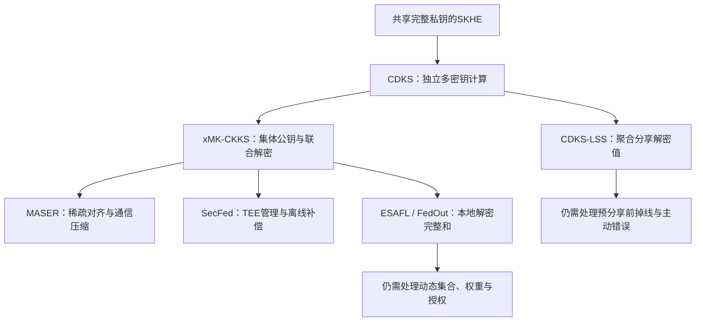
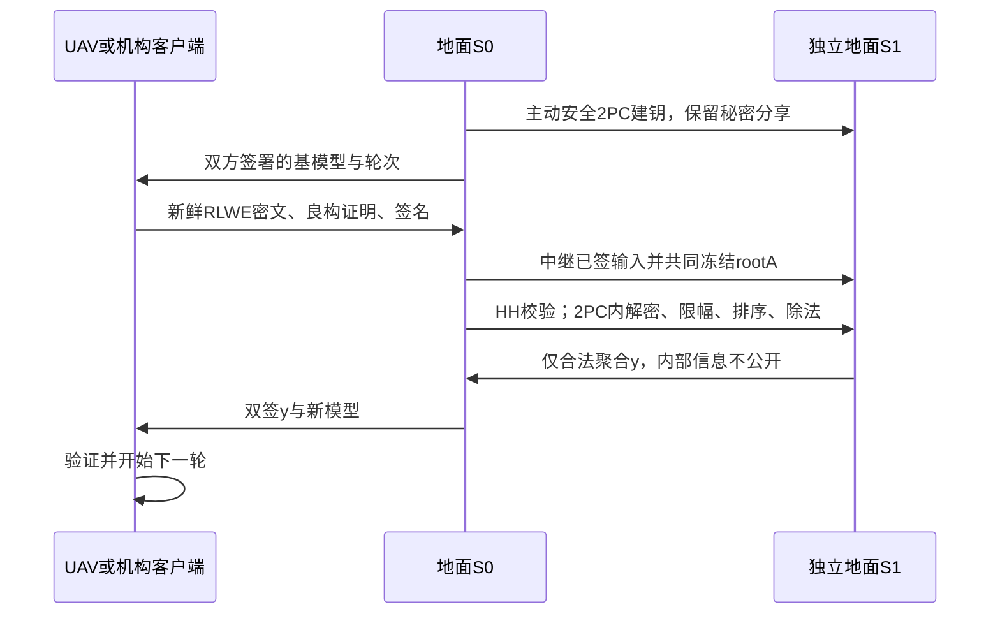
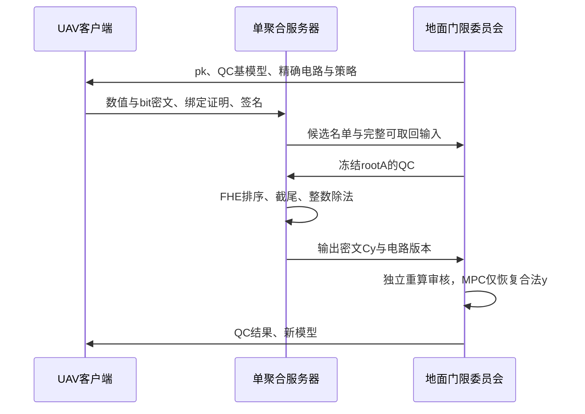
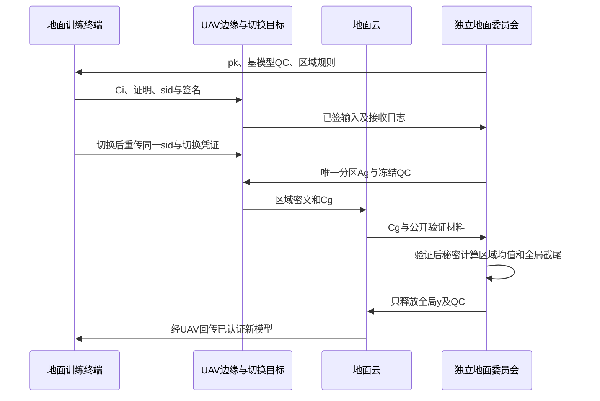
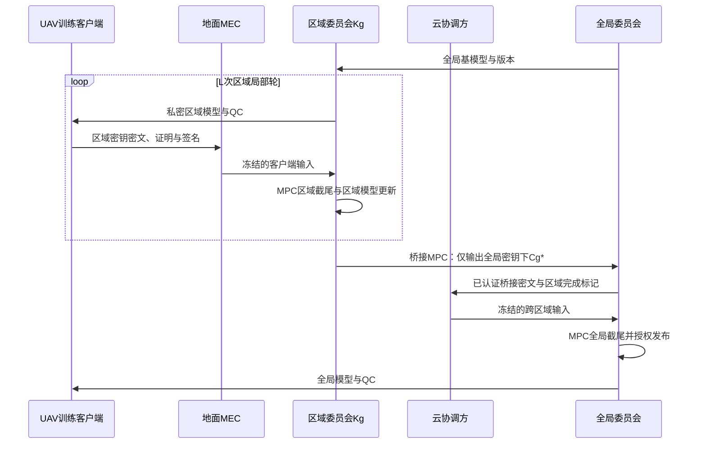
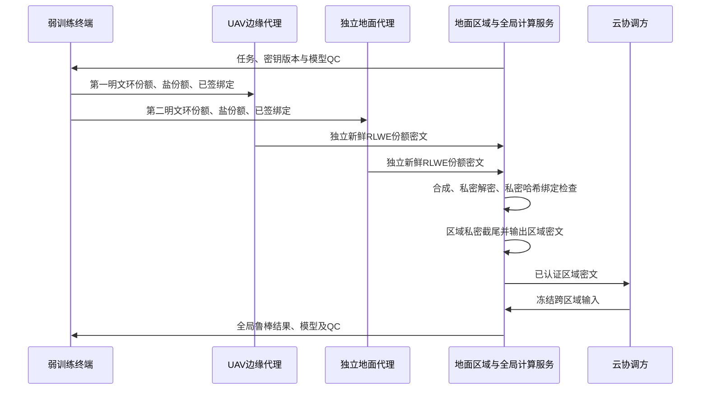

# 同态加密与联邦学习：16份材料阅读、威胁模型及5个UAV候选方案

日期：2026-10-17。范围：本目录 `upload/` 中16份PDF；补充检索用于核查研究重复性，不替代附件正文。本文页码均指PDF物理页，从1开始，可能与期刊页码不同。

> **结论定位。** 本文给出可审查的协议研究蓝图，而不是声称已获得5项可发表的新密码构造。已核对的论文事实、从公式推出的限制、本文候选设计分别标识。候选方案给出闭环功能、实体消息、RLWE公式和条件化证明；尚未完成安全参数实例化、实现和完整文献查新，因此不声称全面优于最新研究、抵御所有投毒、或达到UAV实时部署要求。对已有思路的重复和发现的错误构造，先否决再修订，见第7节。

## 0. 阅读路线与核心判断

1. 先区分**训练拓扑、密钥拓扑、信任拓扑、输出拓扑**。两台密码服务服务器不等于两层训练；写着edge的设备如果自己训练并直接向多个聚合器分享更新，也不自动成为client-edge-cloud层次FL。
2. 单密钥、独立多密钥、集体公钥、阈值解密是不同维度：多方共同生成一个公钥仍可能只有一个有效解密秘密；对解密值做门限分享也不等于对长期私钥做门限分享。
3. 仅做FedAvg通常只需加法同态；真正需要比较、裁剪、排序时，必须增加MPC、证明电路或足够深的FHE，不能把这些操作写成“服务器直接完成”。
4. **安全聚合、聚合可验证、输入有界、统计鲁棒、训练真实性**是五个不同目标。签名证明来源，不证明数据真实；范数限制约束影响，不等于删除后门；运算正确也可能正确地聚合了投毒更新。
5. UAV的关键矛盾是**接触窗口短、位置与成员动态变化、局部群体小、区域Non-IID、空中能耗高**。优先把密钥份额和复杂交互放到独立地面机构，而不是要求所有飞行节点每轮互发大份额。
6. 最值得深入的是候选H1的“跨UAV切换时仍只释放一次全局结果”，以及H2的“区域明文授权与跨域密钥桥接”。它们与UAV部署条件联系更直接。候选F1/F2适合作为安全与性能对照；H3只有在弱终端确实付不起公钥加密且存在独立外包域时才值得采用。

## 1. 先整理架构：实体、可见信息和信任边界

### 1.1 四种基础模式

| 模式 | 在线实体及数量 | 聚合路径 | 明文可能出现在哪里 | 典型安全关系 |
|---|---|---|---|---|
| 标准FL，单服务器 | n客户端+1聚合服务器；可另有离线KGC或门限委员会 | 客户端→中心→客户端 | 客户端；最终和是否向服务器公开取决于方案 | 共享完整私钥时必须处理客户端串谋；单服务器本身不意味着无第三方 |
| 标准FL，双服务器 | n客户端+2独立密码服务器；可另有KGC | 两服务器共同完成一个中心聚合功能 | 两服务器各见份额/扰动值；输出可能公开 | 非串谋或“至多腐化一台”是实质假设；若两台同属同一可统一控制的运营域，不能默认成立 |
| 层次FL，训练中间层 | n客户端+G边缘聚合节点+1云；可另有密钥服务 | 客户端→边缘局部聚合→云全局聚合 | 客户端、授权区域结果、全局结果，必须逐项指定 | 边缘与云是否可串谋、区域是否可解密、每层的参与门槛分别约束 |
| 多聚合器安全聚合 | n训练节点+m聚合器 | 每个训练节点→多个聚合器→重构一个结果 | 个体不可见，聚合结果由指定实体重构 | 主要是信任拆分；没有局部训练闭环时不等于多级HFL |

**所有架构都存在的泄露：** 本地参与身份、时间、消息长度、位置关联、掉线情况，以及被授权发布的模型/聚合值。HE不自动隐藏这些元数据，也不自动保证发布模型的成员推断安全。

### 1.2 逐篇架构与密钥矩阵

记HBC为半诚实；TA/KGC/KDC/AS(init)为初始化可信机构。表中的“无TA”不意味着无需PKI、认证信道、公共参数或一致性设施。

| 编号、文件 | 训练/服务架构；实体数 | 密钥或主要密码原语 | 可信实体与核心可见性 | 正文证据 |
|---|---|---|---|---|
| P01 SecAgg 2017 | 标准FL：n用户+1服务器；主动安全另需认证公钥设施 | DH成对掩码+自掩码+Shamir；**不是RLWE HE** | 服务器最终得到在线用户的和；用户有原始向量、掩码和收到的分享；不应让服务器同时恢复同一存活用户的两类秘密 | PDF pp.5–11，§4–6，Fig.4/5 |
| P02 CDKS 2019 | **通用MKHE及外包神经网络推理**，不是完整FL框架；k密钥方+计算方 | 独立多密钥，packed RLWE，支持扩展密文及乘法重线性化 | 各方持独立sk；计算方可见公钥/密文/评估材料；解密协议另行约束 | pp.3–7，§2–4 |
| P03 ELSA 2023 | 标准FL，n客户端+2独立聚合服务器 | 秘密共享、两服务器MPC、OT相关量验证、范数检查；**不是HE主线** | 单台服务器不见个体梯度；两台服务器知道全局模型和最终聚合；至多腐化1台 | pp.3–5，§2、§3 |
| P04 ResFed | 标准FL，n客户端+1服务器 | 残差预测、压缩/恢复；**本身无密码隐私协议** | 服务器维护客户端轨迹并恢复更新；压缩不等于加密 | pp.3–5，Fig.3、Alg.1 |
| P05 SecFed 2024 | 标准FL，n用户+1云；云拆GP和TEE两个信任组件 | EMK-BFV，TEE密钥管理与离线保护 | TEE完全可信、不串谋；GP与用户HBC且可串谋；TEE掌握关键密钥材料，GP执行密文处理 | pp.4–6，§III-B、§IV；pp.9–12 |
| P06 ESAFL 2025 | 标准FL，n客户端+1云+可选初始化AS | ESHE：客户端各自加密秘密si，**共享聚合解密秘密s=Σsi**；RLWE对称AHE | AS默认可信，可讨论用MPC替代；云不获解密秘密；客户端可本地解密完整聚合；没有每轮公开解密份额 | pp.3、6–9，§III、V、VI |
| P07 FedPHE 2025 | 标准FL，n客户端+1参数服务器PS+KDC | CKKS/packed HE+个性扰动+Shamir式混淆份额+稀疏化 | KDC可信且有周期服务；PS见恢复的sketch、掩码及贡献/选择信息；客户端解密后还需去混淆；不能归为仅靠独立MKHE保护 | pp.4–10，Fig.3、Alg.1、混淆公式 |
| P08 MASKCRYPT 2025 | 标准FL，n客户端+1服务器 | **选择性HE框架**，可接CKKS/BFV/Paillier；掩码共识 | HBC服务器可见未加密坐标及位置模式；常规共同密钥风险需要结合文中扩展讨论，不是完整向量IND-CPA隐私 | pp.3–5，§III-C/IV；pp.7–8安全讨论 |
| P09 MASER 2025 | 标准cross-silo FL，n客户端+1服务器+公钥聚合key manager | xMK-CKKS式集体公钥+剪枝+多数投票掩码 | 服务器HBC；客户端可恶意但不能破坏多数掩码共识；key manager被文中称trusted，但该职责不等于持有全部sk | pp.5–7，§3、§4.1–4.3 |
| P10 ProFL 2025 | 标准FL，n数据提供方+AGG+SP+KGC | **Paillier单公钥**+双服务器扰动/洗牌/安全中位数、Manhattan距离 | KGC可信；AGG持pk，SP持pk/sk；AGG、SP半诚实且不串谋；中间距离等结果有显式泄露 | pp.4–8，§4–7 |
| P11 PrivHFL 2025（文件名PrvFL） | **层次FL**：n用户+G边缘+1云+KGC | 论文称tMK-CKKS；具体为区域主秘密在用户类/边缘/云间分享、门限式部分解密 | KGC初始化可信；跨角色不串谋；同组用户允许受限串谋；组内用户共享相应用户侧份额，不能按n个独立私钥理解 | pp.4–6，Fig.1、Alg.1/2、§4.2 |
| P12 VeSAFL 2025 | m训练edge nodes+n聚合服务器+公告板 | 可验证认证秘密共享、承诺、双线性映射/签名；**非RLWE HE** | 最多k−1恶意聚合服务器，可与恶意训练节点串谋；公告板不可篡改且一致；个体分享保密，公开认证材料与最终聚合可见 | pp.5–8，Fig.1、§IV/V |
| P13 CDKS-LSS 2026 | 标准FL，N客户端+1服务器；每轮客户端间分享 | 独立MK-CKKS/CDKS+对**部分解密值**做Shamir式LSS | 全体半诚实；服务器可与少于t客户端串谋；服务器得总更新；无需可信dealer，但分享完成之前仍依赖所有已纳入输入的贡献 | pp.9–12，§4、Alg.1/2、Theorems 5–7 |
| P14 FedOut 2026 | 标准FL密码外包：n客户端+AS+Proxy CS+KDC；**两个密码服务器不构成HFL** | ECMK-CKKS，个体加密秘密、共同聚合解密秘密；SOP盲化外包、补零密文 | KDC可信；其他HBC；客户端可与其中一个服务器串谋；AS与Proxy CS不串谋；本地模式与外包模式能力不同 | pp.4–9，§4/5、Alg.1–7 |
| P15 VLSFL 2026 | 标准FL，n客户端+1聚合服务器+离线TA | 双掩码、SS、密钥协商、同态哈希/签名、跨轮参数复用；**非RLWE HE** | TA可信；考虑服务器串谋及返回错误结果；验证聚合与保护梯度，不意味着抵御有界后门 | pp.4–8，§IV–VI、Alg.1/2 |
| P16 联邦学习基本架构 | 教学材料；包含FedAvg及多种FL优化 | 无具体密码构造 | 不能作为威胁模型或安全证明依据 | pp.1–10 |

### 1.3 威胁、掉线和鲁棒目标对照

| 材料 | 恶意计算服务器保证 | 恶意客户端/投毒 | 掉线边界与主要限制 |
|---|---|---|---|
| SecAgg | 有主动安全版本，依赖一致性检查、PKI及阈值条件 | 保护输入隐私；不保证提交向量质量 | 多阶段恢复；阈值随腐化模型变化，不可直接套“任意t” |
| CDKS | 通用加密安全不自动给出恶意FL服务安全 | 非研究目标 | 普通联合解密依赖相关密钥方；需额外协议 |
| ELSA | **恶意服务器情形仅保证隐私，正文明确不保证最终聚合与L2检查正确** | 半诚实服务器下检查范数/坐标范围 | 客户端上传后尽量离线；非串谋成立且至少有足够诚实输入 |
| ResFed | 无密码级保证 | 非密码目标 | 压缩恢复与轨迹同步，不能直接用于隐藏个体更新 |
| SecFed | GP/用户HBC，TEE完全可信 | 明确不以投毒为重点 | TEE补偿离线；硬件信任属于方案的一部分 |
| ESAFL | 云HBC | 客户端HBC、允许限定客户端串谋；不是主动投毒防御 | 固定全体密钥和，成员变化/缺席需另处理，不能直接改成动态子集 |
| FedPHE | PS HBC | 明确不考虑投毒 | 代表性选择减轻straggler，不等于选择完成后任意掉线安全 |
| MASKCRYPT | HBC为主 | 扩展讨论串谋，不构成全向量私密的鲁棒协议 | 选择性公开本身形成泄露；加密比例是经验折衷 |
| MASER | 服务器HBC | 多数掩码共识≠对梯度内容的Byzantine稳健统计保证 | 剪枝共识及联合解密仍有在线依赖 |
| ProFL | AGG/SP HBC不串谋，**不是恶意服务器正确性** | targeted/untargeted Byzantine，少于半数；Non-IID设计 | 洗牌/距离信息及其累积关联需额外审查 |
| PrivHFL | 各层HBC且跨角色不串谋 | 同组用户有限串谋；非主动服务器/投毒模型 | 利用角色份额与组内门槛；跨角色串谋不在保护范围 |
| VeSAFL | 认证分享/聚合验证，允许限定主动腐化 | 检测错误分享/篡改；不证明本地数据或训练语义正确 | 需足够可用聚合服务器、公告板一致性、可验证投诉 |
| CDKS-LSS | 半诚实模型 | 无恶意分享正确性或投毒保证 | 分享阶段后t接收者足够；之前缺失一个被纳入贡献仍会阻塞 |
| FedOut | HBC+两服务器非串谋 | 不考虑主动篡改/投毒 | 外包模式补缺席零项；本地模式正文说明不具同样掉线保护 |
| VLSFL | 返回聚合结果可验证；需遵守其认证和阈值假设 | 不证明梯度源自干净数据 | 掩码恢复与参数复用绑定轮次，跨轮安全仍不可仅看单轮 |

## 2. 逐篇阅读笔记：可继承什么，不能继承什么

### 2.1 P01 SecAgg：掉线问题首先是状态一致性问题

**论文事实。** 每个用户以自掩码及成对掩码遮蔽向量；成对掩码在存活用户之和中抵消。用户对必要秘密预分享，掉线后通过恢复协议消掉遗留掩码。主动服务器可能向不同用户谎报不同掉线集合，因此有一致性检查。论文区分被动和主动安全条件，不能只摘出Shamir恢复公式。

**可继承。** 区分“上传前退出”“上传后未解掩码”“恢复方退出”；每个身份在同一轮只能被解释为一种状态。**不能继承。** SecAgg不筛除有毒但格式合法的梯度；输入和本身可能泄露唯一诚实用户。

### 2.2 P02 CDKS：独立密钥计算能力，不是完整FL协议

**论文事实。** 不同密钥下的密文扩展后可做同态运算，密文有效解密关系涉及多个秘密。文章重点包括packed MKHE和神经网络推理。

**推论。** 若把个体密文`(ci,0,ci,1)`及对应近似部分解密`ci,1 si`交给同一对手，就直接给了个体明文的恢复式。这是**不当的FL解密接口**，不等于推翻CDKS本身的加密安全。只替换成MKHE，不能省略谁可以请求解密什么的授权策略。

### 2.3 P03 ELSA：隐私与输入约束可同时做，但恶意服务器正确性另算

**论文事实。** 两独立服务器上的MPC检查坐标范围与L2范数，利用客户端提供的相关量并验证其有效性；其优化追求客户端一次提交后可离线。§2.2明确：一台服务器恶意时仅承诺隐私，运算和范数检查可能不正确。

**可继承。** 把重交互留给服务器，范围检查防模数绕回，输入约束与实际输入绑定。**待补缺口。** 若研究目标含恶意云返回伪聚合，需主动安全MPC或可验证计算，不能引用ELSA直接宣称完成。

### 2.4 P04 ResFed：可借残差思想，不能把压缩当密码

**论文事实。** 客户端和服务器维护模型轨迹，预测模型并传输压缩残差，再恢复模型；Alg.1包含同步和重建过程。

**组合条件。** 若服务器需要基于个体明文轨迹作预测，直接把该算法搬入HE管线会违反个体更新保密。可考虑公开共同基模型上的残差、仅本地误差反馈，或在安全电路中维护私密预测器；最后一种成本必须计入。

### 2.5 P05 SecFed：用可信硬件换取密钥管理及离线便利

**论文事实。** 云GP与TEE分离，TEE生成管理关键密钥并支撑离线保护，EMK-BFV承担密文运算。正文允许HBC用户与GP串谋，但TEE完全可信且不串谋，不讨论主动投毒。

**可继承。** 不把全部模型处理塞进可信内存；离线补偿由稳定实体承担。**代价。** TEE失陷、侧信道、证明链和生命周期是新增边界，不能称为完全无信任方案。

### 2.6 P06 ESAFL：直接本地解密完整和，省去解密份额交换

简化其ESHE加法主干，保留论文中消噪模数映射的作用：

$$c_i^r=[a_r s_i+\widetilde p e_i^r+m_i^r]_q,\quad s=\sum_i s_i,$$
$$C^r=\sum_i c_i^r=[a_rs+\widetilde p\sum_i e_i^r+\sum_i m_i^r]_q,$$
$$M^r=\operatorname{Reduce}_p([C^r-a_rs]_q)=\sum_i m_i^r.$$

`Reduce_p`及无绕回条件是正确性的一部分；不能把`q`任意选择后就声称精确恢复。论文还设计跨轮变化的多项式生成、编码/packing，并让客户端共享聚合解密秘密。

**结构收益。** 不再公开逐方解密值，云也不必得到训练结果明文。**结构约束。** 只有全体相同系数加和时抵消；若改为子集A，留下`−a_r Σ_{i∉A}s_i`；若改为任意权重αi，残留`a_r(Σαi si−s)`。所以“无需份额交换”不是“原生支持任意成员与任意加权鲁棒聚合”。

### 2.7 P07 FedPHE：共同密钥之外还有混淆层及选择泄露

**论文事实。** packed HE与稀疏化降低成本；sketch用于聚类选代表；KDC分发个性混淆因子/份额并周期更新；客户端解密后还要去混淆。其安全不能仅由“客户端有不同私钥”解释。

**可继承。** packing、慢节点选择与贡献权重协同。**不能忽略。** PS恢复sketch并看到选择信息；相似度/选择本身可泄露区域或数据分布。权重、稀疏位置、混淆恢复必须针对同一参与集合，否则掉线改变抵消式。

### 2.8 P08 MASKCRYPT：明确承担部分公开的代价

**论文事实。** 选择重要坐标加密，余下坐标明文；掩码共识使各客户端加密位置对齐。其防推断效果与加密比例、模型和攻击配置有关。

**可继承。** 位置对齐与工程测量。**不能继承。** 不能对公开坐标声称语义安全，也不能把经验攻击失败写成原始数据不可恢复。本文5个候选均不使用选择性公开敏感梯度来换取“隐私保证”。

### 2.9 P09 MASER：剪枝投票解决对齐，不自动解决投毒

**论文事实。** MP剪枝、全局多数掩码、xMK-CKKS式聚合公钥，必要时重构完整模型。服务器HBC，恶意客户端数量不能破坏掩码多数。

**可继承。** 避免各客户端不同稀疏位置导致聚合错位。**不能继承。** 掩码多数安全不推出更新多数一致；仍可在被保留坐标上传有界或同方向恶意值。投票掩码也可能暴露数据重要性模式。

### 2.10 P10 ProFL：隐私下的鲁棒统计必须承认辅助泄露

**论文事实。** KGC、AGG、SP构成Paillier双服务器模型；AGG无sk，SP有sk；洗牌安全中位数及安全Manhattan距离用于防御Non-IID下的Byzantine更新。两服务器HBC不串谋，Byzantine客户端少于半数。

**可继承。** 参考量选取不能简单把所有Non-IID差异视为攻击；共享扰动可能被已知恶意输入削弱。**需要重新分析。** 公开距离不是“毫无信息”：距离对个体与参考的关系有泄露，多轮可形成画像。本文F1保持排序、距离和筛选位在安全计算内部，不以它们绝对无信息为假设。

### 2.11 P11 PrivHFL：真正的区域训练闭环与角色份额

**论文事实。** 用户做κ1步本地训练，边缘局部聚合，经过κ2次局部聚合再上云；KGC给用户类、边缘、云分发区域相关份额。用户侧可与边缘完成局部恢复，云侧与边缘完成上层恢复。跨角色不串谋，同组用户串谋受限。

**重要辨析。** 论文使用tMK-CKKS名称；从其接口看是区域主秘密的角色分享，不能仅按名称推定每一用户都有独立私钥。共享给同组用户的同一角色份额不等于每个用户一份独立Shamir评估。

**本文目标缺口。** 如果云与边缘可共同腐化、区域更新不能交给云看，原假设不再够用；需要密文桥接与更明确的区域结果授权。

### 2.12 P12 VeSAFL：多聚合器验证分享，别误画成三层训练

**论文事实。** 训练edge nodes把认证分享交给多个聚合服务器；公开承诺、双线性认证和公告板支持局部验证及聚合重构。k阈值、可验证投诉、至多k−1恶意聚合服务器共同限定安全。

**可继承。** 可验证分享、公开一致证据、对错误参与者的可验证处理。**不能继承。** “节点上传经认证”不意味着它确实做了规定的SGD，也不意味着其数据没有投毒。其edge node通常是训练输入方；没有再接一层终端和区域训练循环，不能当作PrivHFL同类HFL。

### 2.13 P13 CDKS-LSS：分享的是解密值，阈值适用阶段需说清

每个输入方先算`μi=ci,1 si`，选次数t−1多项式`fi`且`fi(0)=μi`，向接收者j私发`fi(αj)`。接收者仅上交聚合分享：

$$z_j=\sum_{i\in A}f_i(\alpha_j),\quad
\lambda_j^T=\prod_{\ell\in T,\ell\ne j}\frac{\alpha_\ell}{\alpha_\ell-\alpha_j},$$
$$\sum_{j\in T}\lambda_j^Tz_j
=\sum_{i\in A}\sum_{j\in T}\lambda_j^Tf_i(\alpha_j)
=\sum_{i\in A}\mu_i,$$
$$\bar c_0+\sum_{j\in T}\lambda_j^Tz_j\approx\sum_{i\in A}m_i.$$

**论文事实。** 环上分享需要Exceptional Sequence：评估点差及所需分母必须为可逆元。不能把“整数编号不同”误当成任意Rq上可插值。正文半诚实、无TTP、考虑服务器与少于t客户端串谋。

**从流程推出的限制。** 输入方如果尚未向足够接收者分享就退出，已上传的`ci,0`仍缺少对应解密贡献。t个接收者只有对**同一个完整输入集合A**的分享之和，才能恢复该集合的结果。因此容忍的是预分享之后的接收者掉线；不能覆盖任意阶段输入方退出。每轮客户端间大约Θ(|A|N)个环元素的分享通信，不宜直接部署到短时接触的机群。

**证明措辞需收窄。** 若只剩一个诚实输入，输出减去串谋输入已经恢复它；所以论文中“无任何信息”只能理解为**除了规定聚合输出外无额外信息**，并需至少两个未被孤立的诚实贡献。本文沿用该泄露定义。

### 2.14 P14 FedOut：外包消除终端重算，但引入非串谋与模式差异

**论文事实。** 终端把盲化更新交Proxy CS、盲因子交AS，前者外包加密，后者去盲聚合；缺席输入补零密文；KDC可信。外包与本地模式不同，本地模式没有同等掉线保护。

**应保留的疑点而非草率定罪。** 算法初始化里`v`与正文多轮证明“每密文新鲜v”的描述，以及同轮不同v时选择单个第二分量的抵消关系，必须逐式对齐。若同轮所有输入使用共同`v_r`，可保留`−v_raΣsi`与单个`v_ra`的抵消；若每个输入独立vi，选一个c2通常不能抵消`Σvi si`。本地模式若长期复用v且其他客户端知道v及公开pki，可由`ci,1st−v pki≈mi`恢复个体；AS若跨轮见相同掩蔽项，也可见近似更新差分。这里是由特定可见性与复用条件推出的**审计反例条件**，不是对所有外包部署的已验证攻破。本文H3采用每次独立的标准公钥加密，避免依赖共同加密随机量抵消。

### 2.15 P15 VLSFL：多轮、轻量、验证已经有先例

**论文事实。** TA初始化，双掩码与SS解决隐私和掉线，同态哈希/签名验证聚合，参数复用减少多轮成本。

**可继承。** 域分离、验证回传、轮次绑定。**不能作为创新。** “加同态哈希+签名+掉线”已经是既有路线。若迁移到CKKS浮点近似值上直接比精确哈希，还会因为舍入产生错误拒绝；本文将同态哈希用于密文环的精确线性关系。

### 2.16 P16 基本架构：优化目标与密码目标需分开

该材料可用于统一损失、梯度、FedAvg/FedProx等符号，也讨论把权重/学习率在客户端明文预乘后只做CKKS加法。预乘优化以权重可信、所有输入同基模型、同密钥域且scale/level对齐为前提；它无法直接承担恶意服务器下的动态鲁棒权重。材料所述“客户端用自己私钥解密聚合”只有在所选密钥构造支持时才成立，独立多密钥密文不能自动由任意单个私钥解密。加法虽不消耗乘法深度，仍有NTT/内存/通信和累积噪声成本，不能按“零成本”估算。一般FL目标为

$$F(w)=\sum_i p_iF_i(w),\quad F_i(w)=\frac1{n_i}\sum_{z\in D_i}\ell(w;z).$$

`ni`若由恶意客户端自报且作为权重，会形成样本数放大攻击；验证样本量需组织侧配额、可信数据源或额外证明。本文默认等权，或采用事前认证且有上限的公开权重，不把客户端自报数直接当真实规模。

## 3. 方案模式的演进：分支、条件与尚未闭合的问题

### 3.1 密钥与解密这条分支



这是问题关系图，不声称所有箭头都是作者明确的直接继承。xMK-CKKS不在独立附件中；其结构依据ESAFL、MASER、CDKS-LSS对它的介绍，独立原文未逐页核验。

**共同公钥型的核心。** `b=Σbi=−aΣsi+Σei`，每个用户随机加密到同一集体公钥；聚合第二分量`C1`乘每个si后抵消总秘密。它避免“每个个体ci,1对应的解密贡献直接公开”，却把所有si的在线依赖带进了解密。**CDKS-LSS是不同分支**：把原本危险的个体解密贡献私密地聚合；不是简单把xMK-CKKS加一个按钮。

**ESAFL的代价交换。** 无份额交换靠的是共同轮次因子、不同加密秘密与共同和密钥的结构。它并没有凭空得到通用MKHE全部电路能力或可变集合解密能力。新方案若要动态成员、鲁棒权重和单步解密同时成立，必须重写抵消式并证明。

### 3.2 其他分支与组合冲突

| 分支 | 已有代表 | 真正解决的问题 | 与其他分支组合时的冲突 |
|---|---|---|---|
| 掩码掉线 | SecAgg、VLSFL | 网络不稳定下恢复安全和 | 服务器谎报集合、复用掩码、主动份额错误；需要状态一致性 |
| 压缩/稀疏 | ResFed、MASKCRYPT、MASER、FedPHE | 参数尺寸、传输等待 | 明文坐标/掩码/sketch泄露；私密轨迹预测需要安全计算 |
| 聚合验证 | VLSFL、VeSAFL | 篡改、错误分享、伪聚合 | 只验证代数，不验证SGD语义或数据来源 |
| 隐私输入约束 | ELSA、补充RoFL/EIFFeL | 防超大更新和错误格式 | 有界后门仍可通过；证明必须绑定实际密文 |
| 私密鲁棒统计 | ProFL等 | 中位数、距离、筛选与Non-IID | 距离/选择泄露、比较成本、恶意服务器正确性 |
| 层次训练 | PrivHFL | 多局部轮次和回传节约 | 每层输出泄露、小群组隐私、区域偏差、密钥切换 |
| 加密外包 | FedOut | 弱终端公钥运算负担 | 双服务非串谋、盲化完整域、补零与模型分母 |

## 4. UAV应用约束、统一安全定义与可复用密码模块

### 4.1 UAV不是一个固定角色

| 场景 | 谁持数据并训练 | UAV角色 | 可接受的计算放置 | 实际研究问题 |
|---|---|---|---|---|
| 多运营商巡检/测绘协作 | 机载计算模块或落地后的运营商站点 | 训练客户端 | 机载仅小头/adapter；复杂私密统计在地面 | 更新可透露航线、设施、地理位置；竞争方串谋；电池中断 |
| UAV-assisted灾害/农田感知 | 地面传感器、车载网关等有本地训练能力终端 | 飞行接入点/密文聚合器 | UAV加法、缓存；地面服务负责证明验证和解密 | 短接触窗口、跨UAV切换、一次上传、回传中断 |
| Edge-assisted UAV learning | UAV持图像/遥测并训练 | 学习客户端；基站MEC是边缘 | 地面做局部私密鲁棒、跨区域桥接 | 区域Non-IID、多局部轮次、地域模型可见范围 |
| 弱终端+UAV移动边缘 | 低功耗但仍能本地小模型训练的终端 | 加密代理与第一层汇聚 | 终端线性盲化/签名；独立地面代理及委员会重计算 | 避免把“原始数据不上云”误写成把明文梯度交UAV |

不声称“一半UAV论文一定是哪类”，这需要系统综述统计。上述两种assisted角色均有原始研究支持，见参考W03/W04。没有训练能力的普通传感器不能被强行称为FL客户端；必须加本地网关，或明确改做split learning，而后者不在本文5方案范围。

### 4.2 从场景导出的可测约束

设d是实际训练参数量，Bup为一轮上行字节，Rup为可用上行速率，Tcontact为剩余接触窗口：

$$T_{train}+T_{encode}+T_{proof}+8B_{up}/R_{up}+T_{ack}\le T_{contact}.$$

空中能耗至少计入

$$E_{round}=P_{cpu}T_{cpu}+P_{tx}T_{tx}+P_{rx}T_{rx}+P_{hover}T_{extra-hover}.$$

不能只比较加密CPU时间；额外悬停常可能抵消密码优化收益。若单份更新为1 MiB、应用有效链路为2 Mbit/s，仅净上传约4.19 s，尚未计重传和证明；这是量纲示例，不是本文实测。

**需研究的约束：** 非随机掉线导致区域偏差；位置与标签相关的Non-IID；被劫持UAV的Sybil/重放/选择性丢包；同一更新跨边缘重复计数；区域用户过少；过时模型污染；模型分叉诱导梯度泄露；电量耗尽的可用性攻击；云与全部UAV同域腐化；密钥持有节点长期离线。

### 4.3 安全目标与不可能性边界

对协议Π和允许腐化集C，要求存在模拟器使

$$\operatorname{View}^{\Pi}_{C}(X)\approx_c
\operatorname{Sim}(X_C,\mathcal L(X),\mathcal F(X)).$$

`F`是事先规定的鲁棒聚合与更新功能，`L`列出元数据、接受名单和授权区域输出。不同诚实输入只在具有相同合法输出/泄露时才应不可区分。**这不是“观察输出也学不到任何关于输入的信息”。**

- 隐私：只泄露F及L，密钥恢复不足门槛；公开的是完整密文也不应破坏隐私。
- 正确性：诚实方接受的结果等于F在被冻结输入上计算的结果，否则输出⊥；F1允许对手中止。
- 鲁棒性：在明确数量和统计假设下界定恶意影响；不许将训练效果经验结论升格成密码学无条件定理。
- 可用性：需独立说明网络、存活数和接收期限；密码隐私不能解决所有DoS。

**隐私门槛与解密门槛不同。** 设h为每次被释放结果所含、未被串谋者扣除后的最少诚实贡献数，默认h≥2；实践需远大于2。设委员会m个成员，最多c腐化，t为秘密恢复门槛，则基本要求`c<t≤m−c−dK`。本文委员会型候选保守采用m≥3c+1及主动安全诚实多数MPC，并显式限定剩余在线人数；2PC型只有带中止安全，无单方强制出结果。

**多轮差分。** 即便每轮h≥2，若同一输入快照被释放`ΣA xi`和`ΣA\{j} xi`，相减仍给xj。所有候选强制“一个快照、一个功能、一个输出收件集合、一个发布记录”；不允许对同一批输入反复改子集查询。不同轮新更新仍可能泄露训练轨迹；若需要用户级/样本级差分隐私，必须另加机制及会计，本文基础方案不宣称DP。

### 4.4 统一符号

| 符号 | 含义 |
|---|---|
| r, ℓ, k | 全局轮次、区域局部轮次、参数坐标 |
| Ui, Eg, C | 第i客户端、第g边缘、中心协调方 |
| K1,…,Km | 独立地面密钥/计算委员会；不是飞行客户端的全部集合 |
| A, Ag | 本轮/本区域已冻结的有效输入身份集合 |
| f, fg, b | 全局恶意客户端上界、区域上界、完全不可信区域数上界 |
| d, N | 模型参数维度、RLWE环维数；不混用 |
| p, q, Δ | 明文模数、密文模数、BFV缩放因子⌊q/p⌋ |
| Q, B | 固定点比例、已量化坐标幅值上界 |
| x_i, m_i | 有符号整数更新向量及其明文环编码 |
| s, pk, ek | 有效HE秘密、公钥、评估密钥 |
| [z] | MPC内部的认证秘密分享；不表示向任何单方公开z |
| sid, mid, τ | 更新唯一标识、基模型摘要、完整轮次上下文 |
| HH, H, Sig | 密文线性同态哈希、普通抗碰撞哈希、EUF-CMA签名 |
| ⊥ | 公开可归因或不可归因中止；必须按具体子协议说明 |

采用**模型差分**`u_i=w_i−w_base`，故更新式为`w_new=w_base+η·Agg(u)`；若实现采用正梯度`g`则符号改为减号，不能混用。

### 4.5 模块M0：固定点与标准RLWE加解密，避免近似哈希冲突

为严格验证，5方案默认**BFV精确整数层+固定点量化**。CKKS可作工程替代，但需独立分析比较误差、舍入与证明绑定，本文不把它当作等价无损替换。

令`R=Z[X]/(X^N+1)`、`Rq=R/qR`、`Rp=R/pR`。p取满足所用批处理条件的素数，具体p/q/N必须由安全估算器和噪声预算联合选择。`Pack:Zp^d→Rp^L`为分块SIMD编码；不能把多项式系数限幅误当SIMD槽限幅。

客户端本地训练：

$$w_{i,0}=w_{base},\quad
w_{i,e+1}=w_{i,e}-\gamma\nabla F_i(w_{i,e};\xi_{i,e}),\quad
u_i=w_{i,E}-w_{base},$$
$$x_{i,k}=\operatorname{clip}_{[-B,B]}(\operatorname{round}(Q u_{i,k})),\quad
m_i=\operatorname{Pack}(x_i\bmod p).\tag{M0-1}$$

密钥生成与加密（每块独立随机性）：

$$s\leftarrow\chi_s,\ a\leftarrow U(R_q),\ e\leftarrow\chi_e,
\quad b=-as+e\pmod q,\quad pk=(b,a),\tag{M0-2}$$
$$v_i\leftarrow\chi_s,\ e_{i0},e_{i1}\leftarrow\chi_e,$$
$$c_{i0}=bv_i+e_{i0}+\Delta m_i\pmod q,\qquad
c_{i1}=av_i+e_{i1}\pmod q.\tag{M0-3}$$

逐项展开解密：

$$c_{i0}+c_{i1}s=(-as+e)v_i+e_{i0}+\Delta m_i+(av_i+e_{i1})s$$
$$=\Delta m_i+\underbrace{ev_i+e_{i0}+e_{i1}s}_{\nu_i^{HE}}\pmod q,$$
$$m_i=\left[\left\lfloor\frac p q\,[c_{i0}+c_{i1}s]_q\right\rceil\right]_p.\tag{M0-4}$$

由于`Δ=⌊q/p⌋`，还需计入`q−pΔ`引起的缩放误差；“噪声小于Δ/2”只是理想缩放的直观充分条件，最终应采用标准BFV解码正确性界。公开整数加权：

$$C_0=\sum_i a_ic_{i0},\quad C_1=\sum_i a_ic_{i1},$$
$$C_0+C_1s=\Delta\sum_i a_im_i+\sum_i a_i\nu_i^{HE}\pmod q.\tag{M0-5}$$

必须同时满足**明文无绕回**`p>2 max_k|Σa_i x_i,k|`及**密文噪声正确性界**；只给一个N而不约束求和人数、权重及深度没有意义。除法优先在安全电路中作有符号整数除法，或公开解密总和后在实数域除以明确人数；`乘(n−2f)^{-1} mod p`不是固定点实数除法。

**乘法。** BFV乘法不是把两分量直接逐乘：先得`d0=c0c0'`、`d1=c0c1'+c1c0'`、`d2=c1c1'`；按标准BFV乘法缩放/模数处理，再用评估密钥重线性化。其概念关系是

$$\sum_{j=0}^2d_js^j\approx\Delta^2mm',\quad
\operatorname{MulRelin}(c,c')\text{ 解码为 }mm'\bmod p.\tag{M0-6}$$

例如gadget基数β，评估密钥满足`ek_{j0}+ek_{j1}s=β^j s²+εj`，对**标准乘法缩放后**的二次项作gadget分解并合并，才能回到二分量。这里不能省掉BFV乘法缩放、RNS基扩展和噪声跟踪；本文后续`Eval`指定标准库的完整BFV电路语义，不把M0-6当可直接实现的伪算法。使用评估密钥还须采用相应安全定理的辅助/KDM等假设，不能只说“所有都由裸RLWE自动证明”。

### 4.6 模块M1：无可信dealer的密钥管理与安全解密

本文不自行发明未经证明的“加点噪声就安全”的门限解密。**参考实现规格**是：在主动安全MPC内执行标准BFV KeyGen并产生认证分享，pk/ek公开，s从不重构给任意单方。委员会内部还可以使用已有且匹配主动腐化模型的门限FHE实现替换；替换必须重新核查定理条件。

概念上，MPC内部采样小秘密贡献sj、ej并计算

$$[s]=\sum_j[s_j],\quad[e]=\sum_j[e_j],\quad b=-a[s]+[e].\tag{M1-1}$$

小秘密/误差采样和防恶意偏置均由安全采样功能完成；不能让恶意成员在外部任意提交超大sj/ej。最终秘密分布对应多贡献之和，参数须按此噪声/秘密分布估计；也可在电路中直接采样标准单秘密分布。**分享域与Rq不可混为一谈**：可把s的规范系数编码进足够大的素域F_P作Shamir/认证分享，Rq运算和模q约简在电路内实现。

对批准密文C，MPC内部计算

$$[z]=C_0+C_1[s]\pmod q,\quad
[m]=\operatorname{BFVRound}_{p,q}([z]),\quad
[x]=\operatorname{UnpackSigned}([m]).\tag{M1-2}$$

有三种输出模式：仅保持[x]秘密；仅向经授权收件人输出聚合x；或把[x]重新加密成新密文。所有模式都**不把原始C1 sj或单方部分解密值发给云/客户端**。直接公开`d_j=C1 sj`在C1可逆时给出`sj=C1^{-1}dj`，是错误构造；增加一个未经量化的小噪声也不是自动安全。

MPC私密重加密完整式为

$$[v],[e_0],[e_1]\leftarrow\text{安全采样},$$
$$C'_0=b'[v]+[e_0]+\Delta'[\operatorname{Pack}(x)]\pmod {q'},\quad
C'_1=a'[v]+[e_1]\pmod {q'},\tag{M1-3}$$

只公开`(C'0,C'1)`。分布式生成随机性保证至少一个诚实贡献；需要**输出隐私/电路隐私的安全重加密实现**。不使用“每方加密一份mod p分享然后相加”作为默认，因为BFV的q/p缩放及分享绕回可能引入大残差，需要单独处理。

**代价承认。** M1内的取模、舍入、位分解可很贵。选择它是为了给出安全的可执行功能，不是声称它比所有专用门限解密更快。若尚无实现，安全证明为MPC理想功能下的组合证明。

### 4.7 模块M2：私密裁剪、排序、整数均值，具体如何算

主动安全MPC的算术分享记`[x]`，加法和公开常数乘法本地进行。乘法以已验证Beaver三元组`([a],[b],[c=ab])`为例：

$$\epsilon=\operatorname{Open}([x]-[a]),\quad
\delta=\operatorname{Open}([y]-[b]),$$
$$[xy]=[c]+\epsilon[b]+\delta[a]+\epsilon\delta.\tag{M2-1}$$

开启值必须通过MAC/一致性检查；三元组必须经过恶意安全生成/验证，不能信任客户端dealer。2PC可用OT/garbled circuit的主动安全实现完成相同功能，并不声称普通Beaver公式本身即给主动安全。

比较在位分解后执行。对相同位宽的无符号u,v，从最高位到最低位：

$$eq_{j}=1-u_j-v_j+2u_jv_j,$$
$$lt=\sum_{j=0}^{L-1}(1-u_j)v_j\prod_{h=j+1}^{L-1}eq_h.\tag{M2-2}$$

合法bit上高位首个差异只激活一项。对有符号x先加偏置B映到非负；x可能来自恶意密文时需先对p域规范代表解码，**电路内先夹到[-B,B]，再比较，不能相信客户端自我裁剪**。最小最大交换：

$$\beta=[x>y],\quad[x_{lo}]=[x]-\beta([x]-[y]),\quad
[x_{hi}]=[y]+\beta([x]-[y]).\tag{M2-3}$$

固定排序网络不泄露比较分支。n输入每坐标排序后，截尾和与分母为

$$[S_k]=\sum_{j=f+1}^{n-f}[x_{(j),k}],\quad D=n-2f>0,$$
$$[y_k]=\operatorname{RoundSignedDiv}([S_k],D),\quad
w_{new}=w_{base}+\eta\,y/Q.\tag{M2-4}$$

`RoundSignedDiv`用公开除数的整数除法电路，约定负数舍入和半整数规则。FHE版本可同态执行同样的bit比较、交换、长除法电路；用标准BFV乘法和所需重线性化/层级或自举。比较电路是密码成本，不可省略。

**可证明的鲁棒结论R1。** 若至多f输入恶意、n>2f，所有诚实输入在每坐标k都处于`[μk−ρk,μk+ρk]`，则去掉两端f后，所有保留值仍在该区间；否则一个保留的越界值意味着有超过f个同侧越界输入，矛盾。因此

$$|y_k/Q-\mu_k/Q|\le\rho_k/Q+1/(2Q).\tag{R1}$$

若ρ针对量化前真值定义，还须加输入量化误差≤1/(2Q)，总共≤1/Q。结论不依赖知道哪个客户端恶意，但**依赖诚实更新集中**；极端Non-IID、低范数后门和跨坐标相关攻击可使此界对任务效果没有帮助。不能由R1推出对任意深度网络收敛。

**有界均值结论R2。** 对所有输入先强制`||x_i||∞≤B`，n固定，其中f个被任意替换，则相对同位置未被替换的有界参考更新，均值每坐标变化最多`2fB/n`；实数域除以Q。对不含恶意项的诚实均值，差异界可相应推导为`2fB/n`。这是影响上界，远弱于完整投毒检测。

### 4.8 模块M3：签名、一致输入集合和密文同态哈希

完整上下文

$$\tau=(task,r,\ell,epoch,keyID,mid,policyID,deadline,scope),$$
$$sid_i=H(task\|r\|\ell\|id_i\|counter),\quad
\sigma_i=\operatorname{Sign}_{sk_i^{sig}}(\tau\|sid_i\|H(C_i)).\tag{M3-1}$$

接收方验证证书、签名、mid、keyID、一次性sid、长度和期限。公告记录须有一致广播/共识，不能只由恶意云维护一份可分叉日志。委员会在诚实多数下给冻结根`rootA`签署法定人数证书QC；F1由两个服务器分别签署同一根。未拿到入选凭证的客户端不能假设自己的更新已计入。受审查导致未被接收的更新，是可用性/公平性问题，不能伪称所有提交必然包含。

**精确密文同态哈希。** 为展示完整代数，单素数q表示下取阶为q的群G和独立hash-to-group生成元`g1,…,gD`，将二分量密文规范展平成`z(C)∈Zq^D`：

$$HH(C)=\prod_{j=1}^{D}g_j^{z_j(C)},\quad
HH\left(\sum_i a_i C_i\bmod q\right)=\prod_iHH(C_i)^{a_i}.\tag{M3-2}$$

随机独立生成元且离散对数困难时，寻找非平凡线性碰撞归约到群关系问题；必须给出所选多生成元哈希的正式安全实例。该离散对数例子要求q足够大以提供目标安全强度。常见RNS的50–60位小素数**不能**逐分量套用此式并声称128位安全，群阶小会直接破坏碰撞安全；重构为平滑合数阶群也不能解决。参考理论版本采用足够大的单素数q；实际RNS必须另选有正式模数处理和安全参数的同态哈希/承诺，并给出其定理，不把这里的代数示例直接当成高效RNS实现。哈希作用于**本来公开的密文**，不公开小范围明文的确定性哈希，避免字典猜测。

`σi`同时绑定`HH(Ci)`或从已签名Ci计算。聚合者发布`CΣ`、rootA、权重；验证方从冻结的真实Ci独立得到右侧，检查M3-2。若聚合者同时自选Ci和哈希，验证没有意义。对于FHE排序、裁剪、密钥切换、重加密等**非线性/随机化步骤，M3-2不能验证它们**；使用主动安全MPC的计算保证、明确关系的ZK证明，或独立重算完整确定性Eval。签名也不能替代这些保证。

**后量子边界。** 本文M3-2若用离散对数群，则整个系统不是纯后量子；可以保留RLWE隐私结论，但不能称整体后量子。要整体后量子需替换签名、同态哈希、MPC与证明系统并给出相应假设。

### 4.9 模块M4：上传证明与公开密文解密请求的授权

普通模式可让客户端给出ZK知识证明：存在`(x,v,e0,e1)`满足M0-3、Pack关系、误差界、坐标范围、相同τ及sid。bit输入还须证明`b(b−1)=0`及`x+B=Σ2^j bj`；不能只证明“某个有界x”而不与Ci绑定。

本文不指定一套尚未基准测试的高效RLWE证明系统；可采用通用ZK电路完成上述精确关系，成本列为待验证。F1/H2可选择把格式检查和限幅放入MPC，省去客户端重证明；F2必须提供位与数值一致性证明，防服务器在FHE比较时读到伪位。

任何重构请求必须满足

$$\operatorname{Authorize}(\tau,rootA,F,H(C_{out}),scope,releaseState)=1.\tag{M4}$$

委员会不提供一般解密oracle。需要核对计算来源、最少人数、输出计数和收件人；拒绝个体Ci、任意差分子集、重复快照、未验证外包密文、混入挑战密文的请求。仅说“HE是IND-CPA安全”不足以覆盖恶意选择密文的解密接口。

## 5. 五个候选方案总览

本节不把已有密码组件的组合包装成全新HE。候选创新点都是**需要查新和实验验证的系统研究假设**。每个方案按“场景→问题→目标→威胁→符号→设计→时序→证明→否决条件”展开；为避免题目中两个5.6重号，时序图统一放在各方案的`.7`，安全分析放`.8`。

| 候选 | 训练拓扑 | 有效HE密钥 | 可信关系 | 鲁棒功能 | 主要额外问题 |
|---|---|---|---|---|---|
| F1 双运营方私密鲁棒FL | 标准FL，2密码服务器 | 1集体公钥，2方秘密分享 | 至多腐化1服务器；无可信KGC | 全体客户端更新私密截尾均值 | 不向SP泄露距离；恶意服务正确或中止 |
| F2 单聚合服务器的可核验FHE鲁棒FL | 标准FL，1聚合服务器+地面门限委员会 | 1门限公钥，位/数值输入同钥 | 聚合服务器可恶意；委员会腐化受限 | 密文排序、截尾、整数除法 | 客户端上传后离线；完整Eval可重算审核 |
| H1 UAV跨区切换的端到端聚合 | 终端→UAV边缘→云，空间层次 | 1地面委员会门限公钥 | 全部UAV和云可串谋；委员会腐化受限 | 区域有界均值+区域级私密截尾 | 同一更新只计一次、只发布全局结果 |
| H2 地面边缘辅助的多域多周期HFL | UAV→MEC区域→云，时间/空间层次 | G区域公钥+1全局公钥 | 本地/全局委员会各自受限腐化 | 区域私密截尾+跨域私密截尾 | 区域模型授权、密钥桥接、陈旧性 |
| H3 弱终端双域外包HFL | 终端→UAV/独立代理→地面→云 | 1门限公钥，各代理独立随机加密 | 每终端的两份额接收域不能共同腐化 | 区域MPC私密截尾+全局私密截尾 | 终端不做HE，绑定盲化输入与合成密文 |

### 5.0 委员会运行条件的具体约定

对所有委员会型候选，记原委员会m、腐化上界c、同时不可用dK，使用的具体MPC和一致性协议须满足其网络模型。保守实现要求**参与本次计算的在线人数m_live>3c**，并有经验证的重分享/重配置来保持同一有效sk；否则中止。不能仅凭“凑到t个份额”就调用需要诚实多数的主动MPC。

原委员会对冻结记录的签署门槛可取

$$q_{QC}=\left\lfloor\frac{m+c}{2}\right\rfloor+1,\quad m-c-d_K\ge q_{QC}.$$

两个此类法定集合的交集必含诚实成员，且诚实成员不对同一sid签署两份冲突决定。重配置需上一配置的授权记录、私密重分享和明确epoch；飞行客户端的掉线**不改变**地面委员会的HE密钥。本文默认静态腐化或有界epoch腐化；不宣称在无限多epoch累计攻陷所有份额仍保密，主动刷新及安全擦除须另行实现。

## 5.1 候选F1：双运营方、隐藏筛选信息的标准FL

### 5.1.1 场景

多个巡检运营商的机载小模型或地面机库参加跨机构FL；飞行期间只更新检测头/adapter。两个地面服务分别由运营联盟和独立基础设施提供方管理。无人机是数据训练方，网络可以经过基站中继，但中继不做局部训练聚合，所以仍是标准FL。

### 5.1.2 要解决的问题

ProFL的双服务框架以HBC和非串谋为核心，辅助距离等可见；ELSA在恶意服务器下不保证聚合/检查正确。本方案要求排序、筛选和个体梯度均不向任一服务器泄露；任一恶意服务器不能使诚实客户端接受错误结果。

### 5.1.3 创新假设与总体目标

研究点不是“首次双服务器+HE+鲁棒”，而是把**一致基模型、一次上传后的客户端退出、无距离泄露、跨轮输出授权**放入同一个可证明功能。与ELSA、ProFL、Janus及Mario逐项比较后，若这套功能已有同等保障和更低成本，应将F1降为基线，而不是继续宣称新颖。

### 5.1.4 威胁模型及实体可见性

在线实体为n个Ui、S0、S1，共n+2；另需身份认证设施，不持HE秘密。

| 实体 | 可见 | 不可见/限制 |
|---|---|---|
| Ui | 自身数据、更新、加密随机性、所有公开模型、最终y、名单 | 其他诚实个体更新、s、内部比较与截尾位置 |
| S0 | pk/ek、公开密文、签名、名单、最终y、自身秘密分享和MPC视图 | s的另一份；诚实个体明文/排序/距离 |
| S1 | 同S0 | 同S0 |
| 串谋方 | ≤f恶意客户端+至多1个服务器的联合视图 | **禁止同时腐化S0和S1**；不保证拒绝服务下仍输出 |

客户端可任意投毒、重放、提交畸形密文；服务器可偏离协议、改变名单、发模型分叉、请求额外解密。假设主动安全2PC、签名、认证信道和底层HE安全；拒绝服务允许中止。n>2f且合法输出至少h个诚实贡献。双方都被控制时，隐私失效，这是清楚的失效边界。

### 5.1.5 符号

采用第4节全局符号。`[s]_0,[s]_1`表示2PC保存的秘密份额；`A`为双方共同冻结名单；`F_TM(A)`为M2-4的逐坐标截尾均值；所有输入基模型摘要必须相同mid。

### 5.1.6 闭环设计与公式

**F1-0 联合建钥。** S0、S1运行主动安全2PC KeyGen，内部产生s、e和各自分享，只公开`pk=(−as+e,a)`及必要ek。没有给任意单方完整s；身份公钥与HE秘密分离。

**F1-1 发布上下文。** S0提出τ及w，S1检查训练策略后共同签`(τ,H(w))`，Ui仅接受双签相同mid的基模型。若两台收到的模型不同，不训练并中止。

**F1-2 本地训练并上传。** Ui按M0-1得到xi，用新鲜随机性计算

$$c_{i0}=(-as+e)v_i+e_{i0}+\Delta\operatorname{Pack}(x_i),\quad
c_{i1}=av_i+e_{i1}\pmod q.$$

Ui把`(τ,sid,Ci,σi)`发S0；S0中继给S1。客户端可保留回执并在超时后向S1补发，补发不产生新sid。两服务器分别检查签名/身份/上下文，只有双方确认拥有的输入可进入A；共同签`rootA`。更新一旦纳入不因Ui此后掉线而撤销。

**F1-3 精确线性入站检查。** 双方各自算`Csum=Σi∈A Ci`并验证`HH(Csum)=ΠHH(Ci)`，该步骤用于检测中继漏项/改写；**它不验证最终鲁棒均值**。

**F1-4 密文转私密值。** 两方在2PC内逐个计算

$$[z_i]=c_{i0}+c_{i1}([s]_0+[s]_1)\bmod q
=[\Delta m_i+\nu_i^{HE}],$$
$$[x_i]=\operatorname{UnpackSigned}(\operatorname{BFVRound}_{p,q}([z_i])).$$

[xi]不输出给任何一方。对异常格式/长度公开拒绝；对合法密文中的任意p域输入，内部按规范解码并**强制限幅**，不相信客户端声称已裁剪。若需要在训练前排除畸形RLWE密文导致的特殊解密oracle，加入M4良构证明；或者2PC把所有解码过程和失败位都包含在F内、只给一个统一错误结果。参考实现选择M4良构证明，避免私钥相关失败侧信道。

**F1-5 私密鲁棒聚合。** 使用M2比较与交换，对每个k得到`[x(1),k],…,[x(n),k]`。先截尾再求和、整数除法：

$$[S_k]=\sum_{j=f+1}^{n-f}[x_{(j),k}],\quad
[y_k]=\operatorname{RoundSignedDiv}([S_k],n-2f).$$

中间位、排序、距离和被截尾身份均保持私密。仅当`Authorize(τ,rootA,F_TM,scope)=1`时向双方输出y；两服务器各自签`(τ,rootA,H(y),H(wnew))`。

**F1-6 回传与闭环。** 双签结果发给所有授权Ui：

$$w^{r+1}=w^r+\eta_r y^r/Q.$$

Ui核验双签、r、mid、rootA、发布计数；记录接受凭证，再进入下一轮。任一方拒绝签名则没有可被接受的结果，记录⊥。不允许对同一rootA再改成leave-one-out查询。

### 5.1.7 实体时序图



### 5.1.8 安全分析与条件化证明

**隐私命题F1-P。** 在主动安全2PC（带中止）、HE及证明零知识/签名假设下，至多一服务器与≤f客户端串谋，其视图可由腐化输入、A、元数据和y模拟。证明：先以2PC模拟器替代内部KeyGen/解密/排序视图，余下诚实密文在已规定输出条件下由HE混合论证替换，ZK视图可模拟；单方份额不足恢复s。组合使用HE辅助输入安全与MPC实现的准确接口，不能把s意外输出给模拟器以外真实实体。y带来的信息明确保留。

**正确性命题F1-C。** 主动安全2PC使诚实服务器只得到F_TM结果或⊥；其只对正确结果签名。错误y要获双签需伪造诚实服务器签名或破坏2PC，因此接受错误结果概率可忽略。双签不能防双方共同恶意，这已被威胁模型排除。

**鲁棒性。** 在n>2f及R1集中性前提下满足R1；对无集中性的Non-IID仅保证限幅与已选函数被正确计算，不承诺高精度。n−f可能仍有足够诚实输入但对手可通过中止阻塞，**不保证公平输出**。

### 5.1.9 成本与推倒条件

客户端代价为O(L)次公钥加密及良构证明；客户端间零份额互发。两服务器O(d n log²n)次比较规模的安全排序，外加解码及除法电路。若机载证明占满接触窗口，转机构/机库客户端或另用H3，不能口头称轻量。若既有Janus/Mario加现成鲁棒电路已完整实现同一功能，F1只能当基线。

## 5.2 候选F2：单聚合服务器、地面门限授权的FHE鲁棒FL

### 5.2.1 场景

同一灾害响应联盟的UAV在基站可短时上传小型检测头，中心只有一台训练聚合服务；多个稳定地面机构提供解密授权。飞行节点上传后可以换电、返航或断链，不能每轮参与份额交换。可接受分钟级甚至更慢的训练轮次；不把FHE排序放进飞控实时路径。

### 5.2.2 要解决的问题

消除CDKS-LSS每轮飞行客户端互发解密贡献的依赖，同时对恶意单聚合服务器提供精确鲁棒运算检查；不引入掌握全部HE秘密的可信机构。

### 5.2.3 创新假设与总体目标

候选研究点为“**离线客户端、同一冻结输入、确定位排序电路、发布授权**”的一体设计及可行参数区间。单服务器多轮安全聚合已有Flamingo，私密输入约束已有RoFL/EIFFeL，门限HE已有大量工作；它们不是本文独创。F2的可发表性取决于能否证明并实现相较这些基线的具体性能/安全收益。

### 5.2.4 威胁模型及可见性

实体n个Ui+1聚合服务器A+m个地面Kj，共n+1+m；K是密码授权服务，不维护一个中间训练模型，所以仍是标准FL。

| 实体 | 可见 | 不可见/约束 |
|---|---|---|
| Ui | 自身x、随机性、公开密文、最终y、验证材料 | 他人x、排序与私钥 |
| A | 所有已签密文、加密bit、证明、名单、确定性评估过程；可见最终y作为允许输出 | 个体明文、私钥份额、明文筛选位 |
| 单个Kj | 全部公开记录、自己sk分享、重算密文；内部MPC视图和最终y | 完整s、个体明文；不得对个体请求输出 |
| 对手 | A可任意恶意，≤f客户端，≤c委员会成员，可相互串谋 | 必须满足委员会在线诚实多数、门槛及证书条件；不允许累计恢复长期全部份额 |

没有可信dealer；有PKI及委员会一致性基础。允许A拒绝服务；委员会若也复算可替代A完成计算，但该容错路径成本必须计入。

### 5.2.5 符号

`K=(m,c,t)`、`C_i^x`是数值密文，`C_i^{bit,j}`为`ui=xi+B`的bit密文，`bwidth=⌈log2(2B+1)⌉`。d、客户端数上限及排序网络大小预先固定，并有合法padding规则。

### 5.2.6 闭环设计与公式

**F2-0 建钥与模型一致性。** K按M1产生pk/ek及认证秘密分享；发布keyID和具有QC的`(τ,w)`。QC把d、B、bit宽度、最大人数、排序网络、噪声预算和输出策略绑定。

**F2-1 加密数值及bit。** Ui对每个坐标取`ui,k=xi,k+B∈[0,2B]`，位分解`ui,k=Σj2^j bi,k,j`。每个槽的bit和xi分别按M0-3用**独立随机性**加密；各密文满足

$$c_{i0}^{(j)}+c_{i1}^{(j)}s=\Delta\operatorname{Pack}(b_{i,\cdot,j})+\nu_i^{(j)}.$$

Ui证明同一xi同时对应数值密文和全部bit，`b(b−1)=0`、范围合法、噪声/随机性满足良构关系。上传`(Ci^x,{Ci^bit},πi,σi)`到A及可取回的地面接入日志；拿到签收回执后不再需要在线解密。

**F2-2 冻结集合。** K验证证明、身份和sid，QC签A。证明失败在冻结前排除；恶意者只能选择一个合法有界xi。冻结后某Ui掉线不影响其已在密文中的输入。

**F2-3 同态排序。** A运行固定比较网络。对每对word加密bitu、v，同态计算M2-2中的eq和lt；所有加乘由标准BFV Eval完成。得到加密β后：

$$C_{lo}=C_x-\operatorname{Mul}(C_\beta,C_x-C_y),$$
$$C_{hi}=C_y+\operatorname{Mul}(C_\beta,C_x-C_y).\tag{F2-1}$$

bit word本身也用相同β逐位交换，保持后续比较一致；不是只换数值不换bit。排序在偏置非负word上进行，按数值顺序也得到xi顺序。

**F2-4 求截尾和及除法。** 对排序保留项的biased值，

$$C_{S_u,k}=\sum_{j=f+1}^{n-f}C_{u_{(j),k}},\quad
C_{S_x,k}=C_{S_u,k}-\operatorname{PlainLift}(D B),\ D=n-2f.$$

`PlainLift(DB)`指按当前层的正确BFV明文加法接口，不是直接把DB当任意q域常数。之后用bit加法/有符号长除法电路输出

$$C_y=\operatorname{Eval}_{pk}(\operatorname{RoundSignedDiv}(S_x,D),\{C_i\}).\tag{F2-2}$$

更简单的实现可只输出截尾整数和Sx并在公开后除D；由于y是Sx的确定函数而Sx含更多舍入前信息，该变体必须在泄露F中改为发布Sx。本文默认电路内除法，输出y。

**F2-5 计算验证。** 所有诚实Kj独立从同一rootA和确切电路版本重算Eval，规范序列化后比较`H(C_y)`。评估算法的密钥、模数层、rotation、padding和所有评估随机种子必须确定；若自举/实现有随机性，固定公开随机带或改为验证完整计算关系的证明。**HH只检查求和等线性片段**，不能替代此完整审核。至少一个诚实审核者必须被QC规则强制包含，不能让A自选全恶意审核者。

**F2-6 授权恢复和闭环。** K只对通过审核的Cy在MPC内计算

$$[z_y]=C_{y0}+C_{y1}[s],\quad[y]=Unpack(BFVRound([z_y])).$$

不释放单方原始份额。向授权Ui及A输出y和QC，更新`w^{r+1}=w^r+η y/Q`，写入发布记录。输入人数/密文噪声不够、keyID不一致或委员会在线条件不满足，则⊥，不把失败当成小误差继续训练。

### 5.2.7 实体时序图



### 5.2.8 安全分析与条件化证明

**F2-P。** 良构证明的ZK与联合门限HE安全隐藏xi和bit；比较过程只有密文、没有中间解密。K的MPC只允许发布y，≤c成员视图由M1和MPC隐私模拟。需要门限公钥及评估密钥所用具体定理；普通单钥HE IND-CPA不能单独替代门限证明。

**F2-C。** 证明soundness把所有输入和bit绑定；确定性重算把Cy绑定F_TM。错误Cy获得合法QC必须使足够诚实成员签错或破坏共识/签名；MPC正确恢复且噪声界成立时y正确。相等哈希只提供计算对象绑定，完整正确性来自诚实重算及MPC。

**鲁棒与掉线。** R1适用。客户端提交完成后可全部离线，前提是模型收件人后续可恢复连接；提交未完成者不计入A。委员会掉线受5.0约束，不是任意掉线。恶意云可以不计算，此时隐私和安全中止仍成立。

### 5.2.9 成本与推倒条件

FHE排序需大约O(d n log²n·bwidth)级别的bit操作，加位打包、carry和除法；深度可能需要自举。K的完整复算把重计算复制m次，**当前方案不应宣称高效**。目标先限于几十参与者、低维检测头，并实测上行/噪声/内存；这些是测试范围建议，不是可行性结论。若耗时超出训练周期或现成MPC显著更优，F2应保留为严格验证上界基线，不能为了满足5个数量而假定可部署。

## 5.3 候选H1：UAV-assisted、跨切换去重且不公开区域结果的空间HFL

### 5.3.1 场景

灾区地面车辆/传感网关本地训练道路可通行或灾情分类小模型；若干UAV作为飞行基站、缓存与第一层密文聚合器，连接稳定地面云与委员会。UAV自身不持有该任务原始训练数据。地面终端跨UAV覆盖切换，同一上传可能被两架UAV缓存。这里明确是**空间两级聚合HFL**，每全局轮每区域做一次局部和，不声称包含PrivHFL那种多局部训练周期。

### 5.3.2 要解决的问题

直接将PrivHFL角色份额放在UAV上，会扩大边缘失陷和跨角色串谋风险；直接用CDKS-LSS会要求短接触终端互发大量份额。H1要求UAV与云即使共同失陷也不能获得个体/区域明文，并防止跨UAV重复计数、伪造掉线集合和同一快照重复发布。

### 5.3.3 创新假设与总体目标

将**密钥生命周期与UAV移动成员解耦、跨边缘唯一更新记账、区域结果不公开、区域级鲁棒统计**同时约束。研究重点是切换一致性和输出泄露，不把“云上加HE”本身称创新。若已有工作完整实现这些状态及泄露定义，则H1须继续缩小到可证明更低交互或更弱信任的具体差异。

### 5.3.4 威胁模型及可见性

实体n个终端Ui+G个UAV边缘Eg+1云C+m个地面Kj，共n+G+1+m。至少多个UAV区域参与上层鲁棒统计。

| 实体 | 可见 | 不可见/限制 |
|---|---|---|
| Ui | 自身更新、公开基模型、自己接收/切换凭证、全局y | 其他更新、区域均值、委员会s |
| Eg | 覆盖内客户端身份/时间、密文、签名、区域密文和 | 任何个体更新及区域明文；不持解密份额 |
| 云C | 区域密文、公开数量/区域分配、全局y；参考实现可取回个体密文 | 个体与区域明文、私钥 |
| Kj | 公开记录与自身分享、内部MPC视图、全局y | 个体/区域明文，不对区域和单独输出 |
| 对手 | 可控制全部UAV和云；≤c委员会成员；客户端可投毒 | 若整个区域统计不再满足诚实区域假设，计为坏区域；坏区域数≤b，G>2b |

对可用性不承诺UAV恶意丢包时所有终端必纳入；必须有独立或延迟地面确认。身份注册防Sybil，区域不是由恶意UAV随意拆成多个投票单位。每次全局结果须满足每有效区域ng门槛及全局h；这些约束不能依靠云自报。

### 5.3.5 符号

`assign(sid)=g`为该快照唯一所属区域；`Ag`为冻结名单，互不相交。`ng=|Ag|`；`Cg=Σi∈Ag Ci`；`vg=Round(Σxi/ng)`；`b`为不可信区域统计上界。`hand_i`是切换链，不等于新的更新sid。

### 5.3.6 闭环设计与公式

**H1-0 地面建钥。** K按M1建一个pk，UAV只获取公开参数。每轮统一τ、基模型mid、区域注册表、ng_min、b和截止时间。K为策略签QC。

**H1-1 训练上传。** Ui按M0训练、量化并新鲜加密：

$$C_i=(bv_i+e_{i0}+\Delta Pack(x_i),\ av_i+e_{i1})\pmod q.$$

Ui发送`(sid,Ci,πi,σi)`到当前Eg。M4证明绑定xi范围、Ci和τ。Eg返回签收`ackg=SigEg(sid,H(Ci),r)`，并将已签输入和回执提交地面接入日志。**只有地面QC确认后才算真正纳入**；UAV的单方回执不能强制保证其实际转发。

**H1-2 切换与唯一归属。** Ui切到Eh时可重传完全相同的`sid,Ci,σi`，并给`hand_i=SigUi(sid,g,h,H(Ci),counter)`。K依确定性策略选唯一assign，例：第一份获得地面确认的注册区域，之后只迁移缓存/接收路径，不改变该快照统计区域。K拒绝同sid不同Ci或同客户端同一轮超配额。

$$A=\bigsqcup_{g=1}^{G}A_g,\quad
\forall sid:\ \sum_g\mathbf1[sid\in A_g]\le1.\tag{H1-1}$$

跨边缘转移若要改变统计区域，必须在冻结前完成有QC的原子转移；冻结后仅对下一轮生效。所有诚实验证方只认唯一rootA及分区根。

**H1-3 区域聚合与验证。** Eg从已冻结Ag计算

$$C_{g0}=\sum_{i\in A_g}c_{i0},\quad C_{g1}=\sum_{i\in A_g}c_{i1},$$
$$C_{g0}+C_{g1}s=\Delta Pack\left(\sum_{i\in A_g}x_i\right)+\sum_i\nu_i^{HE}.$$

Eg→C、K发送`(g,rootAg,ng,Cg,σg)`；K从已签原始密文/哈希核验`HH(Cg)=Πi∈Ag HH(Ci)`和输入证明。**参考安全版本要求全体原始密文可由地面存储取回以检查证明和可用性**，因此不能宣称只传G个密文就完成全部可验证服务。若未来用digest-bound succinct证明替代，须精确证明“哈希承诺的Ci就是良构有界密文”，并重新计证明与回传成本。

**H1-4 地面内部区域均值。** K在MPC内逐区域解码，不公开局部和：

$$[Z_g]=C_{g0}+C_{g1}[s]\bmod q,$$
$$[S_g]=Unpack(BFVRound([Z_g])),\qquad
[v_g]=RoundSignedDiv([S_g],n_g).\tag{H1-2}$$

确保`p>2 nmax B`并有区域求和噪声预算。归一化必须先按真实ng进行，不把掉线数计入分母。不同区域**等权**进入上层统计，防某一被攻陷大区域靠自报人数压倒其他区域。

**H1-5 区域级鲁棒全局结果。** K在MPC内用M2对vg逐坐标排序并截尾b：

$$[T_k]=\sum_{j=b+1}^{G-b}[v_{(j),k}],\quad
[y_k]=RoundSignedDiv([T_k],G-2b).\tag{H1-3}$$

对合法区域数G变化，先在冻结前检查G>2b；不能靠padding虚构诚实区域。只向全局scope发布y和QC，更新`w^{r+1}=w^r+ηy/Q`；不发布每区域vg、筛选位或中间均值。

**H1-6 回传。** C→Eg→Ui分发全局模型。Ui核验QC、mid链和发布记录，下一轮以新sid训练。延迟接触终端取回同一已认证全局版本，不接受UAV自改模型。

### 5.3.7 实体时序图



### 5.3.8 安全分析与证明

**隐私H1-P。** Eg与C可同时掌握全部Ci、Cg，但无足够sk份额；与≤c委员会成员的联合视图在HE/MPC假设下可模拟。区域均值从未输出，模拟器只需全局y和元数据。相比将区域模型公开给云，本方案泄露函数严格少一个明确类别；但已授权全局结果及位置元数据仍会泄露。

**唯一性H1-U。** 若同sid进入两个冻结Ag，则存在两个冲突QC；两法定签署集合交集含诚实成员，且其状态规则禁止双签，矛盾。签名和抗碰撞哈希阻止把同一sid换成另一Ci。若只有UAV本地日志而无地面一致性，此证明不成立，必须中止或承认重复计数风险。

**完整聚合H1-C。** 验证者从冻结输入得到HH右侧；若Eg给出不同于ΣCi的Cg且哈希仍相等，则形成HH碰撞。之后MPC正确计算H1-2/3，QC只认证合法输出。对断网未获入选证书的输入不承诺包含。

**分层鲁棒H1-R。** 对诚实区域g，若其客户端xi集中且恶意fg已被良构范围证明限制，则区域均值相对诚实均值每坐标偏差≤`2fgB/ng`。若所有未被计为坏区域的vg进一步满足`|vg,k−μk|≤ρk`，且坏区域≤b、G>2b，则R1给全局结果偏差≤`ρk/Q+1/(2Q)`。区域Non-IID使ρ大时保证会变弱，必须按区域/任务分层验证；**该方案不等于在每区域都做完整客户端级鲁棒筛选**。

### 5.3.9 成本与否决条件

终端不互发解密份额，UAV只做加法/缓存；地面主要O(dG log²G)安全比较。原始输入证明审核仍可能需O(nd)回传和验证，所以收益首先是空中交互、移动一致性和较少明文泄露，不是未经证明的渐近带宽下降。若真实场景只有1–2个区域且无法满足G>2b，上层区域截尾没有可靠容错空间，应改用F1或H2的区域内鲁棒统计。

## 5.4 候选H2：Edge-assisted UAV、多区域密钥与授权桥接的多周期HFL

### 5.4.1 场景

巡检UAV在地面MEC覆盖下训练本地图像检测头；每个区域包含一组UAV，MEC组织L次区域训练后才上传全局。区域模型是本区域获准UAV执行下一局部轮训练所需；区域模型不应直接交给云或其他区域。适用于区域内有足够UAV、基站可持续服务的机群，不能套到每个区域只有一架飞机的情形。

### 5.4.2 要解决的问题

在PrivHFL式多局部周期中，明确区域/全局输出泄露并允许训练边缘与云共同被腐化；支持不同区域密钥及跨域加密转换，而不把区域明文先交云重加密；同时防局部与跨区域两层投毒放大及过时模型混合。

### 5.4.3 创新假设与总体目标

研究点为**区域授权可见性+私密密钥桥接+两层鲁棒统计+精确基模型链**。多级聚合、密钥切换和鲁棒均值分别已有工作；组合新颖性必须通过功能和实现比较证实。桥接的新增代价若超过节约的回传，H2不成立为性能优势论文，但其泄露策略仍可作为研究对象。

### 5.4.4 威胁模型及可见性

实体n个UAV客户端+G个MEC+1云+各区域m_g密钥计算成员+全局m_*成员，共`n+G+1+Σm_g+m_*`。区域委员会可为地面机构分布式服务，不应只是MEC同一主机的多个进程。

| 实体 | 可见 | 不可见/允许串谋 |
|---|---|---|
| 区域g的UAV Ui | 自身x、区域模型w_g^r,ℓ、全局w^r | 其他个体、他区区域模型、各完整sk |
| MEC Eg | 本区密文、身份、轮次链、公开计数 | 默认不见区域明文；若部署授权其看则必须修改L |
| 云C | 各区域已桥接密文、全局结果、数量/时间 | 不见区域差分明文 |
| 区域Kg | 自己区域sk份额、内部MPC视图 | 不见个体/区域明文输出；只向授权UAV私密输出 |
| 全局K* | 自己全局sk份额、桥接/鲁棒MPC视图 | 不见区域明文或私钥 |
| 对手 | 可控制全部MEC和云，局部fg客户端，局部cg及全局c*委员 | 每个实际MPC会话均满足其诚实多数与在线条件；获准恶意UAV可主动泄露自己获准看到的区域模型 |

区域级统计若不满足诚实区域集中假设，计作坏区域，最多b；区域内要求ng>2fg，全局G>2b。腐化方获准看到的区域结果列入泄露L，**不能保证其随后不告诉云**。本方案保护未获授权区域的结果与各诚实个体更新，不承诺阻止合法接收者转发。

### 5.4.5 符号

`pk_g=(b_g,a_g)`、`s_g`为区域密钥；`pk_*=(b_*,a_*)`、`s_*`为全局密钥；`w_g^{r,0}=w^r`，局部轮ℓ=0,…,L−1；`mid_g^{r,ℓ}=H(w_g^{r,ℓ})`。`δg^r=w_g^{r,L}−w^r`为区域最终漂移，注意它不是把各轮局部模型直接相加。

### 5.4.6 闭环设计与公式

**H2-0 多域建钥。** 每个Kg独立在MPC中产生sg和区域pk_g，K*产生s*与pk*；有域分离keyID和scope。区域密钥可按epoch更换；活跃客户端加入不改变区域长期sk，但须认证授权。

**H2-1 局部训练输入。** 对每个ℓ，Kg私密向获准Ui输出相同区域基模型，提供可公开认证的模型摘要及版本QC。Ui只接受正确的`(r,ℓ,g,midg,keyIDg)`，训练得`u_i^{r,ℓ}=w_i−w_g^{r,ℓ}`并量化为xi；以区域公钥加密：

$$c_{i0}^{g,\ell}=(-a_gs_g+e_g)v_i+e_{i0}+\Delta_gPack(x_i),$$
$$c_{i1}^{g,\ell}=a_gv_i+e_{i1}\pmod {q_g}.$$

Ui→Eg发送密文/良构证明/签名，Eg→Kg中继。Kg检查并冻结Ag^{r,ℓ}。局部参数、客户端权重、区域身份均不能由Eg临时改变。

**H2-2 区域内私密鲁棒。** Kg用M1在MPC内计算

$$[x_i]=Unpack(BFVRound_{p_g,q_g}(c_{i0}^{g,\ell}+c_{i1}^{g,\ell}[s_g])),$$
$$[y_g^{r,\ell}]=TM_{f_g}(\{[x_i]\}_{i\in A_g^{r,\ell}}),$$
$$[w_g^{r,\ell+1}]=[w_g^{r,\ell}]+\eta_{r,\ell}[y_g^{r,\ell}]/Q.\tag{H2-1}$$

为精确电路实现，w本身也用固定点整数表示，η取公开有理数，在电路中按统一舍入规则完成乘除；不把实数运算当有限域自动除法。私密输出新的区域w给本区Ui，并向所有角色公开其版本摘要/证书；非获准MEC/云只见摘要。

**H2-3 局部闭环。** ℓ←ℓ+1后回到H2-1。参与名单可在下一局部轮改变，但同一局部快照只释放一次。无人机移动到新区域时仅在明确迁移轮边界加入，不把基于旧区域模型的更新混入新区域同版本。

**H2-4 形成区域漂移。** L轮后Kg在MPC内算

$$[d_g]=\operatorname{round}(Q_\delta([w_g^{r,L}]-w^r)),\quad
[d_g]\leftarrow clip_{[-B_\delta,B_\delta]}([d_g]),$$

并按M1-3新鲜加密到本区域密钥Cg，附签名证明该密文由指定局部闭环产生。这个来源保证由主动安全Kg的会话认证实现，不靠Eg一份自签声明。

**H2-5 跨密钥私密桥接。** Kg与K*在独立主动安全桥接MPC中输入经过认证的sg分享和公钥pk*，内部计算

$$[m_g]=BFVRound(C_{g0}+C_{g1}[s_g]),$$
$$C^*_{g0}=b_*[v_g]+[e_{g0}]+\Delta_*[m_g]\pmod {q_*},$$
$$C^*_{g1}=a_*[v_g]+[e_{g1}]\pmod {q_*}.\tag{H2-2}$$

只输出`C_g^*`，不输出mg、sg或部分解密。重新编码须保证p_g、p_*、Qδ和packing映射一致或在电路内转换；本文参考版本统一明文p和打包映射，只换公钥。桥接后验证：

$$C^*_{g0}+C^*_{g1}s_*=
(-a_*s_*+e_*)v_g+e_{g0}+\Delta_*m_g+(a_*v_g+e_{g1})s_*$$
$$=\Delta_*m_g+e_*v_g+e_{g0}+e_{g1}s_*,$$

所以解码得到同一dg，且独立随机重加密不公开sg与s*之间的线性关系。**HH不能证明此跨密钥关系**；它由桥接MPC保证，若需公开可验证性则增加明确关系的ZK证明并计成本。

**H2-6 全局私密鲁棒。** C收集`Cg*`、对应r与mid^r及区域完成证书，K*冻结G_r。拒绝跨全局轮混合。K*在MPC中解密dg到分享后计算

$$[y^r]=TM_b(\{[d_g^r]\}_{g\in G_r}),\qquad
w^{r+1}=w^r+\eta_r^{global} y^r/Q_\delta.\tag{H2-3}$$

默认区域等权；若研究样本权重，须新增有权重上限的鲁棒估计功能及证明，不能将等权R1直接用于任意大权重。发布全局模型/QC后各区域重新从w^{r+1}开始下一轮。

### 5.4.7 实体时序图



### 5.4.8 安全分析与证明

**H2-P。** 每区域HE/MPC保护局部xi；区域模型仅是向指定Ui的合法私密输出。桥接是组合中的关键：内部sg解密值被重新随机加密到pk*，没有明文端点；利用桥接MPC模拟器和标准加密安全，公开Cg*可由允许泄露及相同输出条件模拟。K*全局MPC只释放全局结果。该组合要求每一局部/桥接/全局会话都满足腐化上界，不能只检查总委员会人数。

**H2-C。** 归纳ℓ：初值为已认证w^r；若局部MPC正确且输入mid绑定，则H2-1得到唯一正确的下一区域模型。经过L步得到dg；桥接正确性式给出同一dg在pk*下的加密；H2-3输出规定函数。错误结果若被接受，必有某个主动MPC、认证输入链或QC失效。

**H2-R。** 每局部轮满足R1时，量化区域误差εg,ℓ有界。若理想区域更新映射Tg,ℓ满足`||Tg,ℓ(u)−Tg,ℓ(v)||≤L_T||u−v||`，则误差递推

$$a_{g,\ell+1}\le L_Ta_{g,\ell}+\eta_{r,\ell}\epsilon_{g,\ell},\quad a_{g,0}=0,$$
$$a_{g,L}\le\sum_{j=0}^{L-1}L_T^{L-1-j}\eta_{r,j}\epsilon_{g,j}.\tag{H2-4}$$

这说明L越大偏差可能累积，并不总更好。若除最多b个坏区域外的最终dg都集中在共同目标δ附近，R1再给跨域截尾界。此处共同集中性必须在Non-IID数据上验证；不能由局部诚实多数直接推出。

**泄露与可用性。** 公开区域模型摘要不应视为完全隐私：小模型候选空间也可能被猜测，可用随机承诺替换公开摘要并调整验证。合法区域客户端本来拥有区域模型，恶意者可转发它，已纳入L。桥接需要双方地面会话在线；UAV掉线不影响已冻结输入，但区域人数不足则暂停该区域。

### 5.4.9 成本与否决条件

相较PrivHFL新增区域/全局委员会及桥接MPC，部署实体更多。L次局部循环节省的是**广域全局同步频率**，不是区域内通信总量。若无跨域保密需求、区域UAV少或地面机构不独立，额外密钥与桥接没有必要。若以“多个区域密钥”掩盖同一个管理员可取全sk，则威胁模型不成立。

## 5.5 候选H3：终端不做HE的双域外包、可验证鲁棒HFL

### 5.5.1 场景

偏远农田或灾区有能训练小模型、但不适合做大参数RLWE加密/证明的低功耗网关。UAV提供移动边缘接入及加密服务；另一份盲化份额经低速独立地面网络或独立运营中继交给地面代理P。地面委员会负责区域鲁棒计算，云负责跨区域协调。**必须真实存在第二条独立信任路径**；若所有通信都被同一UAV解开TLS并看见两份额，不能用本方案。

### 5.5.2 要解决的问题

FedOut式外包的KDC、共同随机因子、非串谋和补零条件需逐项检查。H3只保留必要的双域不共同腐化假设，使用每次独立随机的标准BFV加密；终端不生成HE密钥或HE良构证明，同时保证代理不能改写终端实际签署的输入。

### 5.5.3 创新假设与总体目标

研究问题是“**双份额委托加密、低成本终端绑定、区域私密鲁棒、跨UAV离线恢复**”是否比终端直接BFV更划算。OTP盲化与外包加密并非新原语。若第二条链路不存在，或者签名/双通道开销已超过直接HE，H3必须否决。

### 5.5.4 威胁模型及可见性

实体n个终端Ui+G架UAV边缘Eg+1独立地面代理P+1云C+m地面Kj，共n+G+2+m。可把P扩展为多个代理，但不得把同一终端两份额落在同一可共同腐化域。

| 实体 | 可见 | 不可见/限制 |
|---|---|---|
| Ui | xi、盲化ri、两份额、绑定盐κi、最终模型 | 他人更新、HE秘密 |
| Eg | 自己收到的均匀份额y_i0和盐的一份κ_i0、签名、密文 | y_i1、完整κi、xi；不能与该终端的P共同腐化 |
| P | y_i1、κ_i1、签名、自己加密随机性 | y_i0、完整κi、xi；同上 |
| 云C | 合成密文、公开承诺/元数据、全局模型 | 份额明文、xi、区域结果 |
| Kj | HE秘密分享、密文、内部MPC视图 | 原始份额/xi不在内部MPC以外出现 |
| 对手 | 云、≤c委员、≤f终端，并可恶意控制Eg或P | 对每个诚实终端至多控制两份额接收域之一；腐化委员与代理可串谋，但总委员会腐化不越界 |

这是明确的非共同腐化假设，不能靠“签合同”当作密码证明。签名和良构证明处理代理恶意改写，但**不能挽救Eg+P串谋拿齐份额**。认证私密信道必须端到端终止于相应域。

### 5.5.5 符号

`m_i=Pack(x_i)`；`ri←U(Rp^L)`为每次新鲜完整明文域盲因子；`y_i0=m_i−ri mod p`、`y_i1=ri`。`κi∈{0,1}^256`为绑定盐，`κ_i0←U({0,1}^256)`、`κ_i1=κi XOR κ_i0`。`T_i=H(τ||sid||canonical(x_i)||κi)`为带秘密盐的输入绑定，不能改成公开无盐的小域梯度哈希。

### 5.5.6 闭环设计与公式

**H3-0 建钥与任务。** K按M1产生pk并认证τ。终端仅需取得pk的摘要/版本和签名认证材料，实际加密由代理执行。每个终端训练模型差分、量化，选独立ri和κi。

**H3-1 分发两份额。** Ui计算

$$y_{i0}=m_i-r_i\pmod p,\quad y_{i1}=r_i,\quad y_{i0}+y_{i1}=m_i\pmod p.$$

每份额单独均匀，与mi无关。Ui签署`σi=Signi(τ,sid,Ti)`。不公开两个份额各自的无盐摘要：已知其中一份额的攻击者可能据另一摘要对低熵更新作字典测试，详见第7节否决记录。

**最终消息：** Ui→Eg发`(τ,sid,y_i0,κ_i0,T_i,σ_i)`；Ui→P发`(τ,sid,y_i1,κ_i1,T_i,σ_i)`，其中`σi=Signi(τ,sid,Ti)`。对手只见一个κ份额时，完整κi仍有256位未知量；公开Ti不会给小梯度字典测试oracle。

**H3-2 代理独立新鲜加密。** 每个代理b∈{0,1}单独采样`v_ib,e_ib0,e_ib1`，并计算

$$D_{ib,0}=b_{pk}v_{ib}+e_{ib0}+\Delta y_{ib},\qquad
D_{ib,1}=a_{pk}v_{ib}+e_{ib1}\pmod q.\tag{H3-2}$$

不同终端、不同轮、不同份额都不复用v。代理还将`κ_ib`私密输入K的认证MPC输入通道；没有把完整κ发给任何单个K。可将κ份额先加密成额外bit密文后在MPC内解密，便于审计与断点恢复。

每个代理生成M4式**HE良构知识证明**πib，证明Dib确为某个明文环元素yib的标准加密、随机量/误差有规定范围，并绑定τ和sid；此处不需要向终端索要HE证明。K必须在任何私密解码之前验证πib。若没有这一检查，恶意代理可提交任意畸形密文并把哈希接受位变成私钥相关判定oracle，不能仅用IND-CPA论证。

代理→C/K发送`(τ,sid,Dib,πib,Ti,σi,代理签名)`。代理的签名只表明它提交了此D，不足以证明D等于原始份额；正确性最终靠H3-4检查。恶意代理可导致中止，但不能让诚实终端的错误xi被接受。

**H3-3 密文合成与精确误差。** C按同sid凑齐两D并计算

$$C_{i0}=D_{i0,0}+D_{i1,0},\qquad C_{i1}=D_{i0,1}+D_{i1,1}.$$

设两份额规范系数提升满足`lift(y0)+lift(y1)=lift(mi)+p ki`，每系数`ki∈{0,1}`，则

$$C_{i0}+C_{i1}s
=\Delta(m_i+p k_i)+\nu_{i0}^{HE}+\nu_{i1}^{HE}\pmod q$$
$$=\Delta m_i-(q-p\Delta)k_i+\nu_{i0}^{HE}+\nu_{i1}^{HE}\pmod q.\tag{H3-3}$$

所以必须把额外残差`−(q−pΔ)ki`计入噪声预算，满足标准BFV正确性条件后才解码为mi。Ri在明文环均匀，而非随便从小高斯里取“掩码”；否则份额不具OTP隐私。

线性验证`HH(Ci)=HH(Di0)HH(Di1)`检查C没有换掉代理密文。**它尚未证明代理密文包含终端原份额**，下一步不可省。

**H3-4 在地面MPC中验证终端绑定。** K冻结候选sid集合，在安全电路内执行

$$[x'_i]=UnpackSigned(BFVRound(C_{i0}+C_{i1}[s])),$$
$$[\kappa'_i]=[\kappa_{i0}]\oplus[\kappa_{i1}],$$
$$[ok_i]=\mathbf1\{H(\tau\|sid\|canonical([x'_i])\|[\kappa'_i])=T_i\}.\tag{H3-4}$$

签名在公开层验证，哈希和等式比较在MPC内进行；不得先把x'i或κi给某个服务器再验证。诚实Ui签的Ti若被接受，绑定抗第二原像性保证x'i=xi（除可忽略概率）。对合法恶意客户端，其Ti可以对应任意自选输入，后续必须强制限幅。

为避免逐项失败位形成附加泄露，参考版本只公开最终有效sid名单和统一无效原因，不公开x'i、盐、差值或哈希中间态；这些名单属于L。若担心对同一Ti反复自适应猜测，则每sid只允许一次验证，失败后冻结拒绝，不能反复提交不同Ci获得判定oracle。

**H3-5 区域与全局鲁棒聚合。** 对完整验证且被冻结的Ag，在MPC内先限幅再用M2计算

$$[v_g]=TM_{f_g}(\{[x'_i]\}_{i\in A_g}),\quad |A_g|>2f_g.$$

MPC按M1-3把vg重加密成区域密文Vg输出给云；中间vg不公开。这是真实区域私密聚合，UAV在此作为区域加密/输入汇聚点，计算重部分在地面区域服务。随后K对已认证Vg内部解密并做

$$[y]=TM_b(\{[v_g]\}_{g\in G_r}),\quad |G_r|>2b,$$

只发布全局y/Q和模型QC。若认为同一委员会加密vg再解密冗余，可以在安全实现中保持分享直接送全局电路，密文Vg只用作分布式存储/跨会话接口；须如实报告这属于工程裁剪，不声称增加一层HE带来新安全。

**H3-6 掉线与闭环。** Ui交齐两份额并获地面接收回执后可离线。仅交一份则排除；不能用“补零”恢复尚未传送的真实更新。重传保持同sid；UAV切换可沿H1规则搬移份额缓存。代理加密未完成时可利用已私密持久化的份额重试，**不复用旧ri给新的更新**。发布后`w^{r+1}=w^r+ηy/Q`，下一轮重置ri、κi和sid。

### 5.5.7 实体时序图



### 5.5.8 安全分析与证明

**H3-P（份额层）。** 对任意mi和固定b，`Pr[yib=z|mi]=1/|Rp^L|`。单个代理即使知道自己的v、误差和份额，也不能由另一份额密文得到另一个份额；RLWE及委员会MPC保护它。公开Ti有完整未知随机盐κi，其隐藏性按随机预言机/带秘密盐哈希的相应假设论证，**不宣称任意抗碰撞哈希自动是隐藏承诺**；正式实现可替换为标准计算绑定、隐藏承诺，并把验证电路替换为Open验证。全系统隐私是计算安全，份额局部均匀不代表含所有公开辅助量的联合视图都信息论安全。

**H3-C（绑定层）。** 对诚实Ui，σi固定Ti。若代理改写份额或盐，最终MPC接受不同x'i，则要找到与已承诺消息不同的有效开口，破坏绑定/第二原像假设；或者破坏MPC。一次验证策略防止把判定接口用于多次猜测。恶意代理可使ok=0或不提交，因而仅保证正确或排除/中止，不保证可用性。

**H3-R。** 所有被接受输入在电路内限幅，区域ng>2fg及诚实集中性时满足R1；跨区域G>2b且诚实区域统计集中时再满足R1。两层假设分别检查，不能由全局恶意总比例小推定每个区域都安全。客户端是否使用真实数据训练未被证明。

**失效边界。** Eg+P串谋直接有`mi=y_i0+y_i1`；泄露全部κ和公开Ti也可能启用小域猜测；重复使用ri会暴露更新差分。以上均是模型之外或协议禁止的情况，不能用签名、HE或同态哈希补救。

### 5.5.9 成本与否决条件

终端只做随机环元素生成、O(d)加减、哈希和签名，不做RLWE公钥加密与HE证明；但要发送约两份明文域大小的payload，并维持两条认证私密路径。地面需两次HE加密、私密哈希/绑定检查及两级鲁棒电路。是否比直接BFV有优势只能由完整端到端能耗和链路实验判断，不能只展示终端加密时间为零。

## 6. 五个方案的安全关系交叉检查

### 6.1 哪些性质实际成立

“✓”表示在本文明确假设及所调用密码模块满足正式定理时成立；不是已实现、已基准测试或已完成逐行机器证明。

| 性质 | F1 | F2 | H1 | H2 | H3 |
|---|---|---|---|---|---|
| 恶意计算服务器下正确或中止 | ✓，主动2PC+双签 | ✓，完整重算+MPC | ✓，冻结名单/HH+MPC | ✓，各域MPC+桥接 | ✓，代理良构证明+终端绑定+MPC |
| 聚合服务器可与客户端串谋 | 可，至多腐化1台服务器 | 可，但K≤c | 全部UAV/云可串谋，K≤c | 全部MEC/云可串谋，各K受限 | 可与一个份额域串谋，不可两个都控制 |
| 飞行客户端上传后退出 | 可，已冻结输入不撤销 | 可，客户端不持解密份额 | 可，地面确认后 | 可，当前局部轮；下一轮不足人数则暂停 | 两份额均到达并确认后可 |
| 无掌握全部sk的初始化TTP | ✓，以主动2PC建钥为条件 | ✓，以M1为条件 | ✓，以M1为条件 | ✓，各域及桥接均为条件 | ✓，但保留双外包域非串谋 |
| 区域明文不向云公开 | 不涉及 | 不涉及 | ✓ | ✓，合法区域客户端可转告 | ✓ |
| 私密客户端级截尾 | ✓ | ✓ | 无，仅区域均值+上层截尾 | ✓，每个区域 | ✓，每个区域 |
| 不公开筛选位/距离 | ✓ | ✓ | ✓ | ✓ | ✓ |
| 证明真实数据、正确完整SGD | 否 | 否 | 否 | 否 | 否 |
| 无条件防全部后门 | 否 | 否 | 否 | 否 | 否 |
| 已证明比所有2026工作更快/更新 | 否 | 否 | 否 | 否 | 否 |

### 6.2 各类“可信”必须写出来源

- **身份可信：** 注册与证书限制一机一份身份/配额，不等于信任其训练行为。若攻击者可无限注册，f、fg、b都没有可执行意义。
- **运营域独立：** F1/H3需要两域不能共同腐化。不同虚拟机但相同最高权限账号不满足该假设。
- **委员会诚实比例：** F2/H1/H2/H3将完全可信dealer替换为受限腐化委员会，而非消灭全部信任条件。私钥份额刷新、备份和人员权限也在边界内。
- **输入集合一致：** 公开、不可篡改不等于全局一致；必须有一致广播、共识或双签状态规则。普通云数据库不能被默认为不可分叉公告板。
- **同步与存活：** 主动安全2PC允许中止；诚实多数MPC/共识的实际网络模型要明确。在完全异步且允许任意永久失联的网络中，不能只靠代数宣称及时完成。
- **数据语义：** 用ZK证明xi有界不证明其由真实传感数据得到。若目标包含传感器数据真实性，需要设备证书、采集链/可信传感器、数据承诺或可信执行；如果要证明完整SGD，需定义包含数据承诺和计算轨迹的可验证训练电路，代价远高于本文的输入检查。

### 6.3 为什么没有强行给每个方案都采用独立MK-CKKS

独立MKHE在多数据主权、多方独立密钥和复杂跨钥计算中有价值。但在UAV输入频繁掉线场景下，把每个飞行方私钥都设为全局解密的必要条件，会直接引入活性困难。本文优先采用稳定地面委员会的一个有效pk，H2才因区域授权需求采用多个独立密钥域。**H2的“多域密钥桥接”不等于CDKS原生MKHE评估**，不将二者混称。

要改成真正的独立MKHE版本，至少补齐：每个输入密钥方的授权、缺席前预处理、可验证跨钥评估、部分解密的安全聚合、跨轮密钥撤销。若这些成本超过集体公钥方案，独立密钥本身不能当作创新收益。

## 7. 推导后的否决与修订记录

以下是对初始思路作的实质检查。不是以“已给5个名字”视为任务结束，也不把所有仍待证明的组合叫成熟方案。

| 初稿/错误捷径 | 为什么不成立或重复 | 回到架构/威胁后的修订 | 剩余未解决问题 |
|---|---|---|---|
| 双服务器+签名+HE即为新方案 | ELSA/ProFL已覆盖多个部分，Janus已有双服务器多轮与验证 | F1明确主动安全2PC、隐藏距离/筛选、模型一致性和发布接口 | 可能仍是通用MPC直接组合，需完整功能查新与性能证据 |
| 单服务器+门限恢复即解决任意掉线 | CDKS-LSS、Flamingo、门限FHE已有相关研究；门限数不自动带主动正确性 | F2把密钥放地面，客户端一次完成输入；解密前完整审核精确电路 | 完整重算和bit上行很重，当前是严格安全基线候选 |
| 在每架UAV上放解密份额，依次解密区域和 | UAV失陷/云串谋后边界不成立；小群区域和会泄露 | H1完全移走空中私钥份额，只发布一次全局结果，加切换去重 | 地面确认及可取回证明仍占回传；Non-IID区域统计条件强 |
| PrivHFL每区域多套key后让云解密再加密 | 云已看到不该看的区域明文；多key不修复访问控制 | H2用桥接MPC内部解密重加密，私密授权区域输出 | 桥接成本、多委员会部署、获准客户端转发无法阻止 |
| FedOut式固定共同随机量，直接补零即可 | 成员/随机量/权重抵消不一定闭合；存在模式可见性差异 | H3标准BFV独立随机加密两个完整域份额，不补未知真实更新 | 必须存在独立路径；代理和地面计算更重 |
| 把原始`C1 sj`发到云，集齐t个相加 | 可能泄露秘密；直接部分解密不是标准安全门限接口 | M1在MPC内解码或调用匹配模型的已证门限协议 | 需实现并验证主动安全MPC/门限协议，不是本文新HE证明 |
| 把浮点CKKS结果拿来精确同态哈希比较 | 近似误差与整数哈希不匹配；微小合法误差也可拒绝 | 用固定点BFV，并只在精确密文环线性段用HH | BFV参数/固定点精度和RNS哈希要实例化 |
| 对明文更新公开确定性同态哈希 | 小值向量或候选集可被字典匹配；“单向”不等于隐藏 | HH只作用于公开密文；H3输入绑定含完整未知盐/可替换隐藏承诺 | 同态哈希仍需正式构造与参数，不能只给代数性质 |
| H3公开两份额各自摘要以便验证 | 知道一份额后可通过另一份额摘要猜xi | 只公开终端签署的带秘密盐Ti，MPC内检查完整开口 | 哈希隐藏需RO假设或替换标准隐藏承诺 |
| H3代理无良构证明，交任意密文做私密哈希检查 | 接受/失败位可能成为私钥相关判定接口 | 代理承担良构知识证明，先证明后解码，每sid一次检查 | 证明成本从终端转给代理，不代表成本消失 |
| 范数证明+FedAvg即“抵御数据投毒” | RoFL/EIFFeL/ELSA已研究输入约束；有界后门仍可存在 | 明确R1/R2级别保证，加私密截尾并保留统计前提 | 不证明任意后门消除，需具体任务攻击评估 |
| 对不同子集多解几次用来审计 | 输出相减可孤立诚实输入，HE没有被破坏 | 冻结快照、唯一发布、拒绝leave-one-out解密 | 长期训练轨迹仍泄露；需要DP时另做预算 |

**当前判定：** F1/F2“可作为安全设计基线”；H1/H2“有较明确UAV问题驱动的研究候选”；H3“强依赖部署条件的可选候选”。现有证据不足以把其中任何一个标记为已验证的原创论文方案。要满足“比最新研究结构和逻辑更好”的严谨含义，至少需在第8节中一个指定维度赢过相同威胁模型下的基线，不能比弱威胁模型的时间数字后宣布全面更好。

## 8. 参数、实验与定理还需怎样补齐

### 8.1 最小可实施配置规格

先固定任务是检测头/adapter还是整模型，并公布d、量化Q、每坐标B、全局/区域人数、最大恶意数和本地步数。然后选择满足相同安全强度的N、p、q、χs、χe、层数、旋转/重线性化密钥及自举配置。**本文没有给出“128位安全”的凭空参数组合**；小例子只检验代数，不可部署。

未压缩二分量密文大小的粗量纲为

$$B_{ct}\simeq 2N\lceil\log_2q\rceil/8,\quad L=\lceil d/N_{slots}\rceil.$$

F1/H1/H2客户端常规上行约`L·Bct+证明+签名`；F2还含数值/bit密文，朴素实现随bit宽度显著放大，SIMD跨客户端与跨坐标安排不能同时白得；H3终端上行大致`2LN log2 p/8+盐/认证开销`，后续服务器上行仍有两份HE密文与证明。以上不包含RNS、压缩、元数据、TLS重传与评估密钥分摊，不能拿粗式作速度结论。

必须同时完成四类预算：

1. **明文范围：** 加权和、偏置和、平方范数、跨局部轮的累计值分别无绕回；秘密比较在有符号规范表示上执行。
2. **噪声/深度：** 所有乘法、rotation、求和、BFV缩放、H3份额绕回残差、桥接新加密噪声及F2长除法都纳入；失败率不能由一个平均误差代替。
3. **安全强度：** RLWE估算、辅助密钥假设、ZK声健、MPC统计/计算参数、签名/哈希参数相匹配。小RNS模数组上的群哈希不能称128位安全。
4. **可用性/能耗：** 客户端接触窗口、委员会在线条件、回执往返、区域人数不足、重传和额外悬停；将拒绝输出的概率与等待时间单独报告。

### 8.2 基线与消融

| 目标 | 必须对比的基线 | 关键指标/消融 |
|---|---|---|
| 隐私+掉线 | SecAgg、CDKS-LSS、ESAFL、FedOut对应模式；补充Flamingo | 退出发生阶段、客户端互发字节、提交后在线轮次、服务器/代理串谋边界 |
| 轻量/压缩 | ResFed、MASKCRYPT、MASER、FedPHE | 同等泄露条件、总字节、证明及选择泄露；不能将部分明文方案当同等安全 |
| 隐私输入约束 | ELSA、RoFL、EIFFeL | 恶意服务器下正确性、格式检查、范数绕回、低范数攻击 |
| 私密鲁棒 | ProFL、同一鲁棒函数的明文和MPC实现 | 个体距离/排序是否泄露、主任务精度、ASR、耗时/内存 |
| 多轮验证 | VLSFL、VeSAFL、Janus、Mario | 模型分叉、输入遗漏、权重篡改、重放、重复快照、多轮泄露 |
| 层次FL | PrivHFL、明文HierFAVG、edge-aided UAV HFL | κ1/κ2或L、区域异质性、组大小、桥接代价、局部输出泄露 |
| 外包 | FedOut与客户端直接BFV、F1/H1无外包版本 | 两条链路字节/能耗、代理作恶、端到端而非仅终端CPU |

攻击至少包括：符号翻转、缩放、样本数放大、低范数后门、协同方向攻击、局部恶意多数、Sybil、恶意模型分叉、服务器删项/重复项、跨UAV重放、过时模型、解密子集查询、份额中途掉线、加密代理改写及全部空中节点被控制。报告后门ASR与干净准确率，不只看总损失。

Non-IID应分别控制**区域间**与**区域内**异质性；随机Dirichlet划分不等价于真实航线/地形/天气偏差。掉线至少分上传前、上传中、证明完成前、集合冻结后、解密/桥接阶段；不要只模拟随机删客户端。

### 8.3 证明完备性清单：当前完成到哪里

| 项目 | 本文状态 | 进入论文/实现前要求 |
|---|---|---|
| 实体/可见性/串谋范围 | 已明确到各候选 | 将部署的真实权限与模型逐项对应 |
| RLWE加法与桥接功能 | 已逐式展开，附代数检查 | 使用正确BFV库与实际packing/参数验证 |
| 私密排序、除法接口 | 给出比较、交换、Beaver及整数语义 | 实现完整电路、位长、MAC检查和主动安全后端 |
| 端到端隐私 | 理想MPC/证明/HE模块下的条件化组合论证 | 选定具体协议，写完整混合/模拟与辅助输入处理 |
| 主动建钥/门限解密 | 指定安全功能，避免原始份额公开 | 不能拿半诚实MHE论文替代主动安全实现；明确腐化/网络参数 |
| 同态哈希 | 给出单大素数密文环的代数实例及安全条件 | 选具体CR构造；解决RNS与性能，不能只依赖线性性质 |
| 输入证明 | 关系已定义，成本未实例化 | 具体ZK系统、知识声健、零知识、参数/CRS来源 |
| 长期隐私 | 禁同快照多次查询；不承诺DP | 研究参与选择和DP会计，评价公开模型泄露 |
| 统计鲁棒 | R1/R2及H2误差递推有明确前提 | 实测集中条件、Non-IID与后门；需要时补任务收敛定理 |
| 新颖性与性能优势 | 有限范围查新；没有结论 | 系统查新、协议实现、公平同模型比较 |

## 9. 已执行的代数与反例检查

使用确定性种子20261017，在小环`Z_q[X]/(X^8+1)`、p=257、q=2147483647上执行了以下检查。**这些参数不安全；使用系数编码，不测试CKKS、SIMD、BFV乘法或任何真实密码库。** 这只能排查符号、求和、模数和插值错误，不能代替安全证明或部署测试。

| 检查 | 用例数 | 结果 |
|---|---:|---|
| 新鲜RLWE/BFV加解密代数 | 200 | 通过 |
| 两密文加法及明文模p绕回 | 200 | 通过 |
| H3双份额合成及`q−pΔ`残差恒等式 | 200 | 通过 |
| H2解密重加密的功能一致性（没有执行MPC） | 200 | 通过 |
| 聚合LSS，在非连续接收集合{1,4,9}插值 | 200 | 通过 |
| 5-bit比较器、交换器全枚举 | 1024 | 通过 |
| n=4、f=1、三诚实值在[-2,2]时的截尾范围界 | 2125 | 通过 |
| Z17上的OTP边缘分布枚举 | 17 | 通过 |
| 模逆除法错误、多输出差分、同sid去重反例 | 3 | 通过 |
| **合计** | **4169** | **全部断言通过** |

未执行：RLWE安全估算、FHE比较网络/长除法性能、标准BFV乘法实现、SIMD packing、主动MPC/ZK/共识/签名/HH安全实现、无线链路与电量实测。因此报告没有给虚构的吞吐、128位参数、训练精度或UAV续航数字。

## 10. 来源与核查边界

### 10.1 附件原始资料

P编号对应第1.2节和第2节，便于按物理页核查。文件名中的年份/缩写仅作索引，优先以论文正文题名、出版信息与实际方法为准。

| 编号 | 本目录文件 | 正文题名/用途 |
|---|---|---|
| P01 | `upload/17-SecAgg(3).pdf` | Practical Secure Aggregation for Privacy-Preserving Machine Learning |
| P02 | `upload/19-CDKS(3).pdf` | Efficient Multi-Key Homomorphic Encryption with Packed Ciphertexts with Application to Oblivious Neural Network Inference |
| P03 | `upload/23-ELSA(3).pdf` | ELSA: Secure Aggregation for Federated Learning with Malicious Actors |
| P04 | `upload/24-ResFed(2).pdf` | ResFed: Communication Efficient Federated Learning with Deep Compressed Residuals |
| P05 | `upload/24-SecFed(3).pdf` | SecFed: A Secure and Efficient Federated Learning Based on Multi-Key Homomorphic Encryption |
| P06 | `upload/25-ESAFL(3).pdf` | ESAFL: Efficient Secure Additively Homomorphic Encryption for Cross-Silo Federated Learning |
| P07 | `upload/25-FedPHE(3).pdf` | FedPHE: A Secure and Efficient Federated Learning via Packed Homomorphic Encryption |
| P08 | `upload/25-MaskCrypt(3).pdf` | MASKCRYPT: Federated Learning With Selective Homomorphic Encryption |
| P09 | `upload/25-MASER(3).pdf` | Efficient Privacy-Preserving Cross-Silo Federated Learning with Multi-Key Homomorphic Encryption；附件为arXiv:2505.14797v1 |
| P10 | `upload/25-ProFL(1).pdf` | Byzantine-robust federated learning considering distributed Non-IID data in privacy-sensitive scenarios |
| P11 | `upload/25-PrvFL(1).pdf` | PrivHFL: A privacy-preserving scheme for hierarchical federated learning |
| P12 | `upload/25-VeSAFL(3).pdf` | VeSAFL: Verifiable Secure Aggregation for Privacy-Preserving Federated Learning |
| P13 | `upload/26-CDKS-LSS(3).pdf` | Privacy-preserving federated learning via secret sharing and multi-key homomorphic encryption |
| P14 | `upload/26-FedOut(3).pdf` | FedOut: Federated learning with outsourced homomorphic encryption for resource-constrained IoT devices |
| P15 | `upload/26-VLSFL-(3).pdf` | Verifiable and Lightweight Multi-Round Secure Federated Learning |
| P16 | `upload/联邦学习基本架构(3).pdf` | 损失、梯度、模型差分、明文预乘与FL优化方法的教学材料 |

阅读方法为逐文件提取正文，重点核对摘要、系统/威胁模型、关键算法/公式及相关安全讨论；对PrivHFL架构、VeSAFL威胁模型、CDKS-LSS解密算法做了页面视觉复核。**不声称对16份附件的每个附录证明、实验表格或引用文献都完成复现审计。**

### 10.2 补充原始来源与“不能再当创新”的依据

检索日期2026-10-17。以下是原作者/出版方/会议页面；除特别说明外，查新用途核对题名、摘要和范围，**没有将它们全部当作已逐页阅读的第17–27篇论文**。

- **W01** Mouchet et al., *Multiparty Homomorphic Encryption from Ring-Learning-with-Errors*, PoPETs 2021(4), 291–311。[出版方页面](https://petsymposium.org/popets/2021/popets-2021-0071.php)。该工作为半诚实、dishonest-majority MHE路线提供先例；不能直接拿它证明本文主动安全委员会。
- **W02** Lycklama et al., *RoFL: Robustness of Secure Federated Learning*。[作者预印本](https://arxiv.org/abs/2107.03311)。已有单服务器私密输入约束，包含L2/L∞；“HE+范数证明”不是本文新贡献。
- **W03** Yang et al., *Privacy-Preserving Federated Learning for UAV-Enabled Networks: Learning-Based Joint Scheduling and Resource Management*。[作者预印本](https://arxiv.org/abs/2011.14197)。支持UAV作为飞行服务节点、地面终端本地训练及异步/资源约束的场景分析；标题中privacy不代表其提供本文要求的RLWE密码保证。
- **W04** *Hierarchical Federated Learning for Edge-Aided Unmanned Aerial Vehicle Networks*, Applied Sciences 2022, 12(2), 670。[出版方页面](https://www.mdpi.com/2076-3417/12/2/670)。检索返回题名和摘要，直接打开受429限制；仅据可检索摘要确认地面边缘辅助UAV层次训练及Non-IID问题，不推定其详细密码/安全结论。
- **W05** Roy Chowdhury et al., *EIFFeL: Ensuring Integrity for Federated Learning*。[作者预印本](https://arxiv.org/abs/2112.12727)。通用私密输入完整性检查已有研究；不能以“支持任意检查”本身宣称创新。
- **W06** Pu et al., *Janus: Dual-Server Multi-Round Secure Aggregation with Verifiability for Federated Learning*, ICML 2025。[PMLR原始页面](https://proceedings.mlr.press/v267/pu25a.html)。摘要明确覆盖双服务器、多轮、可验证与模型不一致攻击；F1必须与它作功能比较。
- **W07** Ma et al., *Flamingo: Multi-Round Single-Server Secure Aggregation with Applications to Private Federated Learning*。[作者预印本](https://arxiv.org/abs/2308.09883)。多轮、单服务器、轻量掉线已有先例，F2/H1不能只凭这些词构成创新。
- **W08** So et al., *Securing Secure Aggregation: Mitigating Multi-Round Privacy Leakage in Federated Learning*, AAAI 2023。[会议原始页面](https://ojs.aaai.org/index.php/AAAI/article/view/26177)。支持本文对多轮参与选择泄露的警惕；本文单快照一次发布不等于实现其完整长期隐私性质。
- **W09** Yin et al., *Byzantine-Robust Distributed Learning: Towards Optimal Statistical Rates*, ICML 2018。[PMLR原始页面](https://proceedings.mlr.press/v80/yin18a.html)。中位数/截尾均值的鲁棒优化并非新算法；其统计/优化定理有专门前提，不能无条件移植到任意Non-IID机群。
- **W10** *Threshold FHE with Efficient Asynchronous Decryption*。[IACR原始条目](https://eprint.iacr.org/2025/712)。异步门限解密也已有专门研究；本文未逐页验证该方案能否直接替换M1，不把它当黑箱自动满足主动安全与全部在线要求。
- **W11** *Mario: Multi-round Multiple-Aggregator Secure Aggregation with Robustness against Malicious Actors*, EuroS&P 2025。[出版方DOI](https://doi.org/10.1109/EuroSP63326.2025.00069)。检索命中出版方元数据/摘要，未逐页核验；这里仅列为必须进一步比对的近邻，不据题名推断它已经实现本文的统计投毒鲁棒性。

此外检索命中2026年UAV-HFL认证/异常检测、加密/区块链/DP组合等研究。这说明仅把UAV、HE、签名和HFL叠加，不能保证新颖性；本文没有依据这些检索标题给出独占性或全球首次声明。有限检索无法证明“没有任何论文研究过”。

## 11. 研究推进建议

优先把**H1的移动切换与输出约束**做成一个精确功能与可运行原型：它有明确的UAV额外问题，且可对照“只加HE的区域聚合”显示重复计数、区域泄露和预分享交互差异。其局部均值鲁棒性较弱，若任务要求每区域防客户端投毒，应加入H2/H3区域内私密截尾，并重算成本。

若已有稳定地面MEC和多区域机群，优先研究**H2的授权密钥桥接与多周期误差/能耗权衡**；将区域模型合法可见者、区域内人数、L带来的漂移和桥接代价放进同一实验。F1作为较容易定义的隐私鲁棒基线，F2作为最严格但可能昂贵的FHE验证基线，H3仅用于确有独立双路径和终端瓶颈的部署。

所有候选的最终判据都是：在**相同威胁模型、相同输出泄露、相同鲁棒函数及相同安全强度**下，证明或实测一个具体优势。若优势不成立，应收缩目标或改架构，而不是删掉不方便的串谋、掉线和Non-IID条件。

## 附录A：可复查的小参数代数检查代码

仅用于第9节的恒等式检查，不是加密产品、门限协议或安全参数模板。使用Python标准库，可复制到临时文件运行。

```python
# Algebra sanity checks only. Tiny deterministic parameters are NOT secure.
from random import Random
from itertools import product
from hashlib import sha256
from fractions import Fraction
r=Random(20261017)
N,p,q=8,257,2147483647
D=q//p

def add(a,b,mod=q): return [(x+y)%mod for x,y in zip(a,b)]
def neg(a,mod=q): return [(-x)%mod for x in a]
def mul(a,b,mod=q):
 c=[0]*N
 for i,x in enumerate(a):
  for j,y in enumerate(b):
   z=i+j;c[z%N]+=x*y*(1 if z<N else -1)
 return [x%mod for x in c]
def small(): return [r.randrange(-1,2) for _ in range(N)]
def key():
 s=small();a=[r.randrange(q) for _ in range(N)];e=small()
 return s,(add(neg(mul(a,s)),e),a)
def enc(m,pk):
 b,a=pk;v=small();e0=small();e1=small()
 return add(add(mul(b,v),e0),[D*x for x in m]),add(mul(a,v),e1)
def dec(c,s):
 z=add(c[0],mul(c[1],s))
 return [((p*t+q//2)//q)%p for t in z]
def cadd(c1,c2): return add(c1[0],c2[0]),add(c1[1],c2[1])
checks={}
s,pk=key()
for _ in range(200):
 m=[r.randrange(p) for _ in range(N)];assert dec(enc(m,pk),s)==m
checks['RLWE/BFV coefficient encryption and decryption']=200
for _ in range(200):
 m0=[r.randrange(p) for _ in range(N)];m1=[r.randrange(p) for _ in range(N)]
 assert dec(cadd(enc(m0,pk),enc(m1,pk)),s)==add(m0,m1,p)
checks['Ciphertext addition including plaintext wrap']=200
for _ in range(200):
 m=[r.randrange(p) for _ in range(N)];mask=[r.randrange(p) for _ in range(N)]
 y0=add(m,neg(mask,p),p);y1=mask
 c0,c1=enc(y0,pk),enc(y1,pk)
 assert dec(cadd(c0,c1),s)==m
 # Exact scaling residual identity in Zq, one coefficient at a time.
 for a,b,mi in zip(y0,y1,m):
  k=(a+b-mi)//p
  assert (D*(a+b))%q==(D*mi-(q-p*D)*k)%q
checks['H3 split encryption and q-pDelta residual']=200
s2,pk2=key()
for _ in range(200):
 m=[r.randrange(p) for _ in range(N)];c=enc(m,pk)
 # Simulates the mathematical functionality, NOT secure MPC execution.
 c2=enc(dec(c,s),pk2);assert dec(c2,s2)==m
checks['H2 decrypt-reencrypt functionality only']=200
# LSS aggregate reconstruction for an arbitrary non-consecutive receiver set.
P=65537;pts=[1,2,4,7,9];T=[1,4,9]
for _ in range(200):
 mus=[r.randrange(P) for _ in range(5)]
 polys=[[mu,r.randrange(P),r.randrange(P)] for mu in mus]
 z={x:sum(sum(v*pow(x,j,P) for j,v in enumerate(f)) for f in polys)%P for x in pts}
 acc=0
 for x in T:
  lam=1
  for y in T:
   if x!=y:lam=lam*y*pow((y-x)%P,-1,P)%P
  acc=(acc+lam*z[x])%P
 assert acc==sum(mus)%P
checks['LSS aggregation with receiver set {1,4,9}']=200
for u,v in product(range(32),repeat=2):
 ub=[(u>>j)&1 for j in range(5)];vb=[(v>>j)&1 for j in range(5)]
 eq=[1-ub[j]-vb[j]+2*ub[j]*vb[j] for j in range(5)]
 lt=sum((1-ub[j])*vb[j]*__import__('math').prod(eq[h] for h in range(j+1,5)) for j in range(5))
 assert lt==int(u<v)
 beta=int(u>v);assert (u-beta*(u-v),v+beta*(u-v))==(min(u,v),max(u,v))
checks['All 5-bit comparator and compare-exchange cases']=1024
cnt=0
for honest in product(range(-2,3),repeat=3):
 for bad in range(-8,9):
  kept=sorted([*honest,bad])[1:-1]
  assert min(honest)<=Fraction(sum(kept),len(kept))<=max(honest)
  cnt+=1
checks['R1 honest-range property, n=4 f=1']=cnt
# OTP marginal is uniform over every candidate m in Z17.
for m in range(17):
 assert sorted((m-mask)%17 for mask in range(17))==list(range(17))
checks['OTP marginal enumeration over Z17']=17
# Named negative checks: explicit invalid shortcuts must fail.
assert 2*pow(3,-1,17)%17 != Fraction(2,3)
assert (sum([2,3,4])-sum([2,3]))==4
seen=set();accepted=[]
for sid,edge in [('u1:r1','e1'),('u1:r1','e2'),('u2:r1','e2')]:
 if sid not in seen:seen.add(sid);accepted.append((sid,edge))
assert len(accepted)==2
checks['Negative modular-division/differencing and sid dedup checks']=3
for k,v in checks.items():print(f'PASS {k}: {v}')
print('TOTAL',sum(checks.values()))
print('Not tested: RLWE hardness, BFV multiplication, SIMD packing, ZK, MPC, consensus, signatures, HH security, UAV performance.')
```
