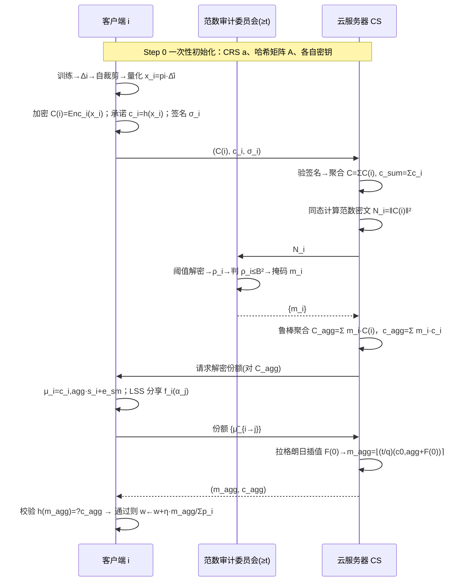
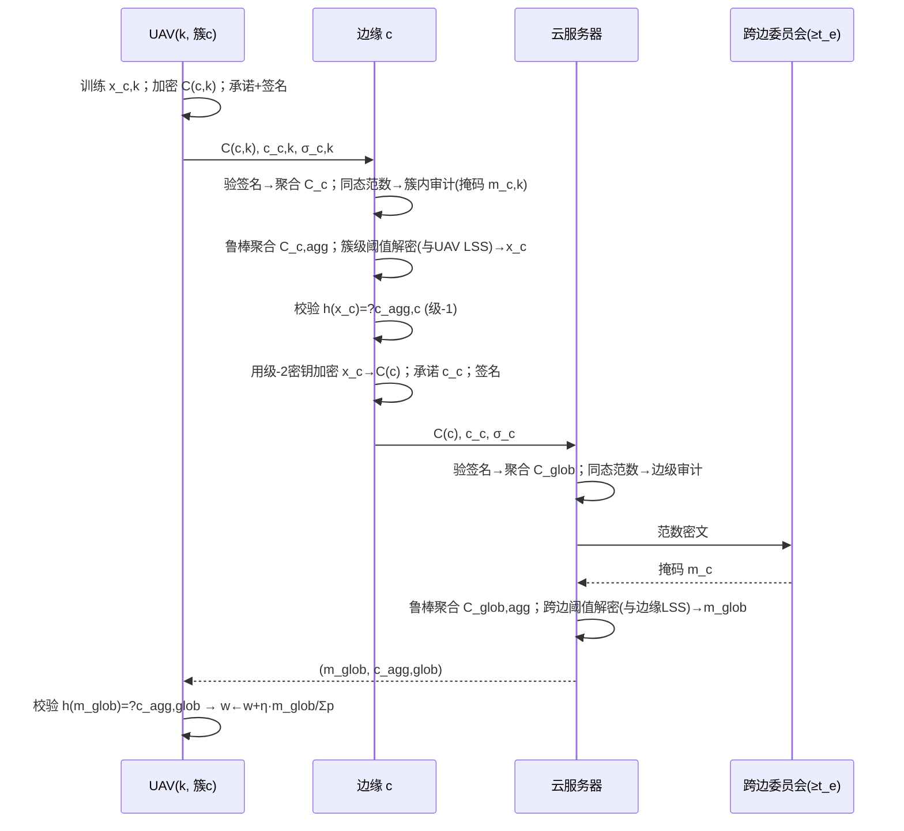
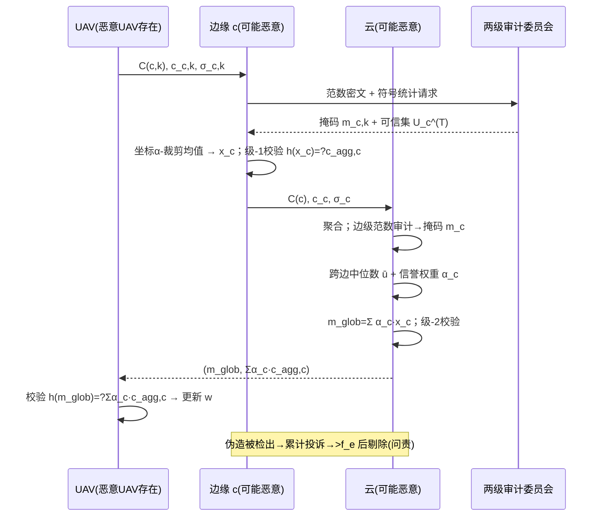
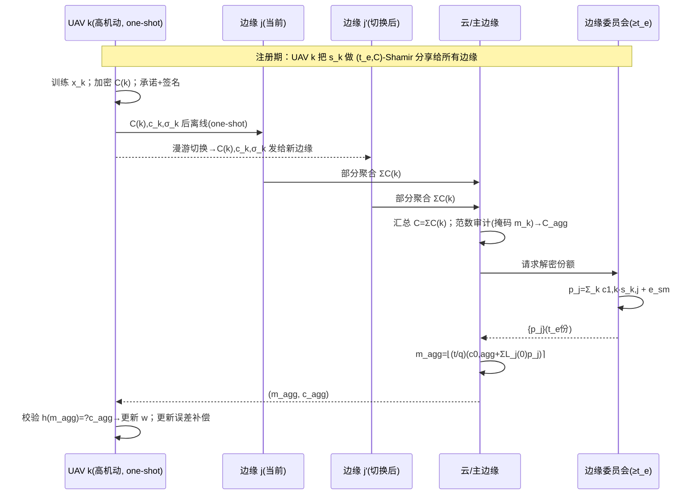

# 同态加密 × 联邦学习（UAV 场景）文献阅读报告与五个新方案设计

> **报告对象**：本目录下 21 篇 PDF（19 篇英文论文 + 2 篇中文基础材料）
> **主题**：全同态/多密钥同态加密（HE/MKHE）与联邦学习（FL）交叉领域，重点面向无人机（UAV）/边缘辅助场景
> **产出**：① 模式总结与演进谱系；② 5 个新方案（2 个标准 FL 架构 + 3 个层次型 FL 架构），每个方案围绕【威胁模型】展开，含闭环公式推导、时序图与安全性分析

---

## 目录

- **第 1 章** 引言与范围
- **第 2 章** UAV 场景下联邦学习的挑战与研究点
- **第 3 章** 文献综述、模式总结与演进谱系
- **第 4 章** 预备知识（统一符号系统与密码学原语）
- **第 5 章** 五个新方案
  - 5.1 方案一（标准 FL）：VCDKS-LSS —— 可验证 + 拜占庭鲁棒的阈值多密钥 CKKS 联邦学习
  - 5.2 方案二（标准 FL）：TwinSHE-FL —— 双服务器分布式门限 RLWE 联邦学习
  - 5.3 方案三（层次 FL）：H-THEFL —— UAV 蜂群两级阈值多密钥同态联邦学习
  - 5.4 方案四（层次 FL）：ByR-HFL —— 抗恶意边缘与投毒的拜占庭鲁棒可验证层次联邦学习
  - 5.5 方案五（层次 FL）：Roam-MKHE-FL —— 移动切换感知的跨边阈值多密钥同态联邦学习
- **第 6 章** 方案横向对比与结论
- **附录** 符号速查表与 21 篇论文卡片速览

---

## 第 1 章 引言与范围

本目录收集的论文横跨 **安全聚合（Secure Aggregation）**、**单/多密钥同态加密（SKHE/MKHE）**、**阈值解密（threshold decryption）**、**可验证联邦学习（verifiable FL）** 与 **拜占庭鲁棒联邦学习（Byzantine-robust FL）** 五大主题，时间跨度 2017–2026。它们可以被组织为一条清晰的技术主线：

> **把「单个解密/解掩码动作」拆解为「可聚合、可阈值、可验证的份额」**。

本文先系统梳理这些论文在 **架构（标准 vs 层次）**、**密钥（单/多/阈值）**、**信任（有无可信机构）**、**威胁模型（半诚实/恶意/合谋/掉线）**、**功能（验证/鲁棒/外包/稀疏化）** 五个维度上的模式；然后在此基础上，**围绕明确的威胁模型**设计 5 个新方案，每个方案都力求在某一个维度上超越本目录中的最新研究，并给出可落地的实体交互闭环公式推导、时序图与安全性证明。

**说明**：目录中文件 `25-PrvFL.pdf` 对应论文实际名为 **PrivHFL**（Computer Networks 2025），下文均以 PrivHFL 指代。

---

## 第 2 章 UAV 场景下联邦学习的挑战与研究点

在 UAV 辅助（UAV-assisted）与边缘辅助（edge-assisted）联邦学习中，参与实体通常是**移动无人机、边缘基站/边缘服务器（RSU/微基站/宏基站）、云服务器**，有时还有**可信机构（TA/KGC/KDC）**。UAV 场景独有的挑战可以归纳为以下 8 类，这些正是本目录论文与本文 5 个新方案的**研究点来源**：

1. **高移动性与链路不稳定（掉线/切换）**。UAV 可能飞出边缘覆盖区、电量耗尽、被干扰，导致客户端随时掉线或在不同边缘服务器间**漫游切换（handover）**。任何要求「全员在线才能解密」的方案（如 xMK-CKKS 聚合公钥、标准 MKHE 全员部分解密）都会失败，需要**阈值门限（t-of-N）**、**补位密文**或**重加密迁移**机制。→ 对应 SecFed、CDKS-LSS、FedOut、PrivHFL、VLSFL、PPBR。

2. **带宽受限与通信瓶颈**。UAV 上行链路稀缺，密文膨胀（HE 通常膨胀 50×–150×）会压垮链路。研究点：**打包/切片（packing/slicing）**、**稀疏化/剪枝（top-k、幅度剪枝、加密稀疏化）**、**两级聚合减少回程流量**。→ 对应 MASER、MaskCrypt、Ftopk、ResFed、ESAFL。

3. **算力/能量受限（机载算力弱）**。UAV 难以承担昂贵的 RLWE 加密与解密。研究点：**外包加密（外包代理）**、**选择性加密（只加密少量权重）**、**加法同态（零乘法深度）**、**明文吸收学习率/权重**。→ 对应 FedOut、MaskCrypt、ESAFL、MASER。

4. **客户端互不信任（单密钥悖论）**。若所有 UAV 共享同一把密钥，一个半诚实/恶意 UAV 可解密他人密文。研究点：**多密钥 HE（MKHE）**或**单密钥 + 秘密共享混淆**。→ 对应 CDKS、SecFed、MASER、FedPHE、SKHE、PrivHFL。

5. **解密份额泄露（多密钥的代价）**。MKHE 要求每个客户端上传「部分解密值」，若直接上传则泄露个体明文甚至私钥。研究点：**阈值秘密共享解密（LSS）**、**和式解密密钥 s=Σsᵢ 单步解密**、**双服务器门限**。→ 对应 CDKS-LSS、ESAFL、PrivHFL、SecFed、FedOut。

6. **无可信基础设施（去 TTP）**。UAV 集群往往无法假设存在可信机构（TA）或可信硬件（TEE）。研究点：**去中心密钥生成、CRS 模型、Pedersen VSS、秘密共享重构**。→ 对应 CDKS、CDKS-LSS、SecAgg、VeSAFL、MaskCrypt。

7. **拜占庭/投毒威胁（恶意 UAV 或恶意边缘）**。部分 UAV 被劫持后会**放大梯度（boosted gradient）**、**符号翻转（sign flipping）**、**合谋投毒**；边缘服务器也可能伪造聚合。研究点：**ℓ₂/范数裁剪防御**、**符号统计聚类**、**安全中位数/曼哈顿距离**、**鲁棒聚合**。→ 对应 ELSA、PPBR、ProFL、VeSAFL。

8. **验证与问责（服务器算错/伪造）**。恶意服务器可能篡改聚合结果、选择性丢弃诚实客户端。研究点：**同态哈希验证**、**签名 + 承诺（Pedersen/BLS）**、**投诉问责**。→ 对应 VLSFL、BPVFL、VeSAFL、Ftopk、SKHE。

**本文 5 个新方案的总体定位**（先给出结论，第 5 章展开）：

| 方案 | 架构 | 核心密钥机制 | 主要解决的缺口 |
|---|---|---|---|
| 方案一 VCDKS-LSS | 标准 FL（单云） | 多密钥 MK-CKKS + 阈值 LSS | CDKS-LSS 缺「验证 + 投毒鲁棒」，补齐后成为**单服务器 + 多密钥 + 阈值 + 可验证 + 鲁棒**的完整解 |
| 方案二 TwinSHE-FL | 标准 FL（双服务器） | 加性密钥分割 (2,2) + 客户端本地解密 | 消除单服务器信任与客户端在线要求，同时做到**验证 + 投毒鲁棒 + 掉线容忍** |
| 方案三 H-THEFL | 层次 FL（UAV→Edge→Cloud） | 两级阈值多密钥 | 把 CDKS-LSS 的阈值解密**两级化**，适配 UAV 蜂群带宽与掉线 |
| 方案四 ByR-HFL | 层次 FL | 两级阈值多密钥 + 双层鲁棒聚合 | 层次 FL 中**恶意边缘 + 合谋投毒**仍无完整防御，本方案补齐 |
| 方案五 Roam-MKHE-FL | 层次 FL | 跨边阈值 + 漫游重加密 | UAV **跨边切换 + 异步/掉队**场景下密钥连续性，去 TTP |

---

## 第 3 章 文献综述、模式总结与演进谱系

### 3.1 架构维度：标准 FL（单服务器 / 双服务器）与层次型 FL

| 类别 | 论文 | 实体构成 |
|---|---|---|
| 标准 FL · 单服务器 | SecAgg、CDKS-LSS、MASER、MaskCrypt、FedPHE、VLSFL、Ftopk(DSVFL) | 客户端 + 1 聚合服务器（+ 可选 TA/KDC） |
| 标准 FL · 双服务器 | ELSA（S₀/S₁ 不共谋）、BPVFL（S₀ 聚合 + S₁ 验证）、ProFL（AGG + SP）、FedOut（AS + Proxy CS） | 客户端 + 2 个不共谋服务器 |
| 层次型 FL（边缘） | PrivHFL、SKHE、PPBR | 客户端（UAV/设备）→ 边缘服务器 → 云服务器 |
| 其他（多聚合器/扁平） | VeSAFL | m 边缘节点 + n 聚合服务器 + 公告板 |

**观察**：双服务器方案几乎都依赖于「两个服务器不共谋」这一信任假设（ELSA 为隐私而设；BPVFL/ProFL 为验证/鲁棒而设）；层次型方案（PrivHFL、SKHE、PPBR）则把「单点解密」拆成「边级 + 云级」两级，以换取带宽与掉线鲁棒。

### 3.2 密钥维度：单密钥 / 多密钥 / 阈值 / 秘密共享

| 密钥方案 | 论文 | 特点 |
|---|---|---|
| 单密钥 SKHE | ESAFL(变体)、FedPHE、SKHE、BPVFL、ProFL、Ftopk | 共享一把密钥；靠混淆/TEE/秘密共享补偿「客户端互信」缺陷 |
| 多密钥 MKHE | CDKS(奠基)、SecFed(EMK-BFV)、MASER、MaskCrypt | 各客户端独立密钥；解密需分布式部分解密 |
| 多密钥 + 阈值 LSS | CDKS-LSS、PrivHFL(tMK-CKKS 2-of-3) | Shamir LSS 嵌入解密；t-of-N 抗掉线 + 信息论安全 |
| 和式解密密钥 s=Σsᵢ | ESAFL、FedOut | 单步、无交互解密；但需全员在线 |
| 掩码/秘密共享（非 HE） | SecAgg、ELSA、VLSFL、VeSAFL | DH+Shamir 掩码 / 布尔+算术共享 / Pedersen VSS |
| 可信机构（TA/KGC/KDC） | SKHE、FedPHE、Ftopk、VLSFL、SecFed、FedOut、PrivHFL、MASER(密钥管理器) | 初始化分发密钥 |
| 无可信机构 | SecAgg、CDKS、CDKS-LSS、ELSA、MaskCrypt、VeSAFL、ESAFL(可选) | CRS/去中心生成 |

### 3.3 信任维度与威胁模型维度

| 威胁模型 | 论文 | 关键假设 |
|---|---|---|
| 半诚实（honest-but-curious） | CDKS、CDKS-LSS、ESAFL、MASER(服务器 HBC)、FedPHE、SKHE、PrivHFL、FedOut、SecFed | 遵守协议但好奇推断 |
| 恶意服务器（可伪造聚合） | ELSA(一个服务器恶意)、VLSFL、Ftopk、BPVFL、VeSAFL(主动) | 服务器可篡改/伪造，需验证 |
| 恶意/拜占庭客户端（投毒） | ELSA、PPBR、ProFL、VeSAFL(语法合法但语义恶意)、MASER(mask 投毒) | 客户端发异常/放大梯度 |
| 合谋 | CDKS-LSS(<t)、ELSA(≤1 恶意服务器)、SecFed(N−1 用户)、ESAFL(N−2 客户端)、ProFL(<50%) | 合谋不破坏隐私/正确性 |
| 掉线容忍 | SecAgg、SecFed(N−2)、VLSFL、Ftopk(τ)、CDKS-LSS(t)、PrivHFL(2-of-3)、PPBR、FedOut | 掉线后仍可聚合/解密 |

### 3.4 功能维度：验证 / 鲁棒聚合 / 外包 / 稀疏化

| 功能 | 论文 |
|---|---|
| 密码学验证（同态哈希/配对/ZKP/BLS） | VLSFL（同态哈希+配对）、BPVFL（LHH+TP-ZKP）、VeSAFL（Pedersen+BLS）、Ftopk（秘密共享签名）、SKHE（哈希矩阵） |
| 拜占庭鲁棒/投毒防御 | ELSA（ℓ₂ 防御）、PPBR（符号聚类+范数裁剪）、ProFL（安全中位数+曼哈顿距离）、MASER（共识剪枝） |
| 外包加密 | FedOut（Proxy CS） |
| 稀疏化/剪枝/压缩 | MASER、MaskCrypt、Ftopk、ResFed |

**关键空白（本文方案针对的点）**：上述论文中**没有任何单一方案同时覆盖「单步/无交互解密 + 恶意安全验证 + 投毒鲁棒 + 掉线容忍」**，且**层次型 FL 中「恶意边缘 + 合谋投毒 + 密码学验证」三者并存的方案缺失**。这正是本文 5 个方案的设计动机。

### 3.5 技术演进谱系（循序渐进推理）

**主线 A ——「解密份额」的进化（用户举的例子的完整展开）**：

1. **CDKS（MK-CKKS，CCS 2019）**：多密钥同态，各客户端独立密钥，服务器同态聚合后需要每个客户端上传「部分解密值」μᵢ = cᵢ·sᵢ + eᵢ。**问题**：直接上传 μᵢ 时，因为 cᵢ 公开、c_{i,0} + μᵢ ≈ mᵢ，半诚实服务器（或合谋客户端）可恢复个体明文甚至私钥 sᵢ。
2. **xMK-CKKS（Ma et al.）**：改用「聚合公钥 pk = Σ pkᵢ」加密，解密时只需聚合密钥。**解决**了解密份额明文泄露，但**新问题**：聚合公钥依赖全部参与者，**任意一个客户端掉线即整体无法解密**。
3. **CDKS-LSS（Information Sciences 2026）**：把 Shamir 线性秘密共享（LSS）嵌入 CDKS 解密流程——每个客户端把 μᵢ 用 t−1 次多项式分享出去，服务器只收到「聚合份额」μ̃ⱼ = F(αⱼ)，阈值重构只泄露 Σμⱼ 而非个体 μᵢ。**同时解决**了「泄露 + 掉线」，并把解密阶段从计算安全升级为信息论安全，且**去 TTP**。**新问题**：仍是半诚实模型，**无验证（服务器可伪造聚合结果）**、**无投毒防御**、且每客户端每轮通信开销 O(N)。
4. **ESAFL（TDSC 2025）**：干脆把解密密钥设为和式 s = Σsᵢ 并整体分发给每个客户端，实现**单步、无交互、无部分解密份额传输**的本地解密，聚合结果对服务器/窃听者保密。**直接避免了份额分发**。**新问题**：半诚实、必须聚合全部 N 个客户端（**不支持掉线**）。

**主线 B ——「信任重构」的进化**：

5. **SecAgg（CCS 2017）**：双重掩码 + Shamir 阈值，把「解掩码」拆成份额，确立「份额 + 阈值」范式。
6. **ELSA（S&P 2023）**：把信任从「单服务器持钥」重构为「双服务器秘密共享 + 客户端供给可验证相关性」，容忍**一个恶意服务器**并引入 **ℓ₂ 投毒防御**；但仅「恶意隐私」而非完整恶意安全。

**主线 C ——「验证 + 鲁棒」的进化**：

7. **VLSFL（TDSC 2026）**：同态哈希 + 双线性配对，客户端常数次配对即可验证服务器聚合正确性，但**无投毒防御**。
8. **PPBR（TMC 2026）**：CLDP + PLHE + 双层过滤（符号统计聚类 + 范数裁剪），层次 FL 中**拜占庭鲁棒**，但**无密码学验证**。
9. **VeSAFL（TDSC 2025）**：Pedersen VSS + BLS，本地与全局更新**均可验证** + 阈值问责，但**不解决语义级投毒**。
10. **ProFL（Information Fusion 2025）**：安全中位数 + 曼哈顿距离 + 反距离加权，**<50% 拜占庭鲁棒**，但统计鲁棒而非密码验证。

**结论（本文方案的设计立足点）**：主线 A、B、C 分别解决了「解密份额」「信任」「验证/鲁棒」中的一至两个点，但**没有任何方案把它们整合**。本文 5 个方案正是沿着这三条主线做**结构上更优的整合与补全**（详见第 5 章每方案「解决的问题 + 创新点」）。

### 3.6 21 篇论文卡片速览

> 完整卡片见附录 A。下表为压缩版。

| # | 论文（年份） | 架构 | 密钥 | 威胁模型 | 验证 | 鲁棒 | 掉线 |
|---|---|---|---|---|---|---|---|
| 1 | SecAgg (CCS'17) | 单服务器 | DH+Shamir 掩码 | 半诚实/主动 | ✗ | ✗ | ✓ |
| 2 | CDKS (CCS'19) | 非 FL | 多密钥 CKKS/BFV | 半诚实 | ✗ | ✗ | ✗ |
| 3 | ELSA (S&P'23) | 双服务器 | 秘密共享 | 恶意(≤1服务器) | ✓(相关) | ℓ₂ | ✓ |
| 4 | BPVFL (GLOBECOM'24) | 双服务器 | 单密钥 Paillier | 恶意服务器 | ✓LHH+ZKP | ✗ | ✓N−1 |
| 5 | ResFed (IoT-J'24) | 单服务器 | 无 | — | ✗ | ✗ | — |
| 6 | SecFed (TDSC'24) | 单服务器 | 多密钥 BFV+TEE | 半诚实 | ✗ | ✗ | ✓N−2 |
| 7 | ESAFL (TDSC'25) | 单服务器 | 和式密钥 ESHE | 半诚实 | ✗ | ✗ | ✗ |
| 8 | FedPHE (TDSC'25) | 单服务器 | 单密钥 CKKS+SS | 半诚实 | ✗ | 贡献加权 | ✗ |
| 9 | MASER (arXiv'25) | 单服务器 | 多密钥 MK-CKKS | HBC 服务器+恶意客户端 | ✗ | 共识剪枝 | ✗ |
| 10 | MaskCrypt (TDSC'25) | 单服务器 | 多密钥+选择性 | 半诚实 | ✗ | ✗ | ✗ |
| 11 | ProFL (Inf.Fusion'25) | 双服务器 | 单密钥 LHE | 恶意(<50%) | ✗ | ✓中位数 | — |
| 12 | PrivHFL (CN'25) | 层次 | tMK-CKKS 2-of-3 | 半诚实 | 边级验证 | ✗ | ✓ |
| 13 | SKHE (IoT-J'25) | 层次 | 单密钥 CKKS+ECC+TEE | 半诚实 | ✓哈希矩阵 | ✗ | ✓ |
| 14 | VeSAFL (TDSC'25) | 多聚合器 | Pedersen VSS+BLS | 主动/恶意 | ✓✓ | 阈值问责 | ✓ |
| 15 | CDKS-LSS (Inf.Sci'26) | 单服务器 | 多密钥+LSS | 半诚实 | ✗ | ✗ | ✓t |
| 16 | FedOut (AEI'26) | 双服务器 | 多密钥+外包 | 半诚实 | ✗ | ✗ | ✓补位 |
| 17 | Ftopk/DSVFL (TMC'26) | 单服务器 | 阈值 Paillier+SS | 恶意服务器 | ✓SS 签名 | ✗ | ✓τ |
| 18 | PPBR (TMC'26) | 层次 | CLDP+PLHE+SA | 拜占庭 | ✗ | ✓✓ | ✓ |
| 19 | VLSFL (TDSC'26) | 单服务器 | 双掩码+SS | 恶意服务器 | ✓✓ | ✗ | ✓ |

---

## 第 4 章 预备知识（统一符号系统与密码学原语）

### 4.1 环与分布

- 分圆环 $R = \mathbb{Z}[X]/(X^N+1)$，$N$ 为 2 的幂；$R_q = R/qR$。
- 秘密分布 $\chi_{\text{key}}$（三元分布，系数 ∈ {−1,0,1}）；误差分布 $\chi_{\text{err}}$（标准差 $\sigma$ 的离散高斯）；均匀分布 $U(R_q)$；smudging 分布 $\chi_{\text{sm}}$（标准差 $\sigma_{\text{sm}} \gg \sigma$）。
- 中心代表 $[\cdot]_q$：取模 q 到区间 $[-q/2, q/2)$。

### 4.2 RLWE / CKKS（单密钥，方案通式）

**KeyGen(1^λ)**：采样 $s \leftarrow \chi_{\text{key}}$，$a \leftarrow U(R_q)$，$e \leftarrow \chi_{\text{err}}$，令 $b = -a\cdot s + e \pmod q$。输出 $sk = s$，$pk = (b, a)$。

**编码/解码（CKKS）**：消息向量 $\mathbf{z}\in\mathbb{C}^{N/2}$ 经规范嵌入 $\sigma:R\to\mathbb{C}^N$ 编码为 $m = \mathsf{Ecd}(\mathbf{z};\Delta) = \lfloor \Delta\cdot\sigma^{-1}(\mathbf{z})\rceil \in R$（$\Delta$ 为缩放因子）；解码 $\mathbf{z}=\mathsf{Dcd}(m;\Delta)=\sigma(m)/\Delta$。

**Enc(pk, m)**：采样 $v\leftarrow\chi_{\text{key}}$，$e_0,e_1\leftarrow\chi_{\text{err}}$，输出密文
$$ct = (c_0, c_1) = \big(v\cdot b + e_0 + m,\ v\cdot a + e_1\big) \pmod q .$$

**Dec(sk, ct)**：计算相位 $\varphi_s(ct) = c_0 + c_1\cdot s = m + (v\cdot e + e_0 + e_1\cdot s)$，其中误差项 $\|v\cdot e + e_0 + e_1 s\| \ll \Delta$，故 $m \approx \varphi_s(ct) \pmod q$，再 $\mathbf{z} = \mathsf{Dcd}(m)$。

**同态加法**：$ct \oplus ct' = (c_0+c_0',\ c_1+c_1')$，满足 $\mathsf{Dec}(ct\oplus ct') = m + m' + \text{noise}$。**（本文方案只用到加法与明文数乘，即零乘法深度，无需 relinearization/rescale。）**

### 4.3 MK-CKKS（CDKS，多密钥加法变体）

**Setup(1^λ)**：公开公共随机串 $a \leftarrow U(R_q)$（CRS 模型）。

**KeyGen_i**：$s_i \leftarrow \chi_{\text{key}}$，$e_i \leftarrow \chi_{\text{err}}$，$pk_i = b_i = -a\cdot s_i + e_i \pmod q$；$sk_i = s_i$。

**Enc_i(m)**：$v\leftarrow\chi_{\text{key}}$，$e_0,e_1\leftarrow\chi_{\text{err}}$，$ct_i = (c_0, c_1) = (v\cdot b_i + e_0 + m,\ v\cdot a + e_1)$，这是在密钥 $(1, s_i)$ 下的密文。

**扩展到 N 方联合密钥**：将 $ct_i$ 提升为 $N+1$ 维密文 $C^{(i)} = (c_0,\ 0,\dots,0,\ \underbrace{c_1}_{\text{第 } i \text{ 位}},\ 0,\dots,0)\in R_q^{N+1}$，联合密钥 $\bar s = (1, s_1,\dots,s_N)$。相位
$$\varphi_{\bar s}(C^{(i)}) = c_0 + c_1\cdot s_i = m + \text{noise} .$$

**同态聚合**：$C = \sum_{i=1}^{N} C^{(i)} = (c_0^{\Sigma},\ c_1,\dots,c_N)$，其中 $c_0^{\Sigma}=\sum_i c_0^{(i)}$，$c_i = c_1^{(i)}$。相位
$$\varphi_{\bar s}(C) = c_0^{\Sigma} + \sum_{i=1}^{N} c_i\cdot s_i = \sum_{i=1}^{N} m_i + \text{noise} .$$

### 4.4 CDKS-LSS 阈值解密（Shamir LSS over R_q）

对聚合密文 $C=(c_0^{\Sigma}, c_1,\dots,c_N)$：

1. **部分解密**：各方 $P_i$ 计算 $\mu_i = c_i\cdot s_i + e_{\text{sm},i}$，$e_{\text{sm},i}\leftarrow\chi_{\text{sm}}$（smudging 噪声掩盖 $s_i$）。
2. **份额分享**：$P_i$ 采样 $t-1$ 次多项式 $f_i(X) = \mu_i + a_{i,1}X + \dots + a_{i,t-1}X^{t-1}$（$a_{i,j}\leftarrow U(R_q)$），把份额 $\tilde\mu_{i\to j} = f_i(\alpha_j)$ 发给 $P_j$（$\alpha_j$ 为公开互异估值点，$j=1..N$）。
3. **份额聚合**：$P_j$ 求和 $\tilde\mu_j = \sum_{i=1}^{N} \tilde\mu_{i\to j} = \sum_i f_i(\alpha_j) = F(\alpha_j)$，其中 $F(X)=\sum_i f_i(X)$，常数项 $F(0)=\sum_i \mu_i$。
4. **阈值重构**：服务器收集任意 $t$ 份 $\{\tilde\mu_j\}_{j\in S}$（$|S|=t$），拉格朗日插值
$$F(0) = \sum_{j\in S} L_j(0)\,\tilde\mu_j,\qquad L_j(0) = \prod_{l\in S,\,l\neq j}\frac{-\alpha_l}{\alpha_j - \alpha_l} .$$
5. **最终解密**：$m_{\text{agg}} \approx c_0^{\Sigma} + F(0) \pmod q$，其中 $c_0^{\Sigma}+F(0) = \sum_i m_i + \sum_i e_{\text{sm},i} + \text{noise}$。

**性质**：任意 $<t$ 份份额不泄露任何 $\mu_i$（信息论安全）；$t$ 份即可重构（掉线容忍 $N-t$）。

### 4.5 SIS 同态哈希（可验证聚合的核心原语）

取公开矩阵 $A \in \mathbb{Z}_q^{\ell\times d}$（$\ell<d$）。对**量化到有界域** $\{-B,\dots,B\}^d$ 的向量 $\mathbf{x}$，定义
$$h(\mathbf{x}) = A\,\mathbf{x} \bmod q \in \mathbb{Z}_q^{\ell} .$$
同态性：$h(\mathbf{x}+\mathbf{y}) = h(\mathbf{x}) + h(\mathbf{y})$（$\mathbb{Z}_q$ 上）。**碰撞抵抗**：在 $\mathsf{SIS}_{q,\ell,\beta}$ 假设下，任何 PPT 对手找不到 $\mathbf{x}\neq\mathbf{x}'$ 且 $\|\mathbf{x}\|,\|\mathbf{x}'\| \le \beta$ 使 $A(\mathbf{x}-\mathbf{x}')=0$。该原语用于：客户端承诺 $c_k = h(\Delta_k)$，服务器聚合后客户端校验 $h(\Delta_{\text{agg}}) = \sum_k c_k$，从而**检测恶意服务器篡改聚合结果**。

### 4.6 数字签名（认证原语）

$\mathsf{SIG}=(\mathsf{KGen},\mathsf{Sign},\mathsf{Vrfy})$，EUF-CMA 安全，可实例化为格基 **Dilithium/ML-DSA**（后量子）。用于对上传的密文 + 承诺签名，防止**外部注入 / 伪造身份**。

### 4.7 鲁棒聚合（范数审计 + 裁剪，本文通用子协议）

防御「放大梯度（boosted gradient）」型投毒的核心是 **ℓ₂ 范数审计与裁剪**（对应 ELSA 的 ℓ₂ 防御、PPBR 的范数裁剪）：

- **同态范数计算**：对更新密文 $C_k$，服务器（或边缘）利用 CKKS 同态乘法与槽求和（需一次旋转/求和，深度 ≤2）计算 $\mathsf{Enc}(\|\Delta_k\|_2^2)$，记为 $N_k$。
- **阈值审计**：一个**非合谋的阈值委员会**（≥t 方）阈值解密 $N_k$ 得到标量 $\|\Delta_k\|_2^2$，检查是否 $\le B^2$（$B$ 为公开裁剪界），输出二元掩码 $m_k\in\{0,1\}$（不泄露更新向量本身）。
- **裁剪聚合**：服务器计算 $C_{\text{agg}} = \sum_k m_k\, C_k$，等价于丢弃越界更新。
- **隐私注记**：审计只泄露每个客户端的**范数标量**（远弱于整条梯度；必要时可加 DP 噪声或只返回掩码 $m_k$）。这是「鲁棒聚合需要非线性判定」与「HE 只能线性运算」之间矛盾的**结构化折中**，本文各方案在此折中上保持一致且显式声明。

---

---

## 第 5 章 五个新方案

> 每个方案统一按 **5.1 场景 → 5.2 问题 → 5.3 创新点 → 5.4 威胁模型 → 5.5 符号系统 → 5.6 方案设计与闭环推导 → 5.7 时序图 → 5.8 安全性分析** 组织。
> 为便于对照，方案间共享第 4 章的原语与符号；各方案内部再定义增量符号。

---

## 5.1 方案一（标准 FL）：VCDKS-LSS —— 可验证 + 拜占庭鲁棒的阈值多密钥同态联邦学习

### 5.1.1 场景

$N$ 个互不信任的组织（如医院、银行、车企研发部门）通过一个**不可信的云聚合服务器 CS** 协同训练一个模型（跨机构 cross-silo FL）。系统**没有可信机构（无 TA/TTP）**，且要求**后量子安全**（基于 RLWE/SIS 的格密码）。典型任务：多家医院在不共享病历的前提下联合训练诊断模型，且要求能审计服务器是否诚实。

### 5.1.2 要解决的问题

本目录中 **CDKS-LSS**（Information Sciences 2026）已经实现了「多密钥 MK-CKKS + 阈值 LSS 解密 + 去 TTP + 抗掉线」，但它仍遗留三个问题：

1. **无验证**：CDKS-LSS 是半诚实模型，服务器（或合谋的少数客户端）可以**返回一个伪造的聚合结果**，客户端无法检测——「算错了没人知道」。
2. **无投毒鲁棒**：恶意客户端可提交**放大梯度（boosted gradient）** 或符号翻转更新，毒化全局模型；CDKS-LSS 没有范数审计或鲁棒聚合。
3. **解密份额无一致性校验**：恶意客户端可发送**错误的 LSS 份额**（或不一致的份额），使重构结果被单方污染。

本方案（**VCDKS-LSS**，Verifiable & Byzantine-Robust threshold Multi-Key CKKS FL）的目标：在**保持 CDKS-LSS 的多密钥 + 阈值 + 去 TTP + 抗掉线**的前提下，**新增（a）同态哈希可验证聚合、（b）格签名认证、（c）范数审计鲁棒聚合、（d）份额一致性校验**，把安全模型从「半诚实」升级到「恶意服务器 + 拜占庭客户端」可检测/可抵御。

### 5.1.3 创新点 / 总体设计目标

1. **验证-隐私的精确对齐**：更新量用 **BFV 整数编码**（精确解密），使「密文聚合」与「同态哈希聚合」两条线性结构严格一致，客户端可用一次哈希校验服务器的聚合结果（CDKS-LSS 用的是 CKKS 近似编码，无法直接做精确哈希校验）。
2. **签名 + 同态哈希双保险**：签名保证「上传者身份真实、消息未被外部注入」；同态哈希保证「服务器聚合结果等于各上传之和」。
3. **范数审计鲁棒聚合**：由**非合谋阈值委员会**同态计算并审计每个更新的 ℓ₂ 范数，越界者被掩码剔除，实现 ELSA 式 ℓ₂ 防御但全程不泄露更新向量。
4. **Feldman 式份额承诺**：对 LSS 份额加同态承诺，检测恶意客户端发送的不一致份额。

### 5.1.4 威胁模型

- **恶意云服务器 CS**：可任意偏离协议——篡改聚合密文、伪造解密结果、选择性丢弃诚实客户端、与少数客户端合谋；但**不能攻破 RLWE/SIS**（即不能从密文/哈希恢复明文或伪造碰撞）。
- **恶意/拜占庭客户端**：至多 $f < t-1$ 个客户端可合谋且行为任意（发放大梯度、伪造签名、发错误份额）；合谋者**不足以**破坏阈值隐私（$<t$）。
- **半诚实且非合谋的范数审计委员会**：委员会成员诚实执行但好奇；其规模 $\ge t$，成员间不共谋（不超过 $t-1$ 个合谋）。
- **网络对手**：可窃听、重放、注入消息（由签名 + IND-CPA 抵御）。
- **掉线**：任意客户端可掉线；只要 $\ge t$ 个客户端在线即可完成解密（阈值容忍）。
- **保护目标**：诚实客户端的本地更新对 CS 与任何 $<t$ 方合谋保持机密（计算安全 = RLWE + 信息论安全 = LSS）；聚合结果可公开但**必须可验证正确**。

### 5.1.5 符号系统

| 符号 | 含义 |
|---|---|
| $N$, $t$ | 客户端总数、解密阈值（$t\le N$） |
| $w^t$ | 第 $t$ 轮全局模型 |
| $\Delta_i$ | 客户端 $i$ 的本地更新 $\Delta_i = w_i - w^t$（FedAvg 增量） |
| $\tilde\Delta_i$ | 自裁剪更新 $\tilde\Delta_i = \Delta_i\cdot\min(1, B/\|\Delta_i\|_2)$ |
| $\hat\Delta_i\in\{-B,\dots,B\}^d$ | 量化后的整数更新（$d$ = 模型维数，逐坐标 |·|≤B） |
| $p_i$ | 客户端 $i$ 聚合权重（如样本占比 $p_i=n_i/\sum n_j$），明文态吸收进更新 |
| $s_i, b_i$ | 客户端 $i$ 私钥、公钥（MK-CKKS） |
| $C^{(i)}$ | 更新 $\hat\Delta_i$ 提升到 $N+1$ 维的多密钥密文 |
| $c_i = h(\hat\Delta_i)$ | 客户端 $i$ 的 SIS 同态哈希承诺 |
| $\rho_i = \|\hat\Delta_i\|_2^2$ | 更新范数平方 |
| $m_i\in\{0,1\}$ | 范数审计产生的接收掩码 |
| $A\in\mathbb{Z}_q^{\ell\times d}$ | 公开 SIS 哈希矩阵 |
| $\sigma_i$ | 客户端 $i$ 的签名（Dilithium） |
| $\alpha_j$, $L_j(0)$ | Shamir 估值点、拉格朗日基系数 |

### 5.1.6 方案设计与闭环公式推导

**Step 0（一次性初始化）**：公开 CRS $a\leftarrow U(R_q)$ 与哈希矩阵 $A$。每个客户端 $i$ 生成 MK-CKKS 密钥 $(s_i, b_i=-a\,s_i+e_i)$、签名密钥对 $(\mathsf{sk}_i^{\text{sig}},\mathsf{vk}_i^{\text{sig}})$，广播 $b_i,\mathsf{vk}_i^{\text{sig}}$。

**Step 1（本地训练 + 预处理）**：客户端 $i$ 训练得 $w_i$，计算 $\Delta_i = w_i - w^t$，自裁剪 $\tilde\Delta_i = \Delta_i\min(1,B/\|\Delta_i\|_2)$，量化到 $\hat\Delta_i\in\{-B,\dots,B\}^d$，并**在明文态吸收权重** $x_i = p_i\cdot\hat\Delta_i$（系数为整数，必要时整体放大取整）。随后用 BFV 整数编码嵌入：
$$\mu_i = \left\lfloor\frac{q}{t_{\text{BFV}}}\cdot x_i\right\rceil \in R_q .$$

**Step 2（加密 + 承诺 + 签名）**：采样 $v\leftarrow\chi_{\text{key}},\ e_0,e_1\leftarrow\chi_{\text{err}}$，加密
$$ct_i = (c_0^{(i)},\,c_1^{(i)}) = \big(v\cdot b_i + e_0 + \mu_i,\ v\cdot a + e_1\big) \pmod q ,$$
并提升到 $N+1$ 维：$C^{(i)} = (c_0^{(i)}, 0,\dots,0, \underbrace{c_1^{(i)}}_{\text{第 }i\text{ 位}},0,\dots,0)$。同时计算承诺与签名：
$$c_i = h(x_i) = A\,x_i \bmod q,\qquad \sigma_i = \mathsf{Sign}_{\mathsf{sk}_i^{\text{sig}}}\!\big(C^{(i)},\,c_i,\,t\big) .$$
上传 $(C^{(i)}, c_i, \sigma_i)$ 给 CS。

**Step 3（认证 + 聚合 + 范数计算）**：CS 用 $\mathsf{vk}_i^{\text{sig}}$ 验证 $\sigma_i$，丢弃无效项。对通过认证者计算：
$$C = \sum_{i} C^{(i)} = \big(c_0^{\Sigma},\ c_1,\dots,c_N\big),\quad c_0^{\Sigma}=\sum_i c_0^{(i)},\ c_i=c_1^{(i)},$$
$$c_{\text{sum}} = \sum_i c_i \in \mathbb{Z}_q^{\ell}\quad(\text{哈希聚合}),$$
并利用 CKKS/BFV 同态乘与槽求和（使用客户端 $i$ 公开的旋转密钥 $\mathsf{rtk}_i$，深度 ≤2）对每个更新**同态计算范数平方密文** $N_i = \mathsf{Eval}\!\big(\|C^{(i)}\|_2^2\big) = \mathsf{Enc}_i(\rho_i)$。

**Step 4（范数审计）**：审计委员会（$\ge t$ 个客户端）对 $N_i$ 做阈值解密得到 $\rho_i$，检查 $\rho_i\le B^2$，输出公开掩码
$$m_i = \begin{cases}1, & \rho_i\le B^2\\ 0, & \text{否则}\end{cases}.$$
（委员会可只公布 $\{m_i\}$ 而不公布 $\rho_i$，或对 $\rho_i$ 加 DP 噪声后再公布，见 §4.7。）

**Step 5（鲁棒聚合）**：CS 计算掩码后的聚合密文与哈希：
$$C_{\text{agg}} = \sum_i m_i\, C^{(i)} = \big(c_{0,\text{agg}},\ c_{1,\text{agg}},\dots,c_{N,\text{agg}}\big),\qquad c_{i,\text{agg}} = m_i\, c_1^{(i)},$$
$$c_{\text{agg}} = \sum_i m_i\, c_i .$$

**Step 6（阈值解密，CDKS-LSS）**：对 $C_{\text{agg}}$ 解密。接受集 $A=\{i:m_i=1\}$ 中每个客户端 $i$ 计算部分解密（加 smudging 噪声）：
$$\mu_i = c_{i,\text{agg}}\cdot s_i + e_{\text{sm},i},\qquad e_{\text{sm},i}\leftarrow\chi_{\text{sm}},$$
并**分享**：采样 $f_i(X)=\mu_i+\sum_{k=1}^{t-1}a_{i,k}X^{k}$，把份额 $\tilde\mu_{i\to j}=f_i(\alpha_j)$ 发给 $P_j$（同时附上对份额的多项式承诺，见 Step 6'）。$P_j$ 汇总 $\tilde\mu_j=\sum_i f_i(\alpha_j)=F(\alpha_j)$。CS 收集任意 $t$ 份份额，拉格朗日插值：
$$F(0) = \sum_{j\in S} L_j(0)\,\tilde\mu_j,\qquad L_j(0)=\prod_{l\in S,l\neq j}\frac{-\alpha_l}{\alpha_j-\alpha_l},\quad |S|=t .$$
最终**精确解密**（BFV 舍入）：
$$m_{\text{agg}} = \left\lfloor\frac{t_{\text{BFV}}}{q}\cdot\big(c_{0,\text{agg}} + F(0)\big)\right\rceil = \sum_{i\in A} x_i = \sum_{i\in A} p_i\,\hat\Delta_i .$$
（$c_{0,\text{agg}}+F(0) = \sum_{i\in A}\mu_i + \sum_{i\in A}e_{\text{sm},i} + \sum_{i\in A}(v_i e_i+e_{0,i}+e_{1,i}s_i)$，当总噪声 $< q/(2t_{\text{BFV}})$ 时舍入精确恢复整数和。）

**Step 6'（份额一致性校验，Feldman 式）**：为检测恶意客户端发错误/不一致份额，客户端 $i$ 在分享 $f_i(X)$ 时额外公开对系数 $a_{i,k}$ 的同态承诺 $[\mathsf{Com}(a_{i,k})]$；$P_j$ 收到 $\tilde\mu_{i\to j}$ 后可校验其落在承诺的线性组合上（不泄露 $f_i$）。校验不通过则举报，CS 排除该客户端。

**Step 7（验证 + 更新）**：CS 广播 $(m_{\text{agg}}, c_{\text{agg}})$。每个客户端校验同态哈希：
$$h(m_{\text{agg}}) = A\,m_{\text{agg}} \overset{?}{=} c_{\text{agg}} = \sum_{i\in A} c_i \pmod q .$$
若相等，接受并更新
$$w^{t+1} = w^t + \eta \cdot \frac{m_{\text{agg}}}{\sum_{i\in A} p_i}\quad(\eta\ \text{为学习率}) ;$$
否则判定 CS 恶意，广播告警并中止本轮。

**闭环校验**：由 Step 6 的精确解密与 Step 3 的 $c_{\text{agg}}=\sum_{i\in A}A x_i$，有
$$h(m_{\text{agg}}) = A\Big(\sum_{i\in A}x_i\Big) = \sum_{i\in A}A x_i = c_{\text{agg}},$$
故诚实 CS 一定通过校验；若 CS 返回 $m_{\text{agg}}'\neq \sum_{i\in A}x_i$ 却通过校验，则 $h(m_{\text{agg}}')=h(\sum x_i)$ 构成 SIS 碰撞。

### 5.1.7 实体交互时序图



### 5.1.8 安全性分析（证明提纲）

**定理 1（隐私/机密性）**：若 RLWE 困难、LSS 信息论安全，则诚实客户端 $h$ 的更新 $x_h$ 对恶意 CS 与任何 $<t$ 个合谋客户端/委员会成员保持机密。

*证明思路*：分三层。(a) 密文 $C^{(h)}$ 在 MK-BFV 的 IND-CPA 下不可区分于均匀，CS 与合谋者（无 $s_h$）无法恢复 $x_h$。(b) 部分解密值 $\mu_h = c_{h,\text{agg}}s_h + e_{\text{sm},h}$ 被 smudging 噪声 $e_{\text{sm},h}$ 掩盖，统计上不泄露 $s_h$ 或 $x_h$（smudging 引理）。(c) $\mu_h$ 经 $t-1$ 次多项式 LSS 分享，任何 $<t$ 份份额对 $\mu_h$ 信息论独立；即使 CS 与 $<t$ 客户端合谋，也无法重建 $\mu_h$。综上 $x_h$ 机密。∎

**定理 2（可验证性/正确性检测）**：在 SIS 假设下，恶意 CS 无法令诚实客户端接受一个被篡改的聚合结果 $m_{\text{agg}}'\neq\sum_{i\in A}x_i$。

*证明思路*：客户端接受当且仅当 $h(m_{\text{agg}}')=c_{\text{agg}}$。诚实聚合满足 $h(\sum_{i\in A}x_i)=c_{\text{agg}}$（线性同态）。若 $m_{\text{agg}}'\neq\sum x_i$ 但二者哈希相等，则 $A(m_{\text{agg}}'-\sum x_i)=0$ 且二者范数均 $\le |A|\cdot d B$（有界），即找到 SIS 解，与 $\mathsf{SIS}_{q,\ell,\beta}$ 困难矛盾。∎

**定理 3（认证/不可伪造）**：若签名方案 EUF-CMA 安全，外部对手无法伪造合法客户端的上传，也无法重放旧轮消息（$t$ 参与签名）。

**定理 4（拜占庭鲁棒）**：范数审计下，每个被接受的更新 $\|\hat\Delta_i\|_2\le B$，故任意拜占庭客户端（无论是否合谋）对聚合结果的**逐坐标影响被钳制在 $O(B)$ 内**；放大梯度攻击被抑制。更精细地，$m_{\text{agg}} = \sum_{i\in A}p_i\hat\Delta_i$ 是「裁剪后加权平均」，与 ELSA 的 ℓ₂ 防御等价，能抵御 boosted-gradient 类投毒（诚实客户端主导时全局模型方向不被单方大幅偏转）。

**定理 5（掉线容忍）**：LSS 阈值 $t$ 保证至多 $N-t$ 个客户端掉线/被掩码剔除后仍可解密，且 $t$ 可配置以在「鲁棒性」与「容忍度」间折中。

**相对 CDKS-LSS 的结构性改进**：① 由「半诚实」升级到「恶意服务器可检测 + 拜占庭客户端可抵御」；② 用 BFV 精确编码 + SIS 哈希实现「聚合可验证」（CDKS-LSS 无验证）；③ 补上签名认证与份额一致性校验；④ 保持多密钥 + 阈值 + 去 TTP + 抗掉线的既有优势。

---

## 5.2 方案二（标准 FL）：TwinSHE-FL —— 双服务器分布式门限 RLWE 联邦学习

### 5.2.1 场景

跨设备/跨机构 FL，客户端为资源受限、间歇在线的设备（**UAV 地面站、车载单元、IoT 网关**）。存在两个**分属不同信任域、互不共谋的聚合服务器** $\mathrm{S}_1,\mathrm{S}_2$（例如两家独立云厂商，或「运营商边缘 + 第三方审计云」）。系统**无可信机构**，客户端**一次性上传后即可离线**（one-shot）。

### 5.2.2 要解决的问题

1. **单服务器是单点信任/单点故障**：方案一的 CS 若恶意可伪造结果（虽可被检测）并单点失效；更关键的是，在 cross-silo 中**聚合结果本身也是敏感信息**（ESAFL 指出 MKHE 的「最终解密」无需密钥、聚合明文会在公共信道泄露给第三方）。单服务器在解密环节不可避免会「看见」全局模型。
2. **客户端在线要求**：多密钥阈值解密（方案一、CDKS-LSS）要求客户端在解密阶段在线并参与 LSS；对「一次性上传即离线」的设备不友好。
3. **验证 + 鲁棒仍缺失于双服务器 HE 方案**：ELSA 用秘密共享做到了双服务器 + 恶意隐私 + ℓ₂ 防御，但**不是 HE**、无同态哈希验证；BPVFL/ProFL 是双服务器但用 Paillier（非后量子）且鲁棒性弱。

本方案（**TwinSHE-FL**）目标：用**双服务器门限解密（2,2）+ 客户端本地最终解密**，做到 **（a）任一服务器单方不掌握解密能力、看不见聚合结果；（b）客户端 one-shot、无需在线参与解密；（c）后量子（RLWE/SIS）；（d）同态哈希验证 + 签名 + 范数审计鲁棒**。

### 5.2.3 创新点

1. **加性门限 RLWE 密钥**：联合私钥 $s = s^{(1)}+s^{(2)}$，$\mathrm{S}_1$ 持 $s^{(1)}$、$\mathrm{S}_2$ 持 $s^{(2)}$，联合公钥 $b = b^{(1)}+b^{(2)}$（$b^{(j)}=-a\,s^{(j)}+e^{(j)}$），**由两个服务器各自生成一半并相加**——无需 TTP、无需 MPC。客户端用联合公钥加密。
2. **双服务器部分解密 + 客户端本地合并**：两服务器各贡献一个部分解密值 $p^{(j)}=c_1 s^{(j)}+e_{\text{sm}}^{(j)}$ 并**广播给所有客户端**；客户端本地 $m \approx c_0+p^{(1)}+p^{(2)}$ 解密。**任一单服务器只知道自己的份额与部分解密值，无法解密**（相当于 (2,2) 门限）；聚合明文只对客户端可见。
3. **同态哈希 + 签名 + 范数审计**：继承方案一的验证/鲁棒机制，但范数审计改由**两个服务器执行安全两方比较**（或由客户端委员会）完成。
4. **one-shot + 掉线容忍**：解密由两服务器完成，客户端无需在线；掉线客户端不影响解密（其密文缺席即可，聚合只覆盖在线者）。

### 5.2.4 威胁模型

- **至多一个恶意服务器**：$\mathrm{S}_1,\mathrm{S}_2$ 中最多一个被攻破（可伪造聚合、伪造部分解密、丢弃数据），**另一个诚实**。这是「只要一个服务器诚实，隐私与可验证性即成立」的分布式信任假设（同 ELSA）。
- **恶意/拜占庭客户端**：可投毒、伪造签名、合谋（不超过 $N-2$ 个）。
- **网络对手**：窃听、注入、重放（签名 + IND-CPA 抵御）。
- **掉线**：客户端任意掉线（one-shot 上传后离线）；聚合覆盖本轮流在线子集。
- **保护目标**：诚实客户端更新对两个服务器与其余客户端保密；聚合结果对两个服务器与第三方保密（只对客户端可见）；正确性可被客户端验证。

### 5.2.5 符号系统

| 符号 | 含义 |
|---|---|
| $s^{(j)}, b^{(j)}$ | 服务器 $\mathrm{S}_j$ 的私钥份额、公钥份额（$j=1,2$） |
| $s=s^{(1)}+s^{(2)}$, $b=b^{(1)}+b^{(2)}$ | 联合私钥、联合公钥 |
| $p^{(j)}$ | 服务器 $\mathrm{S}_j$ 的部分解密值 |
| $x_i = p_i\hat\Delta_i$ | 客户端 $i$ 的加权量化更新（同方案一） |
| 其余 | 同方案一（$C^{(i)}$ 此时是单密钥密文，见下） |

### 5.2.6 方案设计与闭环公式推导

**Step 0（密钥建立，无 TTP）**：公开 $a\leftarrow U(R_q)$、哈希矩阵 $A$。服务器 $\mathrm{S}_j$ 采样 $s^{(j)}\leftarrow\chi_{\text{key}}$、$e^{(j)}\leftarrow\chi_{\text{err}}$，发布 $b^{(j)}=-a\,s^{(j)}+e^{(j)}\pmod q$。联合公钥 $b = b^{(1)}+b^{(2)} = -a(s^{(1)}+s^{(2)}) + (e^{(1)}+e^{(2)}) = -a\,s + e$。**注意**：$b$ 是单密钥 RLWE 公钥，故客户端用**标准 RLWE 加密**（非 MK-CKKS），密文只有两维，通信更省。

**Step 1（本地处理 + 加密 + 承诺 + 签名）**：客户端 $i$ 计算 $x_i=p_i\hat\Delta_i$（同方案一），BFV 编码 $\mu_i=\lfloor(q/t)x_i\rceil$，采样 $v,e_0,e_1$ 加密：
$$ct_i = (c_0^{(i)}, c_1^{(i)}) = \big(v\cdot b + e_0 + \mu_i,\ v\cdot a + e_1\big) \pmod q .$$
承诺与签名：$c_i = A x_i$，$\sigma_i = \mathsf{Sign}(ct_i, c_i, t)$。上传 $(ct_i, c_i, \sigma_i)$，**此后客户端可离线**。

**Step 2（双服务器聚合）**：两服务器各自验证签名后**独立完成相同聚合**：
$$C = \sum_i ct_i = (c_0^{\Sigma}, c_1^{\Sigma}),\qquad c_0^{\Sigma}=\sum_i c_0^{(i)},\ c_1^{\Sigma}=\sum_i c_1^{(i)},$$
$$c_{\text{sum}} = \sum_i c_i .$$
（两服务器得到相同 $C$；若不一致，说明某服务器篡改，进入验证环节检测。）

**Step 3（范数审计，双服务器 2PC 或委员会）**：两服务器对每个 $ct_i$ 同态计算范数平方密文 $N_i$，再通过**安全两方比较**（布尔共享 + 加法电路，或阈值委员会）判定 $\rho_i\le B^2$，得到掩码 $m_i$。为保持「任一服务器不可见明文」，比较在**两方秘密共享**下完成，只输出公开掩码 $m_i$。

**Step 4（鲁棒聚合）**：两服务器各自计算 $C_{\text{agg}} = \sum_i m_i\, ct_i = (c_{0,\text{agg}}, c_{1,\text{agg}})$，$c_{\text{agg}}=\sum_i m_i c_i$。

**Step 5（双服务器部分解密 + 客户端本地合并）**：$\mathrm{S}_j$ 用自己的份额计算部分解密（加 smudging）：
$$p^{(j)} = c_{1,\text{agg}}\cdot s^{(j)} + e_{\text{sm}}^{(j)},\qquad e_{\text{sm}}^{(j)}\leftarrow\chi_{\text{sm}},$$
并广播 $(p^{(j)}, c_{\text{agg}})$。每个客户端本地合并并**精确解密**：
$$m_{\text{agg}} = \left\lfloor\frac{t}{q}\Big(c_{0,\text{agg}} + p^{(1)} + p^{(2)}\Big)\right\rceil = \sum_{i:m_i=1} x_i .$$
推导（闭环）：$c_{0,\text{agg}} = \sum_i (v_i b + e_{0,i}+\mu_i)$，$c_{1,\text{agg}}=\sum_i(v_i a + e_{1,i})$，故
$$\begin{aligned}
c_{0,\text{agg}}+p^{(1)}+p^{(2)}
&= \sum_i\Big(v_i(-a\,s+e) + e_{0,i} + \mu_i\Big) + \Big(\sum_i v_i a + \sum_i e_{1,i}\Big)(s^{(1)}+s^{(2)}) + e_{\text{sm}}^{(1)}+e_{\text{sm}}^{(2)} \\
&= \sum_i\mu_i + \underbrace{\sum_i\big(v_i e + e_{0,i}+e_{1,i}s\big) + e_{\text{sm}}^{(1)}+e_{\text{sm}}^{(2)}}_{\text{总噪声 } < q/(2t)},
\end{aligned}$$
舍入后恢复 $\sum_i x_i$。

**Step 6（验证 + 更新）**：客户端校验 $h(m_{\text{agg}})=A\,m_{\text{agg}}\overset{?}{=}c_{\text{agg}}$；同时校验 $p^{(1)},p^{(2)}$ 的一致性（两个服务器的 $c_{\text{agg}}$ 应相同，且 $h(m_{\text{agg}})$ 匹配）。通过则 $w^{t+1}=w^t+\eta\, m_{\text{agg}}/\sum_{i\in A}p_i$；否则标记恶意服务器并中止。

### 5.2.7 实体交互时序图

```mermaid
sequenceDiagram
    participant Ci as 客户端 i(one-shot)
    participant S1 as 服务器 S1
    participant S2 as 服务器 S2

    Note over Ci,S2: Step 0 无TTP密钥建立：b=b(1)+b(2)，s=s(1)+s(2)
    Ci->>Ci: 训练→裁剪→量化 x_i；加密 ct_i；承诺 c_i；签名 σ_i
    Ci->>S1: (ct_i,c_i,σ_i)
    Ci->>S2: (ct_i,c_i,σ_i)
    Note over Ci,S2: 客户端上传后即可离线(one-shot)
    S1->>S1: 验签名→聚合 C,c_sum→同态范数 N_i
    S2->>S2: 验签名→聚合 C,c_sum→同态范数 N_i
    S1<->>S2: 安全两方比较 ‖x_i‖≤B → 掩码 m_i(只输出掩码)
    S1->>S1: C_agg=Σm_i·ct_i；p(1)=c1,agg·s(1)+e_sm(1)
    S2->>S2: C_agg=Σm_i·ct_i；p(2)=c1,agg·s(2)+e_sm(2)
    S1-->>Ci: 广播 (p(1), c_agg)
    S2-->>Ci: 广播 (p(2), c_agg)
    Ci->>Ci: m_agg=⌊(t/q)(c0,agg+p(1)+p(2))⌉；校验 h(m_agg)=?c_agg
```

### 5.2.8 安全性分析（证明提纲）

**定理 1（隐私，任一服务器单方不可解密）**：若 RLWE 困难，$\mathrm{S}_1$（或 $\mathrm{S}_2$）单方仅持 $s^{(1)}$（或 $s^{(2)}$），收到 $ct_i$ 与对侧 $p^{(2)}$ 后仍无法恢复 $x_i$ 或 $m_{\text{agg}}$。

*证明*：解密需 $c_{0,\text{agg}}+c_{1,\text{agg}}(s^{(1)}+s^{(2)})$；缺少 $s^{(2)}$（对 $\mathrm{S}_1$）时，$c_{1,\text{agg}}s^{(2)}$ 在 RLWE 下与均匀不可区分；$p^{(2)}$ 又被 smudging 噪声掩盖。故单服务器视角的 $m_{\text{agg}}$ 在统计/计算上隐藏。∎

**定理 2（客户端间隐私 + 抗 $N-2$ 合谋）**：任意客户端（含与一个服务器合谋）无法解密其他客户端的 $ct_j$，因为所有客户端共享同一公钥加密，但**只有两服务器联合的部分解密 + 客户端本地结合**能恢复聚合值；单个客户端不掌握 $s^{(1)},s^{(2)}$。∎

**定理 3（可验证性）**：同方案一，SIS 碰撞抵抗保证恶意服务器（即使伪造 $p^{(j)}$）无法让客户端接受错误聚合；且两服务器 $c_{\text{agg}}$ 不一致或 $h(m_{\text{agg}})\neq c_{\text{agg}}$ 即被检测。∎

**定理 4（鲁棒 + 掉线）**：范数审计钳制拜占庭影响（同方案一）；one-shot + 双服务器解密使客户端掉线不影响本轮完成。

**相对 ESAFL/ELSA/BPVFL 的结构性改进**：ESAFL 是「和式密钥 $s=\Sigma s_i$ 分发给每个客户端」，要求客户端持完整密钥、且必须全员在线（不能掉线）；本方案把密钥拆成**双服务器门限 (2,2)**，客户端不持任何解密密钥、one-shot 即可，**同时保留「聚合结果只对客户端可见、服务器不可见」**，并补上 ESAFL/ELSA 所缺的**同态哈希验证 + 签名**。相比 BPVFL/ProFL 的 Paillier，本方案**后量子**且鲁棒性更强。

---

---

## 5.3 方案三（层次 FL）：H-THEFL —— UAV 蜂群两级阈值多密钥同态联邦学习

### 5.3.1 场景

一个 **UAV 蜂群**（$C$ 个簇，簇 $c$ 内有 $N_c$ 架无人机）协同训练一个机载模型（如**空中目标检测 / 交通流量监控 / 灾区态势感知**）。每架 UAV 只与最近的**边缘基站（edge）**通信；各边缘基站把本簇结果汇总后上交给**云服务器**。UAV 频繁掉线、带宽受限，且 UAV 之间互不信任。

### 5.3.2 要解决的问题

本目录中的层次型方案 **PrivHFL**（2-of-3 阈值多密钥 CKKS）存在四个不足，本方案逐一解决：

1. **簇内单密钥弱点**：PrivHFL 每簇用户**共享同一把簇公钥**，同一簇内一个半诚实 UAV 可解密同簇其他 UAV 的密文。→ 改为**逐 UAV 多密钥（MK-CKKS）**，簇内隐私达到「单 UAV 无法解密他人」。
2. **簇级阈值缺失**：PrivHFL 阈值固定 2-of-3，无法按簇内 UAV 数量/掉线率灵活配置。→ 改为**簇级 $(t_c, N_c)$ 阈值 LSS**。
3. **无验证、无鲁棒**：PrivHFL 无同态哈希验证、无投毒防御。→ 在**两级都加**同态哈希验证 + 签名 + 范数审计。
4. **跨簇聚合无阈值**：PrivHFL 云级解密固定依赖「边 + 云」两份额。→ 改为**跨边 $(t_e, C)$ 阈值**，容忍边缘服务器掉线。

### 5.3.3 创新点

1. **两级阈值多密钥（two-level threshold MKHE）**：簇级 MK-CKKS（逐 UAV 密钥）+ 簇级阈值 LSS 解密；边级 MK-CKKS（逐边密钥）+ 跨边阈值 LSS 解密。两级阈值 $t_c, t_e$ 可独立配置，分别应对「UAV 掉线」与「边缘掉线」。
2. **两级验证**：簇级聚合与全局聚合各配一套 SIS 同态哈希承诺，UAV/边可分别验证「边缘算对了」「云算对了」。
3. **两级鲁棒**：簇级范数审计滤除放大梯度 UAV；边级范数审计滤除异常边缘模型。
4. **带宽友好**：边缘做簇级密文聚合后再上传，回程流量由 $O(N)$ 降为 $O(C)$。

### 5.3.4 威胁模型

- **半诚实云服务器、半诚实边缘服务器**：诚实执行但好奇推断；**不可见**任何单个 UAV 更新（只能见簇级/全局聚合结果）。
- **恶意/拜占庭 UAV**：可发放大梯度、伪造签名、合谋；范数审计 + 阈值限制其影响。
- **合谋**：簇内 $<t_c$ 个 UAV 合谋不破坏簇级隐私；跨边 $<t_e$ 个边（+云）合谋不破坏全局隐私。
- **掉线**：簇内至多 $N_c-t_c$ 架 UAV、跨边至多 $C-t_e$ 个边缘掉线，仍可完成。
- **保护目标**：单个 UAV 更新对边缘、云、其他 UAV 保密；簇级聚合对云保密（边级加密）；全局聚合可验证。

### 5.3.5 符号系统

| 符号 | 含义 |
|---|---|
| $c,\ C$ | 簇索引、簇总数 |
| $N_c,\ t_c$ | 簇 $c$ 内 UAV 数、簇级解密阈值 |
| $t_e$ | 跨边解密阈值 |
| $x_{c,k}$ | 簇 $c$ 内 UAV $k$ 的加权量化更新 |
| $s_{c,k}, b_{c,k}$ | 簇 $c$ 内 UAV $k$ 的 MK-CKKS 密钥 |
| $s_c, b_c$ | 边缘 $c$ 的级-2 MK-CKKS 密钥 |
| $x_c$ | 簇 $c$ 的聚合结果（边缘 $c$ 持明文） |
| 其余 | 同方案一 |

### 5.3.6 方案设计与闭环公式推导

**级-1（UAV → 边缘，簇内）**：

1. UAV $k$ 在簇 $c$ 中训练得 $x_{c,k}=p_{c,k}\hat\Delta_{c,k}$（裁剪+量化+加权），加密
$$ct_{c,k}=(c_0^{(c,k)},c_1^{(c,k)})=\big(v b_{c,k}+e_0+\mu_{c,k},\ v a+e_1\big),\quad \mu_{c,k}=\lfloor(q/t)x_{c,k}\rceil,$$
提升为 $N_c{+}1$ 维 $C^{(c,k)}$；承诺 $c_{c,k}=A x_{c,k}$；签名 $\sigma_{c,k}$；上传给边缘 $c$。
2. 边缘 $c$ 验签名后聚合
$$C_c=\sum_{k}C^{(c,k)}=\big(c_0^{(c,\Sigma)},\,c_1^{(c,1)},\dots,c_1^{(c,N_c)}\big),\qquad c_{\text{sum},c}=\sum_k c_{c,k}.$$
3. 边缘 $c$ 同态计算各 UAV 范数密文，**簇内范数审计**（由本簇 $\ge t_c$ 个 UAV 组成委员会阈值解密 $\rho_{c,k}$）得掩码 $m_{c,k}$；鲁棒聚合
$$C_{c,\text{agg}}=\sum_k m_{c,k}\,C^{(c,k)},\qquad c_{\text{agg},c}=\sum_k m_{c,k}\,c_{c,k}.$$
4. **簇级阈值解密**（$t_c$-of-$N_c$，LSS）：UAV $k$ 计算 $\mu_{c,k}=c_1^{(c,k)}s_{c,k}+e_{\text{sm}}$，LSS 分享，边缘 $c$ 收集 $t_c$ 份插值得 $F_c(0)$，精确解密
$$x_c=\left\lfloor\frac{t}{q}\big(c_0^{(c,\Sigma)}+F_c(0)\big)\right\rceil=\sum_{k\in A_c}x_{c,k}\qquad(A_c=\{k:m_{c,k}=1\}).$$

**级-2（边缘 → 云，跨边）**：

5. 边缘 $c$ 用自己的级-2 密钥加密簇结果 $x_c$：
$$ct_c=(c_0^{(c)},c_1^{(c)})=\big(v b_c+e_0+\mu_c,\ v a'+e_1\big),\ \mu_c=\lfloor(q/t)x_c\rceil,$$
提升为 $C{+}1$ 维 $C^{(c)}$；承诺 $c_c = A x_c$（或 $A'$）；签名；上传云。
6. 云聚合 $C_{\text{glob}}=\sum_c C^{(c)}=(c_0^{(\Sigma)},\,c_1^{(1)},\dots,c_1^{(C)})$，$c_{\text{sum},\text{glob}}=\sum_c c_c$。
7. **边级范数审计**（跨边委员会 $\ge t_e$ 个边阈值解密）得掩码 $m_c$；鲁棒聚合 $C_{\text{glob},\text{agg}}=\sum_c m_c C^{(c)}$。
8. **跨边阈值解密**（$t_e$-of-$C$，LSS）：边 $c$ 计算 $\mu_c=c_1^{(c)}s_c+e_{\text{sm}}$，LSS 分享，云收集 $t_e$ 份插值得 $F(0)$，精确解密
$$m_{\text{glob}}=\left\lfloor\frac{t}{q}\big(c_0^{(\Sigma)}+F(0)\big)\right\rceil=\sum_{c\in A}x_c .$$
9. 云广播 $(m_{\text{glob}}, c_{\text{agg},\text{glob}})$；**两级验证**：边 $c$ 校验 $h(x_c)\overset{?}{=}c_{\text{agg},c}$（级-1 正确性），UAV/边校验 $h(m_{\text{glob}})\overset{?}{=}c_{\text{agg},\text{glob}}=\sum_c m_c\,c_c$（级-2 正确性）。通过则更新
$$w^{t+1}=w^t+\eta\cdot\frac{m_{\text{glob}}}{\sum_{c\in A}\sum_{k\in A_c}p_{c,k}}.$$

**闭环一致性**：级-1 保证 $h(x_c)=c_{\text{agg},c}$；级-2 保证 $h(m_{\text{glob}})=\sum_c m_c\,c_c$；两者链接即 $h(\sum_c m_c x_c)=\sum_c m_c\,h(x_c)$（$h$ 线性），故诚实执行时两级验证同时通过。

### 5.3.7 实体交互时序图



### 5.3.8 安全性分析（证明提纲）

**定理 1（簇内隐私）**：MK-CKKS 下，同簇其他 UAV、边缘、云均无法解密单个 UAV 更新（各 UAV 独立密钥；边缘仅见聚合密文与簇级聚合明文 $x_c$）。簇级阈值 LSS 保证 $<t_c$ 合谋不泄露部分解密值。

**定理 2（簇间隐私）**：级-2 边级加密使云只能见各簇聚合密文；跨边阈值 LSS 保证 $<t_e$ 个边（与云）合谋不泄露单个簇聚合。

**定理 3（两级可验证）**：SIS 碰撞抵抗保证恶意边缘/云篡改任一聚合会被对应级哈希校验检出（级-1 检出边缘，级-2 检出云）。

**定理 4（两级鲁棒 + 掉线）**：两级范数审计钳制恶意 UAV 与异常边缘的逐坐标影响；$t_c,t_e$ 阈值分别容忍 UAV 与边缘掉线。

**相对 PrivHFL 的结构性改进**：簇内由「单密钥」升级为「逐 UAV 多密钥」（消除簇内互解密）；阈值由固定 2-of-3 升级为可配置 $(t_c,N_c)$、$(t_e,C)$；新增两级验证 + 两级鲁棒 + 签名，覆盖 PrivHFL 全部缺失。

---

## 5.4 方案四（层次 FL）：ByR-HFL —— 抗恶意边缘与合谋投毒的拜占庭鲁棒可验证层次联邦学习

### 5.4.1 场景

同一 UAV/边缘/云三层架构，但**威胁升级**：部分 UAV 被劫持，进行**跨簇合谋的模型投毒**（标签翻转、符号翻转、ALIE、MinMax 等，同 PPBR 的六类攻击）；同时**部分边缘服务器被攻破**，可能伪造簇聚合、选择性丢弃诚实 UAV、或与恶意 UAV 合谋。数据 **Non-IID**，使「异常」与「多样性」难以区分。

### 5.4.2 要解决的问题

本目录中 **PPBR**（TMC 2026）用 CLDP + PLHE + 符号统计聚类 + 范数裁剪实现了层次 FL 的拜占庭鲁棒，但它：① 服务器是**半诚实**（不防恶意边缘/云的**伪造**，也无密码学验证）；② 用 **CLDP 扰动符号统计**（牺牲精度、非严格密码验证）；③ 无签名/同态哈希。**VeSAFL** 有强验证（Pedersen+BLS）但**不解决语义级投毒**、且非层次架构。**本方案（ByR-HFL）** 目标：在**层次 FL** 中同时做到 **拜占庭鲁棒（抗恶意 UAV + 恶意边缘）+ 密码学可验证 + 后量子**。

### 5.4.3 创新点

1. **双层鲁棒聚合**：
   - 级-1（边缘）：范数审计 + **坐标方向 α-裁剪均值**（对每坐标裁剪到 $[-\tau,\tau]$ 后取均值，抑制符号翻转/放大梯度），在**密文域**完成（阈值委员会解密范数 + 掩码，裁剪在明文系数域由委员会给出标量权重）。
   - 级-2（云）：**跨边坐标中位数 / 裁剪均值** + **边缘信誉自适应加权**（信誉 $\alpha_c$ 随历史异常分数衰减），抵御恶意边缘的「聚合投毒」。
2. **两级密码验证**：继承方案三的 SIS 同态哈希 + 签名，使恶意边缘伪造簇聚合、恶意云伪造全局聚合**可被检测**（PPBR 无此能力）。
3. **符号统计聚类（增强隐私版）**：借鉴 PPBR 的「符号元组 + 聚类」思想，但把 CLDP 扰动替换为**在密文域/阈值委员会下计算符号统计**，避免明文符号泄露（可选用，作为 Non-IID 下的异常检测辅助）。
4. **恶意边缘问责**：对「伪造被检测」的边缘，累计投诉，超过阈值即从 $A$ 中排除（同 VeSAFL 问责）。

### 5.4.4 威胁模型

- **恶意边缘**：可伪造簇聚合、丢弃/替换诚实 UAV 更新、与恶意 UAV 合谋；**但不超过** $f_e$ 个（$f_e < C-t_e$，保证跨边阈值与鲁棒过滤成立）。
- **恶意 UAV（拜占庭 + 合谋投毒）**：每簇拜占庭比例 $\beta < 0.5$，可跨簇合谋优化攻击；范数审计 + 裁剪 + 阈值限制其影响。
- **恶意云**：可伪造全局聚合（由级-2 验证检出）；可与 $<t_e$ 个边合谋。
- **半诚实且非合谋的审计委员会**：两级各一个。
- **掉线**：UAV 与边缘可掉线（两级阈值容忍）。
- **保护目标**：诚实 UAV 更新对边缘/云/其他 UAV 保密；聚合结果可验证；Non-IID 下仍收敛到良性模型。

### 5.4.5 符号系统

| 符号 | 含义 |
|---|---|
| $\beta,\ f_e$ | UAV 拜占庭比例、恶意边缘上限 |
| $\tau$ | 坐标裁剪界 |
| $\alpha_c^{(r)}$ | 边缘 $c$ 第 $r$ 轮信誉权重（自适应） |
| $\mathsf{Med}_{c\in A}(\cdot)$ | 跨边坐标中位数 |
| 其余 | 同方案三 |

### 5.4.6 方案设计与闭环公式推导

级-1（边缘 $c$）流程同方案三，但鲁棒聚合升级为**双层过滤**：

**(i) 范数审计**：委员会阈值解密 $\rho_{c,k}=\|\hat\Delta_{c,k}\|_2^2$，得掩码 $m_{c,k}$（滤除放大梯度）。

**(ii) 符号统计聚类（Non-IID 辅助）**：对通过范数审计的 UAV，委员会在密文域（或经阈值解密后仅取**符号元组** $(\#+, \#-, \#0)/d \in [0,1]^3$）做 trimmed k-means，选最大簇为「可信集」$U_c^{(T)}$（保留 Non-IID 多样性、剔除符号翻转者）。符号元组是 3 维统计量，泄露远小于整条更新。

**(iii) 坐标 α-裁剪均值**：对 $U_c^{(T)}$ 内更新，逐坐标裁剪到 $[-\tau,\tau]$ 后加权求和，得到簇聚合
$$x_c = \sum_{k\in U_c^{(T)}} p_{c,k}\,\mathsf{clip}(\hat\Delta_{c,k}, \tau),\qquad \mathsf{clip}(z,\tau)=\max(-\tau,\min(\tau,z)).$$
（裁剪与求和系数在明文域由边缘 + 委员会协作确定，更新向量本身保持密文；实现上用「掩码 + 明文标量乘」完成，见方案一的范数审计范式。）

级-2（云）流程同方案三，但鲁棒聚合升级为：

**(iv) 跨边坐标中位数 + 信誉加权**：云对簇聚合 $x_c$ 做坐标中位数 $\bar x=\mathsf{Med}_{c\in A}\{x_c\}$，并以信誉权重聚合
$$m_{\text{glob}} = \sum_{c\in A}\alpha_c^{(r)}\,x_c,\qquad \alpha_c^{(r)} = \frac{e^{-\gamma\, d_c^{(r)}}}{\sum_{c'\in A}e^{-\gamma\, d_{c'}^{(r)}}},$$
其中 $d_c^{(r)}=\|x_c-\bar x\|_1$（安全曼哈顿距离，同 ProFL 思路）。异常边缘（$d_c$ 大）权重被指数压低。

**验证**（两级 SIS 哈希 + 签名）同方案三：边缘被检测到伪造（$h(x_c)\neq c_{\text{agg},c}$ 或其簇内哈希不匹配）即累计投诉，$>f_e$ 次后剔除并广播告警。

**闭环一致性**：$h$ 线性 ⇒ $h(m_{\text{glob}}) = h(\sum_c\alpha_c x_c) = \sum_c \alpha_c\,h(x_c) = \sum_c \alpha_c\,c_{\text{agg},c}$；诚实云只需公布 $m_{\text{glob}}$ 与 $\sum_c\alpha_c\,c_{\text{agg},c}$，UAV 校验即通过。

### 5.4.7 实体交互时序图



### 5.4.8 安全性分析（证明提纲）

**定理 1（隐私）**：同方案三（MK-CKKS + 两级阈值 LSS）；符号元组/范数为低维统计量，泄露受控（可加 DP）。

**定理 2（抗恶意 UAV 合谋投毒）**：范数审计 + 符号聚类 + 坐标裁剪三重过滤下，任何拜占庭 UAV 更新对聚合的逐坐标贡献被钳制在 $[-\tau,\tau]$；$\beta<0.5$ 时可信集/裁剪均值仍由诚实 UAV 主导，抵御标签翻转/符号翻转/ALIE/MinMax/IPM（与 PPBR/ProFL 同类结论，但本方案在密文域完成且不注入 CLDP 噪声）。

**定理 3（抗恶意边缘 + 可验证）**：级-1 哈希检出边缘伪造；跨边中位数 + 信誉加权使 $f_e<C-t_e$ 个恶意边缘无法主导 $m_{\text{glob}}$（中位数破坏恶意边缘的线性放大，信誉加权进一步衰减异常边缘）；级-2 哈希检出云伪造。

**定理 4（掉线 + Non-IID）**：两级阈值容忍掉线；符号聚类保留 Non-IID 多样性。

**相对 PPBR/VeSAFL/ProFL 的结构性改进**：PPBR 半诚实服务器 + CLDP（无密码验证）；本方案**恶意边缘 + 密码可验证 + 无 CLDP 精度损失**。VeSAFL 强验证但**不防语义投毒、非层次**；本方案**层次 + 验证 + 语义级鲁棒**三者兼得。ProFL 双服务器中位数鲁棒但 Paillier（非后量子）且非层次；本方案**后量子 + 层次 + 两级鲁棒**。

---

## 5.5 方案五（层次 FL）：Roam-MKHE-FL —— 移动切换感知的跨边阈值多密钥同态联邦学习

### 5.5.1 场景

**高机动 UAV 集群**：UAV 在多个边缘基站覆盖区之间**频繁切换（handover）**，上传时间**异步**、存在**掉队者（straggler）**，且任务关键（如应急搜救、军用协同），**不能假设存在可信机构**，边缘与云均不可信。UAV 上传密文后**立即离线**（one-shot），后续解密不能依赖 UAV 在线。

### 5.5.2 要解决的问题

1. **漫游/切换破坏密钥与聚合**：PrivHFL 的「簇内单密钥」要求 UAV 切换簇时**重新配钥**；MASER/SecFed/CDKS 的标准 MKHE 分布式解密要求 **UAV 在线参与部分解密**——两者都与「高机动 + 上传即离线」冲突。
2. **异步/掉队**：要求「全员在线/全部到齐」才能解密的方案（xMK-CKKS、ESAFL、标准 MKHE）在异步场景失败。
3. **单点信任**：云/单边缘不可信，需跨边分布式解密，去 TTP。
4. **验证 + 鲁棒**：跨边场景仍需可验证聚合与投毒防御。

### 5.5.3 创新点

1. **边缘持有 UAV 密钥的阈值份额（注册期一次性分发）**：每架 UAV $k$ 在注册时把自己的私钥 $s_k$ 经 **Shamir $(t_e, C)$ 阈值分享给全部 $C$ 个边缘**（UAV 自身作 dealer，或经一次性 DKG），边缘 $j$ 持份额 $s_{k,j}=f_k(\alpha_j)$。**此后解密由边缘委员会完成，UAV 无需在线、无需参与部分解密**。
2. **密钥边无关（edge-agnostic）+ 漫游零重配钥**：MK-CKKS 的密文 $C^{(k)}$ 只依赖 UAV 自己的密钥 $s_k$ 与公共 $a$，**与所在边缘无关**。UAV 漫游到新边缘只是「把密文发给新边缘」，**密钥、承诺、聚合结构均不变**——这是本方案相对 PrivHFL 簇内重配钥的关键优势。
3. **跨边阈值解密委员会**：云/主边缘收集聚合密文后，任意 $t_e$ 个边缘各贡献部分解密 $p_j=\sum_k c_{1,k}s_{k,j}+e_{\text{sm}}$，云做拉格朗日插值即可解密——**去 TTP、容忍至多 $C-t_e$ 个边缘掉线/掉队**。
4. **异步 + 掉队容忍**：每轮以「到达即聚合」的滑动窗口运行，阈值 $t_e$ 使聚合不必等待全部边缘；掉队 UAV 的密文下一轮再并入（误差补偿，同 Ftopk）。
5. **验证 + 鲁棒**：继承 SIS 同态哈希 + 签名 + 范数审计（由边缘委员会执行）。

### 5.5.4 威胁模型

- **恶意云 / 恶意边缘**：至多 $t_e-1$ 个边缘恶意（可与云合谋）；跨边阈值保证**只要 $\ge t_e$ 个诚实边缘**即可正确解密且不泄露。
- **恶意 UAV**：投毒、伪造签名（范数审计 + 签名抵御）。
- **掉线/掉队/漫游**：UAV 任意离线；边缘任意掉队（阈值容忍）；UAV 跨边切换不改变密钥。
- **无 TTP**：密钥由 UAV 自行生成并阈值分享给边缘。
- **保护目标**：单个 UAV 更新对云、边缘、其他 UAV 保密；聚合结果可验证；漫游/异步下系统可用。

### 5.5.5 符号系统

| 符号 | 含义 |
|---|---|
| $s_{k,j}$ | 边缘 $j$ 持有的 UAV $k$ 私钥的 Shamir 份额 |
| $p_j$ | 边缘 $j$ 的跨边部分解密值 |
| $\mathsf{Err}_k$ | UAV $k$ 的误差补偿缓冲（异步场景） |
| 其余 | 同方案三/四 |

### 5.5.6 方案设计与闭环公式推导

**Step 0（注册 + 密钥阈值分享，一次性）**：公开 $a$、哈希矩阵 $A$。UAV $k$ 生成 $s_k$、$b_k=-a s_k+e_k$，并采 $t_e{-}1$ 次多项式 $f_k(X)=s_k+\sum_{l=1}^{t_e-1}u_{k,l}X^l$，把份额 $s_{k,j}=f_k(\alpha_j)$ 经安全信道发给边缘 $j$（$j=1..C$）。边缘 $j$ 汇总持有所有 UAV 的份额 $\{s_{k,j}\}_k$。

**Step 1（训练 + 加密 + 承诺 + 签名，one-shot）**：UAV $k$ 计算 $x_k=p_k\hat\Delta_k+\mathsf{Err}_k$（含上轮误差补偿），加密
$$ct_k=(c_0^{(k)},c_1^{(k)})=\big(v b_k+e_0+\mu_k,\ v a+e_1\big),\ \mu_k=\lfloor(q/t)x_k\rceil,$$
提升为 $N{+}1$ 维 $C^{(k)}$；承诺 $c_k=A x_k$；签名 $\sigma_k$。**把 $(C^{(k)},c_k,\sigma_k)$ 发给当前所在边缘**（漫游时即发给新边缘），随后离线。

**Step 2（边缘路由 + 部分聚合）**：边缘 $j$ 验签名后把收到的密文求和 $C_j=\sum_{k\in K_j}C^{(k)}$（$K_j$ 为当前接入边缘 $j$ 的 UAV 集），转发给云/主边缘。云再汇总（密文加法与顺序无关，故边缘部分和可任意合并）：
$$C = \sum_j C_j = \sum_k C^{(k)} = (c_0^{\Sigma}, c_1^{(1)},\dots,c_1^{(N)}),\qquad c_{\text{sum}}=\sum_k c_k.$$

**Step 3（范数审计）**：边缘委员会同态计算各 UAV 范数密文，阈值解密得 $\rho_k$，输出掩码 $m_k$；鲁棒聚合 $C_{\text{agg}}=\sum_k m_k C^{(k)}=(c_{0,\text{agg}},c_{1,\text{agg}}^{(1)},\dots,c_{1,\text{agg}}^{(N)})$。

**Step 4（跨边阈值解密，无需 UAV 在线）**：任意 $t_e$ 个诚实边缘 $j\in S$（$|S|=t_e$）用自己持有的份额计算部分解密：
$$p_j = \sum_{k} c_{1,\text{agg}}^{(k)}\cdot s_{k,j} + e_{\text{sm},j},\qquad e_{\text{sm},j}\leftarrow\chi_{\text{sm}}.$$
云收集 $\{p_j\}_{j\in S}$，拉格朗日插值：
$$\sum_k c_{1,\text{agg}}^{(k)}s_k = \sum_k c_{1,\text{agg}}^{(k)}\Big(\sum_{j\in S}L_j(0)s_{k,j}\Big)=\sum_{j\in S}L_j(0)\Big(\sum_k c_{1,\text{agg}}^{(k)}s_{k,j}\Big)=\sum_{j\in S}L_j(0)\,p_j,$$
故
$$m_{\text{agg}}=\left\lfloor\frac{t}{q}\Big(c_{0,\text{agg}}+\sum_{j\in S}L_j(0)p_j\Big)\right\rceil=\sum_{k\in A}x_k.$$

**Step 5（验证 + 更新 + 误差补偿）**：云广播 $(m_{\text{agg}},c_{\text{agg}}=\sum_{k\in A}c_k)$。UAV（下次上线时）校验 $h(m_{\text{agg}})\overset{?}{=}c_{\text{agg}}$；通过则更新模型，并更新误差缓冲
$$\mathsf{Err}_k^{r+1} = x_k^{(r)} - \text{(本轮被纳入聚合的部分)} \quad(\text{掉队部分累积到下一轮}).$$

**闭环一致性**：跨边阈值重构把「UAV 私钥」的线性组合 $\sum_k c_{1,k}s_k$ 精确表示为「边缘份额」的拉格朗日插值，这是**阈值 MK-CKKS** 的核心等式；$h$ 线性保证验证通过。

### 5.5.7 实体交互时序图



### 5.5.8 安全性分析（证明提纲）

**定理 1（隐私，抗 $<t_e$ 恶意边缘）**：UAV 私钥 $s_k$ 经 $(t_e,C)$-Shamir 分享，任意 $<t_e$ 个边缘合谋（与云合谋）在信息论上无法重建 $s_k$；且每个边缘的 $p_j$ 只含各 UAV 私钥的**份额线性组合**，不泄露任何单个 $s_k$ 或 $x_k$。故更新对 $<t_e$ 边缘合谋保密。∎

**定理 2（漫游正确性）**：MK-CKKS 密文 $C^{(k)}$ 与边缘无关，$C=\sum_j C_j$ 与 UAV 接入位置无关，故切换/掉队不破坏聚合正确性（仅改变部分和的归属）。∎

**定理 3（异步 + 掉队容忍）**：$t_e$ 阈值使解密不依赖全部边缘；误差补偿缓冲保证掉队 UAV 的更新最终被纳入，收敛性不受异步影响（同 FedOut/Ftopk 的补位/补偿思想，但本方案无需可信代理）。∎

**定理 4（可验证 + 鲁棒）**：SIS 哈希检出恶意云/边缘伪造；签名 + 范数审计抵御外部注入与投毒。

**相对 MASER/SecFed/PrivHFL/xMK-CKKS 的结构性改进**：MASER/SecFed/CDKS 需 **UAV 在线部分解密**（不支持漫游+离线）；xMK-CKKS 聚合公钥**单点掉线即失败**；PrivHFL 簇内单密钥**切换需重配钥**。本方案用「**边缘持有阈值密钥份额 + 密钥边无关**」一次性解决漫游、离线、异步、掉队、去 TTP 五大问题，并保持验证 + 鲁棒 + 后量子。

---

---

## 第 6 章 方案横向对比与结论

### 6.1 五个方案横向对比

| 维度 | 方案一 VCDKS-LSS | 方案二 TwinSHE-FL | 方案三 H-THEFL | 方案四 ByR-HFL | 方案五 Roam-MKHE-FL |
|---|---|---|---|---|---|
| 架构 | 标准 FL · 单云 | 标准 FL · 双服务器 | 层次 FL（UAV→边→云） | 层次 FL | 层次 FL |
| 密钥 | 多密钥 + 阈值 LSS | 加性门限 (2,2) + 客户端本地解密 | 两级阈值多密钥 | 两级阈值多密钥 | 跨边阈值（边缘持密钥份额） |
| 可信机构 | 无 | 无 | 无 | 无 | 无 |
| 后量子 | ✓ RLWE/SIS | ✓ RLWE/SIS | ✓ | ✓ | ✓ |
| 威胁模型 | 恶意云 + 拜占庭客户端 | ≤1 恶意服务器 + 拜占庭客户端 | 半诚实云/边 + 拜占庭 UAV | 恶意云/边 + 合谋投毒 UAV | 恶意云/边(<t_e) + 拜占庭 UAV |
| 验证 | ✓ SIS 哈希 + 签名 | ✓ SIS 哈希 + 签名 | ✓ 两级哈希 + 签名 | ✓ 两级哈希 + 签名 | ✓ 哈希 + 签名 |
| 鲁棒聚合 | ✓ 范数审计 | ✓ 范数审计(2PC) | ✓ 两级范数审计 | ✓ 双层鲁棒+信誉 | ✓ 范数审计 |
| 掉线容忍 | ✓ t-of-N | ✓ one-shot(客户端离线) | ✓ 两级阈值 | ✓ 两级阈值 | ✓ 跨边阈值 + 掉队补偿 |
| 漫游/异步 | — | ✓ 客户端 one-shot | — | — | ✓✓ 零重配钥 + 异步 |
| 主要超越对象 | CDKS-LSS | ESAFL/ELSA/BPVFL | PrivHFL | PPBR/VeSAFL/ProFL | MASER/SecFed/PrivHFL/xMK-CKKS |

### 6.2 五个方案之间的内在演进逻辑

五个方案不是并列堆砌，而是沿三条主线**递进补全**：

1. **隐私 → 隐私+验证 → 隐私+验证+鲁棒**：方案一在 CDKS-LSS 上补验证与鲁棒；方案二把「信任」从单服务器重构为双服务器，同时保住「聚合结果只对客户端可见」；方案三把单层阈值**两层化**以适配 UAV 带宽与掉线。
2. **半诚实 → 恶意边缘 → 漫游异步**：方案三假设边缘半诚实；方案四把边缘升级为恶意并引入双层鲁棒 + 信誉问责；方案五进一步解决「漫游 + 离线 + 异步」下密钥连续性与去 TTP。
3. **「解密份额」的终极演化**：方案一的解密份额由 UAV 在线提供（LSS 保护）；方案二由双服务器提供（客户端免在线）；方案五由**边缘委员会用阈值密钥份额**提供（UAV 彻底离线 + 跨边漫游），把本目录「解密份额」这条主线推到「**密钥阈值化到基础设施、客户端零在线负担**」的终点。

### 6.3 结论

本目录 21 篇论文揭示了「同态加密 + 联邦学习（UAV 场景）」的三条核心技术主线——**解密份额进化（CDKS→xMK-CKKS→CDKS-LSS→ESAFL）**、**信任重构（SecAgg→ELSA→双服务器门限）**、**验证 + 鲁棒（VLSFL/BPVFL/VeSAFL ↔ PPBR/ProFL/ELSA）**。现有工作各自只覆盖其中一至两个维度，存在明确空白：**没有方案同时做到「去 TTP + 后量子 + 掉线/漫游容忍 + 恶意安全可验证 + 拜占庭鲁棒」**。

本文据此设计 5 个方案，均**先定威胁模型、再据此构建协议**，给出「实体信息可见性 → 密钥/门限 → 闭环交互公式（含 RLWE 加解密展开）→ 时序图 → 安全性证明」的完整链路。其中：

- **方案一、二** 补齐标准 FL 架构下「多密钥阈值解密」与「双服务器分布式信任」的验证与鲁棒缺口；
- **方案三、四、五** 补齐层次型 FL 架构下「两级阈值」「恶意边缘 + 合谋投毒」「漫游/异步/去 TTP」三个递进缺口。

五个方案可独立部署，也可按「三 → 四 → 五」的信任递增顺序组合，作为 UAV 辅助联邦学习从「静态、半诚实、在线」走向「高机动、恶意、异步」的完整演进路径。

---

## 附录 A　符号速查表

| 符号 | 含义 |
|---|---|
| $R=\mathbb{Z}[X]/(X^N+1)$, $R_q$ | 分圆环及其模 q |
| $\chi_{\text{key}},\chi_{\text{err}},\chi_{\text{sm}}$ | 三元密钥分布、误差分布、smudging 分布 |
| $a$ | 公共 CRS 多项式 |
| $s_i, b_i=-a s_i+e_i$ | 方 $i$ 的私钥、公钥（MK-CKKS） |
| $ct=(c_0,c_1)$ | RLWE/BFV/CKKS 密文 |
| $C^{(i)}\in R_q^{N+1}$ | 提升到 $N$ 方联合密钥的多密钥密文 |
| $\mu_i=c_i s_i+e_{\text{sm},i}$ | 部分解密值 |
| $f_i(X), \alpha_j, L_j(0)$ | Shamir 分享多项式、估值点、拉格朗日基 |
| $t, N$（或 $t_c,N_c,t_e,C$） | 阈值与参与方数 |
| $A\in\mathbb{Z}_q^{\ell\times d}$, $h(x)=Ax$ | SIS 同态哈希矩阵与函数 |
| $\Delta_i,\hat\Delta_i,x_i$ | 本地更新、量化更新、加权量化更新 |
| $p_i$ | 聚合权重（样本占比） |
| $B,\tau$ | 范数裁剪界、坐标裁剪界 |
| $m_i$（或 $m_{c,k},m_c$） | 范数审计掩码 |
| $\mathsf{Sign},\mathsf{Vrfy}$ | 格签名（Dilithium） |
| $w^t, \eta$ | 第 $t$ 轮全局模型、学习率 |

## 附录 B　21 篇论文卡片速览

1. **SecAgg（Bonawitz et al., CCS 2017）**：双重掩码 + Shamir t-of-n，单服务器安全聚合奠基，非 HE。
2. **CDKS（Chen–Dai–Kim–Song, CCS 2019）**：MK-BFV/MK-CKKS packed 多密钥同态 + relinearization + bootstrapping，多密钥奠基。
3. **ELSA（Rathee et al., IEEE S&P 2023）**：双服务器秘密共享，恶意隐私 + ℓ₂ 投毒防御。
4. **BPVFL（GLOBECOM 2024）**：Paillier + 同态哈希 LHH + 三方 ZKP，双服务器双向验证。
5. **ResFed（IoT-J 2024）**：残差 + Top-K + 量化 + Huffman 双向压缩（纯通信，无加密）。
6. **SecFed（TDSC 2024）**：EMK-BFV 多密钥 + TEE，加法拆主密钥，N−2 掉线保护。
7. **ESAFL（TDSC 2025）**：ESHE（和式密钥 s=Σsᵢ + PRG），单步无交互解密，抗 N−2 合谋。
8. **FedPHE（TDSC 2025）**：单密钥打包 CKKS + Shamir 混淆 + 贡献感知加权 + 抗掉队选择。
9. **MASER（arXiv 2025）**：MK-CKKS + 共识剪枝（幅度 + 多数投票）+ 切片降开销。
10. **MaskCrypt（TDSC 2025）**：选择性同态加密（加密稀疏化）+ 多密钥 + 掩码共识。
11. **ProFL（Information Fusion 2025）**：LHE + 双服务器，安全中位数 + 曼哈顿距离，<50% 拜占庭鲁棒。
12. **PrivHFL（Computer Networks 2025）**：层次 client-edge-cloud，tMK-CKKS 2-of-3 阈值，边级验证。
13. **SKHE（IoT-J 2025）**：单密钥 CKKS + ECC 加密私钥 + Shamir 分割 ECC 私钥 + TEE + 哈希矩阵验证。
14. **VeSAFL（TDSC 2025）**：Pedersen VSS + BLS，多聚合器去中心化，本地/全局更新可验证 + 阈值问责。
15. **CDKS-LSS（Information Sciences 2026）**：Shamir LSS 嵌入 CDKS 解密，去 TTP + 信息论安全 + 阈值抗掉线。
16. **FedOut（AEI 2026）**：增强多密钥 CKKS + 外包加密（Proxy）+ 零密文补位抗掉线，资源受限 IoT。
17. **Ftopk/DSVFL（TMC 2026）**：top-k 稀疏 + 误差补偿 + 阈值 Paillier + 秘密共享签名验证。
18. **PPBR（TMC 2026）**：CLDP + PLHE + 符号聚类 + 范数裁剪，层次 FL 拜占庭鲁棒（Non-IID）。
19. **VLSFL（TDSC 2026）**：双掩码 + Shamir + 同态哈希 + 双线性配对，参数复用，可验证多轮。
20. **联邦学习基本架构（中文材料）**：FedSGD/FedAvg/FedProx/FedNova 推导 + CKKS 密文聚合。
21. **联邦学习的加权方式（中文材料）**：七类聚合加权（样本量/均等/质量/贡献/可信度/公平/自适应）。

---

> 报告结束。


