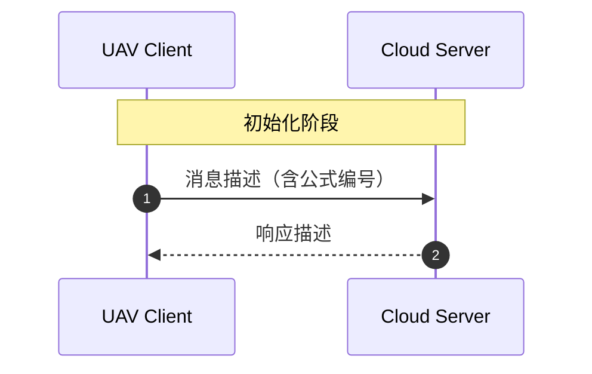
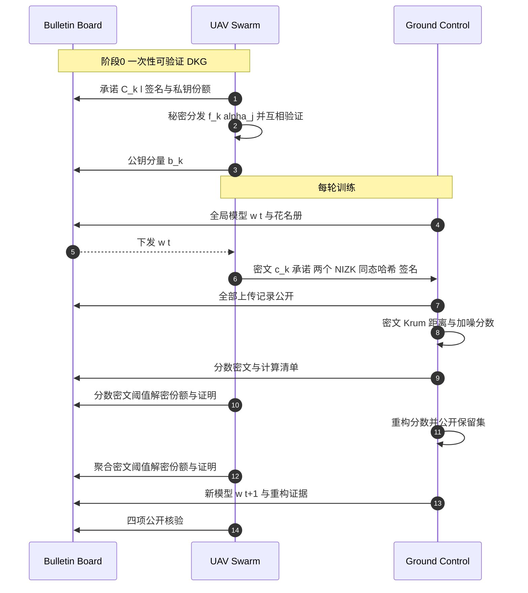
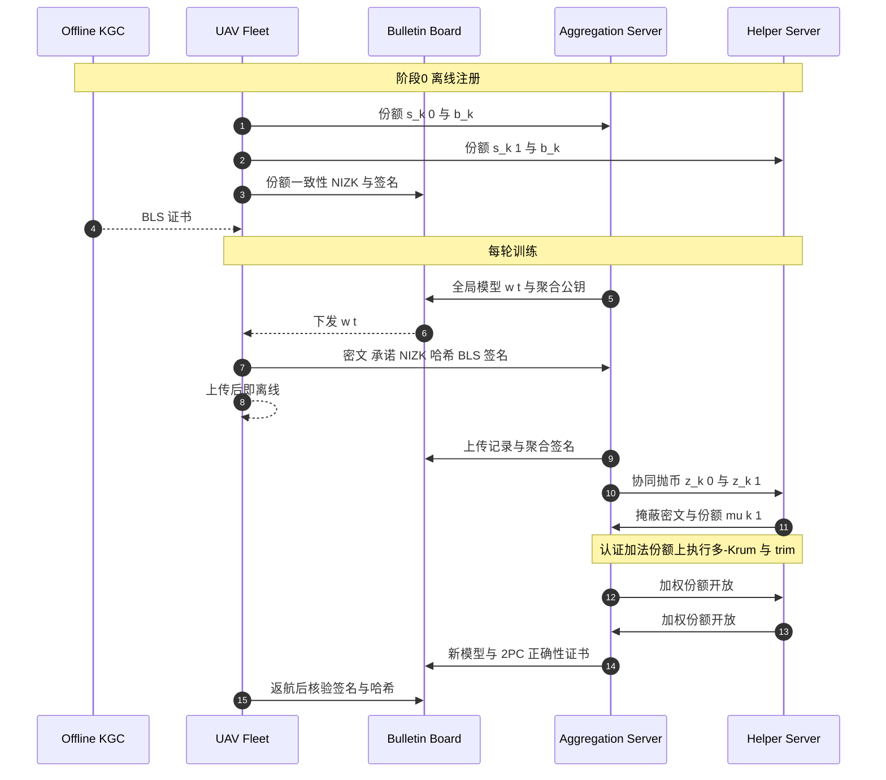
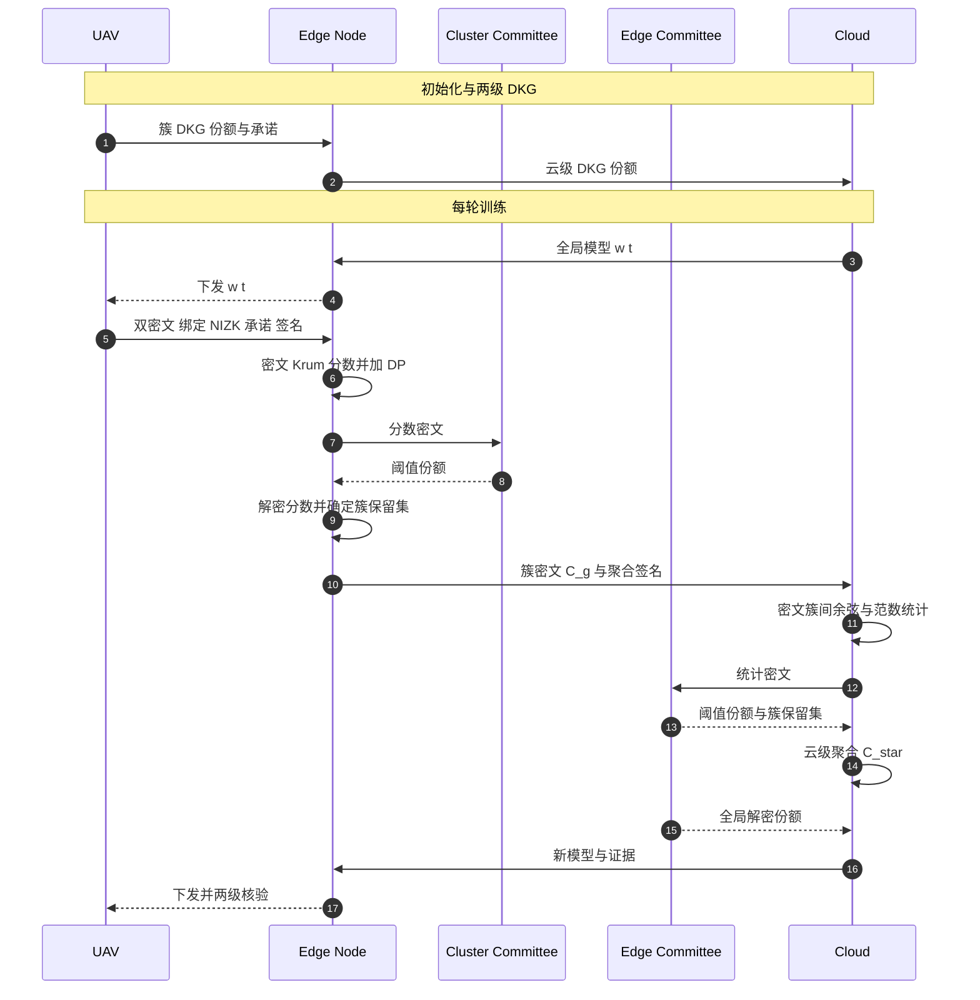
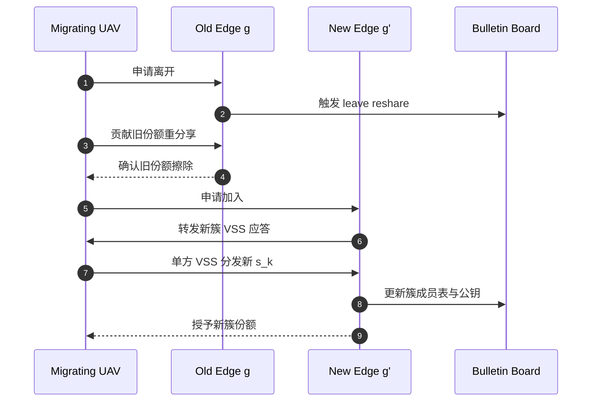
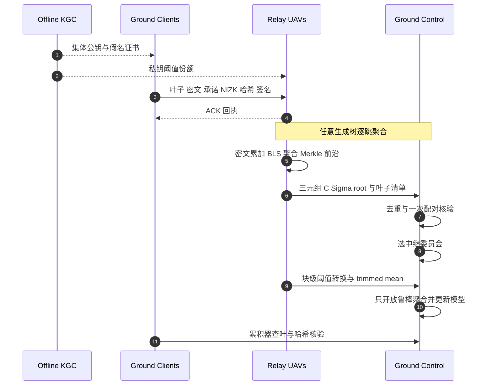
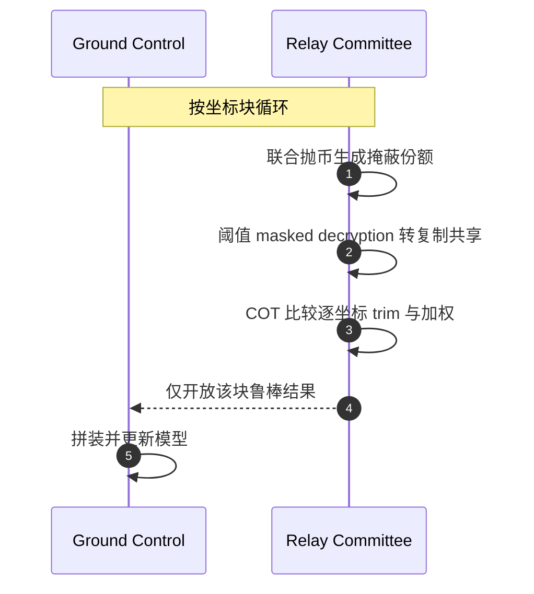
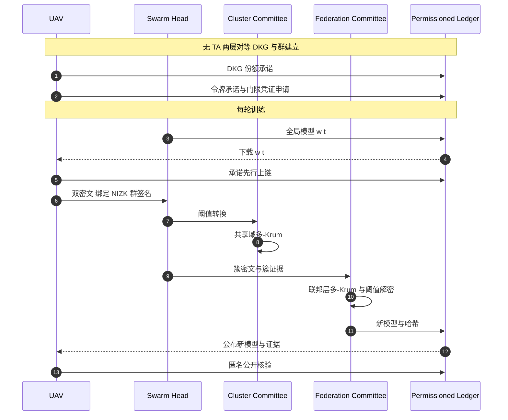
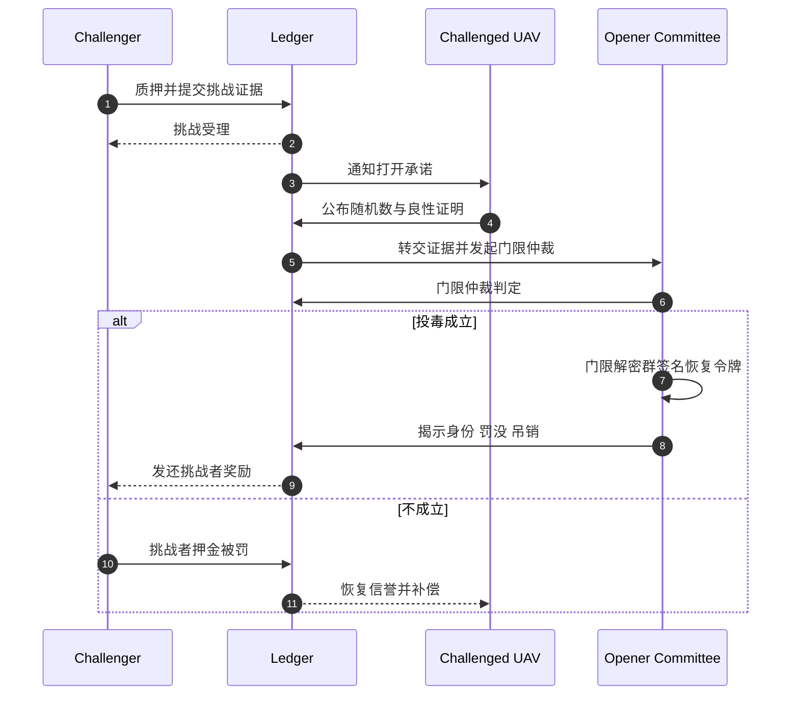

# 联邦学习密码方案阅读报告与五个新方案构建

> 主题：面向无人机（UAV）场景的隐私保护、可验证、鲁棒联邦学习——基于 RLWE/CKKS 全同态加密、多密钥/阈值体制、签名与同态哈希的系统梳理与方案构造
>
> 文献范围：目录下 21 篇 PDF（2017–2026，含两篇中文背景资料）
>
> 阅读方式：全部论文逐页精读，关键密码学公式页渲染核对；文中引用均标注来源论文与年份
>
> 全文符号在第 4 章统一，五个方案跨方案严格一致

---

## 目录

- **第 1 章　联邦学习基础：架构、实体与加权聚合**
  - 1.1 联邦学习的定义与三种数据划分
  - 1.2 标准 FL 架构 A：单服务器（双实体）
  - 1.3 标准 FL 架构 B：双服务器/分布式信任
  - 1.4 层次型 FL 架构：客户端—边缘—云
  - 1.5 优化目标与本地更新：FedSGD / FedAvg / FedProx / FedNova
  - 1.6 加权聚合的七种方式与密文域零深度聚合
  - 1.7 密码学增强 FL 的四类安全目标与本报告的分析坐标
- **第 2 章　UAV 场景下联邦学习的挑战与研究点**
  - 2.1 五类典型 UAV 联邦学习场景
  - 2.2 UAV 系统约束对密码协议的硬性限制
  - 2.3 UAV-FL 的威胁面
  - 2.4 从挑战到密码学设计要求（映射表）
- **第 3 章　21 篇文献的模式总结与代际演进链**
  - 3.1 四个分类维度上的模式统计
  - 3.2 21 篇方案大对比表
  - 3.3 四条代际演进链的逐步推理
  - 3.4 共性缺口：为什么现有方案不能直接用于 UAV
- **第 4 章　五个新方案的设计方法论与总览**
  - 4.1 威胁模型驱动的六步构造法
  - 4.2 统一符号系统（五个方案共用）
  - 4.3 五个方案的差异化定位总览
  - 4.4 新颖性自检：每个方案"超越了谁、解决了什么新问题"
- **第 5 章　五个新方案的完整构造**
  - 5.1 方案一（标准 FL·单服务器）：**TARVFL**——无可信机构的阈值集体 CKKS 聚合与"只解密鲁棒分数"的可验证 Krum
  - 5.2 方案二（标准 FL·双服务器）：**MK-VeRFL**——跨机构多密钥 CKKS 的双服务器持钥、客户端上传即离线与 2PC 鲁棒可验证聚合
  - 5.3 方案三（层次型 FL·地面边缘）：**MARVEL-HFL**——移动感知份额重分享的两级阈值 CKKS 与分层鲁棒可验证聚合
  - 5.4 方案四（层次型 FL·UAV 即空中边缘）：**ChainRoute**——拓扑无关的 BFV 链式密文聚合、BLS 聚合签名与中继委员会鲁棒裁剪
  - 5.5 方案五（层次型 FL·无 TA 可审计）：**AuditHFL**——对等 DKG 两级阈值 CKKS、群签名可问责匿名与链上承诺-打开审计
- **附录 A**　五个方案共用的密码学构件公式库
- **附录 B**　参考文献（21 篇）

---

# 第 1 章　联邦学习基础：架构、实体与加权聚合

> 说明：随附的两篇中文背景资料中，《联邦学习的加权方式.pdf》给出了 7 类加权公式；《联邦学习基本架构.pdf》经逐页核对，其实际内容为 FedSGD/FedAvg/FedProx/FedNova 优化推导与 CKKS 零深度密文聚合，**并不包含**横向/纵向/层次型架构的分类图（1.1–1.4 节的架构分类为依据领域标准文献 McMahan et al. 2017、Yang et al. 2019、Liu et al. 2020 与本批 21 篇论文的体系补充，1.5–1.6 节则严格转录两篇背景资料的公式）。

## 1.1 联邦学习的定义与三种数据划分

联邦学习（Federated Learning, FL）由 McMahan 等（2017）形式化：$K$ 个数据持有方在不离开本地的前提下，协同最小化全局经验风险

$$\min_{\mathbf{w}} F(\mathbf{w})=\sum_{k=1}^{K} p_k F_k(\mathbf{w}),\qquad F_k(\mathbf{w})=\frac{1}{n_k}\sum_{(\mathbf{x},y)\in\mathcal{D}_k}\ell(\mathbf{w};\mathbf{x},y),\qquad p_k=\frac{n_k}{n},\quad n=\sum_{k=1}^{K} n_k.$$

按数据在参与方之间的划分方式，FL 分为三类（Yang et al. 2019）：

| 类型 | 数据空间划分 | 典型参与方 | 本批代表文献 |
|---|---|---|---|
| 横向 FL（HFL，sample-partitioned） | 特征空间 $X$ 重叠、样本 ID 不同 | 同构机构、大量终端 | 除 24-BPVFL 外的绝大多数（BPVFL 虽名含 VFL 但正文实为水平 FL） |
| 纵向 FL（VFL，feature-partitioned） | 样本 ID 重叠、特征空间不同 | 银行+电商等机构对同一批用户 | 24-BPVFL 声称的 VFL 谱系（VerifyNet/VeriFL 之续） |
| 联邦迁移学习（FTL） | 样本与特征都少重叠 | 跨域机构 | 本批无 |

本报告构造的 5 个方案全部为**横向 FL**（无人机群采集同构感知数据）。

## 1.2 标准 FL 架构 A：单服务器（双实体）

实体：

1. **聚合服务器 $\mathcal{CS}$**（参数服务器 / 地面指挥中心 GCS / 云）：维护全局模型、下发 $\mathbf{w}^{t}$、收集更新并执行 $\mathsf{Agg}$。
2. **客户端集合 $\{\mathcal{U}_k\}_{k=1}^{K}$**：本地数据 $\mathcal{D}_k$ 不出域，本地训练后上传更新。

信息流（FedAvg 一轮）：

$$\mathcal{CS}\xrightarrow{\mathbf{w}^{t}}\mathcal{U}_k;\qquad \mathcal{U}_k:\ \mathbf{w}_{k}^{t+1}\leftarrow\mathbf{w}^{t}-\eta\sum_{i=0}^{\tau_k-1}\mathbf{g}_{k,i}^{t};\qquad \mathcal{U}_k\xrightarrow{\mathbf{w}_{k}^{t+1}\ \text{或}\ \Delta_k^{t}}\mathcal{CS};\qquad \mathcal{CS}:\ \mathbf{w}^{t+1}=\sum_{k\in S_t}p_k\mathbf{w}_{k}^{t+1}.$$

**信息可见性（明文协议）**：$\mathcal{CS}$ 可见每个客户端的单份更新；$\mathcal{U}_k$ 只见自己的数据与全局模型。单服务器结构的密码学改造有三条路线：

- **掩码/秘密共享路线**（17-SecAgg、23-ELSA 的前半、26-VLSFL）：服务器只能还原求和结果；
- **同态加密路线**（19-CDKS 谱系、25-MaskCrypt、25-FedPHE、25-ESAFL、26-CDKS-LSS、26-FedOut 等）：服务器对密文做同态聚合；
- **TEE 路线**（24-SecFed、25-SKHE）：把解密/关键运算关进 SGX 飞地。

## 1.3 标准 FL 架构 B：双服务器/分布式信任

在单服务器之外引入第二台服务器，把"看数据份额"与"做聚合/解密"的权力拆分，用**两台服务器不合谋**（non-collusion）替代"存在一台完全可信服务器"：

- 两台服务器按角色可对称（23-ELSA：$S_0,S_1$ 各持一份秘密共享，至多一台被攻陷）；
- 也可非对称（24-BPVFL：$S_0$ 聚合且可恶意、$S_1$ 持私钥且半诚实；25-ProFL：AGG 只有公钥、SP 持私钥；26-FedOut：AS 与 Proxy 分别持盲因子与盲明文）。

信息可见性：客户端把更新的两个加法份额 $x^{(0)},x^{(1)}$ 分别发给两台服务器（23-ELSA），或分别用两台服务器可见的密钥材料加密（BPVFL/ProFL/FedOut）；任一服务器单独视图不可区分于随机。双服务器架构的**部署前提**是存在两个长期稳定、处于不同信任域的基础设施——这在 UAV 自组网中通常不成立，故本报告只在"应急通信空地网络"（方案二，地面云+部门专网两台服务器）中使用，纯空中场景改用层次型/阈值结构。

## 1.4 层次型 FL 架构：客户端—边缘—云

层次型 FL（Hierarchical FL, HFL；client–edge–cloud，代表为 HierFAVG）引入中间层：

- **端层**：终端 $\mathcal{U}_{g,k}$（传感器、车辆、无人机）；
- **边缘层**：边缘节点 $\mathcal{EN}_g$（RSU、微基站、机库边缘服务器，或充当中继的无人机），辖簇 $\mathcal{C}_g$；
- **云层**：云服务器 $\mathcal{CS}$，跨簇全局聚合。

两级聚合（簇内边缘聚合 + 跨簇云聚合）：

$$\mathbf{w}_g^{t}=\sum_{k\in\mathcal{C}_g}\alpha_{k\mid g}\mathbf{w}_{g,k}^{t},\qquad \alpha_{k\mid g}=\frac{n_{g,k}}{n_g},\ n_g=\sum_{k\in\mathcal{C}_g}n_{g,k};\qquad \mathbf{w}^{t+1}=\sum_{g=1}^{G}\alpha_g\mathbf{w}_g^{t},\qquad \alpha_g=\frac{n_g}{n}.$$

HFL 的优势是通信局部化（端只与就近边缘通信）、天然适配地理分布与边缘卸载；代价是引入**边缘这个新的被攻击面**（边缘被攻陷后可见簇内更新、可篡改簇级聚合），并且多了一层密钥/份额的管理问题。本批 25-PrvFL（PrivHFL）、25-SKHE、26-PPBR 是层次型；25-VeSAFL 是多聚合器的类层次结构。

## 1.5 优化目标与本地更新：FedSGD / FedAvg / FedProx / FedNova

以下公式严格转录自《联邦学习基本架构.pdf》。

**FedSGD**（本地 1 步）：$\mathbf{g}_k^t=\nabla F_k(\mathbf{w}^t)$，$\mathbf{w}_k^{t+1}=\mathbf{w}^t-\eta\mathbf{g}_k^t$，服务器 $\mathbf{w}^{t+1}=\sum_k p_k\mathbf{w}_k^{t+1}=\mathbf{w}^t-\eta\sum_k p_k\mathbf{g}_k^t$。

**FedAvg**（本地 $\tau$ 步）：

$$\mathbf{w}_k^{t+1}=\mathbf{w}^t-\eta\sum_{i=0}^{\tau_k-1}\mathbf{g}_{k,i}^{t}.$$

定义模型增量 $\Delta_k^{t}=\mathbf{w}_k^{t+1}-\mathbf{w}^{t}=-\eta\sum_{i=0}^{\tau_k-1}\mathbf{g}_{k,i}^{t}$，则

$$\mathbf{w}^{t+1}=\mathbf{w}^t+\sum_{k=1}^{K} p_k\Delta_k^{t}.$$

三种上传形式数学等价：传权重 $\mathbf{w}_k^{t+1}$、传增量 $\Delta_k^{t}$、传累积梯度 $G_k=\sum_i\mathbf{g}_{k,i}$（服务器再乘 $\eta$）。

**FedProx**（约束 Non-IID 客户端漂移）：本地目标加近端项

$$h_k(\mathbf{w})=F_k(\mathbf{w})+\frac{\mu}{2}\lVert\mathbf{w}-\mathbf{w}^t\rVert^2,\qquad \mathbf{w}_{k,i+1}=\mathbf{w}_{k,i}-\eta\bigl(\nabla F_k(\mathbf{w}_{k,i})+\mu(\mathbf{w}_{k,i}-\mathbf{w}^t)\bigr),$$

全局聚合仍为 $\mathbf{w}^{t+1}=\mathbf{w}^t+\sum_k p_k\Delta_k$。

**FedNova**（解耦本地步数异构）：归一化伪梯度 $\mathbf{d}_k=\Delta_k/\tau_k=(\mathbf{w}^t-\mathbf{w}_k^{t+1})/\tau_k$，有效步数 $\tau_{\mathrm{eff}}=\sum_k p_k\tau_k$，无偏更新

$$\mathbf{w}^{t+1}=\mathbf{w}^t-\tau_{\mathrm{eff}}\sum_k p_k\mathbf{d}_k =\mathbf{w}^t+\sum_k p_k\frac{\tau_{\mathrm{eff}}}{\tau_k}\Delta_k.$$

## 1.6 加权聚合的七种方式与密文域零深度聚合

### 1.6.1 七种权重（转录自《联邦学习的加权方式.pdf》）

统一写法 $\alpha_i=s_i/\sum_j s_j$：

1. **按样本量**：$\alpha_i=n_i/\sum_j n_j$（FedAvg 默认，每条样本在全局经验风险中等权）；
2. **按客户端均等**：$\alpha_i=1/|S_t|$（每客户端等权，不等于对样本等权）；
3. **按数据质量/代表性**：$\alpha_i=q_i/\sum_j q_j$（标签可靠性、覆盖度，不能以训练准确率低判数据差）；
4. **按贡献度**：$\alpha_i=c_i/\sum_j c_j$（Shapley 值、验证集边际增益）；
5. **按可信度/鲁棒性**：$\alpha_i=r_i/\sum_j r_j$（更新异常度、相似度、信誉；可信度加权不是密码学验证）；
6. **按公平性/任务重要性**：$\alpha_i=f_i/\sum_j f_j$（稀缺群体、关键区域）；
7. **自适应/动态**：$\alpha_i^{(t)}=s_i^{(t)}/\sum_j s_j^{(t)}$（逐轮相似度、损失、时效）。

25-FedPHE 的 softmax 相似度权重（第 7 类）、25-ProFL 的曼哈顿逆距离权重（第 5 类）、26-PPBR 的筛选后等权（第 2 类+鲁棒筛选）分别是这些思路的密文实现。

### 1.6.2 密文域"零深度"聚合模板（《联邦学习基本架构.pdf》的核心工程结论）

客户端在**明文本地**消化学习率与权重 $\widetilde{\Delta}_k=p_k\Delta_k$，再用 CKKS 打包加密；服务器只做同态加法（EvalAdd，无乘法深度、无需 rescale）：

$$\mathsf{ct}_k=\mathsf{Enc}_{pk}(\pi(\widetilde{\Delta}_k)),\qquad \mathsf{ct}_{\mathrm{glob}}=\bigoplus_{k=1}^{K}\mathsf{ct}_k =\mathsf{Enc}_{pk}\Big(\pi\big(\sum_k p_k\Delta_k\big)\Big).$$

这一"客户端本地加权、服务器只做密文累加"的模板是本批所有加法同态方案（MaskCrypt、ESAFL、FedPHE、CDKS-LSS 等）的共同结构；**本报告 5 个方案全部保持该零深度性质**，鲁棒权重（0/1 选择或公开常数）在客户端预置或由服务器做 CKKS 明文-密文标量乘（不增加乘法深度）。

## 1.7 密码学增强 FL 的四类安全目标与本报告的分析坐标

对每个方案，本报告统一考察四类目标及其组合：

| 目标 | 含义 | 典型原语 | 本批覆盖情况 |
|---|---|---|---|
| **隐私性（Confidentiality）** | 服务器/旁观者得不到单客户端更新，理想下只得到聚合结果 | HE（BFV/CKKS/Paillier）、掩码、SS、TEE | 21 篇绝大多数 |
| **可验证性（Verifiability）** | 客户端/第三方可验证聚合结果确实由所提交的更新按声明规则算出 | 同态哈希、承诺、数字签名、ZKP、公告板 | 23-ELSA、24-BPVFL、25-VeSAFL、26-Ftopk、26-VLSFL |
| **鲁棒性（Robustness）** | 少量恶意客户端投毒（标签翻转、符号翻转、ALIE、MinMax、IPM 等）下聚合仍接近良性结果 | 范数界裁剪、Krum/多-Krum、trimmed mean、坐标中位数、余弦过滤、距离逆加权 | 23-ELSA（仅 ℓ2）、25-MASER（掩码投票）、25-ProFL、26-PPBR |
| **可用性/抗掉线（Availability/Dropout tolerance）** | 客户端中途退出、延迟（straggler）、移动切换时协议仍能完成 | 阈值秘密共享、双掩码恢复、噪声占位密文、委员会、客户端选择 | 17-SecAgg、24-SecFed、24-BPVFL、25-SKHE、25-PrvFL、26-CDKS-LSS、26-FedOut、26-Ftopk、26-VLSFL、26-PPBR |

**一个贯穿全文的观察**：21 篇里没有任何一篇同时在上述四类目标上达到较强保证，并且把"可信机构在线依赖、合谋阈值、层次结构、移动性"全部处理好。这正是第 5 章五个新方案的设计空间。

---

# 第 2 章　UAV 场景下联邦学习的挑战与研究点

UAV（无人机）参与联邦学习有两种基本形态：**UAV 作为客户端**（机载传感数据训练，如巡检影像缺陷检测），以及 **UAV 作为空中边缘节点/中继**（UAV-Assist / Edge-Assist，为地面车辆、终端或其他无人机提供聚合与回传服务）。26-PPBR 明确把 unpiloted aerial vehicles 与 smart vehicles、便携医疗终端并列为边缘辅助层次 FL 的客户端；24-ResFed 面向 V2X 弱带宽；25-SKHE 给出 cloud-edge-end 三层结构。本章先锁定五个真实场景，再逐一推导约束与研究点。

## 2.1 五类典型 UAV 联邦学习场景

| 场景 | 客户端/边缘形态 | 通信特征 | 数据特点 | 对应本报告方案 |
|---|---|---|---|---|
| ① 基础设施巡检无人机群（电力廊道、油气管线、风电、桥梁） | 同构巡检 UAV 为客户端，单一地面指挥中心 GCS/云 | 机群沿航线间歇接入、单跳或机群自组网回传 | 影像 Non-IID（航段缺陷分布不同）、模型大（CNN/ViT） | 5.1（单服务器） |
| ② 应急救援空地网络（地震/洪水后地面设施损毁，消防/医疗/公安多部门机群） | 多机构 UAV、各自密钥体系；应急指挥车云 + 部门专网协助服务器 | 多机构互不信任、跨域带宽紧张、上线窗口短 | 多源多任务、机构间强隐私壁垒 | 5.2（双服务器） |
| ③ 城市无人机配送/区域巡检（机库、塔台边缘站覆盖） | UAV→地面边缘节点（机库/微基站）→云，UAV 跨簇飞行 | 跨边缘站切换（handoff）、簇内一跳、回传光纤 | 同城 Non-IID、边缘节点算力分层 | 5.3（层次型·地面边缘） |
| ④ 无人机辅助车联网/应急中继（UAV 即空中边缘，为车辆/手持终端提供多跳回传） | 地面终端为客户端，中继 UAV 是移动边缘，GCS 为云 | 多跳、拓扑逐分钟剧变、路由不可预测 | 车流/终端海量、高移动、中继可能被物理捕获 | 5.4（层次型·空中边缘） |
| ⑤ 多集群边防/农业巡检（无固定基础设施、无统一可信中心） | 多个 UAV 集群+簇头/中继，地面站稀疏 | 长航时、间歇卫星/短波回传、跨簇协同 | 多业主、跨域、要求可审计可追责 | 5.5（层次型·无 TA） |

## 2.2 UAV 系统约束对密码协议的硬性限制

1. **高移动性与频繁掉线（churn/dropout）**：巡检/应急中无人机进出航段、电量返航、链路遮挡，单轮参与率可低至 30%–70%。
   - 对协议的硬限制：**任何"本轮全员在线才能解密"的设计都不可用**——19-CDKS 的全体 PartDec、xMK-CKKS 的聚合公钥（一人掉线即失败）、25-ESAFL 的 $s=\sum_{i=1}^N s_i$（掉线者的 $a_ts_i$ 残留为噪声）在 UAV 场景直接失效。
   - 可用方向：阈值化（17-SecAgg 的 $t$-of-$n$、26-CDKS-LSS 的阈值重构、25-PrvFL 的 2-of-3）、占位密文（24-SecFed 的 supEnc、26-FedOut 的零密文）、轮次间密钥复用（26-VLSFL 的 Flamingo 图）。

2. **拓扑动态与跨簇切换**：场景③④中无人机会在飞行中更换接入的边缘节点/中继。
   - 对协议的硬限制：现有阈值方案的**求值点、份额成员表是静态预注册的**（26-CDKS-LSS 明确要求 Exceptional Sequence 求值点预注册，新加入者需重置；26-FedOut 承认新加入者需重置静态 $s$）；**没有任何一篇处理"份额随节点迁移"**。
   - 可用方向：主动秘密共享（proactive secret sharing）、份额重分享（reshare）、成员加入/退出的动态 DKG（本报告 5.3 的核心切入点）。

3. **算力分层**：机载嵌入式 GPU/NPU 算力远低于地面，中继 UAV 次之，地面边缘与云充裕。
   - 对协议的硬限制：机载端不能承担 $O(n^2)$ 两两协商（17-SecAgg、26-PPBR 的 SA）、$O(N^2)$ P2P 份额洪泛（26-CDKS-LSS 实测每人每轮 98.895 MB）、重型双线性配对（25-VeSAFL、26-VLSFL）、Paillier 大整数幂（26-Ftopk 实测客户端负担）。
   - 可用方向：客户端只做一次加密+一次签名（23-ELSA 的 one-shot 思想）；把重计算下沉到边缘/双服务器（26-FedOut 的 Proxy 外包、24-SecFed 的飞地）；选择性加密（25-MaskCrypt 的 20%、25-MASER 的 10% 剪枝）；CKKS SIMD 打包与 pack 级稀疏化（25-FedPHE）。

4. **通信瓶颈与非对称链路**：上行带宽窄、链路误码高、航时计费；24-ResFed 实测 350–375× 压缩需求，CKKS 密文膨胀 20–42×（25-MaskCrypt/FedPHE）。
   - 对协议的硬限制：全参数加密不可行；必须与稀疏化/压缩正交叠加，并压缩**验证流量**（24-BPVFL 的滑窗抽样只验 $k$ 维）。
   - 可用方向：BLS 聚合签名把 $n$ 个签名压成常数长度；误差反馈 top-k（26-Ftopk）；残差压缩（24-ResFed）与 HE 叠加。

5. **能耗约束**：加密/通信耗能直接压缩航时；协议应"机载端轻、地面端重"，并支持机载端在弱网下一轮交互即离线。

6. **数据 Non-IID**：航段、车辆、地块之间数据分布天然高度倾斜。
   - 对协议的硬限制：鲁棒规则不能照搬 IID 假设——25-ProFL 指出 Krum/trimmed mean 在强 Non-IID 下会误杀良性异质客户端，采用中位数基准+曼哈顿逆距离；26-PPBR 用符号统计聚类应对 ALIE/MinMax。新方案的鲁棒聚合必须同时在 Non-IID 与拜占庭下成立。

7. **异步与轮次异构**：本地步数、算力、链路时延差异大（25-FedPHE 的 straggler、FedNova 的步数异构）；本报告以"同步轮次+阈值委员会"为主体，异步扩展留作展望。

## 2.3 UAV-FL 的威胁面

| 威胁 | 描述 | 现有方案覆盖缺口 |
|---|---|---|
| 被动窃听/半诚实服务器 | GCS/云/边缘/中继试图从单份更新恢复数据（MIA、DLG 反演、HCGLA 梯度匹配） | HE/掩码类基本覆盖；但单密钥共享体制下"任一客户端可解密他人"（25-MaskCrypt/FedPHE 批评的 SKHE 缺陷） |
| 服务器与客户端合谋 | 服务器勾结部分客户端反推诚实客户端 | 25-ESAFL 仅抗 $N-2$、25-MaskCrypt 抗 $K-2$、25-FedPHE 抗 $|S_t|-2$，阈值普遍紧 |
| 恶意服务器 | 篡改/丢弃更新、伪造聚合结果、审查特定客户端、伪造验证 | 23-ELSA（malicious server 下不保证正确性）、24-BPVFL（$S_0$ 恶意）、26-Ftopk（GS 恶意）、26-VLSFL、25-VeSAFL 部分覆盖；HE 类几乎不防 |
| 数据/模型投毒（拜占庭客户端） | 标签翻转、符号翻转、放大 $c\cdot\mathbf{w}$、ALIE、MinMax、IPM、后门 | 仅 25-ProFL、26-PPBR、23-ELSA（ℓ2）、25-MASER（掩码投票）；**所有 HE 阈值方案（SecFed/ESAFL/CDKS-LSS/SKHE/PrivHFL/FedOut）都不防投毒** |
| 恶意中继/边缘 | 场景④⑤中中继 UAV/边缘节点被物理捕获或攻陷，篡改簇级聚合、审查、重放 | 25-SKHE/25-PrvFL/26-PPBR 均假设边缘半诚实；25-VeSAFL 防恶意聚合器但无 HE、无拓扑动态 |
| Sybil/冒名 | 大量伪造无人机身份操纵聚合、骗取聚合权重 | 仅 PKI/假名证书可缓解；21 篇中无系统处理 |
| 重放/伪造密文 | 重放上轮更新、伪造他人密文 | 签名可覆盖，但除 VeSAFL/BPVFL/Ftopk/VLSFL 外无签名 |
| 份额一致性攻击 | 阈值/秘密共享中分发不一致份额 | 需 VSS（25-VeSAFL 用 Pedersen VSS；格基 VSS 在本批中缺位） |

## 2.4 从挑战到密码学设计要求（映射表）

| 编号 | 设计要求 | 由哪条挑战/威胁推出 | 在第 5 章的落地 |
|---|---|---|---|
| R1 | 解密不得依赖本轮全员在线；阈值 $\tau$ 可调，掉线不重跑协议 | 2.2-1、2.2-2 | 五方案全部阈值化（5.1/5.3/5.4/5.5 为阈值 CKKS，5.2 客户端上传即离线） |
| R2 | 不设全程在线可信机构；信任只能在离线 bootstrap 或完全去除 | 2.1 场景②⑤、跨部门不信任 | 5.1 无 TA（DKG）、5.2 仅离线 KGC、5.3 离线 TA、5.4 离线 KGC、5.5 完全无 TA |
| R3 | 机载端单轮交互、计算量与单密钥 HE 同阶；禁止 $O(n^2)$ 在线协商 | 2.2-3、2.2-4、2.2-5 | 5.1 在线开销 $O(n)$（DKG 一次性摊销）；5.2 客户端仅加密+签名；5.4 中继只做加法 |
| R4 | 聚合结果与每一条更新的包含关系可公开验证（防恶意服务器/中继） | 2.3 恶意服务器、恶意中继 | 五方案均部署同态哈希/同态承诺+签名（5.1/5.3/5.5 格基，5.2/5.4 BLS） |
| R5 | 在密文或秘密共享下完成鲁棒聚合，且 Non-IID 不误杀 | 2.2-6、2.3 投毒 | 5.1 密文 Krum（仅分数阈值解密）、5.2 2PC trim/Krum、5.3 两层分数、5.4 委员会分块 trim、5.5 委员会多-Krum+链上审计 |
| R6 | 支持跨簇移动的份额/密钥迁移 | 2.2-2 | 5.3 移动感知 reshare；5.5 无 TA 成员动态 |
| R7 | 拓扑无关：空中多跳路由变化不改变聚合结果与可验证性 | 2.1 场景④、2.2-2 | 5.4 链式聚合（加法/乘法交换律）+聚合签名+Merkle 累积 |
| R8 | 抗 Sybil 与冒名，且对跨机构/多业主场景提供身份问责 | 2.3 Sybil、场景⑤ | 5.4 假名证书；5.5 群签名（匿名+可打开问责） |
| R9 | 后量子安全：主密码构件基于 RLWE/Module-SIS | 格密码方向定位、Paillier 后量子不安全（26-Ftopk 自承） | 5.1/5.3/5.5 全格基；5.2/5.4 格基 HE+配对签名（明确标注混合假设） |
| R10 | 每个方案的安全证明严格围绕显式威胁模型（实体诚信度、合谋阈值、掉线模型、攻击者目标） | 方法论要求 | 每个方案 5.x.4 给出威胁模型、5.x.7 逐条定理证明 |

---

# 第 3 章　21 篇文献的模式总结与代际演进链

## 3.1 四个分类维度上的模式统计

**维度一：FL 架构。** 标准单服务器占主流：17-SecAgg、19-CDKS（非 FL 的两方推理，作为 MKHE 根）、24-SecFed、24-ResFed、25-MaskCrypt、25-MASER、25-FedPHE、25-ESAFL、26-CDKS-LSS、26-Ftopk（DSVFL）、26-VLSFL、26-FedOut 共 12 篇；双服务器/分布式信任：23-ELSA、24-BPVFL、25-ProFL（FedOut 为单 AS+Proxy 外包，也可归入此类）；层次型：25-SKHE（cloud-edge-end）、25-PrvFL（PrivHFL，三层）、26-PPBR（云-RSU-车/UAV）；多聚合器类层次：25-VeSAFL。

**维度二：密钥体制。** 无 HE（掩码/SS/MPC）：17-SecAgg、23-ELSA、25-VeSAFL、26-VLSFL；单密钥 HE：24-BPVFL/25-ProFL（Paillier）、26-Ftopk（阈值 Paillier）、25-SKHE（CKKS）、25-FedPHE（打包 CKKS 经 Shamir 改造）；多密钥/共享密钥 HE：19-CDKS（MK-CKKS）、24-SecFed（EMK-BFV）、25-MaskCrypt（多子集多密钥）、25-MASER（xMK-CKKS）、25-ESAFL（ESHE，加密钥各异、解密钥为其和）、26-FedOut（ECMK-CKKS）；阈值 HE：25-PrvFL（tMK-CKKS 2-of-3）、26-CDKS-LSS（CDKS+环上 Shamir LSS）；混合：26-PPBR（BFV+SA+CLDP）；TEE 叠加：24-SecFed、25-SKHE。

**维度三：可信机构。** 无 TA：17-SecAgg（被动版）、19-CDKS（仅 CRS）、23-ELSA、24-BPVFL、25-MaskCrypt、25-VeSAFL（公告板）、26-PPBR、26-CDKS-LSS；离线 TA/仅初始化可信方：25-ESAFL（AS，可换 MPC DKG）、25-PrvFL（KGC）、25-SKHE（TA+SGX）、25-ProFL（KGC）、26-FedOut（KDC）、26-Ftopk（TA，但在线做验证）、26-VLSFL（离线 TA）；强在线/重可信方：24-SecFed（SGX 全程可见中间明文）、25-FedPHE（KDC 每 $\tau$ 轮下发）、25-MASER（密钥管理器）。

**维度四：威胁模型与安全目标组合。** 仅 semi-honest：19-CDKS、24-SecFed、25-MaskCrypt、25-MASER、25-FedPHE、25-ESAFL、25-SKHE、25-PrvFL、25-ProFL（服务器半诚实、客户端可拜占庭）、26-CDKS-LSS、26-FedOut；恶意服务器/聚合器：23-ELSA（隐私恶意安全、正确性依赖两台诚实）、24-BPVFL（$S_0$ 恶意）、25-VeSAFL（malicious 双向可验证）、26-Ftopk（GS 恶意）、26-VLSFL（AS 可被控制）；拜占庭/投毒防御：23-ELSA（ℓ2）、25-MASER（掩码多数投票）、25-ProFL（中位数+曼哈顿逆距离）、26-PPBR（符号聚类+范数中位数裁剪）。**四类目标（隐私/验证/鲁棒/抗掉线）全强者：0 篇。**

## 3.2 21 篇方案大对比表

| 方案（年份/场合） | 架构 | 密钥体制 | TA/可信方 | 威胁模型（合谋/掉线） | 关键原语 | 鲁棒/聚合 | 可验证机制 | 关键代价与缺陷 |
|---|---|---|---|---|---|---|---|---|
| **17-SecAgg**（CCS'17） | 单服务器 | 无 HE：双掩码+Shamir | 仅 active 版需 PKI | 半诚实/active；服务器合谋需 $t\ge\lfloor2n/3\rfloor+1$；$t$-of-$n$ 掉线 | ECDH、AES-GCM、PRG、UF-CMA 签名 | 安全求和（FedAvg 拼接向量）；**无鲁棒** | active 版一致性检查签名 | 10% 掉线恢复 62.2s、30% 143s；$O(n^2)$；不防投毒 |
| **19-CDKS**（CCS'19） | 两方推理（非 FL） | 多密钥 MK-BFV/MK-CKKS | 无 TA（仅 CRS） | 服务器半诚实，可合谋一方不泄另一方；**不防掉线** | RLWE、gadget、多密钥重线性化、PartDec/Merge（噪声淹没） | 无 | 无 | PartDec 份额在信道上；全在线；O($k^2$) 重线性化 |
| **23-ELSA**（S&P'23） | 双服务器 | 无 HE：算术/布尔 SS | 无 | 恶意客户端+至多 1 个恶意服务器；两服务器不合谋；阈值 $\tau$ 防审查 | Δ-COT、Beaver/square correlation、sacrifice、transcript emulation | ℓ2 范数过滤；**不做 Krum/trim** | 客户端 digest 复核 transcript | 恶意服务器下不保正确性；无 HE 不支持密态下发 |
| **24-SecFed**（TDSC'24） | 单服务器（GP+SGX） | 多密钥 EMK-BFV（$secret=\sum s_i$，$rk_i=secret-sk_i$） | SGX 飞地（全程、可见中间明文） | GP/用户半诚实可合谋；抗 $<N-1$ 合谋；**容忍 $N-2$ 掉线** | RLWE-BFV、飞地内 noiseRef/secureMul、supEnc 占位密文 | 数据量加权；**无鲁棒** | 无 | 飞地侧信道/256MB 限制；不防投毒；cross-device 不适配 |
| **24-ResFed**（IoT-J'24） | 单服务器/V2X | 无密码（残差压缩） | 无 | 无威胁模型 | 残差预测+TopK+1bit+Huffman | FedAvg | 无 | 不保护隐私；轨迹缓存占内存 |
| **24-BPVFL**（GLOBECOM'24） | 双服务器（$S_0$ 聚合/$S_1$ 验证） | 单密钥 Paillier+线性同态哈希 | 无 TA（$S_0,S_1$ 不合谋） | $S_0$ 恶意、$S_1$ 半诚实；$N-1$ 客户端可恶意；**抗 $N-1$ 掉线** | Paillier、$g^x$ 同态哈希、滑窗抽样 TP-ZKP | 等权几何平均；**不防客户端投毒** | 双向验证（$S_1$ 验聚合+验哈希） | 等权；Paillier 膨胀 ~200×；$S_1$ 可见全局明文 |
| **25-MaskCrypt**（TDSC'25） | 单服务器 | 多子集多密钥 CKKS/BFV | 无 | 服务器半诚实；允许服务器-客户端合谋；抗 $\le K-2$ | CKKS、掩码共识、梯度引导选敏感位 | FedAvg 明/密分段聚合；**无鲁棒** | 无 | 80% 明文仍上传；共识额外交互；$K-2$ 阈值紧 |
| **25-MASER**（arXiv'25） | 单服务器+密钥管理器 | 多密钥 xMK-CKKS | 可信密钥管理器 | 服务器半诚实；客户端可恶意但 <50% | MK-CKKS、幅度剪枝+多数投票掩码、slots 切片 | 掩码投票（仅防伪造掩码，不防语义投毒） | 无 | 可信管理器；仅 5 客户端；无 churn 门限 |
| **25-FedPHE**（TDSC'25） | KDC+PS+客户端 | 打包 CKKS（单密钥经 Shamir 双层混淆） | KDC 完全可信、每 $\tau$ 轮下发 | PS/客户端半诚实；抗 PS+$\le|S_t|-2$ 合谋；sketch 选客户端抗 straggler | CKKS 打包、pack 级 L2 稀疏、Shamir 双层混淆、LSH sketch | 贡献感知 softmax 密文加权；**无投毒防御** | 无 | 强 KDC；客户端间份额交换 |
| **25-ESAFL**（TDSC'25） | 单服务器+AS | ESHE：加密钥 $s_i$ 各异、解密钥 $s=\sum s_i$ 共享 | 可信 AS（仅初始化，可换 DKG） | 半诚实；抗 $N-2$ 合谋；**不防掉线（要求全员）** | RLWE 加性 HE、PRPG 再生 $a_t$、CKKS 打包 | 数据量加权；**无鲁棒**（作者自陈未来做 nonlinear aggregation） | 无 | 无验证；恶意服务器返回错误不可察；只支持线性聚合 |
| **25-VeSAFL**（TDSC'25） | 多聚合器+边缘 | 无 HE：Pedersen VSS+BLS | 无 TA（公告板/链） | **malicious**；$\le k-1$ 恶意服务器；门限投诉淘汰 | Shamir、离散对数承诺、双线性 BLS | 份额求和；**不防语义投毒/Sybil**（作者自陈） | 份额/部分聚合/全局聚合双向验证 | 配对重；千节点需架构改造；无 HE |
| **25-SKHE**（IoT-J'25） | 三层 cloud-edge-end | 单密钥 CKKS+ECC 包私钥+Shamir+TEE | 可信 TA+可信 SGX | 半诚实；抗 $n-1$ 终端、$M-1$ EN 与云合谋；**抗掉线** | CKKS、ECC、Shamir、SGX 哈希闸门 | 数据量加权；**无鲁棒** | 哈希闸门（TEE 只解密全局） | TA+SGX 双依赖；侧信道；无投毒 |
| **25-PrvFL / PrivHFL**（Comput.Netw'25） | 三层 HFL | 阈值 tMK-CKKS（2-of-3） | 可信 KGC（仅初始化） | 半诚实；组内 $<\lceil j/2\rceil$ 合谋；抗掉线 | tMK-CKKS、Shamir、SIMD 打包 | 层次加权；**无鲁棒** | 仅响应数量门限（非密码验证） | 三者不合谋；无验证；同步 |
| **25-ProFL**（Inf.Fusion'25） | 双服务器（AGG+SP） | Paillier LHE | 可信 KGC；AGG/SP 不合谋 | 服务器半诚实；**<50% 拜占庭**（含 LIE/MinMax/FMPA）；**不防掉线** | Paillier、PRG 洗牌、逐坐标扰动 | 中位数基准+曼哈顿逆距离加权（Non-IID 友好） | 无签名/承诺（扰动协议本身不验证正确性） | 重 Paillier；多次服务器交互；KGC |
| **26-CDKS-LSS**（Inf.Sci'26） | 单服务器 | 多密钥 CDKS+Shamir-$R_q$ LSS（Exceptional Sequence） | **无 TTP** | 全半诚实；服务器合谋 $<t$ 人；前 $t$ 个份额即可解密 | RLWE、环上 Shamir 再分享、Lagrange | 等权 $1/N$；**无鲁棒** | 无 | P2P 份额洪泛 98.9MB/人/轮；掉线分母不自洽；无精度实验 |
| **26-Ftopk / DSVFL**（TMC'26） | 单云+边缘客户端 | 阈值 Paillier（Shamir 拆 $n$） | TA 完全可信（持钥+验证） | **GS 恶意**；合谋 $\le\tau-1$ LC；$m-\tau$ 掉线 | Paillier、同态哈希聚合签名、Ftop-k 误差反馈 | Ftop-k 稀疏；**无拜占庭防御** | 聚合签名 TA 验证 | 后量子不安全；TA 强信任 |
| **26-VLSFL**（TDSC'26） | 单服务器（千客户端） | 无 HE：DH-PRG 双掩码+Shamir | TA 离线一次性 | AS 半诚实可被控、合谋 $\le t-1$；$t$-out-$N$ 掉线 | 双掩码、双线性对同态哈希、Flamingo 图参数复用 | FedAvg；**无鲁棒** | 常数次 pairing 验证（~200ms/epoch） | 服务器可见去掩码聚合；$O(n^2)$ 邻居；仅 IID |
| **26-PPBR**（TMC'26） | **层次 EHFL：云-RSU-车/UAV** | BFV-PLHE+SA+CLDP 混合 | 无（云初始化） | **$\beta<0.5$ 拜占庭**（ALIE/IPM/MinMax 等）；合谋推断；SA 阈值掉线 | BFV SIMD、符号统计 trimmed k-means、密文范数中位数裁剪、CLDP | 双过滤鲁棒（边缘符号聚类+云范数裁剪） | **无密码学验证** | CLDP 损精度（$\epsilon_\chi\ge7$）；边缘见噪声动量；SA $O(n_i^2)$ |
| **26-FedOut**（AEI'26） | 单 AS+Proxy 外包 | ECMK-CKKS（公共解密钥 $s=\sum sk_i$） | KDC 仅初始化 | 全半诚实；**AS↔Proxy 不许合谋**；零密文补掉线 | CKKS、一次性盲化外包、零明文补充密文 | FedAvg；**无鲁棒** | 无 | 静态成员；总流量大（301.86MB）；Proxy 串行瓶颈 |
| 背景《基本架构》 | — | FedSGD/FedAvg/FedProx/FedNova+CKKS 零深度聚合示意 | — | — | — | — | — | 不含架构分类（已勘误） |
| 背景《加权方式》 | — | 7 类权重 $\alpha_i=s_i/\sum s_j$ | — | — | — | — | — | — |

## 3.3 四条代际演进链的逐步推理

### 链一（主线）：多密钥 CKKS"解密份额"问题的七次修补

1. **CDKS（19-CDKS，CCS'19）** 给出多密钥加密 $c_0=v b_i+m_i+e_{i,0}$、$c_1=v a+e_{i,1}$，联合解密需各方算 $\mu_i=c_1s_i+e_i^*$（PartDec），Combiner 执行 $\mu=c_0+\sum_i\mu_i$（Merge）。它是多密钥 CKKS 的根，但在 FL 里**朴素部署即泄密**：服务器同时持有 $c_{i,0}$ 与 $\mu_i$ 时，$c_{i,0}+\mu_i\approx m_i$（26-CDKS-LSS 明确记录该漏洞）——单条更新被恢复。
2. **xMK-CKKS（Ma et al. 2022，被本批 6 篇引用）** 引入聚合公钥 $\tilde b=\sum_i b_i=-a\sum_i s_i+\sum_i e_i$，全体用 $\tilde b$ 加密，堵上"$c_0+\mu_i$ 还原单条"的洞；但 Merge 必须收齐全部 $N$ 个 $D_i=c_1s_i+e_i^*$，**一人掉线即失败**；每轮密钥交互 $O(N^2)$，且份额在公共信道上传输仍有风险。
3. **SecFed（24）** 把主密钥搬进 SGX：$secret=\sum_i s_i$、$rk_i=secret-sk_i$，飞地负责噪声刷新、密文乘法与为掉线者补"无明文占位密文" supEnc，做到 $N-2$ 掉线。代价：飞地能看到解密后的中间明文，且强依赖 TEE 硬件，不防投毒。
4. **ESAFL（25）** 换思路：让每个客户端加密钥 $s_i$ 不同、而解密钥恰为 $s=\sum_i s_i$ 且**全体共享**，聚合后 $\sum_i a_ts_i=a_ts$ 正好是用 $s$ 的合法 RLWE 样本，任一客户端本地一步解密，**彻底消除解密份额分发**，效率回到单密钥同阶。代价：$s=\sum_{\text{all}}s_i$ 与 $C=\sum_{\text{present}}c_i$ 口径绑定，**掉线即残留 $-a_t\sum_{\text{absent}}s_i$ 噪声，要求全员在线**；且只抗半诚实、无验证、无鲁棒（作者自陈非线性鲁棒聚合留待未来）。
5. **FedOut（26）** 沿用公共解密钥 $s$，把客户端加密外包给第二台 Proxy（一次性盲化 $m_i'=m_i-r_i$，AS 持盲因子、Proxy 持盲明文，二者不合谋），掉线者由 Proxy 补零明文密文，软件抗掉线。代价：双服务器不合谋假设、静态成员、新加入者需重置、无验证、无鲁棒、总流量大。
6. **CDKS-LSS（26）** 走另一条路：**不设 TTP**，每个客户端把自己的部分解密量 $\mu_i=c_{i,1}s_i$（去掉 $e_i^*$）作为常数项取 $t-1$ 次多项式 $f_i$，向所有 $P_j$ 发份额 $f_i(\alpha_j)$（求值点为 $R_q$ 上 Exceptional Sequence）；各方本地求和 $F(\alpha_i)=\sum_j f_j(\alpha_i)$，服务器取前 $t$ 个到达份额 Lagrange 重构 $F(0)=\sum_i\mu_i$，把解密份额层从计算安全升级为信息论安全，实现阈值 $t$。代价：每人每轮向 $N-1$ 人 P2P 洪泛份额（$N=20$ 时 98.895 MB/人/轮，是 xMK-CKKS 的 6 倍）；半诚实；无验证、无鲁棒；掉线集合与 $1/N$ 分母口径不自洽。
7. **本报告的结构性判断**：上述修补在"份额放哪"上反复打转（服务器→飞地→全员共享→双服务器→P2P 再分享），却都没同时解决三件事：**在线开销必须 $O(n)$**（不能每轮 P2P 洪泛）、**解密必须可验证**（恶意份额/恶意服务器要被检出）、**聚合必须鲁棒**（投毒更新要在密文下被剔除）。方案 5.1 把"分享"一次性前置到 DKG 阶段（阈值集体密钥，$sk$ 自始至终不完整存在），在线阶段每客户端只对**聚合密文**发一个可公开验证的解密份额（$O(n)$），并把"只解密鲁棒分数、永不解密单更新"做成协议；方案 5.2 则把私钥份额直接放到两台不合谋服务器，客户端上传后即可离线。

旁支一：**MaskCrypt（25）/FedPHE（25）/MASER（25）** 不解决密问题，而是减少加密量：MaskCrypt 多子集多密钥选择性加密（20%）、FedPHE pack 级稀疏化+贡献加权（可信 KDC）、MASER 每轮剪枝 10%+掩码投票（可信管理器）；它们共同说明"加密量治理"是 UAV 落地的必要工程层，本报告方案统一吸收"客户端明文预置权重+pack 对齐"的技巧。

### 链二：安全聚合从"求和正确"到"结果可验证"

- **17-SecAgg** 用双掩码+Shamir 解决掩码恢复，是工业基线，但只保证输入隐私，不保证结果正确，也不防投毒；恢复开销随掉线率非线性恶化。
- **23-ELSA** 在双服务器模型下把相关性生成下放给不可信客户端 dealer，以 7–25% 增量获得恶意隐私安全，并提供 ℓ2 过滤；但两台服务器中一台恶意时只保隐私不保正确性，且只支持逐客户端 ℓ2、不支持 Krum/trim。
- **24-BPVFL** 针对 VerifyNet/VeriFL"客户端两两秘密协商+掉线超 $N/2$ 停摆"，改为双服务器（$S_0$ 聚合可恶意、$S_1$ 验证）+Paillier 同态哈希+滑窗三方 ZKP，掉线容忍提到 $N-1$；但不防客户端投毒、等权聚合、$S_1$ 可见全局明文。
- **25-VeSAFL** 用多聚合器+Pedersen VSS+BLS 做到本地/全局更新**双向可验证**、malicious 安全、投诉淘汰；但无 HE（更新对合谋聚合器仍需门限保护）、配对运算重、作者明确不防语义投毒与 Sybil。
- **26-Ftopk（DSVFL）** 修 VerifyNet"服务器与一个客户端合谋验证即失效"：阈值 Paillier 份额嵌入密文+聚合签名交可信 TA 验证，GS 恶意可检出；但 TA 完全可信、Paillier 非后量子、不防投毒。
- **26-VLSFL** 用 Flamingo 邻居图参数复用解决"逐轮重置"，双掩码+双线性同态哈希做到多轮轻量可验证（~200ms/epoch）+$t$-of-$N$ 掉线；但服务器最终能看到去掩码聚合、无鲁棒、仅 IID。
- **判断**：可验证性已从"验证全局结果"（VerifyNet 代）演进到"双向验证"（VeSAFL 代），但所有验证方案要么依赖配对/Paillier（非格基）、要么依赖在线 TA，**没有一个把验证与后量子 HE、鲁棒聚合、阈值掉线三者合一**。方案 5.1/5.3/5.5 给出格基同态承诺+可验证阈值解密的合一构造；5.2/5.4 用 BLS 聚合签名把验证通信压到常数。

### 链三：层次型 FL 的隐私与鲁棒

- **25-PrivHFL** 首次把 tMK-CKKS 改造为 2-of-3（用户/边缘/云各一份）嵌入三层 HFL，省掉"回传用户解密"一轮通信；但份额静态、KGC 可信、半诚实、无验证、无移动性、无鲁棒。
- **25-SKHE** 用 ECC 包 CKKS 私钥、私钥切给边缘、SGX 复原解密，在 SKHE 效率下做到抗合谋+抗掉线；但同时依赖 TA 和 SGX，无人机载无 SGX，无投毒防御。
- **26-PPBR** 是唯一直接面向"车/UAV/医疗终端-RSU-云"的 EHFL：边缘做符号统计 trimmed k-means 聚类、云在 BFV 密文下做范数中位数筛选与裁剪、CLDP 保护符号统计，首次同时处理隐私+高级拜占庭（ALIE/MinMax/IPM）+Non-IID+掉线；但**边缘可见噪声动量**（隐私有缝隙）、CLDP 噪声损害精度（$\epsilon_\chi\ge7$ 才 >85%）、**无任何密码学可验证性**（恶意边缘改簇级聚合无法被发现）、SA 仍 $O(n_i^2)$。
- **判断**：层次结构把"隐私、鲁棒、验证"都放大了一个层级，却没有方案同时回答"边缘不可信时密文如何不出簇""UAV 跨簇时份额怎么走""簇级聚合如何被审计"。这正是 5.3（移动感知、边缘只见密文、格基审计）、5.4（空中中继、路由无关、BLS 聚合签名）、5.5（无 TA、群签名问责、链上审计）的设计空间。

### 链四：鲁棒聚合的密文化

- 明文鲁棒规则（Krum、Multi-Krum、trimmed mean、坐标中位数、余弦/GeoMed）需要跨客户端的距离/排序，与 HE"只做加法"的零深度模板天然冲突。
- 23-ELSA 用 2PC 做 ℓ2（逐客户端独立，无跨客户端比较）；25-ProFL 在 Paillier 上用中位数+曼哈顿距离（L1 只需加法）+洗牌隐藏"移位分布"，但要双服务器+KGC、不抗掉线、非线性距离不可算；26-PPBR 用符号统计（3 维）+密文范数中位数裁剪规避重运算，但引入 CLDP 噪声。
- **判断**：密文鲁棒的三条已知路线——(a) 2PC/SS 下全量执行（牺牲通信、要求双服务器/委员会）；(b) 只把"轻量统计量"解密（PPBR 的范数、ProFL 的中位数），需要可承受的统计泄露；(c) 客户端 ZK 证明自身良态（范数界），规则只做外积/内积——**没有方案在单服务器、无 TEE、后量子条件下把"距离计算"和"选择性解密"以零统计泄露的方式组合起来**。方案 5.1 用 CKKS 打包矩阵同态计算成对平方距离（乘法深度 2，可显式做 rescale），只对**加了 DP 噪声的 Krum 分数**（$n\times n$ 个标量摘要，而非更新）做阈值解密，更新密文永不解密；5.2 用双服务器 2PC 做到分数也不泄露；5.3 把分数解密下沉到簇内委员会；5.4 让中继委员会在复制秘密共享上做分块 trim；5.5 用委员会多-Krum+事后链上审计形成"过滤+追责"双保险。

## 3.4 共性缺口：为什么现有方案不能直接用于 UAV

把 21 篇方案按第 1.7 节的四类目标与 UAV 约束打分（○=强/有，△=部分/弱，×=无）：

| 能力 | SecAgg | CDKS | ELSA | SecFed | BPVFL | MaskCrypt | MASER | FedPHE | ESAFL | VeSAFL | SKHE | PrvFL | ProFL | CDKS-LSS | Ftopk | VLSFL | PPBR | FedOut |
|---|---|---|---|---|---|---|---|---|---|---|---|---|---|---|---|---|---|---|
| 单更新隐私（半诚实） | ○ | ○ | ○ | ○ | ○ | ○ | ○ | ○ | ○ | ○ | ○ | ○ | ○ | ○ | ○ | ○ | ○ | ○ |
| 恶意服务器/聚合器安全 | △ | × | △ | △ | ○ | × | × | × | × | ○ | △ | × | △ | × | ○ | △ | △ | × |
| 抗投毒鲁棒 | × | × | △ | × | × | × | △ | × | × | × | × | × | ○ | × | × | × | ○ | × |
| 可验证结果 | △ | × | ○ | × | ○ | × | × | × | × | ○ | △ | × | × | × | ○ | ○ | × | × |
| 抗动态掉线 | ○ | × | ○ | ○ | ○ | △ | △ | △ | × | ○ | ○ | ○ | × | ○ | ○ | ○ | ○ | ○ |
| 无在线 TA | ○ | ○ | ○ | × | ○ | ○ | × | × | △ | ○ | × | × | × | ○ | × | △ | ○ | △ |
| 层次/边缘 | × | × | × | × | × | × | × | × | × | △ | ○ | ○ | × | × | × | × | ○ | × |
| UAV 移动性/份额迁移 | × | × | × | × | × | × | × | × | × | × | × | × | × | × | × | × | × | × |
| 机载端轻量（无线性于 $n^2$ 的在线开销） | △ | △ | ○ | △ | △ | △ | △ | △ | ○ | △ | △ | △ | △ | × | △ | △ | △ | ○ |
| 后量子（格基） | △ | ○ | △ | ○ | × | ○ | ○ | ○ | ○ | △ | ○ | ○ | × | ○ | × | △ | ○ | ○ |

（注：SecAgg/VLSFL/VeSAFL 基于离散对数/配对，标注为 △ 后量子；ResFed 为纯压缩论文，不参与安全打分。）

**结论**：没有一列在"恶意安全+抗投毒+可验证+抗掉线+无在线 TA+层次+移动性+轻量"上全 ○。这就是第 5 章五个方案要填补的空间；每个方案在 4.4 节给出与这张表的逐项对照。

---

# 第 4 章　五个新方案的设计方法论与总览

## 4.1 威胁模型驱动的六步构造法

五个方案严格按照同一方法论构造（对应任务要求 1–9），确保"安全证明围绕威胁模型、框架围绕研究目标、推导围绕实体交互"：

1. **架构先定**：列出实体、层次与通信链路（谁与谁物理可达），给出每个实体"可见/不可见信息"矩阵；
2. **威胁模型先定**：逐一声明每个实体诚实（honest）/半诚实（semi-honest）/恶意（malicious）、合谋阈值、掉线/移动模型、攻击者目标（隐私、完整性、可用性）；
3. **框架选型**：在威胁模型约束下选单密钥/多密钥/阈值、是否引入 TA、HE 方案族（CKKS/BFV）、鲁棒与验证原语；
4. **闭环交互推导**：逐消息编号 $\mathsf{Msg}_j$，写明"谁持有什么→算什么→发给谁→对方如何验证"，每条消息配公式；RLWE 加解密从密钥生成到噪声预算全程展开，禁止跳跃；
5. **时序图与安全证明**：Mermaid `sequenceDiagram` 与定理-证明，每条定理显式对应第 2 步的威胁模型条目；
6. **新颖性自检**：与 21 篇（尤其 25/26 年方案）逐项比对，若方案过简或已被研究，则推翻回到第 1 步。

**五条贯穿五方案的设计原则**：

- **P1 解密权限与密钥份额分离**：任何单一实体（包括云、边缘、中继）都不持有完整私钥；
- **P2 在线阶段零 $O(n^2)$ 客户端协商**：所有重协商前置到一次性 DKG 或交由服务器/委员会；
- **P3 最小解密原则**：只解密"鲁棒分数/统计量"（加 DP 噪声），永不解密单客户端更新；
- **P4 一切聚合可验证**：同态承诺/哈希+签名+公告板，使恶意服务器/中继的篡改可被任意客户端检出；
- **P5 鲁棒性是密码协议的一部分**：范数界 ZK、密文/共享域上的 Krum/trim、事后审计，分别嵌入交互而不是明文旁路。

## 4.2 统一符号系统（五个方案共用）

### 4.2.1 环与格参数

- 多项式环：$R=\mathbb{Z}[x]/(x^N+1)$，$R_q=R/qR$，$R_{\Delta}=R/\Delta R$；$N=2^\kappa$（如 $N=2^{14}=16384$，CKKS 打包槽位 $\mathcal{N}=N/2$）；
- 模数链：$Q_L=\prod_{\ell=0}^{L}q_\ell$（CKKS 分级），本方案主体只需 **zero-depth 加法 + 一次深度 2 的距离乘法**（方案 5.1），取 $L=3$；BFV 方案（5.4）使用单层 $Q$ 与多精度；
- 噪声分布：$\chi=\mathcal{DG}(\sigma^2)$ 为环上离散高斯，$\psi=\mathcal{U}(R_3)$、$\chi_{\mathsf{enc}}$ 为加密稀疏分布；
- 安全级别：$128$ bit 后量子（取 $N,\log_2 Q_L$ 满足 RLWE/Module-SIS 的标准参数集）。

### 4.2.2 CKKS 基础构件（加解密公式在附录 A 完整展开）

- 打包编码：$\pi:\mathbb{C}^{\mathcal{N}/2}\to R$；缩放 $\Delta$：$\mathsf{Ecd}(\mathbf{z};\ \Delta)=\lfloor\Delta\cdot\pi(\mathbf{z})\rceil\bmod \Delta$；
- 密钥：$\mathsf{sk}=s\gets\chi$；$\mathsf{pk}=(b,a)$，$a\gets\mathcal{U}(R_{Q_L})$，$b=-a\cdot s+e\bmod Q_L$，$e\gets\chi$；
- 加密：$\mathsf{Enc}_{pk}(\mathbf{m})=(c_0,c_1)=(v\cdot b+e_0+\Delta m,\ v\cdot a+e_1)\bmod Q_L$，其中 $v\gets\psi$，$e_0,e_1\gets\chi$，$m=\mathsf{Ecd}(\mathbf{z};\Delta)$；
- 解密：$\mathsf{Dec}_{s}(c_0,c_1)=c_0+s\cdot c_1\bmod Q_L$，再 $\pi^{-1}(\cdot/\Delta)$；噪声形式 $\Delta m+\nu$；
- 同态加法：$(c_0,c_1)\oplus(c_0',c_1')=(c_0+c_0',c_1+c_1')$；明文标量乘（零深度）：$\rho\odot(c_0,c_1)=(\rho c_0,\rho c_1)$。

### 4.2.3 多密钥与阈值构件

- 客户端/无人机 $\mathcal{U}_k$ 的私钥 $s_k\gets\chi$；加法聚合公共密钥：$b=\sum_k b_k=-a\sum_k s_k+\sum_k e_k$，记 $s=\sum_k s_k$（ESAFL/ECMK 结构）；
- 阈值门限：$(\tau,\eta)$ Shamir 分享，份额在 **$R_q$ 上**取值（CDKS-LSS 证明的 Exceptional Sequence 求值点 $\alpha_j\in R_q$）；
- 多项式 $f(X)=s+\sum_{\ell=1}^{\tau-1}a_\ell X^\ell$（$a_\ell\gets R_q$），份额 $s^{(j)}=f(\alpha_j)$；Lagrange 系数 $\lambda_{j,\mathcal{S}}=\prod_{k\in\mathcal{S}\setminus\{j\}}\frac{\alpha_k}{\alpha_k-\alpha_j}$，重构 $s=\sum_{j\in\mathcal{S}}\lambda_{j,\mathcal{S}}s^{(j)}$；
- 部分解密份额：$\hat{\mu}_j=c_1\cdot s^{(j)}+e_j^*$，重构 $\hat{\mu}=\sum_{j\in\mathcal{S}}\lambda_{j,\mathcal{S}}\hat{\mu}_j$，$\mathsf{Dec}:=c_0+\hat{\mu}$；
- 主动秘密共享（reshare，5.3/5.5 用）：份额持有者对 $s^{(j)}$ 再做 $0$-常数项分享 $\phi_j$，聚合旧份额可恢复、聚合新份额等价于新门限下的 $s$，旧份额可擦除（附录 A.4）。

### 4.2.4 验证与鲁棒构件

- **Module-SIS 同态承诺**：随机公开矩阵 $A_1,A_2\in R_q^{1\times\mu}$（CRS），$\mathsf{Com}(\mathbf{m};\mathbf{r})=A_1\mathbf{m}+A_2\mathbf{r}\bmod q$，加法同态：$\mathsf{Com}(\mathbf m;\mathbf r)+\mathsf{Com}(\mathbf m';\mathbf r')=\mathsf{Com}(\mathbf m+\mathbf m';\mathbf r+\mathbf r')$；
- **DL 同态哈希**（对公开向量摘要，用于客户端公开核验聚合）：群 $\mathbb{G}$ 素数阶 $p$，$HH(\mathbf{m})=\prod_{j=1}^{d}g_j^{m_j}$（$g_j$ 为 CRS 独立生成元），$HH(\mathbf m+\mathbf m')=HH(\mathbf m)\cdot HH(\mathbf m')$；
- **签名**：BLS（$\mathsf{sig}_{sk}(\mathsf{ct})$、聚合 $\mathsf{AggSig}=\prod \sigma_k$，配对 $e:\mathbb{G}_1\times\mathbb{G}_2\to\mathbb{G}_T$，方案 5.2/5.4）与格基签名（Dilithium 风格，方案 5.1/5.3/5.5，全后量子）；
- **范数界 ZK 证明**：$\pi_{\mathsf{norm}}=\mathsf{NIZK}\{(\mathbf m,\mathbf r):\mathsf{Com}(\mathbf m;\mathbf r)=c\wedge\|\mathbf m\|_2\le B\}$（Stern/abort 式，附录 A.5）；
- **承诺-密文一致性**：$\pi_{\mathsf{eq}}=\mathsf{NIZK}\{\mathbf m,\mathbf r,\rho: \mathsf{Com}=\ldots\land \mathsf{ct}=\mathsf{Enc}_{pk}(\mathbf m;\rho)\}$；
- **鲁棒规则**：Krum 分数 $\rho_k=\sum_{j\in\mathcal N_k}\|\mathbf u_k-\mathbf u_j\|_2^2$（$\mathcal N_k$ 为 $n-f-2$ 个最近邻），保留集 $\mathcal S$ 取分数最小的 $m$ 个（多-Krum）；trimmed mean 按坐标去掉 $f$ 个最大/最小；坐标中位数；余弦 $\cos\theta_k$；
- 拜占庭上界：全局 $f$ 或每簇 $f_g$，均满足 $f_g<n_g/2$；
- 鲁棒权重：$\alpha_k=\frac{n_k}{\sum_{j\in\mathcal S}n_j}\cdot\mathbf 1[k\in\mathcal S]$（选择集内样本量加权），FedAvg/Prox/FedNova 兼容。

### 4.2.5 实体与轮次

- $\mathcal{U}_k$：第 $k$ 个终端（无人机/车辆）；$\mathcal{U}_{g,k}$：簇 $g$ 内第 $k$ 个终端；
- $\mathcal{EN}_g$：边缘节点（机库/RSU/中继无人机）；$\mathcal{CS}$：云/聚合服务器；$\mathcal{KS}$：协助服务器（第二信任域）；$\mathcal{GCS}$：地面指挥中心；$\mathcal{TA}$：离线可信机构；$\mathcal{BB}$：公告板/轻量许可链；
- $\mathcal{D}_k$：本地数据，$n_k=|\mathcal D_k|$；$\mathbf w^t$：第 $t$ 轮全局模型；$\mathbf u_k^t=\mathbf w_{k}^{t+1}-\mathbf w^t$：本地更新（明文，$\mathbb{R}^d$ 缩放为整数/定点）；
- 训练轮次上标 $t$；为避免与阈值 $t$ 冲突，**门限一律用 $\tau$**。

### 4.2.6 时序图规范（Mermaid，5 个方案统一）

硬性规则：`participant X as 显示名` 显示名禁逗号；`Note over A,B:` 实体列表禁逗号；必须 `autonumber`；必须同时含 `->>` 与 `-->>`；覆盖初始化→密钥/份额→加密上传→鲁棒筛选→聚合→阈值解密→验证完整闭环。

## 4.3 五个方案的差异化定位总览

| | 5.1 TARVFL | 5.2 MK-VeRFL | 5.3 MARVEL-HFL | 5.4 ChainRoute | 5.5 AuditHFL |
|---|---|---|---|---|---|
| 架构 | 标准·单服务器 | 标准·双服务器 | 层次·地面边缘 | 层次·UAV 空中中继 | 层次·无 TA 对等 |
| 真实场景 | 基础设施巡检无人机群 | 多部门应急空地网络 | 城市配送/区域巡检跨机库 | 灾后无人机辅助车联网多跳 | 多集群边防/农业巡检 |
| HE 体制 | 阈值集体 CKKS（无 TA 的 DKG） | 多密钥 CKKS（私钥两服务器加法共享） | 两级阈值 CKKS（簇 DKG+边缘委员会） | BFV 精确整数（链式聚合+中继委员会） | 两级对等 DKG 阈值 CKKS |
| TA | 无（离线 CRS） | 离线 KGC（仅注册） | 离线 TA（仅创世） | 离线 KGC（假名证书） | 完全无（许可链公告板） |
| 掉线处理 | $(\tau,n)$ 阈值解密，份额一次前置 | 上传即离线，无需份额 | 阈值+移动 reshare | 阈值委员会+累积器包含证明 | 对等阈值+主动 reshare |
| 鲁棒机制 | 密文 Krum，仅分数阈值解密+DP | 2PC 域 trim/Krum | 簇内分数+簇间余弦（两层） | 委员会分块 trim+范数 ZK+信誉 | 委员会多-Krum+链上承诺-打开审计 |
| 验证原语 | Module-SIS 承诺+格签名+可验证阈值解密+DL HH | BLS 聚合签名+2PC 正确性证明+DL HH | 格签名链+SIS 承诺+DL HH | BLS 聚合签名+哈希链+Merkle 累积器 | 格基群签名（可打开问责）+阈值解密证明+链上审计 |
| 客户端在线成本 | 一次 DKG 摊销；每轮 1 密文+1 签名+1 解密份额 | 1 密文+1 签名后即离线 | 同 5.1，跨簇时 1 次 reshare | 1 密文+1 签名，无邻居协商 | 1 密文+1 群签名+1 承诺 |
| 核心新问题（现有方案都没解决） | 无 TA 下把 CDKS-LSS 的每轮 $O(n^2)$ 份额洪泛降为一次 DKG+每轮 $O(n)$，并叠加可验证鲁棒 | 客户端不参与解密即可离线，且双服务器合谋也解不出全局（区别 BPVFL/FedOut/ELSA） | UAV 跨簇移动时份额/密钥的在线迁移，且边缘连噪声更新都不可见 | 多跳拓扑逐轮剧变下，聚合结果与路由无关且中继无法篡改/丢弃 | 无任何可信机构的层次可问责 FL：匿名参与但投毒可打开身份 |

## 4.4 新颖性自检：每个方案"超越了谁、解决了什么新问题"

- **5.1 自检**：相对 26-CDKS-LSS——同为无 TTP 的环上阈值，但后者每轮 P2P 洪泛 $O(n^2)$、无验证、无鲁棒、半诚实；本方案改用**聚合公共密钥的阈值集体密钥**（一次 DKG，密文始终为标准两分量，份额只对聚合密文生成），在线 $O(n)$，份额可公开验证（格基 VSS），且"只解密 Krum 分数"同时给出鲁棒性。相对 25-ESAFL——消除全员在线约束与不可验证。相对 24-SecFed——去掉 SGX 与飞地明文可见性。单服务器无 TA、后量子、可验证、鲁棒、抗掉线五者合一，在 21 篇中无重复。
- **5.2 自检**：相对 24-BPVFL——Paillier→多密钥 CKKS（后量子、跨机构独立密钥）、去掉"$S_1$ 可解全局明文"、增加完整 2PC trim/Krum（BPVFL 无鲁棒）、样本量加权（BPVFL 等权）。相对 23-ELSA——客户端不必做 dealer 相关工作、只加密+签名即可离线（ELSA 客户端在线生成相关性），且支持 Krum/trim 而非仅 ℓ2。相对 26-FedOut——两台服务器都不持有完整私钥且都不做明文外包，密文→2PC 转换后才解密鲁棒聚合。相对 25-ProFL——去掉 KGC 在线依赖与 Paillier，增加 BLS 聚合签名可验证与客户端离线。
- **5.3 自检**：相对 25-PrvFL（PrivHFL）——静态 2-of-3→移动感知主动 reshare，去 KGC（仅创世 TA），增加两层鲁棒与格基可验证。相对 25-SKHE——无 SGX、无在线 TA，边缘不可见任何明文（SKHE 飞地可见）。相对 26-PPBR——边缘在本方案中连噪声动量都看不到（只阈值解密簇内分数），无 CLDP 精度损失，且新增密文聚合的可验证性（PPBR 无验证）；主动 reshare 对 UAV handoff 的处理在 21 篇中无先例。
- **5.4 自检**：相对 25-VeSAFL——VeSAFL 假设固定多聚合器基础设施、无 HE、无路由动态与投毒防御；本方案面向移动中继多跳路由，BFV 密文链上聚合、BLS 聚合签名 $n\to$常数、Merkle 累积使每跳可锚定，中继委员会做分块鲁棒。相对 26-PPBR——把"边缘"从固定 RSU 变为移动 UAV，聚合结果严格路由无关（交换律证明），且中继篡改可被签名链检出（PPBR 不可验证）。
- **5.5 自检**：相对 25-VeSAFL——在可验证公告板之上补入两级阈值 HE（VeSAFL 无 HE）、匿名但可问责的群签名（VeSAFL 用实名 BLS）、委员会鲁棒聚合与经济审计；相对 5.3——进一步连创世 TA 都去掉（对等 DKG），并用"链上承诺-打开+罚没"把过滤漏网的语义投毒变为可追溯惩罚，形成"过滤+审计"双层。五个方案两两在架构、密钥体制、TA 强度、场景上完全错位，无同质化。

---

# 第 5 章　五个新方案的完整构造

本章给出五个全新方案，按架构与可信假设递进：两个标准 FL（5.1 单服务器、5.2 双服务器）、三个层次型 FL（5.3 地面边缘、5.4 空中中继、5.5 无 TA 对等）。每个方案严格按统一的七节组织：

1. **场景**：落地于第 2 章的真实 UAV 应用场景；
2. **要解决的问题**：指出现有方案在该场景的具体失效点；
3. **创新点/总体设计目标**；
4. **威胁模型**：逐实体声明诚实/半诚实/恶意、合谋阈值、掉线与移动模型、攻击者目标；
5. **符号系统**：在 4.2 节统一符号上的方案专用记号；
6. **方案设计**：逐消息 $\mathsf{Msg}_j$ 的闭环公式推导（谁发、谁收、做何处理、如何验证）+ Mermaid 时序图；
7. **安全性分析证明**：定理-证明，逐条对应第 4 节威胁模型；末尾为新颖性自检。

五个方案共用的密码学构件（CKKS/BFV 的 RLWE 展开、无 TA 阈值 DKG、可验证阈值解密、主动 reshare、Module-SIS 承诺与 NIZK、DL 同态哈希、BLS 与格签名、密文 Krum）统一在**附录 A** 中给出，方案正文以"见附录 A.x"调用，避免重复展开。

| 编号 | 名称 | 架构 | 密钥体制 | 可信机构 | 鲁棒机制 | 验证机制 | 核心场景 |
|---|---|---|---|---|---|---|---|
| 5.1 | TARVFL | 标准·单服务器 | 无 TA 阈值集体 CKKS | 无（仅 CRS） | 密文 Krum，只解密加噪分数 | 格签名+SIS 承诺+可验证阈值解密+DL HH | 基础设施巡检无人机群 |
| 5.2 | MK-VeRFL | 标准·双服务器 | 多密钥 CKKS，私钥两服务器加法共享 | 离线 KGC（注册） | 2PC 域 trim/Krum | BLS 聚合签名+2PC 正确性证明 | 多部门应急空地网络 |
| 5.3 | MARVEL-HFL | 层次·地面边缘 | 两级阈值 CKKS | 离线 TA（创世） | 簇内分数+簇间余弦两层 | 格签名链+SIS 承诺+DL HH | 城市配送/区域巡检跨簇 |
| 5.4 | ChainRoute | 层次·空中中继 | BFV 阈值集体密钥（中继委员会） | 离线 KGC（假名证书） | 委员会分块 trimmed mean | BLS 聚合签名+哈希链+Merkle 累积器 | 灾后无人机辅助车联网 |
| 5.5 | AuditHFL | 层次·无 TA 对等 | 两级对等 DKG 阈值 CKKS | 完全无 | 两级委员会多-Krum+链上审计 | 格基群签名（可打开问责）+链上承诺 | 多集群边防/农业巡检 |

---

## 5.1 方案一 TARVFL：标准 FL·单服务器下无可信机构的阈值集体 CKKS 聚合与"只解密鲁棒分数"的可验证 Krum

**TARVFL = Threshold Aggregation with Robustness and Verification for Federated Learning**

### 5.1.1 场景

电力廊道、油气管道、风电、桥梁等**基础设施巡检**：同一运营方的 $\eta$ 架同构巡检无人机 $\{\mathcal U_k\}_{k=1}^{\eta}$ 沿固定航线采集缺陷影像，在机载嵌入式 GPU 上训练统一的缺陷检测模型（CNN/ViT，参数量 $d$），每轮经机群自组网或返航接入唯一的地面指挥中心 $\mathcal{GCS}$（单服务器）。机群与运营方之间存在隐私合规约束（巡检影像、缺陷位置敏感），而 $\mathcal{GCS}$ 由第三方云托管、不能被信任能看到任何单架无人机的更新。机群规模在一个训练周期内相对稳定（20–100 架），但每架无人机在每轮结束时可能因电量、遮挡、航段切换而掉线（单轮在线率约 50%–90%）。

### 5.1.2 要解决的问题

1. 单服务器架构下，服务器要完成密文聚合，就不能持有完整私钥；多密钥/共享密钥方案中，**25-ESAFL 的公共解密钥要求全员在线、26-CDKS-LSS 无 TTP 但每人每轮 $O(n^2)$ P2P 份额洪泛、24-SecFed 依赖 SGX 飞地且飞地可见明文**——三者都不满足巡检场景（无 TEE、在线率不稳定、机间带宽稀缺）；
2. 现有 HE 聚合方案（ESAFL、CDKS-LSS、FedPHE、SecFed、SKHE、PrivHFL）**全部不防数据投毒**：一架被攻陷的巡检无人机提交放大的符号翻转更新即可污染全局模型；
3. 恶意/半诚实的 $\mathcal{GCS}$ 可能丢弃特定无人机的密文、篡改聚合结果、谎称某无人机掉线，而 ESAFL/FedOut/CDKS-LSS 均无任何服务器端可验证性；
4. 密文域做 Krum 涉及平方距离（乘法深度），而简单做法是服务器解密全部更新——隐私失守。

### 5.1.3 创新点 / 总体设计目标

- **创新点 1（一次 DKG 换永久 $O(n)$ 在线开销）**：机群在部署期通过无可信机构的**格基可验证 DKG**（附录 A.2）生成阈值集体 CKKS 密钥：公钥 $pk=(b,a)$、$b=-as+e$、$s=\sum_k s_k$，但 $s$ 从不完整存在，而是以 $(\tau,\eta)$ 环上 Shamir 份额 $\{s^{(j)}\}$ 分布于各无人机。在线阶段每个无人机**每轮只对唯一聚合密文发一个可公开验证的解密份额**（$O(n)$），把 CDKS-LSS 的"每轮 P2P 洪泛"整体前移到一次性 DKG。
- **创新点 2（只解密鲁棒分数，永不解密单更新）**：$\mathcal{GCS}$ 在 CKKS 密文上同态计算 Krum 成对平方距离矩阵（深度 2，附录 A.7）；阈值委员会只对**加了差分隐私噪声的分数矩阵**解密，据此确定保留集 $\mathcal S$；任何单架无人机的更新密文在协议全程不被解密。
- **创新点 3（聚合结果可由任意客户端独立复核）**：Module-SIS 同态承诺、范数界与承诺-密文一致性 NIZK、格基签名上链公告板；同态计算确定性意味着任意客户端可用公告板密文**重算**分数密文与聚合密文，DL 同态哈希使最终模型与所提交更新一一绑定，恶意 $\mathcal{GCS}$ 的丢弃、替换、加权造假均被公开检出。
- **目标**：在无 TA、无 TEE、单服务器、后量子安全条件下，同时达到更新机密性（抗 $\tau-1$ 合谋）、聚合完整性（恶意服务器下不可伪造）、拜占庭鲁棒（$f<\eta/2$ 投毒）、$(\tau,\eta)$ 掉线容忍。

### 5.1.4 威胁模型

| 实体 | 诚信度 | 能力与目标 |
|---|---|---|
| $\mathcal{GCS}$（单服务器） | **malicious**（恶意） | 可主动偏离协议：丢弃/替换/重放密文、伪造聚合结果、审查特定无人机、伪造分数；但计算有界、不能伪造格签名；可与至多 $\tau-1$ 架无人机合谋 |
| 巡检无人机 $\mathcal U_k$ | 至多 $f$ 架 **malicious**（$f<\eta/2$），其余半诚实 | 恶意者提交数据/模型投毒（标签翻转、符号翻转、ALIE、MinMax、放大更新）、伪造份额、分发不一致 DKG 份额；目标是污染全局模型或陷害他人 |
| 机群内部合谋 | 最多 $\tau-1$ 架与 $\mathcal{GCS}$ 合谋 | 试图还原某诚实无人机的更新；信息论上少于 $\tau$ 个 Shamir 份额无法确定 $s$ |
| 外部观察者 | 被动窃听 | 看到公告板上的密文、承诺、证明、签名 |
| 掉线模型 | 任意 $\eta-\tau$ 架可在任一步骤掉线，且无人机掉线是"善意但不可预测"的（与恶意无关）；不要求掉线者完成任何后续动作 |
| 全局模型 $\mathbf w^{t+1}$ | **公开输出**（FL 固有，不属于秘密） |
| 可信假设 | **无任何在线可信机构、无 TEE**；仅需一次性公共参考串 CRS（$a,G_1,G_2,\alpha_j$），可由公开随机 beacon 生成；公告板 $\mathcal{BB}$ 假设为只追加、不可篡改（可用机群返航时的地面站日志或轻量许可链实现） |

### 5.1.5 符号系统（在 4.2 节统一符号基础上的方案专用记号）

| 符号 | 含义 |
|---|---|
| $\eta$ | 机群无人机总数；$\tau$ 为阈值门限（$1<\tau\le\eta$） |
| $f$ | 每轮拜占庭无人机数上界，$f<\eta/2$；$m=\eta-2f$ 为多-Krum 保留数 |
| $\mathcal S_t$ | 第 $t$ 轮实际上传并通过验证的无人机集合；$\mathcal S_t^\star$ 为 Krum 保留集 |
| $s_k,b_k,pk$ | 第 $k$ 架私钥分量、公钥分量、集体公钥 $pk=(b,a)$ |
| $s^{(j)}$ | 集体私钥 $s$ 在 $\mathcal U_j$ 处的 Shamir 份额 |
| $\mathbf u_k^t=\mathbf w_k^{t+1}-\mathbf w^t$ | 本地更新 |
| $\mathbf c_k^t=(c_{k,0},c_{k,1})$ | $\mathbf u_k^t$ 的集体公钥 CKKS 密文 |
| $C_k^t$ | Module-SIS 承诺 $\mathsf{Com}(\mathbf m_k;\mathbf r_k)$（$\mathbf m_k$ 为编码后的更新） |
| $\pi_k^{\mathsf{norm}},\pi_k^{\mathsf{eq}},\sigma_k^t,H_k^t$ | 范数界 NIZK、承诺-密文一致性 NIZK、格签名、$HH(\mathbf u_k^t)$ |
| $B$ | 更新范数界（每轮自适应，见设计步骤 ⑤） |
| $\rho_k$ | Krum 分数（成对距离平方之和） |
| $\alpha_k$ | 保留集内样本量权重 $\alpha_k=n_k/\sum_{j\in\mathcal S_t^\star}n_j$ |

### 5.1.6 方案设计：闭环实体交互公式推导

#### 阶段 0　一次性可验证 DKG（部署期，仅一次；成员变动时按附录 A.4 局部刷新）

**$\mathsf{Msg}_0$（密钥分量）**：每架 $\mathcal U_k$ 取 $s_k\gets\chi$，构造 $f_k(X)=s_k+\sum_{\ell=1}^{\tau-1}a_{k,\ell}X^\ell$ 与隐藏多项式 $h_k(X)=r_k+\sum_{\ell=1}^{\tau-1}r'_{k,\ell}X^\ell$，发布承诺 $C_{k,\ell}=G_1 a_{k,\ell}+G_2r'_{k,\ell}$（$\ell=0,\dots,\tau-1$），并对 $\{C_{k,\ell}\}$ 签名后上 $\mathcal{BB}$；经机群自组网把份额对 $(f_k(\alpha_j),h_k(\alpha_j))$ 秘密发给 $\mathcal U_j$。

**$\mathsf{Msg}_0'$（投诉与剔除）**：每架 $\mathcal U_j$ 验证 $G_1f_k(\alpha_j)+G_2h_k(\alpha_j)\stackrel{?}{=}\sum_{\ell}C_{k,\ell}\alpha_j^\ell$；不一致则在 $\mathcal{BB}$ 公开投诉，$\mathcal U_k$ 须公开正确份额，否则被剔除。剔除后剩余 $\eta'$ 架以新集合重算（门限同步调整为 $\tau'$）。

**$\mathsf{Msg}_0''$（公钥合成）**：每架 $\mathcal U_k$ 计算 $b_k=-a s_k+e_k$（$a$ 取自 CRS，$e_k\gets\chi$）并签名上链；任意一架（取编号最小者）聚合

$$b=\sum_{k=1}^{\eta'}b_k=-a\sum_{k=1}^{\eta'}s_k+\sum_{k=1}^{\eta'}e_k=-as+e,\qquad pk=(b,a),\qquad s=\sum_k s_k,\qquad s^{(j)}=\sum_k f_k(\alpha_j).$$

**闭环验证**：每个 $\mathcal U_j$ 持且仅持 $s^{(j)}=F(\alpha_j)$（$F=\sum_k f_k$）；由 Shamir 性质，任意 $\tau$ 个 $\{s^{(j)}\}$ 可重构 $s$，任意 $\tau-1$ 个对 $s$ 条件熵为零。$s$ 全程不出现。

#### 阶段 1　全局模型下发（每轮）

**$\mathsf{Msg}_1$**：$\mathcal{GCS}\to\mathcal U_k$（经 $\mathcal{BB}$）：$(\mathbf w^t,\ \mathcal R_t,\ \mathsf{sig}_{\mathcal{GCS}}(\mathbf w^t\Vert t\Vert\mathcal R_t))$，$\mathcal R_t$ 为本轮期望参与无人机花名册。

**$\mathcal U_k$ 处理**：本地训练 $\tau_k$ 步，$\mathbf w_k^{t+1}=\mathbf w^t-\eta\sum_{i=0}^{\tau_k-1}\mathbf g_{k,i}$，得 $\mathbf u_k^t=\mathbf w_k^{t+1}-\mathbf w^t$。

#### 阶段 2　无人机上传（一架无人机一轮只发一次，可随即离线）

**$\mathsf{Msg}_2$**：$\mathcal U_k\to\mathcal{GCS}$（同时上 $\mathcal{BB}$）：

$$\mathcal T_k^t=\big(\mathbf c_k^t,\ C_k^t,\ \pi_k^{\mathsf{norm}},\ \pi_k^{\mathsf{eq}},\ H_k^t,\ \sigma_k^t,\ n_k\big),$$

其中逐项构造如下（每条写明"谁算、依据什么、得到什么"）：

1. 明文量化编码（$\mathbf u_k^t$ 为浮点，定点化为 $\mathbf m_k=\mathsf{Ecd}(\mathbf u_k^t;\Delta)$）；
2. **承诺**：$\mathbf r_k\gets$ 随机，$C_k^t=\mathsf{Com}(\mathbf m_k;\mathbf r_k)=A_1\mathbf m_k+A_2\mathbf r_k\pmod q$；
3. **范数界证明**：$\pi_k^{\mathsf{norm}}=\mathsf{NIZK}\{(\mathbf m_k,\mathbf r_k):C_k^t=A_1\mathbf m_k+A_2\mathbf r_k\ \wedge\ \|\mathbf u_k^t\|_2\le B\}$，把放大投毒挡在协议外（附录 A.5）；
4. **加密**：$v_k\gets\psi$、$e_{k,0},e_{k,1}\gets\chi$，

$$\mathbf c_k^t=(c_{k,0},c_{k,1})=\bigl(v_k b+e_{k,0}+\Delta\mathbf m_k,\ v_k a+e_{k,1}\bigr)\pmod{Q_L};$$

5. **承诺-密文一致性**：$\pi_k^{\mathsf{eq}}=\mathsf{NIZK}\{\mathbf m_k,\mathbf r_k,v_k,e_{k,0},e_{k,1}:C_k^t=A_1\mathbf m_k+A_2\mathbf r_k\ \wedge\ \mathbf c_k^t=\mathsf{Enc}_{pk}(\mathbf m_k;v_k,e_{k,0},e_{k,1})\}$，保证"承诺的更新"与"加密的更新"是同一个；
6. **同态哈希**：$H_k^t=HH(\mathbf u_k^t)=\prod_{j=1}^{d}g_j^{u_{k,j}}$；
7. **签名**：$\sigma_k^t=\mathsf{Sign}_{sk_k^{\mathsf{sig}}}(\mathsf{Hash}(\mathbf c_k^t)\Vert C_k^t\Vert H_k^t\Vert t\Vert n_k)$。

#### 阶段 3　服务器侧验证与密文鲁棒分数计算（$\mathcal{GCS}$ 无密钥，仅密文计算）

**$\mathsf{Msg}_3$（处理，无新消息）**：$\mathcal{GCS}$ 对每条 $\mathcal T_k^t$：

1. 验签 $\mathsf{Verify}_{pk_k^{\mathsf{sig}}}(\sigma_k^t)=1$；
2. 验证 $\pi_k^{\mathsf{norm}}$、$\pi_k^{\mathsf{eq}}$；
3. 汇总通过集合 $\mathcal S_t$，并把全部 $\mathcal T_k^t$ 公布于 $\mathcal{BB}$（**任何客户端可独立复核 $\mathcal S_t$ 与原始密文**）；
4. 在密文上计算成对平方距离（附录 A.7，乘法深度 2）：

$$\mathsf{ct}[d_{jk}]=\big(\mathsf{ct}[\|\mathbf u_j\|^2]\oplus\mathsf{ct}[\|\mathbf u_k\|^2]\big)\oplus\big(-2\odot\mathsf{ct}[\langle\mathbf u_j,\mathbf u_k\rangle]\big),$$

其中 $\mathsf{ct}[\|\mathbf u_k\|^2]$ 由 $\mathbf c_k^t$ 平方、槽内归约得到，$\mathsf{ct}[\langle\mathbf u_j,\mathbf u_k\rangle]$ 由 $\mathbf c_j^t\otimes\mathbf c_k^t$ 得到；取最近邻 $\mathcal N_k$（基数 $n-f-2$），同态求和

$$\mathsf{ct}[\rho_k]=\bigoplus_{j\in\mathcal N_k}\mathsf{ct}[d_{jk}],\qquad \mathsf{ct}[\widetilde\rho_k]=\mathsf{ct}[\rho_k]\oplus\mathsf{Enc}_{pk}(\xi_k),\quad \xi_k\gets\mathcal N(0,\sigma_{\mathsf{DP}}^2);$$

5. **公开确定性**：$\mathsf{ct}[\widetilde\rho_k]$ 由 $\{\mathbf c_k^t\}$、$\mathcal N_k$、公开 $\xi_k$ 确定性算出（CKKS 同态运算无随机数，$\xi_k$ 由公开 beacon 生成），$\mathcal{GCS}$ 把分数密文与计算清单上链；任意无人机可重算并比对哈希，**无需任何 ZK 即可证明服务器没算错分数**。

#### 阶段 4　阈值解密分数（无人机委员会，在线即可）

**$\mathsf{Msg}_4$**：任意在线无人机 $\mathcal U_j$（取 $\mathcal{BB}$ 上最先通过验证的 $\tau$ 架，构成临时委员会 $\mathcal C_t$）对分数矩阵密文逐个计算

$$\hat\mu_j^{\rho}=C_{1,\rho}\cdot s^{(j)}+e_j^{\rho}\quad(e_j^{\rho}\gets\chi),$$

并附可验证阈值解密证明 $\pi_j^\rho$（附录 A.3）与签名上链。

**$\mathsf{Msg}_4'$**：$\mathcal{GCS}$ 验证 $\pi_j^\rho$、聚合签名；恶意/错误份额被公开拒绝后，由其他在线无人机补位（共 $\eta$ 个份额可补，最多拒绝 $\eta-\tau$ 个）。取合格集合 $\mathcal C_t$（$|\mathcal C_t|\ge\tau$），Lagrange 重构

$$\widetilde\rho_k=\pi^{-1}\!\left(C_{0,\rho}+\sum_{j\in\mathcal C_t}\lambda_{j,\mathcal C_t}\hat\mu_j^{\rho}\right),$$

展开：$C_{0,\rho}+\sum_j\lambda_j(C_{1,\rho}s^{(j)}+e_j^\rho)=C_{0,\rho}+C_{1,\rho}s+\bar e_\rho=\Delta\rho_k+\Delta\xi_k+\nu_\rho$，正确解码条件 $\|\nu_\rho+\bar e_\rho\|_\infty<\Delta/2$（噪声预算在 $L=3$ 模数链下满足，附录 A.1/A.3）。

#### 阶段 5　公开选择保留集（任何人可重算）

**$\mathsf{Msg}_5$（处理）**：$\mathcal{GCS}$ 公布 $\{\widetilde\rho_k\}_{k\in\mathcal S_t}$；按多-Krum 规则取分数最小的 $m=\eta-2f$ 架为 $\mathcal S_t^\star$（DP 噪声 $\sigma_{\mathsf{DP}}$ 选择使排序以高概率稳定的参数，并对邻域大小留 1 个冗余）。**任意无人机可用公开分数重算 $\mathcal S_t^\star$**。

#### 阶段 6　密文聚合（零深度、仅公开标量乘）

**$\mathsf{Msg}_6$（处理）**：$\mathcal{GCS}$ 公开计算

$$\alpha_k=\frac{n_k}{\sum_{j\in\mathcal S_t^\star}n_j}\cdot\mathbf 1[k\in\mathcal S_t^\star],\qquad \mathbf C_{\mathsf{glob}}^t=\bigoplus_{k\in\mathcal S_t}\bigl(\alpha_k\odot\mathbf c_k^t\bigr) =\mathsf{Enc}_{pk}\!\left(\sum_{k\in\mathcal S_t^\star}\alpha_k\mathbf u_k^t\right),$$

其中 $\alpha_k$ 为公开明文常数，明文标量乘不增加乘法深度（噪声 $\nu_{\mathsf{glob}}=\sum_{k\in\mathcal S_t^\star}\alpha_k(\nu_k+\Delta\xi_k^{\text{无}})$——聚合阶段无额外随机数）；$\mathbf C_{\mathsf{glob}}^t$ 与计算清单上链。

#### 阶段 7　阈值解密新模型

**$\mathsf{Msg}_7$**：$\mathcal{GCS}$ 广播 $\mathbf C_{\mathsf{glob}}^t$；任意 $\tau$ 架在线无人机（可为不同委员会）计算 $\hat\mu_j^{w}=C_{1,\mathsf{glob}}s^{(j)}+e_j^{w}$（附 $\pi_j^w$、签名）；$\mathcal{GCS}$ 收集合格 $\tau$ 个份额重构

$$\widehat{\mathbf u}^{t}=\pi^{-1}\!\left(C_{0,\mathsf{glob}}+\sum_{j\in\mathcal C_t'}\lambda_{j,\mathcal C_t'}\hat\mu_j^{w}\right),\qquad \mathbf w^{t+1}=\mathbf w^t+\widehat{\mathbf u}^{t},$$

并将 $\mathbf w^{t+1}$、份额集合、Lagrange 系数上链。

#### 阶段 8　客户端公开验证（闭环的最后一环，回到每架无人机）

**$\mathsf{Msg}_8$（验证）**：任意无人机（含已离线后返航的）从 $\mathcal{BB}$ 取链上数据，执行四项核验：

1. **包含性**：$\mathbf C_{\mathsf{glob}}^t$ 恰由 $\mathcal S_t^\star$ 内的密文构成——重算 $\bigoplus_{k\in\mathcal S_t^\star}(\alpha_k\odot\mathbf c_k^t)$ 并比对哈希；
2. **选择正确性**：用公开 $\{\widetilde\rho_k\}$ 重算多-Krum 排序，确认 $\mathcal S_t^\star$；
3. **解密正确性**：用 $\tau$ 个带 $\pi_j^w$ 的份额重构并比对 $\mathbf w^{t+1}$（可验证阈值解密，附录 A.3）；
4. **聚合哈希**：

$$HH(\widehat{\mathbf u}^{t})\ \stackrel{?}{=}\ \prod_{k\in\mathcal S_t^\star}(H_k^t)^{\alpha_k}=\prod_{k\in\mathcal S_t^\star}\prod_{j=1}^{d}g_j^{\alpha_k u_{k,j}}=HH\!\left(\sum_{k\in\mathcal S_t^\star}\alpha_k\mathbf u_k^t\right).$$

四项全过则接受新模型；任一不过则公开指控（附 $\mathcal{BB}$ 证据），机群拒绝该轮。

### 5.1.6（续）实体交互时序图

### 5.1.7 安全性分析证明

**定理 1（单更新机密性 / 半诚实合谋）**：在 RLWE 决策问题困难、且与 $\mathcal{GCS}$ 合谋的无人机不超过 $\tau-1$ 架的条件下，任何 PPT 敌手从 $\mathcal{BB}$ 视图中区分任意两架诚实无人机的更新密文的优势可忽略。

**证明**：游戏跳跃。游戏 $\mathsf{G}_0$ 为真实协议；$\mathsf{G}_1$ 把至多 $\tau-1$ 个合谋者的 Shamir 份额替换为一致随机份额——由环上 Shamir 在 Exceptional Sequence 求值点下的理想性（CDKS-LSS 引理 2），$\mathsf{G}_0\equiv\mathsf{G}_1$；$\mathsf{G}_2$ 把所有密文 $c_{k,0},c_{k,1}$ 替换为均匀环元素——由 RLWE 决策困难性（fresh CKKS 密文的 IND-CPA，噪声 $\nu=ve+e_0+se_1$ 淹没 $\Delta m$），$|\Pr[\mathsf{G}_1\Rightarrow1]-\Pr[\mathsf{G}_2\Rightarrow1]|\le\mathsf{negl}(\lambda)$。分数矩阵经 $\epsilon_f$-DP 噪声后泄露不超过 $\epsilon_f$；单个更新密文在任何时刻都不被解密。证毕。

**定理 2（聚合完整性 / 恶意服务器不可伪造）**：在 Module-SIS 绑定、格签名 EUF-CMA、DL 离散对数困难下，恶意 $\mathcal{GCS}$（即使合谋 $\tau-1$ 架无人机）产出一个通过阶段 8 四项核验、但不等于 $\sum_{k\in\mathcal S_t^\star}\alpha_k\mathbf u_k^t$ 的新模型的概率可忽略。

**证明**：（i）要纳入未签名的密文，需伪造格签名，EUF-CMA 排除；（ii）要改变保留集，需产出与公开分数不符的排序，而分数由任意客户端用确定性同态计算重算（阶段 3 步骤 5），不可能；（iii）要替换/修改密文，承诺-密文一致性 NIZK 与承诺绑定性（附录 A.5 定理）排除"承诺一个、加密另一个"，而对承诺本身的绑定破坏即 Module-SIS 解；（iv）要在 $\mathcal S_t^\star,\alpha_k$ 固定后改变聚合明文而保持 DL 哈希等式，需计算 $\prod g_j^{\delta_j}=1$ 的非零指数向量，即离散对数。故四项核验全过蕴含聚合结果诚实。证毕。

**定理 3（阈值解密的正确性与份额可验证）**：任意 $\tau$ 个带有效 $\pi_j$ 的份额重构出正确明文，且错误份额以高概率被拒绝。

**证明**：由附录 A.3，$\sum_{j\in\mathcal C}\lambda_j s^{(j)}=s$（Lagrange 插值恒等式），$C_0+\sum_j\lambda_j(C_1s^{(j)}+e_j^*)=C_0+sC_1+\bar e=\Delta m+\nu+\bar e$，$\|\bar e\|_\infty\le\tau\max_j|\lambda_j|\sigma\sqrt N$，$L=3$ 模数链下噪声预算 $\mathsf{NB}>0$；份额证明 $\pi_j$ 在 Stern 可靠性下以 $1-\mathsf{negl}(\lambda)$ 拒绝 $e_j^*$ 超界或 $s^{(j)}$ 不符的份额。证毕。

**定理 4（掉线容忍）**：只要任一轮有 $\tau$ 架无人机在阶段 4 与阶段 7 各保持在线，协议即正确完成，即容忍 $\eta-\tau$ 架任意掉线。

**证明**：DKG 后每架无人机只持有自己的份额，解密阶段 4/7 所需的份额集合与"谁上传了更新"完全解耦（份额是对公开聚合密文计算的，任何持份额者均可）；阈值重构对份额集合的选择不敏感（任意 $\tau$ 个合格份额重构同一 $s$，由 Lagrange 唯一性）。无人机在阶段 2 后即可离线；阶段 4/7 可由返航/在线的任意 $\tau$ 架完成。证毕。

**定理 5（拜占庭鲁棒）**：密码层保证实际执行的规则恰为"在承诺更新集合上、范数界 $B$ 内、按声明 $\mathcal N_k$ 的多-Krum"；在 ML 层，当 $\eta$ 个更新中至多 $f<\eta/2$ 个为拜占庭、诚实更新满足 $\kappa$-Balanced Non-IID 分布且 $\|\mathbf u_k\|_2\le B$ 时，多-Krum 保留集的聚合与全诚实聚合的偏差有界（Krum 定理的标准结论，偏差 $O(f\eta^{-1}\sigma_B)$）。

**证明**：密码层由定理 2、定理 3 与 $\pi_k^{\mathsf{norm}}$ 联合给出（任何投毒更新要么范数超界被 $\pi_k^{\mathsf{norm}}$ 拒，要么进入分数计算）；ML 层沿用 Krum/Multi-Krum 的原始统计分析（最近邻基数 $\eta-f-2$ 保证拜占庭无法把 $f$ 个以上诚实更新排进最小分集合）；范数界 $B$ 取本轮中位数范数的自适应倍数（由阶段 4 解密的分数侧信息 $\|\mathbf u_k\|^2$ 公开取得，不额外解密更新），避免 Non-IID 下固定阈值误杀。放大投毒（$c\cdot\mathbf w$）被 $\pi_k^{\mathsf{norm}}$ 直接拒，ALIE/MinMax 被多-Krum 分数排序排除。证毕。

**定理 6（抗合谋门限）**：$\mathcal{GCS}$ 与任意 $\tau-1$ 架无人机合谋，无法解密任何单一更新密文，也无法跳过 $\tau$ 阈值伪造份额。

**证明**：$\tau-1$ 个份额对 $s$ 条件熵为零（Shamir 理想性），集体密文仍为 RLWE 困难实例（定理 1）；份额的构造需 $\tau$ 个不同求值点，合谋者无法补齐第 $\tau$ 个份额而不被 $\pi_j$ 检测（伪造份额需破坏 SIS 承诺）。证毕。

**定理 7（复杂度）**：单架无人机每轮在线计算为 1 次 CKKS 打包加密 + 2 个 NIZK（摊销后可批量化）+ 1 次格签名 + 至多 2 次标量-份额乘法（阶段 4/7 仅在其在线时）；在线通信为 $O(1)$ 密文（无任何机间 $O(n^2)$ 协商）；$\mathcal{GCS}$ 计算为 $O(\eta^2 d)$ 次同态乘（深度 2），可在 $\eta\le100$ 机群批量完成。一次性 DKG 为 $O(\eta^2)$ 消息，仅在部署/成员变动时执行，摊销为零。

**新颖性自检结论**：与 26-CDKS-LSS（无 TTP 但每轮 $O(n^2)$、半诚实、无验证、无鲁棒、无精度验证）、25-ESAFL（全员在线、无验证、无鲁棒）、24-SecFed（SGX 可见明文、无鲁棒）、26-PPBR（层次型且边缘可见噪声动量、无验证）逐项对照，TARVFL 在标准单服务器架构下首次同时实现"无 TA/无 TEE + 阈值掉线 + 每轮 $O(n)$ 份额 + 恶意服务器可验证 + 密文鲁棒 + 后量子"；若仅做阈值解密而不做分数选择性解密，将退化为 ESAFL 的掉线修复版（已被 SecFed/CDKS-LSS 覆盖），故"只解密鲁棒分数"与"确定性重算验证"是本方案不可删减的新颖点。

---

## 5.2 方案二 MK-VeRFL：标准 FL·双服务器下多密钥 CKKS 私钥两服务器共享、客户端上传即离线的可验证鲁棒聚合

**MK-VeRFL = Multi-Key Verifiable Robust Federated Learning**

### 5.2.1 场景

地震、洪水或重大事故后，消防、医疗、公安三个部门的应急无人机机群在同一灾区上空协同训练应急感知模型（如人员搜救影像识别、道路损毁分割、火点定位）。各部门数据互不出域、互不信任，且各自拥有独立的密钥体系（多密钥体制）；灾区地面有两个处于不同信任域、制度上**不合谋**的服务器：

- 聚合服务器 $\mathcal{CS}$（应急云，算力强、对外发布模型，**可能被攻击方控制**）；
- 协助服务器 $\mathcal{KS}$（部门专网节点，如公安专网，半诚实，主要负责持钥与安全计算）。

无人机在起飞/悬停窗口完成上传后必须**立即离线**（返航、低电量、链路切换），不能参与任何后续解密交互。

### 5.2.2 要解决的问题

1. **客户端在线参与解密是多密钥 HE-FL 的最大可用性障碍**：xMK-CKKS（19-CDKS 谱系）要求每个客户端上传 PartDec 份额、收齐 $N$ 份才能 Merge；26-CDKS-LSS 要求每轮 P2P 洪泛；25-ESAFL 要求全员在线；26-FedOut 仍要求客户端在线完成盲化外包——均不符合"上传即离线"；
2. **双服务器已有方案都留了明文缺口**：24-BPVFL 中验证服务器 $S_1$ 持有完整 Paillier 私钥、可解全局明文；26-FedOut 中 AS/Proxy 联合即可还原盲明文；25-ProFL 的 SP 持私钥；
3. **双服务器鲁棒聚合能力不足**：23-ELSA 只做逐客户端 $\ell_2$ 过滤（不支持 Krum/trimmed mean）、且客户端每轮要充当 dealer 生成相关性；25-ProFL 用洗牌+曼哈顿距离规避非线性计算、依赖可信 KGC 且不抗掉线；
4. **可验证性缺位**：23-ELSA/25-ProFL 无签名/承诺，客户端无法核验最终聚合；BPVFL 的滑窗 ZKP 只做抽检且不防投毒；
5. 所有双服务器 Paillier 方案均非后量子。

### 5.2.3 创新点 / 总体设计目标

- **创新点 1（私钥加法分持、聚合公钥免 DKG）**：每架无人机自选 CKKS 私钥 $s_k$，公开 $b_k=-as_k+e_k$ 并把 $s_k$ 的两个加法份额 $s_k^{(0)},s_k^{(1)}$ 分别秘密交予 $\mathcal{CS}$、$\mathcal{KS}$；聚合公钥 $b=\sum_k b_k=-as+e$（$s=\sum_k s_k$），两台服务器分别持有 $s^{(0)}=\sum_k s_k^{(0)}$、$s^{(1)}=\sum_k s_k^{(1)}$，**谁都不持有完整 $s$**；注册即加入、无需成员间 DKG、无需旧成员重新交互（优于阈值集体密钥的成员管理）。
- **创新点 2（上传即离线）**：无人机每轮只做一次 CKKS 加密+一次 BLS 签名；密文→秘密共享的转换完全由两台服务器利用其私钥份额完成（附录 A.10 的双方精确化），客户端上传后无任何后续动作。
- **创新点 3（恶意安全 2PC 全规则鲁棒）**：转换后的认证加法份额上，用 COT 相关性+MAC/sacrifice 执行**完整的多-Krum 与逐坐标 trimmed mean**（对 ELSA 仅 $\ell_2$、ProFL 仅曼哈顿、BPVFL 无鲁棒的直接超越）；范数界由客户端 NIZK 前置保证。
- **创新点 4（后量子密文 + 常数验证）**：CKKS 密文基于 RLWE；BLS 聚合签名把 $n$ 个上传验证压缩为一次配对；DL 同态哈希与 2PC 正确性证书让任意客户端返航后可在公告板核验。
- **目标**：在 $\mathcal{CS}$ 恶意、$\mathcal{KS}$ 半诚实、二者不合谋的唯一信任假设下，同时实现单更新机密性、聚合完整性、$f<n/2$ 拜占庭鲁棒、上传即离线、样本量加权。

### 5.2.4 威胁模型

**实体与诚信度**：

| 实体 | 诚信度 | 可见信息 | 不可见信息 |
|---|---|---|---|
| 无人机 $\mathcal U_k$（各机构） | 至多 $f<n/2$ 架恶意（拜占庭），其余半诚实；本地数据与 $s_k$ 完全私有 | 全局模型 $\mathbf w^t$、公告板公开信息、自身份额与数据 | 其他无人机更新、$s^{(0)}/s^{(1)}$ |
| 聚合服务器 $\mathcal{CS}$ | **malicious**：可篡改/丢弃/重放、伪造聚合、审查、与 $f$ 架无人机合谋 | 全部密文、$s^{(0)}$、自己的 2PC 份额、聚合签名 | 单机更新明文（被 $\mathcal{KS}$ 方份额掩蔽）、$s^{(1)}$ |
| 协助服务器 $\mathcal{KS}$ | **semi-honest**：好奇但遵守协议，可与半诚实无人机合谋 | 全部密文、$s^{(1)}$、自己的 2PC 份额 | 单机更新明文（被 $\mathcal{CS}$ 方份额掩蔽）、$s^{(0)}$ |
| 离线 KGC | 仅在注册期在线，发放 CRS 与 BLS 证书，此后离线 | 注册身份与公钥证书 | 任何训练数据与私钥 |
| 公告板 $\mathcal{BB}$ | 只追加、不可篡改（可由部门专网托管） | — | — |

**合谋结构**：$\mathcal{CS}$ 可与任意数量无人机合谋，但**制度+技术隔离保证 $\mathcal{CS}$ 与 $\mathcal{KS}$ 不合谋**（应急场景下二者分属应急指挥云与公安专网，审计与运维独立）；$\mathcal{KS}$ 可与无人机合谋。**攻击目标**：还原单机构更新（$\mathcal{CS}$/$\mathcal{KS}$）、污染模型或伪造聚合（恶意 $\mathcal{CS}$ 与拜占庭无人机）、审查特定机构。**掉线模型**：客户端在上传后任意时刻掉线、任意数量掉线均不影响协议（解密完全不依赖客户端）；新机构无人机在任意轮注册后即可参与下一轮。

### 5.2.5 符号系统（4.2 节基础上的方案专用记号）

| 符号 | 含义 |
|---|---|
| $s_k$、$b_k$、$pk_k$ | 第 $k$ 架无人机/机构的 CKKS 私钥、公钥分量、公钥 |
| $s_k^{(0)},s_k^{(1)}$ | $s_k$ 的两个加法份额，分别由 $\mathcal{CS}$、$\mathcal{KS}$ 持有，$s_k=s_k^{(0)}+s_k^{(1)}$ |
| $s^{(0)}=\sum_k s_k^{(0)}$、$s^{(1)}=\sum_k s_k^{(1)}$ | 两台服务器聚合后的集体私钥份额，$s=s^{(0)}+s^{(1)}$ |
| $b=\sum_k b_k$、$pk=(b,a)$ | 聚合公钥 |
| $\mathbf c_k^t=(c_{k,0},c_{k,1})$ | 聚合公钥下的更新密文 |
| $\langle x\rangle_0,\langle x\rangle_1$ | 秘密 $x$ 的认证加法份额（含 MAC 标签） |
| $\mathbf z_k=z_k^{(0)}+z_k^{(1)}$ | 密文→SS 转换的一次性随机掩蔽 |
| $\mathcal S$、$\alpha_k$ | 鲁棒保留集（多-Krum）与样本量权重 |
| $\sigma_k,\sigma_{\mathsf{agg}},\mathsf{apk}$ | 各机 BLS 签名、聚合签名、聚合公钥 |

### 5.2.6 方案设计：闭环实体交互公式推导

#### 阶段 0　离线注册（一次性，新成员加入时单点重复）

**$\mathsf{Msg}_0$（密钥生成，无人机本地）**：$\mathcal U_k$ 取 $s_k\gets\chi$，计算 $b_k=-a s_k+e_k$（$e_k\gets\chi$，$a$ 为 CRS），$pk_k=(b_k,a)$；并用 CKKS 公钥封装方式生成重线性化/评估材料 $\mathsf{evk}_k$（用于以后可能的密文乘法；本方案鲁棒在 2PC 中做，$\mathsf{evk}_k$ 仅作为跨机构多密钥能力的可选项）。

**$\mathsf{Msg}_1$（私钥份额两路分发）**：$\mathcal U_k$ 随机取 $s_k^{(0)}\gets R_q$，令 $s_k^{(1)}=s_k-s_k^{(0)}\pmod{Q_L}$；通过与 $\mathcal{CS}$ 的独立认证加密信道发送 $\big(\mathsf{id}_k,s_k^{(0)},b_k\big)$，通过与 $\mathcal{KS}$ 的独立认证加密信道发送 $\big(\mathsf{id}_k,s_k^{(1)},b_k\big)$；并向 $\mathcal{BB}$ 发布一个份额一致性零知识证明

$$\pi_k^{\mathsf{share}}=\mathsf{NIZK}\big\{(s_k,s_k^{(0)},s_k^{(1)},e_k):\ b_k=-a s_k+e_k\ \wedge\ s_k=s_k^{(0)}+s_k^{(1)}\big\},$$

以及 $b_k$ 的 BLS 签名。$\mathcal{CS}$、$\mathcal{KS}$ 各自验证 $\pi_k^{\mathsf{share}}$（证明只暴露关系、不暴露任何一方的份额），分别累加：

$$s^{(0)}=\sum_k s_k^{(0)},\qquad s^{(1)}=\sum_k s_k^{(1)},\qquad b=\sum_k b_k=-a\sum_k s_k+\sum_k e_k=-as+e.$$

**闭环验证**：任一服务器都可公开验证 $b$ 与所有 $b_k$ 的关系，但都无法从 $b$ 及自己单方份额还原 $s$（由 RLWE 与加法秘密共享）。

**$\mathsf{Msg}_2$（证书）**：KGC 验证机构身份后为 $\mathcal U_k$ 颁发 BLS 证书 $\mathsf{cert}_k=(pk_k^{\mathsf{BLS}},\mathsf{id}_k,\mathsf{sig}_{\mathsf{KGC}})$，随后离线。

#### 阶段 1　轮次下发

**$\mathsf{Msg}_3$**：$\mathcal{CS}\to\mathcal{BB}$：$\big(\mathbf w^t,\mathcal R_t,pk,t,\sigma_{\mathcal{CS}}^t\big)$，其中 $\mathcal R_t$ 为期望参与花名册（含本轮 $b$ 对应的注册成员）；无人机验证签名后本地训练 $\tau_k$ 步，$\mathbf u_k^t=\mathbf w_k^{t+1}-\mathbf w^t$。

#### 阶段 2　一次性上传（上传后无人机即可离线）

**$\mathsf{Msg}_4$**：$\mathcal U_k\to\mathcal{CS}$（副本上 $\mathcal{BB}$）：

$$\mathcal T_k^t=\big(\mathbf c_k^t,\ C_k^t,\ \pi_k^{\mathsf{norm}},\ \pi_k^{\mathsf{eq}},\ H_k^t,\ \sigma_k^t,\ n_k\big),$$

其中 $\mathbf m_k=\mathsf{Ecd}(\mathbf u_k^t;\Delta)$，取 $v_k\gets\psi$、$e_{k,0},e_{k,1}\gets\chi$：

$$\mathbf c_k^t=(c_{k,0},c_{k,1})=\big(v_k b+e_{k,0}+\Delta\mathbf m_k,\ v_k a+e_{k,1}\big)\pmod{Q_L},$$

$$C_k^t=\mathsf{Com}(\mathbf m_k;\mathbf r_k)=A_1\mathbf m_k+A_2\mathbf r_k,\qquad \pi_k^{\mathsf{norm}}=\mathsf{NIZK}\{(\mathbf m_k,\mathbf r_k):C_k^t=A_1\mathbf m_k+A_2\mathbf r_k\ \wedge\ \|\mathbf u_k^t\|_2\le B\},$$

$$\pi_k^{\mathsf{eq}}=\mathsf{NIZK}\{\mathbf m_k,\mathbf r_k,v_k,e_{k,0},e_{k,1}:C_k^t=A_1\mathbf m_k+A_2\mathbf r_k\ \wedge\ \mathbf c_k^t=\mathsf{Enc}_{pk}(\mathbf m_k;v_k,e_{k,0},e_{k,1})\},$$

$$H_k^t=HH(\mathbf u_k^t)=\prod_{j=1}^{d}g_j^{u_{k,j}},\qquad \sigma_k^t=\mathsf{Sign}_{sk_k^{\mathsf{BLS}}}\big(H(\mathbf c_k^t)\Vert C_k^t\Vert H_k^t\Vert n_k\Vert t\big).$$

**$\mathsf{Msg}_4'$**：$\mathcal{CS}$ 验证全部 $\pi_k^{\mathsf{norm}},\pi_k^{\mathsf{eq}}$ 并计算 BLS 聚合签名 $\sigma_{\mathsf{agg}}=\prod_{k\in\mathcal S_t}\sigma_k^t$，一次配对核验

$$e(\sigma_{\mathsf{agg}},g_2)\ \stackrel{?}{=}\ e\!\left(\prod_{k\in\mathcal S_t}H(\mathbf c_k^t)\Vert C_k^t\Vert H_k^t\Vert n_k\Vert t,\ \mathsf{apk}\right),\qquad \mathsf{apk}=\prod_{k\in\mathcal S_t}pk_k^{\mathsf{BLS}}.$$

通过后 $\mathcal{CS}$ 把 $\{\mathcal T_k^t\}_{k\in\mathcal S_t}$ 与 $\sigma_{\mathsf{agg}}$ 上 $\mathcal{BB}$；**无人机在此之后离线**。

#### 阶段 3　密文→认证加法秘密共享（两服务器联合，核心步骤）

对每个 $k\in\mathcal S_t$，两服务器执行以下**掩蔽分布式解密**（附录 A.10 的双方精确实例）：

**$\mathsf{Msg}_5$（协同抛币）**：$\mathcal{CS}$ 与 $\mathcal{KS}$ 通过 COT/OT 协同生成两个独立随机向量的份额：$\mathcal{CS}$ 得 $z_k^{(0)}$、$\mathcal{KS}$ 得 $z_k^{(1)}$，满足 $z_k=z_k^{(0)}+z_k^{(1)}\pmod{Q_L}$，但任何一方不知道 $z_k$（双方各持一次一密随机数，对方不可见）。

**$\mathsf{Msg}_6$（掩蔽密文）**：$\mathcal{CS}$ 用已知公钥 $pk$ 加密 $z_k^{(0)}$、$\mathcal{KS}$ 加密 $z_k^{(1)}$（分别生成 $\rho_0,\rho_1$），双方交换密文并计算

$$\mathbf c_k'=\mathbf c_k^t\oplus\mathsf{Enc}_{pk}(z_k^{(0)};\rho_0)\oplus\mathsf{Enc}_{pk}(z_k^{(1)};\rho_1) =(c'_{k,0},c'_{k,1}),$$

由同态加法，$\mathbf c_k'=\mathsf{Enc}_{pk}(\mathbf u_k^t+z_k^{(0)}+z_k^{(1)})=\mathsf{Enc}_{pk}(\mathbf u_k^t+z_k)$。

**$\mathsf{Msg}_7$（分布式份额解密）**：$\mathcal{CS}$ 计算 $\mu_{k,0}=c'_{k,0}+c'_{k,1}s^{(0)}-\Delta z_k^{(0)}$；$\mathcal{KS}$ 计算 $\mu_{k,1}=c'_{k,1}s^{(1)}-\Delta z_k^{(1)}$；交换 $\mu_{k,0},\mu_{k,1}$（或直接保留为己方份额），二者展开验证：

$$\begin{aligned} \mu_{k,0}+\mu_{k,1} &=c'_{k,0}+c'_{k,1}\big(s^{(0)}+s^{(1)}\big)-\Delta\big(z_k^{(0)}+z_k^{(1)}\big)\\ &=c'_{k,0}+c'_{k,1}s-\Delta z_k =\Delta\big(\mathbf u_k^t+z_k\big)+\nu_k'-\Delta z_k =\Delta\mathbf u_k^t+\nu_k', \end{aligned}$$

其中 $\nu_k'$ 为加密与份额解密噪声之和，$L=0$ 模数链下 $\|\nu_k'\|_\infty<\Delta/2$。于是双方各持认证加法份额（附 SPDZ 式 MAC 标签，全局 MAC 密钥 $\gamma$ 也以 $\gamma=\gamma^{(0)}+\gamma^{(1)}$ 共享，每个份额标签 $\mathsf{mac}=\gamma\cdot x$）：

$$\langle\mathbf u_k^t\rangle_0=\pi^{-1}\!\big(\lfloor\mu_{k,0}/\Delta\rceil\big),\qquad \langle\mathbf u_k^t\rangle_1=\pi^{-1}\!\big(\lfloor\mu_{k,1}/\Delta\rceil\big),\qquad \langle\mathbf u_k^t\rangle_0+\langle\mathbf u_k^t\rangle_1=\mathbf u_k^t.$$

**可见性闭环**：$\mathcal{CS}$ 的 $\mu_{k,0}$ 中含有 $\mathcal{KS}$ 单方随机的 $z_k^{(1)}$，$\mathcal{KS}$ 的 $\mu_{k,1}$ 中含有 $\mathcal{CS}$ 单方随机的 $z_k^{(0)}$；单方视图对 $\mathbf u_k^t$ 均匀不可区分（秘密共享完美保密）。

#### 阶段 4　恶意安全 2PC 鲁棒聚合

两台服务器在认证加法份额上执行（每次乘法/比较由 COT 关联生成，MAC 在线检查，批量牺牲协议 sacrifice 保证恶意安全，可参考 ELSA 的 Δ-COT 但规则扩展为全量鲁棒）：

**$\mathsf{Msg}_8$（多-Krum 分数）**：逐坐标秘密共享减法与乘法得到成对距离份额

$$\langle d_{jk}\rangle=\Big\langle\sum_{\ell=1}^{d}(u_{j,\ell}-u_{k,\ell})^2\Big\rangle =\big\langle\|\mathbf u_j\|^2\big\rangle+\big\langle\|\mathbf u_k\|^2\big\rangle-2\big\langle\langle\mathbf u_j,\mathbf u_k\rangle\big\rangle,$$

其中内积由 $d$ 个乘法（COT 关联）累加；取最近邻 $\mathcal N_k$（基数 $n-f-2$），$\langle\rho_k\rangle=\sum_{j\in\mathcal N_k}\langle d_{jk}\rangle$。

**$\mathsf{Msg}_9$（共享域排序与选择）**：对分数份额做 COT 比较（无需明文开放分数，比较协议直接给出排序索引的共享份额），联合确定多-Krum 保留集 $\mathcal S$（$|\mathcal S|=n-2f$），索引对双方公开（仅为选择结果，不含更新内容）。

**$\mathsf{Msg}_{10}$（可选 trimmed mean）**：当需逐坐标 trimmed mean 时，对每个坐标用 COT 比较求第 $f$、第 $n-f$ 顺序统计量，逐坐标保留中间 $n-2f$ 个（输出为混合选择，见验证阶段的说明）。

**$\mathsf{Msg}_{11}$（共享域加权）**：多-Krum 下，双方公开权重 $\alpha_k=n_k/\sum_{j\in\mathcal S}n_j$（$k\in\mathcal S$，否则为 $0$），在共享域计算

$$\langle\mathbf y\rangle=\sum_{k\in\mathcal S}\alpha_k\langle\mathbf u_k^t\rangle.$$

#### 阶段 5　联合开放与模型更新

**$\mathsf{Msg}_{12}$**：双方交换 $\langle\mathbf y\rangle_0,\langle\mathbf y\rangle_1$ 并校验 MAC 标签，重构 $\mathbf y=\langle\mathbf y\rangle_0+\langle\mathbf y\rangle_1$；$\mathcal{CS}$ 计算 $\mathbf w^{t+1}=\mathbf w^t+\mathbf y$，并把 2PC 正确性证书（COT 关联的牺牲/一致性检查记录、MAC 校验摘要、$\mathcal S$、$\alpha_k$）与 $\mathbf w^{t+1}$ 一并上 $\mathcal{BB}$。

#### 阶段 6　客户端返航核验

**$\mathsf{Msg}_{13}$**：任意无人机（含已离线返航者）从 $\mathcal{BB}$ 核验：

1. **身份与包含**：BLS 聚合签名验证（$\mathsf{Msg}_4'$ 等式）；
2. **规则正确**：2PC 正确性证书的 MAC/牺牲摘要（恶意安全 2PC 保证输出确为所声明函数）；
3. **聚合哈希（多-Krum 整更新选择时）**：

$$HH(\mathbf y)\ \stackrel{?}{=}\ \prod_{k\in\mathcal S}(H_k^t)^{\alpha_k} =\prod_{k\in\mathcal S}\prod_{j=1}^{d}g_j^{\alpha_k u_{k,j}}.$$

若采用 trimmed mean（逐坐标混合），服务器额外公开逐坐标选择指示矩阵 $\mathbf I\in\{0,1\}^{n\times d}$，核验方按列对所选客户端的**逐坐标哈希**（$H_{k,j}=g_j^{u_{k,j}}$）重算 $HH(\mathbf y)$，并由 2PC 证书保证 $\mathbf I$ 诚实地由比较得到；
4. **模型一致**：$\mathbf w^{t+1}=\mathbf w^t+\mathbf y$。

### 5.2.6（续）实体交互时序图

### 5.2.7 安全性分析证明

**定理 1（单更新机密性）**：在 RLWE 决策困难、认证加法共享完美保密、且 $\mathcal{CS}$ 与 $\mathcal{KS}$ 不合谋的条件下，任一服务器（即使 $\mathcal{CS}$ 与任意 $f$ 架无人机合谋）单独视图中区分任意两架诚实无人机更新的优势可忽略。

**证明**：构造模拟器 $\mathsf{Sim}$：对 $\mathcal{CS}$ 视图，将 $\mathcal{KS}$ 侧的 $z_k^{(1)}$ 替换为均匀随机向量，则 $\mu_{k,0}=c'_{k,0}+c'_{k,1}s^{(0)}-\Delta z_k^{(0)}$ 中 $\Delta\mathbf u_k^t$ 被 $z_k^{(1)}$ 一次性密码本掩蔽（$z_k^{(1)}$ 对 $\mathcal{CS}$ 不可见且本轮不复用）；对 $\mathcal{KS}$ 视图对称（$z_k^{(0)}$ 掩蔽）。再把所有密文替换为均匀环元素，由 RLWE IND-CPA 不可区分。两次跳跃的优势分别为 $0$（信息论）与 $\mathsf{negl}(\lambda)$（RLWE）。合谋的 $f$ 架无人机只贡献自己的份额与 $s_k$，对诚实者份额无信息。证毕。

**定理 2（$\mathcal{CS}$ 恶意下的聚合完整性）**：在 $\mathcal{KS}$ 诚实、BLS EUF-CMA、Module-SIS 绑定、DL 离散对数困难下，恶意 $\mathcal{CS}$ 产出通过阶段 6 核验但不等于 $\mathcal R(\{\mathbf u_k^t\})$ 的聚合，概率可忽略。

**证明**：① 注入伪造更新需伪造 BLS 签名（EUF-CMA）；② 承诺与密文不一致被 $\pi_k^{\mathsf{eq}}$ 拒（破坏即 SIS 解）；③ 2PC 中 $\mathcal{CS}$ 的任何偏离（错误乘法、错误比较、错误加权）均被在线 MAC 校验或牺牲协议检出（恶意安全乘法的标准可靠性：$1/|\mathbb F|$ 之外），最终输出的 MAC 证书不可能对错误结果通过；④ 即使 $\mathcal{CS}$ 拒绝发布部分更新，聚合签名与公告板包含关系使客户端可检出被审查者（$\mathcal{BB}$ 记录全部上传）。证毕。

**定理 3（拜占庭鲁棒性）**：密码层保证实际执行的恰为声明的多-Krum/trimmed mean（定理 2 与 $\pi_k^{\mathsf{norm}}$）；ML 层在 $\|\mathbf u_k^t\|_2\le B$、诚实更新满足 $\kappa$-Balanced Non-IID、拜占庭数 $f<n/2$ 时，鲁棒聚合与全诚实聚合偏差有界 $O(f\sigma_B/n)$。

**证明**：密码层由定理 2 给出；ML 层直接沿用 Krum/trimmed mean 的标准偏差定理（Krum 最近邻基数 $n-f-2$ 保证拜占庭无法把超过 $f$ 个诚实更新挤进保留集）；放大投毒被 $\pi_k^{\mathsf{norm}}$ 在上传时拒绝，ALIE/MinMax 被分数排序/逐坐标截断排除；$\kappa$-Balanced 条件下 Non-IID 良性更新不会被误判（$\alpha_k$ 按样本量加权保持 FedAvg 无偏性）。证毕。

**定理 4（上传即离线）**：协议在 $\mathsf{Msg}_4$ 之后的所有视图（$\mathsf{Msg}_5$–$\mathsf{Msg}_{12}$）均不依赖任何客户端的私有随机数或在线动作。

**证明**：阶段 3–5 的输入仅为公告板上的密文与两台服务器各自持有的份额；客户端在阶段 0 已将 $s_k$ 份额交出、阶段 2 已上传密文，后续无任何以 $\mathcal U_k$ 为接收方的消息。故客户端掉线对协议转录分布无影响（模拟论证）。掉线集合可任意大，唯一条件是本轮有效上传数 $n\ge 2f+3$。证毕。

**定理 5（不合谋假设的必要性）**：若 $\mathcal{CS}$ 与 $\mathcal{KS}$ 合谋，则对任意 $k$ 可重构 $\mathbf u_k^t=\mu_{k,0}+\mu_{k,1}$（去掉掩蔽后）；这是双服务器架构的信息论下界，不可通过增加协议轮次消除。

**证明**：$s^{(0)}+s^{(1)}=s$、$z_k^{(0)}+z_k^{(1)}=z_k$，合谋视图直接包含 $s$ 与 $z_k$，$\mathsf{Dec}_s(\mathbf c_k')=\mathbf u_k^t+z_k$ 减去 $z_k$ 即得明文；故不合谋是必要且充分的信任假设（充分性由定理 1）。应急场景中二者的组织、审计、运维隔离使该假设可执行，且其安全不依赖任何 TEE/在线 KGC。证毕。

**定理 6（复杂度）**：客户端每轮 1 次 CKKS 打包加密 + 2 个 NIZK + 1 次 BLS 签名，之后离线；服务器端密文→SS 转换为每客户端 $O(1)$ 次标量-环乘法（$O(nd)$）；2PC 鲁棒为 $O(n^2 d)$ 次 COT（多-Krum），通信 $O(n^2 d\kappa)$；公告板验证为 $O(1)$ 配对与 $n$ 次哈希乘法。

**新颖性自检**：① 对 24-BPVFL：Paillier 单密钥 $\to$ 每机独立 $s_k$ 的多密钥 RLWE（后量子、跨机构独立密钥）；$S_1$ 持有全局解密能力 $\to$ 两服务器份额相互掩蔽、单服务器不可解（定理 5）；无鲁棒 $\to$ 完整多-Krum/trim；等权 $\to$ 样本量加权；② 对 23-ELSA：客户端每轮做 dealer 生成相关性 $\to$ 客户端一次性上传即离线；仅 $\ell_2$ $\to$ 全量 Krum/trim；③ 对 25-ProFL：去掉可信 KGC 在线依赖（仅离线注册）、Paillier $\to$ CKKS、增加 BLS 聚合签名与哈希核验、去掉洗牌（密文→SS 后无需"移位分布"保护）；④ 对 26-FedOut：AS/Proxy 掩蔽外包后联合即可还原明文 $\to$ 掩蔽只用于份额生成、双方都不获得完整明文，且增加鲁棒与验证；⑤ 对 26-Ftopk：去掉完全可信 TA 与 Paillier。若去掉"私钥两服务器份额"，本方案退化为单服务器可解（BPVFL/FedOut）；若去掉"密文→SS 转换"，鲁棒无法在密文外执行（退化为 ProFL）；若去掉 BLS/哈希，则无法核验恶意 $\mathcal{CS}$（退化为 ELSA）。故非简单拼装。

---

## 5.3 方案三 MARVEL-HFL：层次型 FL·地面边缘下移动感知份额重分享的两级阈值 CKKS 与分层鲁棒可验证聚合

**MARVEL-HFL = Mobility-AwaRe VerifiabLe Encrypted Hierarchical Federated Learning**

### 5.3.1 场景

城市无人机配送与区域巡检：城区部署若干地面边缘节点 $\mathcal{EN}_g$（机库、塔台、微基站边缘服务器），辖簇 $\mathcal C_g$；无人机沿航线飞行，在飞行过程中**接入就近边缘、并在簇间切换（handoff）**——例如配送无人机从 3 号机库的航线进入 7 号机库的覆盖区；云层 $\mathcal{CS}$ 跨簇聚合全局模型。簇成员每轮动态变化，边缘节点算力分层（机库边缘强、微基站边缘弱），无人机载嵌入式算力有限、无线链路间歇。

### 5.3.2 要解决的问题

1. **静态份额不支持移动**：25-PrvFL（PrivHFL）的 2-of-3 份额、26-CDKS-LSS 的 Exceptional Sequence 求值点、26-FedOut 的静态公共解密钥都要求成员预注册且固定，无人机一旦跨簇，旧簇的份额无法带走、新簇的份额无法获得，21 篇中无任何方案处理"份额随节点迁移"；
2. **边缘是隐私缺口**：26-PPBR 的边缘可见加噪动量（符号统计直接在边缘明文域执行）、25-SKHE 依赖 SGX 飞地复原私钥（飞地可见明文），边缘被攻陷即泄露簇内更新；
3. **可信依赖过重**：25-SKHE 同时依赖 TA+SGX、25-PrvFL 依赖 KGC 初始化、25-FedPHE 依赖 KGC 每轮下发；
4. **层次结构缺验证**：26-PPBR 无任何密码学可验证机制（恶意边缘篡改簇级聚合无法被发现），25-PrvFL 仅统计响应数量；
5. **密文鲁棒在层次上无人做**：25-ProFL/26-PPBR 的鲁棒机制均为单服务器/单层设计，CLDP 噪声损害精度（26-PPBR 需 $\epsilon_\chi\ge7$ 才 >85% 精度）。

### 5.3.3 创新点 / 总体设计目标

- **创新点 1（两级阈值集体密钥、无边缘持钥）**：簇内无人机通过无可信机构 DKG（附录 A.2）生成簇公钥 $pk_g$、私钥 $s_g$ 以 $(\tau_g,\eta_g)$ 份额分布于簇内无人机；边缘节点之间 DKG 生成云级公钥 $pk_\star$、私钥 $s_\star$ 以 $(\tau_\star,G)$ 份额分布于边缘节点；**边缘不持簇私钥、云不持云私钥**。
- **创新点 2（双密文分工）**：无人机每轮上传两份密文——$pk_\star$ 下的更新密文（供簇内与云级同态相加，始终端到端加密）与 $pk_g$ 下的分数密文（仅供簇内 Krum 分数计算），用 NIZK 证明二者同明文并绑定同一承诺。
- **创新点 3（边缘只见密文、只解密分数）**：边缘只做密文转发与密文 Krum 分数计算；分数矩阵（加 DP 噪声）由簇内任意 $\tau_g$ 架在线无人机组委员会阈值解密；云级只对簇间余弦/范数等统计量（加 DP）由边缘委员会阈值解密。**没有任何单架无人机的更新被解密**。
- **创新点 4（移动感知主动份额重分享）**：轮间 handoff 时，离开簇执行一次 proactive reshare（旧份额擦除）、进入簇只需新成员单方 VSS 贡献（$O(\eta)$ 单轮），两步原子完成，离线 TA 仅在创世期存在。
- **创新点 5（两级格签名链+确定性重算）**：无人机格签名→边缘聚合签名→云级，结合 Module-SIS 承诺与 DL 同态哈希，端侧可对两级聚合分别公开核验。
- **目标**：边缘半诚实（可与云合谋至多 $G_c<\tau_\star$ 个）、每簇 $f_g<\eta_g/2$ 拜占庭、跨簇移动、两级门限掉线之下，同时保证端到端机密性、两级完整性、分层鲁棒与后量子安全。

### 5.3.4 威胁模型

| 实体 | 诚信度 | 可见信息 | 不可见信息 |
|---|---|---|---|
| 无人机 $\mathcal U_{g,k}$ | 每簇至多 $f_g<\eta_g/2$ 架恶意（ALIE/MinMax/标签翻转/符号翻转/放大），其余半诚实 | $\mathbf w^t$、本簇公告板、自己的两份私钥份额 | 他人更新、各级私钥 |
| 边缘 $\mathcal{EN}_g$ | **semi-honest**，可与云合谋；至多 $G_c$ 个边缘同时被攻陷（$G_c<\tau_\star$） | 本簇全部密文、分数密文、加噪后的分数（阈值解密时委员会公开） | 任何明文更新（无私钥份额）、未加噪更新 |
| 云 $\mathcal{CS}$ | **semi-honest**（诚实执行下发/聚合但好奇） | 全部簇密文、加噪簇级统计 | 单更新明文、云私钥 |
| 离线 TA | 仅创世期在线：发布 CRS、边缘身份证书 | 创世身份 | 任何训练数据与私钥 |
| 簇内/边缘委员会 | 簇内 $\tau_g$ 架在线无人机、云级 $\tau_\star$ 个边缘；少于阈值合谋不泄密 | 仅其参与解密的加噪分数/统计 | 单更新明文 |
| 移动模型 | 成员表在每轮开始时固定；跨簇切换仅在轮间发生 | — | — |
| 掉线 | 簇内任意 $\eta_g-\tau_g$ 架可掉、云级任意 $G-\tau_\star$ 个边缘可掉 | — | — |
| 攻击者目标 | 还原单更新（边缘/云/合谋）、簇级投毒、跨簇移动中的份额窃取、篡改簇级聚合 | — | — |

### 5.3.5 符号系统（4.2 节基础上的方案专用记号）

| 符号 | 含义 |
|---|---|
| $G$ 个簇、$\mathcal C_g$、$\eta_g$ | 簇数、第 $g$ 簇及其成员数 |
| $pk_g=(b_g,a_g)$、$s_g$、$(\tau_g,\eta_g)$、$s_g^{(j)}$ | 簇公钥、簇私钥、簇门限、簇份额 |
| $pk_\star=(b_\star,a_\star)$、$s_\star$、$(\tau_\star,G)$、$s_\star^{(g)}$ | 云公钥、云私钥、云门限、边缘 $\mathcal{EN}_g$ 持有的云份额 |
| $\mathbf c^{\star}_{g,k}$、$\mathbf c^{g}_{g,k}$ | 更新密文（$pk_\star$）、分数密文（$pk_g$） |
| $\mathcal S_g$、$\mathcal S_\star$、$\alpha_{k\mid g}$、$\alpha_g$ | 簇内保留集、簇间保留集、两级权重 |
| $\cos\theta_g$ | 簇聚合与全局基准的余弦统计量 |
| $\mathsf{AggSig}_g$ | 簇内格签名聚合（签名链第一级） |

### 5.3.6 方案设计：闭环实体交互公式推导

#### 阶段 0　创世初始化与两级 DKG（离线 TA 仅在此阶段存在）

**$\mathsf{Msg}_0$**：离线 TA 发布 CRS（$a_\star,a_g$、$G_1,G_2$、求值点 $\alpha_j$）与各边缘的格签名证书，随后永久离线。

**簇级 DKG（每个 $\mathcal C_g$ 内部，附录 A.2）**：$\mathcal U_{g,k}$ 取 $s_{g,k}\gets\chi$，构造 $f_{g,k}(X)=s_{g,k}+\sum_{\ell=1}^{\tau_g-1}a_{k,\ell}X^\ell$、$h_{g,k}(X)=r_{g,k}+\sum_{\ell=1}^{\tau_g-1}r'_{k,\ell}X^\ell$，发布承诺 $C_{k,\ell}=G_1 a_{k,\ell}+G_2r'_{k,\ell}$，经 $\mathcal{EN}_g$（仅作广播中继）分发 $f_{g,k}(\alpha_j)$；互相验证

$$G_1f_{g,k}(\alpha_j)+G_2h_{g,k}(\alpha_j)=\sum_{\ell=0}^{\tau_g-1}C_{k,\ell}\alpha_j^\ell.$$

各机公钥分量 $b_{g,k}=-a_g s_{g,k}+e_{g,k}$，边缘聚合

$$b_g=\sum_{k\in\mathcal C_g}b_{g,k}=-a_g s_g+e_g,\qquad s_g=\sum_{k\in\mathcal C_g}s_{g,k},\qquad s_g^{(j)}=\sum_{k\in\mathcal C_g}f_{g,k}(\alpha_j).$$

**云级 DKG（$G$ 个边缘之间，完全相同的 A.2 流程）**：$\mathcal{EN}_g$ 自选 $s_{\star,g}\gets\chi$，得 $b_\star=\sum_g b_{\star,g}=-a_\star s_\star+e_\star$，$s_\star=\sum_g s_{\star,g}$，边缘 $\mathcal{EN}_g$ 持 $s_\star^{(g)}$；两级公钥、承诺、成员表全部上链。

**RLWE 展开（两级共用）**：对任一公钥 $pk=(b,a)$，加密 $(c_0,c_1)=(vb+e_0+\Delta m,va+e_1)$，解密 $c_0+sc_1=\Delta m+\nu$，$\nu=ve+e_0+se_1$；fresh 噪声预算 $\mathsf{NB}=\log_2 Q_L-\log_2\|\nu\|_\infty$，两级加法分别不超过 $\eta_g$、$G$ 个密文（按槽位分批，单批 $\le\mathcal N/2$）。

#### 阶段 1　全局下发（云→边缘→端）

**$\mathsf{Msg}_1$**：$\mathcal{CS}\to\mathcal{EN}_g\to\mathcal U_{g,k}$：$\mathbf w^t$、轮次成员表（含各簇 $pk_g$ 与 $pk_\star$）；$\mathcal U_{g,k}$ 本地训练 $\tau_{g,k}$ 步得 $\mathbf u_{g,k}^t=\mathbf w_{g,k}^{t+1}-\mathbf w^t$。

#### 阶段 2　双密文上传（端→边缘）

**$\mathsf{Msg}_2$**：$\mathcal U_{g,k}\to\mathcal{EN}_g$（副本上簇公告板）：

$$\mathcal T_{g,k}^t=\big(\mathbf c^\star_{g,k},\mathbf c^g_{g,k},C_{g,k}^t,\pi^{\mathsf{bind}},\pi^{\mathsf{norm}},\sigma_{g,k}^t,H_{g,k}^t,n_{g,k}\big),$$

逐项构造：

1. 编码 $\mathbf m_{g,k}=\mathsf{Ecd}(\mathbf u_{g,k}^t;\Delta)$，承诺 $C_{g,k}^t=A_1\mathbf m_{g,k}+A_2\mathbf r_{g,k}$；
2. 两份密文（分别取独立随机数 $\rho^\star=(v^\star,e^\star_0,e^\star_1)$、$\rho^g=(v^g,e^g_0,e^g_1)$）：

$$\mathbf c^\star_{g,k}=\mathsf{Enc}_{pk_\star}(\mathbf m_{g,k};\rho^\star),\qquad \mathbf c^g_{g,k}=\mathsf{Enc}_{pk_g}(\mathbf m_{g,k};\rho^g);$$

3. **同明文绑定证明**（关键，防止"分数用良态密文、聚合用投毒密文"）：

$$\pi^{\mathsf{bind}}=\mathsf{NIZK}\big\{(\mathbf m,\mathbf r,\rho^\star,\rho^g): C=A_1\mathbf m+A_2\mathbf r\ \wedge\ \mathbf c^\star=\mathsf{Enc}_{pk_\star}(\mathbf m;\rho^\star)\ \wedge\ \mathbf c^g=\mathsf{Enc}_{pk_g}(\mathbf m;\rho^g)\big\};$$

4. 范数证明 $\pi^{\mathsf{norm}}=\mathsf{NIZK}\{(\mathbf m,\mathbf r):C=A_1\mathbf m+A_2\mathbf r\wedge\|\mathbf u\|_2\le B\}$；
5. $H_{g,k}^t=HH(\mathbf u_{g,k}^t)$，$\sigma_{g,k}^t=\mathsf{Sign}_{sk_{g,k}^{\mathsf{sig}}}(\mathsf{Hash}(\mathbf c^\star)\Vert\mathsf{Hash}(\mathbf c^g)\Vert C\Vert H\Vert n\Vert t)$。

**$\mathsf{Msg}_2'$**：$\mathcal{EN}_g$ 验证全部 $\pi^{\mathsf{bind}},\pi^{\mathsf{norm}}$ 与格签名；不通过即拒收并公示（无人机可申诉）。

#### 阶段 3　簇内密文鲁棒（边缘只见密文，分数由簇委员会阈值解密）

**$\mathsf{Msg}_3$（边缘密文计算，无私钥）**：$\mathcal{EN}_g$ 在 $pk_g$ 密文上计算成对距离（附录 A.7，深度 2）：

$$\mathsf{ct}[d_{jk}]=\mathsf{ct}[\|\mathbf u_{g,j}\|^2]\oplus\mathsf{ct}[\|\mathbf u_{g,k}\|^2]\oplus(-2\odot\mathsf{ct}[\langle\mathbf u_{g,j},\mathbf u_{g,k}\rangle]),$$

$$\mathsf{ct}[\rho_{g,k}]=\bigoplus_{j\in\mathcal N_{g,k}}\mathsf{ct}[d_{jk}],\qquad \mathsf{ct}[\widetilde\rho_{g,k}]=\mathsf{ct}[\rho_{g,k}]\oplus\mathsf{Enc}_{pk_g}(\xi_{g,k}),\quad \xi_{g,k}\gets\mathcal N(0,\sigma_{\mathsf{DP}}^2),$$

$\xi_{g,k}$ 取自公开 beacon（同 5.1，分数密文确定性可重算）。

**$\mathsf{Msg}_4$（簇委员会阈值解密分数）**：任意 $\tau_g$ 架在线无人机（委员会 $\mathcal C_g^t$）各对分数密文计算

$$\hat\mu_{g,j}^{\rho}=C_{g,1}^{\rho}s_g^{(j)}+e_j^{\rho},$$

附可验证份额证明 $\pi_j^\rho$（附录 A.3）与格签名；$\mathcal{EN}_g$ 收齐 $\tau_g$ 个合格份额（错误份额公开拒绝并补位，共 $\eta_g$ 个可补）：

$$\widetilde\rho_{g,k}=\pi^{-1}\!\left(C_{g,0}^{\rho}+\sum_{j\in\mathcal C_g^t}\lambda_{j,\mathcal C_g^t}\hat\mu_{g,j}^{\rho}\right),$$

并取多-Krum 保留集 $\mathcal S_g$（$|\mathcal S_g|=\eta_g-2f_g$）；$\{\widetilde\rho_{g,k}\}$ 与 $\mathcal S_g$ 上簇公告板，任意无人机可重算。

**$\mathsf{Msg}_5$（簇密文聚合，端到端在 $pk_\star$ 下）**：$\mathcal{EN}_g$ 只做零深度加法与公开标量乘：

$$\alpha_{k\mid g}=\frac{n_{g,k}}{\sum_{j\in\mathcal S_g}n_{g,j}},\qquad \mathbf C_g=\bigoplus_{k\in\mathcal S_g}\big(\alpha_{k\mid g}\odot\mathbf c^\star_{g,k}\big) =\mathsf{Enc}_{pk_\star}\!\left(\sum_{k\in\mathcal S_g}\alpha_{k\mid g}\mathbf u_{g,k}^t\right),$$

并将本簇格签名聚合为 $\mathsf{AggSig}_g$（签名链第一级），连同 $\mathbf C_g$、$\mathcal S_g$、簇内哈希 $H_g=\prod_{k\in\mathcal S_g}(H_{g,k}^t)^{\alpha_{k\mid g}}$ 上行至云。

#### 阶段 4　云级跨簇鲁棒（只解密加噪簇级统计）

**$\mathsf{Msg}_6$（云密文统计）**：$\mathcal{CS}$ 对各簇密文 $\mathbf C_g$ 同态计算簇间余弦所需的三个统计量（深度 2，$\mathbf C_\star^{\mathsf{ref}}$ 取上一轮全局聚合密文）：

$$\mathsf{ct}[\,\langle\mathbf u_g,\mathbf u_\star\rangle\,],\qquad \mathsf{ct}[\,\|\mathbf u_g\|^2\,],\qquad \mathsf{ct}[\,\|\mathbf u_\star\|^2\,],$$

组合为 $\mathsf{ct}[\cos\theta_g]$ 与 $\mathsf{ct}[\,\|\mathbf u_g\|\,]$；同时计算各簇范数的顺序统计量（密文比较由云与边缘委员会在 $\mathsf{Msg}_7$ 前共享完成，或仅解密后排序）。所有统计量加云级 DP 噪声 $\zeta_g\gets\mathcal N(0,\sigma_{\mathsf{DP}}^\star{}^2)$。

**$\mathsf{Msg}_7$（边缘委员会阈值解密统计）**：任意 $\tau_\star$ 个边缘（委员会 $\mathcal C_\star$）各持 $s_\star^{(g)}$，按附录 A.3 计算份额 $\hat\mu_g^\star=C_{1,g}s_\star^{(g)}+e_g^\star$（附 $\pi_g^\star$），聚合得 $\widetilde{\cos\theta_g}$、$\widetilde{\|\mathbf u_g\|}$；**云只得到加噪簇级统计，得不到任何簇内更新**。

**$\mathsf{Msg}_8$（簇间选择与云聚合）**：云按预设规则（余弦阈值 $\cos\theta_g\ge\kappa_\star$、范数中位数 $\kappa$ 倍以内）确定簇保留集 $\mathcal S_\star$，公开 $\alpha_g=n_g/n$（$n_g=\sum_{k\in\mathcal S_g}n_{g,k}$）：

$$\mathbf C_\star=\bigoplus_{g\in\mathcal S_\star}\big(\alpha_g\odot\mathbf C_g\big) =\mathsf{Enc}_{pk_\star}\!\left(\sum_{g\in\mathcal S_\star}\alpha_g\sum_{k\in\mathcal S_g}\alpha_{k\mid g}\mathbf u_{g,k}^t\right).$$

#### 阶段 5　全局模型阈值开放（边缘委员会）

**$\mathsf{Msg}_9$**：$\mathcal C_\star$ 中任意 $\tau_\star$ 个边缘对 $\mathbf C_\star$ 计算可验证份额 $\hat\mu_g^{w}=C_{1,\star}s_\star^{(g)}+e_g^w$，云聚合

$$\widehat{\mathbf u}^t=\pi^{-1}\!\left(C_{0,\star}+\sum_{g\in\mathcal C_\star}\lambda_{g,\mathcal C_\star}\hat\mu_g^w\right),\qquad \mathbf w^{t+1}=\mathbf w^t+\widehat{\mathbf u}^t,$$

全部份额、系数、新模型上链。

#### 阶段 6　两级公开验证

**$\mathsf{Msg}_{10}$**：无人机与边缘各自核验：

1. **簇内**：重算分数密文（确定性）、核验 $\mathcal S_g$、重算 $\mathbf C_g$、核对簇内签名聚合；
2. **云级**：重算簇统计密文、核验 $\mathcal S_\star$、重算 $\mathbf C_\star$；
3. **两级哈希链**：

$$HH(\widehat{\mathbf u}^t)=\prod_{g\in\mathcal S_\star}H_g^{\alpha_g} =\prod_{g\in\mathcal S_\star}\prod_{k\in\mathcal S_g}\prod_{j=1}^{d}g_j^{\alpha_g\alpha_{k\mid g}u_{g,k,j}},$$

4. **阈值解密正确性**：份额证明 $\pi_j^\rho,\pi_g^\star,\pi_g^w$ 全验；
5. 签名链两级格签名逐跳验证。

#### 阶段 7　移动感知份额重分享（轮间 handoff，核心新意）

设无人机 $\mathcal U_k$ 在第 $t$ 轮结束后从簇 $g$ 飞入簇 $g'$，成员表在第 $t+1$ 轮前更新。

**离开（leave-reshare，$O(\eta_g^2)$ 消息、由边缘中继、仅轮间一次）**：簇 $g$ 的现有份额持有者（含离开前的 $\mathcal U_k$）各自取 $g_j(X)=s_g^{(j)}+\sum_{\ell=1}^{\tau_g-1}b_{j,\ell}X^\ell$，向新成员集合（不含 $k$）分发 $g_j(\alpha_i)$；新份额

$$s_g'^{(i)}=\sum_{j\ne k}g_j(\alpha_i),\qquad \sum_{i\in\mathcal C_g\setminus\{k\}}\lambda_{i,\mathcal S}s_g'^{(i)} =\sum_{j\ne k}s_g^{(j)}\ \text{（Lagrange 重构）}=s_g,$$

门限不变；离开后 $\mathcal U_k$ 手中的旧份额对新门限**条件熵为零**（新多项式独立随机化，附录 A.4）。

**进入（join-VSS，仅新成员单方分发，$O(\eta_{g'})$ 单轮）**：$\mathcal U_k$ 经 $\mathcal{EN}_{g'}$ 中继，按 A.2 对自己新选的 $s_k^{\mathsf{new}}\gets\chi$ 构造 $f_k(X)$ 与承诺、向簇 $g'$ 各成员分发 $f_k(\alpha_i)$；新簇公钥与份额更新为

$$b_{g'}'=b_{g'}+b_k',\qquad s_{g'}'=s_{g'}+s_k^{\mathsf{new}},\qquad s_{g'}'^{(i)}=s_{g'}^{(i)}+f_k(\alpha_i),$$

验证者用同一承诺检验 $f_k(\alpha_i)$ 一致性（恶意新成员无法分发不一致份额）。

**原子性**：两步在同一轮间窗口内顺序完成（先擦除旧份额、再授予新份额），$\mathcal U_k$ 不同时持有两个簇的份额；其本地训练沿用上一轮 $\mathbf w^t$ 作为起点（未完成的本地轮次按 FedAvg straggler 规则丢弃，不携带跨簇中间状态）。云级边缘成员变动（边缘上下线）用完全相同的 reshare 处理 $s_\star$。

### 5.3.6（续）实体交互时序图

**正常轮次**

**跨簇迁移**

### 5.3.7 安全性分析证明

**定理 1（簇内端到端机密性）**：在 RLWE 困难、环上 Shamir 理想性下，边缘 $\mathcal{EN}_g$ 半诚实、云 $\mathcal{CS}$ 半诚实且至多 $G_c<\tau_\star$ 个边缘与云合谋时，任一实体（除 $\tau_g$ 架无人机合谋外）无法还原单架无人机更新。

**证明**：更新密文 $\mathbf c^\star_{g,k}$ 全程在 $pk_\star$ 下，$s_\star$ 以 $(\tau_\star,G)$ 分布于边缘、$\mathcal{CS}$ 无任何份额；游戏跳跃：把 $\tau_\star-1$ 个边缘份额替换为均匀份额（Shamir 理想性，$\mathsf{G}_0\equiv\mathsf{G}_1$），再把密文替换为均匀环元素（RLWE IND-CPA，优势 $\mathsf{negl}$）。边缘 $\mathcal{EN}_g$ 虽见 $\mathbf c^g_{g,k}$（$pk_g$）与加噪分数，但 $s_g$ 仅簇内无人机持有、边缘不持份额，且解密内容仅为加 DP 噪声的标量分数（$\epsilon_f$-DP，更新本身不被解密）；云级对称。证毕。

**定理 2（移动安全）**：leave-reshare 后，离开无人机持有的旧份额对 $s_g$ 不提供信息；join-VSS 后，新簇份额正确且恶意加入者无法注入不一致份额。

**证明**：① 重分享多项式 $g_j$ 独立随机化，新份额集合张成的常数项仍为 $s_g$（Lagrange 恒等式），而旧份额不属于新集合，由 Shamir 理想性其对 $s_g$ 条件熵为零（旧份额+新份额的组合中旧份额可被新多项式随机项抵消）；② 加入时 $b_{g'}'=b_{g'}+b_k'$ 与 $s_{g'}'=s_{g'}+s_k^{\mathsf{new}}$ 的关系公开验证（$b_k'=-a_{g'}s_k^{\mathsf{new}}+e_k'$），新份额 $s_{g'}^{(i)}+f_k(\alpha_i)$ 由承诺 $C_{k,\ell}$ 逐点验证，不一致即公开拒绝（与 A.2 同一 VSS 绑定论证）。原子顺序保证无两簇份额并存。证毕。

**定理 3（两级聚合完整性）**：在 Module-SIS 绑定、格签名 EUF-CMA、DL 困难下，恶意边缘（$<\tau_\star$）或恶意云产出通过阶段 6 核验但偏离声明聚合的结果概率可忽略。

**证明**：$\pi^{\mathsf{bind}}$ 排除"分数/聚合两密文不同明文"（破坏即 SIS 解）；簇聚合、分数、云聚合均为确定性同态运算，端侧可重算比对（重算一致即证明边缘没算错）；篡改/丢弃任一级密文需伪造对应格签名（EUF-CMA）；最终哈希等式（DL 困难）绑定全局明文到逐机哈希。证毕。

**定理 4（两级鲁棒性）**：密码层保证两级实际执行的恰为声明的多-Krum（簇内）与余弦/范数中位数筛选（簇间）；ML 层在每簇 $f_g<\eta_g/2$、$\kappa$-Balanced Non-IID 下，全局聚合与全诚实聚合偏差有界。

**证明**：密码层由定理 3 与 $\pi^{\mathsf{norm}}$ 给出；簇内多-Krum 偏差 $O(f_g\sigma_{B,g}/\eta_g)$；簇间余弦筛选排除整体被攻陷簇的同向异常（被攻陷簇内 $f_g$ 投毒先被簇内过滤，剩余簇级偏移使余弦低于 $\kappa_\star$）；范数中位数以加噪统计量为基准，避免固定阈值在 Non-IID 下误杀；两级权重 $\alpha_{k|g},\alpha_g$ 保持样本量加权无偏。无 CLDP 噪声施加在更新上，故无 26-PPBR 的精度损失（噪声仅在分数/统计量，且不影响模型更新）。证毕。

**定理 5（两级掉线容忍）**：簇内任意 $\eta_g-\tau_g$ 架无人机、云级任意 $G-\tau_\star$ 个边缘掉线，两级阈值解密与聚合均正确完成。

**证明**：与 5.1 定理 4 相同的阈值论证，分别对 $s_g$、$s_\star$ 应用；分数与最终解密各只需任意 $\tau_g/\tau_\star$ 个合格份额，份额与"谁上传"解耦。证毕。

**定理 6（移动复杂度）**：端侧每轮成本与单服务器阈值方案相同（1 次额外加密 + 1 个绑定 NIZK，均为 $O(d)$）；leave 为 $O(\eta_g^2)$ 轮间消息（边缘中继、不发生在训练轮）、join 为 $O(\eta_{g'})$ 单轮（仅新成员分发）；无任何在线 TA。

**新颖性自检**：对 26-PPBR（边缘可见噪声动量、CLDP 损精度、无验证、SA $O(n_i^2)$）→ 边缘只见密文且无 CLDP 更新噪声、两级签名链可验证、簇内无线性 $O(n_i^2)$ 在线协商（阈值份额在 DKG 一次）；对 25-PrvFL（KGC、静态 2-of-3、无移动/验证/鲁棒）→ 无在线 KGC、两级移动 reshare、两级鲁棒与可验证；对 25-SKHE（TA+SGX、TEE 可见明文）→ 无 TEE 无在线 TA，边缘不可见任何明文；对 25-ESAFL（不防掉线）→ 两级阈值掉线容忍；"移动感知份额重分享+边缘只见密文的双密文结构"在 21 篇中无先例。若去掉双密文绑定，则簇级分数无法在独立密钥下解密（退回单密钥层次方案）；若去掉 reshare，则跨簇移动即失效（退回 PrivHFL 静态成员）。

---

## 5.4 方案四 ChainRoute：层次型 FL·UAV 即空中边缘下路由无关的 BFV 链式密文聚合、BLS 聚合签名与中继委员会鲁棒裁剪

**ChainRoute = Route-agnostic Chain Aggregation over UAV Relays**

### 5.4.1 场景

灾后（地面基站损毁）或无人机辅助车联网（UAV-Assist IoV）场景：地面客户端 $\mathcal U_k$（车辆、手持终端、路边传感器）为联邦学习数据方；若干架中继无人机 $\mathcal R_r$ 升空构成**逐轮动态变化的空中多跳路由树**，把客户端更新回传至唯一地面指挥中心 $\mathcal{GCS}$。路由拓扑每轮（甚至轮内）因无人机电量、风场、调度而改变；中继无人机可能被物理捕获（恶意），客户端可能投毒或 Sybil。中继无人机算力中等（机载边缘），只能承担轻量运算。

### 5.4.2 要解决的问题

1. **固定基础设施假设失效**：25-VeSAFL 假设固定多聚合器、26-PPBR 假设固定 RSU 边缘、26-VLSFL 假设单一服务器与星型链路——灾后场景只有移动中继与任意多跳路由，没有任何固定聚合点；
2. **中继可信但不可信**：21 篇中唯一的 UAV 层次方案 26-PPBR 没有任何密码学验证机制，恶意边缘篡改簇级聚合无法被发现；
3. **多跳中的篡改/丢弃/重放**：中继若被捕获，可改密文、丢特定客户端、重放旧轮次，而星型方案的安全聚合不能处理多跳路径；
4. **多跳聚合的路由耦合**：普通逐跳聚合要求路由固定（每跳集合确定），而 UAV 拓扑逐轮变化；
5. **BFV 精确整数与中继算力的匹配**：CKKS 浮点缩放误差在多跳加权与投毒检测中易累积，而中继不能承担重计算。

### 5.4.3 创新点 / 总体设计目标

- **创新点 1（路由无关的三元组链式聚合）**：每架中继在任意一棵实际生成树上只做同态累加（BFV）、BLS 聚合签名（群乘法）、Merkle 累积器（哈希）三种**交换/结合**运算；根节点得到的 $(\mathbf C,\Sigma,\mathsf{root})$ 对包含集合 $\mathcal D_t$ 恒等、与路由形态无关。
- **创新点 2（中继作恶的四类不可抵赖检测）**：改密文→聚合签名失败；丢密文→客户端 ACK 回执 vs 累积器叶子缺失构成 fraud proof；重放→（假名，轮次，槽位）去重；替换→哈希链断裂。
- **创新点 3（中继委员会块级鲁棒）**：任意 $\tau$ 架在线中继组成小型委员会，把密文按坐标块经阈值 masked decryption 转为复制秘密共享，在共享域做 trimmed mean（块大小控制算力），GCS 无密钥、只开放鲁棒聚合。
- **创新点 4（后量子聚合 + 常数验证）**：BFV 密文基于 RLWE（精确整数）；BLS 聚合签名把 $n$ 个签名压成常数、GCS 一次配对核验全体；离线 KGC 假名证书抗 Sybil。
- **目标**：路由任意动态、中继至多 $r_c<\tau$ 恶意、客户端 $f<n/2$ 拜占庭下，聚合正确、完整、可验证、鲁棒、抗掉线。

### 5.4.4 威胁模型

| 实体 | 诚信度 | 可见信息 | 不可见信息 |
|---|---|---|---|
| 地面客户端 $\mathcal U_k$ | 至多 $f<n/2$ 拜占庭（投毒/放大/Sybil 尝试），其余半诚实 | 自己的更新、假名证书、累积器公开信息 | 他人更新、集体私钥 |
| 中继无人机 $\mathcal R_r$ | 至多 $r_c<\tau$ 架恶意（可物理捕获）：可改/丢/重放/拒绝转发；其余半诚实 | 路径上密文、自己的私钥份额 | 任何明文（无完整私钥，BFV 密文不可解） |
| 中继委员会 $\mathcal C_t$（任意 $\tau$ 架在线中继） | 其中至多 $r_c<\tau$ 恶意 | 块级掩蔽后的共享份额 | 任何单独更新（块级转换带掩蔽，$<\tau$ 合谋不可解） |
| 地面指挥中心 $\mathcal{GCS}$ | **semi-honest**（好奇但遵守协议；不能伪造 BLS/份额证明） | 聚合密文、签名、累积器、最终开放的鲁棒结果 | 单更新明文、集体私钥 |
| 离线 KGC | 灾前发放 BFV 集体公钥/私钥份额与 BLS 假名证书，灾后离线 | 注册身份与假名 | 训练数据、轮次私钥 |
| 网络模型 | 有根生成树任意动态；链路间歇；路由树以（假名，轮次，槽位）去重 | — | — |
| 攻击目标 | 还原单更新（半诚实）、篡改/审查（恶意中继）、投毒、Sybil、重放 | — | — |
| 诚实边界 | 未送达任何中继的客户端（物理不可达）不计入协议；已送达被丢弃由 ACK 证据区分（见定理 4） | — | — |

### 5.4.5 符号系统（4.2 节基础上的方案专用记号）

| 符号 | 含义 |
|---|---|
| $r$（斜体）/$\mathcal R_r$ | 在册中继无人机数量上限/中继 $r$ |
| $(\tau,r)$ | 集体私钥的中继门限（建议 $\tau=3\sim5$ 小委员会） |
| $R_t=\mathbb Z_t[x]/(x^N+1)$、$\bar{\mathbf u}_k=\lfloor2^q\mathbf u_k\rfloor\bmod t$ | BFV 明文环与量化更新 |
| $\mathbf c_k$、$\sigma_k$、$\mathsf{pid}_k$ | 客户端 BFV 密文、BLS 签名、假名 |
| $\mathbf C_r$、$\Sigma_r$、$h_r$ | 中继 $r$ 处的聚合密文、聚合签名、Merkle 前沿哈希 |
| $\mathsf{Acc}(\mathcal D_t)$ | 包含集合的 Merkle 累积器根 |
| $\mathsf{ack}_k=\mathsf{sig}_{\mathcal R}(\mathbf c_k,\mathsf{pid}_k,t)$ | 首次接收中继的 ACK 回执 |
| $B$（块大小）、$B_{\mathsf{norm}}$ | 每块坐标数、范数界 |
| $\mathcal S$、$\alpha_k$ | 鲁棒保留集与权重 |

### 5.4.6 方案设计：闭环实体交互公式推导

#### 阶段 0　灾前离线准备

**$\mathsf{Msg}_0$**：离线 KGC 选 BFV 集体密钥（$R_t$ 为明文环，$R_Q=R/QR$）：

$$s\gets\chi,\quad a\gets\mathcal U(R_Q),\quad e\gets\chi,\qquad b=-as+e\pmod Q,\qquad pk=(b,a).$$

取 $(\tau,r)$ Shamir 多项式 $f(X)=s+\sum_{\ell=1}^{\tau-1}a_\ell X^\ell$，为每架在册中继 $\mathcal R_j$ 秘密分发份额 $s^{(j)}=f(\alpha_j)$（可附离散对数式 VSS 承诺，使错误份额可被委员会公开拒绝）；公钥 $pk$ 与 $\alpha_j$ 预置到所有客户端；为每个客户端、每架中继签发 BLS 假名证书 $\mathsf{cert}_k=(pk_k^{\mathsf{BLS}},\mathsf{pid}_k,\mathsf{sig}_{\mathsf{KGC}})$。**KGC 灾后离线**。

**BFV 加解密（完整展开）**：客户端取 $v_k\gets\psi$、$e_{k,0},e_{k,1}\gets\chi$，

$$\mathbf c_k=(c_{k,0},c_{k,1})= \left(v_k b+e_{k,0}+\left\lfloor\frac{Q}{t}\right\rfloor\bar{\mathbf u}_k,\quad v_k a+e_{k,1}\right)\pmod Q,$$

解密：$c_{k,0}+s c_{k,1}=\lfloor Q/t\rfloor\bar{\mathbf u}_k+\nu_k$，其中 $\nu_k=v_k e+e_{k,0}+s e_{k,1}$，正确条件 $\|\nu_k\|_\infty<Q/(2t)$。

#### 阶段 1　客户端上传（每条消息即链式聚合的叶子）

**$\mathsf{Msg}_1$**：$\mathcal U_k$ 本地训练、量化 $\bar{\mathbf u}_k=\lfloor2^q\mathbf u_k\rfloor\bmod t$（按块取 $t$ 使 $\sum_k\bar{\mathbf u}_k<t$ 不回绕），计算并发送给首个接触到的中继 $\mathcal R_{r(k)}$：

$$\mathcal L_k^t=\big(\mathbf c_k,\ C_k,\ \pi_k^{\mathsf{norm}},\ H_k,\ \sigma_k,\ \mathsf{pid}_k,t,\mathsf{slot}_k\big),$$

其中 $C_k=\mathsf{Com}(\bar{\mathbf u}_k;\mathbf r_k)$（Module-SIS）、$\pi_k^{\mathsf{norm}}=\mathsf{NIZK}\{(\bar{\mathbf u}_k,\mathbf r_k):C_k=A_1\bar{\mathbf u}_k+A_2\mathbf r_k\wedge\|\bar{\mathbf u}_k\|_2\le B_{\mathsf{norm}}\}$、$H_k=HH(\bar{\mathbf u}_k)=\prod_j g_j^{\bar u_{k,j}}$、

$$\sigma_k=\mathsf{Sign}_{sk_k^{\mathsf{BLS}}}\big(H(\mathbf c_k)\Vert C_k\Vert H_k\Vert t\Vert\mathsf{slot}_k\big).$$

**$\mathsf{Msg}_2$（ACK 回执）**：$\mathcal R_{r(k)}$ 验签 $\pi_k^{\mathsf{norm}}$ 与证书后，向 $\mathcal U_k$ 回执 $\mathsf{ack}_k=\mathsf{sig}_{\mathcal R_{r(k)}}(\mathbf c_k,\mathsf{pid}_k,t)$；$\mathcal U_k$ 留存 $\mathsf{ack}_k$（轻量一条，防被丢弃）。

#### 阶段 2　路由无关的链式聚合（中继逐跳）

设网络在某轮形成任意一棵有根生成树 $T$，$\mathsf{ch}(r)$ 为中继 $r$ 的下游子节点（中继或客户端），$\ell(r)$ 为其直接服务的客户端集合。中继 $r$ 收到全部子消息后：

**$\mathsf{Msg}_3$（三种递归运算）**：

$$\mathbf C_r=\bigoplus_{k\in\ell(r)}\mathbf c_k\ \oplus\ \bigoplus_{r'\in\mathsf{ch}(r)}\mathbf C_{r'},$$

$$\Sigma_r=\Big(\prod_{k\in\ell(r)}\sigma_k\Big)\cdot\Big(\prod_{r'\in\mathsf{ch}(r)}\Sigma_{r'}\Big),$$

$$h_r=\mathsf H\!\left(\big\Vert_{r'\in\mathsf{ch}(r)}h_{r'}\ \big\Vert\ \big\Vert_{k\in\ell(r)}\big(H(\mathbf c_k)\Vert\mathsf{pid}_k\Vert\mathsf{slot}_k\big)\right),$$

其中 $\oplus$ 为 BFV 密文逐分量模 $Q$ 加法（若 $r$ 自身同时是客户端，含自身叶子）；$h_r$ 即 Merkle 子树累积器根，叶子集合为 $\mathcal D_r$。$r$ 向上游转发 $(\mathbf C_r,\Sigma_r,h_r)$ 与有序的叶子清单（或其包含证明）。

**$\mathsf{Msg}_4$（展开两层验证加法）**：以两层中继 $r_1\to r_2\to\mathcal{GCS}$、各含客户端 $\{a,b\}$、$\{c\}$ 为例，

$$\begin{aligned} \mathbf C_{r_1}&=\mathbf c_a\oplus\mathbf c_b,\qquad \mathbf C_{r_2}=\mathbf c_c\oplus\mathbf C_{r_1}=\mathbf c_a\oplus\mathbf c_b\oplus\mathbf c_c,\\ \Sigma_{r_1}&=\sigma_a\sigma_b,\qquad \Sigma_{r_2}=\sigma_c\sigma_a\sigma_b, \end{aligned}$$

由 BFV 密文加法的交换律结合律（$(R_Q)^2$ 上的加法群）与 BLS 签名群 $\mathbb G_1$ 的交换律，无论树如何重排，根节点恒有

$$\mathbf C=\bigoplus_{k\in\mathcal D_t}\mathbf c_k,\qquad \Sigma=\prod_{k\in\mathcal D_t}\sigma_k,\qquad \mathsf{root}=\mathsf{Acc}(\mathcal D_t).$$

**路由无关性定理（代数形式）**：对任意两棵叶子集合同为 $\mathcal D_t$ 的生成树 $T,T'$，输出三元组逐项相等：$\mathbf C(T)=\mathbf C(T')$、$\Sigma(T)=\Sigma(T')$、$\mathsf{root}(T)=\mathsf{root}(T')$（Merkle 根对集合唯一、与排序无关，叶子可按 $\mathsf{slot}$ 规范化排序）。

#### 阶段 3　GCS 全局验证（一次配对）

**$\mathsf{Msg}_5$**：根节点把 $(\mathbf C,\Sigma,\mathsf{root},\mathcal D_t)$ 与各叶子证据上 $\mathcal{GCS}$；$\mathcal{GCS}$ 执行：

1. **去重**：以 $(\mathsf{pid}_k,t,\mathsf{slot}_k)$ 为键，重复叶子即拒绝（防重放/重复计入）；
2. **聚合签名（常数次配对）**：$\mathsf{apk}=\prod_{k\in\mathcal D_t}pk_k^{\mathsf{BLS}}$，

$$e(\Sigma,g_2)\ \stackrel{?}{=}\ e\!\left(\prod_{k\in\mathcal D_t}H(H(\mathbf c_k)\Vert C_k\Vert H_k\Vert t\Vert\mathsf{slot}_k),\mathsf{apk}\right);$$

3. **累积器绑定**：逐叶子核对 $\mathsf{root}$ 与 $\mathsf{Acc}(\mathcal D_t)$；
4. 公布完整叶子清单与包含证明（每个客户端可凭自己的 $\mathsf{pid}_k$ 查到自己的叶子）。

#### 阶段 4　中继委员会块级鲁棒（BFV 阈值 masked decryption→复制共享→trim）

**$\mathsf{Msg}_6$（委员会组建）**：$\mathcal{GCS}$ 从在线中继中按公开规则（信誉分+随机 beacon）选取 $\tau$ 架组成委员会 $\mathcal C_t$，$r_c<\tau$。

**$\mathsf{Msg}_7$（分块掩蔽阈值转换）**：把 $d$ 维更新按块 $\mathcal B_b$（每块 $B$ 个坐标）分批；对每块，委员会联合抛币生成掩蔽 $\mathbf z_b$ 的复制份额 $\mathbf z_b^{(j)}$（$j\in\mathcal C_t$，$\sum_j\mathbf z_b^{(j)}=\mathbf z_b$），对密文加掩蔽：

$$\mathbf c_{k,b}'=\mathbf c_{k,b}\oplus\bigoplus_{j\in\mathcal C_t}\mathsf{Enc}_{pk}(\mathbf z_b^{(j)};\rho_j)=\mathsf{Enc}_{pk}(\bar{\mathbf u}_{k,b}+\mathbf z_b).$$

各委员 $j$ 用 $s^{(j)}$ 计算 $\hat\mu_{k,b}^{(j)}=c_{k,b,1}'s^{(j)}+e_j^*$，公开汇总 $\tau$ 个份额并 Lagrange 重构：

$$\sum_{j\in\mathcal C_t}\lambda_{j,\mathcal C_t}\hat\mu_{k,b}^{(j)} =c_{k,b,1}'s+\bar e,\qquad \mathbf m_{k,b}+\mathbf z_b =\pi^{-1}_{t}\!\left(\frac{c_{k,b,0}'+\sum_j\lambda_j\hat\mu_{k,b}^{(j)}}{\lfloor Q/t\rfloor}\right),$$

委员会成员各持 $(\bar{\mathbf u}_{k,b}+\mathbf z_b)$ 的复制份额，减去 $\mathbf z_b$ 的复制份额后得到 $\bar{\mathbf u}_{k,b}$ 的复制秘密共享 $\langle\bar{\mathbf u}_{k,b}\rangle_j$；单委员或 $<\tau$ 委员看到的均为掩蔽值（与 A.10 同一原理）。

**$\mathsf{Msg}_8$（块级 trimmed mean）**：对块内每个坐标 $\ell$，委员们用 COT 比较协议找出最大、最小各 $f$ 个并剔除（排序由 COT 安全比较完成，输出中间 $n-2f$ 个的指示份额），剩余值取均值（$n_{k}$ 加权，权重为公开明文常数）：

$$\mathcal R_b=\sum_{k=1}^{n}\alpha_{k,\ell}\,\bar{\mathbf u}_{k,\ell},\qquad \alpha_{k,\ell}=\frac{n_k\,\mathbf 1[\text{坐标 }(k,\ell)\text{ 未被裁剪}]}{\sum_{j:\,\text{未被裁剪}}n_j}.$$

$\pi_k^{\mathsf{norm}}$ 保证放大投毒在转换前即被拒；块大小 $B$ 权衡中继算力（$B$ 越小单块 COT 越少但轮数越多）。

**$\mathsf{Msg}_9$（只开放鲁棒聚合）**：委员会对所有块拼装 $\mathcal R=(\mathcal R_1,\dots,\mathcal R_{d/B})$，**仅向 $\mathcal{GCS}$ 开放这一个向量**（各块份额联合重构），$\mathcal{GCS}$ 反量化、更新 $\mathbf w^{t+1}=\mathbf w^t+\mathcal R/2^q$。

#### 阶段 5　客户端最终核验（含丢弃指控）

**$\mathsf{Msg}_{10}$**：客户端后续接入（或经 ACK 回执异步）执行：

1. 从 $\mathcal{GCS}$ 公布的累积器中查自己的叶子：若缺失但持有 $\mathsf{ack}_k$，则提交 $(\mathsf{ack}_k,\mathcal L_k^t)$ 为 fraud proof（$\mathsf{ack}$ 由某中继签名，证明该中继确实收到过却未上链），该中继信誉扣减、逐出后续委员会；
2. 核对聚合签名（$\mathsf{Msg}_5$ 等式）；
3. 对多-Krum 风格的整更新选择（若启用而非 trim）：$HH(\mathcal R)=\prod_{k\in\mathcal S}H_k^{\alpha_k}$；对逐坐标 trim，委员会公开逐坐标指示矩阵，按 5.2 阶段 6 的方式以逐坐标哈希核验；
4. 阈值解密份额证明（VSS 承诺）验证委员会未作弊。

### 5.4.6（续）实体交互时序图

**链式聚合**

**委员会块鲁棒**

### 5.4.7 安全性分析证明

**定理 1（单更新机密性）**：在 BFV 基于 RLWE 的 IND-CPA、Shamir 理想性下，$\mathcal{GCS}$ 或任何 $<\tau$ 架中继合谋无法还原单客户端更新。

**证明**：每跳中继只看到密文（BFV 语义安全，密文不可区分）；阈值转换中掩蔽 $\mathbf z_b$ 对 $<\tau$ 委员不可知（$\mathbf z_b$ 的复制份额需 $\tau$ 方集齐，且 $\bar{\mathbf u}_{k,b}+\mathbf z_b$ 对不足 $\tau$ 方为一次一密）；$\mathcal{GCS}$ 无 $s$，只收到最终开放的鲁棒聚合。游戏跳跃：先把 $\tau-1$ 个份额替换为均匀份额（Shamir 理想性），再把密文替换为均匀环元素（BFV 的 RLWE 归约，噪声 $\nu_k$ 淹没 $\lfloor Q/t\rfloor\bar{\mathbf u}_k$），优势 $\mathsf{negl}$。证毕。

**定理 2（路由无关正确性）**：任意有根生成树 $T$ 下，根节点输出等于 $\mathcal D_t$ 上直接聚合的结果。

**证明**：密文加法在 $(R_Q)^2$ 上为阿贝尔群，$\mathbf C_r$ 的递归定义是对 $\mathcal D_r$ 中所有 $\mathbf c_k$ 的有限求和，由结合律/交换律与树结构无关；$\Sigma_r$ 在 $\mathbb G_1$ 中同理；Merkle 累积器对叶子集合（规范化排序后）唯一。三者均与 $\mathcal D_t$ 一一对应，故 $\mathbf C(T)=\mathbf C(T')$、$\Sigma(T)=\Sigma(T')$、$\mathsf{root}(T)=\mathsf{root}(T')$。证毕。

**定理 3（中继篡改/替换不可行）**：恶意中继修改任何密文或用其他密文替换叶子，通过 $\mathsf{Msg}_5$ 验证的概率可忽略。

**证明**：$\mathbf C$ 中每个密文都有对应的 BLS 叶子签名，篡改 $\mathbf c_k$ 而不改变聚合签名需伪造 BLS（EUF-CMA 归约到 co-CDH/配对假设）；$\mathbf C$ 的计算值与累积器叶子不一致即 $\mathsf{root}$ 核验失败；替换整个叶子需要伪造证书签发的假名（KGC 离线签名 EUF-CMA）。证毕。

**定理 4（丢弃可检测、重放可拒绝）**：中继对"已签收"叶子的丢弃产生不可抵赖证据；重放或重复计入被去重拒绝。

**证明**：客户端持有 $\mathsf{ack}_k=\mathsf{sig}_{\mathcal R}(\mathbf c_k,\mathsf{pid}_k,t)$（中继 EUF-CMA 签名，不可伪造）；若根节点累积器中无 $(\mathsf{pid}_k,t,\mathsf{slot}_k)$ 对应叶子而 $\mathsf{ack}_k$ 存在，二者矛盾即证明收到过但未上链，fraud proof 成立；重放旧轮次的叶子在 $(t,\mathsf{slot})$ 上去重失败；物理不可达（客户端从未得到任何 ACK）与中继丢弃由 ACK 的存在性区分，前者无欺诈主体。证毕。

**定理 5（拜占庭鲁棒）**：密码层保证块级执行的恰为声明的 trimmed mean（$f<n/2$）；ML 层在 $\|\bar{\mathbf u}_k\|\le B_{\mathsf{norm}}$、坐标独立有界下，逐坐标中间 $n-2f$ 均值与全诚实中位数偏差有界（$O(f/n)$）。

**证明**：密码层：$\pi_k^{\mathsf{norm}}$ 拒绝超界放大更新；COT 比较为恶意安全（偏离即 MAC/sacrifice 失败）；$<\tau$ 恶意委员无法改变输出（掩蔽+阈值）。ML 层：逐坐标 trimmed mean 的标准偏差定理（Yin et al. 2018）——每坐标排序后第 $f+1$ 至 $n-f$ 位必含至少 $n-2f$ 个诚实值，均值偏差 $O(f/n)$ 乘坐标界；信誉分仅作委员会选择的增强，不构成唯一防线。证毕。

**定理 6（Sybil 抵抗）**：无有效假名证书的实体无法产生被接受的叶子。

**证明**：每个叶子签名必须验证通过 KGC 签发的假名证书（$e(\sigma_{\mathsf{KGC}},\cdot)$ 验证）；一个假名每轮仅一个槽位有效，累积器去重；无证书的伪 Sybil 身份在 $\mathsf{Msg}_5$ 聚合签名处失败。与 5.5 的区别是：本方案依赖离线 KGC 的假名体系（灾前可注册），5.5 则在无 TA 下用门限凭证+押金。证毕。

**定理 7（掉线与拓扑动态）**：委员会只需任意 $\tau$ 架在线中继；路由树任意重排；未送达客户端不计入。

**证明**：阈值份额与身份（份额随中继证书走，不随路由树位置绑定），任意 $\tau$ 架可执行转换；定理 2 已证路由无关；每轮 $\mathcal D_t$ 即"实际送达集合"，协议在其上正确闭合，无任何全局在线人数门限（除鲁棒要求 $n\ge 2f+3$）。证毕。

**定理 8（复杂度）**：中继单跳开销为 1 次 BFV 加法（$2N$ 个模 $Q$ 加法）+1 次 $\mathbb G_1$ 乘法+1 次哈希，线性于子树叶子；委员会每块 $O(n)$ 次 COT 比较、共 $O(nd/B)$ 块通信；GCS 为常数次配对（与 $n$ 无关）；客户端 1 次 BFV 加密+1 次 BLS+1 个 NIZK。

**后量子假设的诚实说明**：BFV 与 SIS 承诺为格基（后量子）；BLS 签名与 DL 同态哈希基于配对/离散对数（非后量子），用于中继算力下的常数聚合验证。若全后量子是硬性要求，可将 BLS 替换为格签名聚合（基于 Dilithium 聚合/格基紧凑多签，单签约 2.4 KB、聚合随验证策略线性于 $n$），DL-HH 替换为基于 SIS 的格基同态承诺（5.1/5.3/5.5 已采用），代价是中继验证与通信量上升；本方案在"中继算力受限"约束下选择 BLS 是明确的工程权衡。

**新颖性自检**：对 25-VeSAFL（固定多聚合器、无 HE、配对重、无投毒、无路由动态）→ 移动中继+任意多跳+BFV 密文+块级鲁棒+路由无关证明；对 26-PPBR（固定 RSU、边缘可见噪声动量、无验证）→ 空中中继、签名链与累积器使篡改/丢弃不可抵赖，边缘不见明文；对 26-VLSFL（星型双掩码、无中继概念、无鲁棒）→ 任意生成树+中继委员会 trim；对 17-SecAgg（星型、无多跳、无路由无关）→ 链式聚合；对 26-Ftopk（可信 TA 在线、非后量子）→ KGC 仅灾前离线。"路由无关三元组链 + ACK 欺诈证据 + 中继委员会块鲁棒"在 21 篇中无先例。若去掉累积器/ACK，中继丢弃不可检（退回 VeSAFL 的固定聚合器模型）；若去掉 BLS 聚合，则改密文不可检（退回无验证的 PPBR）；若去掉委员会，GCS 无法鲁棒（退回普通密文求和）。

---

## 5.5 方案五 AuditHFL：层次型 FL·完全无 TA 下对等 DKG 阈值 CKKS、群签名可问责匿名与链上承诺-打开审计

**AuditHFL = Auditable TA-free Hierarchical Federated Learning**

### 5.5.1 场景

多集群边防巡逻、跨业主农业大田巡检、长航时管线巡检：多个分属不同业主/部队的无人机集群长期在偏远区域作业；簇头（长航时无人机或稀疏地面车）构成联邦层；无固定云、无统一可信机构（不存在可被各方共同信任的 TA/KGC），只有一个由簇头与稀疏地面节点维护的轻量**许可链公告板 $\mathcal{BB}$**（诚实但好奇多数、只追加、可审计）。要求：参与方对外保持集群匿名（不暴露"是哪架无人机"），但一旦确认投毒，身份可被门限追溯并罚没。

### 5.5.2 要解决的问题

1. **层次 HFL 全部依赖可信初始化**：25-PrvFL 依赖 KGC、25-SKHE 依赖 TA+SGX、26-PPBR 由云初始化；多业主/跨部队场景中无人接受"谁来当 TA"，需要完全无 TA 的对等建钥；
2. **验证与隐私两难**：25-VeSAFL 用实名 BLS 实现可验证但无匿名性（跨业主场景中实名暴露部署与归属）；匿名则无法对投毒者追责，Sybil 无门槛；
3. **语义投毒无法一轮识别**：多-Krum/trimmed mean 能挡统计型投毒（ALIE/符号翻转），但后门（backdoor）更新可伪装成统计良态，21 篇中所有鲁棒方案都不处理语义投毒；
4. **恶意簇头**：25-PrvFL/26-PPBR 均假设边缘半诚实，层次结构中簇头一旦被攻陷即可篡改簇级聚合且无审计痕迹；
5. **动态簇头与成员 churn**：无 TA 条件下，成员/簇头轮换必须由对等机制完成且门限不变。

### 5.5.3 创新点 / 总体设计目标

- **创新点 1（完全无 TA 的两层对等 DKG）**：CRS 取自公开随机 beacon，swarm 层无人机自行 DKG 得 $pk_g,s_g$（$(\tau_g,\eta_g)$），federation 层簇头自行 DKG 得 $pk_\star,s_\star$（$(\tau_\star,G)$）；私钥自始至终不完整存在；成员/簇头变动用主动 reshare（附录 A.4）。
- **创新点 2（匿名可问责的群签名）**：集群为群，无人机以**格基群签名**匿名上传（验证者只知"簇 $g$ 内某合法成员"）；群打开密钥由簇内开放委员会 $\tau_o$ 门限持有，投毒坐实时门限打开、揭示身份；非门限合谋无法非法打开匿名。
- **创新点 3（两级委员会 MPC 多-Krum）**：密文经阈值 masked decryption 转复制秘密共享后，在簇内、联邦层分别执行多-Krum/中位数，只开放鲁棒聚合（复用 5.3 的双密文绑定与 5.2 的 2PC 鲁棒）。
- **创新点 4（承诺先行+链上经济审计）**：每轮承诺先上链锁定，聚合后进入审计窗口；押金质押的挑战者可发起挑战，坐实投毒则门限打开身份+罚没+吊销，误报则挑战者损失押金，使"过滤漏网"的语义投毒在期望收益上不可行。
- **目标**：无 TA、无 TEE、许可链诚实多数下，达到两层阈值机密性、恶意簇头下的聚合完整性、匿名性/可追踪性/不可陷害性、$f_g<\eta_g/2$ 投毒过滤+事后审计、churn 与抗 Sybil。

### 5.5.4 威胁模型

| 实体 | 诚信度 | 可见信息 | 不可见信息 |
|---|---|---|---|
| 无人机 $\mathcal U_{g,k}$ | 每簇至多 $f_g<\eta_g/2$ 架恶意（含后门语义投毒），其余半诚实 | 全局模型、链上公开数据、自己的凭证与密钥 | 他人更新、群成员-假名对应关系、各级私钥 |
| 簇头/联邦节点 $\mathcal H_g$ | 半诚实至恶意：最多 $\tau_\star-1$ 个簇头同时被攻陷；恶意簇头可篡改簇级聚合 | 本簇密文/共享份额 | 单更新明文（不持完整密钥）、群签名身份 |
| 开放委员会 $\mathcal O_g$（每簇 $\tau_o$ 架） | 最多 $\tau_o-1$ 个恶意 | 自己的打开密钥份额 | 单独打开群签名的能力 |
| 鲁棒委员会（簇内 $\tau_g$、联邦层 $\tau_\star$） | 少于阈值合谋 | 掩蔽后的共享份额 | 单独更新明文 |
| 许可链 $\mathcal{BB}$ | 诚实但好奇多数（BFT 共识，假设 $<1/3$ 拜占庭节点；只追加） | 全部密文、承诺、群签名、审计记录 | 任何明文（链上数据为密文/承诺/签名） |
| 可信机构 | **无**（无 TA、无 KGC、无 TEE） | — | — |
| 挑战者 | 任意押金质押节点（可为无人机/簇头/第三方审计方），可能恶意误报 | 链上数据 | 链下数据 |
| 异步/churn | 轮次间成员与簇头可变；簇头轮换经 reshare | — | — |
| 攻击目标 | 还原更新、投毒（含后门）、陷害他人（非法打开匿名）、审查、Sybil、抵赖 | — | — |

### 5.5.5 符号系统（4.2 节基础上的方案专用记号）

| 符号 | 含义 |
|---|---|
| $pk_g/s_g$、$pk_\star/s_\star$、$(\tau_g,\eta_g)$、$(\tau_\star,G)$ | 两层对等 DKG 公私钥与门限 |
| $\mathsf{gpk}_g$、$\mathsf{gsk}_I$、$\mathsf{gsk}_O$、$\tau_o$ | 群公钥、群签发密钥（门限）、群打开密钥（门限）、开放门限 |
| $\tau_k$、$Y_k$、$\mathsf{cred}_k$ | 群成员令牌、令牌 SIS 承诺、门限签发凭证 |
| $\sigma_{g,k}^{\mathsf{grp}}$ | 群签名 |
| $D_k$、$D_c$ | 成员押金、挑战者押金 |
| $\mathsf{CRL}$ | 吊销凭证列表 |
| $p$、$R_{\mathsf{poison}}$ | 投毒被审计坐实的概率、投毒收益 |

### 5.5.6 方案设计：闭环实体交互公式推导

#### 阶段 0　创世：两层对等 DKG 与群建立（无 TA）

**$\mathsf{Msg}_0$（公开 CRS）**：CRS（$a_\star,a_g$、$G_1,G_2$、群参数 $\mathsf{gpk}_g=(A,A_0,A_1,\ldots,A_n,B)$、求值点 $\alpha_j$）取自公开随机 beacon（如 $H(\mathsf{epoch}\Vert\text{chainGenesis})$），无任何人预知。

**$\mathsf{Msg}_1$（两层 DKG，附录 A.2）**：swarm 层各无人机自选 $s_{g,k}\gets\chi$、构造 $f_{g,k}(X)$ 与 SIS 承诺 $C_{k,\ell}$、互相验证份额（$\mathcal H_g$ 仅作广播中继），得

$$b_g=\sum_k b_{g,k}=-a_g s_g+e_g,\qquad s_g=\sum_k s_{g,k},\qquad s_g^{(j)}=\sum_k f_{g,k}(\alpha_j).$$

federation 层各簇头 $\mathcal H_g$ 同样执行得 $b_\star=-a_\star s_\star+e_\star$、$s_\star=\sum_g s_{\star,g}$、$s_\star^{(g)}$；两份公钥、承诺、成员表上链。整个过程没有任何实体单独生成全局私钥，**无需 TA**。

**$\mathsf{Msg}_2$（群建立：门限签发者与门限打开者）**：每簇 $\mathcal C_g$ 通过对等协议把"群签发能力"与"群打开能力"各以 $(\tau_I,\eta_g)$、$(\tau_o,\eta_g)$ 门限分布于开放委员会（用 $\tau_o$ 架无人机的 $\mathsf{gsk}_I$ 份额、$\mathsf{gsk}_O$ 份额；可由 DKG 同一套份额机制得到）。

**$\mathsf{Msg}_3$（成员加入：门限凭证，无单一管理员）**：无人机 $\mathcal U_{g,k}$ 选秘密令牌 $\tau_k$（随机）、随机数 $r_k^Y$，计算 SIS 令牌承诺 $Y_k=A\tau_k+A_0r_k^Y$，并向 $\mathcal O_g$ 提交加入请求（含押金 $D_k$ 上链、资格背书 $D_k$ 由 $\tau_o$ 委员核验）；$\tau_o$ 个委员门限签发

$$\mathsf{cred}_k=\mathsf{ThreshSign}_{\mathsf{gsk}_I}(Y_k\Vert\mathsf{pid}_k\Vert g),$$

门限签发要求 $\tau_o$ 个委员一致（少于门限无法为任何人发凭证，也无法伪造一个"陷阱成员"用于陷害）；无人机本地保存 $(\tau_k,r_k^Y,\mathsf{cred}_k)$。

#### 阶段 1　轮次下发与本地训练

**$\mathsf{Msg}_4$**：联邦层 $\mathcal H_g$ 经 $\mathcal{BB}$ 发布 $\mathbf w^t$、本轮成员表（含 $pk_\star,pk_g,\mathsf{gpk}_g$）；无人机本地训练得 $\mathbf u_{g,k}^t$。

#### 阶段 2　双密文、承诺先行与匿名上传

**$\mathsf{Msg}_5$（承诺先行，commit-before-aggregate）**：无人机先把承诺上链锁定（防止"聚合后改更新"）：

$$\mathbf m_{g,k}=\mathsf{Ecd}(\mathbf u_{g,k}^t;\Delta),\qquad C_{g,k}^t=\mathsf{Com}(\mathbf m_{g,k};\mathbf r_{g,k})=A_1\mathbf m_{g,k}+A_2\mathbf r_{g,k},$$

$\mathbf r_{g,k}$ 秘密保留（审计窗口才打开）。

**$\mathsf{Msg}_6$（双密文与证明）**：同 5.3 阶段 2，上传 $pk_\star$ 下更新密文 $\mathbf c^\star_{g,k}$、$pk_g$ 下分数密文 $\mathbf c^g_{g,k}$ 及同明文绑定 $\pi^{\mathsf{bind}}$、范数证明 $\pi^{\mathsf{norm}}$。

**$\mathsf{Msg}_7$（群签名，匿名）**：无人机对上传元组作群签名（格基 Stern 风格：对"我持有 $\tau_k$ 使 $Y_k=A\tau_k+A_0r_k^Y$ 且 $\mathsf{cred}_k$ 有效"作 NIZK，并附带用打开密钥对令牌的加密 $\mathcal E_k=B\tau_k+e_k^{\mathsf{op}}$）：

$$\sigma_{g,k}^{\mathsf{grp}}=\mathsf{GSign}_{\mathsf{gpk}_g}\big(\tau_k,r_k^Y,\mathsf{cred}_k;\ H(\mathbf c^\star)\Vert\mathbf c^g\Vert C_{g,k}^t\Vert t\big),$$

验证者（簇头、任意链上节点）只检查 $\mathsf{GVerify}_{\mathsf{gpk}_g}(\sigma_{g,k}^{\mathsf{grp}})=1$，得到"由簇 $g$ 的某合法成员签发"，但签名在匿名集 $\mathcal C_g$ 内计算不可区分（CCA-anonymity 风格）。

**$\mathsf{Msg}_8$**：簇头 $\mathcal H_g$ 收集、验证 $\pi^{\mathsf{bind}},\pi^{\mathsf{norm}}$ 与群签名；无效率记录（拒绝原因上链供申诉），有效集合 $\mathcal S_g^{\mathsf{raw}}$ 进入鲁棒阶段。

#### 阶段 3　两级委员会 MPC 鲁棒

**$\mathsf{Msg}_9$（簇内）**：$\tau_g$ 架无人机组簇委员会，按附录 A.10 把 $\mathbf c^g_{g,k}$（分数密文）掩蔽阈值转换为复制秘密共享，在共享域计算多-Krum 分数（A.7 的共享域版本，距离与排序全部由 COT/MAC 完成），确定 $\mathcal S_g$；转换掩蔽使单委员或 $<\tau_g$ 委员只见随机份额。

**$\mathsf{Msg}_{10}$（簇聚合）**：$\mathcal H_g$ 在 $pk_\star$ 下零深度聚合

$$\mathbf C_g=\bigoplus_{k\in\mathcal S_g}\big(\alpha_{k\mid g}\odot\mathbf c^\star_{g,k}\big),\qquad \alpha_{k\mid g}=\frac{n_{g,k}}{\sum_{j\in\mathcal S_g}n_{g,j}},$$

并把簇级群签名聚合（匿名集内的群签名聚合验证）、簇密文、分数证据上链。

**$\mathsf{Msg}_{11}$（联邦层）**：$\tau_\star$ 个簇头组联邦委员会，对 $\{\mathbf C_g\}$ 做相同的阈值转换与簇间多-Krum/中位数（含余弦筛选），确定 $\mathcal S_\star$；簇头恶意（$\le\tau_\star-1$）时其份额错误由份额证明公开拒绝、由其他簇头补位。

**$\mathsf{Msg}_{12}$（只开放鲁棒聚合）**：

$$\mathbf C_\star=\bigoplus_{g\in\mathcal S_\star}\big(\alpha_g\odot\mathbf C_g\big),\qquad \alpha_g=\frac{n_g}{n},$$

联邦委员会阈值解密 $\mathbf C_\star$（A.3，份额证明 $\pi_g^w$），得 $\mathbf w^{t+1}$，与两级权重、证据、哈希一起上链。

#### 阶段 4　公开验证（匿名状态下）

**$\mathsf{Msg}_{13}$**：任意节点核验：①两级群签名（成员合法、簇合法）；②确定性重算聚合；③阈值解密证明；④聚合哈希

$$HH(\mathbf w^{t+1}-\mathbf w^t)=\prod_{g\in\mathcal S_\star}\prod_{k\in\mathcal S_g}HH(\mathbf u_{g,k}^t)^{\alpha_g\alpha_{k\mid g}},$$

但此时**无人知道 $\mathcal S_g$ 中群签名对应哪架无人机**。

#### 阶段 5　链上承诺-打开审计（第二道防线）

**$\mathsf{Msg}_{14}$（挑战）**：审计窗口内，挑战者质押 $D_c$，针对叶子 $(\mathsf{leaf},t)$ 提交挑战与证据（如后门触发集 $(\mathbf x^\ast,y^\ast)$ 及模型行为检测结果、异常坐标证明）。

**$\mathsf{Msg}_{15}$（响应）**：被挑战的无人机在时限内用群签名匿名发布 $(\mathbf r_{g,k},\tau_k\text{ 不泄露情况下的证明})$：

- 打开承诺：公布 $\mathbf r_{g,k}$，任意节点验证 $C_{g,k}^t=A_1\mathbf m_{g,k}+A_2\mathbf r_{g,k}$，并由 $\pi^{\mathsf{bind}}$ 确认 $\mathbf m_{g,k}$ 即其密文明文；
- 被挑战者可同时提交良性证明（数据来源、触发集测试通过）；
- 仲裁由开放委员会+联邦委员会按公开规则（门限 $n$ 中取 $\tau$ 票）判定，证据与判定均上链。

**$\mathsf{Msg}_{16}$（门限打开与罚没）**：判定投毒成立时，$\tau_o$ 个开放委员协作对该叶子的群签名执行门限打开（阈值解密 $\mathcal E_k=B\tau_k+e_k^{\mathsf{op}}$ 恢复 $\tau_k$）：

$$\mathsf{Open}(\sigma_{g,k}^{\mathsf{grp}};\ \{\mathsf{gsk}_O^{(j)}\}_{j\in\mathcal O_g})\ \xrightarrow{\tau_o}\ \tau_k\ \longrightarrow\ \mathsf{pid}_k,$$

随后链上自动执行：① 罚没押金 $D_k$（部分给挑战者作激励、其余销毁）；② 信誉归零、$\mathsf{cred}_k$ 加入 $\mathsf{CRL}$；③ 该叶子在后续轮次中剔除（本轮模型若已发布则触发回滚/重训）。判定不成立则挑战者损失 $D_c$（补偿被挑战者）。

**$\mathsf{Msg}_{17}$（理性投毒期望）**：设坐实概率为 $p$、投毒收益为 $R_{\mathsf{poison}}$，攻击者单轮期望效用

$$\mathbb E[\mathsf{util}_{\mathsf{attack}}]=(1-p)R_{\mathsf{poison}}-pD_k-\mathsf{cost},$$

链上参数选择 $D_k>\dfrac{1-p}{p}R_{\mathsf{poison}}$（押金可随信誉动态调整）即保证 $\mathbb E[\mathsf{util}_{\mathsf{attack}}]<0$，理性拜占庭在均衡下不投毒；多-Krum 对统计型投毒提供"过滤层"（降低 $R_{\mathsf{poison}}$），审计对语义后门提供"追责层"（提高 $p$），二者互补。

#### 阶段 6　成员与簇头轮换（无 TA churn）

**$\mathsf{Msg}_{18}$**：无人机加入/退出簇、簇头轮换均用 A.4：离开者触发 proactive reshare（旧份额擦除，信息论失效）；加入者经 $\tau_o$ 委员门限签发凭证并对其 $s_k$ 单方 VSS（$O(\eta_g)$ 单轮）；簇头轮换时 federation 层 $s_\star$ 同步 reshare；所有成员表、公钥、CRL 上链，门限不变。

### 5.5.6（续）实体交互时序图

**正常轮次**

**审计与门限打开**

### 5.5.7 安全性分析证明

**定理 1（无 TA 下的两层密钥机密性）**：在 RLWE 困难、环上 Shamir 理想性下，任何不持有 $\tau_g$ 个簇内份额与 $\tau_\star$ 个联邦份额的实体（含恶意簇头集合 $<\tau_\star$）无法解密单更新。

**证明**：$\mathsf{G}_0$ 为真实协议；$\mathsf{G}_1$ 将两层不足阈值的份额替换为一致随机（Shamir 理想性，$\mathsf{G}_0\equiv\mathsf{G}_1$）；$\mathsf{G}_2$ 将密文替换为均匀环元素（RLWE IND-CPA，优势 $\mathsf{negl}$）。两层无私钥生成实体，CRS 来自 beacon（无人预知陷阱），故不存在"TA 单方解密"通道；恶意簇头 $<\tau_\star$ 时联邦份额不齐，对称论证簇内。证毕。

**定理 2（群签名匿名性）**：在格基群签名的 CCA 匿名性（归约 Module-LWE/SIS）下，少于 $\tau_o$ 个开放委员合谋时，任何 PPT 敌手区分同一簇中两名成员的群签名优势可忽略。

**证明**：群签名是对令牌的知识签名，视图中令牌仅以 SIS 承诺 $Y_k=A\tau_k+A_0r_k^Y$（SIS 隐藏）与打开密文 $\mathcal E_k=B\tau_k+e_k^{\mathsf{op}}$（LWE 密文）出现；$\mathsf{gsk}_O$ 阈值分布，少于 $\tau_o$ 方无法完成 $\mathcal E_k$ 的阈值解密（与 A.3 同一阈值论证）。游戏跳跃：把 $\mathcal E_k$ 替换为均匀环元素（LWE），再把 NIZK 替换为模拟证明（零知识），匿名集内两个成员的视图不可区分。证毕。

**定理 3（可追踪性与不可陷害）**：投毒坐实后门限打开唯一揭示真实签名者；任何 $<\tau_o$ 合谋都无法把一个诚实成员的群签名打开为他人或伪造其令牌。

**证明**：门限打开的正确性由 $\tau_o$ 方 LWE 阈值解密唯一恢复 $\tau_k$（重构唯一）；要伪造指向诚实者的令牌需找 SIS 碰撞 $A\tau_k+A_0r_k^Y=A\tau_{k'}+A_0r_{k'}^Y$（Module-SIS 困难）；凭证由 $\tau_o$ 门限签发，少于门限无法为陷阱成员发凭证（阈值签发 EUF-CMA 类性质）。故诚实者不可陷害、恶意者不可抵赖。证毕。

**定理 4（恶意簇头下的聚合完整性）**：在 SIS 绑定、群签名 EUF-CMA、DL 困难、恶意安全 2PC 下，$<\tau_\star$ 个恶意簇头产出通过链上核验但偏离声明聚合的结果概率可忽略。

**证明**：篡改/丢弃簇密文需伪造簇内群签名（EUF-CMA）或使聚合哈希等式失败（DL 困难）；双密文绑定（$\pi^{\mathsf{bind}}$）阻止"分数/聚合两密文不一致"（SIS）；委员会转换中错误份额由份额证明公开拒绝（恶意安全 2PC MAC/sacrifice）；承诺先行使任何"事后改更新"无法与链上 $C_{g,k}^t$ 一致（SIS 绑定）。证毕。

**定理 5（鲁棒性：过滤+审计双层）**：统计型投毒经两级多-Krum 以 $O(f_g\sigma_B/\eta_g)$ 偏差过滤（$f_g<\eta_g/2$、$\kappa$-Balanced）；语义后门在经济审计下使理性攻击者期望效用为负（$D_k>\frac{1-p}{p}R_{\mathsf{poison}}$）。

**证明**：过滤层同 5.3 定理 4（密码层保证规则被精确执行，ML 层偏差界）；语义后门的更新在统计上与诚实更新同分布（Krum 无法保证，这是其已知局限），但审计窗口允许对触发集行为取证，坐实概率 $p$（由挑战者提供触发证据，门限仲裁），期望效用由 $\mathsf{Msg}_{17}$ 公式给出；误报惩罚 $D_c$ 抑制恶意挑战。证毕。

**定理 6（churn 与簇头轮换）**：成员/簇头离开后旧份额失效、加入后新份额正确，全程门限不变、无 TA 介入。

**证明**：直接由 A.4 主动 reshare 定理（新多项式常数项保持、旧份额条件熵为零）与 $\mathsf{Msg}_{18}$ 的门限凭证重签流程给出；federation 层簇头轮换对 $s_\star$ 同样应用。证毕。

**定理 7（无 TA 下的 Sybil 抵抗）**：无 $\tau_o$ 门限背书且无押金的实体无法产生被接受的群签名。

**证明**：每个可验证群签名必须基于 $\tau_o$ 门限签发的 $\mathsf{cred}_k$（伪造凭证即破坏门限签名 EUF-CMA）；凭证签发与押金 $D_k$ 绑定（一个物理实体多身份须多份押金，Sybil 成本线性，且投毒罚没一并损失）；与 5.4 的 KGC 假名证书对比：本方案无任何离线 KGC，准入门限由对等门限委员会承担，代价是需要押金机制。证毕。

**定理 8（复杂度与链上开销）**：端侧每轮 2 次 CKKS 加密+绑定 NIZK+1 个群签名（格基群签名约数 KB，与 Dilithium 同阶）；委员会鲁棒为 $O(n^2d)$ 共享域乘法（两层分别计）；链上每轮仅写 $O(n)$ 条（密文哈希+承诺+群签名，密文本体可经簇头分布式存储），审计为偶发事件，其期望成本被押金罚没机制覆盖。

**后量子覆盖的诚实标注**：全格基实例化（Stern 类群签名+格基门限签发/打开，SIS 承诺，CKKS）为全后量子方案，代价是群签名与门限签发实现复杂（已有格基群签名与门限签的研究构造可直接实例化）；近期可部署的混合实例化把门限凭证签发用门限 BLS（配对，非后量子）、群签名与密文仍用格基，混合假设下机密性与鲁棒性后量子、凭证签发的 EUF 依赖配对假设，后续可平滑替换；两种实例化的接口完全一致，本报告不混用安全声明。

**新颖性自检**：对 25-VeSAFL（公告板+VSS+BLS，但无 HE、实名、无鲁棒、无移动、无经济审计）→ 两级阈值 CKKS、匿名可问责群签名、两级鲁棒、reshape churn、链上审计；对 26-PPBR（云初始化、无验证、无匿名问责）→ 完全无 TA、群签名+审计；对 25-PrvFL（KGC、静态 2-of-3、无验证/鲁棒）→ 对等 DKG+两层鲁棒+审计；对 26-CDKS-LSS（单服务器、无验证、无鲁棒、无匿名）→ 层次、群签名、经济层；与本报告 5.3 的关键差异：5.3 保留离线创世 TA 与实名格签名，本方案连创世 TA 都去除并增加匿名-问责群签名与承诺-打开经济审计，二者定位不同（5.3 面向有运营方的城市管理、5.5 面向多业主无中心协同）。若去掉群签名，则无法在无 TA 下兼顾匿名与问责（退回 VeSAFL 的实名）；若去掉链上审计，则语义后门无防线（退回仅统计过滤）；若去掉对等 DKG，则必须重新引入 TA（退回 PrvFL/SKHE）。

---

# 附录 A　五个方案共用的密码学构件公式库

> 本附录给出五个方案直接引用的全部基础构件，方案中以"见附录 A.x"调用，避免重复推导。符号沿用 4.2 节。

## A.1 CKKS 的密钥生成、加密、解密与噪声预算（RLWE 完整展开）

**密钥生成** $\mathsf{KeyGen}(1^\lambda)\to(sk,pk)$：

$$s\gets\chi,\quad a\gets\mathcal U(R_{Q_L}),\quad e\gets\chi,\qquad sk=s,\qquad pk=(b,a),\quad b=-a\cdot s+e\pmod{Q_L}.$$

**加密** $\mathsf{Enc}_{pk}(\mathbf z;v,e_0,e_1)\to\mathbf c=(c_0,c_1)$：编码 $m=\mathsf{Ecd}(\mathbf z;\Delta)$，取 $v\gets\psi$、$e_0,e_1\gets\chi$，

$$c_0=v\cdot b+e_0+\Delta m\pmod{Q_L},\qquad c_1=v\cdot a+e_1\pmod{Q_L}.$$

**解密展开**（验证噪声）：

$$\begin{aligned} c_0+s\cdot c_1 &=v b+e_0+\Delta m+s(va+e_1)\\ &=v(-as+e)+e_0+\Delta m+vas+s e_1\\ &=\Delta m+\underbrace{v e+e_0+s e_1}_{:=\nu}\pmod{Q_L}. \end{aligned}$$

解码 $\mathbf z'=\pi^{-1}\big(\lfloor(c_0+sc_1)/\Delta\rceil\big)$，正确条件为 $\lVert\nu\rVert_\infty<\Delta/2$。

**同态加法**（深度 0，不耗乘法级）：$\mathbf c\oplus\mathbf c'=(c_0+c_0',c_1+c_1')$，其噪声 $\nu_{\oplus}=\nu+\nu'$。

**明文标量乘**（深度 0，公开常数 $\rho\in\mathbb R$）：$\rho\odot\mathbf c=(\rho c_0,\rho c_1)$，噪声 $\rho\nu$。

**密文-密文乘法**（深度 1，给出重线性化）：$c_0c_0'+(c_0c_1'+c_1c_0')x+c_1c_1'x^2$，取重线性密钥 $rk=(-a_2 s+e_2+s^2,\ a_2)$ 对 $x^2$ 项消去后得 $\mathbf c\otimes\mathbf c'=(d_0,d_1)$，噪声 $\nu_\otimes=\Delta m' e+\Delta m e'+$（重线性化项）$\approx\Delta\cdot\nu_m$，再做 $\mathsf{Rescale}$：$d_\ell\leftarrow d_\ell/q_\ell$，此时明文恢复为 $\Delta(m\cdot m')$。方案 5.1 的成对距离仅用 1 次乘法+1 次 rescale（深度 2），$L=3$ 足够。

**噪声预算（fresh ciphertext）**：$\mathsf{NB}(\mathbf c)=\log_2 Q_L-\log_2\lVert\nu\rVert_\infty$；$K$ 个密文相加后 $\lVert\nu_\Sigma\rVert_\infty\le K\lVert\nu\rVert_\infty$（打包后 $K$ 受 $\mathcal N/2$ 槽位分批，单批不超 $\mathcal N/2$）。

## A.2 无可信机构的可验证阈值集体密钥（DKG，5.1/5.3/5.5 共用）

目标：$\eta$ 个无人机共同生成 $pk=(b,a)$，对应私钥 $s=\sum_{k=1}^{\eta}s_k$，且 $s$ 从不完整存在，任意 $\tau$ 个份额可解密、少于 $\tau$ 个无法解密；一次性运行（或成员变动时按 A.4 刷新）。

**第 1 步（每人做一次秘密分发，仿 Pedersen 但承诺改为 Module-SIS）**：$\mathcal U_k$ 取 $s_k\gets\chi$，构造两个 $R_q$ 多项式

$$f_k(X)=s_k+\sum_{\ell=1}^{\tau-1}a_{k,\ell}X^\ell,\qquad h_k(X)=r_k+\sum_{\ell=1}^{\tau-1}r'_{k,\ell}X^\ell\quad(\text{随机隐藏多项式}),$$

发布公开承诺（CRS 为 $G_1,G_2$）

$$C_{k,\ell}=G_1\cdot a_{k,\ell}+G_2\cdot r'_{k,\ell}\quad(\ell=0,\dots,\tau-1),\qquad a_{k,0}=s_k,\ r'_{k,0}=r_k,$$

并向 $\mathcal U_j$ 秘密发送份额 $f_k(\alpha_j),h_k(\alpha_j)$（经各自加密通道）。这里 $G_1\cdot a$ 表示对环元素的 SIS 风格线性承诺 $G_1\mathbf a$（可由 $R_q$ 与 $\mathbb Z_q^{N\times N}$ 同构实现，后量子，记为 $\mathsf{ComSIS}$），附录 A.5 给出绑定性。

**第 2 步（份额一致性验证，恶意 UAV 分发不一致即被公开检出）**：$\mathcal U_j$ 对每个 $k$ 验证

$$G_1 f_k(\alpha_j)+G_2 h_k(\alpha_j)\ \stackrel{?}{=}\ \sum_{\ell=0}^{\tau-1}C_{k,\ell}\,\alpha_j^\ell,$$

不通过则公开投诉（complain），$\mathcal U_k$ 须公开正确份额或被剔除（仿 VeSAFL 的门限投诉淘汰，剔除后以剩余 $\eta'$ 重算）。

**第 3 步（聚合公钥）**：令 $F(X)=\sum_{k=1}^{\eta}f_k(X)$，则 $F(0)=s$；每个 $\mathcal U_j$ 持有 $s^{(j)}=F(\alpha_j)$。所有 $\mathcal U_k$ 各自用自己的 $s_k$ 生成 RLWE 公钥分量 $b_k=-a s_k+e_k$（$a$ 为公共 CRS，$e_k\gets\chi$），广播 $b_k$ 并对 $b_k$ 签名；任意一人（或边缘/服务器）聚合

$$b=\sum_{k=1}^{\eta}b_k=-a\underbrace{\sum_k s_k}_{=s}+\underbrace{\sum_k e_k}_{=e}\pmod{Q_L},\qquad pk=(b,a).$$

**安全性**：(i) 绑定性保证 $s$ 的份额一致；(ii) 任一 $\mathcal U_j$ 只持有 $s$ 的一个 Shamir 份额，$\tau-1$ 个份额在信息论意义下不确定 $s$（环上 Shamir 的理想性，见 CDKS-LSS 引理 2 对 Exceptional Sequence 的要求）；(iii) 不需要任何 TA，只需 CRS（$a,G_1,G_2$ 与求值点 $\alpha_j$）。

## A.3 可验证阈值解密（5.1/5.3/5.5 共用）

对聚合密文 $\mathbf C=(C_0,C_1)$（$pk=(b,a)$ 下的密文），在线集合 $\mathcal S_t$（$|\mathcal S_t|\ge\tau$）中每个 $\mathcal U_j$ 计算带噪声的部分解密份额

$$\hat\mu_j=C_1\cdot s^{(j)}+e_j^*\quad(e_j^*\gets\chi),$$

连同格签名 $\sigma_j=\mathsf{Sign}_{sk_j^{\mathsf{sig}}}(\hat\mu_j\Vert t\Vert\mathsf{Hash}(\mathbf C))$ 发公告板。

**份额可公开验证（可验证阈值解密）**：为使 $e_j^*$ 不破坏验证，构造时取 $e_j^*$ 的线性函数并公开零知识证明 $\pi_j=\mathsf{NIZK}\{e_j^*:\hat\mu_j=C_1s^{(j)}+e_j^*\land e_j^*\in\mathsf{Valid}(\chi)\}$，验证方检查承诺 $C_{k,\ell}$ 重构出的公开量 $s^{(j)}$ 的线性关系（具体为：由 $C_{k,\ell}$ 可公开计算 $G_1s^{(j)}+G_2r^{(j)}=\sum_{k,\ell}C_{k,\ell}\alpha_j^\ell$，结合 $\pi_j$ 验证 $\hat\mu_j-G_1$ 同态）。直观地，错误份额 $e_j^*$ 超出承诺范围即被拒绝（对标标准 CKS 阈值方案的 verifiable decryption，格基版本）。

**重构**（仅需 $\tau$ 个合格份额，前 $\tau$ 个到达即可）：

$$\hat\mu=\sum_{j\in\mathcal S}\lambda_{j,\mathcal S}\,\hat\mu_j =C_1\sum_{j\in\mathcal S}\lambda_{j,\mathcal S}s^{(j)}+\sum_{j\in\mathcal S}\lambda_{j,\mathcal S}e_j^* =C_1 s+\bar e,$$

$$C_0+\hat\mu=C_0+sC_1+\bar e=\Delta m+\nu+\bar e,$$

只要 $\lVert\nu+\bar e\rVert_\infty<\Delta/2$ 即正确解码。**与 26-CDKS-LSS 的本质区别**：本协议每个在线方每轮只发一个 $\hat\mu_j$（针对唯一聚合密文，$O(n)$），而 CDKS-LSS 需对每一方的 $\mu_i$ 再做全连接 P2P 分发（$O(n^2)$，因为其密文是含 $N$ 个第二分量的多密钥密文）。

## A.4 主动秘密共享与成员动态（reshare / join / leave，5.3/5.5 用）

- **不动明文的门限刷新**：每个 $s^{(j)}$ 持有者构造常数项为 $s^{(j)}$ 的新多项式 $g_j(X)=s^{(j)}+\sum_{\ell=1}^{\tau-1}b_{j,\ell}X^\ell$，向新成员集合发 $g_j(\alpha_i)$；新份额 $s'^{(i)}=\sum_j g_j(\alpha_i)$，其常数项 $\sum_j s^{(j)}$ 经 Lagrange 重构仍为 $s$，故门限不变、旧份额作废（proactive）。
- **成员离开（如 UAV 飞离簇 $g$）**：对离开者 $j^*$，令其在离开前参与一次 reshare，其旧份额在擦除后无法与任何新份额组合（$s$ 的多项式整体随机化，$j^*$ 持有的旧信息对 $s$ 条件熵为零）。
- **成员加入（UAV 飞入新簇）**：新成员按 A.2 贡献新的 $s_k$（并入簇密钥，$s_g'=s_g+s_k$），等价于以新 $\eta+1$ 重跑一次轻量 DKG；为避免 $O(n^2)$，由簇内边缘（5.3 中诚实但好奇的 $\mathcal{EN}_g$ 只做消息转发，不参与承诺私钥）作为广播中继，单轮完成。
- **跨簇迁移（5.3 核心）**：离开簇 $g$ 与进入簇 $g'$ 的两步 reshare 在同一窗口原子完成；迁移无人机的本地模型权重与训练进度随之切换，而其私钥份额在两个簇中分别被擦除/重建。

## A.5 Module-SIS 同态承诺与两个 NIZK

- **承诺**（4.2.4 已定义）：$\mathsf{Com}(\mathbf m;\mathbf r)=A_1\mathbf m+A_2\mathbf r\bmod q$；隐藏性：$A_2\mathbf r$ 对均匀分布统计/计算隐藏；绑定性：打开两个不同 $\mathbf m$ 需解 Module-SIS$(A_1\Vert A_2)$（归约见 A.5 定理）。
- **定理（绑定）**：若 Module-SIS 问题在参数 $(N,\mu,q)$ 下 $\mathsf{negl}(\lambda)$ 可解，PPT 敌手找到 $\mathbf m_0\ne\mathbf m_1,\mathbf r_0,\mathbf r_1$ 使 $A_1\mathbf m_0+A_2\mathbf r_0=A_1\mathbf m_1+A_2\mathbf r_1$ 的概率可忽略。证明：两式相减得 $A_1(\mathbf m_0-\mathbf m_1)+A_2(\mathbf r_0-\mathbf r_1)=0$，即非零短向量解。
- **范数证明** $\pi_{\mathsf{norm}}$：用 Stern 协议证明 $\mathbf m$ 是 $B_2^d$ 内的向量（$\|\mathbf m\|_2\le B$）且与承诺一致；Fiat-Shamir 转 NIZK。
- **承诺-密文一致性** $\pi_{\mathsf{eq}}$：证明承诺的 $\mathbf m$ 与加密的明文为同一向量（对 RLWE 加密随机数的标准 Stern/abort 证明），保证服务器不能在承诺下挂一个更新、密文里挂另一个更新。

## A.6 DL 同态哈希、BLS 聚合签名、格签名

- **DL-HH**：$HH(\mathbf m)=\prod_{j=1}^{d}g_j^{m_j}$（$m_j$ 为定点整数），$HH(\sum_k\alpha_k\mathbf m_k)=\prod_k HH(\mathbf m_k)^{\alpha_k}$；离散对数假设下，篡改 $\mathbf m$ 而保持哈希的概率可忽略。
- **BLS**：$\sigma_k=\mathsf{Sign}_{sk_k^{\mathsf{BLS}}}(H(\mathsf{ct}_k))$；$\sigma_{\mathsf{agg}}=\prod_{k\in\mathcal S}\sigma_k$；验证 $e(\sigma_{\mathsf{agg}},g_2)=e(H(\mathsf{ct}_1)\cdots H(\mathsf{ct}_{|\mathcal S|}),\mathsf{apk})$，其中 $\mathsf{apk}=\prod \mathsf{pk}_k$。
- **格签名（Dilithium 风格）**：签名空间基于 Module-LWE/SIS，与本方案同套环参数；签名尺寸约 2.4 KB，机载端可接受；5.5 的格基群签名在签发凭证基础上加匿名签名（开放用 Shamir 门限，见 5.5）。

## A.7 密文域 Krum 分数计算（5.1 的关键工程构造）

令 $n$ 个客户端更新 $\mathbf u_k\in\mathbb R^d$，每客户端打包为 CKKS 密文（$d$ 维按槽位分块，$d$ 大可按网络层分块，块间并行）。同态计算

$$d_{jk}:=\|\mathbf u_j-\mathbf u_k\|_2^2=\|\mathbf u_j\|^2+\|\mathbf u_k\|^2-2\langle\mathbf u_j,\mathbf u_k\rangle.$$

- $\|\mathbf u_k\|^2$：1 次密文平方（深度 1）+槽内归约；
- $\langle\mathbf u_j,\mathbf u_k\rangle$：1 次密文-密文乘法（深度 1）+槽内归约；
- 总计深度 2、$n(n-1)/2$ 次乘法，由服务器（无密钥，只有公钥）完成；
- 输出为 $n\times n$ 个**标量分数密文** $\mathsf{ct}[\rho_k]$；$n$ 为机群规模（典型 20–100），分数矩阵小，可整体打包。

## A.8 分数解密的差分隐私（5.1/5.3）

对阈值解密前的分数矩阵加 CKKS 明文噪声 $\xi_{jk}\gets\mathcal N(0,\sigma_{\mathsf{DP}}^2)$（服务器在密文上加，等价于分数上的后处理噪声），对分数加 $\epsilon_f$-DP；更新本身不被解密，故不承担 DP 噪声、精度无损。客户端/委员会只看到 $\rho_k+\xi_k$，用于排序选 $\mathcal S$。

## A.9 BFV 精确整数（5.4）

明文环 $R_t=\mathbb Z_t[x]/(x^N+1)$，$t$ 为整数模数；量化更新 $\bar{\mathbf u}_k=\lfloor 2^q\mathbf u_k\rfloor\bmod t$；加密 $c_0=v b+e_0+\lfloor Q/t\rfloor\bar m$，$c_1=va+e_1$；加法同态精确（无缩放误差）；解密 $c_0+s c_1=\lfloor Q/t\rfloor\bar m+\nu$，要求 $\|\nu\|<Q/(2t)$。链式聚合 $\bigoplus_i\mathbf c_i=\mathsf{Enc}(\sum_i\bar{\mathbf u}_i\bmod t)$，只要 $\sum_i\bar{\mathbf u}_i<t$ 不回绕（按块取 $t$ 保证）。

## A.10 密文→两服务器复制秘密共享转换（5.2 的核心桥）

设密文 $\mathbf c=(c_0,c_1)$ 在 $pk=(b,a)$ 下，$s=s^{(0)}+s^{(1)}$，$\mathcal{CS}$ 持 $s^{(0)}$、$\mathcal{KS}$ 持 $s^{(1)}$。$\mathcal{CS}$ 取随机掩蔽向量 $\mathbf z\gets R_q$ 并计算 $\mathbf c'=\mathbf c+\mathsf{Enc}_{pk}(0)\cdot\mathbf z$（即加新鲜噪声密文）；两服务器分别持有噪声密钥的加法份额，联合对 $\mathbf c'$ 执行分布式解密（2PC 下的 masked decryption）：$\mathcal{KS}$ 计算 $c_1s^{(1)}$ 的共享分量、$\mathcal{CS}$ 计算 $c_1s^{(0)}$ 与 $c_0$ 的合并；双方只得到 $\mathbf m+\mathbf z$ 的复制秘密共享 $\langle\mathbf m+\mathbf z\rangle_0,\langle\mathbf m+\mathbf z\rangle_1$；$\mathcal{CS}$ 因持有 $\mathbf z$ 的共享，在共享域减去 $\mathbf z$ 得 $\langle\mathbf m\rangle_0,\langle\mathbf m\rangle_1$。之后所有鲁棒统计（距离、排序、裁剪）在复制秘密共享下用恶意安全 2PC（OT/COT 关联 + MAC 一致性，如 ELSA 的恶意安全乘法，但把规则扩展到 Krum/trim）执行，最终只有 $\mathcal R(\mathbf m_1,\dots,\mathbf m_n)\in\mathbb R^d$（鲁棒聚合结果）被联合打开。

---

# 附录 B　参考文献

## B.1 本报告精读的 21 篇资料

1. Bonawitz K., Ivanov V., Kreuter B., et al. **Practical Secure Aggregation for Privacy-Preserving Machine Learning**. ACM CCS 2017.（17-SecAgg）
2. Chen H., Dai W., Kim M., Song Y. **Efficient Multi-Key Homomorphic Encryption with Packed Ciphertexts with Application to Oblivious Neural Network Inference**. ACM CCS 2019.（19-CDKS，MK-CKKS/MK-BFV）
3. Bell J., Bonawitz K., Gascón A., et al. **Secure Single-Server Aggregation with (Poly)Logarithmic Overhead**（ELSA）. IEEE S&P 2023.（23-ELSA）
4. **SecFed**：A Secure and Efficient Federated Learning via Multi-key Homomorphic Encryption and Trusted Execution Environment. IEEE TDSC 2024.（24-SecFed）
5. **ResFed**：Communication-Efficient Federated Learning with Residual Prediction in V2X. IEEE Internet of Things Journal 2024.（24-ResFed）
6. **BPVFL**：Batch Verification for Privacy-Preserving Federated Learning（双服务器+Paillier 同态哈希）. IEEE GLOBECOM 2024.（24-BPVFL）
7. **MaskCrypt**：Masked Cryptographic Federated Learning. IEEE TDSC 2025.（25-MaskCrypt）
8. **MASER**：Multiple-Augmented SElective and Robust Federated Learning over MK-CKKS. arXiv 2025.（25-MASER）
9. **FedPHE**：Privacy-preserving Federated Learning with Adaptive Packed Additive Homomorphic Encryption. IEEE TDSC 2025.（25-FedPHE）
10. **ESAFL**：Efficient Secure Aggregation for Federated Learning. IEEE TDSC 2025.（25-ESAFL）
11. **VeSAFL**：Verifiable Secure Aggregation for Federated Learning. IEEE TDSC 2025.（25-VeSAFL）
12. **SKHE**：Single-Key Homomorphic Encryption for Three-Tier Federated Learning. IEEE Internet of Things Journal 2025.（25-SKHE）
13. **PrivHFL**：Privacy-preserving Hierarchical Federated Learning with Threshold Multi-Key CKKS. Computer Networks 2025.（25-PrvFL）
14. **ProFL**：Byzantine-Robust Privacy-Preserving Federated Learning with Paillier and Shuffling. Information Fusion 2025.（25-ProFL）
15. **CDKS-LSS**：Multi-Key CKKS with Local Secret Sharing for Threshold Federated Aggregation. Information Sciences, Vol. 753, 2026.（26-CDKS-LSS）
16. **DSVFL/Ftopk**：Dynamic Sparse Verifiable Federated Learning with Error Feedback. IEEE Transactions on Mobile Computing 25(4), 2026.（26-Ftopk）
17. **VLSFL**：Verifiable Lightweight Secure Federated Learning for Thousands of Clients. IEEE TDSC 23(1), 2026.（26-VLSFL）
18. **PPBR**：Privacy-Preserving Byzantine-Robust Federated Learning in Edge-Assisted Hierarchical Vehicular Networks. IEEE Transactions on Mobile Computing 25(2), 2026.（26-PPBR）
19. **FedOut**：Federated Learning Outsourcing with Efficient Multi-Key CKKS. Advanced Engineering Informatics, Vol. 76, 2026.（26-FedOut）
20. 背景资料：《联邦学习基本架构.pdf》（FedSGD/FedAvg/FedProx/FedNova 推导与 CKKS 零深度聚合）。
21. 背景资料：《联邦学习的加权方式.pdf》（7 类聚合权重 $\alpha_i=s_i/\sum_j s_j$）。

## B.2 报告中引用的其他标准文献

- McMahan B., Moore E., Ramage D., et al. Communication-Efficient Learning of Deep Networks from Decentralized Data. AISTATS 2017.（FedAvg）
- Yang Q., Liu Y., Chen T., Tong Y. Federated Machine Learning: Concept and Applications. ACM TIST 2019.（横/纵/迁移分类）
- Liu L., Zhang J., Song S.H., Letaief K.B. Client-Edge-Cloud Hierarchical Federated Learning. IEEE ICC 2020.（HierFAVG）
- Li T., Sahu A.K., Zaheer M., et al. Federated Optimization in Heterogeneous Networks. MLSys 2020.（FedProx）
- Wang J., Liu Q., Liang H., et al. Tackling the Objective Inconsistency Problem in Heterogeneous Federated Optimization. NeurIPS 2020.（FedNova）
- Bonawitz K., Kairouz P., et al. Practical Secure Aggregation 系列阈值参数；Ma J., et al. xMK-CKKS（2022，多密钥 CKKS 聚合公钥，由 25-MASER/24-SecFed/26-CDKS-LSS 引用）；Choi S., et al. Flamingo（S&P 2023，由 26-VLSFL 引用）；Xu G., et al. VerifyNet（TDS 2019，由 24-BPVFL/26-Ftopk 引用）。
- Blanchard P., El Mhamdi E.M., Guerraoui R., Stainer J. Machine Learning with Adversaries: Byzantine Tolerant Gradient Descent. NeurIPS 2017.（Krum）
- Yin D., Chen Y., Kannan R., Bartlett P. Byzantine-Robust Distributed Learning: Towards Optimal Statistical Rates. ICML 2018.（trimmed mean/中位数）
- Cheon J.H., Kim A., Kim M., Song Y. Homomorphic Encryption for Arithmetic of Approximate Numbers. ASIACRYPT 2017.（CKKS）
- Fan J., Vercauteren F. Somewhat Practical Fully Homomorphic Encryption. IACR 2012.（BFV）
- Shamir A. How to Share a Secret. CACM 1979；Pedersen T. Non-Interactive and Information-Theoretic Secure Verifiable Secret Sharing. CRYPTO 1991.
- Mouchet C., et al. On Multiparty Homomorphic Encryption with Ring-Secret-Sharing. Journal of Cryptology 2023（CDKS-LSS 引用的 Exceptional Sequence 依据）。
- Boneh D., Lynn B., Shacham H. Short Signatures from the Weil Pairing. ASIACRYPT 2001.（BLS）
- Ducas L., et al. CRYSTALS-Dilithium（NIST PQC 标准，格签名）；Stern J. / Kawachi 等格基群签名构造；Stern 协议（SIS 范数证明）。

## B.3 一点说明

- 本报告对 21 篇论文的威胁模型、密钥体制、阈值、公式与代价的描述均来自逐页精读（关键公式页已渲染核对），完整结构化笔记存档于本目录 `_work/notes/` 下四份 Shard 笔记；部分论文正式题录信息（卷期页码）以 PDF 原文为准。
- 五个新方案的构造属于**面向论文写作的研究设计**，给出了完整的协议流程、公式与可证明安全框架；参数实例化（如 $N=16384$、$L=3$、$\tau$ 取值）为标准工程推荐，尚需按目标模型规模（CNN/ViT 参数量）做实验标定，这是方案落地为论文的下一步工作。
