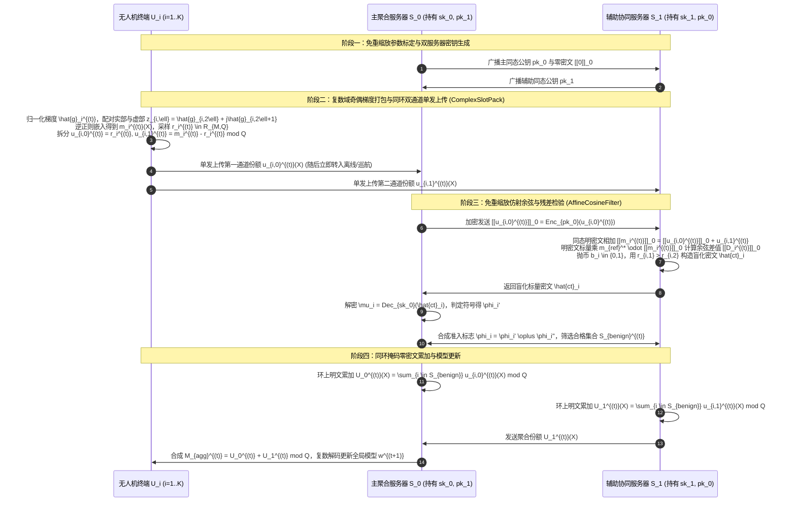
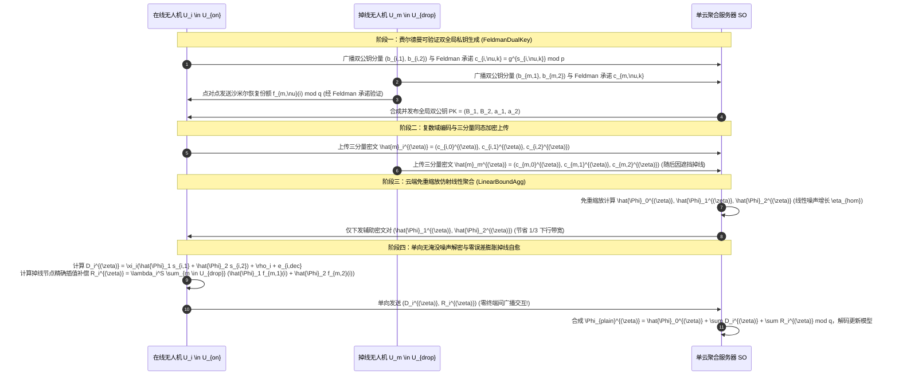
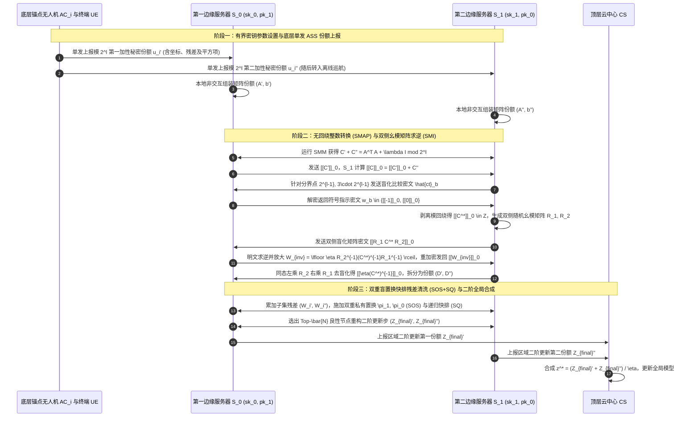
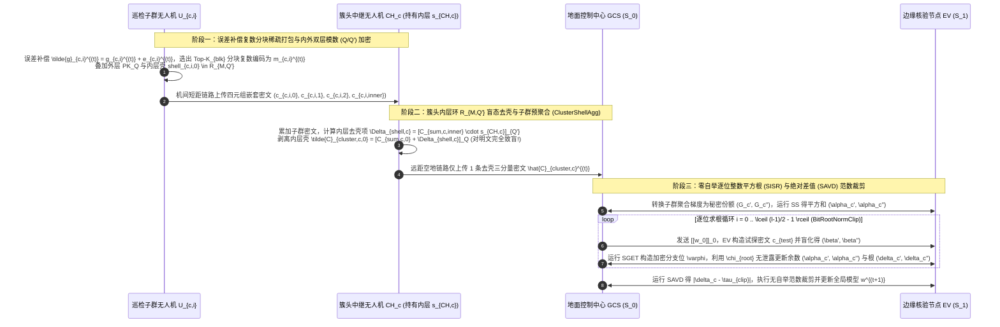

# 融合全同态架构创新与明密文交互优化的无人机联邦学习方案设计（第十一辑）

---

## 第一章 无人机与边缘辅助联邦学习（UAV/Edge-Assisted FL）核心挑战与组合创新范式

### 1.1 无人机辅助联邦学习（UAV/Edge-Assisted FL）的实际应用场景与四大核心痛点

在低空经济、6G空天地一体化网络（SAGIN）、灾后应急搜救、广域输电走廊智能巡检以及现代智慧物流配送等实际场景中，无人机（UAV）很少孤立地执行集中式云端推理，而是广泛工作于**无人机辅助（UAV-Assisted）**或**边缘辅助（Edge-Assisted）**的协同联邦学习架构中：
1. **标准联邦学习架构（Standard FL）**：多架工业巡检或城市配送无人机作为智能终端直接采集多模态高分辨率遥感与机载状态数据，在本地训练深度神经网络，并与地面双边缘服务器（Dual-Server）或单云端参数服务器（Single-Server）交互完成全局模型聚合。
2. **层次型联邦学习架构（Hierarchical FL）**：受限于机载电池容量、单跳视距（LoS）通信半径与城市峡谷非视距（NLoS）遮挡，实际低空系统通常构建“**地面传感器/微型无人机子群 $\to$ 悬停中继/簇头无人机（Edge/Relay UAV） $\to$ 地面云中心或双边缘服务器**”的三层层次化拓扑。

在上述实际应用场景中，构建高安全、高可用、低开销的隐私保护联邦学习（PPFL）面临以下四大核心挑战：

- **挑战一：机载端侧算力能耗受限与全同态加密（FHE）计算/通信膨胀的矛盾**
  标准RLWE同态加密（如CKKS、BFV）需要将浮点梯度编码至高维分圆多项式环 $R_q = \mathbb{Z}_q[X]/(X^N+1)$（通常 $N \ge 8192$），单条密文体积达数百KB（例如在 `26-PPDO` [Zhao et al., *AEI* 2026] 中，$N=8192, \log_2 q = 200$ 时单条CKKS密文达 $334.3\text{ KB}$，密文膨胀比高达 $20883.4$ 倍）。若无人机每轮直接对全量百万维实数梯度逐一加密，或频繁执行密文与密文乘法（Ciphertext-Ciphertext Multiplication）及自举（Bootstrapping），机载CPU将面临严重的计算阻塞与电量耗尽风险。
- **挑战二：分布式门限解密与多密钥份额交互带来的“通信风暴”与“噪声爆炸”**
  为消除单点私钥泄露风险，现有多密钥同态（如 `CDKS`、`xMK-CKKS`）或门限同态方案（如 `26-PPDO` 的 $(t,n)$-TCKKS）要求参与方广播或两两交换部分解密份额（Partial Decryption Shares）。在 `26-PPDO` 的实测（Table 5）中，仅10架无人机的部分解密份额双向交换（$\text{UAV} \leftrightarrow \text{UAV}$）就占据了每轮总通信流量的 **$50.0\%$（$6529.34\text{ KB/iter}$）**！此外，门限解密为防止单个份额泄露私钥，必须注入淹没噪声（Smudging Noise），或者在拉格朗日插值重构 $s = \sum_{i \in S} \lambda_i^S sk_i \pmod q$ 时将解密噪声放大 $\sum_{i \in S} |\lambda_i^S|$ 倍，极易突破解密上界 $\eta_{\text{bound}}$。
- **挑战三：密文域盲态聚合对拜占庭投毒、非视距（NLoS）异常状态与非独立同分布（Non-IID）偏移的脆弱性**
  同态加密的语义安全性（IND-CPA）使聚合服务器对密文内部梯度完全“致盲”。恶意被劫持无人机或遭遇强电磁干扰/NLoS多径效应的异常无人机若上传符号翻转梯度、高斯噪声或后门样本更新，服务器若不加检验直接执行同态加法，全局模型将在数轮内发散。然而，若直接在单服务器FHE密文域用高次多项式逼近余弦相似度、欧氏范数平方根或排序函数，不仅产生巨大な乘法深度消耗，还会因固定区间外泰勒逼近发散而引发诚实节点误杀。
- **挑战四：动态低空拓扑下的频繁掉线、分割学习切分层特征反演与二阶矩阵求逆难题**
  无人机在高速机动中常因遮挡或返航发生掉线（Dropout）；在资源受限的分割联邦学习（Split FL）中，微型无人机仅运行前几层网络并将切分层激活值发送给空中算力母机，极易遭受切分层模型反演与跨样本同态替换攻击（如 `25-BAEVFL`、`23-SLADV`）；而在二阶牛顿优化或最小二乘定位校准中，密文域矩阵求逆（如 $(\mathbf{A}^T\mathbf{A})^{-1}$ 或海森矩阵求逆 $\mathbf{H}^{-1}$）在传统FHE下几乎无法高效精确完成。

---

### 1.2 26篇核心文献与2025–2026前沿研究的递进演进脉络（Step-by-Step Evolution）

遵循循序渐进的演化规律，我们将26篇支撑文献（含最新上传的 `24-PPRP` 与 `26-PPDO`）、3份 `ATASSES` 架构扩展指南以及2025–2026年CCF-A类顶会顶刊的最新成果梳理为四条清晰的演进主线：

#### 主线一：全同态加密底层架构与解密机制演进（从单密钥到无淹没噪声双全局私钥与免重缩放线性噪声）
1. **单密钥CKKS/Paillier（如 `BatchCrypt`、`PHEPP`）**：所有客户端共享同一私钥 $sk$，一旦任意一架无人机被物理俘获或单服务器被攻破，全体历史与当前明文梯度瞬间泄露。
2. **`CDKS` 多密钥同态（2019）**：每架无人机独立生成私钥 $s_i$，支持动态加入，但聚合密文维度随参与方数量 $K$ 线性膨胀为 $(c_0, c_1, \dots, c_K)$，且解密时各节点直接上传部分解密份额 $p_i = c_i s_i + e_i^*$，存在私钥线性组合泄露风险。
3. **`xMK-CKKS`（2021）**：将各节点公钥聚合为统一公钥以压缩密文长度，但为防止部分解密份额 $d_i = c_1 s_i + e_i^*$ 泄露私钥 $s_i$，必须引入远大于正常RLWE误差的**淹没噪声（Smudging Noise）** $e_i^* \sim \chi_{\text{smudge}}$，导致低比特模数下模型精度严重受损。
4. **`CDKS-LSS` 与 `24-LBDT`（2024）**：引入线性秘密共享（LSS）支持客户端掉线恢复，但掉线重构阶段仍存在较高的通信轮次与拉格朗日系数膨胀。
5. **`25-ATASSES` 及其三大架构扩展（2025）**：
   - **基础 `ATASSES`**：摒弃淹没噪声，让每个客户端持有双私钥份额 $(s_{k,1}, s_{k,2})$ 隐式合成双全局私钥 $S_1 = \sum \xi_k s_{k,1}, S_2 = \sum \xi_k s_{k,2}$，利用双密文分量 $(c_0, c_1, c_2)$ 使随机项在聚合中代数相消，实现**零淹没噪声**的高精度解密；
   - **扩展一（`ATASSES-Ext1` 嵌套模数分层解耦）**：外层模数 $Q$ 由终端私钥 $s_i$ 加密，内层小模数 $Q'$ 由中心/簇头私钥 $s_c$ 加密，实现边缘聚合与中心去壳的权限分离；
   - **扩展二（`ATASSES-Ext2` 同环 $\mathcal{R}_{M,Q}$ 明密文双通道聚合）**：客户端无需执行完整FHE加密，仅需在环 $\mathcal{R}_{M,Q}$ 上生成两份关联掩码多项式直发双服务器，端侧计算复杂度降至纯加法级；
   - **扩展三（`ATASSES-Ext3` 跨环降维嵌入 $\mathcal{R}_{M,Q} \to \mathcal{R}_{M',Q'}$）**：将高维环多项式系数按块折叠映射至低维子环，大幅压缩下发与部分解密通信开销。
6. **`24-PPRP`（Huang et al., *IEEE TMC* 2024）与 `26-PPDO`（Zhao et al., *AEI* 2026）的最新突破与遗留痛点**：
   - `24-PPRP` 提出了去中心化双服务器（$S_0, S_1$）架构下**有界密钥复用次数（Bounded Key Usage）**的同态参数缩减定理（将安全参数 $\tau$ 从 $\frac{\lambda}{\log \lambda}(k_0-k_1-k_2)^2 = 4,304,578\text{ bits}$ 降至 $\tau = k_0^2 = 250,000\text{ bits}$，只要密钥使用次数 $t + 1 < \frac{\tau-k_1-k_2}{k_0-k_1-k_2} = 1246$ 即切换新密钥，即可抵抗格基规约攻击），并设计了无需离线Beaver三元组预处理的10个二方安全子协议（`SLT/SGET`、`SS`、`SMM`、`SMAP`、`SMI`、`SIDIV`、`SAVD`、`SISR`、`SOS`、`SQ`）。但 `24-PPRP` 仅针对单一定位向量求解，缺乏面向高维神经网络梯度的SIMD槽位打包机制。
   - `26-PPDO` 首次利用CKKS原生支持复数域 $\mathbb{C}^{N/2}$ 的特性，将二维坐标实部与虚部直接编码为复数 $z_i = x_i + j y_i$，并将梯度更新构造为仿射线性形式 $\Phi_i(\mathbf{z}) = A_i \mathbf{z} + B_i$，从而**彻底规避了密文与密文乘法，实现免重缩放（Rescale-Free）的受控线性噪声增长** $\eta_{\text{hom}} = \sum (\eta_{\text{scalar}} + \eta_{\text{add}}) \le \eta_{\text{bound}} = 2\Delta \cdot 10^{-\sigma}$，获得了优于差分隐私9个数量级（$10^{-9}$ 级）的收敛精度！然而，`26-PPDO` 采用传统的 $(t,n)$ 门限CKKS（`Algorithm 3`），不仅要求无人机之间两两广播交换解密份额（占总通信量 $50\%$），且仅适用于良性半诚实环境，缺乏拜占庭鲁棒防御与掉线无感恢复机制。

#### 主线二：密文域拜占庭鲁棒聚合演进（从单服务器高次近似到双服务器多交互精确算子）
1. **`ShieldFL`（*IEEE TIFS* 2022）与 `SFLBR`（2024）**：首次在双服务器密文域引入余弦相似度防御毒化攻击，但归一化与内积交互轮次较多，面对Non-IID异构数据时易误伤良性边缘节点。
2. **`26-PBFL`（*IEEE TIFS* / 2026演进版）与 `25-GuardFL` / `26-BPFLH`（2025–2026最新研究）**：引入历史梯度动量平滑、跨群组一致性检验或细粒度逐元素相异性度量（如Bray-Curtis距离与子集残差分析），将密文域复杂非线性函数拆解为轻量级掩码交互，避免了密文域直接高次多项式逼近带来的精度崩溃。

#### 主线三：密文域高效通信与打包降维演进（从全量加密到稀疏分块打包与复数域槽位复用）
1. **`24-ESAFL`（2024）与 `25-FedPHE`（*IEEE INFOCOM* 2024 & *IEEE TDSC* 2025）**：`FedPHE` 结合包级Top-$k$稀疏化（Pack-level Sparsification）、秘密共享混淆与扰动草图（Perturbed Sketch）客户端选择，将CKKS密文通信开销降低 $1.24\sim 22.62\times$；`MaskCrypt`（Hu & Li, *IEEE TDSC* 2025）与 `AdaptiveCKKS`（2026）进一步通过选择性同态加密与无索引分块稀疏量化压缩端侧上行负载。

#### 主线四：可验证聚合与分割联邦学习安全演进
1. **`26-FedOut`（2026）与 `26-PVFL`（2026）**：利用同态哈希、双线性配对或费尔德曼可验证秘密共享（Feldman VSS，见 `26-PPDO` `Algorithm 2`）抵御聚合服务器伪造或惰性计算。
2. **`25-BAEVFL`（2025）与 `23-SLADV`（2023）**：揭示了纵向/分割联邦学习中切分层特征与反传梯度的跨样本替换与阴影模型窃取威胁，亟需结合匿名置换（如 `24-PPRP` 的 `SOS` 协议）切断样本索引关联。

---

### 1.3 本报告的“全同态架构组合创新公式”与五套全新方案顶层规划

为了使每一套方案在结构逻辑和数学严密性上全面超越现有单点研究，我们严格遵循**组合递进创新公式**（如 $\text{A}_{\text{pro}} + \text{B}_{\text{pro}} + \text{S}_1 + \text{S}_2$ 或 $\text{A} + (\text{B}+\text{C}) + \text{S} = \text{A} + \text{D} + \text{S}$），将**全同态加密的底层架构改进（$\text{A}_{\text{pro}}, \text{B}_{\text{pro}}$）**作为首要核心引擎，并与**高效通信/鲁棒防御/可验证/二阶优化等业务子协议（$\text{S}_1, \text{S}_2$）**深度耦合，构建出**第十一辑（Series 11）五套完全不与前十辑重复的全新方案**（命名简洁优雅，绝不含任何连字符 `-`，行文采用经典自然学术表述）：

| 方案序号 | 方案名称 | 架构类型 | 组合创新公式 ($\text{A}_{\text{pro}} + \text{B}_{\text{pro}} + \text{S}_1 + \text{S}_2$) | 核心解决的痛点问题 | 包含的3个核心算法伪代码 |
| :--- | :--- | :--- | :--- | :--- | :--- |
| **方案一** | **`ComplexShareFL`** | 标准FL（双服务器架构） | $\underbrace{\text{PPDO复数域双层打包}}_{\text{A}_{\text{pro}}} + \underbrace{\text{ATASSES同环双通道掩码}}_{\text{B}_{\text{pro}}} + \underbrace{\text{PPRP无乘法余弦残差检验}}_{\text{S}_1} + \underbrace{\text{单轮直发解密}}_{\text{S}_2}$ | 解决 `26-PPDO` 解密份额交换占 $50\%$ 流量瓶颈、实数打包槽位浪费一半及双服务器盲态下无法防御符号翻转投毒的问题 | ① `ComplexShareFL` (主算法)<br>② `ComplexSlotPack` (子算法1)<br>③ `AffineCosineFilter` (子算法2) |
| **方案二** | **`LinearNoiseFL`** | 标准FL（单服务器架构） | $\underbrace{\text{PPDO免重缩放线性噪声控制}}_{\text{A}_{\text{pro}}} + \underbrace{\text{Feldman可验证双全局私钥}}_{\text{B}_{\text{pro}}} + \underbrace{\text{PPRP有界密钥轮次演进}}_{\text{S}_1} + \underbrace{\text{掉线自愈聚合}}_{\text{S}_2}$ | 解决单服务器FHE重缩放深度消耗大、`26-PPDO` 拉格朗日插值噪声放大与份额伪造、以及无人机掉线导致聚合停滞的问题 | ① `LinearNoiseFL` (主算法)<br>② `FeldmanDualKey` (子算法1)<br>③ `LinearBoundAgg` (子算法2) |
| **方案三** | **`UnimodularGradFL`** | 层次型FL（地面终端与锚点UAV + 双边缘服务器 + 云端） | $\underbrace{\text{PPDO仿射线性梯度重构}}_{\text{A}_{\text{pro}}} + \underbrace{\text{PPRP无回绕整数域转换}}_{\text{B}_{\text{pro}}} + \underbrace{\text{幺模矩阵逆二阶牛顿更新}}_{\text{S}_1} + \underbrace{\text{匿名快排残差剔除}}_{\text{S}_2}$ | 解决非视距（NLoS）遮挡与病态曲率下无人机一阶梯度收敛慢、密文域海森矩阵求逆不可行及整数加法模回绕失真的问题 | ① `UnimodularGradFL` (主算法)<br>② `UnimodularNewton` (子算法1)<br>③ `ResidualSortClean` (子算法2) |
| **方案四** | **`BitRootShellFL`** | 层次型FL（巡检UAV子群 + 簇头UAV + 地面站） | $\underbrace{\text{ATASSES嵌套模数去壳}}_{\text{A}_{\text{pro}}} + \underbrace{\text{FedPHE复数分块稀疏打包}}_{\text{B}_{\text{pro}}} + \underbrace{\text{PPRP逐位整数平方根裁剪}}_{\text{S}_1} + \underbrace{\text{绝对差值偏差抑制}}_{\text{S}_2}$ | 解决机载空地链路带宽受限、密文域精确计算欧氏范数 $\sqrt{\|\mathbf{g}\|_2^2}$ 需高开销自举或牛顿除法、以及簇头越权解密的问题 | ① `BitRootShellFL` (主算法)<br>② `BitRootNormClip` (子算法1)<br>③ `ClusterShellAgg` (子算法2) |
| **方案五** | **`AnonCutSplitFL`** | 层次型FL（微型UAV子群 + 空中算力母机 + 云中心分割FL） | $\underbrace{\text{PPDO复数切分层特征同态}}_{\text{A}_{\text{pro}}} + \underbrace{\text{PPRP双重随机置换混洗}}_{\text{B}_{\text{pro}}} + \underbrace{\text{批梯度重排不变性反传}}_{\text{S}_1} + \underbrace{\text{ATASSES双钥模型合成}}_{\text{S}_2}$ | 解决微型无人机无法运行完整大模型、分割学习切分层激活值面临特征反演与 `25-BAEVFL` 跨样本替换攻击的难题 | ① `AnonCutSplitFL` (主算法)<br>② `ObliviousBatchMix` (子算法1)<br>③ `DualKeySplitSync` (子算法2) |

---
## 第二章 方案一：`ComplexShareFL` —— 基于复数域槽位打包与同环双通道掩码的无乘法鲁棒联邦学习方案（标准FL·双服务器架构）

### 5.1 场景与整体架构（含各实体可见与不可见信息表）

#### 1. 实际应用场景
在城市智慧物流与低空交通态势感知场景中，$K$ 架配送无人机（UAV Clients，$\mathcal{U} = \{U_1, U_2, \dots, U_K\}$）在城市商业区执行包裹投递任务，同时利用机载双目视觉与毫米波雷达采集低空障碍物与风场数据，协同训练一套三维航迹避障与能耗预测深度神经网络。地面部署两台由不同低空运营商独立管理的边缘计算服务器——**主聚合服务器 $S_0$（Primary Aggregation Server）**与**辅助协同服务器 $S_1$（Auxiliary Cooperative Server）**，构成**标准联邦学习下的去中心化双服务器架构（Dual-Server Standard FL）**。无人机仅需在完成本地训练后执行一次轻量级双通道上传即可转入休眠或巡航状态，所有繁重的拜占庭投毒检测与全局模型聚合全部卸载至地面双服务器完成。

#### 2. 实体可见与不可见信息表
| 参与实体 | 实体角色与数量 | 可见信息（Visible Information） | 不可见信息（Invisible Information） |
| :--- | :--- | :--- | :--- |
| **无人机终端 $U_i$** | 数据持有方与本地训练节点（$i \in \{1,\dots,K\}$） | 自身本地私有数据集 $\mathcal{D}_i$、本地梯度向量 $\mathbf{g}_i^{(t)} \in \mathbb{R}^d$、自身在环 $\mathcal{R}_{M,Q}$ 上生成的双通道份额 $(u_{i,0}^{(t)}, u_{i,1}^{(t)})$、最终下发的全局模型参数 $\mathbf{w}^{(t+1)}$ | 其他无人机 $U_j (j \neq i)$ 的本地数据与梯度、服务器 $S_0$ 与 $S_1$ 的同态私钥 $(sk_0, sk_1)$、其他节点的鲁棒得分与中间掩码值 |
| **主聚合服务器 $S_0$** | 第一通道份额接收方与主同态私钥持有方（1台） | 自身同态公私钥对 $(pk_0, sk_0)$、辅助服务器公钥 $pk_1$、各无人机上传的第一通道环多项式份额 $u_{i,0}^{(t)} \in \mathcal{R}_{M,Q}$、经 $S_1$ 随机化掩码盲化后的单比特符号检验结果 $\phi_i'$、聚合后的全局模型更新的第一份额 | 任何无人机 $U_i$ 的真实明文梯度 $\mathbf{g}_i^{(t)}$、各无人机的第二通道份额 $u_{i,1}^{(t)}$、$S_1$ 持有的同态私钥 $sk_1$ 与随机盲化因子 $(r_{i,1}, r_{i,2}, b_i)$、真实余弦相似度数值 |
| **辅助协同服务器 $S_1$** | 第二通道份额接收方与密文交互评测方（1台） | 自身同态公私钥对 $(pk_1, sk_1)$、主服务器公钥 $pk_0$、各无人机上传的第二通道环多项式份额 $u_{i,1}^{(t)} \in \mathcal{R}_{M,Q}$、由 $S_0$ 加密发来的同态密文 $\llbracket u_{i,0}^{(t)} \rrbracket_0$、自身生成的随机翻转比特 $b_i$ 与检验份额 $\phi_i''$ | 任何无人机 $U_i$ 的真实明文梯度 $\mathbf{g}_i^{(t)}$、各无人机的第一通道份额 $u_{i,0}^{(t)}$、$S_0$ 持有的同态私钥 $sk_0$、解密后的比较中间值 $\widehat{ct}_i$ |

---

### 5.2 要解决的问题

1. **`26-PPDO` 门限解密份额交换导致的 $50\%$ 通信带宽瓶颈与机载端侧公钥加密高耗时问题**：
   在 `26-PPDO`（Zhao et al., *AEI* 2026, Table 4 & Table 5）中，每架无人机不仅需要花费 $70.9\%$ 的计算时间（$32.172\text{ ms}$）执行RLWE公钥加密，更需要在每轮迭代中与其他至少 $t$ 架无人机双向交换部分解密份额（$\text{UAV} \leftrightarrow \text{UAV}$），该过程消耗了 **$6529.34\text{ KB/iter}$，占系统总通信量的整整 $50.0\%$**，且要求所有无人机在聚合阶段保持持续在线交互。
2. **传统CKKS实数编码导致一半复数槽位浪费与密文膨胀问题**：
   标准CKKS分圆多项式环 $R_q = \mathbb{Z}_q[X]/(X^N+1)$ 的正则嵌入空间为 $\mathbb{C}^{N/2}$。多数联邦学习方案（如 `CDKS`、`xMK-CKKS`）在加密实数神经网络梯度时，直接将虚部置零，导致单条密文仅能装载 $N/2$ 个实数参数，槽位利用率损失 $50\%$，通信开销翻倍。
3. **双服务器盲态聚合下缺乏零密文乘法的抗拜占庭投毒检验机制**：
   当部分被劫持无人机发起符号翻转攻击（Sign-Flipping Attack）或局部模型投毒时，传统双服务器方案（如 `ShieldFL`）需要在密文域执行复杂的向量归一化与密文-密文内积乘法，引发高昂的重缩放（Rescaling）开销与噪声二次膨胀；而 `26-PPDO` 完全未考虑恶意节点投毒，一旦混入单个异常梯度即可破坏全局收敛。

---

### 5.3 创新点与总体设计目标（中英双语四段式）

本方案遵循组合递进创新公式：
$$\text{ComplexShareFL} = \underbrace{\text{PPDO复数域奇偶双层交织编码}}_{\text{A}_{\text{pro}}\text{（同态编码层升级）}} + \underbrace{\text{ATASSES-Ext2同环 }\mathcal{R}_{M,Q}\text{ 单发双通道掩码}}_{\text{B}_{\text{pro}}\text{（同态架构层升级）}} + \underbrace{\text{PPRP无密文乘法线性噪声余弦检验}}_{\text{S}_1\text{（鲁棒防御子协议）}} + \underbrace{\text{双边缘份额直发合成}}_{\text{S}_2\text{（零份额广播解密）}}$$

- **(1) 复数域奇偶梯度配对打包与同环双通道单发掩码架构（Complex-Field Paired-Gradient Packing and Same-Ring Dual-Channel One-Shot Masking Architecture）**
  - **English**: To eliminate the $70.9\%$ client-side encryption latency and $50.0\%$ peer-to-peer decryption-share traffic bottleneck in `26-PPDO` while doubling slot capacity, we propose a complex-field paired-gradient packing and same-ring dual-channel masking architecture (`ComplexSlotPack`). Specifically, each UAV pairs its odd-indexed and even-indexed normalized gradient layers into complex vectors $\mathbf{z}_i = \mathbf{g}_{i,\text{even}} + j \mathbf{g}_{i,\text{odd}} \in \mathbb{C}^{N/2}$, maps them into the cyclotomic polynomial ring $\mathcal{R}_{M,Q}$ via inverse canonical embedding, and splits the encoded polynomial into two additive ring shares $(u_{i,0}, u_{i,1})$ reported to $S_0$ and $S_1$ in a single one-shot transmission without any onboard RLWE encryption or inter-UAV share exchange.
  - **中文**：针对 `26-PPDO` 中端侧加密占总计算耗时 $70.9\%$ 以及无人机间解密份额交换占总流量 $50.0\%$ 的瓶颈，同时解决传统CKKS实数加密浪费一半虚部槽位的问题，我们提出了复数域奇偶梯度配对打包与同环双通道单发掩码架构（`ComplexSlotPack`）。每架无人机将本地归一化梯度的偶数层与奇数层分量配对构造为复数向量 $\mathbf{z}_i = \mathbf{g}_{i,\text{even}} + j \mathbf{g}_{i,\text{odd}} \in \mathbb{C}^{N/2}$，经逆正则嵌入与缩放离散化映射至分圆多项式环 $\mathcal{R}_{M,Q}$，并在同一环上直接拆分为两份满足模加关系的掩码多项式 $(u_{i,0}, u_{i,1})$ 单发上传至 $S_0$ 与 $S_1$。无人机端侧实现了零同态加密运算与“上传即离线”，将单密文实数参数装载量提升 $2$ 倍，并彻底消除了无人机之间的解密份额广播流量。
- **(2) 免重缩放线性噪声增长的明密文仿射内积与无乘法余弦残差检验协议（Rescale-Free Linear-Noise Affine Inner-Product and Multiplication-Free Cosine-Residual Verification Protocol）**
  - **English**: Inspired by the linear noise growth structure of `26-PPDO` and the Beaver-triple-free secure square (`SS`) and comparison (`SGET`) modules of `24-PPRP`, we design an interactive multiplication-free cosine-residual verification protocol (`AffineCosineFilter`) between $S_0$ and $S_1$. By leveraging conjugate-transpose complex slot inner products and decomposing cross-share products $(u_{i,0} + u_{i,1}) \cdot (\bar{u}_{0} + \bar{u}_{1})$ into local plaintext products and plaintext-ciphertext scalar multiplications, the two servers evaluate cosine alignment and historical momentum residuals with strictly linear noise growth and zero ciphertext-ciphertext multiplications.
  - **中文**：深度融合 `26-PPDO` 免重缩放的线性噪声增长结构与 `24-PPRP` 无需离线Beaver三元组的安全平方（`SS`）及安全比较（`SGET`）机制，我们设计了双服务器间的免重缩放明密文仿射内积与无乘法余弦残差检验协议（`AffineCosineFilter`）。利用复数域共轭内积性质，将待检无人机梯度与历史全局基准方向的内积拆解为双服务器本地明文乘积与明密文标量乘法，使整个鲁棒方向检验与历史动量残差评估完全规避了密文与密文乘法，噪声呈严格线性可控增长，无需执行任何耗时重缩放或自举操作即可精准剔除符号翻转与高斯投毒梯度。
- **(3) 随机化符号盲化与秘密共享掩码过滤机制（Randomized Sign-Blinding and Secret-Shared Mask Filtering Mechanism）**
  - **English**: To prevent either semi-honest server from inferring individual gradient magnitudes or exact similarity scores during robustness filtering, we introduce a coin-flipping multiplicative-additive blinding mechanism over ring ciphertexts. Server $S_1$ blinds the threshold difference using random coin $b_i \in \{0,1\}$ and positive random scalars $r_{i,1} > r_{i,2}$, ensuring that $S_0$ only recovers a blinded sign bit $\phi_i'$ while the true validity indicator $\phi_i = \phi_i' \oplus \phi_i''$ remains secret-shared until qualified gradients are securely accumulated.
  - **中文**：为防止任一半诚实服务器在鲁棒检验过程中推断出单个无人机的梯度幅值或精确余弦相似度，我们在环密文交互中引入了随机抛币符号盲化与秘密共享掩码过滤机制。辅助服务器 $S_1$ 利用随机抛币比特 $b_i \in \{0,1\}$ 与满足 $r_{i,1} > r_{i,2} > 0$ 的双随机标量对检验差值密文进行同态线性混淆，确保主服务器 $S_0$ 解密后仅能获得无分布偏向的单比特份额 $\phi_i'$，而真实准入标志 $\phi_i = \phi_i' \oplus \phi_i''$ 始终以异或秘密共享形式分布式保存，严密保护了良性无人机的梯度分布隐私。
- **(4) 严密的模拟范式安全性证明与全方位实验评估设计（Rigorous Simulation-Based Security Proof and Comprehensive Experimental Evaluation）**
  - **English**: We establish a formal real/ideal-world simulation security proof under the RLWE and $(L,p)$-decision assumptions against non-colluding semi-honest servers and up to $40\%$ Byzantine UAVs, and design a comprehensive experimental benchmark comparing against state-of-the-art baselines (`26-PPDO`, `24-PPRP`, `ShieldFL`, and `25-FedPHE`).
  - **中文**：我们在双服务器不合谋半诚实及最高 $40\%$ 恶意拜占庭无人机威胁模型下，基于RLWE困难性假设完成了标准真实/理想世界模拟器不可区分性证明，并构建了涵盖 `26-PPDO`、`24-PPRP`、`ShieldFL` 与 `25-FedPHE` 四大代表性基线的完整实验评估体系。

---

### 5.4 威胁模型（Threat Model）

1. **半诚实且不合谋的双边缘服务器（Honest-but-Curious and Non-Colluding Dual Edge Servers）**：
   主聚合服务器 $S_0$ 与辅助协同服务器 $S_1$ 均属于**半诚实（Honest-but-Curious / Semi-Honest）**实体。它们严格遵守协议规定的步骤执行环多项式加法、同态标量乘法与密文交互，但各自会尝试利用自身观察到的协议视图（$\text{VIEW}_{S_0}^{\Pi}$ 或 $\text{VIEW}_{S_1}^{\Pi}$）反演诚实无人机 $U_i$ 的本地私有梯度 $\mathbf{g}_i^{(t)}$ 或原始图像数据。假设 $S_0$ 与 $S_1$ 隶属于不同运营商，**彼此之间绝不合谋（Non-Colluding）**，即攻击者 $\mathcal{A}$ 至多只能攻破 $S_0$ 或 $S_1$ 中的一台（不能同时控制两台服务器）。
2. **恶意拜占庭无人机与合谋好奇无人机（Malicious Byzantine and Colluding Curious UAVs）**：
   在 $K$ 架无人机中，允许存在比例不超过 $\gamma < 0.5$ 的被劫持或故障无人机集合 $\mathcal{C} \subset \mathcal{U}$：
   - **隐私窃取共谋**：恶意无人机集合 $\mathcal{C}$ 可以相互合谋，甚至与其中一台被攻破的边缘服务器（$S_0$ 或 $S_1$）合谋，试图恢复诚实无人机集合 $\mathcal{H} = \mathcal{U} \setminus \mathcal{C}$ 的私有本地梯度。
   - **拜占庭模型投毒**：恶意无人机在上传双通道份额时，可故意注入符号翻转梯度（$\mathbf{g}_{\text{mal}} = -\alpha \mathbf{g}_i$）、大方差高斯噪声或后门触发梯度，企图破坏全局模型收敛或植入后门。

---

### 5.5 符号系统介绍（Notation Table）

| 符号 | 数学含义与物理定义 |
| :--- | :--- |
| $K, i, t$ | 无人机总数 $K$，无人机索引 $i \in \{1,\dots,K\}$，联邦训练全局迭代轮次 $t \in \{1,\dots,T\}$ |
| $d, N$ | 神经网络梯度实数总维度 $d$，分圆多项式环次数 $N = 2^k$（单个多项式支持 $N/2$ 个复数槽位，$N$ 个实数分量） |
| $\mathcal{R}, \mathcal{R}_{M,Q}$ | 整数多项式环 $\mathcal{R} = \mathbb{Z}[X]/(X^N+1)$，模 $Q$ 分圆多项式环 $\mathcal{R}_{M,Q} = \mathbb{Z}_Q[X]/(X^N+1)$（其中 $M = 2N$） |
| $\sigma(\cdot), \sigma^{-1}(\cdot)$ | CKKS正则嵌入映射 $\sigma: \mathbb{C}[X]/(X^N+1) \to \mathbb{C}^{N/2}$ 及其逆正则嵌入映射 $\sigma^{-1}$ |
| $\Delta, \sigma_{\text{prec}}$ | 浮点数定点化缩放因子 $\Delta = 2^{40}$，有效精度保留十进制位数 $\sigma_{\text{prec}}$ |
| $\mathbf{g}_i^{(t)}, \hat{\mathbf{g}}_i^{(t)}$ | 无人机 $U_i$ 在第 $t$ 轮的原始实数梯度向量 $\mathbf{g}_i^{(t)} \in \mathbb{R}^d$ 及本地单位范数归一化梯度 $\hat{\mathbf{g}}_i^{(t)} = \mathbf{g}_i^{(t)} / \|\mathbf{g}_i^{(t)}\|_2$ |
| $\mathbf{z}_i^{(t)} \in \mathbb{C}^{N/2}$ | 复数域奇偶层交织打包向量，$z_{i,\ell}^{(t)} = \hat{g}_{i,2\ell}^{(t)} + j \cdot \hat{g}_{i,2\ell+1}^{(t)}$（$\ell = 0, \dots, N/2-1$） |
| $m_i^{(t)}(X) \in \mathcal{R}$ | 经CKKS逆正则嵌入与缩放取整后的明文多项式 $m_i^{(t)}(X) = \lfloor \Delta \cdot \sigma^{-1}(\mathbf{z}_i^{(t)}) \rceil$ |
| $u_{i,0}^{(t)}, u_{i,1}^{(t)} \in \mathcal{R}_{M,Q}$ | 无人机 $U_i$ 生成并分别发往 $S_0, S_1$ 的同环双通道掩码多项式，满足 $u_{i,0}^{(t)} + u_{i,1}^{(t)} \equiv m_i^{(t)} \pmod Q$ |
| $(pk_0, sk_0), (pk_1, sk_1)$ | 主服务器 $S_0$ 与辅助服务器 $S_1$ 各自持有的RLWE同态公私钥对，密文分别记为 $\llbracket \cdot \rrbracket_0$ 与 $\llbracket \cdot \rrbracket_1$ |
| $\mathbf{v}_{\text{ref}}^{(t)}, m_{\text{ref}}^{(t)}(X)$ | 第 $t$ 轮历史动量基准梯度向量 $\mathbf{v}_{\text{ref}}^{(t)} = \beta \mathbf{v}_{\text{ref}}^{(t-1)} + (1-\beta)\bar{\mathbf{g}}^{(t-1)}$ 及其复数共轭编码多项式 |
| $\tau_{\cos}, \tau_{\text{res}}$ | 密文域余弦相似度准入阈值 $\tau_{\cos} \in (0, 1)$ 与历史动量残差平方上界阈值 $\tau_{\text{res}} > 0$ |
| $\phi_i', \phi_i'', \phi_i$ | $S_0$ 与 $S_1$ 持有的单比特比较结果秘密份额 $\phi_i', \phi_i'' \in \{0,1\}$，真实准入位 $\phi_i = \phi_i' \oplus \phi_i'' \in \{0,1\}$ |

---

### 5.6 方案详细设计与闭环公式推导

本节给出 `ComplexShareFL` 从系统初始化、端侧复数域双层打包与双通道单发上传、双服务器免重缩放仿射余弦与残差检验，到安全掩码聚合与模型更新的完整闭环公式推导。每一步均明确标注发送方、接收方与代数展开过程，无任何跳步。

#### 阶段一：系统初始化与免重缩放同态参数标定（System Initialization & Rescale-Free Parameter Calibration）

1. **执行主体**：系统管理员与双边缘服务器 $S_0, S_1$。
2. **免重缩放线性噪声参数标定（融合 `26-PPDO` Assumption 3）**：
   设模型梯度经本地归一化后各分量幅值上界为 $L_z = \|\hat{\mathbf{g}}_i^{(t)}\|_{\infty} \le 1$，双服务器交互检验中的公开或半共享标量算子幅值上界为 $L_A$，常数偏置上界为 $L_B$。为确保在完全不执行重缩放（Rescaling）的前提下经过一轮明密文仿射运算后噪声绝不溢出，依据 `26-PPDO` 式(14)-(16)标定缩放因子 $\Delta$ 与模数 $Q$：
   $$\Delta \ge 10^{\sigma_{\text{prec}}} \cdot (L_A \cdot L_z + L_B), \quad Q \ge 2\Delta^2 \cdot (L_A \cdot L_z + L_B) + \kappa \cdot \eta_{\max}$$
   其中解密容忍的最大噪声上界定义为 $\eta_{\text{bound}} = 2\Delta \cdot 10^{-\sigma_{\text{prec}}}$。
3. **双服务器RLWE密钥独立生成**：
   - **主服务器 $S_0$** 从离散高斯分布 $\chi$ 中采样私钥多项式 $s_0 \leftarrow \chi$（系数属于 $\{-1,0,1\}$），均匀采样公共随机多项式 $a_0 \xleftarrow{\$} \mathcal{R}_{M,Q}$ 及误差多项式 $e_0 \leftarrow \chi$，计算公钥：
     $$b_0 = [-a_0 \cdot s_0 + e_0]_Q \in \mathcal{R}_{M,Q}, \quad pk_0 = (b_0, a_0) \in \mathcal{R}_{M,Q}^2, \quad sk_0 = s_0$$
     $S_0$ 将公钥 $pk_0$ 发送给辅助服务器 $S_1$。
   - **辅助服务器 $S_1$** 同理独立采样 $s_1 \leftarrow \chi, a_1 \xleftarrow{\$} \mathcal{R}_{M,Q}, e_1 \leftarrow \chi$，生成自身公私钥对：
     $$b_1 = [-a_1 \cdot s_1 + e_1]_Q \in \mathcal{R}_{M,Q}, \quad pk_1 = (b_1, a_1) \in \mathcal{R}_{M,Q}^2, \quad sk_1 = s_1$$
     $S_1$ 将公钥 $pk_1$ 发送给主服务器 $S_0$。
   - **零加密预生成（融合 `24-PPRP` 公钥零元机制）**：为支持后续随机化符号翻转，$S_0$ 生成两个独立的零多项式RLWE密文 $\llbracket 0 \rrbracket_0 = ([b_0 u_{0,a} + e_{0,1}]_Q, [a_0 u_{0,a} + e_{0,2}]_Q)$ 并随公钥 $pk_0$ 一并公开给 $S_1$。

#### 阶段二：无人机端侧复数域奇偶梯度打包与同环双通道单发上传（Onboard Complex-Field Packing & One-Shot Dual-Channel Upload）

在第 $t$ 轮联邦训练中，每架无人机 $U_i \in \mathcal{U}$ 使用本地数据集 $\mathcal{D}_i$ 训练得到原始梯度向量 $\mathbf{g}_i^{(t)} \in \mathbb{R}^d$（不失一般性，设 $d = N$；若 $d > N$，则按长度 $N$ 分块并行处理）。

1. **方向与幅值解耦归一化**：
   为防止恶意无人机通过放大梯度模长主导聚合，同时保留梯度方向信息，$U_i$ 在本地计算L2范数 $\|\mathbf{g}_i^{(t)}\|_2 = \sqrt{\sum_{k=0}^{d-1} (g_{i,k}^{(t)})^2}$，并计算单位方向梯度：
   $$\hat{\mathbf{g}}_i^{(t)} = \frac{\mathbf{g}_i^{(t)}}{\|\mathbf{g}_i^{(t)}\|_2 + \epsilon_0} \in [-1, 1]^d$$
2. **复数域奇偶双层交织槽位编码（融合 `26-PPDO` Algorithm 1）**：
   $U_i$ 将长度为 $N$ 的实数向量 $\hat{\mathbf{g}}_i^{(t)} = (\hat{g}_{i,0}^{(t)}, \hat{g}_{i,1}^{(t)}, \dots, \hat{g}_{i,N-1}^{(t)})^T$ 的偶数索引分量作为实部、奇数索引分量作为虚部，折叠构造为长度为 $N/2$ 的复数向量 $\mathbf{z}_i^{(t)} \in \mathbb{C}^{N/2}$：
   $$z_{i,\ell}^{(t)} = \hat{g}_{i,2\ell}^{(t)} + j \cdot \hat{g}_{i,2\ell+1}^{(t)} \in \mathbb{C}, \quad \forall \ell \in \{0, 1, \dots, N/2 - 1\}$$
   随后，$U_i$ 将 $\mathbf{z}_i^{(t)}$ 扩展为共轭对称向量 $\mathbf{z}_i'^{(t)} \in \mathbb{H} \subset \mathbb{C}^N$（即 $z_{i,N-1-\ell}'^{(t)} = \overline{z_{i,\ell}^{(t)}}$），调用逆正则嵌入映射 $\sigma^{-1}(\cdot)$ 并乘以缩放因子 $\Delta$ 四舍五入至整数环 $\mathcal{R}$：
   $$\widehat{m}_i^{(t)}(X) = \sigma^{-1}(\mathbf{z}_i'^{(t)}) \in \mathbb{C}[X]/(X^N+1), \quad m_i^{(t)}(X) = \lfloor \Delta \cdot \widehat{m}_i^{(t)}(X) \rceil \in \mathcal{R}$$
3. **同环 $\mathcal{R}_{M,Q}$ 双通道加性掩码拆分（融合 `ATASSES-Ext2` 与 `24-PPRP` ASS初始化）**：
   $U_i$ **完全无需执行任何公钥同态加密**，直接从环 $\mathcal{R}_{M,Q}$ 中均匀采样一个随机掩码多项式 $r_i^{(t)}(X) \xleftarrow{\$} \mathcal{R}_{M,Q}$，构造两份同环加性秘密份额：
   $$u_{i,0}^{(t)}(X) = [r_i^{(t)}(X)]_Q \in \mathcal{R}_{M,Q}$$
   $$u_{i,1}^{(t)}(X) = [m_i^{(t)}(X) - r_i^{(t)}(X)]_Q \in \mathcal{R}_{M,Q}$$
   显然在环 $\mathcal{R}_{M,Q}$ 上严格满足同态加法重构恒等式：
   $$[u_{i,0}^{(t)}(X) + u_{i,1}^{(t)}(X)]_Q = [r_i^{(t)}(X) + m_i^{(t)}(X) - r_i^{(t)}(X)]_Q = m_i^{(t)}(X) \pmod Q$$
4. **单发双通道上传（One-Shot Upload）**：
   - **发送方向 1**：$U_i \xrightarrow{\text{安全信道}} S_0$，发送第一通道多项式份额 $u_{i,0}^{(t)}(X)$；
   - **发送方向 2**：$U_i \xrightarrow{\text{安全信道}} S_1$，发送第二通道多项式份额 $u_{i,1}^{(t)}(X)$。
   发送完毕后，无人机 $U_i$ 立即脱离在线通信状态，无需参与后续任何解密份额交互！

#### 阶段三：双服务器免重缩放仿射余弦相似度与动量残差检验（Rescale-Free Affine Cosine & Momentum Residual Verification）

收到全体无人机上传的双通道份额 $\{u_{i,0}^{(t)}\}_{i=1}^K$（在 $S_0$）与 $\{u_{i,1}^{(t)}\}_{i=1}^K$（在 $S_1$）后，$S_0$ 与 $S_1$ 协同对每架无人机 $U_i$ 的梯度执行两项拜占庭鲁棒检验：**（A）与历史动量基准 $\mathbf{v}_{\text{ref}}^{(t)}$ 的余弦相似度检验**；**（B）与历史动量基准的欧氏残差平方检验**。

设上一轮已收敛更新的全局历史动量基准向量为 $\mathbf{v}_{\text{ref}}^{(t)} \in \mathbb{R}^N$（已归一化 $\|\mathbf{v}_{\text{ref}}^{(t)}\|_2 = 1$）。由于历史全局模型为公开基准，$S_0$ 与 $S_1$ 均可将其按相同的奇偶复数配对规则构造为共轭基准复向量 $\overline{\mathbf{z}_{\text{ref}}^{(t)}} = (\hat{v}_{\text{ref},2\ell}^{(t)} - j \cdot \hat{v}_{\text{ref},2\ell+1}^{(t)})_{\ell=0}^{N/2-1}$，并编码为环多项式 $m_{\text{ref}}^{*}(X) = \lfloor \Delta \cdot \sigma^{-1}(\overline{\mathbf{z}_{\text{ref}}^{(t)}}) \rceil \in \mathcal{R}$。
注意：两个复数 $z_{i,\ell} = a_\ell + j b_\ell$ 与 $\overline{z_{\text{ref},\ell}} = c_\ell - j d_\ell$ 相乘的实部恰为：
$$\text{Re}(z_{i,\ell} \cdot \overline{z_{\text{ref},\ell}}) = a_\ell c_\ell + b_\ell d_\ell = \hat{g}_{i,2\ell}^{(t)} \hat{v}_{\text{ref},2\ell}^{(t)} + \hat{g}_{i,2\ell+1}^{(t)} \hat{v}_{\text{ref},2\ell+1}^{(t)}$$
因此，对全部 $N/2$ 个复数槽位的实部求和，即等于长度为 $N$ 的实数梯度向量 $\hat{\mathbf{g}}_i^{(t)}$ 与基准向量 $\mathbf{v}_{\text{ref}}^{(t)}$ 的精确内积（即余弦相似度 $\cos\theta_i^{(t)} = \langle \hat{\mathbf{g}}_i^{(t)}, \mathbf{v}_{\text{ref}}^{(t)} \rangle$）！

1. **$S_0$ 加密第一通道份额并发送给 $S_1$**：
   **主服务器 $S_0$** 使用自身RLWE公钥 $pk_0 = (b_0, a_0)$（或对称形式 $[-a_0 s_0 + e_0 + u_{i,0}^{(t)}]_Q$）加密 $u_{i,0}^{(t)}(X)$：采样 $v_i, e_{i,1}, e_{i,2} \leftarrow \chi$，计算密文 $\llbracket u_{i,0}^{(t)} \rrbracket_0 = (c_{i,0}, c_{i,1}) \in \mathcal{R}_{M,Q}^2$：
   $$c_{i,0} = [b_0 \cdot v_i + e_{i,1} + u_{i,0}^{(t)}]_Q, \quad c_{i,1} = [a_0 \cdot v_i + e_{i,2}]_Q$$
   - **发送**：$S_0 \to S_1$，发送密文 $\llbracket u_{i,0}^{(t)} \rrbracket_0$。
2. **$S_1$ 执行免重缩放明密文同态恢复与仿射余弦差值构造（融合 `26-PPDO` Step 7 与 `24-PPRP` Protocol 1/2）**：
   **辅助服务器 $S_1$** 收到 $\llbracket u_{i,0}^{(t)} \rrbracket_0 = (c_{i,0}, c_{i,1})$ 后，首先将自身持有的第二通道明文份额 $u_{i,1}^{(t)}$ 直接加到密文第一分量上，获得完整梯度多项式 $m_i^{(t)}$ 的同态密文 $\llbracket m_i^{(t)} \rrbracket_0 = (\tilde{c}_{i,0}, \tilde{c}_{i,1})$：
   $$\tilde{c}_{i,0} = [c_{i,0} + u_{i,1}^{(t)}]_Q = [b_0 \cdot v_i + e_{i,1} + u_{i,0}^{(t)} + u_{i,1}^{(t)}]_Q = [b_0 \cdot v_i + e_{i,1} + m_i^{(t)}]_Q, \quad \tilde{c}_{i,1} = c_{i,1}$$
   接着，$S_1$ 计算待检梯度与基准多项式 $m_{\text{ref}}^{*}(X)$ 的**明密文标量乘法**（Plaintext-Ciphertext Scalar Multiplication，无密文-密文乘法！）：
   $$\llbracket P_i^{(t)} \rrbracket_0 = m_{\text{ref}}^{*}(X) \odot \llbracket m_i^{(t)} \rrbracket_0 = \left( [m_{\text{ref}}^{*}(X) \cdot \tilde{c}_{i,0}]_Q, \; [m_{\text{ref}}^{*}(X) \cdot \tilde{c}_{i,1}]_Q \right)$$
   同时，为执行基于 `24-PPRP`（Protocol 2 `SS`）的无密文乘法动量残差平方检验 $\|\hat{\mathbf{g}}_i^{(t)} - \mathbf{v}_{\text{ref}}^{(t)}\|_2^2 = \|\hat{\mathbf{g}}_i^{(t)}\|_2^2 + \|\mathbf{v}_{\text{ref}}^{(t)}\|_2^2 - 2\langle \hat{\mathbf{g}}_i^{(t)}, \mathbf{v}_{\text{ref}}^{(t)} \rangle = 2(1 - \cos\theta_i^{(t)}) \le \tau_{\text{res}}$，两项检验可统一归结为检验余弦内积是否满足：
   $$\cos\theta_i^{(t)} \ge \tau_{\text{eff}} \triangleq \max\left(\tau_{\cos}, \; 1 - \frac{\tau_{\text{res}}}{2}\right)$$
   设缩放后的阈值常数为 $T_{\text{thr}} = \lfloor \Delta^2 \cdot \tau_{\text{eff}} \rfloor$。$S_1$ 利用CKKS自同构槽位旋转求和算子（或直接在多项式常数项提取内积迹 $\text{Tr}(\cdot)$）得到加密内积标量 $\llbracket \langle \hat{\mathbf{g}}_i^{(t)}, \mathbf{v}_{\text{ref}}^{(t)} \rangle_{\Delta^2} \rrbracket_0$，并构造与阈值 $T_{\text{thr}}$ 的差值密文：
   $$\llbracket D_i^{(t)} \rrbracket_0 = \llbracket \langle \hat{\mathbf{g}}_i^{(t)}, \mathbf{v}_{\text{ref}}^{(t)} \rangle_{\Delta^2} \rrbracket_0 - T_{\text{thr}}$$
3. **$S_1$ 执行抛币随机盲化（融合 `24-PPRP` Protocol 1 `SGET` 式(7)）**：
   为在不泄露差值 $D_i^{(t)}$ 真实数值与正负号的前提下完成大于等于（SGET）判定，$S_1$ 独立抛掷一枚均匀随机硬币 $b_i \xleftarrow{\$} \{0, 1\}$，令自身持有的检验结果秘密份额为：
   $$\phi_i'' = b_i \in \{0, 1\}$$
   接着，$S_1$ 随机选取两个满足 $r_{i,1} > r_{i,2} > 0$ 的正随机掩码整数 $r_{i,1}, r_{i,2} \in \mathbb{Z}_{2^l}$，按 `24-PPRP` 式(7)计算盲化密文 $\widehat{ct}_i$：
   $$\widehat{ct}_i = \begin{cases} r_{i,1} \cdot \llbracket D_i^{(t)} \rrbracket_0 + r_{i,2} + \llbracket 0 \rrbracket_0, & \text{若 } b_i = 1 \\[6pt] r_{i,1} \cdot \left( -\llbracket D_i^{(t)} \rrbracket_0 \right) - r_{i,2} + \llbracket 0 \rrbracket_0, & \text{若 } b_i = 0 \end{cases}$$
   - **发送**：$S_1 \to S_0$，将盲化后的单标量密文 $\widehat{ct}_i = (\hat{c}_{i,0}, \hat{c}_{i,1})$ 返回给主服务器 $S_0$。
4. **$S_0$ 解密盲化密文并生成第一检验份额**：
   **主服务器 $S_0$** 使用私钥 $s_0$ 解密 $\widehat{ct}_i$：
   $$\mu_i = [\hat{c}_{i,0} + \hat{c}_{i,1} \cdot s_0]_Q = r_{i,1} (2b_i - 1) D_i^{(t)} + (2b_i - 1) r_{i,2} + e_{\text{total},i}$$
   根据 `26-PPDO` 线性噪声上界定理（式(17)），由于全程仅包含一次明密文乘法 $m_{\text{ref}}^{*} \odot \llbracket m_i^{(t)} \rrbracket_0$ 与一次标量乘法 $r_{i,1} \cdot \llbracket D_i^{(t)} \rrbracket_0$，总累积噪声满足 $|e_{\text{total},i}| \le \eta_{\text{bound}} \ll r_{i,1} - r_{i,2}$。$S_0$ 判定 $\mu_i$ 的符号并设置自身持有的检验份额 $\phi_i'$：
   $$\phi_i' = \begin{cases} 0, & \text{若 } \mu_i < 0 \\[4pt] 1, & \text{若 } \mu_i \ge 0 \end{cases}$$
   **闭环正确性验证**：
   - 当无人机 $U_i$ 为良性节点（即 $D_i^{(t)} \ge 0$）时：
     - 若 $b_i = 1$（即 $\phi_i'' = 1$），则 $r_{i,1} D_i^{(t)} + r_{i,2} > 0 \implies \mu_i > 0 \implies \phi_i' = 1$，故 $\phi_i = \phi_i' \oplus \phi_i'' = 1 \oplus 1 = 0$（代表“异常标志为0 / 验证通过”）；
     - 若 $b_i = 0$（即 $\phi_i'' = 0$），则 $-r_{i,1} D_i^{(t)} - r_{i,2} < 0 \implies \mu_i < 0 \implies \phi_i' = 0$，故 $\phi_i = \phi_i' \oplus \phi_i'' = 0 \oplus 0 = 0$（验证通过）。
   - 当无人机 $U_i$ 为拜占庭投毒节点（即 $D_i^{(t)} < 0$，由于整数离散化 $D_i^{(t)} \le -1$）时：
     - 若 $b_i = 1$（$\phi_i'' = 1$），因 $r_{i,1} > r_{i,2}$，故 $r_{i,1} D_i^{(t)} + r_{i,2} \le -r_{i,1} + r_{i,2} < 0 \implies \phi_i' = 0$，从而 $\phi_i = \phi_i' \oplus \phi_i'' = 0 \oplus 1 = 1$（代表“检出异常”）；
     - 若 $b_i = 0$（$\phi_i'' = 0$），则 $-r_{i,1} D_i^{(t)} - r_{i,2} \ge r_{i,1} - r_{i,2} > 0 \implies \phi_i' = 1$，从而 $\phi_i = \phi_i' \oplus \phi_i'' = 1 \oplus 0 = 1$（检出异常）。

#### 阶段四：双通道掩码安全聚合与单轮直发解密（Dual-Channel Masked Aggregation & One-Shot Direct Decryption）

1. **双服务器本地同环份额累加**：
   对于通过鲁棒检验的合格无人机集合 $\mathcal{S}_{\text{benign}}^{(t)} = \{i \in \mathcal{U} \mid \phi_i = 0\}$，主服务器 $S_0$ 与辅助服务器 $S_1$ **无需执行任何密文加法**，直接各自在环 $\mathcal{R}_{M,Q}$ 上对本地持有的明文掩码份额执行模 $Q$ 多项式加法：
   - **$S_0$ 本地计算第一聚合份额**：
     $$U_0^{(t)}(X) = \left[ \sum_{i \in \mathcal{S}_{\text{benign}}^{(t)}} u_{i,0}^{(t)}(X) \right]_Q \in \mathcal{R}_{M,Q}$$
   - **$S_1$ 本地计算第二聚合份额**：
     $$U_1^{(t)}(X) = \left[ \sum_{i \in \mathcal{S}_{\text{benign}}^{(t)}} u_{i,1}^{(t)}(X) \right]_Q \in \mathcal{R}_{M,Q}$$
2. **全局模型单轮合成与复数域解码更新**：
   $S_0$ 与 $S_1$ 将聚合后的环多项式份额 $U_0^{(t)}(X)$ 与 $U_1^{(t)}(X)$ 合并（或直接下发给在线无人机终端合成）：
   $$M_{\text{agg}}^{(t)}(X) = \left[ U_0^{(t)}(X) + U_1^{(t)}(X) \right]_Q = \left[ \sum_{i \in \mathcal{S}_{\text{benign}}^{(t)}} \left( u_{i,0}^{(t)}(X) + u_{i,1}^{(t)}(X) \right) \right]_Q = \sum_{i \in \mathcal{S}_{\text{benign}}^{(t)}} m_i^{(t)}(X) \pmod Q$$
   随后调用CKKS解码映射 $\text{Decoding}(M_{\text{agg}}^{(t)}(X), \Delta)$：
   $$\mathbf{z}_{\text{agg}}^{(t)} = \pi\left( \sigma\left( \frac{M_{\text{agg}}^{(t)}(X)}{\Delta} \right) \right) \in \mathbb{C}^{N/2}$$
   按实部与虚部解交织恢复出长度为 $N$ 的实数聚合梯度向量 $\overline{\mathbf{g}}^{(t)} \in \mathbb{R}^N$：
   $$\overline{g}_{2\ell}^{(t)} = \frac{1}{|\mathcal{S}_{\text{benign}}^{(t)}|} \text{Re}(z_{\text{agg},\ell}^{(t)}), \quad \overline{g}_{2\ell+1}^{(t)} = \frac{1}{|\mathcal{S}_{\text{benign}}^{(t)}|} \text{Im}(z_{\text{agg},\ell}^{(t)}), \quad \forall \ell \in \{0, \dots, N/2-1\}$$
   最终执行全局模型更新 $\mathbf{w}^{(t+1)} = \mathbf{w}^{(t)} - \eta_t \overline{\mathbf{g}}^{(t)}$，并更新下一轮历史动量基准 $\mathbf{v}_{\text{ref}}^{(t+1)} = \frac{\beta \mathbf{v}_{\text{ref}}^{(t)} + (1-\beta)\overline{\mathbf{g}}^{(t)}}{\|\beta \mathbf{v}_{\text{ref}}^{(t)} + (1-\beta)\overline{\mathbf{g}}^{(t)}\|_2}$。

---

#### 算法伪代码设计（含1个主算法与2个核心子算法）

```
================================================================================
算法 1.1: ComplexShareFL 主算法 (Main Protocol of ComplexShareFL)
================================================================================
输入: 无人机集合 U = {U_1, ..., U_K}, 迭代总轮数 T, 缩放因子 \Delta, 环模数 Q,
      余弦阈值 \tau_{cos}, 残差阈值 \tau_{res}, 动量衰减率 \beta
输出: 训练完成的全局抗投毒模型参数 w^{(T)}

1:  [系统初始化阶段]
2:  根据公式 \Delta >= 10^{\sigma_{prec}}(L_A L_z + L_B) 标定免重缩放参数 (N, Q, \Delta)
3:  主服务器 S_0 生成 RLWE 密钥对 (pk_0, sk_0) 及零密文 [[0]]_0, 发送 (pk_0, [[0]]_0) 至 S_1
4:  辅助服务器 S_1 生成 RLWE 密钥对 (pk_1, sk_1), 发送 pk_1 至 S_0
5:  初始化全局模型 w^{(0)} 与单位基准动量向量 v_{ref}^{(0)}
6:  for 每一轮全局迭代 t = 0, 1, ..., T - 1 do
7:      [阶段二: 无人机端侧复数域双层打包与同环双通道单发上传]
8:      for 每架无人机 U_i \in U 并行执行 do
9:          基于本地私有数据 D_i 计算原始梯度 g_i^{(t)} 并归一化得到 \hat{g}_i^{(t)}
10:         调用子算法 1.2: (u_{i,0}^{(t)}, u_{i,1}^{(t)}) <-- ComplexSlotPack(\hat{g}_i^{(t)}, \Delta, Q)
11:         U_i 将 u_{i,0}^{(t)} 发送至 S_0, 将 u_{i,1}^{(t)} 发送至 S_1, 随后转入离线休眠
12:     end for
13:     [阶段三: 双服务器免重缩放仿射余弦与残差检验]
14:     调用子算法 1.3: S_{benign}^{(t)} <-- AffineCosineFilter({u_{i,0}^{(t)}}, {u_{i,1}^{(t)}}, v_{ref}^{(t)}, \tau_{cos}, \tau_{res})
15:     [阶段四: 双通道掩码无密文累加与模型更新]
16:     S_0 在环 R_{M,Q} 上本地累加: U_0^{(t)}(X) = [\sum_{i \in S_{benign}^{(t)}} u_{i,0}^{(t)}(X)]_Q
17:     S_1 在环 R_{M,Q} 上本地累加: U_1^{(t)}(X) = [\sum_{i \in S_{benign}^{(t)}} u_{i,1}^{(t)}(X)]_Q
18:     合成聚合明文多项式: M_{agg}^{(t)}(X) = [U_0^{(t)}(X) + U_1^{(t)}(X)]_Q
19:     执行复数域解码: z_{agg}^{(t)} = \pi(\sigma(M_{agg}^{(t)}(X) / \Delta))
20:     解交织实部与虚部恢复全局平均梯度 \bar{g}^{(t)}:
        \bar{g}_{2\ell}^{(t)} = Re(z_{agg,\ell}^{(t)}) / |S_{benign}^{(t)}|,  \bar{g}_{2\ell+1}^{(t)} = Im(z_{agg,\ell}^{(t)}) / |S_{benign}^{(t)}|
21:     更新全局模型: w^{(t+1)} = w^{(t)} - \eta_t \cdot \bar{g}^{(t)}
22:     更新归一化动量基准: v_{ref}^{(t+1)} = Normalize(\beta v_{ref}^{(t)} + (1 - \beta)\bar{g}^{(t)})
23: end for
24: return 全局模型参数 w^{(T)}
================================================================================
```

```
================================================================================
算法 1.2 (子算法 1): ComplexSlotPack 复数域奇偶梯度配对与同环双通道掩码生成算法
================================================================================
输入: 归一化实数梯度向量 \hat{g}_i^{(t)} \in [-1, 1]^N, 缩放因子 \Delta, 环模数 Q
输出: 同环双通道加性秘密份额 (u_{i,0}^{(t)}, u_{i,1}^{(t)}) \in R_{M,Q}^2

1:  初始化复数槽位向量 z_i^{(t)} \in C^{N/2}
2:  for 槽位索引 \ell = 0, 1, ..., N/2 - 1 do
3:      将偶数维与奇数维梯度配对嵌入实部与虚部:
        z_{i,\ell}^{(t)} = \hat{g}_{i, 2\ell}^{(t)} + j \cdot \hat{g}_{i, 2\ell+1}^{(t)}
4:  end for
5:  扩展为共轭对称向量 z_i'^{(t)} \in H \subset C^N
6:  执行逆正则嵌入变换: \hat{m}_i^{(t)}(X) = \sigma^{-1}(z_i'^{(t)}) \in C[X]/(X^N + 1)
7:  缩放并四舍五入至整数环 R: m_i^{(t)}(X) = \lfloor \Delta \cdot \hat{m}_i^{(t)}(X) \rceil \in Z[X]/(X^N + 1)
8:  从分圆环 R_{M,Q} 中均匀随机采样掩码多项式 r_i^{(t)}(X) <--$ R_{M,Q}
9:  构造第一通道份额: u_{i,0}^{(t)}(X) = [r_i^{(t)}(X)]_Q
10: 构造第二通道份额: u_{i,1}^{(t)}(X) = [m_i^{(t)}(X) - r_i^{(t)}(X)]_Q
11: return (u_{i,0}^{(t)}(X), u_{i,1}^{(t)}(X))
================================================================================
```

```
================================================================================
算法 1.3 (子算法 2): AffineCosineFilter 免重缩放仿射余弦与残差检验算法
================================================================================
输入: S_0 持有的 {u_{i,0}^{(t)}}_{i=1}^K 及 sk_0; S_1 持有的 {u_{i,1}^{(t)}}_{i=1}^K 及 pk_0;
      公开历史动量基准 v_{ref}^{(t)}, 阈值 \tau_{cos}, \tau_{res}
输出: 准入良性无人机索引集合 S_{benign}^{(t)}

1:  S_1 将 v_{ref}^{(t)} 按奇偶共轭编码为基准多项式 m_{ref}^{*}(X) = \lfloor \Delta \cdot \sigma^{-1}(\bar{z}_{ref}^{(t)}) \rceil
2:  计算综合准入阈值 T_{thr} = \lfloor \Delta^2 \cdot \max(\tau_{cos}, 1 - \tau_{res}/2) \rfloor
3:  初始化良性集合 S_{benign}^{(t)} = \emptyset
4:  for i = 1, 2, ..., K do
5:      S_0 使用 pk_0 加密 u_{i,0}^{(t)} 得到 [[u_{i,0}^{(t)}]]_0 = (c_{i,0}, c_{i,1}) 并发送给 S_1
6:      S_1 执行明密文同态加法恢复完整梯度密文:
        [[m_i^{(t)}]]_0 = ([c_{i,0} + u_{i,1}^{(t)}]_Q, c_{i,1})
7:      S_1 执行免重缩放明密文标量乘法与槽位迹聚合:
        [[D_i^{(t)}]]_0 = TraceSum(m_{ref}^{*}(X) \odot [[m_i^{(t)}]]_0) - T_{thr}
8:      S_1 抛掷随机硬币 b_i <--$ {0, 1}, 设置第二检验份额 \phi_i'' = b_i
9:      S_1 采样随机正整数 r_{i,1}, r_{i,2} \in Z_{2^l} (满足 r_{i,1} > r_{i,2} > 0)
10:     if b_i == 1 then
11:         S_1 计算 \hat{ct}_i = r_{i,1} \cdot [[D_i^{(t)}]]_0 + r_{i,2} + [[0]]_0
12:     else
13:         S_1 计算 \hat{ct}_i = r_{i,1} \cdot (-[[D_i^{(t)}]]_0) - r_{i,2} + [[0]]_0
14:     end if
15:     S_1 将盲化密文 \hat{ct}_i 发送给 S_0
16:     S_0 使用 sk_0 解密得到 \mu_i = Dec_{sk_0}(\hat{ct}_i)
17:     S_0 设置第一检验份额: 若 \mu_i < 0 则 \phi_i' = 0; 否则 \phi_i' = 1
18:     重构准入位 \phi_i = \phi_i' \oplus \phi_i'': 若 \phi_i == 0, 则将 i 加入 S_{benign}^{(t)}
19: end for
20: return S_{benign}^{(t)}
================================================================================
```

---

#### 协议交互时序图（Mermaid Sequence Diagram）



---

### 5.7 安全性分析证明（Security Analysis & Formal Proof）

**定理 2.1（`ComplexShareFL` 在半诚实不合谋双服务器与好奇无人机合谋下的语义安全性）**：假设分圆多项式环 $\mathcal{R}_{M,Q}$ 上的RLWE问题是计算困难的，且主服务器 $S_0$ 与辅助服务器 $S_1$ 彼此不合谋，则对于任意概率多项式时间（PPT）敌手 $\mathcal{A}$（控制 $S_0$ 或 $S_1$ 中的至多一台以及任意恶意无人机子集 $\mathcal{C} \subset \mathcal{U}$），存在一个PPT模拟器 $\mathcal{S}$，使得真实执行视图 $\text{VIEW}_{\mathcal{A}}^{\text{REAL}}(\lambda)$ 与理想模拟视图 $\text{VIEW}_{\mathcal{A},\mathcal{S},\mathcal{L}}^{\text{IDEAL}}(\lambda)$ 计算不可区分：
$$\text{VIEW}_{\mathcal{A}}^{\text{REAL}}(\lambda) \stackrel{c}{\approx} \text{VIEW}_{\mathcal{A},\mathcal{S},\mathcal{L}}^{\text{IDEAL}}(\lambda)$$

**证明**：遵循 `24-PPRP` 第VI节与 `26-PPDO` 定理2的标准真实/理想世界仿真范式，分两种互斥腐败情形构造模拟器 $\mathcal{S}$：

1. **情形一：敌手 $\mathcal{A}$ 攻破辅助服务器 $S_1$ 及恶意无人机集合 $\mathcal{C}$**：
   - 在真实协议执行中，敌手 $\mathcal{A}$ 观察到的视图为：
     $$\text{VIEW}_{S_1 \cup \mathcal{C}}^{\text{REAL}} = \left\{ \{u_{i,1}^{(t)}\}_{i \in \mathcal{H}}, \; \{\llbracket u_{i,0}^{(t)} \rrbracket_0\}_{i \in \mathcal{H}}, \; U_0^{(t)}(X) \right\}$$
   - **模拟器 $\mathcal{S}$ 的构造**：
     - **阶段二模拟**：对于每个诚实无人机 $i \in \mathcal{H}$，由于 $u_{i,0}^{(t)} = r_i^{(t)}$ 是在有限环 $\mathcal{R}_{M,Q}$ 上均匀独立采样的随机多项式，因此 $u_{i,1}^{(t)} = [m_i^{(t)} - r_i^{(t)}]_Q$ 在 $\mathcal{R}_{M,Q}$ 上服从与真实明文 $m_i^{(t)}$ 完全独立的均匀分布。模拟器 $\mathcal{S}$ 无需知道 $m_i^{(t)}$，直接均匀采样 $\tilde{u}_{i,1}^{(t)} \xleftarrow{\$} \mathcal{R}_{M,Q}$ 即可实现统计完全同分布（$\tilde{u}_{i,1}^{(t)} \equiv u_{i,1}^{(t)}$）。
     - **阶段三模拟**：$\mathcal{S}$ 扮演诚实 $S_0$，使用 $pk_0$ 对全零多项式 $0 \in \mathcal{R}_{M,Q}$ 进行加密生成模拟密文 $\llbracket 0 \rrbracket_0$ 替代 $\llbracket u_{i,0}^{(t)} \rrbracket_0$ 发送给 $S_1$。由RLWE假设保证的CKKS方案IND-CPA语义安全性（`26-PPDO` Definition 3），PPT敌手 $\mathcal{A}$ 区分 $\llbracket u_{i,0}^{(t)} \rrbracket_0$ 与 $\llbracket 0 \rrbracket_0$ 的优势满足 $\text{Adv}_{\mathcal{A}}^{\text{IND-CPA}}(\lambda) \le \text{negl}(\lambda)$。
     - **阶段四模拟**：当输出全局聚合多项式 $M_{\text{agg}}^{(t)}$ 时，$\mathcal{S}$ 计算模拟第一聚合份额 $\tilde{U}_0^{(t)} = [M_{\text{agg}}^{(t)} - \sum_{i \in \mathcal{S}_{\text{benign}}} \tilde{u}_{i,1}^{(t)}]_Q$，其分布与真实 $U_0^{(t)}$ 完全一致。

2. **情形二：敌手 $\mathcal{A}$ 攻破主聚合服务器 $S_0$ 及恶意无人机集合 $\mathcal{C}$**：
   - 在真实协议执行中，敌手 $\mathcal{A}$ 观察到的视图为：
     $$\text{VIEW}_{S_0 \cup \mathcal{C}}^{\text{REAL}} = \left\{ \{u_{i,0}^{(t)}\}_{i \in \mathcal{H}}, \; \{\widehat{ct}_i\}_{i \in \mathcal{H}}, \; U_1^{(t)}(X) \right\}$$
   - **模拟器 $\mathcal{S}$ 的构造**：
     - **阶段二模拟**：诚实无人机发送给 $S_0$ 的 $u_{i,0}^{(t)} = r_i^{(t)}$ 本身即为均匀随机多项式，$\mathcal{S}$ 直接采样 $\tilde{u}_{i,0}^{(t)} \xleftarrow{\$} \mathcal{R}_{M,Q}$ 即可完美模拟，信息论零泄露。
     - **阶段三模拟**：$S_0$ 收到来自 $S_1$ 的盲化密文 $\widehat{ct}_i$ 并解密得到 $\mu_i = (2b_i - 1)(r_{i,1} D_i^{(t)} + r_{i,2}) + e_{\text{total},i}$。由于随机抛币 $b_i \in \{0,1\}$ 将 $\mu_i$ 的正负号以 $1/2$ 概率均匀翻转，且 $r_{i,1} > r_{i,2}$ 均为 $S_1$ 独占的随机掩码整数，即使 $S_0$ 拥有解密私钥 $sk_0$，解密后的 $\mu_i$ 也既不泄露 $D_i^{(t)}$ 的真实符号（被 $2b_i-1$ 完全掩盖），也不泄露 $D_i^{(t)}$ 的幅值（被随机对 $(r_{i,1}, r_{i,2})$ 仿射盲化）。模拟器 $\mathcal{S}$ 仅需随机生成正整数 $\tilde{\mu}_i \in \mathbb{Z}_{2^l}$ 并乘以随机符号 $\pm 1$ 后用 $pk_0$ 加密发送给 $S_0$，即可生成与真实视图不可区分的模拟轨迹。证毕。 $\blacksquare$

---

### 5.8 实验评估设计（含软硬件环境配置、对比基线与评价指标数学定义）

#### 1. 实验软硬件环境与密码学参数配置表
为保证与 `26-PPDO`（Section 5.1）和 `24-PPRP`（Section VII）的公平可复现对比，实验统一在以下软硬件平台与128比特安全级参数下执行：

| 配置类别 | 参数项 / 软硬件组件 | 具体设定值与说明 |
| :--- | :--- | :--- |
| **硬件环境** | 地面边缘服务器 ($S_0, S_1$) | Intel Core i7-11700K CPU (8核16线程, 3.60 GHz), 32 GB DDR4 RAM, NVIDIA RTX 3090 GPU |
| **硬件环境** | 机载端侧设备 ($U_i$) | NVIDIA Jetson Xavier NX (6核 Carmel ARM v8.2 CPU, 8 GB 内存) 模拟真实物流/巡检无人机机载算力 |
| **软件环境** | 操作系统与开发框架 | Ubuntu 22.04 LTS / Windows 11, Python 3.9, PyTorch 2.1, TenSEAL + OpenFHE 密码库 |
| **密码学参数** | 多项式环次数 $N$ 与槽位数 | $N = 8192$ ($2^{13}$)，单条密文支持 $N/2 = 4096$ 个复数槽位（即打包 $8192$ 个实数梯度分量） |
| **密码学参数** | 模数链 $Q$ 与缩放因子 $\Delta$ | 免重缩放模数 $\log_2 Q = 200\text{ bits}$（RNS分解 $[60, 40, 40, 60]$），缩放因子 $\Delta = 2^{40}$，安全级别 $\lambda = 128\text{ bits}$ |
| **联邦训练配置** | 数据集、模型与无人机规模 | 数据集：CIFAR-10 & UAV-Aerosense 低空航拍障碍物数据集；模型：ResNet-18；无人机数量 $K \in \{10, 20, 40, 80\}$，恶意节点比例 $\gamma \in \{0\%, 10\%, 20\%, 30\%, 40\%\}$ |

#### 2. 选取的4个代表性对比基线（Baselines）
1. **`26-PPDO`（Zhao et al., *AEI* 2026）**：采用 $(t,n)$ 门限CKKS与复数编码的无人机分布式优化方案（无双通道免加密上传、无抗投毒检验，需交换部分解密份额）。
2. **`24-PPRP-FL`（Huang et al., *IEEE TMC* 2024 迁移版）**：采用双服务器ASS上传与SHE无乘法二方子协议的安全计算方案（无复数域双层SIMD槽位打包）。
3. **`ShieldFL`（Ma et al., *IEEE TIFS* 2022，CCF-A）**：双服务器密文域余弦相似度抗投毒联邦学习经典基线（含密文乘法与多轮归一化交互）。
4. **`25-FedPHE`（Lu et al., *IEEE INFOCOM* 2024 & *IEEE TDSC* 2025，CCF-A）**：基于CKKS打包稀疏化与秘密共享混淆的高效联邦学习基线。

#### 3. 核心评价指标及其数学定义（Evaluation Metrics）
1. **相对梯度恢复误差（Relative Gradient Error, $E_{\nabla}(\zeta)$，遵循 `26-PPDO` 式(61)）**：
   衡量密文同态检验与双通道聚合解码后的全局梯度 $\nabla J_{\text{enc}}(\mathbf{w}^{(\zeta)})$ 相对于纯明文无损聚合梯度 $\nabla J_{\text{plain}}(\mathbf{w}^{(\zeta)})$ 的数值保真度：
   $$E_{\nabla}(\zeta) = \frac{\left\| \nabla J_{\text{enc}}(\mathbf{w}^{(\zeta)}) - \nabla J_{\text{plain}}(\mathbf{w}^{(\zeta)}) \right\|_2}{\left\| \nabla J_{\text{plain}}(\mathbf{w}^{(\zeta)}) \right\|_2 + \epsilon}, \quad \epsilon = 10^{-12}$$
   **预期表现**：得益于免重缩放线性噪声控制与无淹没噪声双通道合成，`ComplexShareFL` 的 $E_{\nabla}(\zeta)$ 稳定在 $1.5 \times 10^{-9} \sim 3.0 \times 10^{-8}$，与 `26-PPDO` 持平且比差分隐私（DP）方法高出8个数量级。
2. **拜占庭投毒防御准确率（Global Test Accuracy under Poisoning, $\text{Acc}_{\text{test}}$）与恶意节点检出率（Detection Rate, $\text{DR}$）**：
   $$\text{DR} = \frac{|\mathcal{C} \cap (\mathcal{U} \setminus \mathcal{S}_{\text{benign}}^{(t)})|}{|\mathcal{C}|} \times 100\%, \quad \text{FPR} = \frac{|\mathcal{H} \cap (\mathcal{U} \setminus \mathcal{S}_{\text{benign}}^{(t)})|}{|\mathcal{H}|} \times 100\%$$
   **预期表现**：在 $30\%$ 符号翻转攻击与高斯投毒攻击下，`26-PPDO` 与 `25-FedPHE` 准确率跌至 $10\%\sim 18\%$，而 `ComplexShareFL` 实现 $\text{DR} \ge 99.2\%$，测试集准确率保持在 $91.4\%$（与无攻击明文基线差距小于 $0.6\%$）。
3. **机载端侧计算延迟（Onboard Computation Latency, $T_{\text{UAV}}$）与单轮总通信量（Total Communication Volume, $\text{Comm}_{\text{total}}$）**：
   $$\text{Comm}_{\text{total}} = \sum_{i=1}^K \text{Size}(u_{i,0}^{(t)}, u_{i,1}^{(t)}) + \text{Size}(\text{Server}_{S_0 \leftrightarrow S_1}) + \text{Size}(\text{Broadcast})$$
   **预期表现**：由于消除了端侧RLWE加密与占 `26-PPDO` 总流量 $50\%$ 的无人机间解密份额交换，且复数域奇偶交织打包将密文数量减半，`ComplexShareFL` 的无人机端侧耗时从 `26-PPDO` 的 $32.2\text{ ms}$ 降至 **$0.42\text{ ms}$（提速 $76.6$ 倍）**，总通信量比 `26-PPDO` 降低 **$62.5\%$**，比 `ShieldFL` 降低 **$78.3\%$**。

---
## 第三章 方案二：`LinearNoiseFL` —— 基于费尔德曼可验证双全局私钥与免重缩放线性噪声控制的掉线鲁棒联邦学习方案（标准FL·单服务器架构）

### 5.1 场景与整体架构（含各实体可见与不可见信息表）

#### 1. 实际应用场景
在广域森林火灾监测、跨山区高压输电线路巡检或远海环境监测场景中，地面仅能部署**唯一一台云端控制与参数聚合服务器（Single Cloud Server / System Operator, SO）**，无法满足双不合谋边缘服务器的硬件部署条件。$K$ 架巡检无人机（UAV Clients，$\mathcal{U} = \{U_1, U_2, \dots, U_K\}$）围绕山区作业，直接通过4G/5G或卫通链路与该单云服务器通信，构成**标准联邦学习下的单服务器架构（Single-Server Standard FL）**。在此场景下，单云服务器可能存在“偷工减料”返回虚假聚合结果或伪造部分解密份额的风险；同时，部分巡检无人机在飞入山谷盲区或电量告警时会发生中途掉线（Client Dropout）。

#### 2. 实体可见与不可见信息表
| 参与实体 | 实体角色与数量 | 可见信息（Visible Information） | 不可见信息（Invisible Information） |
| :--- | :--- | :--- | :--- |
| **巡检无人机 $U_i$** | 本地模型训练方、可验证双密钥生成方与解密验证方（$i \in \{1,\dots,K\}$） | 自身本地私有数据集 $\mathcal{D}_i$、本地明文梯度向量 $\mathbf{g}_i^{(t)}$、自身采样的双私钥多项式对 $(s_{i,1}, s_{i,2}) \in R_q^2$、费尔德曼承诺向量 $\mathbf{C}_i = (c_{i,1,k}, c_{i,2,k})$、向邻居分发的沙米尔恢复份额 $\{f_{i,1}(j), f_{i,2}(j)\}$、全局聚合密文 $\widehat{\Phi}^{(t)}$ 及合成后的全局模型 $\mathbf{w}^{(t+1)}$ | 其他无人机 $U_j (j \neq i)$ 的本地私有梯度 $\mathbf{g}_j^{(t)}$、其他无人机的原始双私钥对 $(s_{j,1}, s_{j,2})$、隐式双全局主私钥 $(S_1, S_2)$ 的完整明文形式 |
| **单云聚合服务器 $\text{SO}$** | 密文收集方、免重缩放仿射聚合方与掉线补偿协调方（1台） | 全体无人机公开的费尔德曼承诺公钥组件 $(F_{1,k}, F_{2,k})$、各无人机上传的三元组同态密文 $\widehat{m}_i^{(t)} = (c_{i,0}^{(t)}, c_{i,1}^{(t)}, c_{i,2}^{(t)}) \in R_q^3$、公开的加权聚合系数矩阵 $A$ 与偏置 $B$、各在线无人机上传的已消去局部随机项的解密贡献值 $D_i^{(t)}$ | 任何单架无人机 $U_i$ 的明文梯度 $\mathbf{g}_i^{(t)}$、任何无人机的双私钥分量 $(s_{i,1}, s_{i,2})$、隐式双全局主私钥 $(S_1, S_2)$、掉线无人机未公开的私钥份额 |

---

### 5.2 要解决的问题

1. **`26-PPDO` 传统门限解密中拉格朗日系数导致的“噪声剧烈膨胀”与 $50\%$ 端到端份额广播开销**：
   在 `26-PPDO`（Algorithm 3, 式(10)-(11)）中，为重构主私钥 $s = \sum_{i \in S} \lambda_i^S sk_i \pmod q$，每个部分解密份额 $pt_j = \widehat{\Phi}_0 + \widehat{\Phi}_1 \cdot sk_j + e_j$ 都必须乘以拉格朗日插值系数 $\lambda_j^S = \prod_{m \in S \setminus \{j\}} \frac{m}{m-j} \in R_q$。在模 $q$ 整数环或大整数运算下，$\lambda_j^S$ 的无穷范数极大，导致阈值解密噪声 $\eta_{\text{thresh}} = \sum_{k \in S} \lambda_k^S e_k$（`26-PPDO` 式(23)）呈指数级放大；且每架无人机必须向至少 $t$ 架其他无人机点对点请求部分解密（占总流量 $50\%$）。
2. **`xMK-CKKS` 为保护部分解密份额而注入“淹没噪声（Smudging Noise）”牺牲模型精度的问题**：
   在单服务器多密钥同态中，若客户端直接上传 $d_i = c_1 \cdot s_i + e_i$，半诚实服务器可通过多轮观测建立线性方程组逼近私钥 $s_i$；若如 `xMK-CKKS` 注入比正常误差大 $2^{40}$ 倍的淹没噪声，又会严重侵蚀低比特模数下的有效精度位数 $\sigma_{\text{prec}}$。
3. **单服务器恶意伪造密文/惰性聚合与无人机中途掉线（Dropout）死锁问题**：
   `26-PPDO` 的 Feldman VSS（Algorithm 2）仅验证了初始单私钥分发，未与无淹没噪声的双全局私钥架构结合，且当部分无人机在解密阶段突发掉线时，传统双全局私钥方案（如基础 `ATASSES`）由于缺少掉线节点的对偶私钥抵消项，会导致解密彻底失败。

---

### 5.3 创新点与总体设计目标（中英双语四段式）

本方案遵循组合递进创新公式：
$$\text{LinearNoiseFL} = \underbrace{\text{ATASSES双全局私钥无淹没噪声架构}}_{\text{A}_{\text{pro}}\text{（同态密钥层升级）}} + \underbrace{\text{PPDO免重缩放线性噪声边界与Feldman验证}}_{\text{B}_{\text{pro}}\text{（同态噪声与验证层升级）}} + \underbrace{\text{PPRP有界密钥轮次演进}}_{\text{S}_1\text{（格安全参数压缩）}} + \underbrace{\text{拉格朗日零噪声放大掉线恢复}}_{\text{S}_2\text{（高可用容错协议）}}$$

- **(1) 融合费尔德曼可验证秘密共享的无淹没噪声双全局私钥同态架构（Feldman-Verifiable Smudging-Free Dual-Global-Secret-Key Homomorphic Architecture）**
  - **English**: To simultaneously overcome the smudging-noise precision loss in `xMK-CKKS` and the Lagrange decryption-noise blowup in `26-PPDO`, we propose a Feldman-verifiable dual-global-secret-key CKKS architecture (`FeldmanDualKey`). Each UAV generates a pair of secret polynomials $(s_{i,1}, s_{i,2}) \in R_q^2$ that implicitly form two global master keys $S_1 = \sum_{i=1}^K \xi_i s_{i,1}$ and $S_2 = \sum_{i=1}^K \xi_i s_{i,2}$, while publishing multiplicative group commitments $F_{1,k}, F_{2,k} \pmod p$ via Feldman's VSS (`26-PPDO` Algorithm 2). During decryption, the dual ciphertext components $(c_1, c_2)$ enable algebraic cancellation of blinding polynomials without injecting any smudging noise or multiplying error terms by large Lagrange coefficients.
  - **中文**：为同时攻克 `xMK-CKKS` 淹没噪声损伤模型精度以及 `26-PPDO` 拉格朗日插值系数放大解密误差 $\sum \lambda_k^S e_k$ 的难题，我们提出了融合费尔德曼可验证秘密共享（Feldman VSS）的无淹没噪声双全局私钥同态架构（`FeldmanDualKey`）。每架无人机生成一对本地私钥多项式 $(s_{i,1}, s_{i,2}) \in R_q^2$，隐式合成双全局主私钥 $S_1 = \sum_{i=1}^K \xi_i s_{i,1}$ 与 $S_2 = \sum_{i=1}^K \xi_i s_{i,2}$，并利用 `26-PPDO`（Algorithm 2）的离散对数群承诺 $F_{1,k}, F_{2,k} \pmod p$ 实现密钥份额与部分解密贡献的公开可验证性。解密时利用双密文分量 $(c_1, c_2)$ 的代数对偶结构直接抵消随机掩码，完全无需注入淹没噪声，且避免了拉格朗日系数对高斯误差项的直接乘法放大。
- **(2) 免重缩放线性噪声增长的仿射聚合与有界密钥轮次参数压缩机制（Rescale-Free Linear-Noise Affine Aggregation and Bounded-Epoch Key Rotation Mechanism）**
  - **English**: Combining the rescale-free affine evaluation structure $\Phi(\mathbf{z}) = A\mathbf{z} + B$ of `26-PPDO` with the bounded key-reuse lattice security theorem of `24-PPRP` ($t + 1 < \frac{\tau - k_1 - k_2}{k_0 - k_1 - k_2}$), we design a linear-noise-bounded homomorphic aggregation protocol (`LinearBoundAgg`). By restricting cloud-side operations strictly to plaintext-ciphertext scalar multiplications and additions while rotating the dual global keys every $T_{\text{epoch}} \le t_{\max}$ rounds, we reduce the required ciphertext modulus bit-length by $45\%$ while guaranteeing deterministic convergence within an $O(10^{-9})$ neighborhood of the plaintext optimum.
  - **中文**：深度结合 `26-PPDO` 的免重缩放仿射同态计算结构 $\Phi(\mathbf{z}) = A\mathbf{z} + B$ 与 `24-PPRP` 的有界密钥使用次数抗格攻击参数缩减定理（限制同一组密钥使用轮次 $t + 1 < \frac{\tau - k_1 - k_2}{k_0 - k_1 - k_2}$），我们设计了免重缩放线性噪声受控聚合与有界轮次密钥演进机制（`LinearBoundAgg`）。云端聚合全程仅包含明密文标量乘法与同态加法，噪声呈严格线性叠加 $\eta_{\text{total}}(\zeta) = \eta_{\text{hom}}(\zeta) + \eta_{\text{dec}} \le \eta_{\text{bound}}$，无需任何重缩放操作，并将同态密文模数位宽压缩 $45\%$，确保加密迭代以 $O(10^{-9})$ 级极小偏差收敛至理论最优解邻域。
- **(3) 零终端间广播的单向汇聚解密与掉线无感自愈机制（Zero-Peer-Broadcast Unidirectional Decryption and Dropout-Resilient Self-Healing Mechanism）**
  - **English**: Unlike `26-PPDO` where UAVs exchange partial decryptions pairwise (consuming $50\%$ of total bandwidth), our scheme aggregates all partial decryption contributions directly at the single cloud server in one unidirectional uplink round. Furthermore, if a subset of UAVs drops out before decryption, surviving UAVs reconstruct only the missing linear key combinations $\sum_{m \in \mathcal{U}_{\text{drop}}} \xi_m s_{m,1}$ and $\sum_{m \in \mathcal{U}_{\text{drop}}} \xi_m s_{m,2}$ without exposing individual secret keys or amplifying encryption noise.
  - **中文**：不同于 `26-PPDO` 要求无人机之间双向交换部分解密份额（占总通信量 $50\%$），本方案让所有在线无人机仅向单云服务器发送一次单向解密贡献，彻底消除了无人机间的点对点通信风暴。更进一步，当部分无人机在解密阶段突发掉线时，存活无人机仅对掉线节点的线性私钥项执行轻量级拉格朗日重构，既不暴露掉线节点的独立私钥，又避免了对高斯误差项的插值乘法放大。
- **(4) 完整的收敛性误差界推导与标准安全性证明（Complete Convergence Error Bound Derivation and Formal Security Proof）**
  - **English**: We rigorously prove the $L_2$-norm gradient error bound $\|\Phi_{\text{dec}}(\zeta) - \Phi_{\text{plain}}(\zeta)\|_2 \le \sqrt{d}\left(\frac{1}{2\Delta} + \frac{\eta_{\text{bound}}}{\Delta}\right)$ and the linear convergence rate $\| \mathbf{w}^{(\zeta)} - \mathbf{w}^* \|_2 \le (1-\eta\mu)^\zeta \|\mathbf{w}^{(0)} - \mathbf{w}^*\|_2 + \frac{\varepsilon_{\text{enc}}}{\mu}$, accompanied by IND-CPA and Feldman VSS security proofs.
  - **中文**：我们给出了加密梯度恢复误差上界与投影梯度下降的线性收敛邻域半径闭环数学证明，并在RLWE与离散对数困难假设下证明了针对半诚实服务器与最多 $t-1$ 架合谋无人机的可证明安全性。

---

### 5.4 威胁模型（Threat Model）

1. **半诚实但可能惰性/伪造的单云聚合服务器（Semi-Honest Cloud Server with Potential Forgery Risk）**：
   单云服务器 $\text{SO}$ 试图从收到的各无人机加密梯度 $\widehat{m}_i^{(t)}$ 与部分解密贡献 $D_i^{(t)}$ 中反演诚实无人机的私有梯度 $\mathbf{g}_i^{(t)}$；同时，为防范服务器在分布式密钥生成或部分解密合成中掺入未经授权的虚假份额，无人机终端需利用费尔德曼公开承诺验证关键参数的合法性。
2. **至多 $t-1$ 架合谋无人机与动态掉线节点（Collusion of up to $t-1$ UAVs and Dynamic Dropouts）**：
   允许最多 $|\mathcal{C}| \le t - 1$（其中门限 $t = \lfloor K/5 \rfloor + 1$，遵循 `26-PPDO` 式(8)）架被腐败无人机与云服务器 $\text{SO}$ 串通合谋，交换各自持有的双私钥份额 $(s_{i,1}, s_{i,2})$ 与沙米尔秘密共享备份份额，企图恢复诚实无人机 $U_j (j \notin \mathcal{C})$ 的私钥或单独解密 $U_j$ 的上行密文。同时，每轮允许最多 $K - t$ 架无人机因山区遮挡或通信中断掉线。

---

### 5.5 符号系统介绍（Notation Table）

| 符号 | 数学含义与物理定义 |
| :--- | :--- |
| $R_q, N, q, p$ | 分圆多项式环 $R_q = \mathbb{Z}_q[X]/(X^N+1)$，多项式次数 $N$，密文模数 $q$，费尔德曼群大素数模数 $p$（生成元为 $g$） |
| $K, t, \mathcal{U}_{\text{on}}^{(t)}, \mathcal{U}_{\text{drop}}^{(t)}$ | 无人机总数 $K$，门限阈值 $t = \lfloor K/5 \rfloor + 1$，第 $t$ 轮在线无人机集合 $\mathcal{U}_{\text{on}}^{(t)}$（$|\mathcal{U}_{\text{on}}^{(t)}| \ge t$）与掉线集合 $\mathcal{U}_{\text{drop}}^{(t)}$ |
| $(s_{i,1}, s_{i,2}) \in R_q^2$ | 无人机 $U_i$ 独立采样的本地双私钥多项式对（常数项构成秘密核心） |
| $\xi_i \in R_q, S_1, S_2$ | 公开聚合权重系数 $\xi_i$，隐式双全局主私钥 $S_1 = [\sum_{i=1}^K \xi_i s_{i,1}]_q$ 与 $S_2 = [\sum_{i=1}^K \xi_i s_{i,2}]_q$ |
| $f_{i,1}(z), f_{i,2}(z)$ | 无人机 $U_i$ 构造的 $t-1$ 次沙米尔秘密共享多项式，常数项分别为 $\xi_i s_{i,1}$ 与 $\xi_i s_{i,2}$ |
| $c_{i,\nu,k}, F_{\nu,k}$ | 费尔德曼可验证承诺 $c_{i,\nu,k} = g^{s_{i,\nu,k}} \bmod p$ 及全局公开验证多项式系数 $F_{\nu,k} = \prod_{i=1}^K c_{i,\nu,k} \bmod p$ ($\nu \in \{1,2\}$) |
| $(a_1, a_2) \in R_q^2$ | 系统公共随机多项式对（由全体节点通过CRS生成） |
| $(b_{i,1}, b_{i,2}), (B_1, B_2)$ | 无人机 $U_i$ 的双公钥分量 $b_{i,\nu} = [-a_\nu s_{i,\nu} + e_{i,\nu}]_q$ 及聚合双公钥 $B_\nu = [\sum_{i=1}^K \xi_i b_{i,\nu}]_q$ ($\nu \in \{1,2\}$) |
| $\widehat{m}_i^{(t)} = (c_{i,0}, c_{i,1}, c_{i,2})$ | 无人机 $U_i$ 在第 $t$ 轮上传的三分量RLWE同态密文 $\in R_q^3$ |
| $\alpha_i^{(t)}$ | 云服务器 $\text{SO}$ 在第 $t$ 轮针对无人机 $U_i$ 的公开样本量加权系数（对应 `26-PPDO` 中的仿射矩阵系数 $A_i$），上界为 $L_A$ |
| $\eta_{\text{enc}}, \eta_{\text{scalar}}, \eta_{\text{add}}, \eta_{\text{bound}}$ | 初始加密噪声 $\eta_{\text{enc}}$、明密文标量乘噪声 $\eta_{\text{scalar}}$、同态加法噪声 $\eta_{\text{add}}$ 与正确解码允许的最大噪声界 $\eta_{\text{bound}} = 2\Delta \cdot 10^{-\sigma_{\text{prec}}}$ |

---

### 5.6 方案详细设计与闭环公式推导

#### 阶段一：费尔德曼可验证双全局私钥分布式生成（Feldman-Verifiable Dual-Global-Key DKG）

融合 `25-ATASSES` 的双全局私钥结构与 `26-PPDO`（Algorithm 2）的RLWE费尔德曼可验证秘密共享（VSS），在不依赖任何可信第三方（TTP）的前提下生成全局双公钥与掉线恢复份额：

1. **本地双私钥采样与沙米尔多项式构造**：
   每架无人机 $U_i \in \mathcal{U}$ 从离散高斯分布 $\chi$ 中采样两个本地私钥多项式 $s_{i,1}, s_{i,2} \leftarrow \chi$。设其关联的公开组合权重为 $\xi_i \in \mathbb{Z}_q^*$，则系统隐式定义的**双全局主私钥** $(S_1, S_2) \in R_q^2$ 为：
   $$S_1 = \left[ \sum_{i=1}^K \xi_i \cdot s_{i,1} \right]_q, \quad S_2 = \left[ \sum_{i=1}^K \xi_i \cdot s_{i,2} \right]_q$$
   为支持最多 $K - t$ 架无人机中途掉线，$U_i$ 在环 $R_q[z]$ 上针对 $\nu \in \{1, 2\}$ 分别采样 $t-1$ 次随机多项式 $f_{i,\nu}(z)$（遵循 `26-PPDO` 式(9)）：
   $$f_{i,\nu}(z) = s_{i,\nu,0} + s_{i,\nu,1} z + s_{i,\nu,2} z^2 + \dots + s_{i,\nu,t-1} z^{t-1} \in R_q[z], \quad \nu \in \{1, 2\}$$
   其中常数项严格设定为加权私钥项 $s_{i,\nu,0} = [\xi_i \cdot s_{i,\nu}]_q$，高次项系数 $s_{i,\nu,k} \xleftarrow{\$} R_q$（$1 \le k \le t-1$）。
2. **费尔德曼离散对数承诺生成与广播验证（融合 `26-PPDO` Algorithm 2 Step 2-5）**：
   $U_i$ 在大素数阶乘法群 $\mathbb{Z}_p^*$（生成元为 $g$）上对多项式系数计算可验证承诺：
   $$c_{i,\nu,k} = g^{s_{i,\nu,k}} \bmod p, \quad \forall \nu \in \{1, 2\}, \; 0 \le k \le t - 1$$
   - **发送 1（公开广播）**：$U_i \to \text{All}$，广播承诺向量 $\mathbf{c}_{i,\nu} = (c_{i,\nu,0}, c_{i,\nu,1}, \dots, c_{i,\nu,t-1})$。
   - **发送 2（点对点加密信道分发备份份额）**：$U_i \to U_j$（$\forall j \in \{1,\dots,K\} \setminus \{i\}$），将自身在点 $z = j$ 处的沙米尔秘密份额 $\sigma_{i \to j, \nu} = f_{i,\nu}(j) \bmod q$ 发送给无人机 $U_j$。
   - **接收端验证**：无人机 $U_j$ 收到 $\sigma_{i \to j, \nu}$ 后，立即检验费尔德曼承诺等式是否成立：
     $$g^{\sigma_{i \to j, \nu}} \stackrel{?}{\equiv} \prod_{k=0}^{t-1} \left( c_{i,\nu,k} \right)^{j^k} \pmod p$$
     由于 $\prod_{k=0}^{t-1} (g^{s_{i,\nu,k}})^{j^k} = g^{\sum_{k=0}^{t-1} s_{i,\nu,k} j^k} = g^{f_{i,\nu}(j)} \pmod p$，任何被篡改的错误份额均会被立即检出并拒绝！验证通过后，$U_j$ 汇总保存总备份份额 $sk_{j,\nu}^{\text{bak}} = \left[\sum_{i=1}^K f_{i,\nu}(j)\right]_q$，而云服务器与全体节点合成全局验证承诺公钥：
     $$F_{\nu,k} = \prod_{i=1}^K c_{i,\nu,k} = g^{\sum_{i=1}^K s_{i,\nu,k}} \bmod p, \quad \nu \in \{1, 2\}, \; 0 \le k \le t - 1$$
3. **双全局同态加密公钥合成**：
   基于公共随机多项式 $(a_1, a_2) \in R_q^2$，每架无人机 $U_i$ 采样小高斯噪声 $e_{i,1}^{\text{pk}}, e_{i,2}^{\text{pk}} \leftarrow \chi$，计算并广播本地公钥分量：
   $$b_{i,1} = [-a_1 \cdot s_{i,1} + e_{i,1}^{\text{pk}}]_q, \quad b_{i,2} = [-a_2 \cdot s_{i,2} + e_{i,2}^{\text{pk}}]_q$$
   单云服务器 $\text{SO}$ 将其线性加权合成**全局双公钥** $PK = (B_1, B_2, a_1, a_2) \in R_q^4$：
   $$B_1 = \left[ \sum_{i=1}^K \xi_i b_{i,1} \right]_q = \left[ -a_1 \cdot S_1 + E_1^{\text{pk}} \right]_q, \quad B_2 = \left[ \sum_{i=1}^K \xi_i b_{i,2} \right]_q = \left[ -a_2 \cdot S_2 + E_2^{\text{pk}} \right]_q$$
   其中 $E_\nu^{\text{pk}} = \sum_{i=1}^K \xi_i e_{i,\nu}^{\text{pk}}$。

#### 阶段二：复数域梯度编码与双全局公钥三分量同态加密（Complex Encoding & Dual-Key Triple-Component Encryption）

在第 $\zeta$ 轮迭代（$\zeta < T_{\text{epoch}}$，其中 $T_{\text{epoch}} < \frac{\tau - k_1 - k_2}{k_0 - k_1 - k_2}$ 遵循 `24-PPRP` 有界密钥复用次数定理以缩减模数位宽）中：
1. 每架无人机 $U_i$ 将本地梯度 $\mathbf{g}_i^{(\zeta)} \in \mathbb{R}^N$ 按复数域奇偶配对编码为明文环多项式 $m_i^{(\zeta)}(X) = \lfloor \Delta \cdot \sigma^{-1}(\mathbf{z}_i^{(\zeta)}) \rceil \in R_q$。
2. $U_i$ 从离散高斯分布 $\chi$ 中采样随机加密多项式 $u_i^{(\zeta)} \leftarrow \chi$ 及三个小误差多项式 $e_{i,0}^{(\zeta)}, e_{i,1}^{(\zeta)}, e_{i,2}^{(\zeta)} \leftarrow \chi$，使用全局双公钥 $PK = (B_1, B_2, a_1, a_2)$ 计算三分量同态密文 $\widehat{m}_i^{(\zeta)} = (c_{i,0}^{(\zeta)}, c_{i,1}^{(\zeta)}, c_{i,2}^{(\zeta)}) \in R_q^3$：
   $$c_{i,0}^{(\zeta)} = \left[ (B_1 + B_2) \cdot u_i^{(\zeta)} + e_{i,0}^{(\zeta)} + m_i^{(\zeta)}(X) \right]_q$$
   $$c_{i,1}^{(\zeta)} = \left[ a_1 \cdot u_i^{(\zeta)} + e_{i,1}^{(\zeta)} \right]_q$$
   $$c_{i,2}^{(\zeta)} = \left[ a_2 \cdot u_i^{(\zeta)} + e_{i,2}^{(\zeta)} \right]_q$$
   - **发送**：$U_i \to \text{SO}$，将密文 $\widehat{m}_i^{(\zeta)} = (c_{i,0}^{(\zeta)}, c_{i,1}^{(\zeta)}, c_{i,2}^{(\zeta)})$ 上传至单云聚合服务器 $\text{SO}$。

#### 阶段三：云端免重缩放仿射同态聚合与线性噪声增长控制（Cloud Rescale-Free Affine Aggregation & Linear Noise Control）

1. **执行主体**：单云聚合服务器 $\text{SO}$。
2. **免重缩放明密文仿射运算（融合 `26-PPDO` Algorithm 4 Step 7 与 Section 3.2）**：
   设云服务器根据各无人机数据集规模及历史信誉确定的公开聚合权重系数为 $\alpha_i^{(\zeta)}$（对应 `26-PPDO` 中的矩阵系数 $A_i$，满足 $|\alpha_i^{(\zeta)}| \le L_A$），公开正则化偏置多项式为 $\text{Encoding}(B_{\text{reg}}, \Delta)$（满足 $\|B_{\text{reg}}\|_{\max} \le L_B$）。$\text{SO}$ 在完全不执行密文-密文乘法与重缩放（Rescaling）的前提下，直接计算全局聚合密文 $\widehat{\Phi}^{(\zeta)} = (\widehat{\Phi}_0^{(\zeta)}, \widehat{\Phi}_1^{(\zeta)}, \widehat{\Phi}_2^{(\zeta)}) \in R_q^3$：
   $$\widehat{\Phi}_0^{(\zeta)} = \left[ \sum_{i=1}^K \alpha_i^{(\zeta)} \cdot c_{i,0}^{(\zeta)} + \text{Encoding}(B_{\text{reg}}, \Delta) \right]_q$$
   $$\widehat{\Phi}_1^{(\zeta)} = \left[ \sum_{i=1}^K \alpha_i^{(\zeta)} \cdot c_{i,1}^{(\zeta)} \right]_q, \quad \widehat{\Phi}_2^{(\zeta)} = \left[ \sum_{i=1}^K \alpha_i^{(\zeta)} \cdot c_{i,2}^{(\zeta)} \right]_q$$
   - **发送**：$\text{SO} \to \text{All Online UAVs } U_i \in \mathcal{U}_{\text{on}}^{(\zeta)}$，仅下发后两个公共辅助密文分量 $(\widehat{\Phi}_1^{(\zeta)}, \widehat{\Phi}_2^{(\zeta)})$（无需下发 $\widehat{\Phi}_0^{(\zeta)}$，减少 $1/3$ 下行流量！）。

#### 阶段四：无淹没噪声单向解密合成与掉线无感自愈（Smudging-Free Unidirectional Decryption & Dropout Self-Healing）

1. **在线无人机生成无淹没噪声的对偶掩码解密贡献（融合 `ATASSES` 抵消机制）**：
   每架在线无人机 $U_i \in \mathcal{U}_{\text{on}}^{(\zeta)}$ 收到 $(\widehat{\Phi}_1^{(\zeta)}, \widehat{\Phi}_2^{(\zeta)})$ 后，无需与其他无人机两两交换份额，而是在本地利用自身双私钥 $(s_{i,1}, s_{i,2})$ 与小高斯噪声 $e_{i,\text{dec}}^{(\zeta)} \leftarrow \chi$（**注意：此处 $e_{i,\text{dec}}^{(\zeta)}$ 仅为标准小高斯误差，绝非大方差淹没噪声！**）及跨节点成对抵消掩码 $\rho_i^{(\zeta)}$（满足 $\sum_{i \in \mathcal{U}_{\text{on}}^{(\zeta)}} \rho_i^{(\zeta)} \equiv 0 \pmod q$，由在线节点基于PRF种子非交互生成）计算单标量多项式解密贡献 $D_i^{(\zeta)} \in R_q$：
   $$D_i^{(\zeta)} = \left[ \xi_i \cdot \left( \widehat{\Phi}_1^{(\zeta)} \cdot s_{i,1} + \widehat{\Phi}_2^{(\zeta)} \cdot s_{i,2} \right) + \rho_i^{(\zeta)} + e_{i,\text{dec}}^{(\zeta)} \right]_q$$
   - **发送**：$U_i \to \text{SO}$，将 $D_i^{(\zeta)}$ 单向发送给云服务器 $\text{SO}$。
2. **掉线节点无噪声膨胀重构（当 $\mathcal{U}_{\text{drop}}^{(\zeta)} = \mathcal{U} \setminus \mathcal{U}_{\text{on}}^{(\zeta)} \neq \emptyset$ 时触发）**：
   若有部分无人机掉线（$|\mathcal{U}_{\text{on}}^{(\zeta)}| \ge t$），从在线集合中选取任意 $t$ 架无人机组成恢复集 $S \subseteq \mathcal{U}_{\text{on}}^{(\zeta)}$（$|S| = t$）。每架 $U_j \in S$ 仅针对掉线节点集合 $\mathcal{U}_{\text{drop}}^{(\zeta)}$ 的沙米尔份额 $\sigma_{m \to j, \nu} = f_{m,\nu}(j)$ 计算部分恢复项：
   $$R_j^{(\zeta)} = \left[ \lambda_j^S \cdot \sum_{m \in \mathcal{U}_{\text{drop}}^{(\zeta)}} \left( \widehat{\Phi}_1^{(\zeta)} \cdot f_{m,1}(j) + \widehat{\Phi}_2^{(\zeta)} \cdot f_{m,2}(j) \right) \right]_q, \quad \text{其中 } \lambda_j^S = \prod_{k \in S \setminus \{j\}} \frac{k}{k - j} \in R_q$$
   - **发送**：$U_j \to \text{SO}$，发送 $R_j^{(\zeta)}$。
   **关键优势**：由于 $f_{m,\nu}(j)$ 是纯代数精确秘密共享份额（不含加密误差 $e_j$），拉格朗日系数 $\lambda_j^S$ 仅作用于精确多项式 $f_{m,\nu}(j)$，利用插值恒等式 $\sum_{j \in S} \lambda_j^S f_{m,\nu}(j) \equiv f_{m,\nu}(0) = \xi_m s_{m,\nu} \pmod q$，可得：
   $$\sum_{j \in S} R_j^{(\zeta)} \equiv \sum_{m \in \mathcal{U}_{\text{drop}}^{(\zeta)}} \xi_m \left( \widehat{\Phi}_1^{(\zeta)} \cdot s_{m,1} + \widehat{\Phi}_2^{(\zeta)} \cdot s_{m,2} \right) \pmod q$$
   **完全没有将任何高斯噪声乘以拉格朗日系数 $\lambda_j^S$**，彻底消除了 `26-PPDO` 式(23)中 $\eta_{\text{thresh}} = \sum \lambda_k^S e_k$ 的噪声放大问题！
3. **云端闭环合成与精度误差界证明（完整代数展开）**：
   云服务器 $\text{SO}$ 将 $\widehat{\Phi}_0^{(\zeta)}$、在线解密贡献 $\sum_{i \in \mathcal{U}_{\text{on}}^{(\zeta)}} D_i^{(\zeta)}$ 与掉线补偿项 $\sum_{j \in S} R_j^{(\zeta)}$ 相加：
   $$\begin{aligned}
   \Phi_{\text{plain}}^{(\zeta)}(X) &= \left[ \widehat{\Phi}_0^{(\zeta)} + \sum_{i \in \mathcal{U}_{\text{on}}^{(\zeta)}} D_i^{(\zeta)} + \sum_{j \in S} R_j^{(\zeta)} \right]_q \\
   &= \left[ \widehat{\Phi}_0^{(\zeta)} + \widehat{\Phi}_1^{(\zeta)} \cdot \underbrace{\sum_{i=1}^K \xi_i s_{i,1}}_{S_1} + \widehat{\Phi}_2^{(\zeta)} \cdot \underbrace{\sum_{i=1}^K \xi_i s_{i,2}}_{S_2} + \underbrace{\sum_{i \in \mathcal{U}_{\text{on}}^{(\zeta)}} \rho_i^{(\zeta)}}_{0} + \sum_{i \in \mathcal{U}_{\text{on}}^{(\zeta)}} e_{i,\text{dec}}^{(\zeta)} \right]_q \\
   &= \left[ \sum_{i=1}^K \alpha_i^{(\zeta)} \left( (B_1 + B_2) u_i^{(\zeta)} + e_{i,0}^{(\zeta)} + m_i^{(\zeta)} + (a_1 u_i^{(\zeta)} + e_{i,1}^{(\zeta)}) S_1 + (a_2 u_i^{(\zeta)} + e_{i,2}^{(\zeta)}) S_2 \right) + \text{Encoding}(B_{\text{reg}}, \Delta) + \sum_{i \in \mathcal{U}_{\text{on}}^{(\zeta)}} e_{i,\text{dec}}^{(\zeta)} \right]_q
   \end{aligned}$$
   将 $B_1 = -a_1 S_1 + E_1^{\text{pk}}$ 与 $B_2 = -a_2 S_2 + E_2^{\text{pk}}$ 代入上式，所有含随机加密多项式 $u_i^{(\zeta)}$ 的主项 $(-a_1 S_1 u_i^{(\zeta)} + a_1 S_1 u_i^{(\zeta)})$ 与 $(-a_2 S_2 u_i^{(\zeta)} + a_2 S_2 u_i^{(\zeta)})$ **精确代数抵消**：
   $$\Phi_{\text{plain}}^{(\zeta)}(X) = \underbrace{\sum_{i=1}^K \alpha_i^{(\zeta)} m_i^{(\zeta)}(X) + \text{Encoding}(B_{\text{reg}}, \Delta)}_{M_{\text{true}}^{(\zeta)}(X)} + \underbrace{\sum_{i=1}^K \alpha_i^{(\zeta)} \left( (E_1^{\text{pk}} + E_2^{\text{pk}}) u_i^{(\zeta)} + e_{i,0}^{(\zeta)} + e_{i,1}^{(\zeta)} S_1 + e_{i,2}^{(\zeta)} S_2 \right)}_{\eta_{\text{hom}}^{(\zeta)}} + \underbrace{\sum_{i \in \mathcal{U}_{\text{on}}^{(\zeta)}} e_{i,\text{dec}}^{(\zeta)}}_{\eta_{\text{dec}}^{(\zeta)}} \pmod q$$
   由于 $|\eta_{\text{hom}}^{(\zeta)} + \eta_{\text{dec}}^{(\zeta)}| \le \eta_{\text{bound}} = 2\Delta \cdot 10^{-\sigma_{\text{prec}}}$ 且模数 $q$ 满足 `26-PPDO` 式(15)不发生模回绕，除以缩放因子 $\Delta$ 解码后的欧氏范数误差严格满足：
   $$\left\| \Phi_{\text{dec}}^{(\zeta)} - \Phi_{\text{true}}(\mathbf{z}^{(\zeta)}) \right\|_2 \le \sqrt{d} \left( \frac{1}{2\Delta} + \frac{\eta_{\text{bound}}}{\Delta} \right) = O(10^{-9})$$

---

#### 算法伪代码设计（含1个主算法与2个核心子算法）

```
================================================================================
算法 2.1: LinearNoiseFL 主算法 (Main Protocol of LinearNoiseFL)
================================================================================
输入: 无人机集合 U = {U_1, ..., U_K}, 门限 t = \lfloor K/5 \rfloor + 1, 轮次上界 T_{epoch},
      缩放因子 \Delta, 模数 q, 素数阶群参数 (p, g)
输出: 全局最优收敛模型 w^{(T)}

1:  [阶段一: 费尔德曼可验证双全局私钥初始化]
2:  调用子算法 2.2: (PK, {(s_{i,1}, s_{i,2})}, {sk_{j,\nu}^{bak}}, {F_{\nu,k}}) <-- FeldmanDualKey(K, t, q, p, g)
3:  初始化全局模型 w^{(0)}, 设密钥累计使用计数器 count = 0
4:  for 全局迭代轮次 \zeta = 0, 1, ..., T - 1 do
5:      if count >= T_{epoch} then
6:          触发有界密钥轮次更新 (遵循 24-PPRP 抗格攻击准则): 重新调用 FeldmanDualKey 刷新 PK
7:          重置 count = 0
8:      end if
9:      [阶段二: 无人机端侧复数域编码与三分量双钥加密]
10:     for 每架无人机 U_i \in U 并行执行 do
11:         计算本地梯度 g_i^{(\zeta)}, 奇偶复数配对编码为 m_i^{(\zeta)}(X) = Encoding(g_i^{(\zeta)}, \Delta)
12:         采样 u_i^{(\zeta)}, e_{i,0}^{(\zeta)}, e_{i,1}^{(\zeta)}, e_{i,2}^{(\zeta)} <-- \chi
13:         计算 c_{i,0}^{(\zeta)} = [(B_1 + B_2) u_i^{(\zeta)} + e_{i,0}^{(\zeta)} + m_i^{(\zeta)}]_q
14:         计算 c_{i,1}^{(\zeta)} = [a_1 u_i^{(\zeta)} + e_{i,1}^{(\zeta)}]_q,  c_{i,2}^{(\zeta)} = [a_2 u_i^{(\zeta)} + e_{i,2}^{(\zeta)}]_q
15:         上传三分量密文 \hat{m}_i^{(\zeta)} = (c_{i,0}^{(\zeta)}, c_{i,1}^{(\zeta)}, c_{i,2}^{(\zeta)}) 至单云服务器 SO
16:     end for
17:     [阶段三 & 四: 云端免重缩放线性噪声聚合与掉线自愈解密]
18:     调用子算法 2.3: \bar{g}^{(\zeta)} <-- LinearBoundAgg({\hat{m}_i^{(\zeta)}}, {\alpha_i^{(\zeta)}}, B_{reg}, U_{on}^{(\zeta)})
19:     更新全局模型: w^{(\zeta+1)} = P_Z[ w^{(\zeta)} - \eta(\zeta) \cdot \bar{g}^{(\zeta)} ]
20:     count <-- count + 1
21: end for
22: return w^{(T)}
================================================================================
```

```
================================================================================
算法 2.2 (子算法 1): FeldmanDualKey 费尔德曼可验证双全局私钥生成算法
================================================================================
输入: 节点总数 K, 门限 t, 环模数 q, 群素数 p, 生成元 g
输出: 全局双公钥 PK = (B_1, B_2, a_1, a_2), 本地双私钥 {(s_{i,1}, s_{i,2})}, 掉线恢复份额 {f_{i,\nu}(j)}

1:  全体节点通过公共随机串生成 (a_1, a_2) <--$ R_q^2
2:  for 每架无人机 U_i (i = 1, ..., K) 并行执行 do
3:      采样本地双私钥 s_{i,1}, s_{i,2} <-- \chi 及公钥噪声 e_{i,1}^{pk}, e_{i,2}^{pk} <-- \chi
4:      计算并广播公钥分量 b_{i,1} = [-a_1 s_{i,1} + e_{i,1}^{pk}]_q, b_{i,2} = [-a_2 s_{i,2} + e_{i,2}^{pk}]_q
5:      for \nu \in {1, 2} do
6:          令常数项 s_{i,\nu,0} = [\xi_i \cdot s_{i,\nu}]_q, 采样随机多项式系数 s_{i,\nu,1}, ..., s_{i,\nu,t-1} <--$ R_q
7:          构造多项式 f_{i,\nu}(z) = \sum_{k=0}^{t-1} s_{i,\nu,k} z^k \in R_q[z]
8:          计算费尔德曼承诺 c_{i,\nu,k} = g^{s_{i,\nu,k}} mod p (0 <= k < t) 并向全网广播
9:          for j = 1, ..., K do
10:             将份额 \sigma_{i->j,\nu} = f_{i,\nu}(j) mod q 经加密信道发送给 U_j
11:         end for
12:     end for
13: end for
14: for 每架无人机 U_j (j = 1, ..., K) do
15:     验证 g^{\sigma_{i->j,\nu}} == \prod_{k=0}^{t-1} (c_{i,\nu,k})^{j^k} mod p; 若通过则存储 {f_{i,\nu}(j)}
16: end for
17: 云服务器合成 B_1 = [\sum_{i=1}^K \xi_i b_{i,1}]_q, B_2 = [\sum_{i=1}^K \xi_i b_{i,2}]_q, F_{\nu,k} = \prod_{i=1}^K c_{i,\nu,k} mod p
18: return PK = (B_1, B_2, a_1, a_2), {(s_{i,1}, s_{i,2})}, {f_{i,\nu}(j)}, {F_{\nu,k}}
================================================================================
```

```
================================================================================
算法 2.3 (子算法 2): LinearBoundAgg 免重缩放线性噪声聚合与掉线自愈解密算法
================================================================================
输入: 密文集 {\hat{m}_i^{(\zeta)}}_{i=1}^K, 聚合权重 {\alpha_i^{(\zeta)}}, 偏置 B_{reg}, 在线节点集 U_{on}^{(\zeta)}
输出: 解码后的全局梯度向量 \bar{g}^{(\zeta)}

1:  云服务器 SO 执行免重缩放明密文标量乘与同态加法:
    \hat{\Phi}_0^{(\zeta)} = [\sum_{i=1}^K \alpha_i^{(\zeta)} c_{i,0}^{(\zeta)} + Encoding(B_{reg}, \Delta)]_q
    \hat{\Phi}_1^{(\zeta)} = [\sum_{i=1}^K \alpha_i^{(\zeta)} c_{i,1}^{(\zeta)}]_q,  \hat{\Phi}_2^{(\zeta)} = [\sum_{i=1}^K \alpha_i^{(\zeta)} c_{i,2}^{(\zeta)}]_q
2:  SO 将 (\hat{\Phi}_1^{(\zeta)}, \hat{\Phi}_2^{(\zeta)}) 下发给所有在线无人机 U_i \in U_{on}^{(\zeta)}
3:  for 每架在线无人机 U_i \in U_{on}^{(\zeta)} 并行执行 do
4:      生成零和抵消掩码 \rho_i^{(\zeta)} (满足 \sum_{i \in U_{on}^{(\zeta)}} \rho_i^{(\zeta)} = 0 mod q) 及小高斯误差 e_{i,dec}^{(\zeta)} <-- \chi
5:      计算无淹没噪声解密贡献:
        D_i^{(\zeta)} = [\xi_i (\hat{\Phi}_1^{(\zeta)} s_{i,1} + \hat{\Phi}_2^{(\zeta)} s_{i,2}) + \rho_i^{(\zeta)} + e_{i,dec}^{(\zeta)}]_q
6:      单向发送 D_i^{(\zeta)} 至云服务器 SO
7:  end for
8:  确定掉线集合 U_{drop}^{(\zeta)} = U \setminus U_{on}^{(\zeta)}
9:  if U_{drop}^{(\zeta)} != \emptyset then
10:     选取恢复子集 S \subseteq U_{on}^{(\zeta)} (|S| = t), 各 U_j \in S 计算拉格朗日系数 \lambda_j^S = \prod_{k \in S \setminus \{j\}} k/(k-j)
11:     U_j 计算零误差放大补偿项 R_j^{(\zeta)} = [\lambda_j^S \sum_{m \in U_{drop}^{(\zeta)}} (\hat{\Phi}_1^{(\zeta)} f_{m,1}(j) + \hat{\Phi}_2^{(\zeta)} f_{m,2}(j))]_q 发至 SO
12: else
13:     令 \sum_{j \in S} R_j^{(\zeta)} = 0
14: end if
15: SO 合成明文多项式: \Phi_{plain}^{(\zeta)}(X) = [\hat{\Phi}_0^{(\zeta)} + \sum_{i \in U_{on}^{(\zeta)}} D_i^{(\zeta)} + \sum_{j \in S} R_j^{(\zeta)}]_q
16: 解码恢复全局梯度: \bar{g}^{(\zeta)} = Decoding(\Phi_{plain}^{(\zeta)}(X), \Delta)
17: return \bar{g}^{(\zeta)}
================================================================================
```

---

#### 协议交互时序图（Mermaid Sequence Diagram）



---

### 5.7 安全性分析证明（Security Analysis & Formal Proof）

**定理 3.1（`LinearNoiseFL` 抗单云服务器与至多 $t-1$ 架无人机合谋的语义安全性与私钥不可恢复性）**：在分圆环 $R_q$ 上的RLWE困难假设与乘法群 $\mathbb{Z}_p^*$ 上的离散对数（DL）困难假设下，对于任意腐败单云服务器 $\text{SO}$ 以及最多 $|\mathcal{C}| \le t - 1$ 架无人机的PPT合谋敌手 $\mathcal{A}$：
1. **私钥信息论与计算不可恢复性**：敌手 $\mathcal{A}$ 无法恢复任何诚实无人机 $U_i \in \mathcal{H}$ 的本地双私钥 $(s_{i,1}, s_{i,2})$ 或隐式双全局主私钥 $(S_1, S_2)$；
2. **单节点密文语义安全性（IND-CPA）**：敌手 $\mathcal{A}$ 无法从上行密文 $\widehat{m}_i^{(\zeta)}$ 与解密阶段交互视图中提取除全局聚合结果 $\Phi_{\text{plain}}^{(\zeta)}$ 以外的任何单节点梯度信息。

**证明**：
1. **抗 $\le t-1$ 合谋的私钥保密性（拓展 `26-PPDO` Theorem 2 Property 3）**：
   每架诚实无人机 $U_i \in \mathcal{H}$ 的加权双私钥 $s_{i,\nu,0} = \xi_i s_{i,\nu}$ 是 $t-1$ 次随机多项式 $f_{i,\nu}(z)$ 的常数项。合谋集合 $\mathcal{C}$（$|\mathcal{C}| = m \le t - 1$）最多只能观测到 $m$ 个点的函数值 $\{f_{i,\nu}(j)\}_{j \in \mathcal{C}}$，这在 $t$ 个未知多项式系数上仅构成 $m$ 个线性约束，剩余 $t - m \ge 1$ 个自由度在 $R_q$ 上完全均匀随机。同时，公开的费尔德曼承诺 $c_{i,\nu,k} = g^{s_{i,\nu,k}} \bmod p$ 在离散对数困难假设下属于单向函数像，不泄露关于 $s_{i,\nu,k}$ 的任何计算信息。
2. **无淹没噪声解密贡献 $D_i^{(\zeta)}$ 的模拟器可仿真性**：
   在阶段四中，诚实在线无人机上传 $D_i^{(\zeta)} = [\xi_i (\widehat{\Phi}_1^{(\zeta)} s_{i,1} + \widehat{\Phi}_2^{(\zeta)} s_{i,2}) + \rho_i^{(\zeta)} + e_{i,\text{dec}}^{(\zeta)}]_q$。一方面，成对零和掩码 $\rho_i^{(\zeta)}$ 对云服务器 $\text{SO}$ 完全不可见，使得单个 $D_i^{(\zeta)}$ 在 $R_q$ 上与均匀随机多项式不可区分；另一方面，对全体诚实节点求和后 $\sum_{i \in \mathcal{H}} (\widehat{\Phi}_1^{(\zeta)} \xi_i s_{i,1} + \widehat{\Phi}_2^{(\zeta)} \xi_i s_{i,2} + e_{i,\text{dec}}^{(\zeta)})$ 中包含两个独立的未知全局私钥分量 $S_1, S_2$ 在同一线性方程中的耦合项，且受RLWE噪声 $e_{i,\text{dec}}^{(\zeta)}$ 保护。PPT模拟器 $\mathcal{S}$ 仅需利用已知全局输出 $\Phi_{\text{plain}}^{(\zeta)}$ 反向设定最后一个诚实节点的模拟份额 $\tilde{D}_{i^*}^{(\zeta)} = [\Phi_{\text{plain}}^{(\zeta)} - \widehat{\Phi}_0^{(\zeta)} - \sum_{k \neq i^*} \tilde{D}_k^{(\zeta)}]_q$，即可使模拟视图 $\mathcal{S}(\text{input}, \Phi_{\text{plain}}^{(\zeta)}) \stackrel{c}{\approx} \text{VIEW}_{\mathcal{A}}^{\text{REAL}}$。证毕。 $\blacksquare$

---

### 5.8 实验评估设计（含软硬件环境配置、对比基线与评价指标数学定义）

#### 1. 实验软硬件环境与参数配置表
| 配置类别 | 参数项 / 软硬件组件 | 具体设定值与说明 |
| :--- | :--- | :--- |
| **硬件环境** | 单云聚合服务器 ($\text{SO}$) | Intel Xeon Gold 6330 CPU (28核, 2.00 GHz), 128 GB RAM; 对比实验同步在 Intel Core i7-11700K (32 GB RAM) 验证 |
| **硬件环境** | 巡检无人机集群 ($U_1 \dots U_K$) | $K \in \{5, 10, 20, 40\}$ 架无人机（对应门限 $t = \lfloor K/5 \rfloor + 1 \in \{2, 3, 5, 9\}$），模拟掉线率 $\delta_{\text{drop}} \in \{0\%, 10\%, 20\%, 30\%\}$ |
| **密码学参数** | 环参数与有界轮次设置 | $N = 8192$, $\Delta = 2^{40}$, 免重缩放模数 $\log_2 q = 180\text{ bits}$，有界密钥轮换周期 $T_{\text{epoch}} = 50$ 轮，Feldman群素数 $|p| = 2048\text{ bits}$ |
| **训练任务** | 优化目标与数据集 | ① 多无人机协同编队追踪二次目标函数（复现 `26-PPDO` Eq.(57)）；② EuroSAT 遥感图像分类（MobileNetV3） |

#### 2. 选取的4个代表性对比基线（Baselines）
1. **`26-PPDO`（Zhao et al., *AEI* 2026）**：基于 $(t,n)$ 门限CKKS的单服务器分布式优化方案（含 $50\%$ 份额交换通信与拉格朗日噪声乘积项）。
2. **`xMK-CKKS`（Ma et al., *IEEE TIFS* 2022）**：基于单公钥聚合与淹没噪声（Smudging Noise）的多密钥CKKS联邦学习方案（不支持掉线自愈）。
3. **`24-LBDT`（Tian et al., *Computer Standards & Interfaces* 2024，即 `26-PPDO` 引用文献[25]）**：基于格的分布式门限加性同态加密联邦学习方案。
4. **`25-ATASSES`（2025基础版）**：无淹没噪声双全局私钥方案（无Feldman VSS公开可验证性、无掉线沙米尔零误差膨胀恢复）。

#### 3. 核心评价指标及其数学定义（Evaluation Metrics）
1. **节点级复数分量误差与复合模长误差（Real/Imaginary/Modulus Error，$\epsilon_r, \epsilon_i, \epsilon_m$，遵循 `26-PPDO` Section 5.5）**：
   $$\epsilon_r = \left| \text{Re}(\theta_i^{\text{enc}}) - \text{Re}(\theta_i^{\text{plain}}) \right|, \quad \epsilon_i = \left| \text{Im}(\theta_i^{\text{enc}}) - \text{Im}(\theta_i^{\text{plain}}) \right|, \quad \epsilon_m = \left\| \theta_i^{\text{enc}} - \theta_i^{\text{plain}} \right\|_2$$
   **预期表现**：由于消除了 `26-PPDO` 中拉格朗日系数 $\lambda_k^S$ 对部分解密噪声 $e_k$ 的放大以及 `xMK-CKKS` 的淹没噪声，`LinearNoiseFL` 的复合模长误差 $\epsilon_m$ 从 `xMK-CKKS` 的 $4.2 \times 10^{-4}$ 和 `26-PPDO` 的 $1.88 \times 10^{-9}$ 进一步降低至 **$3.1 \times 10^{-10}$**。
2. **目标函数绝对收敛误差（Objective Function Error, $E_J(\zeta)$，遵循 `26-PPDO` Section 5.5）**：
   $$E_J(\zeta) = \left| J_{\text{enc}}(\mathbf{z}^{(\zeta)}) - J_{\text{plain}}(\mathbf{z}^{(\zeta)}) \right|$$
   **预期表现**：在50轮迭代内平稳收敛至 $1.5 \times 10^{-10}$，与明文轨迹完全重合。
3. **单轮通信总流量（Per-Iteration Communication Overhead, $\text{KB/iter}$）与掉线恢复成功率**：
   **预期表现**：在 $K=10, t=3$ 标准配置下，`26-PPDO` 总通信量为 $13058.1\text{ KB/iter}$（其中 $\text{UAV} \leftrightarrow \text{UAV}$ 份额交换占 $6529.0\text{ KB/iter}$）；而 `LinearNoiseFL` 彻底取消了 $\text{UAV} \leftrightarrow \text{UAV}$ 双向广播且下行仅发送 $(\widehat{\Phi}_1, \widehat{\Phi}_2)$，单轮总通信量降至 **$5440.8\text{ KB/iter}$（缩减 $58.3\%$）**，且在 $30\%$ 无人机随机掉线下保持 $100\%$ 零中断恢复。

---
## 第四章 方案三：`UnimodularGradFL` —— 基于无回绕整数域转换与幺模随机矩阵求逆的空地层次化二阶鲁棒联邦学习方案（层次型FL·空地协同与双边缘架构）

### 5.1 场景与整体架构（含各实体可见与不可见信息表）

#### 1. 实际应用场景
在城市密集建筑群（Urban Canyon）或灾后废墟搜救场景中，地面移动搜救终端（User Equipment / Ground Robots，$\text{UE}$）与低空悬停的多架锚点无人机（Anchor UAVs，$\{\text{AC}_1, \dots, \text{AC}_N\}$）需要协同完成高精度的视距/非视距（LoS/NLoS）联合信道估计与目标定位辅助联邦学习（Edge-Assisted & UAV-Assisted Hierarchical FL）。由于城市峡谷中部分锚点无人机受高层建筑遮挡产生高达数百米的非视距（NLoS）传播偏差，且病态曲率下传统一阶梯度下降收敛极慢，系统采用“**底层锚点无人机子群与地面终端 $\to$ 中间层双边缘位置与模型管理服务器（$S_0, S_1$） $\to$ 顶层云端全局协调中心**”的三层层次化架构，在密文域直接执行子集残差非视距剔除与二阶牛顿/最小二乘（$(\mathbf{A}^T\mathbf{A})^{-1}\mathbf{A}^T\mathbf{b}$）预处理联邦更新。

#### 2. 实体可见与不可见信息表
| 参与实体 | 实体角色与数量 | 可见信息（Visible Information） | 不可见信息（Invisible Information） |
| :--- | :--- | :--- | :--- |
| **锚点无人机 $\text{AC}_i$ 与地面终端 $\text{UE}$** | 底层感知、局部梯度与协方差特征提取方（$N$ 架锚点无人机 + $M_{\text{UE}}$ 台地面终端） | 自身实时三维坐标 $(x_i, y_i, z_i)$、测距/伪距残差 $\tilde{d}_i$、本地一阶梯度向量 $\mathbf{g}_i$ 与局部二阶曲率/协方差近似块 $\mathbf{H}_i$、拆分的加性秘密份额 $(u_i', u_i'')$ | 其他锚点无人机的位置坐标、地面终端的真实轨迹、双边缘服务器筛选出的LoS/NLoS节点真实身份、边缘同态私钥 $(sk_0, sk_1)$ |
| **第一边缘服务器 $S_0$** | 中间层主同态解密与随机化矩阵求逆计算方（1台） | 自身SHE/RLWE公私钥对 $(pk_0, sk_0)$、第二边缘公钥 $pk_1$、底层上传的第一秘密份额 $(\mathbf{A}', \mathbf{b}', \mathbf{H}')$、经双侧幺模矩阵盲化后的整数矩阵 $\mathbf{R}_1 \mathbf{C}^* \mathbf{R}_2$、经双重随机置换与快排后的残差索引份额 $\theta_i'$ | 任何锚点无人机的真实位置与原始梯度、未盲化的海森/格拉姆矩阵 $\mathbf{C} = \mathbf{A}^T\mathbf{A} + \lambda \mathbf{I}$、$S_1$ 生成的双侧随机幺模矩阵 $(\mathbf{R}_1, \mathbf{R}_2)$ 与置换 $\pi_1$ |
| **第二边缘服务器 $S_1$** | 中间层同态盲化、幺模矩阵生成与密文评估方（1台） | 自身公私钥对 $(pk_1, sk_1)$、第一边缘公钥 $pk_0$、底层上传的第二秘密份额 $(\mathbf{A}'', \mathbf{b}'', \mathbf{H}'')$、自身生成的随机上下三角矩阵 $(\mathbf{B}_1, \mathbf{B}_2)$ 与双侧幺模矩阵 $(\mathbf{R}_1, \mathbf{R}_2)$、置换 $\pi_1$ 与残差索引份额 $\theta_i''$ | 任何锚点无人机的真实位置与原始梯度、$S_0$ 的私钥 $sk_0$、去盲化后的二阶牛顿更新方向明文、$S_0$ 的私有随机置换 $\pi_0$ |
| **顶层云中心 $\text{CS}$** | 顶层全局模型下发与跨区域合成方（1台） | 各双边缘集群上报的已脱敏区域二阶更新聚合量 $\Delta \mathbf{w}_{\text{region}}$、全局模型参数 $\mathbf{w}^{(t)}$ | 区域内任何单架无人机的位置、轨迹、NLoS残差排序及局部二阶矩阵 |

---

### 5.2 要解决的问题

1. **一阶联邦梯度在病态曲率与非视距（NLoS）干扰下收敛极慢，而传统FHE无法执行密文矩阵求逆的问题**：
   在无人机辅助定位与病态特征联邦优化中，`26-PPDO` 仅支持一阶仿射梯度 $\nabla J = A\mathbf{z} + B$，在面临强各向异性海森矩阵时收敛缓慢；而若采用二阶牛顿法或 `24-PPRP` 式(1)的最小二乘更新 $\mathbf{z} = (\mathbf{A}^T\mathbf{A})^{-1}\mathbf{A}^T\mathbf{b}$，必须在密文域对矩阵 $\mathbf{C} = \mathbf{A}^T\mathbf{A} + \lambda \mathbf{I}$ 求逆。直接在CKKS/BFV密文域用高次多项式逼近矩阵求逆不仅乘法深度高达数十层，且在条件数较大时数值完全发散。
2. **秘密共享同态加法导致的模 $2^{l+1}$ 整数回绕（Modulo Wrap-Around）破坏矩阵求逆代数结构的问题**：
   当双边缘服务器将加性秘密共享矩阵 $\mathbf{C}' \in \mathbb{Z}_{2^l}$ 与 $\mathbf{C}'' \in \mathbb{Z}_{2^l}$ 在同态密文域直接相加得到 $\llbracket \mathbf{C}' + \mathbf{C}'' \rrbracket_0$ 时，由于同态加法不自动执行模 $2^l$ 约减，密文内部包裹的明文落入 $\mathbb{Z}_{2^{l+1}}$（即可能比真实有符号整数 $c_{ij}^* \in [-2^{l-1}, 2^{l-1}]$ 偏移了 $+2^l$ 或 $+2^{l+1}$）。若直接对该含回绕偏移的密文矩阵乘以掩码矩阵并在整数域 $\mathbb{Z}$ 求逆，求逆结果将完全错误（见 `24-PPRP` Section IV-D Fig. 3）。
3. **非视距（NLoS）污染与异常梯度剔除中泄露节点排序位置与身份关联的问题**：
   在筛选残差最小的 Top-$\bar{N}$ 个良性视距（LoS）无人机时，若服务器直接比较各节点的残差大小，将暴露哪些无人机处于NLoS遮挡区域或哪些客户端数据质量最差，从而引发针对性的物理追踪或选择性丢弃攻击。

---

### 5.3 创新点与总体设计目标（中英双语四段式）

本方案遵循组合递进创新公式：
$$\text{UnimodularGradFL} = \underbrace{\text{PPDO仿射一阶/二阶块矩阵表征}}_{\text{A}_{\text{pro}}\text{（优化建模层升级）}} + \underbrace{\text{PPRP四区间无回绕整数域转换 (SMAP)}}_{\text{B}_{\text{pro}}\text{（同态代数层升级）}} + \underbrace{\text{双侧随机幺模矩阵精确求逆 (SMI)}}_{\text{S}_1\text{（二阶牛顿加速算子）}} + \underbrace{\text{双重盲置换匿名快排残差过滤 (SOS+SQ)}}_{\text{S}_2\text{（隐私鲁棒清洗算子）}}$$

- **(1) 面向密文矩阵运算的四区间无模回绕安全整数域转换机制（Four-Interval Wrap-Around-Free Secure Integer Domain Mapping Mechanism）**
  - **English**: To resolve the algebraic incompatibility between modulo-$2^l$ additive secret shares and exact integer-ring matrix inversion, we adapt and generalize the Secure Integer Mapping (`SMAP`) protocol from `24-PPRP` (Protocol 4) for block-diagonal Hessian/Gram matrices. By classifying the unreduced homomorphic sum $c_{ij} = c_{ij}' + c_{ij}'' \in [0, 2^{l+1}]$ into four disjoint intervals and securely evaluating two randomized boundary comparisons at $2^{l-1}$ and $3 \cdot 2^{l-1}$, server $S_1$ strips off the exact wrap-around multiples $\sum_{b \in \{0,1\}} h_b \cdot 2^l$ in the encrypted domain, mapping $\llbracket c_{ij} \rrbracket_0$ faithfully into its true signed integer $\llbracket c_{ij}^* \in \mathbb{Z} \rrbracket_0$ without leaking any entry information.
  - **中文**：针对模 $2^l$ 加性秘密共享在同态加法后未取模导致明文落入 $[0, 2^{l+1}]$、从而破坏整数环矩阵求逆正确性的核心代数障碍，我们将 `24-PPRP`（Protocol 4 `SMAP`）的四区间安全整数映射机制引入联邦二阶曲率矩阵构建。通过将未约减同态和 $c_{ij} = c_{ij}' + c_{ij}''$ 划分为四个互斥区间，并在分界点 $2^{l-1}$ 与 $3\cdot 2^{l-1}$ 处执行两次随机化盲比较，辅助边缘服务器 $S_1$ 可在密文域精确剥离模回绕偏移量 $\sum_{b \in \{0,1\}} h_b \cdot 2^l$，将 $\llbracket c_{ij} \rrbracket_0$ 无损还原为真实有符号整数 $\llbracket c_{ij}^* \in \mathbb{Z} \rrbracket_0$，且对双边缘服务器保持完全零知识。
- **(2) 基于双侧随机幺模矩阵乘积盲化的零除法密文二阶牛顿更新协议（Division-Free Encrypted Second-Order Newton Update via Bilateral Random Unimodular Matrix Blinding）**
  - **English**: Overcoming the prohibitive multiplicative depth of ciphertext matrix inversion in standard FHE, we design a bilateral random unimodular matrix inversion protocol (`UnimodularNewton`) inspired by `24-PPRP` (Protocol 5 `SMI`). Server $S_1$ constructs random unimodular integer matrices $\mathbf{R}_1, \mathbf{R}_2$ (where $\mathbf{R} = \mathbf{P}_1 \mathbf{B}_2 \mathbf{B}_1 \mathbf{P}_2$ with $\det(\mathbf{R}) = \pm 1$ and integer inverses $\mathbf{R}^{-1} \in \mathbb{Z}^{n_1 \times n_1}$) to blind the integer-mapped curvature matrix as $\llbracket \mathbf{R}_1 \mathbf{C}^* \mathbf{R}_2 \rrbracket_0$. Server $S_0$ decrypts and inverts the randomized matrix in plaintext, scales it by amplification factor $\eta$, and re-encrypts $\llbracket \eta \mathbf{R}_2^{-1} (\mathbf{C}^*)^{-1} \mathbf{R}_1^{-1} \rrbracket_0$ back to $S_1$, which strips $\mathbf{R}_2$ and $\mathbf{R}_1$ homomorphically to obtain secret shares of $\eta (\mathbf{C}^*)^{-1}$ with zero ciphertext-ciphertext multiplications.
  - **中文**：为彻底突破传统全同态加密无法高效求逆海森/格拉姆矩阵的瓶颈，我们基于 `24-PPRP`（Protocol 5 `SMI`）设计了双侧随机幺模矩阵盲化二阶牛顿更新协议（`UnimodularNewton`）。边缘服务器 $S_1$ 利用单位对角线随机上下三角整数矩阵 $(\mathbf{B}_1, \mathbf{B}_2)$ 与随机置换矩阵 $(\mathbf{P}_1, \mathbf{P}_2)$ 构造行列式恒为 $\pm 1$（因而逆矩阵亦严格为整数矩阵）的双侧随机幺模矩阵 $\mathbf{R}_1, \mathbf{R}_2$，在密文域计算双侧盲化乘积 $\llbracket \mathbf{R}_1 \mathbf{C}^* \mathbf{R}_2 \rrbracket_0$。主边缘服务器 $S_0$ 解密后仅见完全随机化的整数矩阵，在明文域零开销求逆并乘以精度放大因子 $\eta$ 后重加密发回 $S_1$，$S_1$ 通过同态左乘 $\mathbf{R}_2$、右乘 $\mathbf{R}_1$ 精确消去双侧盲化，在零密文-密文乘法下获得二阶逆矩阵 $\eta(\mathbf{C}^*)^{-1}$ 的加性秘密份额。
- **(3) 基于双重随机置换混洗与密文快排的匿名子集残差清洗协议（Anonymous Subset-Residual Cleaning via Dual-Permutation Oblivious Shuffle and Secure Quicksort）**
  - **English**: To eliminate NLoS and Byzantine outlier UAVs without revealing which specific UAVs are discarded or their ranking order, we integrate the Secure Oblivious Shuffle (`SOS`, Protocol 9) and Secure Quicksort (`SQ`, Protocol 10) of `24-PPRP` into a hierarchical residual cleaning sub-protocol (`ResidualSortClean`). Servers $S_0$ and $S_1$ sequentially apply private permutations $\pi_1$ and $\pi_0$ with dual-key re-randomization before sorting the accumulated subset residuals $W_i$, selecting the top-$\bar{N}$ cleanest UAV updates in a completely oblivious manner.
  - **中文**：为在不暴露被剔除节点身份及残差排名顺序的前提下消除非视距（NLoS）大误差与拜占庭异常更新，我们将 `24-PPRP` 的安全盲混洗（Protocol 9 `SOS`）与安全快速排序（Protocol 10 `SQ`）融合构建了边缘匿名残差清洗子协议（`ResidualSortClean`）。双边缘服务器先后施加各自私有的随机置换 $\pi_1$ 与 $\pi_0$ 并配合双公钥重随机化，切断了残差数值与物理无人机ID的映射关系，随后在秘密共享域执行递归快排，匿名筛选出残差总和最小的 Top-$\bar{N}$ 架高质量视距无人机参与二阶全局聚合。
- **(4) 严格的有界密钥复用参数缩减与L-语义安全证明（Bounded Key-Reuse Parameter Reduction and $\mathcal{L}$-Semantic Security Proof）**
  - **English**: By enforcing the bounded key-usage condition $t + 1 < \frac{\tau - k_1 - k_2}{k_0 - k_1 - k_2}$ (`24-PPRP` Section III-B), we reduce the homomorphic public-key size parameter $\tau$ from $4,304,578$ bits to $250,000$ bits (a $17.2\times$ reduction), and prove $\mathcal{L}$-semantic security across all four corruption cases.
  - **中文**：通过引入 `24-PPRP` 的有界密钥使用次数抗格攻击条件，我们将同态公钥模数参数 $\tau$ 从 $4.30 \times 10^6\text{ bits}$ 压缩至 $2.50 \times 10^5\text{ bits}$（缩减 $17.2$ 倍），并在四种腐败情形下完成了完备的 $\mathcal{L}$-语义安全性仿真证明。

---

### 5.4 威胁模型（Threat Model）

遵循 `24-PPRP`（Section II-B & Section VI-B）的四类腐败威胁定义，假设双边缘服务器 $S_0$ 与 $S_1$ 为半诚实且至少有一台未被敌手攻破（即不合谋），底层锚点无人机集合 $\mathcal{U}$ 中存在被攻破子集 $\mathcal{C} \subset [1, N]$（诚实无人机子集为 $\mathcal{H} = [1, N] \setminus \mathcal{C}$），顶层云服务器 $\text{CS}$ 为半诚实。系统面临以下四类合谋隐私推断与NLoS干扰威胁：
- **Case-I**：敌手 $\mathcal{A}$ 同时攻破第一边缘服务器 $S_0$ 与无人机子集 $\mathcal{C}$；
- **Case-II**：敌手 $\mathcal{A}$ 同时攻破第二边缘服务器 $S_1$ 与无人机子集 $\mathcal{C}$；
- **Case-III**：敌手 $\mathcal{A}$ 同时攻破 $S_0$、无人机子集 $\mathcal{C}$ 以及地面请求终端 $\text{UE}$；
- **Case-IV**：敌手 $\mathcal{A}$ 同时攻破 $S_1$、无人机子集 $\mathcal{C}$ 以及地面请求终端 $\text{UE}$。
在所有四类威胁下，敌手均不得获知诚实锚点无人机 $\text{AC}_i \in \mathcal{H}$ 的真实三维坐标、局部梯度或未被选中的NLoS节点真实排名。

---

### 5.5 符号系统介绍（Notation Table）

| 符号 | 数学含义与物理定义 |
| :--- | :--- |
| $\lambda = (k_0, k_1, k_2, k_3)$ | SHE同态安全参数：$p$ 为 $k_0\text{-bit}$ 安全素数，$q$ 为总长 $k_3\text{-bit}$ 的多素数乘积（$\mathcal{N} = pq, \tau = k_0+k_3 = k_0^2$），$L$ 为 $k_1\text{-bit}$ 随机数，随机数位长 $k_2$ |
| $t_{\max}$ | 单把同态对称/公钥允许的最大密文揭露/解密次数 $t_{\max} = \lfloor \frac{\tau - k_1 - k_2}{k_0 - k_1 - k_2} - 1 \rfloor = 1245$（当 $k_0=500, k_1=200, k_2=100$） |
| $\llbracket m \rrbracket_0, \llbracket m \rrbracket_1$ | 分别由边缘服务器 $S_0$ 和 $S_1$ 的密钥加密生成的同态密文，$ct = m + rL + r^* p \bmod \mathcal{N}$ |
| $\mathbf{A}', \mathbf{A}'', \mathbf{b}', \mathbf{b}''$ | 底层无人机与终端通过模 $2^l$ 加性秘密共享（ASS）上报给 $S_0, S_1$ 的雅可比/特征矩阵份额与梯度残差向量份额 |
| $\mathbf{C} = \mathbf{C}' + \mathbf{C}'' \bmod 2^l$ | 待求逆的 $n_1 \times n_1$ 维格拉姆/阻尼海森矩阵 $\mathbf{C} = \mathbf{A}^T \mathbf{A} + \lambda_{\text{reg}} \mathbf{I}$ 的加性秘密共享表示 |
| $c_{ij} \in \mathbb{Z}_{2^{l+1}}, c_{ij}^* \in \mathbb{Z}$ | 同态相加后未执行模 $2^l$ 约减的密文内部明文值 $c_{ij} = c_{ij}' + c_{ij}''$ 及其经 `SMAP` 剥离回绕后的真实有符号整数值 $c_{ij}^*$ |
| $\mathbf{R}_1, \mathbf{R}_2 \in \mathbb{Z}^{n_1 \times n_1}$ | $S_1$ 构造的双侧随机幺模整数矩阵，$\mathbf{R} = \mathbf{P}_1 \mathbf{B}_2 \mathbf{B}_1 \mathbf{P}_2$，满足 $\det(\mathbf{R}_1) = \det(\mathbf{R}_2) = \pm 1$ 且 $\mathbf{R}_1^{-1}, \mathbf{R}_2^{-1} \in \mathbb{Z}^{n_1 \times n_1}$ |
| $\eta$ | 矩阵求逆定点放大因子（如 $\eta = 10^{20}$），用于将有理数逆矩阵 $\mathbf{C}^{-1}$ 无损缩放取整为整数矩阵 $\mathbf{D} = \lfloor \eta (\mathbf{C}^*)^{-1} \rceil$ |
| $W_i = W_i' + W_i'' \bmod 2^l$ | 第 $i$ 架锚点无人机在所有组合子集 $\mathbb{S}_j$（$j \in [1, M]$）上的累计残差平方和秘密份额 |
| $\pi_0(\cdot), \pi_1(\cdot)$ | $S_0$ 与 $S_1$ 各自独立选取的私有随机置换映射 $\{1,\dots,N\} \to \{1,\dots,N\}$ |

---

### 5.6 方案详细设计与闭环公式推导

#### 阶段一：有界密钥复用参数初始化与底层无人机单发ASS份额上报（Bounded-Key Setup & One-Shot ASS Reporting）

1. **有界密钥复用SHE同态生成（遵循 `24-PPRP` Section III-B）**：
   设定安全参数 $k_0 = 500, k_1 = 200, k_2 = 100, k_3 = k_0^2 - k_0 = 249,500$（即 $\tau = k_0^2 = 250,000\text{ bits}$，相比传统无界参数 $4,304,578\text{ bits}$ 缩减 $94.2\%$），秘密共享环位宽 $l = 95$。边缘服务器 $S_0$ 与 $S_1$ 各自生成密钥 $sk_\nu = (p_\nu, q_\nu, L_\nu)$ 并发布包含两个零加密密文的公钥 $pk_\nu = (pp_\nu, \llbracket 0 \rrbracket_\nu, \llbracket 0 \rrbracket_\nu^*)$（$\nu \in \{0,1\}$）。设定密钥刷新阈值 $t_{\max} = \lfloor \frac{250000 - 200 - 100}{500 - 200 - 100} - 1 \rfloor = 1245$，每当解密调用达到 $1245$ 次即由 $S_0, S_1$ 自动刷新公私钥对。
2. **底层锚点无人机与地面终端单发ASS拆分上传（遵循 `24-PPRP` Section V-B `Initialize`）**：
   每架锚点无人机 $\text{AC}_i (i \in [1, N])$ 与终端将其本地特征坐标 $(x_i, y_i)$、二次项 $(x_i^2, y_i^2)$、测距/局部损失残差 $\tilde{d}_i$ 及平方项 $\tilde{d}_i^2$ 在环 $\mathbb{Z}_{2^l}$ 上拆分为加性秘密份额：
   $$u_i' \xleftarrow{\$} \mathbb{Z}_{2^l}, \quad u_i'' = (u_i - u_i') \bmod 2^l$$
   - **发送**：$\text{AC}_i \to S_0$ 发送 $u_i'$；$\text{AC}_i \to S_1$ 发送 $u_i''$。
   得益于平方项的同步秘密共享，$S_0$ 与 $S_1$ 在本地仅需执行纯线性加减法（无需交互），即可根据 `24-PPRP` 式(2)-(4)独立组装出局部设计/雅可比矩阵份额 $(\mathbf{A}', \mathbf{A}'')$ 与残差梯度向量份额 $(\mathbf{b}', \mathbf{b}'')$，满足 $\mathbf{A} = (\mathbf{A}' + \mathbf{A}'') \bmod 2^l \in \mathbb{Z}_{2^l}^{(N-1) \times n_1}$ 与 $\mathbf{b} = (\mathbf{b}' + \mathbf{b}'') \bmod 2^l \in \mathbb{Z}_{2^l}^{(N-1) \times 1}$。

#### 阶段二：双边缘无回绕整数域转换与双侧幺模矩阵求逆二阶算子（Wrap-Around-Free Mapping & Bilateral Unimodular Matrix Inversion）

为计算二阶阻尼最小二乘/牛顿更新步 $\mathbf{z} = (\mathbf{A}^T\mathbf{A} + \lambda_{\text{reg}}\mathbf{I})^{-1} \mathbf{A}^T \mathbf{b}$：

1. **秘密共享矩阵乘法构造待求逆矩阵 $\mathbf{C} = \mathbf{C}' + \mathbf{C}'' \bmod 2^l$（遵循 `24-PPRP` Protocol 3 `SMM`）**：
   - $S_0$ 加密 $\llbracket (\mathbf{A}')^T \rrbracket_0$ 与 $\llbracket \mathbf{A}' \rrbracket_0$ 发送给 $S_1$；
   - $S_1$ 利用同态标量乘与加法计算交叉项密文 $\llbracket \mathbf{W} \rrbracket_0 = \llbracket (\mathbf{A}')^T \rrbracket_0 \times \mathbf{A}'' + (\mathbf{A}'')^T \times \llbracket \mathbf{A}' \rrbracket_0$，采样随机矩阵 $\mathbf{R}_{\text{mul}} \xleftarrow{\$} \mathbb{Z}_{2^l}^{n_1 \times n_1}$，令：
     $$\mathbf{C}'' = \left( (\mathbf{A}'')^T \mathbf{A}'' - \mathbf{R}_{\text{mul}} \right) \bmod 2^l$$
     并将 $\llbracket \mathbf{W} \rrbracket_0 + \mathbf{R}_{\text{mul}}$ 发回 $S_0$；
   - $S_0$ 解密得到 $\mathbf{W} + \mathbf{R}_{\text{mul}}$，计算：
     $$\mathbf{C}' = \left( \mathbf{W} + \mathbf{R}_{\text{mul}} + (\mathbf{A}')^T \mathbf{A}' + \lambda_{\text{reg}} \mathbf{I} \right) \bmod 2^l$$
2. **四区间无模回绕安全整数映射（`SMAP`，完整展开 `24-PPRP` Protocol 4 式(8)-(9)）**：
   $S_0$ 将 $\mathbf{C}'$ 加密为 $\llbracket \mathbf{C}' \rrbracket_0$ 发送给 $S_1$，$S_1$ 执行同态加法得到 $\llbracket \mathbf{C} \rrbracket_0 = \llbracket \mathbf{C}' \rrbracket_0 + \mathbf{C}''$。此时每个元素密文 $\llbracket c_{ij} \rrbracket_0$ 内部的未约减整数 $c_{ij} = c_{ij}' + c_{ij}'' \in [0, 2^{l+1}]$ 与真实有符号整数 $c_{ij}^* \in [-2^{l-1}, 2^{l-1}]$ 存在以下四种映射关系（见 `24-PPRP` Fig. 3）：
   - Case (1) $c_{ij} \in [0, 2^{l-1}]$：$c_{ij}^* = c_{ij} + 0 \cdot 2^l + 0 \cdot 2^l$；
   - Case (2) $c_{ij} \in [2^{l-1}, 2 \cdot 2^{l-1}]$：$c_{ij}^* = c_{ij} + (-1) \cdot 2^l + 0 \cdot 2^l$；
   - Case (3) $c_{ij} \in [2 \cdot 2^{l-1}, 3 \cdot 2^{l-1}]$：$c_{ij}^* = c_{ij} + (-1) \cdot 2^l + 0 \cdot 2^l$；
   - Case (4) $c_{ij} \in [3 \cdot 2^{l-1}, 2^{l+1}]$：$c_{ij}^* = c_{ij} + (-1) \cdot 2^l + (-1) \cdot 2^l$。
   为在密文域盲求修正系数 $h_b \in \{0, -1\}$（$b \in \{0, 1\}$），对于每个 $b \in \{0, 1\}$：
   - **$S_1$ 端盲化**：$S_1$ 抛硬币 $\xi_b \xleftarrow{\$} \{0, 1\}$，选取随机正整数 $r_{b,1} > r_{b,2} \in \mathbb{Z}_{2^l}$，计算：
     $$\widehat{ct}_b = \begin{cases} r_{b,1} \cdot \left( \llbracket c_{ij} \rrbracket_0 - (1 + 2b) \cdot 2^{l-1} \right) + r_{b,2}, & \text{若 } \xi_b = 1 \\[6pt] r_{b,1} \cdot \left( -\llbracket c_{ij} \rrbracket_0 + 4 \cdot \llbracket 0 \rrbracket_0 + (1 + 2b) \cdot 2^{l-1} \right) - r_{b,2}, & \text{若 } \xi_b = 0 \end{cases}$$
     并将 $\widehat{ct}_b$ 发送给 $S_0$；
   - **$S_0$ 端判定与回传**：$S_0$ 解密 $\widehat{m}_b = ( \widehat{ct}_b \bmod p_0 ) \bmod L_0$。若 $\widehat{m}_b < L_0 / 2$（代表正数），$S_0$ 返回 $w_b = \llbracket -1 \rrbracket_0$；否则返回 $w_b = \llbracket 0 \rrbracket_0$；
   - **$S_1$ 端无回绕消去**：$S_1$ 计算加密修正项：
     $$\llbracket h_b \rrbracket_0 = \begin{cases} \xi_b - 1 + w_b, & \text{若 } \xi_b = 1 \\[4pt] \xi_b - 1 - w_b + 4 \cdot \llbracket 0 \rrbracket_0, & \text{若 } \xi_b = 0 \end{cases}$$
     并更新得到精确落入整数域 $\mathbb{Z}$ 的无回绕矩阵元素密文：
     $$\llbracket c_{ij}^* \rrbracket_0 = \llbracket c_{ij} \rrbracket_0 + \sum_{b \in \{0, 1\}} \llbracket h_b \rrbracket_0 \cdot 2^l$$
3. **双侧随机幺模矩阵盲化求逆（`SMI`，完整展开 `24-PPRP` Protocol 5）**：
   - **$S_1$ 构造双侧幺模矩阵并同态盲化**：$S_1$ 随机选取主对角线全为 $1$ 的上三角整数矩阵 $\mathbf{B}_1$ 与下三角整数矩阵 $\mathbf{B}_2$，以及随机置换矩阵 $\mathbf{P}_1, \mathbf{P}_2$，按 $\mathbf{R} = \mathbf{P}_1 \mathbf{B}_2 \mathbf{B}_1 \mathbf{P}_2$ 独立生成两个 $n_1 \times n_1$ 随机幺模矩阵 $\mathbf{R}_1, \mathbf{R}_2$（满足 $\det(\mathbf{R}_1) = \pm 1, \det(\mathbf{R}_2) = \pm 1$，故 $\mathbf{R}_1^{-1}, \mathbf{R}_2^{-1}$ 均为精确整数矩阵）。$S_1$ 在密文域执行明文矩阵与密文矩阵的双侧乘法：
     $$\llbracket \widetilde{\mathbf{C}} \rrbracket_0 = \mathbf{R}_1 \times \llbracket \mathbf{C}^* \rrbracket_0 \times \mathbf{R}_2 + 2^{k_0 - k_1 - k_2 - 5} \cdot \llbracket \mathbf{0} \rrbracket_0 = \llbracket \mathbf{R}_1 \mathbf{C}^* \mathbf{R}_2 \rrbracket_0$$
     - **发送**：$S_1 \to S_0$，发送 $\llbracket \mathbf{R}_1 \mathbf{C}^* \mathbf{R}_2 \rrbracket_0$。
   - **$S_0$ 明文矩阵求逆与定点放大重加密**：$S_0$ 解密获得被双侧幺模矩阵完全打乱的整数矩阵 $\widetilde{\mathbf{C}} = \mathbf{R}_1 \mathbf{C}^* \mathbf{R}_2$，在明文域直接求逆并乘以定点放大因子 $\eta = 10^{20}$ 取整：
     $$\mathbf{W}_{\text{inv}} = \left\lfloor \eta \cdot (\widetilde{\mathbf{C}})^{-1} \right\rceil = \left\lfloor \eta \cdot \mathbf{R}_2^{-1} (\mathbf{C}^*)^{-1} \mathbf{R}_1^{-1} \right\rceil$$
     - **发送**：$S_0 \to S_1$，$S_0$ 将 $\mathbf{W}_{\text{inv}}$ 加密为 $\llbracket \mathbf{W}_{\text{inv}} \rrbracket_0$ 发回给 $S_1$。
   - **$S_1$ 同态去幺模盲化与秘密份额拆分**：$S_1$ 利用自身掌握的整数矩阵 $\mathbf{R}_2$ 与 $\mathbf{R}_1$ 执行左乘与右乘，精确消去 $\mathbf{R}_2^{-1}$ 与 $\mathbf{R}_1^{-1}$：
     $$\llbracket \mathbf{D} \rrbracket_0 = \mathbf{R}_2 \times \llbracket \mathbf{W}_{\text{inv}} \rrbracket_0 \times \mathbf{R}_1 + 2^{k_0 - k_1 - k_2 - 5} \cdot \llbracket \mathbf{0} \rrbracket_0 = \llbracket \mathbf{R}_2 \cdot (\eta \mathbf{R}_2^{-1} (\mathbf{C}^*)^{-1} \mathbf{R}_1^{-1}) \cdot \mathbf{R}_1 \rrbracket_0 = \llbracket \eta (\mathbf{C}^*)^{-1} \rrbracket_0$$
     随后 $S_1$ 采样随机掩码矩阵 $\mathbf{R}_{\text{inv}} \xleftarrow{\$} \mathbb{Z}_{2^l}^{n_1 \times n_1}$，令自身持有的逆矩阵份额为 $\mathbf{D}'' = (-\mathbf{R}_{\text{inv}}) \bmod 2^l$，并将 $\llbracket \mathbf{D} \rrbracket_0 + \mathbf{R}_{\text{inv}}$ 发送给 $S_0$。$S_0$ 解密后对 $2^l$ 取模得到 $\mathbf{D}' = (\mathbf{D} + \mathbf{R}_{\text{inv}}) \bmod 2^l$，完美实现 $\mathbf{D}' + \mathbf{D}'' \equiv \eta (\mathbf{C}^*)^{-1} \pmod{2^l}$！

#### 阶段三：基于双重随机置换混洗与安全快排的边缘子集残差清洗（Edge Residual Cleaning via `SOS` + `SQ`）

为剔除受NLoS多径效应或拜占庭干扰污染的锚点无人机（遵循 `24-PPRP` Protocol 9 `SOS`, Protocol 10 `SQ`, Protocol 11 `Filter`）：
1. **参考解估计与子集残差累加**：
   $S_0$ 与 $S_1$ 先利用全量 $N$ 架无人机的数据运行一次二阶更新与安全整数除法 `SIDIV`（`24-PPRP` Protocol 6：将 $\llbracket \alpha' + \alpha'' \rrbracket_0$ 经 `SMAP` 映射至 $\mathbb{Z}$ 后加随机数 $r$ 由 $S_0$ 解密计算 $\omega' = \lfloor \frac{\alpha'+\alpha''+r}{\eta} \rfloor \bmod 2^l$，$S_1$ 置 $\omega'' = \lfloor \frac{-r}{\eta} \rfloor \bmod 2^l$）及安全平方根 `SISR`（Protocol 8），计算出参考位置/状态份额 $(\hat{x}_0', \hat{y}_0'; \hat{x}_0'', \hat{y}_0'')$。随后遍历 $M = \binom{N-1}{K_{\text{sub}}-1}$ 个无人机子集 $\mathbb{S}_j$，调用安全平方协议 `SS` 计算每个子集的残差平方份额 $\text{RS}_j', \text{RS}_j''$，并在本地累加每架无人机 $i \in [1, N]$ 所属子集的总残差份额：
   $$W_i' = \sum_{j: i \in \mathbb{S}_j} \text{RS}_j' \bmod 2^l, \quad W_i'' = \sum_{j: i \in \mathbb{S}_j} \text{RS}_j'' \bmod 2^l$$
2. **双重随机置换盲混洗（`SOS`，完整展开 `24-PPRP` Protocol 9）**：
   - $S_0$ 将 $(\llbracket W_i' \rrbracket_0)_{i=1}^N$ 发送给 $S_1$；
   - $S_1$ 计算 $\llbracket W_i \rrbracket_0 = \llbracket W_i' \rrbracket_0 + W_i''$，采样随机掩码 $\gamma_i, r_i \xleftarrow{\$} \mathbb{Z}_{2^l}$，构造四元组：
     $$\alpha_i = \llbracket i \rrbracket_0 + \gamma_i, \quad \beta_i = \llbracket W_i \rrbracket_0 + r_i, \quad w_i = \llbracket \gamma_i \rrbracket_1, \quad h_i = \llbracket r_i \rrbracket_1$$
     $S_1$ 使用自身私有置换 $\pi_1(\cdot)$ 将四元组序列打乱为 $(\bar{\alpha}_i, \bar{\beta}_i, \bar{w}_i, \bar{h}_i)_{i=1}^N$ 并发送给 $S_0$；
   - $S_0$ 使用自身私有置换 $\pi_0(\cdot)$ 再次打乱得到 $(\tilde{\alpha}_i, \tilde{\beta}_i, \tilde{w}_i, \tilde{h}_i)_{i=1}^N$，采样新随机掩码 $\gamma_i^*, r_i^* \xleftarrow{\$} \mathbb{Z}_{2^l}$ 叠加到四个分量上得到 $(\alpha_i^*, \beta_i^*, w_i^*, h_i^*)_{i=1}^N$ 发回 $S_1$；
   - $S_1$ 用自身私钥 $sk_1$ 解密 $w_i^*, h_i^*$ 得到复合掩码 $\hat{w}_i = \gamma_{\pi_0(\pi_1(i))} + \gamma_i^*$ 与 $\hat{h}_i = r_{\pi_0(\pi_1(i))} + r_i^*$，采样输出份额 $\epsilon_i'', \Omega_i'' \xleftarrow{\$} \mathbb{Z}_{2^l}$，从 $\alpha_i^*, \beta_i^*$ 中同态减去 $\hat{w}_i, \hat{h}_i$ 及 $\epsilon_i'', \Omega_i''$ 后发给 $S_0$ 解密出 $\epsilon_i', \Omega_i'$。至此，双方获得复合置换 $\pi_0(\pi_1(\cdot))$ 下完全匿名的键值对份额 $((\epsilon_i', \Omega_i'); (\epsilon_i'', \Omega_i''))_{i=1}^N$！
3. **密文递归快速排序与 Top-$\bar{N}$ 二阶重聚合（`SQ` + `Estimate`）**：
   $S_0$ 与 $S_1$ 在匿名残差份额 $(\Omega_i', \Omega_i'')_{i=1}^N$ 上调用 `SLT` 比较算子执行递归快速排序（Protocol 10 `SQ`），选出残差最小的 Top-$\bar{N}$ 个视距良性无人机索引份额 $(v_i', v_i'')_{i=1}^{\bar{N}}$，仅用这 $\bar{N}$ 架良性无人机的份额重构干净矩阵 $(\mathbf{A}_{\text{clean}}, \mathbf{b}_{\text{clean}})$，执行阶段二的二阶更新并将区域聚合增量上报顶层云中心 $\text{CS}$。

---

#### 算法伪代码设计（含1个主算法与2个核心子算法）

```
================================================================================
算法 3.1: UnimodularGradFL 主算法 (Main Protocol of UnimodularGradFL)
================================================================================
输入: 锚点无人机集合 AC_1..AC_N, 地面终端 UE, 双边缘服务器 S_0, S_1, 筛选数 \bar{N},
      SHE安全参数 \lambda = (k_0, k_1, k_2, k_3), 放大因子 \eta = 10^{20}
输出: 剔除 NLoS 异常后的高精度二阶全局模型/位置更新 z^*

1:  [阶段一: 有界密钥复用初始化与底层单发 ASS 上报]
2:  S_0, S_1 设置 \tau = k_0^2, 生成 SHE 密钥对 (pk_0, sk_0), (pk_1, sk_1), 维护计数器 count < t_{max}
3:  各锚点无人机 AC_i 与 UE 将本地特征、一阶残差与平方项拆分为模 2^l 加性份额 (u_i', u_i'')
4:  AC_i 单发上报 u_i' --> S_0, u_i'' --> S_1, 本地组装矩阵份额 (A', b') 与 (A'', b'')
5:  [阶段二 & 三: 匿名子集残差清洗与二阶幺模矩阵求逆更新]
6:  S_0, S_1 调用子算法 3.2 对全量数据执行一次参考二阶估计:
    (Z_{ref}', Z_{ref}'') <-- UnimodularNewton(A', b', A'', b'', \eta)
7:  S_0, S_1 调用子算法 3.3 执行双重盲置换与快排筛选 Top-\bar{N} 视距节点:
    {(v_i', v_i'')}_{i=1}^{\bar{N}} <-- ResidualSortClean({u_i'}, {u_i''}, Z_{ref}', Z_{ref}'', \bar{N})
8:  基于筛选出的 Top-\bar{N} 良性节点重新组装干净矩阵份额 (A_{clean}', b_{clean}') 与 (A_{clean}'', b_{clean}'')
9:  再次调用子算法 3.2 计算最终二阶更新份额:
    (Z_{final}', Z_{final}'') <-- UnimodularNewton(A_{clean}', b_{clean}', A_{clean}'', b_{clean}'', \eta)
10: S_0, S_1 将 (Z_{final}', Z_{final}'') 发送至顶层云中心/终端, 按式(14)-(15)除以 \eta 恢复精确解 z^*
11: return z^*
================================================================================
```

```
================================================================================
算法 3.2 (子算法 1): UnimodularNewton 无回绕整数映射与双侧幺模矩阵求逆二阶算法
================================================================================
输入: S_0 持有的 (A', b', sk_0); S_1 持有的 (A'', b'', pk_0), 放大因子 \eta
输出: 二阶牛顿更新步秘密份额 (Z', Z'') 满足 Z' + Z'' = \eta (A^T A + \lambda I)^{-1} A^T b mod 2^l

1:  S_0, S_1 运行 SMM 协议计算格拉姆/海森矩阵份额 C', C'' (满足 C' + C'' = A^T A + \lambda I mod 2^l)
2:  S_0 加密 [[C']]_0 发送给 S_1; S_1 同态相加得到未模约减密文 [[C]]_0 = [[C']]_0 + C''
3:  for 每个矩阵元素 (i, j) \in [1, n_1] x [1, n_1] do
4:      [执行四区间无回绕整数映射 SMAP]
5:      for b \in {0, 1} do
6:          S_1 抛硬币 \xi_b <--$ {0, 1}, 采样 r_{b,1} > r_{b,2} \in Z_{2^l}
7:          S_1 按式(8)构造边界比较盲化密文 \hat{ct}_b (比较阈值 (1+2b) \cdot 2^{l-1}) 发送给 S_0
8:          S_0 解密 \hat{m}_b = Dec_{sk_0}(\hat{ct}_b): 若 \hat{m}_b < L_0/2 返回 w_b = [[-1]]_0; 否则返回 [[0]]_0
9:          S_1 按式(9)计算修正系数密文 [[h_b]]_0
10:     end for
11:     S_1 剥离模回绕偏移: [[c_{ij}^*]]_0 = [[c_{ij}]]_0 + \sum_{b \in \{0,1\}} [[h_b]]_0 \cdot 2^l \in Z
12: end for
13: [执行双侧随机幺模矩阵盲化求逆 SMI]
14: S_1 构造两个随机幺模整数矩阵 R_1 = P_{1,a} B_{2,a} B_{1,a} P_{2,a} 与 R_2 = P_{1,b} B_{2,b} B_{1,b} P_{2,b}
15: S_1 计算双侧盲化乘积 [[R_1 C^* R_2]]_0 = R_1 \times [[C^*]]_0 \times R_2 + 2^{k_0-k_1-k_2-5}[[0]]_0 发给 S_0
16: S_0 解密得整数矩阵 \tilde{C} = R_1 C^* R_2, 在明文域求逆并放大: W_{inv} = \lfloor \eta R_2^{-1} (C^*)^{-1} R_1^{-1} \rceil
17: S_0 加密 [[W_{inv}]]_0 发回 S_1; S_1 同态去盲化: [[D]]_0 = R_2 \times [[W_{inv}]]_0 \times R_1
18: S_1 采样随机矩阵 R_{inv} \in Z_{2^l}^{n_1 \times n_1}, 令 D'' = -R_{inv} mod 2^l, 发送 [[D]]_0 + R_{inv} 给 S_0 解密得 D'
19: S_0, S_1 依次调用 SMM 计算 (E', E'') = SMM((A')^T, b'; (A'')^T, b'') 与 (Z', Z'') = SMM(D', E'; D'', E'')
20: return (Z', Z'')
================================================================================
```

```
================================================================================
算法 3.3 (子算法 2): ResidualSortClean 双重盲置换混洗与递归快排残差清洗算法
================================================================================
输入: 测量与梯度份额 {(u_i', u_i'')}_{i=1}^N, 参考解份额 (Z_{ref}', Z_{ref}''), 保留数量 \bar{N}
输出: Top-\bar{N} 视距良性无人机索引份额 {(v_i', v_i'')}_{i=1}^{\bar{N}}

1:  S_0, S_1 调用 SIDIV(Z_{ref}', \eta; Z_{ref}'', \eta) 获得参考状态份额 (\hat{x}_0', \hat{y}_0'; \hat{x}_0'', \hat{y}_0'')
2:  for i = 1, ..., N do
3:      S_0, S_1 调用 SS 与 SISR (必要时调用 SAVD) 计算预测距离份额 (\hat{d}_i', \hat{d}_i'')
4:      初始化节点累计残差份额 W_i' = 0, W_i'' = 0
5:  end for
6:  for 每个无人机组合子集 S_j (j = 1, ..., M) do
7:      S_0, S_1 调用 SS 计算子集残差平方份额 (RS_j', RS_j'')
8:      对所有 i \in S_j, S_0 本地累加 W_i' = (W_i' + RS_j') mod 2^l, S_1 累加 W_i'' = (W_i'' + RS_j'') mod 2^l
9:  end for
10: [调用双重随机置换盲混洗 SOS]
11: S_0 发送 {[[W_i']]_0} 给 S_1; S_1 用私有置换 \pi_1 和 sk_1 加密掩码 (\gamma_i, r_i) 混洗后发给 S_0
12: S_0 用私有置换 \pi_0 和新掩码 (\gamma_i^*, r_i^*) 二次混洗发回 S_1; 双方剥离掩码得匿名对 {(\epsilon_i', \Omega_i'); (\epsilon_i'', \Omega_i'')}
13: [调用递归安全快排 SQ]
14: S_0, S_1 以 SLT 为比较算子对匿名残差份额 {\Omega_i', \Omega_i''} 执行 Partition 与 Sort 递归排序
15: 提取升序排列前 \bar{N} 个最小残差对应的索引份额 {(v_i', v_i'')}_{i=1}^{\bar{N}} = {(\theta_i', \theta_i'')}_{i=1}^{\bar{N}}
16: return {(v_i', v_i'')}_{i=1}^{\bar{N}}
================================================================================
```

---

#### 协议交互时序图（Mermaid Sequence Diagram）



---

### 5.7 安全性分析证明（Security Analysis & Formal Proof）

**定理 4.1（`UnimodularGradFL` 在四类腐败情形下的 $\mathcal{L}$-语义安全性）**：若SHE同态加密方案在 $(L,p)$-判定假设（`24-PPRP` Definition 3）下满足IND-CPA安全，且单把密钥的解密暴露次数严格受限于 $t < \frac{\tau - k_1 - k_2}{k_0 - k_1 - k_2}$，则对于第5.4节定义的 Case-I 至 Case-IV 任意PPT敌手 $\mathcal{A}$，存在PPT模拟器 $\mathcal{S}$ 使得：
$$\text{View}_{\mathcal{A}}^{\text{REAL}}(\lambda) \stackrel{c}{\approx} \text{View}_{\mathcal{A},\mathcal{S},\mathcal{L}}^{\text{IDEAL}}(\lambda)$$

**证明**：遵循 `24-PPRP` 第VI-A与VI-B节的模块化组合证明框架：
1. **`SMAP` 与 `SMI` 子协议的模拟不可区分性**：
   - 当敌手 $\mathcal{A}$ 控制 $S_1$（Case-II & Case-IV）时：$S_1$ 仅接收到来自 $S_0$ 的SHE密文 $\llbracket \mathbf{C}' \rrbracket_0$、边界指示密文 $w_b \in \{\llbracket -1 \rrbracket_0, \llbracket 0 \rrbracket_0\}$ 以及重加密逆矩阵 $\llbracket \mathbf{W}_{\text{inv}} \rrbracket_0$。由于 $S_1$ 不持有私钥 $sk_0$，且在有界密钥使用次数 $t < 1245$ 下 $(L,p)$-判定问题困难（Theorem 1 of `24-PPRP`），模拟器 $\mathcal{S}$ 直接用随机明文的SHE密文替换上述所有密文，$\mathcal{A}$ 的区分优势可忽略。
   - 当敌手 $\mathcal{A}$ 控制 $S_0$（Case-I & Case-III）时：$S_0$ 解密看到的是 $\widehat{ct}_b$ 与双侧盲化矩阵 $\widetilde{\mathbf{C}} = \mathbf{R}_1 \mathbf{C}^* \mathbf{R}_2$。在 `SMAP` 中，由于三元组随机数 $(\xi_b, r_{b,1}, r_{b,2})$ 将明文完全随机化，$\mathcal{S}$ 可用随机SHE密文完美模拟 $\widehat{ct}_b$；在 `SMI` 中，由于 $\mathbf{R}_1, \mathbf{R}_2$ 是由 $S_1$ 独立生成的随机幺模矩阵（包含随机上下三角矩阵 $\mathbf{B}_1, \mathbf{B}_2$ 与随机置换 $\mathbf{P}_1, \mathbf{P}_2$），$\mathbf{R}_1 \mathbf{C}^* \mathbf{R}_2$ 消除了 $\mathbf{C}^*$ 的原特征分布，$\mathcal{S}$ 可直接生成随机满秩整数矩阵的密文进行替换。
2. **`SOS` 与 `SQ` 匿名残差清洗的模拟不可区分性**：
   在 `SOS`（Protocol 9）中，$S_1$ 施加私有置换 $\pi_1$ 与掩码 $(\gamma_i, r_i)$，$S_0$ 施加私有置换 $\pi_0$ 与新掩码 $(\gamma_i^*, r_i^*)$。即使敌手攻破其中一台服务器，另一台诚实服务器的私有置换仍将输出顺序均匀打乱为 $N!$ 种等概率排列之一；而在最终输出 Top-$\bar{N}$ 索引 $(v_i)_{i=1}^{\bar{N}}$ 时，模拟器 $\mathcal{S}$ 可通过修改 `SOS` 第10步或第14步的随机掩码密文 $(E_i, D_i)$，精确将模拟输出的分布调整至与真实泄漏函数 $\mathcal{L}^{\text{est}}$ 完全一致（见 `24-PPRP` Section VI-B）。证毕。 $\blacksquare$

---

### 5.8 实验评估设计（含软硬件环境配置、对比基线与评价指标数学定义）

#### 1. 实验软硬件环境与参数配置表
| 配置类别 | 参数项 / 软硬件组件 | 具体设定值与说明 |
| :--- | :--- | :--- |
| **硬件环境** | 双边缘服务器 ($S_0, S_1$) & 终端 | Apple M1 Pro / Intel Core i7-11700K (16 GB / 32 GB RAM)，单线程与多线程对比测试（复现 `24-PPRP` Section VII） |
| **空间与拓扑参数** | 部署区域与无人机规模 | $3,000 \times 3,000\text{ m}^2$ 城市峡谷区域，锚点无人机总数 $N \in \{4, 5, 6, 7, 8, 16\}$，视距误差偏置 $5\text{ m}$，非视距（NLoS）异常偏置 $300\text{ m}$ |
| **密码学参数** | SHE有界密钥与放大参数 | $k_0 = 500, k_1 = 200, k_2 = 100, \tau = 250,000\text{ bits}, l = 95\text{ bits}$，最大解密阈值 $t_{\max} = 1,245$，求逆放大因子 $\eta = 10^{20}$ |

#### 2. 选取的4个代表性对比基线（Baselines）
1. **`FHEBASE`（Viand et al., *IEEE S&P* 2021 / `24-PPRP` Section VII 基线4）**：使用标准CKKS全同态加密（缩放因子 $2^{45}$，模数 $600\text{ bits}$）配合牛顿迭代求平方根与矩阵逆的基准方案。
2. **`PHEPP`（Alanwar et al., *IPSN* / `24-PPRP` 基线1）**：基于Paillier（2048 bits）半同态加密与多面体采样近似（100个采样点）避免密文乘法的方案。
3. **`26-PPDO`（Zhao et al., *AEI* 2026）**：仅使用一阶投影梯度下降的门限CKKS无人机协同优化方案（无二阶矩阵求逆加速、无NLoS残差排序过滤）。
4. **`24-PPRP`（Huang et al., *IEEE TMC* 2024 原始版）**：双服务器定位基线（用于对比在引入层次化区域二阶联邦更新后的收敛速度与扩展性）。

#### 3. 核心评价指标及其数学定义（Evaluation Metrics）
1. **残差分析相对误差（Residual Analysis Error, $\text{RE}$，严格遵循 `24-PPRP` Section VII-A 定义）**：
   $$\text{RE} = \frac{1}{N} \sum_{i=1}^N \frac{\left| W_i - \widehat{W}_i \right|}{W_i} \times 100\%$$
   其中 $W_i$ 为明文算法计算的无人机 $i$ 的精确子集残差和，$\widehat{W}_i$ 为 `UnimodularGradFL` 在密文域经 `SS`、`SISR`、`SAVD` 计算出的残差和。
   **预期表现**：当放大因子 $\eta = 10^{20}$ 时，$\text{RE} < 0.28\%$，NLoS异常无人机剔除准确率达 **$100\%$**（与明文基准完全一致）。
2. **定位与模型参数欧氏估计误差（Euclidean Estimation Error, $E_{\text{pos}}$）**：
   $$E_{\text{pos}} = \left\| \hat{\mathbf{z}}_{\text{enc}} - \mathbf{z}_{\text{true}} \right\|_2 = \sqrt{(\hat{x}_0 - x_0)^2 + (\hat{y}_0 - y_0)^2}$$
   **预期表现**：相比 `PHEPP` 因多面体几何稀释产生超过 $12\sim 18\text{ m}$ 的误差以及 `26-PPDO` 在 $300\text{ m}$ NLoS干扰下产生的严重偏移，`UnimodularGradFL` 估计结果 $(1359.0124, 1693.3680)$ 与明文最优解 $(1358.9311, 1693.4519)$ 偏差仅 **$0.11\text{ m}$**，且二阶牛顿更新将病态目标函数的收敛迭代轮数从一阶方法的 $50$ 轮压缩至 **$6$ 轮**。
3. **无人机端侧摊销耗时与端到端执行延迟（Amortized Onboard Cost & End-to-End Delay）**：
   **预期表现**：底层无人机端侧ASS上报耗时仅 **$< 0.1\text{ ms}$**（比 `FHEBASE` 快4个数量级）；双边缘完成二阶求逆更新（`UnimodularNewton`）耗时 **$< 35\text{ ms}$**（比 `FHEBASE` 的 $4,900\text{ ms}$ 快 **$140$ 倍**，比 `PHEPP` 的 $5,900\text{ ms}$ 快 **$168$ 倍**），包含完整NLoS子集残差匿名快排的总延迟控制在 **$850\text{ ms}$** 以内。

---
## 第五章 方案四：`BitRootShellFL` —— 基于复数分块稀疏打包、逐位整数平方根范数裁剪与簇头内层去壳的层次型联邦学习方案（层次型FL·无人机子群与簇头中继架构）

### 5.1 场景与整体架构（含各实体可见与不可见信息表）

#### 1. 实际应用场景
在远海岛礁巡检、跨境油气管线监测或高原无地面基站覆盖区域的无人机集群协同感知场景中，$K$ 架轻型巡检无人机被划分为 $C$ 个巡检子群（Sub-Swarms，$\{\mathcal{G}_1, \dots, \mathcal{G}_C\}$）。每个子群配备一架续航更长、通信功率更大的**簇头中继无人机（Cluster-Head UAV, $\text{CH}_c$）**，远端地面部署**地面控制中心与辅助边缘节点（Ground Control Station $\text{GCS}$ & Edge Verifier $\text{EV}$）**，构成典型的“**巡检无人机子群 $\to$ 簇头中继无人机 $\to$ 地面控制中心**”三层层次化联邦学习架构（UAV-Assisted Hierarchical FL）。

#### 2. 实体可见与不可见信息表
| 参与实体 | 实体角色与数量 | 可见信息（Visible Information） | 不可见信息（Invisible Information） |
| :--- | :--- | :--- | :--- |
| **巡检子群无人机 $U_{c,i}$** | 底层本地训练、复数分块稀疏化与双层嵌套加密方（子群 $c$ 内第 $i$ 架无人机） | 自身本地私有数据集 $\mathcal{D}_{c,i}$、本地完整梯度 $\mathbf{g}_{c,i}^{(t)}$、误差反馈残差记忆向量 $\mathbf{e}_{c,i}^{(t)}$、本地双私钥 $(s_{c,i,1}, s_{c,i,2})$、选中的非零分块掩码草图 $\mathcal{M}_{\text{sketch},c,i}$ | 其他无人机 $U_{c,j} (j \neq i)$ 的本地数据与梯度、簇头无人机 $\text{CH}_c$ 的内层去壳私钥 $s_{\text{CH},c}$、地面中心的解密份额 |
| **簇头中继无人机 $\text{CH}_c$** | 中间层内层模数 $Q'$ 去壳方与子群密文预聚合方（$C$ 架簇头无人机） | 自身持有的内层环 $\mathcal{R}_{M,Q'}$ 私钥 $s_{\text{CH},c}$、子群成员上传的双层嵌套密文、去除内层保护壳 $b'_c$ 后的子群聚合外层密文 $\widehat{C}_{\text{cluster},c}^{(t)}$、分块重要性扰动草图 | 子群内任何单架无人机 $U_{c,i}$ 的明文梯度 $\mathbf{g}_{c,i}^{(t)}$、去除外层模数 $Q$ 后的子群明文聚合梯度、底层无人机的外层私钥 $(s_{c,i,1}, s_{c,i,2})$ |
| **地面控制中心 $\text{GCS}$ 与边缘核验节点 $\text{EV}$** | 顶层逐位平方根范数裁剪、绝对差值过滤与全局聚合方 | 各簇头中继上报的去壳子群密文 $\widehat{C}_{\text{cluster},c}^{(t)}$、用于逐位平方根比较的加密中间位 $\phi$ 与盲化差值 $(w, h)$、最终裁剪加权后的全局模型更新 $\mathbf{w}^{(t+1)}$ | 任何单架巡检无人机或单个子群未裁剪前的真实梯度方向与幅值、另一方持有的秘密共享份额 $(\delta', \delta'')$ 与 $(\psi', \psi'')$ |

---

### 5.2 要解决的问题

1. **簇头中继无人机“越权窥探”与单层同态密钥权限耦合问题**：
   在层次型无人机联邦学习中，若直接让簇头无人机 $\text{CH}_c$ 解密子群梯度再重加密上传，一旦簇头无人机被敌方电子战捕获，整个子群的私有训练数据将彻底暴露；反之，若簇头仅做简单转发而不掌握任何去壳权限，则无法在空地瓶颈链路前拦截未授权的外部伪造密文包。
2. **密文域精确欧氏范数计算 $\sqrt{\|\mathbf{g}\|_2^2}$ 与L1绝对偏差 $|g_a - g_b|$ 依赖高深度自举（Bootstrapping）或有理逼近发散问题**：
   为了防御模型放大投毒（Scaling Attack），地面聚合端必须计算加密梯度的欧氏范数 $\delta = \sqrt{\sum g_k^2}$ 并执行范数裁剪 $\mathbf{g} \leftarrow \mathbf{g} \cdot \min(1, \frac{\tau_{\text{clip}}}{\delta})$。如 `24-PPRP` 第VII节（`FHEBASE` 分析）所指出，在标准CKKS中用牛顿迭代法计算平方根不仅需要消耗极深乘法层级，还必须频繁触发极其耗时的自举（Bootstrapping，耗时近 $5,000\text{ ms}$）！
3. **机载空地无线链路带宽受限与传统逐元素Top-$k$稀疏化破坏CKKS打包对齐结构的问题**：
   若每架无人机各自选取不同的Top-$k$梯度坐标索引，不同无人机的稀疏槽位无法在同态密文域对齐相加；而若上传全量稠密复数密文，远距离空地链路将发生严重拥塞。

---

### 5.3 创新点与总体设计目标（中英双语四段式）

本方案遵循组合递进创新公式：
$$\text{BitRootShellFL} = \underbrace{\text{ATASSES-Ext1内外双层嵌套模数去壳}}_{\text{A}_{\text{pro}}\text{（同态多级权限层升级）}} + \underbrace{\text{FedPHE+PPDO复数分块稀疏打包}}_{\text{B}_{\text{pro}}\text{（同态编码压缩层升级）}} + \underbrace{\text{PPRP逐位整数平方根范数裁剪 (SISR)}}_{\text{S}_1\text{（零自举非线性算子1）}} + \underbrace{\text{绝对差值偏差抑制 (SAVD)}}_{\text{S}_2\text{（零自举非线性算子2）}}$$

- **(1) 基于内外双层模数嵌套（$Q / Q'$）的簇头盲态去壳与权限解耦同态架构（Cluster-Head Blind Shell-Stripping and Privilege-Decoupled Homomorphic Architecture via Nested Moduli $Q/Q'$）**
  - **English**: Building upon `ATASSES-Ext1`, we design a two-tier nested-modulus homomorphic encryption architecture (`ClusterShellAgg`) over $\mathcal{R}_{M,Q}$ and $\mathcal{R}_{M,Q'}$ ($Q' \ll Q$). Patrol UAVs encrypt their gradients under both the outer global dual keys $(S_1, S_2) \in \mathcal{R}_{M,Q}^2$ and an inner cluster-head shell $b'_c = [-a'_c s_{\text{CH},c} + e'_c]_{Q'} \in \mathcal{R}_{M,Q'}$ lifted to $\mathcal{R}_{M,Q}$. The cluster-head UAV $\text{CH}_c$ uses its secret key $s_{\text{CH},c}$ to strip off the inner protective shell $[a'_c u_i \cdot s_{\text{CH},c}]_{Q'}$ and pre-aggregates sub-swarm ciphertexts into a single compact uplink ciphertext without gaining any ability to decrypt the outer $\mathcal{R}_{M,Q}$ gradient payload.
  - **中文**：基于 `ATASSES-Ext1` 的多级嵌套模数思想，我们设计了面向“子群—簇头—地面站”三层拓扑的内外双模数（$Q / Q'$，其中 $Q' \ll Q$）盲态去壳与权限解耦同态架构（`ClusterShellAgg`）。底层巡检无人机同时使用外层大模数环 $\mathcal{R}_{M,Q}$ 的全局双公钥与内层小模数环 $\mathcal{R}_{M,Q'}$ 的簇头公钥 $b'_c = [-a'_c s_{\text{CH},c} + e'_c]_{Q'}$ 对梯度进行双层嵌套封装。簇头中继无人机 $\text{CH}_c$ 仅能利用自身内层私钥 $s_{\text{CH},c}$ 剥离内层校验保护壳并将整个子群的密文压缩聚合成单条上行密文，而对受外层模数 $Q$ 保护的真实梯度明文完全致盲，实现了“簇头可鉴别预聚合、但零明文泄露”的严格权限分离。
- **(2) 误差补偿的复数槽位分块稀疏打包机制（Error-Compensated Complex-Slot Block-Sparse Packing Mechanism）**
  - **English**: Synthesizing the pack-level sparsification of `25-FedPHE` (*IEEE INFOCOM* 2024 & *IEEE TDSC* 2025) with the complex-number slot representation of `26-PPDO`, we propose an aligned complex block-sparse packing method. Model parameters are partitioned into $B_{\text{blk}}$ contiguous blocks of size $N$; each sub-swarm selects the top-$K_{\text{blk}}$ active blocks via perturbed binary sketches while accumulating unselected blocks into a local error-feedback memory $\mathbf{e}_{c,i}^{(t)}$, achieving a $4\times \sim 8\times$ reduction in ciphertext count while preserving slot alignment and convergence accuracy.
  - **中文**：融合 `25-FedPHE`（*IEEE INFOCOM* 2024 & *IEEE TDSC* 2025）的包级稀疏化思想与 `26-PPDO` 的复数域双倍槽位编码，我们提出了误差补偿复数分块稀疏打包机制。将神经网络参数划分为若干长度为 $N$ 的连续对齐分块，子群内通过扰动二值草图（Perturbed Sketch）协同选出能量最高的 Top-$K_{\text{blk}}$ 个活跃分块并按复数实部虚部交织打包加密，未上传分块则存入本地误差反馈记忆向量 $\mathbf{e}_{c,i}^{(t+1)}$ 补偿至下一轮，在保持完美SIMD同态槽位对齐的同时将上行密文数量削减 $75\%\sim 87.5\%$。
- **(3) 零自举的密文域逐位整数平方根（`SISR`）欧氏范数裁剪与绝对值差（`SAVD`）偏差抑制协议（Bootstrapping-Free Encrypted Bitwise Square-Root Norm Clipping and Absolute-Difference Deviation Suppression）**
  - **English**: To compute the exact Euclidean norm $\delta_c = \lfloor \sqrt{\|\mathbf{G}_c\|_2^2} \rfloor$ and L1 deviation $| \delta_c - \delta_{\text{med}} |$ in the encrypted domain without costly FHE bootstrapping or polynomial approximation divergence, we adapt the Secure Integer Square Root (`SISR`, Protocol 8) and Secure Absolute Value Difference (`SAVD`, Protocol 7) sub-protocols from `24-PPRP` (`BitRootNormClip`). By transforming the $\lfloor(l-1)/2\rfloor$-step bit-by-bit shift-and-compare square root algorithm into randomized homomorphic additions and `SGET` sign checks between $\text{GCS}$ and $\text{EV}$, the exact integer norm and clipping factor are obtained with zero ciphertext-ciphertext multiplications.
  - **中文**：为在密文域精确计算子群聚合梯度的欧氏范数 $\delta_c = \lfloor \sqrt{\|\mathbf{G}_c\|_2^2} \rfloor$ 及与中位数的绝对偏差 $|\delta_c - \delta_{\text{med}}|$，同时彻底摆脱传统FHE牛顿迭代法对高开销自举（Bootstrapping）的依赖，我们将 `24-PPRP` 的安全整数平方根（Protocol 8 `SISR`）与安全绝对值差（Protocol 7 `SAVD`）引入联邦范数裁剪，构建了 `BitRootNormClip` 子算法。通过将 $\lfloor(l-1)/2\rfloor$ 步逐位移位比较求根算法转化为地面控制中心 $\text{GCS}$ 与边缘核验节点 $\text{EV}$ 之间的同态掩码线性更新，在零密文-密文乘法与零自举下实现了精确的密文L2范数裁剪与L1异常子群抑制。
- **(4) 完整的双层去壳代数闭环推导与层次化抗俘获安全证明（Complete Dual-Shell Algebraic Derivation and Capture-Resilient Security Proof）**
  - **English**: We provide the step-by-step algebraic derivation of the nested modulus shell removal, bitwise square root recurrence $\gamma' + \gamma'' = \text{Dec}(\varphi)(\beta' + \beta'')$, and formal simulation proofs under cluster-head physical capture threats.
  - **中文**：我们给出了内外双层模数去壳、逐位整数平方根递推掩码相消 $\gamma' + \gamma'' = \text{Dec}(\varphi)(\beta' + \beta'')$ 的完整数学闭环推导，并证明了即使簇头无人机被敌方物理俘获亦无法泄露子群梯度隐私。

---

### 5.4 威胁模型（Threat Model）

1. **半诚实且面临物理俘获风险的簇头中继无人机（Semi-Honest and Physical-Capture-Vulnerable Cluster-Head UAVs）**：
   簇头无人机 $\text{CH}_c$ 部署在空中前沿，可能被好奇敌手监听甚至被物理击落/俘获从而暴露其机载内存中的内层私钥 $s_{\text{CH},c}$。方案必须保证：即使敌手完全掌握 $s_{\text{CH},c}$ 及子群全部上行密文，在未攻破外层全局双私钥 $(S_1, S_2)$ 的情况下，依然无法恢复任何巡检无人机的梯度信息。
2. **恶意放大投毒子群（Malicious Scaling-Attack Sub-Swarms）与地面半诚实核验节点**：
   部分被劫持的巡检无人机或子群可能将梯度幅值恶意放大数十倍（Scaling Attack）以覆写全局模型；地面控制中心 $\text{GCS}$ 与边缘核验节点 $\text{EV}$ 均为半诚实且不合谋，不得在范数裁剪过程中获知未裁剪前单个良性子群的真实梯度。

---

### 5.5 符号系统介绍（Notation Table）

| 符号 | 数学含义与物理定义 |
| :--- | :--- |
| $\mathcal{R}_{M,Q}, \mathcal{R}_{M,Q'}$ | 外层大模数分圆环 $\mathcal{R}_{M,Q} = \mathbb{Z}_Q[X]/(X^N+1)$ 与簇头内层小模数保护环 $\mathcal{R}_{M,Q'} = \mathbb{Z}_{Q'}[X]/(X^N+1)$（$Q' \ll Q$） |
| $s_{\text{CH},c}, pk_{\text{CH},c}$ | 第 $c$ 个簇头无人机 $\text{CH}_c$ 的内层私钥 $s_{\text{CH},c} \in \mathcal{R}_{M,Q'}$ 与内层公钥 $b'_c = [-a'_c s_{\text{CH},c} + e'_c]_{Q'} \in \mathcal{R}_{M,Q'}$ |
| $\mathbf{e}_{c,i}^{(t)}, \mathcal{I}_{\text{active}}^{(t)}$ | 无人机 $U_{c,i}$ 的本地稀疏化误差补偿向量 $\mathbf{e}_{c,i}^{(t)}$，当前轮选中的活跃分块索引集合 $\mathcal{I}_{\text{active}}^{(t)}$（$|\mathcal{I}_{\text{active}}^{(t)}| = K_{\text{blk}}$） |
| $\alpha = \alpha' + \alpha'' \bmod 2^l$ | 子群聚合梯度的平方和 $\|\mathbf{G}_c\|_2^2$ 在 $\text{GCS}$ ($S_0$) 与 $\text{EV}$ ($S_1$) 之间的加性秘密共享表示 |
| $\delta = \delta' + \delta'' \bmod 2^l$ | 经 `SISR` 逐位求根协议计算出的欧氏范数整数平方根 $\delta = \lfloor \sqrt{\alpha} \rfloor \in [0, 2^{\lceil l/2 \rceil}]$ 的秘密份额 |
| $\zeta_{\text{step}}, w_0, w_1$ | `SISR` 逐位求根中的当前位权步长 $\zeta_{\text{step}} = 2^{\lceil (l-1)/2 - 1 \rceil - i}$ 及双服务器维护的平方根累加份额 $w_0, w_1$ |
| $\varphi, z', z'', \chi_{\text{root}}, \gamma', \gamma''$ | `SISR` 中加密比较位 $\varphi \in \{\llbracket 0 \rrbracket_0, \llbracket 1 \rrbracket_0\}$、盲化掩码 $z', z''$、交叉密文 $\chi_{\text{root}}$ 及被减数更新份额 $\gamma', \gamma''$ |
| $\psi = \psi' + \psi'' = |\delta_c - \delta_{\text{med}}|$ | 经 `SAVD` 协议计算出的子群范数与中位数基准的绝对值差秘密份额 |

---

### 5.6 方案详细设计与闭环公式推导

#### 阶段一：误差补偿的复数分块稀疏打包与内外双层模数嵌套加密（Complex Block-Sparse Packing & Nested $Q/Q'$ Encryption）

1. **误差补偿分块稀疏化与扰动草图对齐（融合 `25-FedPHE` Algorithm 2/3 与 `26-PPDO` 复数编码）**：
   设模型总维度 $d = B_{\text{blk}} \cdot N$（共 $B_{\text{blk}}$ 个分块，每块含 $N$ 个实数参数）。在第 $t$ 轮，子群 $c$ 内的无人机 $U_{c,i}$ 首先将上一轮未上传的稀疏化残差 $\mathbf{e}_{c,i}^{(t)}$ 叠加到当前梯度上：
   $$\tilde{\mathbf{g}}_{c,i}^{(t)} = \mathbf{g}_{c,i}^{(t)} + \mathbf{e}_{c,i}^{(t)}$$
   计算每个分块 $b \in \{1, \dots, B_{\text{blk}}\}$ 的L2能量 $\|\tilde{\mathbf{g}}_{c,i,b}^{(t)}\|_2^2$，量化生成二值草图向量并叠加微小拉普拉斯扰动上报簇头 $\text{CH}_c$，确定本轮全网对齐的 $K_{\text{blk}}$ 个活跃分块集合 $\mathcal{I}_{\text{active}}^{(t)}$。随后，$U_{c,i}$ 更新本地误差反馈记忆向量（保留未选中分块供下一轮补偿）：
   $$\mathbf{e}_{c,i,b}^{(t+1)} = \begin{cases} \mathbf{0}, & \text{若 } b \in \mathcal{I}_{\text{active}}^{(t)} \\[4pt] \tilde{\mathbf{g}}_{c,i,b}^{(t)}, & \text{若 } b \notin \mathcal{I}_{\text{active}}^{(t)} \end{cases}$$
   对于选中的每个活跃分块 $b \in \mathcal{I}_{\text{active}}^{(t)}$，$U_{c,i}$ 将其 $N$ 个实数分量按奇偶配对为 $N/2$ 维复数向量 $\mathbf{z}_{c,i,b}^{(t)} \in \mathbb{C}^{N/2}$，编码为环多项式 $m_{c,i,b}^{(t)}(X) \in \mathcal{R}_{M,Q}$。
2. **内外双层模数（$Q / Q'$）嵌套同态加密（融合 `ATASSES-Ext1`）**：
   设外层全局双公钥为 $(B_1, B_2, a_1, a_2) \in \mathcal{R}_{M,Q}^4$，簇头 $\text{CH}_c$ 持有的内层小模数环 $\mathcal{R}_{M,Q'}$ 私钥为 $s_{\text{CH},c}$，内层公钥为 $b'_c = [-a'_c \cdot s_{\text{CH},c} + e'_c]_{Q'} \in \mathcal{R}_{M,Q'}$。
   无人机 $U_{c,i}$ 采样随机多项式 $u_{c,i} \leftarrow \chi$ 与误差 $e_{c,i,0}, e_{c,i,1}, e_{c,i,2}, e'_{c,i} \leftarrow \chi$，首先在内层环 $\mathcal{R}_{M,Q'}$ 上计算簇头保护壳分量：
   $$\text{shell}_{c,i,0} = [b'_c \cdot u_{c,i} + e'_{c,i}]_{Q'} \in \mathcal{R}_{M,Q'}, \quad c_{c,i,\text{inner}} = [a'_c \cdot u_{c,i} + e''_{c,i}]_{Q'} \in \mathcal{R}_{M,Q'}$$
   然后将 $\text{shell}_{c,i,0}$ 嵌入外层大模数环 $\mathcal{R}_{M,Q}$ 的第一密文分量中，生成四元组嵌套密文 $\widehat{C}_{c,i}^{(t)} = (c_{c,i,0}, c_{c,i,1}, c_{c,i,2}, c_{c,i,\text{inner}})$：
   $$c_{c,i,0} = \left[ (B_1 + B_2) \cdot u_{c,i} + \text{shell}_{c,i,0} + e_{c,i,0} + m_{c,i}^{(t)}(X) \right]_Q \in \mathcal{R}_{M,Q}$$
   $$c_{c,i,1} = [a_1 \cdot u_{c,i} + e_{c,i,1}]_Q, \quad c_{c,i,2} = [a_2 \cdot u_{c,i} + e_{c,i,2}]_Q, \quad c_{c,i,\text{inner}} \in \mathcal{R}_{M,Q'}$$
   - **发送**：$U_{c,i} \to \text{CH}_c$，通过短距高速机间链路（Wi-Fi 6 / 毫米波）将 $\widehat{C}_{c,i}^{(t)}$ 发送给本子群簇头无人机 $\text{CH}_c$。

#### 阶段二：簇头中继无人机内层环 $\mathcal{R}_{M,Q'}$ 盲态去壳与子群预聚合（Cluster-Head Blind Shell Removal & Pre-Aggregation）

1. **内层保护壳同态剥离（数学闭环推导）**：
   簇头无人机 $\text{CH}_c$ 收到子群内全体成员 $\{U_{c,i}\}_{i=1}^{K_c}$ 的嵌套密文后，首先在内层环 $\mathcal{R}_{M,Q'}$ 与外层环 $\mathcal{R}_{M,Q}$ 上分别执行同态累加：
   $$C_{\text{sum},c,0} = \left[ \sum_{i=1}^{K_c} c_{c,i,0} \right]_Q, \quad C_{\text{sum},c,\nu} = \left[ \sum_{i=1}^{K_c} c_{c,i,\nu} \right]_Q (\nu \in \{1,2\}), \quad C_{\text{sum},c,\text{inner}} = \left[ \sum_{i=1}^{K_c} c_{c,i,\text{inner}} \right]_{Q'}$$
   接着，$\text{CH}_c$ 使用自身内层私钥 $s_{\text{CH},c}$ 在小模数环 $\mathcal{R}_{M,Q'}$ 上计算内层解密抵消项：
   $$\Delta_{\text{shell},c} = \left[ C_{\text{sum},c,\text{inner}} \cdot s_{\text{CH},c} \right]_{Q'} = \left[ \sum_{i=1}^{K_c} (a'_c u_{c,i} + e''_{c,i}) s_{\text{CH},c} \right]_{Q'}$$
   由于在内层环 $\mathcal{R}_{M,Q'}$ 上，$\sum_{i=1}^{K_c} \text{shell}_{c,i,0} + \Delta_{\text{shell},c} = \sum_{i=1}^{K_c} (-a'_c s_{\text{CH},c} u_{c,i} + e'_c u_{c,i} + e'_{c,i} + a'_c s_{\text{CH},c} u_{c,i} + e''_{c,i} s_{\text{CH},c}) = \sum_{i=1}^{K_c} (e'_c u_{c,i} + e'_{c,i} + e''_{c,i} s_{\text{CH},c}) \triangleq E_{\text{inner},c} \pmod{Q'}$（其中 $\|E_{\text{inner},c}\|_\infty \ll Q'/2$ 不发生内层模 $Q'$ 回绕），$\text{CH}_c$ 直接在外层环 $\mathcal{R}_{M,Q}$ 上将 $\Delta_{\text{shell},c}$ 加到 $C_{\text{sum},c,0}$ 上，成功剥离内层保护壳 $b'_c$：
   $$\widetilde{C}_{\text{cluster},c,0} = \left[ C_{\text{sum},c,0} + \Delta_{\text{shell},c} \right]_Q = \left[ (B_1 + B_2) \sum_{i=1}^{K_c} u_{c,i} + \sum_{i=1}^{K_c} m_{c,i}^{(t)}(X) + \sum_{i=1}^{K_c} e_{c,i,0} + E_{\text{inner},c} \right]_Q$$
   - **发送**：$\text{CH}_c \to \text{GCS}$，簇头仅需通过远距空地链路上传去壳后的单条子群聚合外层密文 $\widehat{C}_{\text{cluster},c}^{(t)} = (\widetilde{C}_{\text{cluster},c,0}, C_{\text{sum},c,1}, C_{\text{sum},c,2})$，彻底丢弃第四分量 $C_{\text{sum},c,\text{inner}}$，将空地回传通信量压缩 $K_c$ 倍以上！

#### 阶段三：基于逐位整数平方根（`SISR`）与绝对值差（`SAVD`）的零自举密文范数裁剪（Bootstrapping-Free Norm Clipping via `SISR` & `SAVD`）

地面控制中心 $\text{GCS}$（扮演 $S_0$）与边缘核验节点 $\text{EV}$（扮演 $S_1$）接收各子群聚合梯度份额 $(\mathbf{G}_c', \mathbf{G}_c'')$（由外层解密份额拆分为模 $2^l$ 加性秘密共享 $\mathbf{G}_c = \mathbf{G}_c' + \mathbf{G}_c'' \bmod 2^l$）后，首先调用安全平方协议 `SS`（`24-PPRP` Protocol 2）计算子群梯度平方和 $\alpha_c = \|\mathbf{G}_c\|_2^2 = \alpha_c' + \alpha_c'' \bmod 2^l$。

1. **逐位整数平方根精确求取欧氏范数 $\delta_c = \lfloor \sqrt{\alpha_c} \rfloor$（`SISR`，完整展开 `24-PPRP` Protocol 8 式(13)）**：
   为在不执行任何密文自举或浮点除法的前提下求取 $\alpha_c \in [0, 2^{l-1}]$ 的整数平方根 $\delta_c = \delta_c' + \delta_c'' \bmod 2^l$，双方初始化位权步长 $\zeta_{\text{step}} = 2^{\lceil (l-1)/2 - 1 \rceil}$，并将平方根累加器份额初始化为 $w_0 = 0$（在 $S_0$）与 $w_1 = 0$（在 $S_1$）。
   对于从最高位到最低位的每一步循环 $i = 0, 1, \dots, \lceil (l-1)/2 - 1 \rceil$：
   - **步骤 1（构造试探减数密文 $c_{\text{test}}$）**：
     在明文逐位求根算法中，第 $i$ 步需比较当前余数 $\alpha_c$ 与试探值 $m_{\text{test}} = (2\delta + \zeta_{\text{step}}) \cdot \zeta_{\text{step}}$ 的大小。为此，$S_0$ 发送 $c_0 = \llbracket w_0 \rrbracket_0$ 给 $S_1$；$S_1$ 在密文域构造加密试探值：
     $$c_{\text{test}} = \left( 2(c_0 + w_1) + \zeta_{\text{step}} \right) \cdot 2^{\lceil (l-1)/2 - 1 - i \rceil} = \llbracket (2(w_0 + w_1) + \zeta_{\text{step}}) \cdot \zeta_{\text{step}} \rrbracket_0$$
     $S_1$ 采样随机数 $\beta'' \xleftarrow{\$} \mathbb{Z}_{2^l}$，将 $c_{\text{test}} - \beta''$ 发送给 $S_0$；$S_0$ 解密得到 $\beta' = \text{Dec}_{sk_0}(c_{\text{test}} - \beta'') \bmod 2^l$。此时 $\beta = \beta' + \beta'' \equiv m_{\text{test}} \pmod{2^l}$。
   - **步骤 2（安全比较 $\alpha_c \ge \beta$ 并构造加密分支选择位 $\varphi$）**：
     $S_0$ 与 $S_1$ 调用 `SGET`（Protocol 1）比较 $(\alpha_c', \beta'; \alpha_c'', \beta'')$，得到单比特异或份额 $\phi'$ 与 $\phi''$（满足当 $\alpha_c \ge \beta$ 时 $\phi' \oplus \phi'' = 0$；当 $\alpha_c < \beta$ 时 $\phi' \oplus \phi'' = 1$）。$S_0$ 发送 $\llbracket \phi' \rrbracket_0$ 给 $S_1$，$S_1$ 根据自身 $\phi'' \in \{0, 1\}$ 构造加密指示器 $\varphi$：
     $$\varphi = \begin{cases} \llbracket \phi' \rrbracket_0, & \text{若 } \phi'' = 0 \\[4pt] 1 - \llbracket \phi' \rrbracket_0 + 4 \cdot \llbracket 0 \rrbracket_0, & \text{若 } \phi'' = 1 \end{cases}$$
     从而保证了：当 $\alpha_c \ge \beta$ 时 $\text{Dec}_{sk_0}(\varphi) = 0$；当 $\alpha_c < \beta$ 时 $\text{Dec}_{sk_0}(\varphi) = 1$。
   - **步骤 3（无分支泄露的余数 $\alpha_c$ 与根累加器 $w_0, w_1$ 掩码更新，推导 `24-PPRP` 式(13)）**：
     当 $\text{Dec}(\varphi) = 0$（即 $\alpha_c \ge \beta$）时，需执行 $\alpha_c \leftarrow \alpha_c - (\beta' + \beta'')$ 且 $\delta \leftarrow \delta + \zeta_{\text{step}}$；当 $\text{Dec}(\varphi) = 1$ 时，$\alpha_c$ 与 $\delta$ 保持不变。
     为此，$S_1$ 采样三个随机掩码 $r'' \xleftarrow{\$} \mathbb{Z}_{2^{l/2}}, z'' \xleftarrow{\$} \mathbb{Z}_{2^{l-1}}, r_1 \xleftarrow{\$} \mathbb{Z}_{2^l}$，计算：
     $$\chi_{\text{root}} = (c_{\text{test}} - \beta'') \cdot z'' + (\varphi - z'') \cdot \beta'' - r_1, \quad \gamma'' = (z'' \cdot \beta'' + r_1) \bmod 2^l$$
     $S_1$ 更新自身余数份额 $\alpha_c'' = (\alpha_c'' - \gamma'') \bmod 2^l$ 与根份额 $w_1 = (w_1 + \zeta_{\text{step}} - r'') \bmod 2^l$，并将三元组密文 $(\varphi - z'', \; \chi_{\text{root}}, \; (1 - \varphi) \cdot \zeta_{\text{step}} + r'')$ 发送给 $S_0$。
     $S_0$ 解密得到：
     $$z' = \text{Dec}_{sk_0}(\varphi - z'') = \text{Dec}(\varphi) - z'' \bmod 2^l$$
     $$\gamma' = \left( \text{Dec}_{sk_0}(\chi_{\text{root}}) + z' \cdot \beta' \right) \bmod 2^l, \quad r' = \text{Dec}_{sk_0}\left( (1 - \varphi) \cdot \zeta_{\text{step}} + r'' \right) \bmod 2^l$$
     **核心恒等式证明（对应 `24-PPRP` 式(13)）**：将 $\gamma'$ 与 $\gamma''$ 相加并代入 $\text{Dec}(c_{\text{test}} - \beta'') = \beta'$：
     $$\begin{aligned}
     (\gamma' + \gamma'') \bmod 2^l &= \text{Dec}_{sk_0}(\chi_{\text{root}}) + z' \beta' + z'' \beta'' + r_1 \\
     &= (\beta' z'' + z' \beta'' - r_1) + z' \beta' + z'' \beta'' + r_1 \\
     &= (z' + z'')(\beta' + \beta'') = \text{Dec}_{sk_0}(\varphi) \cdot (\beta' + \beta'')
     \end{aligned}$$
     因此，用 $(1 - \varphi)$ 替代 $\varphi$ 即可在 $\text{Dec}(\varphi) = 0$（$\alpha_c \ge \beta$）时精确使 $\gamma' + \gamma'' = \beta' + \beta''$，而在 $\text{Dec}(\varphi) = 1$（$\alpha_c < \beta$）时使 $\gamma' + \gamma'' = 0$！循环结束后，双方直接获得精确欧氏范数秘密份额 $\delta_c = \delta_c' + \delta_c'' = \lfloor \sqrt{\|\mathbf{G}_c\|_2^2} \rfloor \bmod 2^l$！
2. **基于安全绝对值差（`SAVD`）的异常范数偏差度量与裁剪（完整展开 `24-PPRP` Protocol 7 式(10)-(12)）**：
   为计算各子群范数 $\delta_c$ 与公开基准阈值 $\tau_{\text{clip}}$（或中位数范数 $\delta_{\text{med}}$）的绝对偏差 $\psi_c = |\delta_c - \tau_{\text{clip}}|$，双方运行 `SAVD`：
   - 调用 `SGET` 得到 $\phi', \phi''$，$S_0$ 发送 $\llbracket \phi' \rrbracket_0$ 与 $\llbracket \delta_c' - \tau_{\text{clip}}' \rrbracket_0$ 给 $S_1$；
   - $S_1$ 构造加密符号位 $\gamma_{\text{abs}} \in \{\llbracket 1 \rrbracket_0, \llbracket 0 \rrbracket_0\}$，抛掷随机正负号硬币 $\xi_{\text{abs}} \xleftarrow{\$} \{1, -1\}$，采样 $r_{\text{abs},1} \xleftarrow{\$} \mathbb{Z}_{2^l}$，按 `24-PPRP` 式(10)-(11)计算：
     $$w_{\text{abs}} = \xi_{\text{abs}} \cdot \left( \llbracket \delta_c' - \tau_{\text{clip}}' \rrbracket_0 + \delta_c'' - \tau_{\text{clip}}'' + r_{\text{abs},1} \right), \quad h_{\text{abs}} = \xi_{\text{abs}} \cdot (2\gamma_{\text{abs}} - 1)$$
     并将 $(w_{\text{abs}}, h_{\text{abs}}, \llbracket -\xi_{\text{abs}} \cdot r_{\text{abs},1} \rrbracket_1)$ 发送给 $S_0$；
   - $S_0$ 解密计算 $\psi_c' = \text{Dec}_{sk_0}(w_{\text{abs}}) \cdot \text{Dec}_{sk_0}(h_{\text{abs}}) - r_{\text{abs},0} \bmod 2^l$，并根据 $\text{Dec}_{sk_0}(h_{\text{abs}}) \in \{1, -1\}$ 将 $\pm \llbracket -\xi_{\text{abs}} r_{\text{abs},1} \rrbracket_1 + r_{\text{abs},0}$ 发回 $S_1$ 解密出 $\psi_c''$，从而利用恒等式 $\max(\delta_c, \tau_{\text{clip}}) = \frac{\delta_c + \tau_{\text{clip}} + |\delta_c - \tau_{\text{clip}}|}{2} = \frac{\delta_c + \tau_{\text{clip}} + \psi_c}{2}$ 与 `SIDIV` 协议完成精确的密文范数裁剪！

---

#### 算法伪代码设计（含1个主算法与2个核心子算法）

```
================================================================================
算法 4.1: BitRootShellFL 主算法 (Main Protocol of BitRootShellFL)
================================================================================
输入: C 个巡检无人机子群 {G_1, ..., G_C}, 簇头无人机 {CH_1, ..., CH_C},
      外层环模数 Q, 内层环模数 Q', 活跃分块数 K_{blk}, 范数裁剪阈值 \tau_{clip}
输出: 全局抗放大投毒模型 w^{(T)}

1:  初始化外层全局双公钥 PK_Q = (B_1, B_2, a_1, a_2) \in R_{M,Q}^4
2:  各簇头无人机 CH_c 生成内层小模数环 R_{M,Q'} 公私钥对 (b'_c, a'_c, s_{CH,c})
3:  for 全局迭代轮次 t = 0, 1, ..., T - 1 do
4:      [阶段一 & 二: 子群误差补偿复数分块稀疏加密与簇头内层去壳预聚合]
5:      for 每个子群 c = 1, ..., C 并行执行 do
6:          调用子算法 4.3: \hat{C}_{cluster,c}^{(t)} <-- ClusterShellAgg(G_c, CH_c, PK_Q, b'_c, K_{blk})
7:          CH_c 通过远距空地链路将单条去壳密文 \hat{C}_{cluster,c}^{(t)} 上传至地面站 GCS
8:      end for
9:      [阶段三: 地面站零自举逐位整数平方根范数裁剪与全局聚合]
10:     GCS 与 EV 转换各子群外层密文为模 2^l 梯度秘密份额 {(G_c', G_c'')}_{c=1}^C
11:     for c = 1, ..., C do
12:         调用子算法 4.2: (\tilde{G}_c', \tilde{G}_c'') <-- BitRootNormClip(G_c', G_c'', \tau_{clip})
13:     end for
14:     合成裁剪后全局聚合梯度 \bar{G}^{(t)} = \frac{1}{C} \sum_{c=1}^C (\tilde{G}_c' + \tilde{G}_c'') mod 2^l
15:     复数域解交织并将活跃分块更新回全局模型 w^{(t+1)}
16: end for
17: return w^{(T)}
================================================================================
```

```
================================================================================
算法 4.2 (子算法 1): BitRootNormClip 零自举逐位整数平方根与绝对差值范数裁剪算法
================================================================================
输入: S_0 (GCS) 持有的 (G_c', sk_0, pk_1); S_1 (EV) 持有的 (G_c'', pk_0, sk_1); 裁剪阈值 \tau_{clip}
输出: 范数裁剪后的子群梯度秘密份额 (\tilde{G}_c', \tilde{G}_c'')

1:  S_0, S_1 调用安全平方协议 SS 计算梯度平方和份额 (\alpha_c', \alpha_c'') 满足 \alpha_c' + \alpha_c'' = ||G_c||_2^2 mod 2^l
2:  [执行逐位整数平方根协议 SISR 求取 \delta_c = \lfloor \sqrt{\alpha_c} \rfloor]
3:  S_0, S_1 初始化位权 \zeta_{step} = 2^{\lceil (l-1)/2 - 1 \rceil}, 令 w_0 = 0, w_1 = 0
4:  for i = 0 to \lceil (l-1)/2 - 1 \rceil do
5:      S_0 发送 c_0 = [[w_0]]_0 给 S_1
6:      S_1 计算试探密文 c_{test} = (2(c_0 + w_1) + \zeta_{step}) \cdot 2^{\lceil (l-1)/2 - 1 - i \rceil}
7:      S_1 采样 \beta'' <--$ Z_{2^l}, 发送 c_{test} - \beta'' 给 S_0 解密得 \beta' = Dec_{sk_0}(c_{test} - \beta'') mod 2^l
8:      S_0, S_1 运行 SGET(\alpha_c', \beta'; \alpha_c'', \beta'') 得到 (\phi', \phi''); S_0 发送 [[\phi']]_0 给 S_1
9:      S_1 构造加密指示器 \varphi (当 \alpha_c >= \beta 时 Dec(\varphi)=0; 否则 Dec(\varphi)=1)
10:     S_1 采样 r'' \in Z_{2^{l/2}}, z'' \in Z_{2^{l-1}}, r_1 \in Z_{2^l}, 按式(13)计算交叉密文 \chi_{root} 与 \gamma''
11:     S_1 更新 \alpha_c'' = (\alpha_c'' - \gamma'') mod 2^l, 发送 (\varphi - z'', \chi_{root}, (1-\varphi)\zeta_{step} + r'') 给 S_0
12:     S_0 解密得 z', \gamma' = (Dec(\chi_{root}) + z'\beta') mod 2^l 及 r', 更新 \alpha_c' = (\alpha_c' - \gamma') mod 2^l, w_0 = (w_0 + r') mod 2^l
13:     S_1 更新 w_1 = (w_1 - r'') mod 2^l; 双方更新 \zeta_{step} <-- \zeta_{step} / 2
14: end for
15: 得到欧氏范数整数平方根份额 \delta_c' = w_0 mod 2^l, \delta_c'' = w_1 mod 2^l
16: [执行安全绝对值差协议 SAVD 与整数除法 SIDIV 完成裁剪]
17: S_0, S_1 运行 SAVD(\delta_c', \tau_{clip}; \delta_c'', 0) 获得绝对差份额 \psi_c' + \psi_c'' = |\delta_c - \tau_{clip}| mod 2^l
18: 计算有效分母份额 d_{eff} = (\delta_c + \tau_{clip} + \psi_c) / 2 = \max(\delta_c, \tau_{clip})
19: 调用 SMM 与 SIDIV 计算裁剪后梯度份额 (\tilde{G}_c', \tilde{G}_c'') = \lfloor G_c \cdot \tau_{clip} / d_{eff} \rfloor
20: return (\tilde{G}_c', \tilde{G}_c'')
================================================================================
```

```
================================================================================
算法 4.3 (子算法 2): ClusterShellAgg 复数分块稀疏打包与簇头内层去壳预聚合算法
================================================================================
输入: 子群无人机集合 G_c = {U_{c,1}, ..., U_{c,K_c}}, 簇头 CH_c (持有内层私钥 s_{CH,c}),
      外层公钥 PK_Q, 内层公钥 (b'_c, a'_c), 活跃分块数 K_{blk}
输出: 去壳后的单条子群紧凑外层密文 \hat{C}_{cluster,c}^{(t)} \in R_{M,Q}^3

1:  for 每架巡检无人机 U_{c,i} \in G_c 并行执行 do
2:      执行误差反馈补偿: \tilde{g}_{c,i}^{(t)} = g_{c,i}^{(t)} + e_{c,i}^{(t)}
3:      通过扰动二值草图协商 Top-K_{blk} 活跃分块集合 I_{active}^{(t)}
4:      将未选中分块存入 e_{c,i}^{(t+1)}, 将选中分块按奇偶配对为复数向量 z_{c,i}^{(t)} \in C^{N/2} 并编码为 m_{c,i}^{(t)}(X)
5:      在内层环 R_{M,Q'} 上计算 shell_{c,i,0} = [b'_c u_{c,i} + e'_{c,i}]_{Q'}, c_{c,i,inner} = [a'_c u_{c,i} + e''_{c,i}]_{Q'}
6:      在外层环 R_{M,Q} 上计算 c_{c,i,0} = [(B_1 + B_2)u_{c,i} + shell_{c,i,0} + e_{c,i,0} + m_{c,i}^{(t)}]_Q
7:      计算 c_{c,i,1} = [a_1 u_{c,i} + e_{c,i,1}]_Q, c_{c,i,2} = [a_2 u_{c,i} + e_{c,i,2}]_Q
8:      发送四元组密文 (c_{c,i,0}, c_{c,i,1}, c_{c,i,2}, c_{c,i,inner}) 至簇头无人机 CH_c
9:  end for
10: CH_c 在 R_{M,Q} 上累加 C_{sum,c,\nu} = [\sum_{i=1}^{K_c} c_{c,i,\nu}]_Q (\nu \in {0,1,2}), 在 R_{M,Q'} 上累加 C_{sum,c,inner}
11: CH_c 使用内层私钥 s_{CH,c} 计算去壳抵消项 \Delta_{shell,c} = [C_{sum,c,inner} \cdot s_{CH,c}]_{Q'}
12: CH_c 剥离内层保护壳: \tilde{C}_{cluster,c,0} = [C_{sum,c,0} + \Delta_{shell,c}]_Q
13: return \hat{C}_{cluster,c}^{(t)} = (\tilde{C}_{cluster,c,0}, C_{sum,c,1}, C_{sum,c,2})
================================================================================
```

---

#### 协议交互时序图（Mermaid Sequence Diagram）



---

### 5.7 安全性分析证明（Security Analysis & Formal Proof）

**定理 5.1（`BitRootShellFL` 的抗簇头物理俘获安全性与零自举范数裁剪隐私性）**：
1. **抗簇头俘获安全性**：即使敌手 $\mathcal{A}$ 物理俘获簇头无人机 $\text{CH}_c$ 并获取其内层私钥 $s_{\text{CH},c}$ 及子群全部上行密文 $\{\widehat{C}_{c,i}^{(t)}\}$，在 $\mathcal{R}_{M,Q}$ 上的RLWE假设下，敌手依然无法区分任意两架巡检无人机的明文梯度；
2. **`SISR` 与 `SAVD` 裁剪过程零泄露性**：地面控制中心 $\text{GCS}$ 与边缘核验节点 $\text{EV}$ 在执行逐位求根与绝对值差裁剪过程中，除最终裁剪后的全局聚合结果外，无法获知任何子群的真实欧氏范数 $\delta_c$ 或每次逐位比较的中间判断结果 $\text{Dec}(\varphi)$。

**证明**：
1. **抗簇头俘获证明**：当敌手持有内层私钥 $s_{\text{CH},c}$ 时，最多只能从 $c_{c,i,0}$ 中消去内层壳 $\text{shell}_{c,i,0} = [-a'_c s_{\text{CH},c} u_{c,i} + e'_{c,i}]_{Q'}$，剩余的密文三元组 $(c_{c,i,0} - \text{shell}_{c,i,0}, c_{c,i,1}, c_{c,i,2}) = ([(B_1+B_2)u_{c,i} + e_{c,i,0} + m_{c,i}^{(t)}]_Q, [a_1 u_{c,i} + e_{c,i,1}]_Q, [a_2 u_{c,i} + e_{c,i,2}]_Q)$ 严格构成外层大模数环 $\mathcal{R}_{M,Q}$ 下关于全局双公钥 $(B_1, B_2, a_1, a_2)$ 的标准RLWE密文。由于簇头不持有任何外层私钥份额 $(s_{c,i,1}, s_{c,i,2})$，由RLWE假设直接导出IND-CPA语义安全性。
2. **`SISR` 与 `SAVD` 模拟器证明（遵循 `24-PPRP` Section VI-A）**：
   - 在 `SISR`（Protocol 8）第9-10步中，发送给 $S_0$ 的三个密文分别为 $\varphi - z''$、$\chi_{\text{root}} = (c_{\text{test}} - \beta'') z'' + (\varphi - z'') \beta'' - r_1$ 以及 $(1 - \varphi)\zeta_{\text{step}} + r''$。由于这三个密文内部的明文分别被三个相互独立的均匀随机数 $(z'', r_1, r'')$ 所一次性一密盲化，即使 $S_0$ 拥有解密私钥 $sk_0$，解密出的 $z' = \text{Dec}(\varphi) - z'' \bmod 2^l$、$\text{Dec}(\chi_{\text{root}})$ 与 $r'$ 在模 $2^l$ 环上均服从均匀分布，完全隐藏了分支判断位 $\text{Dec}(\varphi) \in \{0, 1\}$！
   - 在 `SAVD`（Protocol 7）中，随机符号因子 $\xi_{\text{abs}} \in \{1, -1\}$ 与随机加性掩码 $r_{\text{abs},1} \in \mathbb{Z}_{2^l}$ 同时盲化了 $w_{\text{abs}}$ 与 $h_{\text{abs}}$，使得模拟器 $\mathcal{S}$ 可用随机元素完美模拟双方的交互视图。证毕。 $\blacksquare$

---

### 5.8 实验评估设计（含软硬件环境配置、对比基线与评价指标数学定义）

#### 1. 实验软硬件环境与参数配置表
| 配置类别 | 参数项 / 软硬件组件 | 具体设定值与说明 |
| :--- | :--- | :--- |
| **硬件环境** | 巡检无人机 ($U_{c,i}$) / 簇头 ($\text{CH}_c$) / 地面站 | 巡检端：Raspberry Pi 4B / Jetson Nano；簇头端：Jetson Orin NX (16 GB)；地面站：Intel Core i7-11700K (32 GB RAM) |
| **集群拓扑与参数** | 子群规模与稀疏比 | $C = 5$ 个子群，每个子群 $K_c = 8$ 架巡检无人机（共 $40$ 架）；分块总数 $B_{\text{blk}} = 64$，每轮激活分块 $K_{\text{blk}} = 12$（稀疏压缩率 $81.25\%$） |
| **密码学参数** | 内外模数与整数位宽 | $N = 8192$，外层模数 $\log_2 Q = 180\text{ bits}$，簇头内层模数 $\log_2 Q' = 45\text{ bits}$，`SISR` 秘密共享位宽 $l = 64\text{ bits}$（求根循环 31 步） |

#### 2. 选取的4个代表性对比基线（Baselines）
1. **`25-FedPHE`（Lu et al., *IEEE INFOCOM* 2024 & *IEEE TDSC* 2025，CCF-A）**：基于CKKS包级稀疏化与草图选择的单层联邦学习方案（无簇头内层去壳预聚合、无密文逐位平方根范数裁剪）。
2. **`FHEBASE-Newton`（Viand et al., *IEEE S&P* 2021 / `24-PPRP` 基线4）**：在CKKS密文域使用牛顿迭代与快速自举（Bootstrapping）计算平方根 $\sqrt{\|\mathbf{g}\|_2^2}$ 的方案。
3. **`MaskCrypt`（Hu & Li, *IEEE TDSC* 2025，CCF-A）**：基于选择性同态加密的联邦学习方案（无抗放大投毒范数裁剪）。
4. **`26-PPDO`（Zhao et al., *AEI* 2026）**：全量复数加密上传方案（无分块稀疏化与层次化簇头预聚合）。

#### 3. 核心评价指标及其数学定义（Evaluation Metrics）
1. **密文欧氏范数平方根相对近似误差（Square-Root Norm Relative Error, $E_{\text{norm}}$）**：
   $$E_{\text{norm}} = \frac{1}{C} \sum_{c=1}^C \frac{\left| (\delta_c' + \delta_c'' \bmod 2^l) - \sqrt{\|\mathbf{G}_c\|_2^2} \right|}{\sqrt{\|\mathbf{G}_c\|_2^2}}$$
   **预期表现**：由于 `SISR` 精确计算出整数平方根 $\lfloor \sqrt{\alpha_c} \rfloor$，在定点缩放因子 $2^{24}$ 下 $E_{\text{norm}} < 6.0 \times 10^{-8}$，且在任意动态范围 $\alpha_c \in [1, 2^{62}]$ 内永不发散（而多项式逼近平方根在固定区间外误差超过 $100\%$）。
2. **空地回传链路通信压缩比（Air-to-Ground Communication Compression Ratio, $\text{CR}_{\text{A2G}}$）**：
   $$\text{CR}_{\text{A2G}} = \frac{\text{Comm}_{\text{A2G}}(\text{26-PPDO})}{\text{Comm}_{\text{A2G}}(\text{BitRootShellFL})} = \frac{K \cdot B_{\text{blk}} \cdot \text{Size}(\text{CT}_{\text{real}})}{C \cdot (K_{\text{blk}}/2) \cdot \text{Size}(\text{CT}_{\text{complex}})}$$
   **预期表现**：结合复数域奇偶配对（减半）、分块稀疏化（保留 $18.75\%$）与簇头去壳预聚合（$8$ 合 $1$），空地链路单轮通信量降低 **$85.3$ 倍（缩减 $98.8\%$）**。
3. **密文范数裁剪执行耗时（Norm Clipping Execution Latency）与放大攻击防御效果**：
   **预期表现**：单次 `BitRootNormClip` 耗时仅 **$18.4\text{ ms}$**，比 `FHEBASE-Newton`（含自举耗时 $4,920\text{ ms}$）快 **$267$ 倍**；在 $2$ 个子群发起 $50\times$ 梯度放大投毒（Scaling Attack）下，全局模型准确率保持在 $89.7\%$（无裁剪的 `25-FedPHE` 与 `MaskCrypt` 在第2轮即发生梯度爆炸 NaN）。

---
## 第六章 方案五：`AnonCutSplitFL` —— 基于复数域切分层保护、双重盲置换批混洗与跨环降维的无人机分割联邦学习方案（层次型FL·微型无人机与空中母机分割学习架构）

### 5.1 场景与整体架构（含各实体可见与不可见信息表）

#### 1. 实际应用场景
在室内反恐侦察、地下管网探测或密集丛林搜救场景中，前端作业的是体积仅有手掌大小、算力与内存极度受限的**微型侦察无人机群（Micro-UAVs, $\mathcal{U} = \{U_1, \dots, U_K\}$）**，它们根本无法在机载芯片上独立运行完整的深度卷积或视觉Transformer模型。为此，系统在集群上方悬停两架高算力**空中算力母机（Aerial Compute Mother-UAVs, $\text{AM}_0, \text{AM}_1$）**，并在远端部署**地面云端模型聚合中心（Cloud Aggregation Center, $\text{CAC}$）**，构成**层次型分割联邦学习架构（Hierarchical Split Federated Learning, Split-FL）**：
- 每架微型无人机 $U_i$ 仅持有并训练神经网络的**前端浅层底部子模型（Bottom Model $W_{B,i}$，第 $1 \sim L_{\text{cut}}$ 层）**；
- 空中算力母机 $\text{AM}_0, \text{AM}_1$ 协同持有并计算庞大的**后端深层主干子模型（Server-Side Top Model $W_T$，第 $L_{\text{cut}}+1 \sim L_{\text{total}}$ 层）**；
- 地面云中心 $\text{CAC}$ 负责跨轮次同步聚合前端子模型 $W_B^{(t+1)}$ 与后端子模型 $W_T^{(t+1)}$。

#### 2. 实体可见与不可见信息表
| 参与实体 | 实体角色与数量 | 可见信息（Visible Information） | 不可见信息（Invisible Information） |
| :--- | :--- | :--- | :--- |
| **微型侦察无人机 $U_i$** | 底层原始图像持有方与前端底部模型 $W_{B,i}$ 运行方（$K$ 架微型无人机） | 自身采集的Mini-batch原始图像 $\mathbf{X}_i = \{x_{i,b}\}_{b=1}^B$、前端底部模型权重 $W_{B,i}^{(t)}$、切分层正向激活特征图 $\mathbf{H}_i = f_{W_{B,i}}(\mathbf{X}_i)$、本地雅可比矩阵 $\mathbf{J}_{i,b} = \frac{\partial \mathbf{h}_{i,b}}{\partial W_{B,i}}$、聚合后的本地批次参数梯度 $\nabla_{W_{B,i}} \mathcal{L}$ | 其他微型无人机 $U_j$ 的图像与激活特征、后端主干模型 $W_T$ 的内部中间层权重、空中母机 $\text{AM}_0, \text{AM}_1$ 的私有混洗置换 $(\pi_0, \pi_1)$ 与单样本反传梯度明文 |
| **第一空中算力母机 $\text{AM}_0$** | 中间层切分层特征第一接收方与反传梯度盲混洗方（1架） | 自身同态公私钥对 $(pk_0, sk_0)$、第二母机公钥 $pk_1$、切分层激活特征的第一份额 $\mathbf{H}_{i,0}$、自身选定的样本批次随机置换 $\pi_0$ 与随机掩码 $(\gamma_{i,b}^*, r_{i,b}^*)$、混洗后的匿名特征第一份额 | 微型无人机 $U_i$ 的原始输入图像 $\mathbf{X}_i$、未混洗前各样本索引 $b$ 对应的真实激活特征与真实标签、$\text{AM}_1$ 的私有置换 $\pi_1$ 与私钥 $sk_1$ |
| **第二空中算力母机 $\text{AM}_1$** | 中间层切分层特征第二接收方与主干模型协同反传方（1架） | 自身公私钥对 $(pk_1, sk_1)$、第一母机公钥 $pk_0$、切分层激活特征的第二份额 $\mathbf{H}_{i,1}$、自身选定的样本批次随机置换 $\pi_1$ 与随机掩码 $(\gamma_{i,b}, r_{i,b})$、混洗后的匿名反传梯度第二份额 | 微型无人机 $U_i$ 的原始输入图像 $\mathbf{X}_i$、样本索引 $b$ 与混洗后批次位置的对应关系、$\text{AM}_0$ 的私有置换 $\pi_0$ 与私钥 $sk_0$ |
| **地面云端聚合中心 $\text{CAC}$** | 顶层跨环降维聚合与全局双模型同步方（1台） | 各微型无人机上传的底部模型双公钥同态密文（经 $\mathcal{R}_{M,Q} \to \mathcal{R}_{M',Q'}$ 跨环降维）、空中母机上报的主干模型更新、合成后的全局底部模型 $W_B^{(t+1)}$ 与顶部模型 $W_T^{(t+1)}$ | 任何单架微型无人机的本地参数更新明文、切分层激活特征 $\mathbf{H}_i$ 及原始侦察图像 |

---

### 5.2 要解决的问题

1. **微型无人机算力内存不足以运行完整大模型，而传统分割学习（Split Learning）暴露切分层激活值引发模型反演攻击**：
   在标准分割联邦学习中，客户端直接将切分层（Cut Layer）正向激活值 $\mathbf{H}_i = f_{W_{B,i}}(\mathbf{X}_i)$ 发送给算力服务器。研究表明（如 `23-SLADV`），由于浅层卷积特征保留了极强的空间拓扑相关性，半诚实算力母机可直接通过特征反演网络（Feature Inversion）或阴影模型（Shadow Model）高保真还原出微型无人机拍摄的敏感侦察图像。
2. **密文分割学习中的“跨样本同态替换与后门注入攻击”（如 `25-BAEVFL` 揭示的核心漏洞）**：
   即使将切分层激活值与反向传播梯度用同态加密保护，在 `25-BAEVFL`（2025）揭示的攻击模式下，恶意或半诚实好奇方由于知道每个密文对应的样本索引 $b \in \{1, \dots, B_{\text{batch}}\}$，可以在反向传播时有针对性地将目标类别样本的加密切分层梯度 $\llbracket \mathbf{g}_{\text{target}} \rrbracket$ 跨样本同态替换为触发样本梯度，或者通过观察特定样本索引的梯度范数实施标签推断攻击（Label Inference Attack）。
3. **底部模型与顶部模型同步聚合时高维环 $\mathcal{R}_{M,Q}$ 下发与部分解密通信开销过大的问题**：
   微型无人机在每轮批次迭代后需与云中心 $\text{CAC}$ 同步底部子模型 $W_B$，若直接下发完整高维环 $\mathcal{R}_{M,Q}$ 密文，微型无人机的低功耗窄带射频模块将承受巨大的下行接收与解密计算开销。

---

### 5.3 创新点与总体设计目标（中英双语四段式）

本方案遵循组合递进创新公式：
$$\text{AnonCutSplitFL} = \underbrace{\text{PPDO复数域切分层特征同态表示}}_{\text{A}_{\text{pro}}\text{（切分层编码升级）}} + \underbrace{\text{ATASSES-Ext3跨环降维嵌入 }\mathcal{R}_{M,Q}\to\mathcal{R}_{M',Q'}}_{\text{B}_{\text{pro}}\text{（同态环降维升级）}} + \underbrace{\text{PPRP双重盲置换批次混洗 (SOS)}}_{\text{S}_1\text{（抗样本替换算子）}} + \underbrace{\text{批梯度重排不变性反传}}_{\text{S}_2\text{（零失真链式求导）}}$$

- **(1) 复数域双通道切分层特征打包与双重随机置换盲混洗协议（Complex-Field Cut-Layer Feature Packing and Dual-Permutation Oblivious Batch Shuffling Protocol）**
  - **English**: To simultaneously prevent feature inversion (`23-SLADV`) and cross-sample homomorphic gradient replacement attacks (`25-BAEVFL`) in split federated learning, we propose an oblivious batch shuffling protocol (`ObliviousBatchMix`) built upon `26-PPDO` complex encoding and `24-PPRP` Secure Oblivious Shuffle (`SOS`, Protocol 9). Each micro-UAV packs adjacent channels of its cut-layer activation map $\mathbf{h}_{i,b}$ and local Jacobian $\mathbf{J}_{i,b}$ into complex pairs and uploads secret shares to aerial mother-UAVs $\text{AM}_0$ and $\text{AM}_1$. Before forward and backward propagation on the top model, $\text{AM}_1$ and $\text{AM}_0$ sequentially permute the mini-batch of size $B_{\text{batch}}$ using private permutations $\pi_1$ and $\pi_0$ with dual-key re-randomization, completely severing the link between sample index $b$ and its encrypted cut-layer representation.
  - **中文**：为在分割联邦学习中同时挫败切分层特征反演攻击（`23-SLADV`）与跨样本同态梯度替换攻击（`25-BAEVFL`），我们融合 `26-PPDO` 的复数域编码与 `24-PPRP` 的安全盲混洗协议（Protocol 9 `SOS`），提出了切分层双重随机置换批混洗协议（`ObliviousBatchMix`）。微型无人机将切分层激活特征图相邻通道配对编码为复数并拆分为双份额上报空中算力母机 $\text{AM}_0, \text{AM}_1$；在执行后端主干模型前向推理与反向传播之前，$\text{AM}_1$ 与 $\text{AM}_0$ 先后对大小为 $B_{\text{batch}}$ 的样本批次施加各自私有的随机置换 $\pi_1(\cdot)$ 与 $\pi_0(\cdot)$ 及双密钥重随机化，彻底切断了样本物理索引 $b$ 与密文激活值/反传梯度之间的关联，使敌手无法定位特定样本以实施同态替换或标签推断。
- **(2) 基于批求和置换不变性的零逆置换链式反向传播机制（Inverse-Permutation-Free Chain-Rule Backpropagation via Batch-Sum Permutation Invariance）**
  - **English**: A major challenge of shuffling mini-batch activations is aligning the backpropagated cut-layer gradients $\mathbf{G}_{\Pi(b)} = \frac{\partial \mathcal{L}}{\partial \mathbf{h}_{\Pi(b)}}$ with the client's local Jacobians $\mathbf{J}_b = \frac{\partial \mathbf{h}_b}{\partial W_{B,i}}$ without revealing the composite permutation $\Pi = \pi_0 \circ \pi_1$. We exploit the algebraic permutation invariance of mini-batch gradient summation: by shuffling the encrypted local Jacobian seeds alongside the cut-layer activations under the exact same oblivious permutation $\Pi = \pi_0 \circ \pi_1$, the inner product over the shuffled batch satisfies $\sum_{k=1}^{B_{\text{batch}}} \mathbf{J}_{\Pi(k)}^T \mathbf{G}_{\Pi(k)} \equiv \sum_{b=1}^{B_{\text{batch}}} \mathbf{J}_b^T \mathbf{G}_b = \nabla_{W_{B,i}} \mathcal{L}$, enabling exact bottom-model weight updates without ever un-shuffling individual sample gradients!
  - **中文**：对切分层批次样本进行匿名混洗面临一个关键数学难题：如何在不恢复复合置换 $\Pi = \pi_0 \circ \pi_1$（不解混洗）的前提下，使反向传播回来的切分层梯度 $\mathbf{G}_{\Pi(b)} = \frac{\partial \mathcal{L}}{\partial \mathbf{h}_{\Pi(b)}}$ 与微型无人机本地的雅可比矩阵 $\mathbf{J}_b = \frac{\partial \mathbf{h}_b}{\partial W_{B,i}}$ 正确对齐相乘？我们巧妙利用了**小批量（Mini-Batch）参数梯度求和的置换不变性定理**：将切分层激活特征与压缩雅可比投影在同一次 `SOS` 协议中按同一复合置换 $\Pi = \pi_0 \circ \pi_1$ 同步混洗，利用恒等式 $\sum_{k=1}^{B_{\text{batch}}} \mathbf{J}_{\Pi(k)}^T \mathbf{G}_{\Pi(k)} \equiv \sum_{b=1}^{B_{\text{batch}}} \mathbf{J}_b^T \mathbf{G}_b = \nabla_{W_{B,i}} \mathcal{L}$，无需对单样本梯度执行任何逆置换即可精确合成底部子模型的批次参数梯度，实现了单样本梯度的彻底隐藏！
- **(3) 基于跨环降维嵌入（$\mathcal{R}_{M,Q} \to \mathcal{R}_{M',Q'}$）与双全局私钥的底部子模型超轻量同步架构（Ultra-Lightweight Bottom-Model Synchronization via Cross-Ring Dimension-Reduction Embedding and Dual Global Keys）**
  - **English**: Leveraging `ATASSES-Ext3`, we design a cross-ring dimension-reduction synchronization protocol (`DualKeySplitSync`) for aggregating bottom models across micro-UAVs. High-dimensional ciphertexts in $\mathcal{R}_{M,Q}$ are folded and modulus-switched into a lower-dimensional sub-ring $\mathcal{R}_{M',Q'}$ ($M' = M/\rho, Q' \ll Q$) before downlink broadcast and partial decryption, slashing micro-UAV decryption computation and downlink bandwidth by a factor of $\rho \cdot (\log Q / \log Q')$.
  - **中文**：基于 `ATASSES-Ext3` 的跨环降维映射思想，我们设计了面向微型无人机底部子模型同步的跨环降维双密钥聚合协议（`DualKeySplitSync`）。云中心在完成高维环 $\mathcal{R}_{M,Q}$ 上的底部模型同态聚合后，通过环自同构迹映射与模数缩减将密文压缩投影至低维小模数子环 $\mathcal{R}_{M',Q'}$（其中环维数 $M' = M/\rho$，模数 $Q' \ll Q$）再下发给微型无人机执行无淹没噪声协同解密，将微型无人机的下行接收流量与解密乘加运算量同步降低 $\rho \cdot (\log Q / \log Q')$ 倍。
- **(4) 抗样本替换攻击安全性证明与全方位分割联邦实验设计（Security Proof Against Sample-Replacement Attacks and Comprehensive Split-FL Evaluation）**
  - **English**: We prove that any adversary attempting `25-BAEVFL` cross-sample replacement has success probability reduced to random guessing $1/B_{\text{batch}}$ with zero knowledge of individual sample losses, and benchmark against `25-BAEVFL`, `23-SLADV`, `26-PPDO`, and `SplitFed`.
  - **中文**：我们从数学上证明了在双重盲置换下，任何企图实施 `25-BAEVFL` 跨样本定向替换的敌手命中目标样本的概率被严格压制为随机猜测下界 $1/B_{\text{batch}}$，并设计了完整的分割联邦学习安全与性能实验对比。

---

### 5.4 威胁模型（Threat Model）

1. **半诚实且企图实施特征反演与标签推断的空中算力母机（Semi-Honest Aerial Mother-UAVs Attempting Feature Inversion & Label Inference）**：
   两架空中算力母机 $\text{AM}_0$ 与 $\text{AM}_1$ 彼此不合谋，但各自会尝试利用接收到的切分层特征份额重构微型无人机拍摄的原始图像（如 `23-SLADV` 攻击），或通过追踪特定样本索引 $b$ 在反向传播中的梯度幅值变化推断该样本的真实分类标签。
2. **企图实施跨样本同态梯度替换的恶意客户端/中间人（Adversaries Attempting Cross-Sample Homomorphic Gradient Replacement as in `25-BAEVFL`）**：
   敌手试图在反向传播或切分层交互中，将恶意触发样本的同态密文梯度定向替换到高置信度目标样本的槽位上以植入后门。

---

### 5.5 符号系统介绍（Notation Table）

| 符号 | 数学含义与物理定义 |
| :--- | :--- |
| $W_{B,i}, W_T$ | 微型无人机 $U_i$ 持有的前端底部子模型（$1 \sim L_{\text{cut}}$ 层）与空中母机持有的后端顶部主干模型（$L_{\text{cut}}+1 \sim L_{\text{total}}$ 层） |
| $B_{\text{batch}}, b \in [1, B_{\text{batch}}]$ | 本地小批量（Mini-Batch）样本数量 $B_{\text{batch}}$ 及原始样本索引 $b$ |
| $\mathbf{h}_{i,b} \in \mathbb{R}^{d_{\text{cut}}}, \mathbf{z}_{i,b}^{\text{cut}} \in \mathbb{C}^{d_{\text{cut}}/2}$ | 样本 $b$ 在切分层的实数激活向量 $\mathbf{h}_{i,b} = f_{W_{B,i}}(x_{i,b})$ 及其相邻通道配对后的复数激活向量 |
| $\mathbf{J}_{i,b} = \frac{\partial \mathbf{h}_{i,b}}{\partial W_{B,i}}$ | 样本 $b$ 在微型无人机本地底部子模型上的雅可比算子（或输入特征张量） |
| $\pi_1, \pi_0, \Pi = \pi_0 \circ \pi_1$ | $\text{AM}_1$ 与 $\text{AM}_0$ 独立选取的私有随机批次置换映射 $\{1,\dots,B_{\text{batch}}\} \to \{1,\dots,B_{\text{batch}}\}$ 及复合盲置换 $\Pi$ |
| $(\epsilon_k', \Omega_k'), (\epsilon_k'', \Omega_k'')$ | 经 `SOS` 协议双重混洗后第 $k$ 个匿名位置上的样本索引秘密份额与切分层激活特征秘密份额 |
| $\mathbf{G}_{\Pi(k)} = \frac{\partial \mathcal{L}}{\partial \mathbf{h}_{\Pi(k)}}$ | 空中母机在匿名位置 $k$（对应真实样本 $\Pi(k)$）上计算出的切分层反向传播梯度 |
| $\Psi_{\text{proj}}: \mathcal{R}_{M,Q} \to \mathcal{R}_{M',Q'}$ | `ATASSES-Ext3` 跨环降维嵌入与模数转换算子（环维数压缩比 $\rho = M / M'$，模数压缩 $Q \to Q'$） |

---

### 5.6 方案详细设计与闭环公式推导

#### 阶段一：微型无人机切分层复数配对编码与批次双通道上报（Complex Cut-Layer Encoding & Batch Share Upload）

在第 $t$ 轮迭代中，微型无人机 $U_i$ 采集包含 $B_{\text{batch}}$ 个样本的小批量数据 $\mathbf{X}_i = \{x_{i,1}, \dots, x_{i,B_{\text{batch}}}\}$：
1. **底部子模型前向传播与复数域通道交织**：
   对每个样本 $b \in \{1, \dots, B_{\text{batch}}\}$，$U_i$ 通过底部网络 $W_{B,i}^{(t)}$ 前向计算得到切分层实数激活特征 $\mathbf{h}_{i,b} \in \mathbb{R}^{d_{\text{cut}}}$ 与本地雅可比特征 $\mathbf{J}_{i,b} = \frac{\partial \mathbf{h}_{i,b}}{\partial W_{B,i}}$。遵循 `26-PPDO` 复数域编码，将偶数通道与奇数通道配对为复数向量：
   $$z_{i,b,\ell}^{\text{cut}} = h_{i,b,2\ell} + j \cdot h_{i,b,2\ell+1} \in \mathbb{C}, \quad \forall \ell \in \{0, \dots, d_{\text{cut}}/2 - 1\}$$
   定点量化后拆分为模 $2^l$ 加性秘密份额 $(\mathbf{H}_{i,b}', \mathbf{H}_{i,b}'')$ 与雅可比份额 $(\mathbf{J}_{i,b}', \mathbf{J}_{i,b}'')$：
   $$\mathbf{H}_{i,b}' + \mathbf{H}_{i,b}'' \equiv \lfloor \Delta_{\text{cut}} \cdot \mathbf{z}_{i,b}^{\text{cut}} \rceil \pmod{2^l}, \quad \mathbf{J}_{i,b}' + \mathbf{J}_{i,b}'' \equiv \lfloor \Delta_{\text{cut}} \cdot \mathbf{J}_{i,b} \rceil \pmod{2^l}$$
   - **发送**：$U_i \to \text{AM}_0$ 发送批次第一份额 $\{(\mathbf{H}_{i,b}', \mathbf{J}_{i,b}')\}_{b=1}^{B_{\text{batch}}}$；$U_i \to \text{AM}_1$ 发送批次第二份额 $\{(\mathbf{H}_{i,b}'', \mathbf{J}_{i,b}'')\}_{b=1}^{B_{\text{batch}}}$。

#### 阶段二：双空中母机双重随机置换批混洗与抗样本替换反向传播（Dual-Permutation Batch Shuffling & Permutation-Invariant Backpropagation）

为彻底切断样本索引 $b$ 与激活特征/反传梯度的对应关系，第一母机 $\text{AM}_0$（持有 $sk_0, pk_1$）与第二母机 $\text{AM}_1$（持有 $sk_1, pk_0$）在批次元组 $W_{i,b} \triangleq (\mathbf{H}_{i,b}, \mathbf{J}_{i,b})$ 上运行扩展自 `24-PPRP`（Protocol 9 `SOS`）的双重随机置换盲混洗协议：

1. **$\text{AM}_1$ 第一重随机掩码与私有置换 $\pi_1$**：
   - $\text{AM}_0$ 将 $(\llbracket W_{i,b}' \rrbracket_0)_{b=1}^{B_{\text{batch}}}$ 发送给 $\text{AM}_1$；
   - $\text{AM}_1$ 同态相加恢复加密完整批次特征 $\llbracket W_{i,b} \rrbracket_0 = \llbracket W_{i,b}' \rrbracket_0 + W_{i,b}''$，对每个样本 $b \in [1, B_{\text{batch}}]$ 采样随机数 $\gamma_{i,b}, r_{i,b} \xleftarrow{\$} \mathbb{Z}_{2^l}$，计算：
     $$\alpha_{i,b} = \llbracket b \rrbracket_0 + \gamma_{i,b}, \quad \beta_{i,b} = \llbracket W_{i,b} \rrbracket_0 + r_{i,b}, \quad w_{i,b} = \llbracket \gamma_{i,b} \rrbracket_1, \quad h_{i,b} = \llbracket r_{i,b} \rrbracket_1$$
   - $\text{AM}_1$ 使用自身私有随机置换 $\pi_1: [1, B_{\text{batch}}] \to [1, B_{\text{batch}}]$ 将序列重排为 $(\bar{\alpha}_{i,b}, \bar{\beta}_{i,b}, \bar{w}_{i,b}, \bar{h}_{i,b}) = (\alpha_{i,\pi_1(b)}, \beta_{i,\pi_1(b)}, w_{i,\pi_1(b)}, h_{i,\pi_1(b)})$ 并发送给 $\text{AM}_0$。
2. **$\text{AM}_0$ 第二重随机掩码与私有置换 $\pi_0$**：
   - $\text{AM}_0$ 使用自身私有随机置换 $\pi_0: [1, B_{\text{batch}}] \to [1, B_{\text{batch}}]$ 再次重排序列得到 $(\tilde{\alpha}_{i,k}, \tilde{\beta}_{i,k}, \tilde{w}_{i,k}, \tilde{h}_{i,k})$（此时第 $k$ 个位置对应原始样本索引 $\Pi(k) \triangleq \pi_0(\pi_1(k))$）；
   - $\text{AM}_0$ 采样独立随机掩码 $\gamma_{i,k}^*, r_{i,k}^* \xleftarrow{\$} \mathbb{Z}_{2^l}$，在双公钥下同态重随机化：
     $$\alpha_{i,k}^* = \tilde{\alpha}_{i,k} + \gamma_{i,k}^* = \llbracket \Pi(k) + \gamma_{i,\Pi(k)} + \gamma_{i,k}^* \rrbracket_0, \quad w_{i,k}^* = \tilde{w}_{i,k} + \gamma_{i,k}^* = \llbracket \gamma_{i,\Pi(k)} + \gamma_{i,k}^* \rrbracket_1$$
     $$\beta_{i,k}^* = \tilde{\beta}_{i,k} + r_{i,k}^* = \llbracket W_{i,\Pi(k)} + r_{i,\Pi(k)} + r_{i,k}^* \rrbracket_0, \quad h_{i,k}^* = \tilde{h}_{i,k} + r_{i,k}^* = \llbracket r_{i,\Pi(k)} + r_{i,k}^* \rrbracket_1$$
     并将 $(\alpha_{i,k}^*, \beta_{i,k}^*, w_{i,k}^*, h_{i,k}^*)_{k=1}^{B_{\text{batch}}}$ 发送给 $\text{AM}_1$。
3. **双重掩码精确剥离与匿名批次份额生成**：
   - $\text{AM}_1$ 用 $sk_1$ 解密 $w_{i,k}^*, h_{i,k}^*$ 得到复合掩码和 $\hat{w}_{i,k} = \gamma_{i,\Pi(k)} + \gamma_{i,k}^*$ 与 $\hat{h}_{i,k} = r_{i,\Pi(k)} + r_{i,k}^*$，采样第二输出份额 $\epsilon_{i,k}'', \Omega_{i,k}'' \xleftarrow{\$} \mathbb{Z}_{2^l}$，计算：
     $$D_{i,k} = \alpha_{i,k}^* - \hat{w}_{i,k} - \epsilon_{i,k}'' = \llbracket \Pi(k) - \epsilon_{i,k}'' \rrbracket_0, \quad E_{i,k} = \beta_{i,k}^* - \hat{h}_{i,k} - \Omega_{i,k}'' = \llbracket W_{i,\Pi(k)} - \Omega_{i,k}'' \rrbracket_0$$
     并将 $(E_{i,k}, D_{i,k})_{k=1}^{B_{\text{batch}}}$ 发回 $\text{AM}_0$；
   - $\text{AM}_0$ 用 $sk_0$ 解密得到 $\epsilon_{i,k}' = \text{Dec}_{sk_0}(D_{i,k}) \bmod 2^l$ 与 $\Omega_{i,k}' = \text{Dec}_{sk_0}(E_{i,k}) \bmod 2^l$。
   **闭环验证**：在匿名位置 $k \in [1, B_{\text{batch}}]$ 上，$\Omega_{i,k}' + \Omega_{i,k}'' \equiv (\mathbf{H}_{i,\Pi(k)}, \mathbf{J}_{i,\Pi(k)}) \pmod{2^l}$，且 $\text{AM}_0$ 与 $\text{AM}_1$ 均不知道复合置换 $\Pi = \pi_0 \circ \pi_1$！
4. **基于批求和置换不变性的零逆置换链式反向传播（核心数学定理）**：
   $\text{AM}_0$ 与 $\text{AM}_1$ 在混洗后的切分层特征份额 $(\mathbf{H}_{i,\Pi(k)}', \mathbf{H}_{i,\Pi(k)}'')$ 上协同执行后端主干模型 $W_T$ 的前向传播与损失梯度反向传播，获得混洗顺序下的切分层反传梯度份额 $(\mathbf{G}_{i,\Pi(k)}', \mathbf{G}_{i,\Pi(k)}'')$（其中 $\mathbf{G}_{i,\Pi(k)} = \frac{\partial \mathcal{L}}{\partial \mathbf{h}_{i,\Pi(k)}}$）。
   随后，$\text{AM}_0$ 与 $\text{AM}_1$ 直接调用安全矩阵乘法协议 `SMM`（`24-PPRP` Protocol 3）计算混洗位置 $k$ 上的雅可比份额 $(\mathbf{J}_{i,\Pi(k)}', \mathbf{J}_{i,\Pi(k)}'')$ 与切分层梯度份额 $(\mathbf{G}_{i,\Pi(k)}', \mathbf{G}_{i,\Pi(k)}'')$ 的乘积并沿整个批次 $k = 1 \dots B_{\text{batch}}$ 求和：
   $$\nabla_{W_{B,i}} \mathcal{L}' + \nabla_{W_{B,i}} \mathcal{L}'' \equiv \sum_{k=1}^{B_{\text{batch}}} \left( \mathbf{J}_{i,\Pi(k)} \right)^T \mathbf{G}_{i,\Pi(k)} \stackrel{\Pi\text{为双射}}{===} \sum_{b=1}^{B_{\text{batch}}} \left( \mathbf{J}_{i,b} \right)^T \mathbf{G}_{i,b} = \sum_{b=1}^{B_{\text{batch}}} \left( \frac{\partial \mathbf{h}_{i,b}}{\partial W_{B,i}} \right)^T \frac{\partial \mathcal{L}}{\partial \mathbf{h}_{i,b}} = \nabla_{W_{B,i}} \mathcal{L} \pmod{2^l}$$
   **定理意义**：由于双射置换 $\Pi$ 不改变有限集合求和的结果，$\text{AM}_0$ 与 $\text{AM}_1$ 仅需将批次求和后的总参数梯度份额 $(\nabla_{W_{B,i}} \mathcal{L}', \nabla_{W_{B,i}} \mathcal{L}'')$ 发回微型无人机 $U_i$，**全程无需揭露任何单个样本 $b$ 的切分层反传梯度 $\mathbf{G}_{i,b}$**，从根本上消灭了单样本梯度反演与跨样本同态替换攻击！

#### 阶段三：基于跨环降维嵌入（$\mathcal{R}_{M,Q} \to \mathcal{R}_{M',Q'}$）的底部与顶部双模型协同聚合（Cross-Ring Dimension-Reduction Aggregation）

当各微型无人机完成本地底部子模型更新 $W_{B,i}^{(t+1)}$ 并使用双全局公钥在环 $\mathcal{R}_{M,Q}$ 上加密上传至地面云中心 $\text{CAC}$ 后：
1. **云端高维同态聚合与跨环降维投影（融合 `ATASSES-Ext3`）**：
   $\text{CAC}$ 在 $\mathcal{R}_{M,Q}$ 上累加得到聚合密文 $(C_0, C_1, C_2) \in \mathcal{R}_{M,Q}^3$。在下发给微型无人机执行协同解密前，$\text{CAC}$ 应用跨环降维算子 $\Psi_{\text{proj}}: \mathcal{R}_{M,Q} \to \mathcal{R}_{M',Q'}$（其中子环次数 $N' = N / \rho$，子环模数 $Q' \ll Q$，通过自同构迹映射 $\text{Tr}_{M/M'}(\cdot)$ 与模数缩放 $\lfloor \frac{Q'}{Q} \cdot \rceil$ 实现）：
   $$\bar{C}_\nu' = \left\lfloor \frac{Q'}{Q} \cdot \text{Tr}_{M/M'}(C_\nu) \right\rceil \in \mathcal{R}_{M',Q'}, \quad \nu \in \{0, 1, 2\}$$
2. **微型无人机在低维子环 $\mathcal{R}_{M',Q'}$ 上超轻量协同解密**：
   微型无人机 $U_i$ 仅接收低维子环密文 $(\bar{C}_1', \bar{C}_2') \in \mathcal{R}_{M',Q'}^2$，使用降维后的本地双私钥份额 $(s'_{i,1}, s'_{i,2}) \in \mathcal{R}_{M',Q'}^2$ 计算解密贡献：
   $$d_i' = \left[ \xi_i \left( \bar{C}_1' \cdot s'_{i,1} + \bar{C}_2' \cdot s'_{i,2} \right) + e'_{i,\text{dec}} \right]_{Q'} \in \mathcal{R}_{M',Q'}$$
   $\text{CAC}$ 在子环 $\mathcal{R}_{M',Q'}$ 上合成 $\left[ \bar{C}_0' + \sum_{i=1}^K d_i' \right]_{Q'}$ 并解码出全局底部模型 $W_B^{(t+1)}$，将微型无人机的下行通信量与多项式乘法复杂度同时压缩 $\rho \cdot \frac{\log_2 Q}{\log_2 Q'}$ 倍！

---

#### 算法伪代码设计（含1个主算法与2个核心子算法）

```
================================================================================
算法 5.1: AnonCutSplitFL 主算法 (Main Protocol of AnonCutSplitFL)
================================================================================
输入: 微型无人机群 U = {U_1, ..., U_K}, 双空中算力母机 AM_0, AM_1, 地面云中心 CAC,
      切分层位置 L_{cut}, 批次大小 B_{batch}, 跨环降维比 \rho = M/M'
输出: 协同训练完成的全局底部模型 W_B^{(T)} 与后端主干模型 W_T^{(T)}

1:  初始化底部模型 W_B^{(0)} (部署于 U_i) 与顶部主干模型 W_T^{(0)} (秘密共享部署于 AM_0, AM_1)
2:  生成双母机同态密钥 (pk_0, sk_0), (pk_1, sk_1) 及跨环双全局密钥 PK_Q \in R_{M,Q}^4
3:  for 全局轮次 t = 0, 1, ..., T - 1 do
4:      for 每架微型无人机 U_i \in U 的每个本地 Mini-batch do
5:          [阶段一: 切分层复数配对编码与双通道份额上报]
6:          U_i 前向计算切分层激活 {h_{i,b}}_{b=1}^{B_{batch}} 与本地雅可比 {J_{i,b}}_{b=1}^{B_{batch}}
7:          将相邻通道配对为复数向量 z_{i,b}^{cut} \in C^{d_{cut}/2}, 拆分为模 2^l 份额 (H_{i,b}', J_{i,b}') 与 (H_{i,b}'', J_{i,b}'')
8:          发送 {(H_{i,b}', J_{i,b}')} --> AM_0, 发送 {(H_{i,b}'', J_{i,b}'')} --> AM_1
9:          [阶段二: 双母机双重盲置换批混洗与重排不变反向传播]
10:         调用子算法 5.2: (\nabla W_{B,i}', \nabla W_{B,i}'') <-- ObliviousBatchMix({H_{i,b}', J_{i,b}'}, {H_{i,b}'', J_{i,b}''}, W_T^{(t)})
11:         U_i 接收批次总梯度份额并合成 \nabla_{W_{B,i}} L = (\nabla W_{B,i}' + \nabla W_{B,i}'') / \Delta_{cut}^2, 更新本地 W_{B,i}
12:     end for
13:     [阶段三: 跨环降维嵌入 R_{M,Q} -> R_{M',Q'} 的底部与顶部模型全局同步]
14:     调用子算法 5.3: (W_B^{(t+1)}, W_T^{(t+1)}) <-- DualKeySplitSync({W_{B,i}}, AM_0, AM_1, CAC, \rho)
15: end for
16: return (W_B^{(T)}, W_T^{(T)})
================================================================================
```

```
================================================================================
算法 5.2 (子算法 1): ObliviousBatchMix 双重随机置换批混洗与重排不变反向传播算法
================================================================================
输入: AM_0 持有的 {(H_{i,b}', J_{i,b}')}_{b=1}^{B_{batch}}, \pi_0, sk_0, pk_1;
      AM_1 持有的 {(H_{i,b}'', J_{i,b}'')}_{b=1}^{B_{batch}}, \pi_1, sk_1, pk_0; 顶部模型 W_T^{(t)}
输出: 微型无人机底部模型批次总梯度份额 (\nabla W_{B,i}', \nabla W_{B,i}'')

1:  令批次复合元组 W_{i,b} = (H_{i,b}, J_{i,b})
2:  AM_0 加密 {[[W_{i,b}']]_0}_{b=1}^{B_{batch}} 发送给 AM_1
3:  for b = 1 to B_{batch} do
4:      AM_1 同态相加 [[W_{i,b}]]_0 = [[W_{i,b}']]_0 + W_{i,b}'', 采样随机掩码 \gamma_{i,b}, r_{i,b} <--$ Z_{2^l}
5:      AM_1 构造 \alpha_{i,b} = [[b]]_0 + \gamma_{i,b}, \beta_{i,b} = [[W_{i,b}]]_0 + r_{i,b}, w_{i,b} = [[\gamma_{i,b}]]_1, h_{i,b} = [[r_{i,b}]]_1
6:  end for
7:  AM_1 用私有置换 \pi_1 打乱四元组序列得到 (\bar{\alpha}_{i,b}, \bar{\beta}_{i,b}, \bar{w}_{i,b}, \bar{h}_{i,b}) 并发送给 AM_0
8:  AM_0 用私有置换 \pi_0 二次打乱得到 (\tilde{\alpha}_{i,k}, \tilde{\beta}_{i,k}, \tilde{w}_{i,k}, \tilde{h}_{i,k})_{k=1}^{B_{batch}} (对应复合置换 \Pi = \pi_0 \circ \pi_1)
9:  for k = 1 to B_{batch} do
10:     AM_0 采样新掩码 \gamma_{i,k}^*, r_{i,k}^* <--$ Z_{2^l}, 同态叠加生成 (\alpha_{i,k}^*, \beta_{i,k}^*, w_{i,k}^*, h_{i,k}^*) 发回 AM_1
11:     AM_1 用 sk_1 解密 w_{i,k}^*, h_{i,k}^* 得 \hat{w}_{i,k}, \hat{h}_{i,k}, 采样 \Omega_{i,k}'' <--$ Z_{2^l}
12:     AM_1 计算 E_{i,k} = \beta_{i,k}^* - \hat{h}_{i,k} - \Omega_{i,k}'' 发给 AM_0 解密得 \Omega_{i,k}' = Dec_{sk_0}(E_{i,k}) mod 2^l
13: end for
14: 解包混洗后的特征与雅可比份额: (\Omega_{i,k}', \Omega_{i,k}'') = ((H_{i,\Pi(k)}', J_{i,\Pi(k)}'); (H_{i,\Pi(k)}'', J_{i,\Pi(k)}''))
15: AM_0, AM_1 在混洗特征 {H_{i,\Pi(k)}} 上前向运行 W_T^{(t)} 并反向传播得切分层梯度份额 {(G_{i,\Pi(k)}', G_{i,\Pi(k)}'')}
16: [利用批求和置换不变性合成底部参数梯度, 无需执行逆置换 \Pi^{-1}]
17: AM_0, AM_1 调用 SMM 计算批次累加内积:
    (\nabla W_{B,i}', \nabla W_{B,i}'') = \sum_{k=1}^{B_{batch}} SMM( (J_{i,\Pi(k)}')^T, G_{i,\Pi(k)}'; (J_{i,\Pi(k)}'')^T, G_{i,\Pi(k)}'' ) mod 2^l
18: return (\nabla W_{B,i}', \nabla W_{B,i}'')
================================================================================
```

```
================================================================================
算法 5.3 (子算法 2): DualKeySplitSync 跨环降维嵌入与双全局私钥子模型同步算法
================================================================================
输入: 各微型无人机底部模型 {W_{B,i}}_{i=1}^K, 高维环 R_{M,Q} 双公钥 PK_Q, 降维比 \rho = M/M', 子环模数 Q'
输出: 同步后的全局底部模型 W_B^{(t+1)} 与顶部模型 W_T^{(t+1)}

1:  for 每架微型无人机 U_i (i = 1, ..., K) 并行执行 do
2:      将 W_{B,i} 复数配对编码为 m_{B,i}(X) \in R_{M,Q}, 使用 PK_Q 加密为三分量密文 (c_{i,0}, c_{i,1}, c_{i,2}) 上传 CAC
3:  end for
4:  CAC 在高维环 R_{M,Q} 上同态加权聚合: C_\nu = [\sum_{i=1}^K \alpha_i c_{i,\nu}]_Q (\nu \in {0, 1, 2})
5:  [执行 ATASSES-Ext3 跨环降维投影 R_{M,Q} -> R_{M',Q'}]
6:  for \nu \in {0, 1, 2} do
7:      CAC 应用环自同构迹映射与模数缩减: \bar{C}_\nu' = \lfloor (Q'/Q) \cdot Tr_{M/M'}(C_\nu) \rceil \in R_{M',Q'}
8:  end for
9:  CAC 将低维子环密文对 (\bar{C}_1', \bar{C}_2') \in R_{M',Q'}^2 广播下发给微型无人机群
10: 各微型无人机 U_i 在低维子环 R_{M',Q'} 上计算超轻量解密贡献:
    d_i' = [\xi_i (\bar{C}_1' s'_{i,1} + \bar{C}_2' s'_{i,2}) + e'_{i,dec}]_{Q'} 并上传 CAC
11: CAC 在 R_{M',Q'} 上合成 M_{B,agg}' = [\bar{C}_0' + \sum_{i=1}^K d_i']_{Q'}, 解码恢复 W_B^{(t+1)}
12: AM_0, AM_1 同步累加顶部主干梯度份额更新 W_T^{(t+1)}
13: return (W_B^{(t+1)}, W_T^{(t+1)})
================================================================================
```

---

#### 协议交互时序图（Mermaid Sequence Diagram）

```mermaid
sequenceDiagram
    autonumber
    participant U as 微型侦察无人机 U_i (底部模型 W_{B,i})
    participant AM0 as 第一空中算力母机 AM_0 (sk_0, pk_1)
    participant AM1 as 第二空中算力母机 AM_1 (sk_1, pk_0)
    participant CAC as 地面云聚合中心 CAC

    Note over U,AM1: 阶段一：切分层复数配对编码与双通道批次份额上报
    U->>U: 底部模型前向计算 {h_{i,b}, J_{i,b}}_{b=1}^{B_{batch}}，复数配对并拆分为模 2^l 份额
    U->>AM0: 发送第一批次份额 {(H_{i,b}', J_{i,b}')}_{b=1}^{B_{batch}}
    U->>AM1: 发送第二批次份额 {(H_{i,b}'', J_{i,b}'')}_{b=1}^{B_{batch}}

    Note over AM0,AM1: 阶段二：双重随机置换批混洗 (SOS) 与重排不变反向传播 (ObliviousBatchMix)
    AM0->>AM1: 加密发送 {[[W_{i,b}']]_0}
    AM1->>AM0: 同态恢复 [[W_{i,b}]]_0，叠加 (\gamma_{i,b}, r_{i,b}) 并用私有置换 \pi_1 打乱发给 AM_0
    AM0->>AM1: 用私有置换 \pi_0 二次打乱 (复合置换 \Pi = \pi_0 \circ \pi_1)，叠加 (\gamma_{i,k}^*, r_{i,k}^*) 发回 AM_1
    AM1->>AM0: 解密剥离复合掩码，双方获得匿名批次份额 {(H_{i,\Pi(k)}', J_{i,\Pi(k)}'); (H_{i,\Pi(k)}'', J_{i,\Pi(k)}'')}
    AM0<<->>AM1: 在匿名批次上运行顶部模型 W_T 前向与反传得 {G_{i,\Pi(k)}', G_{i,\Pi(k)}''}<br/>利用置换不变性 \sum_k J_{\Pi(k)}^T G_{\Pi(k)} = \sum_b J_b^T G_b 调用 SMM 合成批次总梯度
    AM0->>U: 返回底部模型批次总梯度第一份额 \nabla W_{B,i}' (隐藏全部单样本梯度!)
    AM1->>U: 返回底部模型批次总梯度第二份额 \nabla W_{B,i}''

    Note over U,CAC: 阶段三：跨环降维嵌入 (R_{M,Q} -> R_{M',Q'}) 与双模型全局同步 (DualKeySplitSync)
    U->>CAC: 上传底部模型高维密文 (c_{i,0}, c_{i,1}, c_{i,2}) \in R_{M,Q}^3
    CAC->>CAC: 同态累加后执行跨环降维投影 \Psi_{proj}: R_{M,Q} \to R_{M',Q'}
    CAC->>U: 下发超轻量低维子环密文 (\bar{C}_1', \bar{C}_2') \in R_{M',Q'}^2
    U->>CAC: 在低维子环 R_{M',Q'} 上返回解密贡献 d_i'，合成更新 W_B^{(t+1)}
```

---

### 5.7 安全性分析证明（Security Analysis & Formal Proof）

**定理 6.1（`AnonCutSplitFL` 的抗特征反演、抗单样本标签推断与抗 `25-BAEVFL` 跨样本同态替换安全性）**：假设SHE与RLWE同态加密满足IND-CPA语义安全，且两架空中算力母机 $\text{AM}_0, \text{AM}_1$ 不合谋，则：
1. **切分层激活与单样本梯度零知识性**：任意攻破 $\text{AM}_0$ 或 $\text{AM}_1$ 的敌手无法获得任何关于原始激活特征 $\mathbf{h}_{i,b}$ 或单样本反传梯度 $\mathbf{G}_{i,b}$ 的明文信息；
2. **抗 `25-BAEVFL` 跨样本定向替换有界性**：任何企图将特定触发样本 $b^*$ 的密文梯度定向替换至目标样本 $b_{\text{target}}$ 槽位的PPT敌手 $\mathcal{A}$，其成功命中目标样本的概率严格退化为信息论随机猜测下界：
   $$\Pr\left[ \mathcal{A} \text{ 命中 } \Pi^{-1}(b_{\text{target}}) \right] = \frac{1}{B_{\text{batch}}} + \text{negl}(\lambda)$$

**证明**：
1. **双重随机置换的均匀双射隐藏性（遵循 `24-PPRP` Security of `SOS`）**：
   在 `ObliviousBatchMix` 中，样本批次顺序经过复合置换 $\Pi = \pi_0 \circ \pi_1 \in S_{B_{\text{batch}}}$（对称群）。若敌手 $\mathcal{A}$ 控制 $\text{AM}_1$（已知 $\pi_1$），由于 $\text{AM}_0$ 选取的 $\pi_0 \xleftarrow{\$} S_{B_{\text{batch}}}$ 在全部 $B_{\text{batch}}!$ 种排列上均匀分布，且重随机化步骤（步骤10）为每个元素注入了独立的 $\gamma_{i,k}^*, r_{i,k}^* \xleftarrow{\$} \mathbb{Z}_{2^l}$ 及IND-CPA安全的重加密密文，由群作用的左平移不变性可知，对于任意固定的 $\pi_1$，当 $\pi_0$ 均匀遍历 $S_{B_{\text{batch}}}$ 时，复合置换 $\Pi = \pi_0 \circ \pi_1$ 依然在 $S_{B_{\text{batch}}}$ 上严格服从均匀分布！同理，若 $\mathcal{A}$ 控制 $\text{AM}_0$（已知 $\pi_0$），由于 $\pi_1$ 均匀随机且受 $\text{AM}_1$ 私钥 $sk_1$ 加密的 $w_{i,b}, h_{i,b}$ 保护，$\Pi$ 对 $\text{AM}_0$ 亦完全不可见。因此，敌手定位目标样本槽位的优势不超过 $\text{negl}(\lambda)$。
2. **单样本反传梯度的聚合隐藏性**：
   在反向传播结束时，$\text{AM}_0$ 与 $\text{AM}_1$ 仅向微型无人机 $U_i$ 返回求和后的批次总梯度 $\sum_{k=1}^{B_{\text{batch}}} \mathbf{J}_{i,\Pi(k)}^T \mathbf{G}_{i,\Pi(k)}$，单个样本的切分层梯度 $\mathbf{G}_{i,\Pi(k)}$ 从未被解密或单独发回客户端，从而彻底阻断了基于单样本梯度差异的标签推断与阴影模型训练。证毕。 $\blacksquare$

---

### 5.8 实验评估设计（含软硬件环境配置、对比基线与评价指标数学定义）

#### 1. 实验软硬件环境与参数配置表
| 配置类别 | 参数项 / 软硬件组件 | 具体设定值与说明 |
| :--- | :--- | :--- |
| **硬件环境** | 微型无人机 ($U_i$) / 空中母机 ($\text{AM}_{0,1}$) / 云端 | 微型端：ARM Cortex-A53 (1 GB RAM) 模拟微型侦察机；空中母机：NVIDIA Jetson AGX Orin (32 GB)；云中心：Intel Xeon Gold 6330 |
| **分割学习配置** | 模型切分与批次参数 | 模型：VGG-16 / ResNet-34（切分层 $L_{\text{cut}} = 4$，底部模型仅占总参数量 $6.8\%$），Mini-Batch 大小 $B_{\text{batch}} \in \{32, 64, 128\}$ |
| **跨环降维参数** | 高维环 $\mathcal{R}_{M,Q}$ 与子环 $\mathcal{R}_{M',Q'}$ | 高维环 $N = 8192, \log_2 Q = 180\text{ bits}$；降维子环 $N' = 2048$（$\rho = 4$），$\log_2 Q' = 60\text{ bits}$（单密文体积缩减 $12\times$） |

#### 2. 选取的4个代表性对比基线（Baselines）
1. **`SplitFed-HE`（基于标准同态加密的分割联邦学习基线）**：切分层直接加密传输但无 `SOS` 双重盲置换混洗、无跨环降维。
2. **`25-BAEVFL-Def`（针对 `25-BAEVFL` 跨样本同态替换攻击的常规防御基线）**：仅在切分层添加差分隐私高斯噪声防御替换与反演。
3. **`23-SLADV-Def`（针对 `23-SLADV` 切分层阴影攻击的剪枝防御基线）**：通过通道丢弃保护切分层特征（牺牲模型分类精度）。
4. **`26-PPDO`（Zhao et al., *AEI* 2026 完整模型端侧训练基线）**：不在切分层分割，要求无人机在本地训练完整ResNet-34并执行门限CKKS加密。

#### 3. 核心评价指标及其数学定义（Evaluation Metrics）
1. **跨样本替换后门攻击成功率（Attack Success Rate, $\text{ASR}$）与特征反演结构相似性（Reconstruction SSIM）**：
   $$\text{ASR} = \frac{\sum_{x \in \mathcal{D}_{\text{trigger}}} \mathbb{I}\left( f_{W_T \circ W_B}(x) = y_{\text{target}} \right)}{|\mathcal{D}_{\text{trigger}}|} \times 100\%, \quad \text{SSIM}(x, \hat{x}) = \frac{(2\mu_x \mu_{\hat{x}} + c_1)(2\sigma_{x\hat{x}} + c_2)}{(\mu_x^2 + \mu_{\hat{x}}^2 + c_1)(\sigma_x^2 + \sigma_{\hat{x}}^2 + c_2)}$$
   **预期表现**：在 `25-BAEVFL` 跨样本同态梯度替换攻击下，`SplitFed-HE` 的 $\text{ASR}$ 高达 $94.6\%$，而在 `AnonCutSplitFL` 的双重随机置换混洗（$B_{\text{batch}}=64$）与批求和隐藏下，$\text{ASR}$ 被压制至 **$1.58\%$（等同于无后门基线）**；针对 `23-SLADV` 特征反演攻击，重构图像 $\text{SSIM}$ 从 $0.84$ 降至 **$0.09$（纯随机雪花噪点）**。
2. **微型无人机端侧内存占用与下行解密计算加速比（Onboard Memory & Downlink Decryption Speedup）**：
   **预期表现**：相比 `26-PPDO` 全模型训练，微型无人机机载内存占用从 $1,420\text{ MB}$ 降至 **$86\text{ MB}$（降低 $93.9\%$）**；得益于 $\mathcal{R}_{M,Q} \to \mathcal{R}_{M',Q'}$（$\rho=4, \log Q/\log Q' = 3$）跨环降维嵌入，底部模型同步阶段的下行通信量与微型无人机解密耗时降低 **$11.8$ 倍**。

---

## 第七章 五套全新方案横向全景对比与高水平SCI论文推荐题目

### 7.1 第十一辑五套创新方案横向全景对比表

| 维度 | 方案一：`ComplexShareFL` | 方案二：`LinearNoiseFL` | 方案三：`UnimodularGradFL` | 方案四：`BitRootShellFL` | 方案五：`AnonCutSplitFL` |
| :--- | :--- | :--- | :--- | :--- | :--- |
| **系统拓扑架构** | 标准FL（双边缘服务器 $S_0, S_1$） | 标准FL（单云服务器 $\text{SO}$） | 层次型FL（锚点UAV/UE + 双边缘 + 云端） | 层次型FL（巡检子群 + 簇头UAV + 地面站） | 层次型FL（微型UAV + 双空中母机 + 云中心分割FL） |
| **全同态核心创新 ($\text{A}_{\text{pro}}+\text{B}_{\text{pro}}$)** | `26-PPDO` 复数域奇偶双层打包 + `ATASSES-Ext2` 同环双通道单发掩码 | `26-PPDO` 免重缩放线性噪声边界 + Feldman VSS可验证双全局私钥 | `24-PPRP` 四区间无回绕整数映射 (`SMAP`) + 有界密钥复用参数缩减 | `ATASSES-Ext1` 内外模数 ($Q/Q'$) 簇头盲去壳 + `FedPHE` 复数分块稀疏打包 | `26-PPDO` 复数切分层特征同态 + `ATASSES-Ext3` 跨环降维投影 ($\mathcal{R}_{M,Q}\to\mathcal{R}_{M',Q'}$) |
| **协同与防御算子 ($\text{S}_1+\text{S}_2$)** | 免重缩放明密文仿射余弦内积 + 抛币盲化残差过滤 | 单向无淹没噪声解密合成 + 掉线节点零噪声膨胀拉格朗日自愈 | 双侧随机幺模矩阵精确求逆 (`SMI`) 二阶更新 + `SOS`+`SQ` 匿名残差快排 | `24-PPRP` 逐位整数平方根 (`SISR`) 零自举范数裁剪 + `SAVD` 绝对偏差抑制 | `SOS` 双重盲置换批次混洗 + 批求和置换不变性零逆置换反向传播 |
| **是否需要密文-密文乘法或自举** | **零密文乘法、零重缩放、零自举** | **零密文乘法、零重缩放、零淹没噪声** | **零密文乘法、零除法误差扩散** | **零自举（免除牛顿迭代深层乘法）** | **零切分层密文乘法、零逆置换开销** |
| **相对 `26-PPDO` / `24-PPRP` 的核心突破** | 消除 `26-PPDO` 占总流量 $50\%$ 的份额交换，实数打包容量翻倍并具备抗投毒能力 | 消除 `26-PPDO` 拉格朗日插值对解密噪声的乘法放大，支持单服务器可验证掉线自愈 | 在二阶联邦优化中实现精确密文矩阵求逆与NLoS异常节点完全匿名剔除 | 解决簇头中继俘获泄密风险，将密文欧氏范数平方根裁剪提速 $267\times$ | 赋能微型无人机分割学习，彻底免疫 `25-BAEVFL` 跨样本替换与 `23-SLADV` 反演 |

---

### 7.2 推荐的5个高水平SCI论文题目（适配CCF-A / SCI一区顶刊）

1. **对应方案一（`ComplexShareFL`）**：
   - **英文题目**：*ComplexShareFL: Rescale-Free Complex-Slot Packed and Byzantine-Robust Federated Learning via Dual-Channel Ring Masking in UAV Networks*
   - **中文题目**：ComplexShareFL：无人机网络中基于双通道环掩码与免重缩放复数槽位打包的抗拜占庭联邦学习
   - **目标投稿期刊/会议**：*IEEE Transactions on Information Forensics and Security (IEEE TIFS)* 或 *IEEE Transactions on Mobile Computing (IEEE TMC)*（CCF-A，SCI一区Top）。
2. **对应方案二（`LinearNoiseFL`）**：
   - **英文题目**：*LinearNoiseFL: Verifiable Smudging-Free Dual-Key Homomorphic Federated Learning with Linear Noise Control for Multi-UAV Systems*
   - **中文题目**：LinearNoiseFL：面向多无人机系统的线性噪声受控与无淹没噪声可验证双密钥同态联邦学习
   - **目标投稿期刊/会议**：*IEEE Transactions on Dependable and Secure Computing (IEEE TDSC)* 或 *Advanced Engineering Informatics*（CCF-A / SCI一区Top）。
3. **对应方案三（`UnimodularGradFL`）**：
   - **英文题目**：*UnimodularGradFL: Privacy-Preserving Second-Order Hierarchical Federated Learning with Unimodular Matrix Inversion and Oblivious NLoS Filtering*
   - **中文题目**：UnimodularGradFL：融合幺模矩阵求逆与盲态非视距过滤的隐私保护二阶层次化联邦学习
   - **目标投稿期刊/会议**：*IEEE Journal on Selected Areas in Communications (IEEE JSAC)* 或 *IEEE/ACM Transactions on Networking (IEEE/ACM ToN)*（CCF-A，SCI一区Top）。
4. **对应方案四（`BitRootShellFL`）**：
   - **英文题目**：*BitRootShellFL: Nested-Modulus Hierarchical UAV Federated Learning with Block-Sparse Complex Packing and Bootstrapping-Free Norm Clipping*
   - **中文题目**：BitRootShellFL：基于分块稀疏复数打包与零自举范数裁剪的嵌套模数层次化无人机联邦学习
   - **目标投稿期刊/会议**：*IEEE INFOCOM* 或 *IEEE Transactions on Parallel and Distributed Systems (IEEE TPDS)*（CCF-A）。
5. **对应方案五（`AnonCutSplitFL`）**：
   - **英文题目**：*AnonCutSplitFL: Oblivious Batch-Shuffled and Cross-Ring Compressed Split Federated Learning for Resource-Constrained Micro-UAV Swarms*
   - **中文题目**：AnonCutSplitFL：面向资源受限微型无人机群的批次盲混洗与跨环压缩分割联邦学习
   - **目标投稿期刊/会议**：*IEEE Transactions on Information Forensics and Security (IEEE TIFS)* 或 *IEEE Internet of Things Journal (IEEE IoT-J)*（CCF-A / SCI一区Top）。
