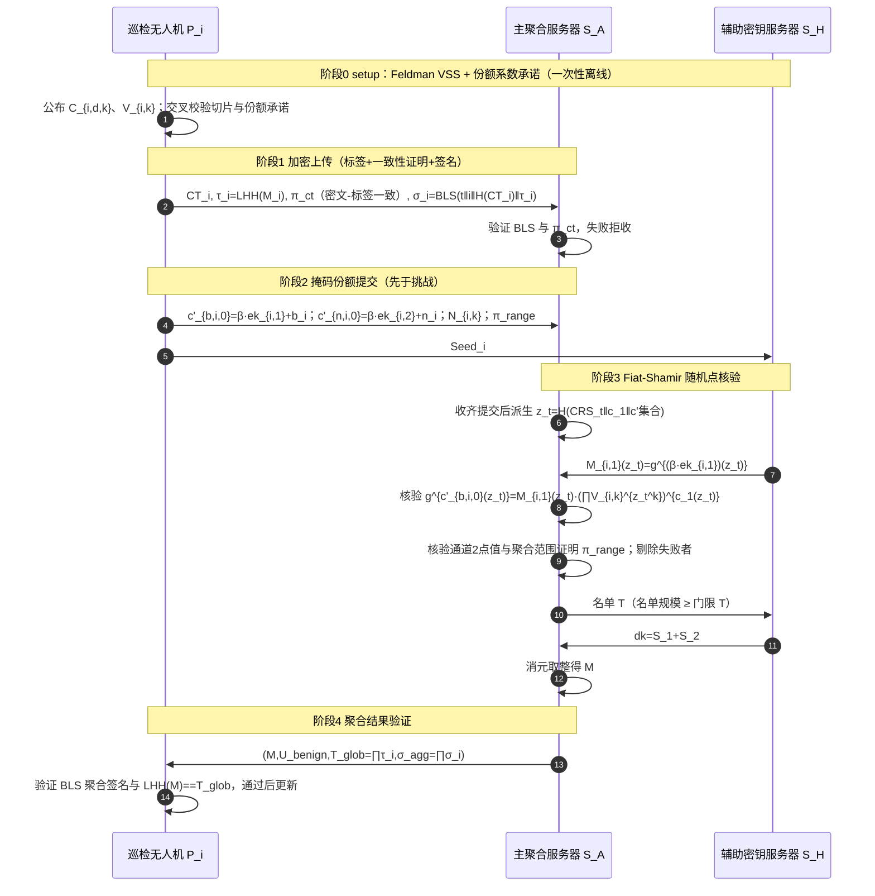

# 方案一 `TwinWeldFL` 可验证性专题：点值承诺、LHH 与 BLS 全流程闭环公式推导

> **文档定位**：本文档从方案一 `TwinWeldFL` 中**分离出可验证性功能**单独介绍并完成闭环推导。可验证性解决三类主动攻击：
> 1. **恶意无人机伪造外层解密份额** $b_i^{\mathrm{mal}}\ne c_1\cdot s_i\pmod Q$（破坏门限解密，使全局乱码且无法定位）；
> 2. **恶意无人机上传超界温和噪声** $n_i^{\mathrm{mal}}$（破坏噪声预算，造成拒绝服务）；
> 3. **双服务器篡改聚合结果或替换/丢弃客户端更新**（聚合结果不可信）。
>
> **前置阅读**：《方案一-TwinWeldFL-核心框架与多维正确性分析.md》（继承其全部符号与阶段划分）。
>
> **重要说明**：原方案的验证框架（点值承诺 + LHH + BLS）方向正确，但存在 **3 处必须修补的可靠性缺口**（固定挑战点可被定点伪造、份额注册承诺未具体化、$\tau_i$ 与 $CT_i$ 之间无一致性证明、签名未覆盖密文、$n_i$ 无有界约束）。本文档 §4 给出修补版完整协议（Feldman 系数承诺 + Fiat-Shamir 随机挑战 + 批量范围证明 + 签名绑定密文 + 密文-标签一致性证明），并在 §5 逐条证明完备性与可靠性。

---

## 目录

1. [使用的技术清单](#1-使用的技术清单)
2. [各项技术的基本内容](#2-各项技术的基本内容)
3. [验证对象分解与威胁映射](#3-验证对象分解与威胁映射)
4. [结合方案一的修补版全流程闭环推导](#4-结合方案一的修补版全流程闭环推导)
5. [完备性、可靠性与不可伪造性定理](#5-完备性可靠性与不可伪造性定理)
6. [原方案缺口分析与修补对照表](#6-原方案缺口分析与修补对照表)
7. [修补版伪代码](#7-修补版伪代码)
8. [实体交互时序图](#8-实体交互时序图)
9. [与 BPVFL / VeSAFL / VLSFL / Ftopk 的对比](#9-与-bpvfl--vesafl--vlsfl--ftopk-的对比)
10. [小结](#10-小结)

---

## 1. 使用的技术清单

| 编号 | 技术 | 验证目标 | 来源参照 |
| :--:| :--- | :--- | :--- |
| V1 | **离散对数（DL）假设与群指数同态** | 所有承诺/哈希的代数基座：$g^x\cdot g^y=g^{x+y}$，$(g^x)^c=g^{xc}$ | 标准群密码学 |
| V2 | **双线性配对（BLS12-381，$\mathbb{G}_1,\mathbb{G}_2,\mathbb{G}_T$）** | BLS 聚合签名验证；KZG 多项式承诺（可选压缩） | BLS 标准 |
| V3 | **Feldman 可验证秘密共享（VSS）/ 多项式系数承诺** | DKG 切片正确性；份额环多项式 $s_i(X)$ 的任意点公开求值 | Feldman VSS、`25-VeSAFL` |
| V4 | **Schwartz-Zippel 引理（多项式恒等式概率检验）** | 单点/多点检验 $b_i(X)\overset{?}{=}c_1(X)s_i(X)$ 的可靠性界 | 经典代数引理 |
| V5 | **Fiat-Shamir 启发式（承诺-挑战-响应 $\Sigma$ 协议非交互化）** | 保证挑战点在份额提交**之后**才确定，封堵定点伪造 | 标准 NIZK、`23-ELSA` 分布式验证 |
| V6 | **线性同态哈希 LHH（Pedersen 向量承诺型）** | 聚合明文完整性：$\mathrm{LHH}(\sum M_i)=\prod_i\mathrm{LHH}(M_i)$ | `26-VLSFL`（配对型 HF）、Pedersen |
| V7 | **BLS 聚合签名** | 上传来源认证、轮次绑定、抗抵赖/重放/冒充 | BLS 标准 |
| V8 | **批量范围证明（Bulletproofs 型）** | 约束 $n_i$ 各系数在 $[-B_{\mathrm{sm}},B_{\mathrm{sm}}]$ 内，护噪声预算 | Bulletproofs |
| V9 | **密文-标签一致性零知识证明（TP-ZKP / 格上 $\Sigma$ 协议）** | 证明 $CT_i$ 加密的明文就是 $\tau_i$ 所承诺的 $M_i$ | `24-BPVFL`（Paillier TP-ZKP）、格 ZKP |

---

## 2. 各项技术的基本内容

### 2.1 离散对数假设与群指数同态（V1）

设 $\mathbb{G}_1$ 为阶 $q_v$ 的素数阶循环群，生成元 $g$。**DL 假设**：给定 $g^x$，概率多项式时间（PPT）敌手求出 $x$ 的概率可忽略。群指数天然具有加性同态：

$$
g^x\cdot g^y=g^{x+y},\qquad (g^x)^c=g^{xc},\qquad g^{x}\cdot g^{-y}=g^{x-y}.
$$

这使得「在不公开 $x,y$ 的前提下，公开验证 $x,y$ 之间的线性关系」成为可能：已知 $g^x,g^y$，任何人可验证 $g^x=(g^y)^c$（即 $x=cy$）。

**模数兼容约束（重要）**：所有被承诺值（$s_i[k]$、$b_i(z)$、$n_i[k]$、$M_i[\nu]$）均在 $\mathbb{Z}_Q$ 中，而群指数按 $\mathbb{Z}_{q_v}$ 运算。要求 $q_v\ge Q$；若 BFV 采用 RNS 多素数模数 $Q=\prod_{\ell}p_\ell$，则在每个素数 $p_\ell$（$p_\ell<q_v$，BLS12-381 的 $q_v\approx2^{255}$ 远大于典型 BFV 素数链的 $p_\ell\approx2^{40}\sim2^{60}$）上分别执行承诺与验证。下文为简洁统一记为 $\bmod Q$。

### 2.2 双线性配对与 BLS12-381（V2）

配对 $e:\mathbb{G}_1\times\mathbb{G}_2\to\mathbb{G}_T$ 满足双线性 $e(g^a,h^b)=e(g,h)^{ab}$、非退化、可计算。BLS12-381 的安全性归约到 co-CDL/co-CDH 困难性。用途：

- BLS 签名验证（§2.7）；
- （可选）KZG 多项式承诺：对多项式 $f(X)$，SRS 为 $(g_1,g_1^\tau,g_1^{\tau^2},\dots;g_2,g_2^\tau)$，承诺 $C=g_1^{f(\tau)}$；对求值 $y=f(z)$ 的 opening 为 $\pi=g_1^{q(\tau)}$，其中 $q(X)=(f(X)-y)/(X-z)$，验证仅需两次配对：

$$
e(C\cdot g_1^{-y},\,g_2)=e(\pi,\,g_2^{\tau-z}).
$$

KZG 把多项式承诺压缩为 $1$ 个 $\mathbb{G}_1$ 元素，opening 为 $1$ 个群元素，适合把 §4.1 的份额承诺从 $M$ 个群元素压缩为 $O(1)$。

### 2.3 Feldman 可验证秘密共享 / 多项式系数承诺（V3）

对以 $\mathbb{Z}_q$ 为系数的多项式 $\phi(X)=\sum_{k=0}^{d}\phi_kX^k$，公布**系数承诺** $C_k=g^{\phi_k}$（$k=0,\dots,d$）。则：

- **任意点公开求值**：$g^{\phi(z)}=\prod_{k=0}^{d}C_k^{\,z^k}$，无需持有者再提供证明；
- **份额校验**：声称 $y=\phi(z)$ 时，验证 $g^y=\prod_k C_k^{z^k}$；
- **绑定性**：在 DL 假设下，承诺者无法对同一组 $\{C_k\}$ 给出两个不同的 $\phi$。

Pedersen 变体 $C_k=g^{\phi_k}h^{r_k}$（额外生成元 $h$，$r_k$ 随机）提供**完美隐藏**（Feldman 原始版本只在 DL 下计算隐藏）。Feldman VSS 用于 DKG 时，分享者 $P_i$ 对其 Shamir 多项式 $f_i$ 发布系数承诺，每个接收者据此校验自己的切片，从而在无 Dealer 条件下保证「注册的份额与真实分发的份额一致」。

### 2.4 Schwartz-Zippel 引理（V4）

设 $\Delta(X)\not\equiv0$ 是域 $\mathbb{F}$ 上次数至多 $d$ 的非零多项式，$z\xleftarrow{\$}\mathbb{F}$ 均匀随机，则

$$
\Pr_{z}[\Delta(z)=0]\le \frac{d}{|\mathbb{F}|}.
$$

**关键前提**：$z$ 必须在**验证者（或随机预言机）选定且独立于 $\Delta$**。本方案中 $\Delta b(X)=b_i^{\mathrm{mal}}(X)-c_1(X)s_i(X)$ 是环多项式（次数 $<M$），随机挑战点 $z_t$ 处的碰撞概率上界为 $M/Q$；取 $k$ 个独立点则为 $(M/Q)^k$。

### 2.5 Fiat-Shamir 启发式（V5）

$\Sigma$ 协议三轮为「承诺 $\mathrm{commit}$ → 随机挑战 $\mathrm{challenge}$ → 响应 $\mathrm{response}$」。Fiat-Shamir 用随机预言机（实践中为抗碰撞哈希 $H$）把挑战设为 $H(\text{transcript})$，实现非交互化。其**可靠性绑定于顺序**：挑战必须哈希包含证明者的承诺，使证明者在选定承诺内容前无法预知挑战。本方案中，$b_i$ 的承诺是掩码密文 $c'_{b,i,0}$，因此挑战点必须取

$$
z_t=H\big(\mathrm{CRS}_t\,\Vert\, c_1\,\Vert\,\{c'_{b,i,0}\}_{i\in\mathcal{U}_{\mathrm{up}}}\big)\pmod Q,
$$

即 $z_t$ 在所有提交收齐后才确定。原方案的固定点 $z_{\mathrm{chk}}$ 违反此顺序（见 §6 的 G1）。

### 2.6 线性同态哈希 LHH（V6）

取相互独立的生成元 $\{g_\nu\}_{\nu=1}^{d}$（及可选的隐藏生成元 $h$），对明文向量 $M=(M[1],\dots,M[d])$ 定义

$$
\mathrm{LHH}(M)=\prod_{\nu=1}^{d}g_\nu^{M[\nu]}\in\mathbb{G}_1.
$$

- **加性同态**：$\mathrm{LHH}(M+M')=\mathrm{LHH}(M)\cdot\mathrm{LHH}(M')$；
- **标量同态**：$\mathrm{LHH}(cM)=\mathrm{LHH}(M)^c$；
- **绑定性（抗碰撞）**：归约于 DL：若 $M\ne M'$ 而 $\mathrm{LHH}(M)=\mathrm{LHH}(M')$，则 $\prod_\nu g_\nu^{M[\nu]-M'[\nu]}=1$，在生成元独立（无知对数关系）假设下给出 $\log_{g_1}g_\nu$ 的非平凡关系。

`26-VLSFL` 的配对型 HF 是其在 $\mathbb{G}_1\times\mathbb{G}_2$ 上的双群版本，用于配对验证；本方案用单群 Pedersen 型即可，验证只需 $\mathbb{G}_1$ 上的乘法与幂。

### 2.7 BLS 聚合签名（V7）

$P_i$ 签名私钥 $x_i\in\mathbb{Z}_{q_v}$，公钥 $pk_i=g_2^{x_i}$（$\mathbb{G}_2$ 侧），哈希到曲线 $\mathcal{H}:\{0,1\}^*\to\mathbb{G}_1$。对消息 $m_i$ 的签名

$$
\sigma_i=\mathcal{H}(m_i)^{x_i}\in\mathbb{G}_1.
$$

不同消息的聚合签名 $\sigma_{\mathrm{agg}}=\prod_i\sigma_i$，验证（augmented hash 天然抗 rogue-key）：

$$
e(\sigma_{\mathrm{agg}},g_2)\ \overset{?}{=}\ \prod_{i}e\big(\mathcal{H}(m_i),pk_i\big).
$$

安全性为 co-CDH 下的 EUF-CMA（存在性不可伪造，抗选择消息攻击）。在本方案中提供**身份认证、轮次绑定（防重放）、抗抵赖**。

### 2.8 批量范围证明（V8）

Bulletproofs 允许在不揭露 $v$ 的情况下证明 $v\in[0,2^n)$（通过 $v'=v+2^{n-1}$ 移位证明 $v\in[-2^{n-1},2^{n-1})$），通信量为 $O(\log n)$、无可信设置、聚合证明可把多个范围合并为一个。对环多项式 $n_i$ 的 $M$ 个系数，用**聚合 Bulletproof**（aggregated range proof）一次证明全部系数落在 $[-B_{\mathrm{sm}},B_{\mathrm{sm}}]$。

### 2.9 密文-标签一致性零知识证明（V9）

LHH 标签 $\tau_i=\mathrm{LHH}(M_i)$ 与外层密文 $CT_i=\mathsf{Enc}_{PK}(M_i)$ 是**分开生成**的，必须证明二者对应同一明文，否则恶意客户端可以用 $M_i'$ 生成 $\tau_i$、用 $M_i$ 生成 $CT_i$（最终聚合哈希失配，或更隐蔽地嫁祸）。

- **Paillier 路线（`24-BPVFL` 的 TP-ZKP）**：验证者抛随机线性挑战矩阵 $A$，证明者返回密文与哈希值在 $A$ 下的线性变换响应，验证者核对变换后明文与哈希的对应关系（见 BPVFL 式 (18)(19)）；
- **BFV/RLWE 路线（本方案采用）**：格上 $\Sigma$ 协议，证明知识 $(M_i,u_i,e_{i,0},e_{i,1})$ 满足

$$
c_{i,0}=p_0u_i+\Delta M_i+e_{i,0},\quad c_{i,1}=p_1u_i+e_{i,1},\quad \tau_i=\prod_\nu g_\nu^{M_i[\nu]},
$$

并对噪声 $e_{i,\cdot}$ 给出有界性证明（拒绝采样保证分布零知识，标准 BFV 证明系统如 ECDIVE/`fv-rs` 原语）。该证明可 Fiat-Shamir 非交互化，随上传消息一次提交。

---

## 3. 验证对象分解与威胁映射

| 编号 | 验证对象 | 防住的攻击 | 机制 | 执行方/时机 |
| :--:| :--- | :--- | :--- | :--- |
| V-a | DKG 切片 $\hat{s}_{j,i}=f_i(\alpha_j)$ 与份额 $s_i$ 真实 | 份额造假、私钥污染 | Feldman VSS 系数承诺（V3） | setup，各方校验 |
| V-b | **份额解密值 $b_i=c_1s_i$ 真实** | 伪造 $b_i^{\mathrm{mal}}$ 致全局乱码 | 份额系数承诺 + Fiat-Shamir 随机点 + 群指数恒等式（V1/V3/V4/V5） | 阶段 3 合成前 |
| V-c | 温和噪声 $n_i$ 有界 | 超界 $n_i^{\mathrm{mal}}$ 破坏噪声预算（DoS） | 聚合 Bulletproof 范围证明（V8） | 阶段 2/3 |
| V-d | 聚合明文 $M=\sum_{i\in\mathcal{U}_{\mathrm{benign}}}M_i$ | 服务器篡改聚合结果、替换/丢弃更新 | LHH 加性同态（V6） | 阶段 4，客户端核验 |
| V-e | 上传者身份、轮次、$(CT_i,\tau_i)$ 绑定 | 冒充、重放、密文与标签被拆分替换 | BLS 签名（V7），消息含 $H(CT_i)$ | 阶段 1 起逐消息 |
| V-f | $CT_i$ 与 $\tau_i$ 对应同一明文 | 恶意端自造不一致的密文与标签 | 密文-标签一致性 ZKP（V9） | 阶段 1 上传时 |

---

## 4. 结合方案一的修补版全流程闭环推导

### 4.1 阶段 0 增强：Feldman VSS 与份额多项式系数承诺（V-a、V-b 的注册基础）

除核心框架的 DKG 外，额外执行两步公开注册。

**(1) DKG 切片的 Feldman 校验（V-a）**：$P_i$ 对其 Shamir 多项式 $f_i(X)=\hat{s}_i+\sum_{d=1}^{T-1}\lambda_{i,d}X^d$（系数为环多项式，按系数维 $k=0,\dots,M-1$ 展开）公布

$$
\mathsf{C}_{i,d,k}=g^{\lambda_{i,d}[k]},\quad d=0,\dots,T-1,\ k=0,\dots,M-1
$$

（$\lambda_{i,0}=\hat{s}_i$；可用 Pedersen 随机化或 KZG 压缩）。$P_j$ 收到切片 $\hat{s}_{j,i}=f_i(\alpha_j)$ 后，对每个系数维 $k$ 校验

$$
\boxed{g^{\hat{s}_{j,i}[k]}\ \overset{?}{=}\ \prod_{d=0}^{T-1}\mathsf{C}_{i,d,k}^{\,\alpha_j^{\,d}}.}\tag{4-1}
$$

右侧 $=\prod_d g^{\lambda_{i,d}[k]\alpha_j^d}=g^{\sum_d\lambda_{i,d}[k]\alpha_j^d}=g^{f_i(\alpha_j)[k]}$，故 (4-1) 成立当且仅当切片真实（DL 假设下不可伪造）。

**(2) 份额环多项式 $s_i(X)$ 的系数承诺（V-b 的公开求值基座）**：$P_i$ 对其聚合后份额 $s_i=\sum_j f_j(\alpha_i)$ 的环多项式系数（记 $s_i(X)=\sum_{k=0}^{M-1}s_i[k]X^k$，此处 $X$ 为环变量）公布

$$
\boxed{\mathsf{V}_{i,k}=g^{s_i[k]}\in\mathbb{G}_1,\quad k=0,\dots,M-1.}\tag{4-2}
$$

由于 $s_i$ 的每个系数都由步骤 (1) 的 DKG 承诺线性决定，$P_i$ 不能对 $\mathsf{V}_{i,k}$ 造假（可由 $\{\mathsf{C}_{j,d,k}\}$ 公开重算 $g^{s_i[k]}=\prod_j\prod_d\mathsf{C}_{j,d,k}^{\alpha_i^d}$ 交叉核验）。由此，**对任意挑战点 $z$，任何人都可公开计算份额点值承诺**：

$$
\boxed{V_i(z)\triangleq g^{s_i(z)}=\prod_{k=0}^{M-1}\mathsf{V}_{i,k}^{\,z^k}.}\tag{4-3}
$$

> 压缩选项：$M$ 个 $\mathsf{V}_{i,k}$ 可用 KZG 承诺 $V_i=g_1^{s_i(\tau)}$（§2.2）替代，配合一次配对 opening；或用 Pedersen 向量承诺压缩到 $O(\log M)$。setup 一次性、离线完成，带宽不敏感，下文以 Feldman 形式表述（验证最直接）。

### 4.2 阶段 1 增强：标签、签名与密文-标签一致性（V-d、V-e、V-f）

$P_i$ 加密 $CT_i=(c_{i,0},c_{i,1})$ 后：

1. **LHH 标签**（与 $M_i$ 打包对齐，同一组槽位顺序）：

$$
\tau_i=\mathrm{LHH}(M_i)=\prod_{\nu=1}^{d}g_\nu^{M_i[\nu]}\in\mathbb{G}_1. \tag{4-4}
$$

2. **密文-标签一致性证明**（V-f）：生成非交互格 $\Sigma$ 证明（Fiat-Shamir）

$$
\pi_i^{\mathrm{ct}}=\mathrm{NIZK}\Big\{(M_i,u_i,e_{i,0},e_{i,1}):\
c_{i,0}=p_0u_i+\Delta M_i+e_{i,0},\ c_{i,1}=p_1u_i+e_{i,1},\ \tau_i=\mathrm{LHH}(M_i)\Big\}. \tag{4-5}
$$

3. **BLS 签名（绑定密文与标签）**：

$$
\boxed{\sigma_i=\mathcal{H}\big(t\,\Vert\, i\,\Vert\, H(CT_i)\,\Vert\,\tau_i\big)^{x_i}.}\tag{4-6}
$$

上传 $(CT_i,\tau_i,\pi_i^{\mathrm{ct}},\sigma_i)$。$\mathcal{S}_A$ 用 $pk_i$ 验证 $\sigma_i$ 与 $\pi_i^{\mathrm{ct}}$，任一失败立即拒收。修补要点：**签名与一致性证明都必须覆盖 $H(CT_i)$**（原方案只签 $\tau_i$，密文可被拆分替换）。

### 4.3 阶段 2/3：份额真实性的随机点核验（V-b，核心修补）

**(1) 提交先于挑战**：各 $P_i$ 上传通道掩码密文（与核心框架 (4-5) 相同）

$$
c'_{b,i,0}=\beta\cdot ek_{i,1}+b_i\pmod Q,\qquad b_i=c_1s_i\pmod Q.
$$

$\mathcal{S}_A$ 收齐本轮全部提交 $\{c'_{b,i,0}\}$ 后，计算（可由任何人公开重算的）本轮挑战点

$$
\boxed{z_t=H\big(\mathrm{CRS}_t\,\Vert\, c_1\,\Vert\,\{c'_{b,i,0}\}_{i\in\mathcal{U}_{\mathrm{up}}}\big)\pmod Q,\quad z_t\in\mathbb{Z}_Q^*.}\tag{4-7}
$$

因为 $z_t$ 哈希包含全部提交，任何 $P_i$ 在构造 $c'_{b,i,0}$（即选定 $b_i$）时都无法预知 $z_t$。

> **轮次说明（One-Shot 仍然保持，无需客户端二次响应）**：本协议的关键性质是**点值核验完全公开可验证**——份额 $s_i$ 的系数承诺 $\mathsf{V}_{i,k}$ 在 setup 阶段已固定（(4-2)），噪声 $n_i$ 的系数承诺 $N_{i,k}$ 随本次提交一并给出（(4-10)），验证者在任意 $z_t$ 处都能用这些承诺**独立**算出点值 $V_i(z_t)$、$N_i(z_t)$，无需无人机在看到 $z_t$ 后再发送任何「响应」。因此客户端只需一次原子提交（阶段 1 的 $CT_i,\tau_i,\pi_i^{\mathrm{ct}},\sigma_i$ 与阶段 2 的 $c'_{b,i,0},c'_{n,i,0},N_{i,k},\pi_i^{\mathrm{range}}$），$\mathcal{S}_A$ 收齐后自行派生 $z_t$ 并在 $\mathcal{S}_H$ 辅助下完成全部核验，无人机发完即离线。
>
> **可靠性（最后提交者的 grinding 分析）**：$z_t$ 哈希包含所有客户端的提交，非最后提交者在自己上传时无法预知他人提交；即使是最后一个提交者，它也只能对自己的 $c'$ 做离线搜索——每改动一次 $c'$ 得到一个新的 $z_t$，而 $\Delta b(z_t)=0$ 的概率仅 $M/Q$，$q$ 次尝试成功概率上界 $qM/Q$。取参数使 $qM/Q\le2^{-\lambda}$（$q$ 为证明者算力上界，如 $Q\ge2^{2\lambda}$ 量级）即可。若需要更强的自适应安全，可由 $\mathcal{S}_A$ 收齐后引入公开 VRF/多方掷币随机性（仍不需要客户端在线）。

**(2) 掩码点值与份额点值**：$\mathcal{S}_H$ 由 $\mathrm{Seed}_i$ 展开 $ek_{i,1}$，计算掩码点值

$$
M_{i,1}(z_t)=g^{(\beta\cdot ek_{i,1})(z_t)}\in\mathbb{G}_1 \tag{4-8}
$$

并发给 $\mathcal{S}_A$（$\mathcal{S}_H$ 不接触 $c'_{b,i,0}$，此群元素在 DL 下不泄露 $ek_{i,1}$）。$\mathcal{S}_A$ 由 (4-3) 公开计算份额点值 $V_i(z_t)=\prod_k\mathsf{V}_{i,k}^{z_t^k}=g^{s_i(z_t)}$。

**(3) 群指数恒等式核验**：

$$
\boxed{g^{\,c'_{b,i,0}(z_t)}\ \overset{?}{=}\ M_{i,1}(z_t)\cdot \big(V_i(z_t)\big)^{c_1(z_t)}.}\tag{4-9}
$$

展开右侧指数：

$$
(\beta\cdot ek_{i,1})(z_t)+c_1(z_t)\cdot s_i(z_t).
$$

若 $P_i$ 诚实，$b_i(X)=c_1(X)s_i(X)\pmod Q$，环多项式乘法与求值可交换：

$$
b_i(z_t)=(c_1s_i)(z_t)=c_1(z_t)s_i(z_t),
$$

故右侧指数 $=(\beta\cdot ek_{i,1})(z_t)+b_i(z_t)=c'_{b,i,0}(z_t)$，(4-9) 成立。核验失败的节点在合成前被当场剔除。通道 2 同式核验 $g^{c'_{n,i,0}(z_t)}\overset{?}{=}M_{i,2}(z_t)\cdot N_i(z_t)$（$N_i(z)$ 为 $n_i$ 的承诺，与 §4.4 范围证明配套）。

### 4.4 阶段 2 增强：温和噪声的范围证明（V-c）

$P_i$ 对 $n_i(X)=\sum_{k=0}^{M-1}n_i[k]X^k$ 的每个系数 $n_i[k]\in[-B_{\mathrm{sm}},B_{\mathrm{sm}}]$ 生成系数承诺与一条**聚合范围证明**

$$
N_{i,k}=g^{n_i[k]}\,(k=0,\dots,M-1),\qquad
\pi_i^{\mathrm{range}}=\mathrm{BulletAgg}\big(\{n_i[k]\in[-B_{\mathrm{sm}},B_{\mathrm{sm}}]\}_k\big), \tag{4-10}
$$

随阶段 2 消息上传。$\mathcal{S}_A$ 在合成前验证 $\pi_i^{\mathrm{range}}$；任何超界 $n_i^{\mathrm{mal}}$（会使 $\|N_{\mathrm{sm}}\|_\infty$ 突破核心框架定理 3 的噪声界）被拒收。点值核验中的 $N_i(z_t)=\prod_k N_{i,k}^{z_t^k}=g^{n_i(z_t)}$ 同时把「被承诺的 $n_i$」与「实际装入通道 2 的 $n_i$」绑定。

### 4.5 阶段 4 增强：聚合结果的 LHH 与 BLS 聚合验证（V-d、V-e）

过滤与解密结束后，$\mathcal{S}_A$ 对**实际纳入聚合的良性集合** $\mathcal{U}_{\mathrm{benign}}$（与焊接解密名单一致）合成标签与签名

$$
\mathcal{T}_{\mathrm{glob}}=\prod_{i\in\mathcal{U}_{\mathrm{benign}}}\tau_i,\qquad
\sigma_{\mathrm{agg}}=\prod_{i\in\mathcal{U}_{\mathrm{benign}}}\sigma_i, \tag{4-11}
$$

并广播 $(M,\mathcal{U}_{\mathrm{benign}},\mathcal{T}_{\mathrm{glob}},\sigma_{\mathrm{agg}})$。每个客户端：

1. 按 (4-6) 的逐消息配对公式验证 BLS 聚合签名（核对每条 $H(CT_i)$ 与轮次 $t$）；
2. 独立重算 LHH 并核验

$$
\boxed{\mathrm{LHH}(M)=\prod_{\nu=1}^{d}g_\nu^{M[\nu]}\ \overset{?}{=}\ \mathcal{T}_{\mathrm{glob}}=\prod_{i\in\mathcal{U}_{\mathrm{benign}}}\tau_i.}\tag{4-12}
$$

由加性同态，当且仅当 $M=\sum_{i\in\mathcal{U}_{\mathrm{benign}}}M_i$ 时 (4-12) 成立：

$$
\prod_{i\in\mathcal{U}_{\mathrm{benign}}}\tau_i
=\prod_{i}\prod_\nu g_\nu^{M_i[\nu]}
=\prod_\nu g_\nu^{\sum_i M_i[\nu]}
=\mathrm{LHH}\Big(\sum_{i\in\mathcal{U}_{\mathrm{benign}}}M_i\Big).
$$

任一服务器对聚合结果做加减、替换、丢弃（在名单外）都会被 (4-12) 或签名核验检出。

### 4.6 全验证闭环一览

```text
setup:   DKG Feldman 系数承诺 (4-1)  → 份额环多项式系数承诺 V_{i,k} (4-2)
上传:    τ_i=LHH(M_i) (4-4) + 密文-标签一致性 π_ct (4-5) + BLS(含 H(CT_i)) (4-6)
挑战:    收齐提交后 z_t=H(CRS_t‖c_1‖{c'}) (4-7)
份额核验:g^{c'_{b,i,0}(z_t)} = g^{mask(z_t)}·(g^{s_i(z_t)})^{c_1(z_t)} (4-9)
噪声核验:聚合 Bulletproof 约束 n_i∈[-B_sm,B_sm] (4-10)
结果核验:LHH(M)=∏τ_i (4-12) + BLS 聚合签名
```

---

## 5. 完备性、可靠性与不可伪造性定理

### 定理 V1（份额核验的完备性 / Completeness）

诚实 $P_i$（$b_i=c_1s_i$）必通过 (4-9)。

**证明**：诚实时 $c'_{b,i,0}(X)=\beta\cdot ek_{i,1}(X)+c_1(X)s_i(X)$。代入 $z_t$ 并用环多项式求值与乘法的可交换性：

$$
c'_{b,i,0}(z_t)=\beta(z_t)ek_{i,1}(z_t)+c_1(z_t)s_i(z_t),
$$

恰为右侧两群元素乘积的指数；Feldman 承诺 (4-3) 保证 $V_i(z_t)=g^{s_i(z_t)}$，$\mathcal{S}_H$ 诚算 $M_{i,1}(z_t)$。等式成立。$\blacksquare$

### 定理 V2（伪造份额的可靠性 / Soundness）

在 DL 假设与随机预言机模型下，对恶意 $P_i$ 提交的 $b_i^{\mathrm{mal}}\ne c_1s_i$，(4-9) 通过的概率至多为 $M/Q$（$k$ 点时为 $(M/Q)^k$）。

**证明**：令 $\Delta b(X)=b_i^{\mathrm{mal}}(X)-c_1(X)s_i(X)\not\equiv0$，次数 $<M$。由 (4-7)，$z_t$ 在 $\{c'_{b,i,0}\}$ 提交之后由 $H$ 派生，独立于 $\Delta b$。(4-9) 若成立，必有

$$
g^{\Delta b(z_t)}=1\iff \Delta b(z_t)\equiv0\pmod Q,
$$

（否则左、右指数相差非零元，DL 群中群元素不等——除非敌手能伪造 $M_{i,1}(z_t)$ 或 $V_i(z_t)$，前者归 DL/需知道 $\mathrm{Seed}_i$，后者归对 Feldman 承诺的绑定）。由 Schwartz-Zippel，$\Pr[\Delta b(z_t)=0]\le M/Q$。取 $k$ 个独立挑战点（分别由不同转录哈希派生）得 $(M/Q)^k$；$Q$ 为大素数时 $M/Q\ll2^{-40}$（如 $M=2^{13},Q\ge2^{60}$），多点或 $Q\ge2^{2\lambda}$ 时可忽略。对最后提交者的自我 grinding，$q$ 次离线尝试上界为 $qM/Q$，同取 $qM/Q\le2^{-\lambda}$。$\blacksquare$

**为何固定点不安全（G1 的根因）**：若 $z$ 在攻击者选择 $b_i^{\mathrm{mal}}$ 之前已知，取任意 $r(X)$ 令

$$
\Delta b(X)=(X-z)\,r(X)\ne0,
$$

则 $\Delta b(z)=0$ 但 $\Delta b\not\equiv0$——单点核验永远通过而完整份额被污染。故挑战必须后于提交（(4-7)），这是原方案最关键的修补。

### 定理 V3（份额注册的真实性）

DKG 中，恶意 $P_i$ 分发与公开系数承诺不一致的切片 $\hat{s}_{j,i}\ne f_i(\alpha_j)$ 时，(4-1) 以压倒性概率失败；$P_i$ 注册与其真实份额不符的 $\mathsf{V}_{i,k}$ 时，可由 DKG 系数承诺公开重算发现。

**证明**：(4-1) 右侧由公开承诺唯一确定为 $g^{f_i(\alpha_j)[k]}$；若切片不符，$g^{\hat{s}_{j,i}[k]}$ 与其不等，DL 假设下敌手无法找到使二者相等的幂。$\mathsf{V}_{i,k}$ 的交叉核验同理（公开线性重算）。$\blacksquare$

### 定理 V4（范围证明的完备性与可靠性）

诚实 $n_i$（各系数 $\in[-B_{\mathrm{sm}},B_{\mathrm{sm}}]$）通过 $\pi_i^{\mathrm{range}}$；超界系数通过聚合 Bulletproof 的概率可忽略（离散对数/内积论证的标准可靠性，知识误差 $1/n$ 经多轮可忽略）。

**证明**：Bulletproofs 内积论证在随机预言机下的标准可靠性；聚合证明保持逐分量约束。结合点值绑定 $N_i(z_t)$，被证明的 $n_i$ 即装入通道 2 的 $n_i$，故 $\|N_{\mathrm{sm}}\|_\infty\le nB_{\mathrm{sm}}$ 有密码学保障，核心框架定理 3 的噪声上界不被恶意输入突破。$\blacksquare$

### 定理 V5（LHH 聚合验证的完备性与绑定性）

(i) 诚实聚合时 (4-12) 恒成立；(ii) 任意 PPT 敌手（含被腐化的服务器）找到 $M'\ne\sum_{i\in\mathcal{U}_{\mathrm{benign}}}M_i$ 使 $\mathrm{LHH}(M')=\mathcal{T}_{\mathrm{glob}}$ 的概率可忽略。

**证明**：(i) 由 §2.6 加性同态。(ii) 若 $\mathrm{LHH}(M')=\mathcal{T}_{\mathrm{glob}}=\mathrm{LHH}(M)$，则 $\prod_\nu g_\nu^{M'[\nu]-M[\nu]}=1$，给出独立生成元之间的非平凡对数关系，在 DL/无知对数关系假设下不可行。$\blacksquare$

**验证语义的边界**：LHH 证明「公布的 $M$ 等于名单内各客户端所承诺明文之和」，**不证明名单本身的合理性**——剔除决策由鲁棒插件 `TrustBoundFilter` 负责；服务器若错误剔除良性节点，应配合鲁棒插件的可审计凭据（鲁棒文档 §10 第 5 点）。

### 定理 V6（BLS 认证与抗重放）

在 co-CDH 假设下，任何 PPT 敌手在不知 $x_i$ 时无法就新消息伪造 $P_i$ 的合法签名（EUF-CMA）；消息含轮次 $t$ 与 $H(CT_i)$，故跨轮重放、密文/标签拆分替换均被拒。

**证明**：BLS 聚合签名的标准 EUF-CMA 归约（augmented hash 抗 rogue-key）；消息绑定 $H(CT_i)$ 后，替换 $CT_i$ 即破坏 $\sigma_i$ 验证（抗第二原像归约于哈希）。$\blacksquare$

### 定理 V7（密文-标签一致性）

$\pi_i^{\mathrm{ct}}$ 完备且可靠：诚实端通过；若 $CT_i$ 与 $\tau_i$ 对应不同明文，则通过概率可忽略（格 $\Sigma$ 协议的可靠性，挑战后于承诺）。

**证明**：$\Sigma$ 协议的特殊可靠性（special soundness）：对同一承诺的两个不同挑战，提取器可提取见证 $(M_i,u_i,e)$；若两个见证的明文不同，则与 $\tau_i$ 绑定关系冲突。Fiat-Shamir 变换在 ROM 下保持可靠性。由此 $\tau_i$ 与 $CT_i$ 必然绑定同一 $M_i$，定理 V5 的聚合验证才能定位到具体作恶者而非仅 abort。$\blacksquare$

---

## 6. 原方案缺口分析与修补对照表

| # | 原方案表述 | 问题 | 修补 | 对应定理 |
| :-:| :--- | :--- | :--- | :--- |
| G1 | 固定挑战点 $z_{\mathrm{chk}}$，$VK_i=g^{s_i(z_{\mathrm{chk}})}$ setup 注册 | 攻击者预知 $z$，构造 $\Delta b=(X-z)r$ 定点伪造，单点核验通过而完整份额被污染 | 挑战点改由提交后转录哈希派生 (4-7)；份额用系数承诺支撑任意点求值 (4-2)(4-3) | V2 |
| G2 | 「所有人可通过 Reed-Solomon 校验验证 $VK_i$ 真实性」未给构造 | 份额注册无具体协议，$VK_i$ 可与真实 $s_i$ 不符 | DKG 阶段 Feldman 系数承诺 (4-1) 与份额系数承诺交叉重算 (4-2) | V3 |
| G3 | $\sigma_i=\mathrm{Sign}(t\Vert i\Vert\tau_i)$ | 签名未覆盖 $CT_i$，密文可被替换/与标签拆分 | 签 $(t\Vert i\Vert H(CT_i)\Vert\tau_i)$ (4-6) | V6 |
| G4 | $\tau_i=\mathrm{LHH}(M_i)$ 但无 $\tau_i\leftrightarrow CT_i$ 一致性证明 | 恶意端可用不同明文分别生成密文与标签，失配时只能 abort 无法定位 | 密文-标签一致性格 NIZK (4-5) | V7 |
| G5 | 通道 2 $n_i$ 无任何约束 | 超界 $n_i^{\mathrm{mal}}$ 撑破噪声界（取整失败型 DoS） | 聚合 Bulletproof 范围证明 (4-10) + 点值绑定 | V4 |
| G6 | 单点、群阶与 BFV 模数关系未说明 | $Q>q_v$ 时指数模 $q_v$ 折叠，承诺失配 | 明确 $q_v\ge Q$ 或在 RNS 各素数上分别承诺验证（§2.1） | 参数约束 |
| G7 | $\mathcal{S}_H$ 算 $M_{i,1}$ 的授权依据未说明 | 需防 $\mathcal{S}_H$ 自己伪造掩码承诺 | $M_{i,1}$ 与种子通道绑定，可由种子公开重算（第三方可审计 $\mathcal{S}_H$ 的 $M_{i,1}$ 是否与种子一致） | 审计性 |

---

## 7. 修补版伪代码

```text
================================================================================
算法 V（可验证 OneShotWeld）：份额防伪、噪声有界与聚合结果验证
--------------------------------------------------------------------------------
[阶段 0 setup（一次性、离线）]
 1: DKG 同核心框架；P_i 公布 f_i 的 Feldman 系数承诺 C_{i,d,k}=g^{λ_{i,d}[k]}；
 2: P_j 校验切片 g^{ŝ_{j,i}[k]} = ∏_d C_{i,d,k}^{α_j^d}；          // (4-1)
 3: P_i 公布份额环多项式系数承诺 V_{i,k}=g^{s_i[k]}，并由 C_{j,d,k} 交叉重算核验； // (4-2)

[阶段 1 上传]
 4: P_i 加密 CT_i；计算 τ_i=LHH(M_i)=∏_ν g_ν^{M_i[ν]}；             // (4-4)
 5: P_i 生成密文-标签一致性证明 π_ct（格 Σ 协议，Fiat-Shamir）；      // (4-5)
 6: P_i 计算 σ_i=BLS.Sign(t‖i‖H(CT_i)‖τ_i)；上传 (CT_i,τ_i,π_ct,σ_i)； // (4-6)
 7: S_A 验证 BLS 签名与 π_ct，失败即拒收；

[阶段 2 一次原子提交（发完即离线，无 P2P、无二次响应）]
 8: 各 P_i 构造 c'_{b,i,0}=β·ek_{i,1}+b_i、c'_{n,i,0}=β·ek_{i,2}+n_i；
 9: P_i 生成 n_i 系数承诺 N_{i,k} 与聚合范围证明 π_range（∈[-B_sm,B_sm]），
    与两份掩码密文一次性上传 S_A；Seed_i 送 S_H；                    // (4-10)

[阶段 3 挑战与核验（服务器侧公开完成，客户端无需在线）]
10: S_A 收齐提交后公开派生 z_t=H(CRS_t‖c_1‖{c'_{b,i,0}})；            // (4-7)
11: S_H 由种子展开 ek_{i,1}，计算 M_{i,1}(z_t)=g^{(β·ek_{i,1})(z_t)} 送 S_A； // (4-8)
12: for i do
13:   S_A 公开计算 V_i(z_t)=∏_k V_{i,k}^{z_t^k}=g^{s_i(z_t)}；       // (4-3)
14:   核验 g^{c'_{b,i,0}(z_t)} == M_{i,1}(z_t)·V_i(z_t)^{c_1(z_t)}； // (4-9)
15:   核验 g^{c'_{n,i,0}(z_t)} == M_{i,2}(z_t)·N_i(z_t) 及 π_range；
16:   任一失败 → 剔除该节点（并记录可审计凭据）
17: end for
18: 通过者构成 T；S_A 与 S_H 执行核心框架焊接/消元（名单交叉确认）；

[阶段 4 结果验证]
19: S_A 计算 T_glob=∏_{i∈U_benign} τ_i、σ_agg=∏ σ_i；
20: 广播 (M,U_benign,T_glob,σ_agg)；
21: 各客户端验证 BLS 聚合签名与 LHH(M)==T_glob，通过后更新模型。     // (4-12)
================================================================================
```

---

## 8. 实体交互时序图



---

## 9. 与 BPVFL / VeSAFL / VLSFL / Ftopk 的对比

| 维度 | 本方案修补版 | `24-BPVFL` | `25-VeSAFL` | `26-VLSFL` | `26-Ftopk` |
| :--- | :--- | :--- | :--- | :--- | :--- |
| 验证份额真实性 | Feldman 系数承诺 + Fiat-Shamir 随机点（DL 群，轻量） | 三方 TP-ZKP（Paillier 指数） | Pedersen VSS + 双线性配对 | 配对 HF | 指数签名 |
| 验证聚合结果 | 单群 LHH + BLS 聚合 | 同态哈希链 + 验证服务器 | 配对验证 | 配对 HF+BLS 风格 | 在线 TA 验签转发 |
| 密文-标签一致性 | 格 NIZK（BFV，可随包提交） | TP-ZKP（Paillier） | 无（配对开销大） | 无明确 | 无 |
| 噪声有界性 | 聚合 Bulletproof | 无 | 无 | 无 | 无 |
| 可信假设 | 无 TA/无 TEE（CRS 可多方仪式） | 验证服务器持钥（单点信任） | 无 TA | TA 分发密钥 | **在线 TA** |
| 配对开销 | 份额核验仅 $\mathbb{G}_1$ 幂/乘（BLS 验证才配对） | 指数+ZKP | 逐参数配对（重） | 每客户端 3 次配对 | 指数 |
| 轮次代价 | setup 一次；每轮客户端**一次原子提交**（挑战由服务器收齐后公开派生，One-Shot 保持） | 在线交互 | 配对交互 | 两阶段 | 在线 TA 转发 |
| 与门限 FHE 兼容 | 原生（份额即验证对象） | 单密钥 Paillier | 多服务器 HFL | 双掩码 | 门限 Paillier |

**定位结论**：本方案把「份额真实性」交给最契合 Shamir 结构的 Feldman 系数承诺 + Fiat-Shamir 点值（无配对、常数量群运算），把「结果完整性」交给单群 LHH + BLS（每客户端主要为一次哈希计算），并补齐了原方案缺失的噪声范围证明与密文-标签一致性，全程不引入在线 TA 或 SGX。

---

## 10. 小结

1. **可验证性的三个层次在修补版中全部闭环**：
   - 份额层（V-a/V-b）：Feldman 系数承诺让任意点份额承诺可公开求值，Fiat-Shamir 随机挑战把伪造概率压到 $M/Q$（多点 $(M/Q)^k$），封堵了原方案固定点的定点伪造；
   - 输入层（V-c/V-f）：聚合 Bulletproof 约束 $n_i$ 有界，格 NIZK 约束 $CT_i$ 与 $\tau_i$ 同明文，BLS 绑定 $H(CT_i)$ 防拆分替换；
   - 输出层（V-d）：LHH 加性同态 + BLS 聚合签名，使任何对聚合结果的篡改、对更新的增删都可被客户端检出。
2. **完备性与可靠性逐条成理**（定理 V1–V7）：诚实者恒通过；伪造份额、超界噪声、错误聚合、冒充重放均在 DL/co-CDH/Schwartz-Zippel/ROM 下以压倒性概率失败。
3. **代价明确**：setup 一次性的 $O(M)$ 群元素承诺（可 KZG 压缩到 $O(1)$）、每轮一次转录哈希挑战与常数群运算、一条聚合范围证明；不依赖在线 TA 或 SGX。
4. **与其余两文档的关系**：本专题只解决「数据/份额/结果是否真实未篡改」；「谁该被纳入聚合」由鲁棒专题决定，「加密聚合与焊接解密如何正确且私密」由核心框架保证。三者阈值一致（恶意比例 $<50\%$、门限 $T$）、挂载点互不耦合，可独立替换增强。
