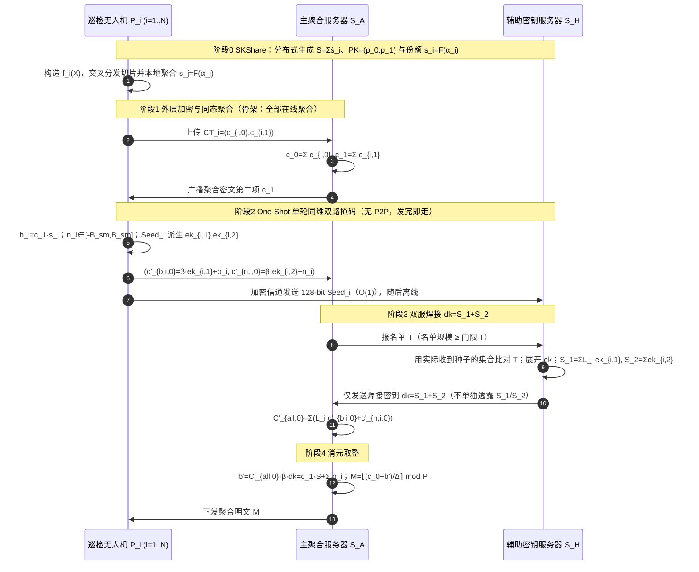

# 方案一 `TwinWeldFL` 核心隐私框架（功能分离版）与多维正确性分析

> **文档定位**：本文档是对《gemini——ppfl_fhe_uav_atasses.md》中**方案一 `TwinWeldFL`** 的功能解耦产物之一。
> 原方案一同时承载三类安全属性：
> 1. **隐私性（Privacy）**——外层门限 BFV + 外层环同维双轨掩码 + 双总私钥单轮焊接解密（`OneShotWeld`）；
> 2. **鲁棒性（Robustness）**——双站协同乘性盲化距离截尾过滤（`TrustBoundFilter`），见姊妹文档《方案一-TwinWeldFL-鲁棒性专题-TrustBoundFilter.md》；
> 3. **可验证性（Verifiability）**——私钥份额点值承诺、线性同态哈希（LHH）与 BLS 聚合签名，见姊妹文档《方案一-TwinWeldFL-可验证性专题-点值承诺与LHH-BLS.md》。
>
> **本文档只保留隐私骨架（记为 `TwinWeldFL-Core`）**：假设所有在线无人机均为诚实参与者（不做投毒过滤）、且暂不引入任何主动验证机制（默认份额真实、聚合结果可信），专注证明「加密 → 聚合 → 单轮掩码 → 双总私钥焊接 → 消元取整」这一密码学主闭环的正确性。第 6 章给出原方案一的**多维正确性总分析**（含对鲁棒性、可验证性两插件的挂载点说明与已识别缺陷清单）。

---

## 目录

1. [核心框架使用的技术清单](#1-核心框架使用的技术清单)
2. [各项技术的基本内容](#2-各项技术的基本内容)
3. [符号系统](#3-符号系统)
4. [分离后核心框架 `TwinWeldFL-Core` 的全流程闭环推导](#4-分离后核心框架-twinweldfl-core-的全流程闭环推导)
5. [核心正确性定理（解密闭环）](#5-核心正确性定理解密闭环)
6. [方案一多维正确性分析](#6-方案一多维正确性分析)
7. [核心框架伪代码（剥离版）](#7-核心框架伪代码剥离版)
8. [实体交互时序图](#8-实体交互时序图)
9. [小结](#9-小结)

---

## 1. 核心框架使用的技术清单

| 编号 | 技术 | 在核心框架中的角色 | 直接来源 |
| :--: | :--- | :--- | :--- |
| T1 | **RLWE/BFV 环上全同态加密（外层 ThFHE）** | 保护业务梯度 $M_i$；密文可同态加、同态标量乘；标准公钥格式 $(c_0,c_1)$ | 《标准公钥结构.pdf》、`25-ATASSES` §4.3 |
| T2 | **无 Dealer 分布式密钥生成（DKG）** | 无 TA 生成隐式全局总私钥 $S=\sum_i\hat{s}_i$ 与聚合公钥 $PK$ | 《分布式密钥生成DKG原理.pdf》、`25-ATASSES` §5.2 `SKShare` |
| T3 | **$(T,N)$-Shamir 门限秘密共享（环多项式版）** | 把 $S$ 切成份额 $s_i=F(\alpha_i)$，任意 $T$ 人可重构 | 《标准公钥结构.pdf》、`25-ATASSES` §4.2 |
| T4 | **拉格朗日插值与线性秘密共享（LSS）** | 由份额恢复 $S$：$\sum_{i\in\mathcal{T}}L_i^{(\mathcal{T})}s_i=S$；保证 $b_i=c_1s_i$ 是 $b=c_1S$ 的合法份额 | `25-ATASSES` §4.2 |
| T5 | **噪声淹没（Noise Smudging）** | 用未被拉格朗日系数放大的温和噪声 $\sum n_i$ 统计掩盖含私钥信息的解密噪声 $e_{CT}$ | `25-ATASSES` Lemma 1 |
| T6 | **非共谋双服务器架构（$\mathcal{S}_A,\mathcal{S}_H$）** | 密文流与种子流物理分离；单服务器无法同时持有掩码密文与掩码密钥 | 《双服务器_层次型结构扩展.pdf》方案二 |
| T7 | **PRG 种子托管 + 外层环同维一次一密掩码** | 以 128-bit 种子在**原环 $\mathcal{R}_{M,Q}$** 上派生全域均匀掩码密钥，替代内层 BFV 升维加密，零 $Q'$、零内层底噪 | 《双服务器_层次型结构扩展.pdf》方案二 |
| T8 | **双总私钥焊接（Key Binding）$dk=S_1+S_2$** | 拉格朗日通道总私钥 $S_1$ 与直接累加通道总私钥 $S_2$ 在 $\mathcal{S}_H$ 处焊死，迫使 $\mathcal{S}_A$ 只能解开「$b+N_{\mathrm{sm}}$」绑定体 | 《双私钥结构.pdf》、`25-ATASSES` §6 |

> **功能分离的接口约定**：
> - 鲁棒插件 `TrustBoundFilter` 挂载在**阶段 1 与阶段 2 之间**：输入全部在线密文 $\{CT_i\}$，输出良性集合 $\mathcal{U}_{\mathrm{benign}}$ 及良性聚合密文 $CT$。核心框架默认 $\mathcal{U}_{\mathrm{benign}}=\mathcal{U}_{\mathrm{up}}$。
> - 验证插件挂载在**阶段 0（份额承诺注册）、阶段 3（份额点值核验）、阶段 4（聚合结果 LHH/BLS 核验）**。核心框架默认所有数据真实有效，省略这些核验。

---

## 2. 各项技术的基本内容

### 2.1 RLWE 与 BFV 外层加密（T1）

**环结构**：取二的幂 $M$，密文多项式环 $\mathcal{R}_{M,Q}=\mathbb{Z}_Q[X]/(X^M+1)$，明文环 $\mathcal{R}_{M,P}=\mathbb{Z}_P[X]/(X^M+1)$，缩放因子 $\Delta=\lfloor Q/P\rfloor$。环元素的 $\ell_\infty$ 范数记为 $\|f\|_\infty=\max_k|f_k|$，环卷积满足 $\|f\cdot g\|_\infty\le M\|f\|_\infty\|g\|_\infty$（对稀疏 ternary 密钥有更紧的实践界）。

**密钥与密文**（BFV 标准格式）：私钥 $s\in\mathcal{R}_{M,Q}$，公钥 $pk=(p_0,p_1)=(-a\cdot s+e_{\mathrm{pk}},\ a)$。对明文 $m\in\mathcal{R}_{M,P}$，采样 $u\leftarrow\chi_{sk}$（通常 ternary）、$e_0,e_1\leftarrow\psi$（离散高斯，系数界 $B$），加密为

$$
c_0=p_0\cdot u+\Delta m+e_0\pmod Q,\qquad c_1=p_1\cdot u+e_1\pmod Q.
$$

**解密**：线性组合 $c_0+c_1\cdot s=\Delta m+\underbrace{(e_{\mathrm{pk}}u+e_0+e_1s)}_{e}$，当 $\|e\|_\infty<\Delta/2$ 时，$m=\lfloor(c_0+c_1s)/\Delta\rceil\bmod P$ 无损恢复。

**同态性质**：密文相加对应明文相加；密文乘明文小常数对应明文乘常数（不增加乘法深度）。本框架聚合只用**同态加法**与**标量乘法**（零深度、零 rescale），这是噪声可控的关键。

### 2.2 无 Dealer 分布式密钥生成（T2）

$N$ 架无人机各自采样本地根秘密 $\hat{s}_i\leftarrow\chi_{sk}$，系统隐式总私钥为 $S=\sum_{i=1}^N\hat{s}_i$，**完整的 $S$ 从未出现在任何一方**。由 CRS 提供公共多项式 $a$，无人机 $i$ 广播公钥贡献 $b_i=-a\hat{s}_i+e_{\mathrm{pk},i}$，聚合得

$$
p_0=\sum_i b_i=-a\underbrace{\sum_i\hat{s}_i}_{S}+\underbrace{\sum_i e_{\mathrm{pk},i}}_{e_{\mathrm{pk}}},\qquad p_1=a,
$$

即 $PK=(p_0,p_1)$ 与单节点 BFV 公钥代数结构完全一致。

### 2.3 $(T,N)$-Shamir 门限共享（T3）

无人机 $i$ 以 $\hat{s}_i$ 为常数项构造 $T-1$ 次（系数在 $\mathcal{R}_{M,Q}$ 上的）随机多项式

$$
f_i(X)=\hat{s}_i+\sum_{d=1}^{T-1}\lambda_{i,d}X^d\pmod Q,
$$

把切片 $\hat{s}_{j,i}=f_i(\alpha_j)$ 经安全信道发给 $P_j$。$P_j$ 本地求和得自己的份额

$$
s_j=\sum_{i=1}^N\hat{s}_{j,i}=\sum_{i=1}^N f_i(\alpha_j)=F(\alpha_j)\pmod Q,
$$

其中 $F(X)=\sum_i f_i(X)$，常数项 $F(0)=\sum_i\hat{s}_i=S$。

> **两层变量必须区分**（《DKG 原理》特别强调）：环多项式变量 $X$（满足 $X^M=-1$）描述 BFV 的代数结构；Shamir 标量变量 $z\in\mathbb{Z}_Q$（份额求值点 $\alpha_i$）描述门限结构。$s_j=F(\alpha_j)$ 是在**标量 $\alpha_j$** 上对「系数为环多项式的 $F$」求值，其结果仍是一个环多项式。

### 2.4 拉格朗日插值与线性秘密共享（T4）

对任意在线集合 $\mathcal{T}$（$|\mathcal{T}|\ge T$），拉格朗日系数

$$
L_i^{(\mathcal{T})}=\prod_{j\in\mathcal{T},\,j\ne i}\frac{\alpha_j}{\alpha_j-\alpha_i}\pmod Q
$$

严格满足 $\sum_{i\in\mathcal{T}}L_i^{(\mathcal{T})}s_i=F(0)=S\pmod Q$。由于该重构是份额的**线性组合**，对任意公开环元素 $c_1$ 都有

$$
\sum_{i\in\mathcal{T}}L_i^{(\mathcal{T})}(c_1\cdot s_i)=c_1\cdot\sum_iL_i^{(\mathcal{T})}s_i=c_1\cdot S.
$$

即 $b_i=c_1s_i$ 天然是目标 $b=c_1S$ 的 $(T,N)$-线性秘密共享份额——**份额分布与在线集合 $\mathcal{T}$ 无关，无需提前知道 $\mathcal{T}$**，这是抗任意掉线的代数根源。

### 2.5 噪声淹没引理（T5）

**引理（Noise Smudging，`25-ATASSES` Lemma 1）**：设 $B_1,B_2$ 为正整数，$e_1\in[-B_1,B_1]$ 为固定整数，$e_2\xleftarrow{\$}[-B_2,B_2]$ 均匀随机，则 $e_2+e_1$ 与 $e_2$ 统计不可区分，只要 $B_1/B_2\in\mathrm{negl}(\lambda)$。

**含义**：聚合器恢复的解密项必须是「近似值」$b'=b+n_{\mathrm{sm}}$ 而非精确值 $b$。否则 $e_{CT}=c_0+b-\Delta M$ 被精确反演，结合公开的 $c_0,c_1$ 可推断总私钥 $S$ 的信息。引入大尺度温和噪声后，含私钥信息的小噪声 $e_{CT}$ 被统计淹没。

### 2.6 非共谋双服务器（T6）

- $\mathcal{S}_A$（主聚合服务器）：接触**全部业务密文**与掩码密文，但**不接触**任何掩码种子/密钥；
- $\mathcal{S}_H$（辅助密钥服务器）：接触**全部掩码种子**并合成焊接密钥，但**不接触**任何业务密文与掩码密文；
- 二者由不同安全域运维，**非共谋假设**（Non-collusion）：不私下交换内部状态。

密文流与种子流的分离使任何单一服务器的视图都不构成完整的「密文+密钥」配对。

### 2.7 PRG 种子托管与外层环同维一次一密掩码（T7）

这是相对原版 `ATASSES` 内层 BFV「加密份额」的关键工程简化。每架无人机采样 128-bit 种子 $\mathrm{Seed}_i$，由伪随机生成器在**外层原环 $\mathcal{R}_{M,Q}$** 上直接派生两把全域均匀的一次性掩码密钥

$$
ek_{i,1},ek_{i,2}\leftarrow \mathrm{PRG}(\mathrm{Seed}_i)\in\mathcal{R}_{M,Q}.
$$

由于 $ek_{i,k}$ 在 $\mathcal{R}_{M,Q}$ 上（伪）均匀，对固定的 CRS 基底 $\beta=a'\cdot u'$，乘积 $\beta\cdot ek_{i,k}$ 在环上（伪）均匀，构成**一次一密（One-Time Pad）/PRF 掩码**：

- **无需内层加密底噪 $e'$**（均匀掩码本身已提供信息论/PRG 安全性）；
- **无需内层模数 $Q'=O(NQ^2)$ 升维**（掩码密文与外层密文同维，均在模 $Q$ 下）；
- **无需终端间 $O(N^2)$ P2P 切片**：种子直接经加密信道托管给 $\mathcal{S}_H$，上行仅 $16$ 字节。

### 2.8 双总私钥焊接（T8）

两条通道隐式定义两把总私钥：

| 通道 | 封装内容 | 服务器聚合方式 | 隐式总私钥 |
| :--: | :--- | :--- | :--- |
| 通道 1 | 外层份额 $b_i$ | 乘 $L_i^{(\mathcal{T})}$ 后求和 | $S_1=\sum_{i\in\mathcal{T}}L_i^{(\mathcal{T})}ek_{i,1}$ |
| 通道 2 | 温和噪声 $n_i$ | 系数 $1$ 直接求和 | $S_2=\sum_{i\in\mathcal{T}}ek_{i,2}$ |

若 $\mathcal{S}_A$ 分别拿到 $S_1,S_2$，便可单独解开通道 1 得到**精确**的 $b=c_1S$（绕过噪声淹没），协议立即崩溃。因此必须在 $\mathcal{S}_H$ 处把两把总私钥**焊死**为 $dk=S_1+S_2$ 后才发出，使 $\mathcal{S}_A$ 只能一次性解开「$b+N_{\mathrm{sm}}$」绑定体（《双私钥结构.pdf》的 Key Binding 视角）。

---

## 3. 符号系统

| 符号 | 定义 |
| :--- | :--- |
| $\mathcal{R}_{M,Q},\mathcal{R}_{M,P},\Delta$ | 外层密文环 $\mathbb{Z}_Q[X]/(X^M+1)$、明文环 $\mathbb{Z}_P[X]/(X^M+1)$、缩放因子 $\Delta=\lfloor Q/P\rfloor$。核心框架全程在模 $Q$ 下，**无 $Q',\Delta'$** |
| $\hat{s}_i,\ S,\ PK=(p_0,p_1)$ | 无人机本地根秘密、隐式全局总私钥 $S=\sum_{i=1}^N\hat{s}_i$、全局公钥 $p_0=-aS+e_{\mathrm{pk}},\ p_1=a$ |
| $f_i(X),F(X),s_i$ | 本地 Shamir 多项式、全局合并多项式 $F=\sum_i f_i,\ F(0)=S$、份额 $s_i=F(\alpha_i)$ |
| $\mathcal{T},\ L_i^{(\mathcal{T})}$ | 在线集合（$|\mathcal{T}|\ge T$）、拉格朗日系数 |
| $M_i,\ CT_i=(c_{i,0},c_{i,1})$ | 本地明文梯度（量化打包后的明文多项式）、外层业务密文 |
| $CT=(c_0,c_1),M$ | 聚合业务密文与聚合明文（核心框架下 $M=\sum_{i\in\mathcal{T}}M_i$） |
| $u,e_0,e_1,e_{CT}$ | 聚合随机项 $u=\sum_i u_i$、聚合噪声、外层累积噪声 $e_{CT}=e_{\mathrm{pk}}u+e_0+e_1S$ |
| $b_i,b$ | 部分解密份额 $b_i=c_1s_i$、目标解密项 $b=c_1S$ |
| $n_i,B_{\mathrm{sm}},N_{\mathrm{sm}}$ | 温和混淆噪声 $n_i\xleftarrow{\$}[-B_{\mathrm{sm}},B_{\mathrm{sm}}]$、总温和噪声 $N_{\mathrm{sm}}=\sum_{i\in\mathcal{T}}n_i$ |
| $\mathrm{Seed}_i,ek_{i,1},ek_{i,2}$ | 128-bit 种子与由其在 $\mathcal{R}_{M,Q}$ 派生的两把一次性掩码密钥 |
| $\beta=a'u'$ | CRS 每轮生成的公共掩码基底（公共第二项为 $-\beta$） |
| $c'_{b,i,0},c'_{n,i,0}$ | 通道 1、通道 2 的同维掩码密文 |
| $S_1,S_2,dk$ | 第一总私钥、第二总私钥、焊接联合总私钥 $dk=S_1+S_2$ |
| $C'_{\mathrm{all},0},b'$ | 双轨融合总掩码密文、恢复的近似解密项 $b'=c_1S+N_{\mathrm{sm}}$ |

---

## 4. 分离后核心框架 `TwinWeldFL-Core` 的全流程闭环推导

### 阶段 0：分布式密钥生成与外层私钥切片（`SKShare`）

公共底数 $a\leftarrow\mathrm{CRS}\in\mathcal{R}_{M,Q}$，门限 $T$。

**步骤 0-1（本地根秘密与公钥）**：$P_i$ 采样 $\hat{s}_i\leftarrow\chi_{sk}$、$e_{\mathrm{pk},i}\leftarrow\psi$，令 $S=\sum_{i=1}^N\hat{s}_i$，协作生成

$$
p_0=-a\cdot S+e_{\mathrm{pk}}\pmod Q,\qquad p_1=a.
$$

**步骤 0-2（Shamir 切片与份额聚合）**：$P_i$ 构造 $f_i(X)=\hat{s}_i+\sum_{d=1}^{T-1}\lambda_{i,d}X^d$，向 $P_j$ 发送 $\hat{s}_{j,i}=f_i(\alpha_j)$。$P_j$ 聚合得

$$
s_j=\sum_{i=1}^N f_i(\alpha_j)=F(\alpha_j)\pmod Q,\qquad F(0)=S.
$$

由 §2.4，任意 $|\mathcal{T}|\ge T$：

$$
\boxed{\sum_{i\in\mathcal{T}}L_i^{(\mathcal{T})}s_i=S\pmod Q.}\tag{4-1}
$$

### 阶段 1：外层业务梯度加密与密文聚合

**步骤 1-1（标准公钥加密）**：第 $t$ 轮，$P_i$ 将本地梯度量化编码为明文多项式 $M_i\in\mathcal{R}_{M,P}$，采样 $u_i\leftarrow\chi_{sk}$，$e_{i,0},e_{i,1}\leftarrow\psi$，加密

$$
c_{i,0}=p_0u_i+\Delta M_i+e_{i,0}\pmod Q,\qquad c_{i,1}=p_1u_i+e_{i,1}\pmod Q.
$$

**步骤 1-2（同态聚合，核心框架不做过滤）**：$\mathcal{S}_A$ 对全部在线密文同态相加（鲁棒插件开启时仅对良性集合 $\mathcal{U}_{\mathrm{benign}}$ 相加），令 $u=\sum_i u_i,\ e_0=\sum_i e_{i,0},\ e_1=\sum_i e_{i,1}$：

$$
\begin{aligned}
c_0&=\sum_i c_{i,0}=p_0u+\Delta M+e_0\pmod Q,\\
c_1&=\sum_i c_{i,1}=p_1u+e_1\pmod Q,
\end{aligned}\tag{4-2}
$$

其中聚合明文 $M=\sum_{i\in\mathcal{T}}M_i\pmod P$。

**步骤 1-3（外层解密关系铺垫）**：

$$
\begin{aligned}
c_0+c_1S
&=(-aS+e_{\mathrm{pk}})u+\Delta M+e_0+(au+e_1)S\\
&=\Delta M+\underbrace{(e_{\mathrm{pk}}u+e_0+e_1S)}_{e_{CT}}\pmod Q.
\end{aligned}\tag{4-3}
$$

定义目标解密项 $b=c_1S\pmod Q$，则 $c_0+b=\Delta M+e_{CT}$。后续全部工作就是在不泄露 $S$、不精确暴露 $b$ 的前提下恢复 $b$ 的近似值。$\mathcal{S}_A$ 广播 $c_1$。

### 阶段 2：无人机单轮同维双路掩码封装（One-Shot 客户端）

$P_i$ 收到 $c_1$ 后，仅做一轮本地计算，**无任何 P2P 通信，发完即休眠**。

**步骤 2-1（份额与噪声）**：

$$
b_i=c_1\cdot s_i\pmod Q,\qquad n_i\xleftarrow{\$}[-B_{\mathrm{sm}},B_{\mathrm{sm}}].\tag{4-4}
$$

**步骤 2-2（种子派生同维掩码密钥）**：采样 $\mathrm{Seed}_i\xleftarrow{\$}\{0,1\}^{128}$，令 $ek_{i,1},ek_{i,2}\leftarrow\mathrm{PRG}(\mathrm{Seed}_i)\in\mathcal{R}_{M,Q}$（全域均匀）。

**步骤 2-3（构造双路掩码密文，模 $Q$ 下、无底噪）**：

$$
\begin{aligned}
c'_{b,i,0}&=\beta\cdot ek_{i,1}+b_i\pmod Q &\text{（通道 1）},\\
c'_{n,i,0}&=\beta\cdot ek_{i,2}+n_i\pmod Q &\text{（通道 2）},
\end{aligned}\tag{4-5}
$$

其中 $\beta=a'u'$，公共第二项为 $-\beta$。

**步骤 2-4（单轮并发上传）**：

- $P_i\to\mathcal{S}_A$：$(c'_{b,i,0},c'_{n,i,0})\in\mathcal{R}_{M,Q}^2$（与外层密文同维，无 $Q'$ 膨胀）；
- $P_i\to\mathcal{S}_H$：仅 $\mathrm{Seed}_i$（$16$ 字节，$O(1)$），经加密信道。

### 阶段 3：双服协同合成与双总私钥焊接

**步骤 3-1（$\mathcal{S}_A$ 非对称线性同态组合）**：收齐在线集合 $\mathcal{T}$（$|\mathcal{T}|\ge T$）后计算 $\{L_i^{(\mathcal{T})}\}$，对通道 1 乘 $L_i$、通道 2 乘 $1$，再融合：

$$
\begin{aligned}
C'_{\mathrm{all},0}
&=\sum_{i\in\mathcal{T}}\big(L_i^{(\mathcal{T})}c'_{b,i,0}+c'_{n,i,0}\big)\pmod Q\\
&=\beta\underbrace{\sum_{i\in\mathcal{T}}L_i^{(\mathcal{T})}ek_{i,1}}_{S_1}
 +\beta\underbrace{\sum_{i\in\mathcal{T}}ek_{i,2}}_{S_2}
 +\underbrace{\sum_{i\in\mathcal{T}}L_i^{(\mathcal{T})}b_i}_{(4-7)\,=\,b}
 +\underbrace{\sum_{i\in\mathcal{T}}n_i}_{N_{\mathrm{sm}}}\pmod Q\\
&=\beta(S_1+S_2)+c_1S+N_{\mathrm{sm}}\pmod Q.
\end{aligned}\tag{4-6}
$$

其中份额插值恒等由 (4-1) 封闭：

$$
\sum_{i\in\mathcal{T}}L_i^{(\mathcal{T})}b_i
=\sum_i L_i^{(\mathcal{T})}(c_1s_i)
=c_1\sum_iL_i^{(\mathcal{T})}s_i
=c_1S=b. \tag{4-7}
$$

**步骤 3-2（名单交叉确认）**：$\mathcal{S}_A$ 将实际收齐的名单 $\mathcal{T}$ 告知 $\mathcal{S}_H$。$\mathcal{S}_H$ 以「**实际收到种子的集合**」作为独立名单视图与 $\mathcal{T}$ 比对，若不一致或 $|\mathcal{T}|<T$ 则中止（防小集合攻击与名单不一致）。

**步骤 3-3（$\mathcal{S}_H$ 本地合成并焊接）**：由 $\{\mathrm{Seed}_i\}_{i\in\mathcal{T}}$ 展开 $\{ek_{i,1},ek_{i,2}\}$，计算

$$
S_1=\sum_{i\in\mathcal{T}}L_i^{(\mathcal{T})}ek_{i,1}\pmod Q,\qquad
S_2=\sum_{i\in\mathcal{T}}ek_{i,2}\pmod Q,
$$

$$
\boxed{dk=S_1+S_2\pmod Q.}\tag{4-8}
$$

$\mathcal{S}_H$ 仅把 $dk$ 发给 $\mathcal{S}_A$，**绝不单独发送 $S_1$ 或 $S_2$**。

### 阶段 4：一步消元与外层取整恢复

**步骤 4-1（精确消去掩码，无内层取整）**：$\mathcal{S}_A$ 用公共第二项 $-\beta$ 与 $dk$ 做线性消元：

$$
\begin{aligned}
b'
&=C'_{\mathrm{all},0}+(-\beta)\cdot dk\pmod Q\\
&=\big[\beta(S_1+S_2)+c_1S+N_{\mathrm{sm}}\big]-\beta(S_1+S_2)\pmod Q\\
&=\boxed{c_1S+N_{\mathrm{sm}}\pmod Q.}
\end{aligned}\tag{4-9}
$$

由于同维掩码没有内层加密底噪 $e'$，这一步是**模 $Q$ 下的精确恒等式**，原版 ATASSES 的内层缩放取整 $\lfloor\cdot/\Delta'\rceil$ 被完全省去。

**步骤 4-2（合并外层首项并取整）**：

$$
\begin{aligned}
m'_{\mathrm{final}}
&=c_0+b'\pmod Q\\
&=\Delta M+e_{CT}+N_{\mathrm{sm}}\pmod Q.
\end{aligned}\tag{4-10}
$$

当总噪声满足 $\|e_{CT}+N_{\mathrm{sm}}\|_\infty<\Delta/2$ 时，

$$
\boxed{M=\left\lfloor\frac{m'_{\mathrm{final}}}{\Delta}\right\rceil\bmod P
=\sum_{i\in\mathcal{T}}M_i\bmod P.}\tag{4-11}
$$

至此，加密 → 聚合 → 单轮掩码 → 焊接 → 消元 → 取整的密码学主闭环完全封闭。

---

## 5. 核心正确性定理（解密闭环）

### 定理 1（解密闭环的正确性 / Correctness）

在各方诚实执行、BFV 参数满足噪声界条件、且 $|\mathcal{T}|\ge T$ 时，$\mathcal{S}_A$ 输出的 $\lfloor m'_{\mathrm{final}}/\Delta\rceil$ 等于良性聚合明文 $\sum_{i\in\mathcal{T}}M_i\bmod P$。

**证明**：由 (4-2) 密文同态加法的线性性、(4-7) 拉格朗日插值恒等、(4-9) 同维掩码精确消元，得 $m'_{\mathrm{final}}=\Delta M+e_{CT}+N_{\mathrm{sm}}$。由噪声界条件（定理 3）与 BFV 取整解码定义，四舍五入后恢复 $M$。$\blacksquare$

### 定理 2（任意门限与掉线独立性 / Threshold Robustness）

协议成功当且仅当 $|\mathcal{T}|\ge T$；无人机在发送完 $(c'_{b,i,0},c'_{n,i,0})$ 与 $\mathrm{Seed}_i$ 后立即掉线不影响解密；且份额/密钥的生成**不依赖**在线集合 $\mathcal{T}$。

**证明**：(i) $b_i=c_1s_i$ 是 $b=c_1S$ 的 LSS 份额（§2.4），任意 $T$ 个份额由 (4-7) 重构；(ii) 掩码密钥 $ek_{i,1},ek_{i,2}$ 不再做 P2P 二次共享，其合成由 $\mathcal{S}_H$ 从种子独立完成，不存在「发了密文、没发切片」的跨集合一致性要求；(iii) 种子流与密文流均为单轮原子提交，$\mathcal{S}_H$ 的名单以实际收到的种子为准，从根本上消除了原版 ATASSES 第一回合的状态同步死锁。$\blacksquare$

### 定理 3（噪声预算与无损取整 / Noise Budget）

设 BFV 单密文加密噪声系数界为 $B$，密钥 $u_i$ 为 ternary（$\|u_i\|_\infty\le1$），聚合 $n=|\mathcal{T}|$ 份，则存在与 $n$ 线性相关的外层累积噪声界 $B_{CT}(n)$（$B_{CT}(n)=O(nB)$ 量级），使得无损取整的充分条件为

$$
\boxed{B_{CT}(n)+n\cdot B_{\mathrm{sm}}<\Delta/2,}\tag{5-1}
$$

同时噪声淹没要求

$$
\boxed{B_{CT}(n)\,/\,(n\cdot B_{\mathrm{sm}})\in\mathrm{negl}(\lambda).}\tag{5-2}
$$

**证明（噪声逐项界定）**：

- $e_{\mathrm{pk}}u$：$\|e_{\mathrm{pk}}\|_\infty=O(NB)$，$u=\sum_i u_i$ 为至多 $n$ 个 ternary 之和，环卷积按标准 BFV 噪声传播公式给出界 $B_{A}$；
- $e_0=\sum_i e_{i,0}$：$\|e_0\|_\infty\le nB$；
- $e_1S$：$\|e_1\|_\infty\le nB$，$S$ 为 $N$ 个 ternary 之和（稀疏），按环卷积界给出 $B_{C}$；
- 合计 $B_{CT}(n)=B_A+nB+B_C=O(nB)$（工程上以 BFV 库的 noise budget 实际计量为准）。

温和噪声 $n_i$ 相互独立、每系数有界 $B_{\mathrm{sm}}$，故最坏情形 $\|N_{\mathrm{sm}}\|_\infty\le nB_{\mathrm{sm}}$（注意 $N_{\mathrm{sm}}$ **不乘任何拉格朗日系数**，这是双轨结构相对传统「带噪份额插值」的根本优势——后者噪声被放大为 $\sum_i|L_i|B_{\mathrm{sm}}$，引发拉格朗日噪声爆炸）。总噪声小于 $\Delta/2$ 即得 (5-1)。

噪声淹没：把 $e_{CT}$ 视为固定误差、$N_{\mathrm{sm}}$ 视为近似均匀于 $[-nB_{\mathrm{sm}},nB_{\mathrm{sm}}]$ 的掩蔽量，由 §2.5 引理，$B_{CT}(n)/(nB_{\mathrm{sm}})\in\mathrm{negl}(\lambda)$ 时 $e_{CT}+N_{\mathrm{sm}}$ 与 $N_{\mathrm{sm}}$ 统计不可区分，得 (5-2)。$\blacksquare$

**参数配合（实践口径）**：取 $B_{\mathrm{sm}}$ 为超统计阶（polynomial-in-$\lambda$）大于 $B_{CT}(n)/n$，再令 $\Delta\approx Q/P$ 留出至少 $1+\log_2\!\big(2nB_{\mathrm{sm}}/\Delta\big)$ 级别的噪声预算余量；$Q$ 按 $n$ 的规模选取多素数级联，保证 (5-1) 对设计上限 $n\le N$ 成立。

### 定理 4（双服务器视图隐私 / Privacy under Non-collusion）

(i) $\mathcal{S}_H$ 的视图（种子、名单）与业务明文 $\{M_i\}$、份额 $\{s_i\}$、掩码密文统计独立；(ii) $\mathcal{S}_A$ 不能从 $dk=S_1+S_2$ 中分离出 $S_1$ 或 $S_2$，从而只能获得绑定了 $N_{\mathrm{sm}}$ 的 $b'=c_1S+N_{\mathrm{sm}}$，在噪声淹没下无法反推 $S$ 或任一 $M_i$。

**证明**：

- (i) $\mathcal{S}_H$ 全程不接触 $CT_i$、$c'_{b,i,0}$、$c'_{n,i,0}$，种子经 PRG 派生的 $ek_{i,k}$ 在业务明文的条件分布中不引入相关项，故其视图与 $M_i,s_i$ 独立（非共谋假设下它无法把种子与密文配对）；
- (ii) 掩码密钥在 $\mathcal{R}_{M,Q}$ 上全域均匀，$\beta\cdot ek_{i,k}$ 为一次一密，$\mathcal{S}_A$ 看到的单份掩码密文不泄露 $b_i,n_i$；焊接后，$S_2=\sum_i ek_{i,2}$ 含至少 $n-(T-1)\ge1$ 个诚实无人机的独立均匀环元素，给定 $dk=S_1+S_2$ 时 $S_2$ 仍在环上（伪）均匀，故 $S_1,S_2$ 计算不可分离；$\mathcal{S}_A$ 唯一能恢复的是 $b'$，由 (5-2) 与噪声淹没引理，$b'$ 不含 $S$ 的可计算信息。$\blacksquare$

---

## 6. 方案一多维正确性分析

本章对**完整方案一**（含鲁棒插件、验证插件）做多维体检。结论先行：**密码学主闭环（隐私骨架）在代数上完全正确、参数条件清晰；鲁棒性与可验证性两个插件的总体思路成立，但原文档存在若干必须修补的严谨性缺口**（已逐条列出，修补推导见两份姊妹文档）。

### 维度 1：密码学解密闭环正确性 —— ✅ 正确

(4-1)→(4-11) 逐步可验：公钥聚合（DKG）、份额插值（4-7）、双轨融合（4-6）、焊接消元（4-9）、取整（4-11）严丝合缝。相对原版 ATASSES，方案一在原环 $\mathcal{R}_{M,Q}$ 上做掩码，消元是**精确恒等式**而非近似取整，反而消除了内层底噪 $E'_{\mathrm{total}}$ 与 $\Delta'$ 取整误差源，精度更优。

### 维度 2：噪声预算正确性 —— ✅ 正确，参数约束需显式化

定理 3 给出了两个必须同时满足的条件：无损取整 (5-1) 与噪声淹没 (5-2)。原文档仅定性写了 $\|e_{CT}+\sum n_i\|_\infty<\Delta/2$，建议在正式成稿时补入 $B_{CT}(n)=O(nB)$ 的显式噪声传播表（按 BFV 库的标准 $\texttt{noise\_budget}$ 口径），并说明 $N_{\mathrm{sm}}$ 以 $n$ 线性增长、$Q$ 需随 $n$ 级联。**这是工程可复现性问题，不是逻辑错误。**

### 维度 3：门限与掉线正确性 —— ✅ 正确且优于原版

$b_i=c_1s_i$ 的 LSS 性质使份额生成与 $\mathcal{T}$ 无关；种子托管把「密钥可得性」从终端间二次共享转移到 $\mathcal{S}_H$ 的独立收集，任何单机原子提交后掉线均无影响。这一改进对无人机高机动场景是实质的。

### 维度 4：双服务器隐私正确性 —— ✅ 正确（依赖非共谋假设）

定理 4 成立，但其安全性**强依赖非共谋假设**：一旦 $\mathcal{S}_A,\mathcal{S}_H$ 合谋，掩码密钥（由种子）与掩码密文配对，$b_i$ 与 $b$ 可被直接恢复（虽有 $n_i$ 通道的噪声淹没仍在，但 $S_1/S_2$ 焊接保护失效）。这是双服务器范式的标准信任前提，应在威胁模型中继续强化表述（如异构监管、物理隔离、可审计日志）。

### 维度 5：名单一致性与小集合攻击 —— ✅ 闭环（已补强）

$\mathcal{S}_A$ 聚合所用集合与 $\mathcal{S}_H$ 合成 $dk$ 所用集合必须严格一致，否则 (4-6) 与 (4-8) 的掩码系数不匹配，消元失败。原文档由「$\mathcal{S}_H$ 校验 $|\mathcal{T}|\ge T$」处理；本文档补强为**双名单交叉确认**（$\mathcal{S}_H$ 以实际收到种子的独立视图比对 $\mathcal{S}_A$ 所报名单），并拒绝 $|\mathcal{T}|<T$ 的小集合攻击。

### 维度 6：鲁棒性（TrustBoundFilter）正确性 —— ⚠️ 思路成立，两处必须修补

| 检查点 | 原方案设计 | 结论 |
| :--- | :--- | :--- |
| 密态距离平方计算（同态减、平方、Galois 折半旋转求和） | 标准 BFV SIMD 操作 | ✅ 正确，乘法深度仅 1 |
| 均值中心含 $1/n$ 除法 | BFV 整数明文环上 $1/n$ 有取整误差 | ⚠️ **修补**：改用整数化中心 $n\cdot M_i-\sum_j M_j$，距离整体放大 $n^2$ 倍，截尾集合等价 |
| 「每客户端独立 $\gamma_i$」盲化后排序 | $\gamma_i^2D_i^2$ 的序与 $D_i^2$ 不一致 | ⚠️ **缺陷**：独立盲因子破坏序关系，MAD 排序结果错误。**修补**：改用**统一正盲因子** $\gamma$（同轮同值），MAD 在共同正仿射变换下不变，截尾集合保持；$\mathcal{S}_H$ 仅返回良性名单 |
| 距离密文的解锁通道 | 原文「协同解锁」未给密码学细节 | ⚠️ 需显式化：距离专用双陷阱门密钥（密钥切换）或两服务器秘密共享部分解密，详见鲁棒文档 §3.3 |
| 均值中心的拜占庭稳健性 | 均值可被 $<50\%$ 强污染拉偏 | ⚠️ 边界条件：建议两轮截尾（trimmed mean 重算中心）或密态几何中值；MAD 本身具有 $50\%$ breakdown point，阈值统计量稳健，但中心不稳健 |
| 攻击面覆盖 | 幅值/方向偏离的离群点 | ✅ 对 scale-up、sign-flipping 有效；对范数正常的角度/后门投毒（ELSA 已指出）能力有限，需结合余弦相似度（PBFL 路线）增强 |

完整推导、不变性证明与修补版伪代码见《方案一-TwinWeldFL-鲁棒性专题-TrustBoundFilter.md》。

### 维度 7：可验证性正确性 —— ⚠️ 三个机制方向正确，三处必须修补

| 验证对象 | 原方案机制 | 结论 |
| :--- | :--- | :--- |
| 份额真实性 $b_i\overset{?}{=}c_1s_i$ | 固定挑战点 $z_{\mathrm{chk}}$ 的群指数点值恒等式 | ⚠️ **缺陷**：$z_{\mathrm{chk}}$ 固定且公开时，恶意端可构造 $\Delta b(X)=(X-z_{\mathrm{chk}})r(X)$ 使单点核验通过而污染完整多项式。**修补**：改为 Fiat-Shamir 每轮随机挑战（密文先提交、挑战后生成）+ setup 阶段 Pedersen 多项式承诺，或多点挑战使伪造概率降至 $(M/Q)^k$ |
| 份额注册真实性 | 文中提 Reed-Solomon 校验 | ⚠️ 应明确为 Feldman VSS：DKG 阶段对 $f_i$ 发布系数承诺，供各方校验收到的切片 |
| 聚合结果完整性 | $\mathrm{LHH}(M)\overset{?}{=}\prod_i\tau_i$ | ✅ 加性同态成立；但 $\tau_i$ 与 $CT_i$ 的**一致性未被证明**（端可对 $\tau_i$ 与密文使用不同明文），需 BPVFL 式 TP-ZKP 或在签名中绑定 $H(CT_i)$ |
| 来源认证 | $\sigma_i=\mathrm{Sign}(t\Vert i\Vert\tau_i)$ | ⚠️ 签名未覆盖 $CT_i$，建议签 $(t\Vert i\Vert\tau_i\Vert H(CT_i))$ |
| 通道 2 噪声 $n_i$ 的有界性 | 无 | ⚠️ 恶意端可上传超界 $n_i^{\mathrm{mal}}$ 破坏噪声预算（DoS），需 Bulletproofs 小范围证明或对 $n_i$ 做承诺约束 |
| 过滤后名单与 LHH 标签集 | $\mathcal{T}_{\mathrm{glob}}$ 仅对良性集合累乘 | ✅ 需把 $\mathcal{U}_{\mathrm{benign}}$ 与 $(M,\mathcal{T}_{\mathrm{glob}},\sigma_{\mathrm{agg}})$ 同时下发，客户端只对名单内标签核验 |

完整完备性/可靠性证明（含 Schwartz-Zippel 概率界、LHH 绑定/隐藏、BLS 的 EUF-CMA）与修补版协议见《方案一-TwinWeldFL-可验证性专题-点值承诺与LHH-BLS.md》。

### 维度 8：复杂度、通信与工程正确性 —— ✅ 正确

- 客户端计算：每轮 $O(K)$（$K$ 为梯度长度，对应环槽位数），无 P2P；
- 服务器计算：$O(NK)$（同态加、标量乘、种子展开），无 $O(N^2)$ 项；
- 客户端上行：到 $\mathcal{S}_A$ 为两份同维密文（相对原版 ATASSES 双路 $Q'$ 密文缩减约 $4\times$），到 $\mathcal{S}_H$ 为 $16$ 字节种子；
- 轮数：严格 1 轮（One-Shot）；
- 前提：PRG 输出在 $\mathcal{R}_{M,Q}$ 上需保证全域均匀性（标准 PRG/PRF 安全性归约），CRS 基底 $\beta$ 每轮新鲜。

### 维度 9：威胁模型匹配性 —— ✅ 总体匹配，恶意比例上限需贯穿三个插件

威胁模型允许腐化 $<T$ 架无人机（实践中 $<50\%$）。鲁棒插件的 MAD 截尾 breakdown point 为 $50\%$，与该上限匹配；验证插件的点值承诺在 $T-1$ 合谋下仍可靠（DL 假设）；隐私骨架在 $T-1$ 合谋 + 单服务器视角下安全。三者阈值一致，无内部矛盾。

### 多维正确性总表

| 维度 | 判定 | 关键条件/修补 |
| :--- | :--: | :--- |
| 1 解密闭环 | ✅ | 公式 (4-1)–(4-11) 全封闭 |
| 2 噪声预算 | ✅ | 需显式满足 (5-1)(5-2) |
| 3 门限/掉线 | ✅ | LSS 份额与集合无关；种子原子托管 |
| 4 双服隐私 | ✅ | 强依赖非共谋；合谋时焊接保护失效 |
| 5 名单一致性 | ✅ | 双名单交叉确认（本文档补强） |
| 6 鲁棒性 | ⚠️ | 整数化中心、统一盲因子、解锁通道显式化、中心稳健性 |
| 7 可验证性 | ⚠️ | 随机挑战点、Feldman/Pedersen 承诺、签名绑 CT、$n_i$ 范围证明 |
| 8 复杂度/通信 | ✅ | $O(NK)$、1 轮、种子 $O(1)$ |
| 9 威胁模型 | ✅ | 三插件阈值一致（$<50\%$） |

---

## 7. 核心框架伪代码（剥离版）

```text
================================================================================
算法 C（TwinWeldFL-Core）：外层环同维双总私钥单轮焊接联邦学习（隐私骨架）
Input: 训练轮数 T_max；无人机集合 {P_1,...,P_N}；门限 T；服务器 S_A, S_H
Output: 每轮聚合明文 M^(t)
--------------------------------------------------------------------------------
[阶段 0 SKShare]
 1: 各 P_i 采样 ŝ_i ← χ_sk, e_pk,i ← ψ；构造 f_i(X)=ŝ_i+Σ λ_{i,d}X^d；
    交叉分发切片 ŝ_{j,i}=f_i(α_j)；本地聚合 s_j=Σ_i f_i(α_j)=F(α_j)；
    聚合公钥 PK=(p_0=-aS+e_pk, p_1=a)，S=Σ_i ŝ_i。
[每轮 t]
 2: 各 P_i 训练并量化 M_i；采样 u_i,e_{i,0},e_{i,1}；加密
       c_{i,0}=p_0u_i+ΔM_i+e_{i,0}, c_{i,1}=p_1u_i+e_{i,1}；上传 S_A。
 3: S_A 同态聚合 c_0=Σ_i c_{i,0}, c_1=Σ_i c_{i,1}；广播 c_1。
    （鲁棒插件插入点：用 TrustBoundFilter 替换为良性集合聚合，见鲁棒文档）
[阶段 2 One-Shot 客户端，各 P_i∈T 并行]
 4: b_i ← c_1·s_i mod Q；n_i ← Uniform[-B_sm,B_sm]；
 5: Seed_i ← {0,1}^128；(ek_{i,1},ek_{i,2}) ← PRG(Seed_i) ∈ R_{M,Q}^2；
 6: c'_{b,i,0} ← β·ek_{i,1}+b_i mod Q；c'_{n,i,0} ← β·ek_{i,2}+n_i mod Q；
 7: P_i → S_A：(c'_{b,i,0},c'_{n,i,0})；P_i → S_H：Seed_i；随后可离线。
[阶段 3 双服焊接]
 8: S_A 计算 {L_i^(T)}，C'_{all,0} ← Σ_i (L_i c'_{b,i,0}+c'_{n,i,0}) mod Q；
    把名单 T 送 S_H。
 9: S_H 以实际收到种子的集合比对 T；若 |T|<T 或不一致则 abort；
    展开种子得 ek_{i,1},ek_{i,2}；
    S_1 ← Σ_i L_i ek_{i,1}；S_2 ← Σ_i ek_{i,2}；dk ← S_1+S_2 mod Q；
    仅发送 dk 给 S_A。
    （验证插件插入点：焊接/合成前的点值核验与承诺校验，见验证文档）
[阶段 4 消元取整]
10: b' ← C'_{all,0}+(-β)·dk mod Q；                 // = c_1S+Σ_i n_i
11: M ← ⌊(c_0+b')/Δ⌉ mod P；输出 M。
    （验证插件插入点：LHH/BLS 聚合结果核验，见验证文档）
================================================================================
```

---

## 8. 实体交互时序图



---

## 9. 小结

1. **隐私骨架在代数上完全正确**：核心框架把原版 ATASSES 的「内层 BFV 加密份额 + 两轮 P2P 切片」替换为「外层原环同维一次一密掩码 + 种子托管 + 双总私钥焊接」，消元由近似取整升级为精确恒等式，主闭环 (4-1)–(4-11) 完整封闭，且天然消除 $Q'$ 膨胀、$O(N^2)$ 切片与半途掉线死锁。
2. **安全性归约清晰**：RLWE/PRG 保护单份掩码密文；非共谋 + 焊接保证 $\mathcal{S}_A$ 拿不到精确 $b$；噪声淹没保证 $S$ 不可反演；无损取整只需 (5-1)(5-2) 两个显式参数条件。
3. **两个插件是「增强」而非「主闭环前提」**：剥离鲁棒性与可验证性后，核心框架在诚实模型下依然正确、可独立运行；两个插件分别解决拜占庭投毒与主动作恶，其挂载点、推导与修补见两份姊妹文档。
4. **下一步**：按第 6 章维度 6、7 的修补清单，在鲁棒文档中完成整数化中心/统一盲因子/距离解锁通道的闭环，在验证文档中完成随机挑战点/Feldman 承诺/签名绑定 CT/噪声范围证明的闭环。
