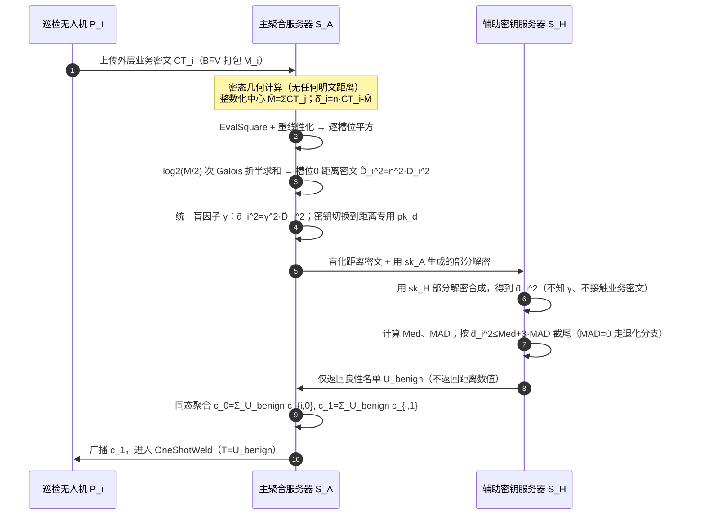

# 方案一 `TwinWeldFL` 鲁棒性专题：`TrustBoundFilter` 全流程闭环公式推导

> **文档定位**：本文档从方案一 `TwinWeldFL` 中**分离出鲁棒性功能**单独介绍并完成闭环推导。鲁棒性解决的问题是：**在密文不解密的前提下，识别并剔除幅值放大或方向偏离的拜占庭投毒更新**，使进入门限解密环节的聚合密文只含良性更新。
>
> **前置阅读**：《方案一-TwinWeldFL-核心框架与多维正确性分析.md》（外层 BFV 加密、DKG、双服务器架构与同维掩码主闭环）。本文档继承其全部符号。
>
> **重要说明**：原方案的 `TrustBoundFilter` 思路正确，但存在三处工程/代数严谨性缺口（整数除法、独立盲因子与排序矛盾、距离解锁通道未显式化），本文档在 §4 给出**修补版闭环**，并在 §6 给出完整的正确性证明与统计性质证明。

---

## 目录

1. [使用的技术清单](#1-使用的技术清单)
2. [各项技术的基本内容](#2-各项技术的基本内容)
3. [问题定义与在方案一中的挂载位置](#3-问题定义与在方案一中的挂载位置)
4. [结合方案一的修补版全流程推导](#4-结合方案一的修补版全流程推导)
5. [正确性与鲁棒性定理](#5-正确性与鲁棒性定理)
6. [原方案缺口分析与修补对照表](#6-原方案缺口分析与修补对照表)
7. [修补版伪代码](#7-修补版伪代码)
8. [实体交互时序图](#8-实体交互时序图)
9. [与 PBFL / ELSA / ShieldFL 的对比](#9-与-pbfl--elsa--shieldfl-的对比)
10. [边界、局限与进一步增强](#10-边界局限与进一步增强)

---

## 1. 使用的技术清单

| 编号 | 技术 | 在 `TrustBoundFilter` 中的角色 | 来源参照 |
| :--:| :--- | :--- | :--- |
| R1 | **拜占庭攻击建模**（scale-up、label/sign-flipping、AGR-tailored、后门） | 明确过滤对象与攻击强度 | `26-PBFL`、`23-ELSA`、`26-PPBR` |
| R2 | **基于几何中心的距离离群点检测**（欧氏距离平方） | 用 $\|M_i-\bar M\|_2^2$ 度量更新异常度 | 距 Krum/几何中值/trimmed-mean 一系 |
| R3 | **中位数（Median）与中位数绝对偏差（MAD）** | 稳健位置/尺度估计，给出无污染分布参数的自适应阈值 | 经典稳健统计（$50\%$ breakdown point） |
| R4 | **BFV/CKKS SIMD 槽位打包** | 把梯度 $d$ 个系数打包进环的 $M/2$ 个槽位，支持单指令并行 | BFV 标准原语 |
| R5 | **同态减法、同态平方（EvalSquare）+ 重线性化（Relinearization）** | 密文域精确计算逐元素差值平方 | BFV 标准原语（仅耗 1 层乘法深度） |
| R6 | **Galois 旋转折半求和（EvalGal / Rotate-and-Sum）** | 把逐元素平方折叠为槽位 0 的距离平方标量 | BFV 标准原语（$\log_2(M/2)$ 次旋转） |
| R7 | **双服务器协同解密（距离专用双陷阱门/密钥切换）** | 在不暴露个体梯度、不把外层总私钥交给任何一方的前提下解锁距离标量 | `26-PBFL`（双陷阱门 PHE）、`23-ELSA`（2PC 部分解密） |
| R8 | **统一正乘性盲化（Multiplicative Blinding）** | 向 $\mathcal{S}_H$ 隐藏距离绝对值，同时保持序关系与 MAD 截尾结果不变 | 本文档对原方案的修补（原方案误用独立盲因子） |
| R9 | **截尾聚合（Trimmed Aggregation）** | 剔除离群点后同态累加良性密文 | Multi-Krum/Trimmed Mean 范式 |

---

## 2. 各项技术的基本内容

### 2.1 拜占庭攻击模型（R1）

设本轮上传集合 $\mathcal{U}_{\mathrm{up}}=\mathcal{H}\cup\mathcal{A}$，良性集合 $\mathcal{H}$、恶意集合 $\mathcal{A}$，$|\mathcal{A}|/|\mathcal{U}_{\mathrm{up}}|<1/2$（与核心框架威胁模型一致）。典型攻击：

- **幅值放大（Scale-up / Boosted）**：$M_i^{\mathrm{mal}}=\kappa\,M_i$，$\kappa\gg1$，使单个毒化更新主导聚合（$\ell_2$ 攻击的典型）；
- **标签翻转（Label Flipping）**：用翻转标签训练，更新方向系统性偏离良性分布；
- **符号翻转（Sign Flipping / Random Perturbation）**：$M_i^{\mathrm{mal}}=-\kappa\,M_i$ 或 $M_i^{\mathrm{mal}}=\bar M+\kappa(\bar M-M_i)$；
- **AGR-tailored（自适应攻击）**：攻击者知悉聚合规则，刻意把毒化更新伪装到过滤阈值内；
- **后门（Backdoor）**：范数正常、仅在特定触发输入上偏转（距离/范数类防御对此类**不敏感**，见 §10）。

**防御目标**：输出良性集合 $\mathcal{U}_{\mathrm{benign}}\supseteq\mathcal{H}$（尽可能不含 $\mathcal{A}$），且良性误删率可控。

### 2.2 几何中心距离与离群检测（R2）

明文域中，以群体中心 $\bar M=\frac{1}{n}\sum_{i\in\mathcal{U}_{\mathrm{up}}}M_i$ 为基准，第 $i$ 个更新的异常度为

$$
D_i^2=\|M_i-\bar M\|_2^2=\sum_{\nu=1}^{d}(M_i[\nu]-\bar M[\nu])^2.
$$

良性更新在中心附近聚集成团，投毒更新（尤其 scale-up、sign-flipping）在该距离上显著偏大。距离类防御属于 Multi-Krum/几何中值同族：Krum 用「到最近邻的距离和」，本方案用「到均值中心的距离 + MAD 阈值」，计算更轻。

### 2.3 中位数与 MAD（R3）

设 $\{x_i\}_{i=1}^n$ 为一组样本：

$$
\mathrm{Med}(x)=\operatorname{median}_i x_i,\qquad
\mathrm{MAD}(x)=\operatorname{median}_i |x_i-\mathrm{Med}(x)|.
$$

异常截尾规则（$3$ 为常用经验常数，正态分布下约对应 $3\sigma$ 外）：

$$
\mathcal{U}_{\mathrm{benign}}=\{i:\ x_i\le \mathrm{Med}(x)+3\,\mathrm{MAD}(x)\}.
$$

**稳健性**：中位数与 MAD 的**有限样本失效点（breakdown point）均为 $50\%$**——只要严格异常（趋于 $+\infty$）的样本不超过一半，二者都不会被拉向无穷，阈值保持有界。这与「恶意比例 $<50\%$」的威胁模型精确匹配。

**关键不变性（§5 定理 R3 要用到）**：在共同正仿射变换 $x_i\mapsto a x_i+b$（$a>0$）下，

$$
\mathrm{Med}(ax+b)=a\,\mathrm{Med}(x)+b,\qquad
\mathrm{MAD}(ax+b)=a\,\mathrm{MAD}(x),
$$

故阈值判定 $x_i\le\mathrm{Med}(x)+3\mathrm{MAD}(x)$ 与 $ax_i+b\le\mathrm{Med}(ax+b)+3\mathrm{MAD}(ax+b)$ **完全等价**（两边乘 $a$ 加 $b$），截尾集合不变。纯乘性变换 $x_i\mapsto a x_i$（$b=0$）是其特例。

### 2.4 BFV SIMD 打包与同态代数（R4、R5）

BFV 用分圆环嵌入把明文多项式的 $M/2$ 个槽位（slot，共轭对）映射为 $\mathbb{Z}_P^{M/2}$ 上的向量。把梯度 $M_i$ 的 $d$ 个系数对齐打包（$d\le M/2$，不足补零），则：

- 密文加/减 = 槽位并行加/减：$\llbracket x\rrbracket\pm\llbracket y\rrbracket=\llbracket x\pm y\rrbracket$；
- 密文乘明文常数 = 槽位并行缩放：$\llbracket x\rrbracket\odot c=\llbracket c\odot x\rrbracket$；
- 密文平方 $\mathrm{EvalSquare}(\llbracket x\rrbracket)=\llbracket x^2\rrbracket$（逐槽位平方），耗 1 层乘法深度并需一次重线性化把三元组密文降回二元组。

BFV 明文环是**整数**环，加减乘（未取整前）**逐位精确**——这是距离平方可以密态精确计算的根本原因（区别于 CKKS 的近似）。

### 2.5 Galois 旋转折半求和（R6）

Galois 密钥 $\{gk_{2^\xi}\}$ 支持密文槽位循环旋转 $\mathrm{Rot}_k$。对打包好的逐元素平方向量 $\llbracket z\rrbracket=(\llbracket z_1^2\rrbracket,\dots,\llbracket z_{M/2}^2\rrbracket)$，折半求和

$$
\llbracket S\rrbracket\leftarrow\llbracket z\rrbracket;\qquad
\text{for }\xi=0,1,\dots,\log_2(M/2)-1:\quad
\llbracket S\rrbracket\leftarrow\llbracket S\rrbracket+\mathrm{Rot}_{2^\xi}(\llbracket S\rrbracket)
$$

执行 $\log_2(M/2)$ 次「旋转+加」后，**每个槽位（特别地槽位 0）都等于所有槽位之和** $\sum_{\nu=1}^{M/2}z_\nu^2$。复杂度仅 $O(\log M)$ 次旋转，与维度 $d$ 无关地并行完成。

### 2.6 双服务器协同解锁距离标量（R7）

距离密文是用**外层门限公钥 $PK$** 加密的，不能让任何一方持有完整 $S$ 去解密（否则回到单服务器威胁）。两种标准化实现：

- **方案 A（距离专用双陷阱门 + 密钥切换，PBFL 路线）**：setup 阶段额外生成一把「距离统计专用」密钥对 $(pk_d,sk_d)$，$sk_d$ 在 $\mathcal{S}_A,\mathcal{S}_H$ 间做加性秘密共享 $sk_d=sk_A+sk_H$；利用外层 evk 生成 $PK\to pk_d$ 的密钥切换密钥（密钥切换过程不解密、不泄露明文），把距离密文切换到 $pk_d$ 下；解锁时两服务器分别用 $sk_A,sk_H$ 计算部分解密，相加即得明文距离。任何一方都只见到一个（被自身盲化的）份额。
- **方案 B（加性盲化 + 2PC 部分解密，ELSA 路线）**：$\mathcal{S}_A$ 对距离密文叠加一次性加性盲 $R$，两服务器在共享外层 $S$ 的份额下对盲化后密文部分解密，再在 $\mathcal{S}_H$ 侧重组，去盲由双方按份额完成；明文距离只以秘密共享形式存在。

本方案采用**方案 A**（与非共谋双服、密钥切换的 FHE 工程范式一致），解锁目标是**被乘性盲化后的距离**，$\mathcal{S}_H$ 仅据此排序，任何一方都得不到真实距离。

### 2.7 乘性盲化（R8）

对正的距离平方 $x_i>0$，用正因子 $\gamma>0$ 缩放为 $\tilde x_i=\gamma^2 x_i$。盲化必须满足两个相反要求：

1. **隐藏绝对值**：$\gamma$ 对解锁方 $\mathcal{S}_H$ 保密，$\mathcal{S}_H$ 只见 $\tilde x_i$，无法还原 $x_i$ 的绝对尺度（它又不接触业务密文，无法把距离与梯度内容关联）；
2. **保持决策不变**：排序与 MAD 截尾只能利用「序与相对结构」，因此 $\gamma$ 必须对**同一轮所有客户端相同**（共同正仿射变换），由 §2.3 不变性保证截尾集合不变。

> 原方案让每个客户端用独立的 $\gamma_i$，则 $\tilde x_i=\gamma_i^2x_i$ 的序被随机打乱，$\mathcal{S}_H$ 无法排序；若解锁后交回 $\mathcal{S}_A$ 除以 $\gamma_i^2$，则 $\mathcal{S}_A$ 得到真实距离，盲化失去意义。这是原方案的核心矛盾，修补版统一用**每轮一个** $\gamma$ 且仅让 $\mathcal{S}_H$ 见到缩放后的标量（见 §4）。

---

## 3. 问题定义与在方案一中的挂载位置

挂载在核心框架**阶段 1（密文聚合）之后、阶段 2（广播 $c_1$）之前**：

```text
上传 {CT_i} → 【TrustBoundFilter】→ 良性聚合密文 CT=(c_0,c_1) → 广播 c_1 → OneShotWeld
```

**接口**：

- 输入：本轮上传的外层密文 $\{CT_i\}_{i\in\mathcal{U}_{\mathrm{up}}}$（及客户端附带的标签/签名，验证专题处理）；
- 输出：良性集合 $\mathcal{U}_{\mathrm{benign}}$、良性聚合密文 $CT=(c_0,c_1)$，其中 $c_0=\sum_{i\in\mathcal{U}_{\mathrm{benign}}}c_{i,0}$、$c_1=\sum_{i\in\mathcal{U}_{\mathrm{benign}}}c_{i,1}$。

**安全约束**：过滤全程 $\mathcal{S}_A,\mathcal{S}_H$ 均不得获得任何 $M_i$ 的明文或真实两两距离；$\mathcal{S}_H$ 仅获得被统一盲化的距离标量用于排序，最终只输出良性名单。

---

## 4. 结合方案一的修补版全流程推导

设本轮上传 $n=|\mathcal{U}_{\mathrm{up}}|$ 份密文，$CT_i=(c_{i,0},c_{i,1})$ 为 $M_i$ 的 BFV 打包密文。为记号简洁，槽位向量直接记为 $M_i=(M_i[1],\dots,M_i[d])$，所有运算均在槽位上并行。

### 4.1 步骤 F1：整数化群体中心（修补 $1/n$ 取整问题）

明文中心为 $\bar M=\frac{1}{n}\sum_j M_j$。若直接在 BFV 整数环上乘 $n^{-1}\bmod P$，当 $n\nmid\sum_j M_j[\nu]$ 时产生取整误差，且该误差经平方后偏移距离。修补技巧：**整体放大 $n$ 倍，消去除法**。定义整数化中心

$$
\widehat M\triangleq\sum_{j=1}^{n}M_j,
$$

并定义第 $i$ 个更新的**整数化差值向量**

$$
\widehat\delta_i\triangleq n\cdot M_i-\widehat M=\sum_{j=1}^{n}(M_i-M_j).
$$

在密文域，$\mathcal{S}_A$ 仅用同态加与明文常数乘即可得到（$n$ 为公开小整数）：

$$
\llbracket\widehat M\rrbracket=\bigoplus_{j=1}^{n}CT_j,\qquad
\llbracket\widehat\delta_i\rrbracket=n\odot CT_i\ominus\llbracket\widehat M\rrbracket.
$$

### 4.2 步骤 F2：密态差值平方与 Galois 折叠

逐槽位平方（一次 EvalSquare + 重线性化）：

$$
\llbracket Z_i\rrbracket=\mathrm{EvalSquare}\big(\llbracket\widehat\delta_i\rrbracket\big),
\qquad Z_i[\nu]=\widehat\delta_i[\nu]^2.
$$

折半旋转求和（$\log_2(M/2)$ 次 EvalGal），槽位 0 输出标量密文

$$
\llbracket\widehat D_i^{\,2}\rrbracket=\bigoplus_{\xi=0}^{\log_2(M/2)-1}\mathrm{Rot}_{2^\xi}(\llbracket Z_i\rrbracket)\text{ 的槽位 0},\qquad
\widehat D_i^{\,2}=\sum_{\nu=1}^{d}\widehat\delta_i[\nu]^2.
$$

### 4.3 步骤 F3：整数化距离与真实距离的等价性

$$
\widehat D_i^{\,2}=\sum_\nu\big(n(M_i[\nu]-\bar M[\nu])\big)^2
=n^2\underbrace{\sum_\nu(M_i[\nu]-\bar M[\nu])^2}_{D_i^2}.
$$

故

$$
\boxed{\widehat D_i^{\,2}=n^2 D_i^2.}\tag{4-1}
$$

即所有距离被**同一正因子 $n^2$** 缩放。由 §2.3 正仿射不变性，在 $\{\widehat D_i^{\,2}\}$ 上做 MAD 截尾与在 $\{D_i^2\}$ 上**截尾集合完全一致**（中位数、MAD、阈值同步乘 $n^2$）。BFV 全程无除法、无取整误差。

### 4.4 步骤 F4：统一乘性盲化与双服协同解锁（修补独立盲因子与解锁通道）

1. $\mathcal{S}_A$ 采样**本轮唯一**的正盲因子 $\gamma>0$（如 $\gamma\leftarrow\mathbb{Z}_{2^\kappa}^+$，$\kappa$ 为统计安全参数对应的位宽），对所有客户端一致地密文缩放：

$$
\llbracket\widetilde d_i^{\,2}\rrbracket=\gamma^2\odot\llbracket\widehat D_i^{\,2}\rrbracket
=\llbracket\gamma^2\widehat D_i^{\,2}\rrbracket.
$$

2. 经 §2.6 方案 A 的距离专用密钥切换与双陷阱门部分解密，$\mathcal{S}_A,\mathcal{S}_H$ 协同解锁，使 $\mathcal{S}_H$ 得到（且仅得到）标量

$$
\widetilde d_i^{\,2}=\gamma^2\widehat D_i^{\,2}=\gamma^2 n^2 D_i^2,\qquad i\in\mathcal{U}_{\mathrm{up}}.
$$

$\mathcal{S}_A$ 持有 $\gamma$ 但不持有解锁后的标量；$\mathcal{S}_H$ 持有标量但不知 $\gamma$、也不接触业务密文。双方视图分离：

- $\mathcal{S}_A$：只见密文与盲化密文，无任何距离明文；
- $\mathcal{S}_H$：只见一组被随机正因子 $\gamma^2 n^2$ 缩放的标量，知道其**序与相对比值**（排序所必需），不知绝对尺度，也无法与任何梯度关联。

### 4.5 步骤 F5：$\mathcal{S}_H$ 侧稳健截尾（只返回名单）

在 $\{\widetilde d_i^{\,2}\}$ 上计算

$$
\widetilde m=\mathrm{Med}(\widetilde d^{\,2}),\qquad
\widetilde\sigma=\mathrm{MAD}(\widetilde d^{\,2})=\mathrm{Median}_i\big|\widetilde d_i^{\,2}-\widetilde m\big|,
$$

锁定良性名单

$$
\mathcal{U}_{\mathrm{benign}}=\{i\in\mathcal{U}_{\mathrm{up}}:\ \widetilde d_i^{\,2}\le \widetilde m+3\widetilde\sigma\}.
$$

$\mathcal{S}_H$ 把 $\mathcal{U}_{\mathrm{benign}}$（仅下标集合）返回 $\mathcal{S}_A$，**不回传任何距离数值**。

> 若 $\mathrm{MAD}=0$（距离高度集中，常见于良性同质数据），退化为以 $\widetilde m$ 为基准的倍数阈值（如 $\widetilde d_i^{\,2}\le c\,\widetilde m$）或回退到范数上界策略，工程上需显式处理该退化分支。

### 4.6 步骤 F6：良性密文同态聚合

$\mathcal{S}_A$ 按名单聚合（零深度同态加）：

$$
c_0=\bigoplus_{i\in\mathcal{U}_{\mathrm{benign}}}c_{i,0},\qquad
c_1=\bigoplus_{i\in\mathcal{U}_{\mathrm{benign}}}c_{i,1}.
$$

对应明文 $M=\sum_{i\in\mathcal{U}_{\mathrm{benign}}}M_i$，随后进入核心框架的广播 $c_1$ 与 `OneShotWeld` 阶段（此时在线集合 $\mathcal{T}$ 即 $\mathcal{U}_{\mathrm{benign}}$，解密名单与过滤名单天然一致）。

### 4.7 全流程闭环一览

$$
\underbrace{CT_i}_{\text{外层密文}}
\xrightarrow{\,n\odot CT_i-\bigoplus CT_j\,}\llbracket\widehat\delta_i\rrbracket
\xrightarrow{\mathrm{EvalSquare+Galois}}\llbracket\widehat D_i^{\,2}=n^2D_i^2\rrbracket
\xrightarrow{\gamma^2\odot}\llbracket\widetilde d_i^{\,2}\rrbracket
\xrightarrow[\text{双陷阱门}]{\text{密钥切换+协同解锁}}\widetilde d_i^{\,2}\ (\text{仅 }\mathcal{S}_H)
\xrightarrow{\mathrm{Med,MAD}}\mathcal{U}_{\mathrm{benign}}
\xrightarrow{\bigoplus}\!CT.
$$

---

## 5. 正确性与鲁棒性定理

### 定理 R1（密态距离的精确性）

在 BFV 打包对齐、无槽位溢出（明文模数 $P$ 足够容纳 $n^2d$ 量级的差值平方和，见 §5.4 参数条件）的前提下，步骤 F2 折叠输出的 $\widehat D_i^{\,2}$ 与明文整数化距离 $\sum_\nu(nM_i[\nu]-\widehat M[\nu])^2$ **逐整数相等**（无近似误差）。

**证明**：BFV 对加法、明文常数乘、一次乘法在未取整前为精确整数运算；EvalSquare 是槽位精确平方；Galois 旋转是槽位置换，折半求和为精确加法。故槽位 0 为各槽位精确平方之和，取整误差为零。$\blacksquare$

### 定理 R2（整数化中心的决策等价性）

在 $\{\widehat D_i^{\,2}=n^2D_i^2\}$ 上的 MAD 截尾结果与在真实距离 $\{D_i^2\}$ 上的结果完全一致，即

$$
\{i:\widehat D_i^{\,2}\le\mathrm{Med}(\widehat D^{\,2})+3\mathrm{MAD}(\widehat D^{\,2})\}
=
\{i:D_i^2\le\mathrm{Med}(D^2)+3\mathrm{MAD}(D^2)\}.
$$

**证明**：由 §2.3 共同正仿射不变性（$a=n^2>0,b=0$），$\mathrm{Med}(\widehat D^{\,2})=n^2\mathrm{Med}(D^2)$，$\mathrm{MAD}(\widehat D^{\,2})=n^2\mathrm{MAD}(D^2)$，阈值两侧同乘 $n^2$，成员判定不变。$\blacksquare$

### 定理 R3（统一盲化下截尾集合不变 + 绝对值隐藏）

(i) $\mathcal{S}_H$ 在 $\{\widetilde d_i^{\,2}=\gamma^2 n^2D_i^2\}$ 上的截尾名单与明文真实名单一致；(ii) 在 $\gamma$ 对 $\mathcal{S}_H$ 均匀未知时，$\mathcal{S}_H$ 视图中距离绝对尺度被隐藏，其获得的信息仅为距离的**序与相对比值**。

**证明**：(i) 再用一次正仿射不变性（$a=\gamma^2n^2>0$）。(ii) 对 $\mathcal{S}_H$ 而言，$\gamma$ 为 $\mathbb{Z}_{2^\kappa}^+$ 上的未知随机量，给定观测 $\{\widetilde d_i^{\,2}\}$ 时任意共同正缩放的距离族 $\{D_i^2\mapsto c\cdot D_i^2\}$ 不可区分；可识别的只有与 $\gamma$ 无关的量——排序（序）与比值 $\widetilde d_i^{\,2}/\widetilde d_j^{\,2}=D_i^2/D_j^2$。$\blacksquare$

> 隐私口径说明：距离的序与相对比值是「为完成排序而必须暴露的最小信息」（与 PBFL 暴露掩码后余弦、ELSA 暴露比较结果的口径一致）。若连序关系也要隐藏，需走完整 2PC 排序网络（秘密共享比较 OT，见 §10），代价显著增大。

### 定理 R4（MAD 截尾的拜占庭容忍度）

当严格异常的恶意更新（$D_i^2\to\infty$，如 scale-up）数量 $m<n/2$ 时，$\mathrm{Med}$ 与 $\mathrm{MAD}$ 保持有界且由良性分布决定，阈值 $\mathrm{Med}+3\mathrm{MAD}$ 不被毒化拉向无穷，全部严格异常更新被剔除。

**证明**：中位数与 MAD 的 breakdown point 为 $1/2$。把样本按大小排序，严格异常的 $m$ 个占据最大的 $m$ 个位置；当 $m<n/2$，中位数位置 $\lceil n/2\rceil$ 与 MAD 中位位置都落在良性样本内，二者均为良性分布的有限值，阈值有限；趋于无穷的异常值必然超过有限阈值而被剔除。$\blacksquare$

### 定理 R5（良性更新的保留：误删率，正确性的另一面）

若良性更新满足 $M_i[\nu]=\bar M[\nu]+\varepsilon_i[\nu]$，其中 $\varepsilon_i$ 为次高斯、参数 $\sigma$（良性梯度的自然离散），则在良性同质子模型下，良性 $i$ 被误删的概率有界

$$
\Pr\big[D_i^2>\mathrm{Med}(D^2)+3\mathrm{MAD}(D^2)\big]\ \le\ C\exp(-c\,\eta^2)
$$

其中阈值在该分布下约对应 $\eta$ 个标准差（正态时 $3\mathrm{MAD}\approx2.0\,\sigma$，配合中位数位置即经典 $3\sigma$ 量级），$C,c$ 为常数。

**证明要点**：$D_i^2/\sigma^2$ 为 $d$ 个次高斯平方之和（次 $\chi^2$），集中在 $d\sigma^2$ 附近；MAD 一致估计尺度（$\mathrm{MAD}\approx0.6745\sigma$ 的逐坐标口径在距离和上重新标定），超过阈值的尾部按次高斯指数衰减。$\blacksquare$

**含义**：阈值 $3$ 是「误删良性 vs. 漏检恶意」的折中常数，应随 Non-IID 程度调参（Non-IID 强时良性分布本身偏散，应放大常数或改用相对偏离），这是参数校准问题而非协议缺陷。

### 5.4 明文模数与乘法深度参数条件

- 槽位明文值上界：$\widehat\delta_i[\nu]=n(M_i[\nu]-\bar M[\nu])$，量化后 $|M_i[\nu]|\le\Delta_P$（明文槽位有效范围），则 $\widehat\delta_i[\nu]^2\le n^2(2\Delta_P)^2$，距离和 $\widehat D_i^{\,2}\le d\cdot4n^2\Delta_P^2$；盲化后 $\widetilde d_i^{\,2}\le\gamma^2\cdot4dn^2\Delta_P^2$。**要求明文模数 $P$ 容纳该上界**（或在距离专用密钥下使用独立的、更大的明文模数/单槽编码），否则发生明文溢出导致回绕，距离失真。
- 乘法深度：仅一次 EvalSquare（深度 1）+ 明文常数乘（不增深），标准 BFV 参数（$M=8192/16384$，多素数 $Q$）即可支撑。
- 旋转密钥：需预置 $\log_2(M/2)$ 把 Galois 密钥。

---

## 6. 原方案缺口分析与修补对照表

| # | 原方案表述 | 问题性质 | 修补（本文档） | 影响 |
| :-:| :--- | :--- | :--- | :--- |
| G1 | 中心密文 $CT_{\mathrm{mean}}=\frac1n\sum CT_i$ | BFV 整数环上 $1/n$ 取整误差，平方后偏移距离 | **整数化中心** $\widehat M=\sum M_j$，$\widehat\delta_i=nM_i-\widehat M$，距离整体乘 $n^2$（定理 R2） | 消除取整误差，截尾决策等价 |
| G2 | 「每客户端独立采样 $\gamma_i>0$，$\mathcal{S}_H$ 解锁 $\gamma_i^2D_i^2$ 后排序」 | 独立缩放破坏序关系，排序/MAD 结果错误；若交回 $\mathcal{S}_A$ 去盲则真实距离泄露 | **每轮统一** $\gamma$，$\mathcal{S}_H$ 只见 $\gamma^2n^2D_i^2$，仅返回名单（定理 R3） | 隐私与排序决策同时成立 |
| G3 | 「与 $\mathcal{S}_H$ 协同解锁第 1 槽位标量」未给密码学实现 | 解锁通道不明确，可能隐含需要外层 $S$ 或额外一轮门限解密，与 One-Shot 冲突 | **距离专用双陷阱门密钥 + 密钥切换**（或加盲 2PC 部分解密），解锁发生在两服之间，无人机不参与，不增加客户端轮次 | 协议可落地，One-Shot 不变 |
| G4 | 以算术均值为中心 | 均值 breakdown point 为 0，$<50\%$ 强污染可拉偏中心 | §10 给出**两轮截尾/密态几何中值**增强；基础版依赖 MAD 对尺度污染的稳健性与「恶意距离显著偏大」假设 | 明确攻击边界 |
| G5 | 仅欧氏距离 | 对范数正常的角度/后门投毒不敏感 | 增加密态余弦相似度通道（PBFL 路线）或符号/3D 特征（PPBR 路线） | 扩展攻击覆盖面 |
| G6 | 阈值 $\mathrm{Med}+3\mathrm{MAD}$ 未处理 $\mathrm{MAD}=0$ | 退化分支除零/阈值失效 | 显式退化处理：倍数阈值或范数界回退 | 工程健壮性 |
| G7 | 未给明文模数溢出条件 | 距离平方和可能超过 $P$ 回绕 | §5.4 参数条件（距离专用编码/更大明文模数） | 防止距离回绕失真 |

---

## 7. 修补版伪代码

```text
================================================================================
算法 R（TrustBoundFilter v2，修补版）：双站协同统一盲化密态距离 MAD 截尾
Input: 上传密文 {CT_i}_{i∈U_up}（n=|U_up|）；距离专用密钥对 (pk_d, sk_A+sk_H)；
       CRS/Galois 密钥 {gk}；常数 c_MAD=3
Output: 良性名单 U_benign；良性聚合密文 CT=(c_0,c_1)
--------------------------------------------------------------------------------
[S_A：密态几何计算，全程不接触任何明文距离]
 1: [[M̂]] ← ⊕_{j=1}^n CT_j                         // 整数化群体中心（无 1/n）
 2: for i ∈ U_up do
 3:   [[δ̂_i]] ← n ⊙ CT_i ⊖ [[M̂]]
 4:   [[Z_i]] ← Relinearize(EvalSquare([[δ̂_i]]))   // 逐槽位平方，深度 1
 5:   [[D̂_i^2]] ← GaloisFoldSum([[Z_i]])           // log2(M/2) 次旋转，槽位0
 6: end for
 7: γ ← 本轮唯一正盲因子（对 S_H 保密）
 8: for i ∈ U_up do [[d̃_i^2]] ← KeySwitch_to_pk_d( γ^2 ⊙ [[D̂_i^2]] )
 9: 把 {[[d̃_i^2]]} 与 S_H 协同：分别用 sk_A、sk_H 部分解密后合成
    （S_A 不获得合成后的标量；S_H 获得且仅获得 d̃_i^2 = γ^2 n^2 D_i^2）

[S_H：盲化标量上的稳健截尾，仅返回名单]
10: m̃ ← Median({d̃_i^2})；σ̃ ← MAD({d̃_i^2})
11: if σ̃ = 0 then U_benign ← { i : d̃_i^2 ≤ c·m̃ }        // 退化分支
    else           U_benign ← { i : d̃_i^2 ≤ m̃ + c_MAD·σ̃ }
12: return U_benign → S_A（不返回任何距离数值）

[S_A：良性聚合]
13: c_0 ← ⊕_{i∈U_benign} c_{i,0}；c_1 ← ⊕_{i∈U_benign} c_{i,1}
14: return CT=(c_0,c_1), U_benign
================================================================================
```

---

## 8. 实体交互时序图



---

## 9. 与 PBFL / ELSA / ShieldFL 的对比

| 维度 | `TrustBoundFilter`（本方案修补版） | `26-PBFL`（TDSC'26） | `23-ELSA`（S&P'23） | `22-ShieldFL`（TIFS'22） |
| :--- | :--- | :--- | :--- | :--- |
| 架构 | 非共谋双服 + 外层门限 BFV | 双服 + 双陷阱门 RLWE | 双服 + 2PC 秘密共享 | 双服 + 双陷阱门 Paillier |
| 异常度量 | 到群体中心的**欧氏距离平方** + MAD | 到毒化基线的**余弦相似度** + 信用评分 | $\ell_2$ 范数上界（augmented）+ 一次性客户端 | 梯度余弦（相同掩码相减，已被攻破） |
| 密态计算原语 | 同态平方（深度 1）+ Galois 折叠 | 密文-密文内积（同态乘，较重） | Beaver 三元组 / 比较 OT | 逐元素 Paillier 内积，很慢 |
| 距离隐私 | 统一 $\gamma$ 盲化，仅暴露序 | 随机掩码 $r_j$，暴露掩码后余弦 | 仅暴露比较结果（最强隐私） | 差值泄露（已知缺陷） |
| 阈值稳健性 | Median/MAD，breakdown $50\%$ | softmax 置信度 + 指数滑动信用 | 客户端被信任为相关性源 | 无稳健统计 |
| 拜占庭手段 | 截尾（硬剔除） | 软加权 + 断崖抑制 + 信用惩罚 | 范数硬界 | 余弦比较 |
| 客户端轮次 | 不增加（过滤全在两服之间） | 两服多轮交互 | 两服 OT 交互，客户端一次性 | 两服交互 |
| 已知盲区 | 范数正常的角度/后门投毒 | 全局余弦对角度伪装仍有限 | 不防后门/角度（需配其他防御） | 相同掩码相减攻击 |

**定位结论**：`TrustBoundFilter` 选择了「欧氏距离 + MAD 硬截尾」的轻量路线——密态部分仅一次同态平方与 $\log M$ 次旋转，无需密文-密文乘法（相较 PBFL 去掉了同态内积的重线性化与模量膨胀），隐私口径介于 PBFL（暴露余弦）与 ELSA（仅暴露比较位）之间。对 scale-up、sign-flipping 等幅值型投毒高效；对 AGR-tailored 与后门投毒应叠加余弦/符号通道。

---

## 10. 边界、局限与进一步增强

1. **均值中心的稳健性（G4）**：算术均值的 breakdown point 为 0。虽然距离阈值统计量（Med/MAD）稳健，但中心本身可能被强污染拉偏，导致「毒化点反而离被拉偏的中心更近」。两种增强：
   - **两轮截尾（推荐，轻量）**：用第一轮 MAD 名单粗滤后，在剩余密文上重算中心 $\widehat M^{(2)}=\sum_{i\in\mathcal{U}^{(1)}}CT_i$，再做一轮距离截尾（trimmed mean 迭代一次），显著降低中心偏差；
   - **密态几何中值（强但重）**：几何中值（Weiszfeld 迭代）breakdown 为 $50\%$，但每轮需要密态比较/除法，乘法深度与交互大增，可在高对抗场景选用。
2. **角度/后门投毒（G5）**：距离对「范数正常、方向偏转」不敏感。可并行计算密态余弦 $\cos_i=\langle M_i,M_{\mathrm{ref}}\rangle/(\|M_i\|\|M_{\mathrm{ref}}\|)$（PBFL 式双服掩码内积），与距离通道取联合判定。
3. **Non-IID 偏差**：强 Non-IID 下良性更新天然发散，固定 $3\mathrm{MAD}$ 误删率上升。应按客户端/簇分层计算中心与尺度，或采用相对偏离阈值，并与联邦加权方式（按样本量 $p_k=n_k/n$）对齐——若聚合目标是加权平均，距离也应在加权空间内定义。
4. **隐私口径升级**：若不允许 $\mathcal{S}_H$ 获得距离序，可把 Med/MAD 与排序全部用秘密共享比较 OT（ELSA/Prio 路线）在共享态完成，服务器只学到名单，代价是 $O(n\log n)$ 次比较 OT。
5. **与验证插件的衔接**：被剔除节点的身份与依据应可审计（避免 $\mathcal{S}_H$ 借过滤之名选择性剔除）。建议 $\mathcal{S}_H$ 对 $\mathcal{U}_{\mathrm{benign}}$ 与阈值计算过程生成可核验凭据（哈希链/签名），交由可验证性专题的审计通道核验。
6. **参数清单**：明文模数容纳 §5.4 上界、乘法深度 1、$\log_2(M/2)$ 把旋转密钥、盲因子位宽 $\kappa$（统计安全）、MAD 常数（按 Non-IID 校准）、MAD=0 退化阈值倍数。

---

## 11. 小结

`TrustBoundFilter` 的鲁棒性闭环可概括为「**整数化中心（无除法）→ 一次同态平方 + Galois 折叠（精确距离）→ 统一盲化 + 双陷阱门解锁（隐绝对值、保序）→ Median/MAD 截尾（$50\%$ breakdown）→ 良性密文零深度聚合**」。定理 R1–R5 分别保证了密态距离精确性、整数化决策等价性、盲化下名单不变性与隐私、拜占庭容忍度与良性误删率。原方案的三处关键缺口（$1/n$ 取整、独立盲因子、解锁通道）已在修补版中封闭；剩余的中心稳健性与角度攻击盲区属于攻击面边界，已给出两轮截尾与余弦通道的明确增强路径。
