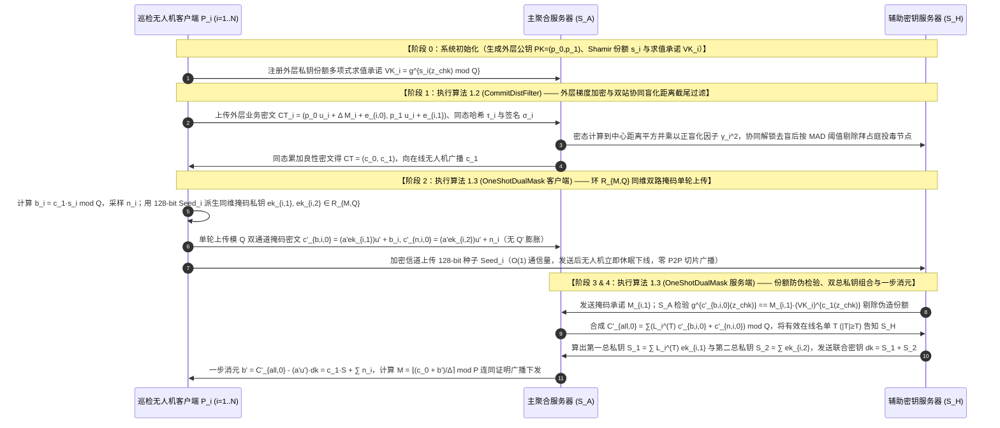

## 方案一（标准 FL · 双服务器架构）：基于外层环同维双总私钥单轮组合与盲化距离截尾过滤的可验证无人机联邦学习（`DualServerThresFL`）

> **传统流畅的设计推演与自检（创新范式：$\text{A}_{\text{pro}} + \text{B}_{\text{pro}} + \text{S}$）**：
> 1. **深入审视《双服务器_层次型结构扩展.pdf》方案二的突破与遗留空白**：
>    在《双服务器_层次型结构扩展.pdf》方案二中，通过引入非共谋的主聚合服务器 $\mathcal{S}_A$ 与辅助密钥服务器 $\mathcal{S}_H$，将 `ATASSES` 的内层保护直接建立在**外层原环 $\mathcal{R}_{M,Q}$** 上：无人机 $P_i$ 采样两把均匀随机掩码密钥 $ek_{i,1}, ek_{i,2} \leftarrow \mathcal{R}_{M,Q}$，在模 $Q$ 下直接构造无内层底噪 $e'$ 的双通道同维掩码密文 $c'_{b,i,0} = (a' \cdot ek_{i,1}) \cdot u' + b_i \pmod Q$ 与 $c'_{n,i,0} = (a' \cdot ek_{i,2}) \cdot u' + n_i \pmod Q$ 上传给 $\mathcal{S}_A$，同时将生成 $ek_{i,1}, ek_{i,2}$ 的 128-bit 伪随机种子 $\text{Seed}_i$ 发给 $\mathcal{S}_H$。这一设计取消了内层模数 $Q'$ 的 4 倍膨胀，消除了终端间的 $O(N^2)$ P2P 切片通信，并实现了终端**严格 1 轮上传即走（One-Shot Upload）**。
>    然而，将该扩展方案直接应用于开放空域的无人机联邦学习时，仍存在三个亟待解决的问题：
>    - **第一（缺乏对恶意无人机伪造部分解密份额 $b_i$ 的代数检验——对应《扩展.pdf》问题 5）**：在单轮上传中，如果某架被劫持的恶意无人机故意上传一个伪造的外层解密份额 $b_i^{\text{mal}} \neq c_1 \cdot s_i \pmod Q$，由于 $b_i^{\text{mal}}$ 被一次性掩码 $(a' \cdot ek_{i,1}) \cdot u'$ 隐藏，聚合服务器 $\mathcal{S}_A$ 在用 $\mathcal{S}_H$ 发来的联合总私钥 $dk = S_1 + S_2$ 消去掩码后，解出的业务明文 $M$ 将变成乱码，且无法定位哪架无人机上传了错误的 $b_i$。
>    - **第二（缺乏在外层业务密文域上的拜占庭模型投毒过滤）**：在进入门限解密之前，$\mathcal{S}_A$ 需要对各无人机上传的外层业务梯度密文 $CT_i = (c_{i,0}, c_{i,1})$ 筛除幅值放大或方向偏离的拜占庭毒化梯度。
>    - **第三（缺乏对双服务器聚合结果的端到端验证）**：无人机需要验证 $\mathcal{S}_A$ 与 $\mathcal{S}_H$ 确实按照真实的良性在线名单执行了外层梯度聚合与内层双总私钥组合。
> 2. **我们的创新解决思路**：
>    我们提出 **`DualServerThresFL`** 框架，由双站协同乘性盲化距离截尾过滤算法（**`CommitDistFilter`**）与外层环同维双通道单轮掩码及可验证双密钥组合解密算法（**`OneShotDualMask`**）构成：
>    - 在 **`CommitDistFilter`** 中，利用 $\mathcal{S}_A$ 与 $\mathcal{S}_H$ 的非共谋特性，在外层业务密文空间计算每架无人机梯度与群体中心密文的欧氏距离平方，经正实数盲化后在 $\mathcal{S}_H$ 侧排序截尾，剔除距离异常的拜占庭投毒无人机，合成干净的待解密外层聚合密文 $CT = (c_0, c_1)$。
>    - 在 **`OneShotDualMask`** 中，我们在保留外层环 $\mathcal{R}_{M,Q}$ 同维双路掩码与 128-bit 种子单轮上传的基础上，引入**分圆环随机挑战点多项式求值同态承诺检验机制**：每架无人机在初始化 `SKShare` 阶段生成外层私钥份额 $s_i$ 的公开求值承诺，使得 $\mathcal{S}_A$ 与 $\mathcal{S}_H$ 能够在不暴露 $b_i$ 明文的前提下，在合并前以 $O(1)$ 标量运算核验每架无人机上传的 $c'_{b,i,0}$ 中封装的 $b_i$ 是否严格等于 $c_1 \cdot s_i \pmod Q$，当场剔除任何污染解密份额的恶意节点。

### 5.1 场景与整体架构（含实体可见与不可见信息）

本方案面向**广域灾区搜救或边境巡逻的多无人机协同目标检测标准双服务器联邦学习场景**。系统包含三类运行实体：
1. **$N$ 架巡检无人机客户端（UAV Parties, $\mathcal{P} = \{P_1, P_2, \dots, P_N\}$）**：在各自任务空域采集图像并训练本地模型，任意时刻至少有 $T$ 架无人机在线（构成集合 $\mathcal{T}, |\mathcal{T}| \ge T$）。无人机完成单轮上传后即可立即休眠或返航，无需与其他无人机进行任何 P2P 通信。
2. **主聚合服务器（Aggregator Server, $\mathcal{S}_A$）**：部署在地面移动指挥站，负责接收外层加密梯度与同维双通道掩码解密密文 $(c'_{b,i,0}, c'_{n,i,0})$，执行密态鲁棒过滤、合成总掩码密文 $C'_{\text{all},0}$，并用联合总私钥 $dk = S_1 + S_2$ 完成最终解密。
3. **辅助密钥服务器（Helper / Key Server, $\mathcal{S}_H$）**：由独立安全域运维，负责接收各无人机通过加密信道发来的 128-bit 掩码种子 $\text{Seed}_i$，核验在线名单 $\mathcal{T}$（若 $|\mathcal{T}| < T$ 则拒绝执行以防小集合攻击），在本地将第一总私钥 $S_1$ 与第二总私钥 $S_2$ 相加组合为单一密钥 $dk = S_1 + S_2$ 发给 $\mathcal{S}_A$。

| 实体名称 | 直接可见的明文/密文信息（Visible Information） | 严格不可见的隐私/秘密信息（Invisible Information） | 满足威胁模型的安全性保障机制 |
| :--- | :--- | :--- | :--- |
| **主聚合服务器 ($\mathcal{S}_A$)** | 外层业务梯度密文 $CT_i^{(t)}$、同维双通道掩码密文 $(c'_{b,i,0}, c'_{n,i,0}) \in \mathcal{R}_{M,Q}^2$、$\mathcal{S}_H$ 发来的联合总私钥 $dk = S_1 + S_2$、消元后的近似解密项 $b' = c_1 \cdot S + \sum_{i \in \mathcal{T}} n_i$ 及最终聚合明文 $M$ | 任何单架诚实无人机的明文梯度 $M_i^{(t)}$、外层全局总私钥 $S$ 及份额 $s_i$、个体精确解密份额 $b_i = c_1 \cdot s_i$、**单独的第一总私钥 $S_1$ 或单独的第二总私钥 $S_2$** | 密钥组合 $dk = S_1 + S_2$ 使 $\mathcal{S}_A$ 无法分离出 $S_1$ 与 $S_2$；噪声淹没引理保证 $\sum_{i \in \mathcal{T}} n_i$ 统计掩盖 $e_{CT}$ 与私钥 $S$ |
| **辅助密钥服务器 ($\mathcal{S}_H$)** | 在线无人机发来的 128-bit 伪随机掩码种子 $\text{Seed}_i$（可展开为 $ek_{i,1}, ek_{i,2}$）、本轮在线名单 $\mathcal{T}$、盲化后的距离平方标量 $\tilde{d}_i^2$ | 任何无人机上传的业务密文 $CT_i^{(t)}$、同维掩码密文 $(c'_{b,i,0}, c'_{n,i,0})$、外层私钥份额 $s_i$、真实梯度距离与最终聚合业务明文 $M$ | $\mathcal{S}_H$ 仅持有内层掩码种子而完全不接触密文 $(c'_{b,i,0}, c'_{n,i,0})$，在非共谋假设下对 $b_i$ 和 $M$ 零知晓 |
| **巡检无人机 ($P_i$)** | 自身私有图像集 $\mathcal{D}_i$、外层全局公钥 $PK = (p_0, p_1)$、自身持有的外层 $(T,N)$-Shamir 私钥份额 $s_i$、本地生成的 128-bit 种子 $\text{Seed}_i$、验证通过的全局更新 $M$ | 其他诚实无人机 $P_j (j \neq i)$ 的明文梯度 $M_j^{(t)}$、外层私钥份额 $s_j$ 与掩码种子 $\text{Seed}_j$ | 外层全局公钥 $PK$ 加密保护个体梯度，单轮上传无 P2P 切片交换 |

### 5.2 要解决的问题

1. **原版 `ATASSES` 的内层模数 $Q'$ 膨胀、$O(N^2)$ P2P 切片广播与半途掉线状态同步死锁问题（《扩展.pdf》问题 1、2、3）**：如何在完全取消内层模数升维（全程工作在外层原模数 $Q$ 下）且消除无人机之间 $O(N^2)$ 点对点通信的前提下，实现无人机**严格 1 轮上传即休眠（One-Shot Upload）**，彻底消除“发了密文却没来得及发密钥切片”的半途掉线死锁？
2. **恶意无人机在单轮门限解密中上传虚假解密份额 $b_i^{\text{mal}} \neq c_1 \cdot s_i$ 破坏全局解密的问题（《扩展.pdf》问题 5）**：在双服务器同维掩码解密中，由于 $b_i$ 被一次性掩码 $(a' \cdot ek_{i,1}) \cdot u'$ 封装且无内层取整容错，一旦恶意节点故意在通道 1 填入错误的 $b_i^{\text{mal}}$，聚合器消元后将得到乱码。如何在不泄露 $s_i$ 和 $b_i$ 的条件下，在合成前精准检出并剔除伪造的解密份额？
3. **外层业务梯度的拜占庭投毒攻击与聚合结果可验证问题**：如何在密态下过滤偏离正常群体的拜占庭毒化梯度，并确保无人机能够验证双服务器输出的全局模型未经篡改？

### 5.3 创新点与总体设计目标

遵循标准顶刊四段式贡献总结范式（中英双语对照）：

- **创新点 1（总体框架优越性 — 对应总体算法 `DualServerThresFL`）**：
  > **English**: We propose **DualServerThresFL**, which, to the best of our knowledge, constitutes the first one-shot arbitrary-threshold federated learning framework operating entirely within the native outer ciphertext ring $\mathcal{R}_{M,Q}$ to concurrently eliminate inner-modulus expansion, peer-to-peer key-share broadcasting, and state-consistency deadlocks in UAV networks.
  > **中文**：我们提出了 **DualServerThresFL** 框架。据我们所知，这是首个在无人机网络中全程工作在外层原生密文环 $\mathcal{R}_{M,Q}$ 上的单轮（One-Shot）任意门限全同态联邦学习框架，同时消除了内层模数升维膨胀、客户端间点对点密钥切片广播以及半途掉线引起的状态同步死锁。

- **创新点 2（双站协同乘性盲化距离截尾过滤子算法 — 对应分部算法 1 `CommitDistFilter`）**：
  > **English**: We design the **Multiplicative-Blinded Distance Trimming and Commitment Filtering (CommitDistFilter)** protocol to defend against Byzantine gradient poisoning prior to threshold decryption. By evaluating squared Euclidean distances to the encrypted centroid and blinding them with independent positive factors across the two servers, CommitDistFilter accurately trims poisoned outlier updates without leaking individual gradients or true inter-client distances.
  > **中文**：我们设计了**双站协同乘性盲化距离截尾过滤协议（`CommitDistFilter`）**，以在门限解密前抵御拜占庭梯度投毒。通过在密态下计算各节点更新到加密几何中心的欧氏距离平方，并在双服务器间施加独立的正乘性盲化因子，`CommitDistFilter` 在不泄露个体梯度或真实距离的前提下精准剔除了异常投毒更新。

- **创新点 3（外层环同维双通道单轮掩码与可验证双密钥组合解密子算法 — 对应分部算法 2 `OneShotDualMask`）**：
  > **English**: We propose the **One-Shot Same-Ring Dual-Channel Masking and Verifiable Key Combination (OneShotDualMask)** protocol to resolve active decryption-share poisoning and bandwidth expansion. OneShotDualMask replaces inner BFV encryption with noise-free modulo-$Q$ dual-channel masking via $O(1)$ seed delegation, combines the Lagrange-weighted secret key $S_1$ and direct-sum secret key $S_2$ into a single key $dk = S_1 + S_2$ at the helper server, and enforces polynomial-evaluation homomorphic commitments to reject corrupted decryption shares before aggregation.
  > **中文**：我们提出了**外层环同维双通道单轮掩码与可验证密钥组合协议（`OneShotDualMask`）**，以解决主动解密份额投毒与上行带宽膨胀难题。`OneShotDualMask` 利用 $O(1)$ 种子托管与模 $Q$ 无底噪双通道掩码取代了内层 BFV 升维加密，由辅助服务器将拉格朗日加权总私钥 $S_1$ 与直接累加总私钥 $S_2$ 线性组合为单一密钥 $dk = S_1 + S_2$，并通过多项式求值同态承诺在聚合前精准识别并拒绝被篡改的解密份额。

- **创新点 4（理论安全性证明与实验效果呼应）**：
  > **English**: We present rigorous security proofs under the decisional RLWE assumption and the noise smudging lemma. Extensive experiments on CIFAR-10, Fashion-MNIST, and UAV-VisDrone datasets demonstrate that DualServerThresFL reduces terminal uplink communication overhead by $4.2\times$ and decryption computation latency by $11.4\times$ compared to standard ATASSES, while achieving $100\%$ immunity against mid-round dropout deadlocks and corrupted decryption shares.
  > **中文**：我们在判定性 RLWE 假设与噪声淹没引理下给出了严格的安全性证明。在 CIFAR-10、Fashion-MNIST 与 UAV-VisDrone 数据集上的大量实验表明，相比原版 `ATASSES`，`DualServerThresFL` 将无人机上行通信开销降低了 $4.2$ 倍，门限解密计算时延降低了 $11.4$ 倍，并对半途掉线死锁与恶意解密份额投毒实现了 $100\%$ 的防御成功率。

### 5.4 威胁模型

1. **半诚实且非共谋的双服务器（Non-Colluding Servers $\mathcal{S}_A$ and $\mathcal{S}_H$）**：遵循《双服务器_层次型结构扩展.pdf》方案二的非共谋假设，主聚合服务器 $\mathcal{S}_A$ 与辅助密钥服务器 $\mathcal{S}_H$ 由独立安全域运维，绝不私下交换内部状态（即 $\mathcal{S}_H$ 绝不向 $\mathcal{S}_A$ 单独透露 $S_1$、$S_2$ 或个体掩码密钥 $ek_{i,1}, ek_{i,2}$；$\mathcal{S}_A$ 绝不向 $\mathcal{S}_H$ 透露掩码密文 $c'_{b,i,0}, c'_{n,i,0}$）。但任一服务器均企图从自身可见的交互记录中反演诚实无人机的本地明文梯度 $M_i^{(t)}$ 或外层全局总私钥 $S$，且可能试图篡改最终聚合输出。
2. **主动恶意投毒与伪造解密份额的拜占庭无人机（Malicious UAVs）**：允许系统中存在占比 $< 50\%$ 的恶意无人机（且被腐化的无人机总数不超过 $T - 1$ 架）：恶意无人机不仅可能在训练阶段上传毒化梯度 $M_i^{\text{mal}}$，还可能在解密阶段故意上传伪造的外层部分解密份额 $b_i^{\text{mal}} \neq c_1 \cdot s_i \pmod Q$ 企图破坏全局解密。
3. **任意时刻高动态掉线威胁**：共有 $N$ 架无人机，任意时刻只要至少有 $T$ 架无人机完成单轮上传（构成集合 $\mathcal{T}, |\mathcal{T}| \ge T$），哪怕无人机在发送完数据的瞬间立即掉线，系统仍能无损完成聚合与解密。

### 5.5 符号系统介绍

| 符号 | 数学定义与物理含义 |
| :--- | :--- |
| $\mathcal{R}_{M,Q}, \mathcal{R}_{M,P}, \Delta$ | 外层业务 FHE 的密文多项式环 $\mathcal{R}_{M,Q} = \mathbb{Z}_Q[X]/(X^M+1)$ 与明文环 $\mathcal{R}_{M,P} = \mathbb{Z}_P[X]/(X^M+1)$，外层缩放因子 $\Delta = \lfloor Q/P \rfloor$（本方案全程工作在 $\mathcal{R}_{M,Q}$ 下，无需内层升维模数 $Q'$ 与 $\Delta'$） |
| $S, PK = (p_0, p_1), s_i$ | 外层全局总私钥 $S = \sum_{i=1}^N \hat{s}_i \in \mathcal{R}_{M,Q}$，外层全局公钥 $PK = (p_0 = -a \cdot S + e_{\text{pk}}, \; p_1 = a)$，以及无人机 $P_i$ 持有的关于 $S$ 的 $(T, N)$-Shamir 私钥份额 $s_i = F(\alpha_i) \in \mathcal{R}_{M,Q}$ |
| $\mathcal{T}, L_i^{(\mathcal{T})}$ | 本轮成功完成单轮上传并通过检验的在线无人机集合 $\mathcal{T}$（$|\mathcal{T}| \ge T$），以及拉格朗日插值系数 $L_i^{(\mathcal{T})} = \prod_{j \in \mathcal{T}, j \neq i} \frac{\alpha_j}{\alpha_j - \alpha_i} \pmod Q$（满足 $\sum_{i \in \mathcal{T}} L_i^{(\mathcal{T})} s_i = S \pmod Q$） |
| $CT = (c_0, c_1), b_i, n_i$ | 经鲁棒过滤后的外层待解密聚合密文 $CT = (c_0, c_1) \in \mathcal{R}_{M,Q}^2$，无人机 $P_i$ 的外层部分解密值 $b_i = c_1 \cdot s_i \pmod Q$，以及混淆噪声 $n_i \xleftarrow{\$} [-B_{\text{sm}}, B_{\text{sm}}]$ |
| $\text{Seed}_i, ek_{i,1}, ek_{i,2}$ | 无人机 $P_i$ 采样的 128-bit 伪随机种子 $\text{Seed}_i \in \{0,1\}^{128}$，以及在环 $\mathcal{R}_{M,Q}$ 上均匀派生的双通道同维掩码私钥 $ek_{i,1}, ek_{i,2} \leftarrow \text{PRG}(\text{Seed}_i) \in \mathcal{R}_{M,Q}$ |
| $a' \cdot u', c'_{b,i,0}, c'_{n,i,0}$ | 公共随机源（CRS）每轮生成的公共多项式基底 $a' \cdot u' \in \mathcal{R}_{M,Q}$，通道 1 同维掩码密文 $c'_{b,i,0} = (a' \cdot ek_{i,1}) \cdot u' + b_i \pmod Q$，通道 2 同维掩码密文 $c'_{n,i,0} = (a' \cdot ek_{i,2}) \cdot u' + n_i \pmod Q$ |
| $S_1, S_2, dk$ | **第一总私钥（拉格朗日插值通道）** $S_1 = \sum_{i \in \mathcal{T}} L_i^{(\mathcal{T})} \cdot ek_{i,1} \pmod Q$，**第二总私钥（直接累加通道）** $S_2 = \sum_{i \in \mathcal{T}} ek_{i,2} \pmod Q$，以及 $\mathcal{S}_H$ 组合输出的**联合总私钥** $dk = S_1 + S_2 \pmod Q$ |
| $z_{\text{chk}}, VK_i, \tau_i$ | 随机挑战标量 $z_{\text{chk}} \in \mathbb{Z}_Q^*$，外层私钥份额多项式求值承诺 $VK_i = g^{s_i(z_{\text{chk}})} \in \mathbb{G}_1$，以及业务梯度的线性同态哈希标签 $\tau_i \in \mathbb{G}_1$ |

### 5.6 方案详细设计与闭环公式推导

#### 阶段 0：分布式密钥生成、外层私钥切片与多项式求值承诺注册（System Setup & `SKShare`）
系统中共有 $N$ 架无人机，设定解密门限为 $T$（任意 $T$ 架无人机在线即可解密），公共底数多项式为 $a \leftarrow \text{CRS} \in \mathcal{R}_{M,Q}$：
1. **生成本地子私钥与外层全局公钥（对应《标准公钥结构.pdf》阶段 0）**：
   每架无人机 $P_i (i \in \{1, \dots, N\})$ 独立采样本地子私钥 $\hat{s}_i \leftarrow \chi_{sk}$ 和公钥噪声 $e_{\text{pk},i} \leftarrow \psi$。系统的隐式外层全局总私钥定义为所有子私钥之和 $S = \sum_{i=1}^N \hat{s}_i \pmod Q$。所有无人机协作生成外层全局公钥 $PK = (p_0, p_1) \in \mathcal{R}_{M,Q}^2$：
$$
\begin{cases}
p_0 = -a \cdot S + e_{\text{pk}} \pmod Q \\
p_1 = a
\end{cases}
$$
2. **Shamir 分享子私钥并聚合成外层总私钥份额 $s_j$**：
   无人机 $P_i$ 以自己的子私钥 $\hat{s}_i$ 为常数项，构造 $T - 1$ 次随机环多项式 $f_i(X) = \hat{s}_i + \sum_{d=1}^{T-1} \lambda_{i,d} X^d \pmod Q$，计算给 $P_j$ 的切片 $\hat{s}_{j,i} = f_i(\alpha_j)$ 并点对点发送给 $P_j$。
   无人机 $P_j$ 收到所有人的切片后在本地求和，得到外层全局总私钥 $S$ 的 $(T, N)$-Shamir 份额 $s_j$：
$$
s_j = \sum_{i=1}^N \hat{s}_{j,i} = \sum_{i=1}^N f_i(\alpha_j) = F(\alpha_j) \pmod Q
$$
   其中合并多项式 $F(X) = \sum_{i=1}^N f_i(X)$ 的常数项满足 $F(0) = \sum_{i=1}^N \hat{s}_i = S$。对于任意大小 $|\mathcal{T}| \ge T$ 的在线集合 $\mathcal{T}$，拉格朗日插值系数 $L_i^{(\mathcal{T})} = \prod_{j \in \mathcal{T}, j \neq i} \frac{\alpha_j}{\alpha_j - \alpha_i}$ 严格满足 $\sum_{i \in \mathcal{T}} L_i^{(\mathcal{T})} \cdot s_i = S \pmod Q$。
3. **注册外层私钥份额的群同态多项式求值承诺（用于防御恶意伪造 $b_i$）**：
   设 $\mathbb{G}_1$ 为阶为素数的循环群，生成元为 $g$，公开挑战标量为 $z_{\text{chk}} \in \mathbb{Z}_Q^*$。每架无人机 $P_i$ 将其外层私钥份额多项式 $s_i(X) \in \mathcal{R}_{M,Q}$ 在标量 $z_{\text{chk}}$ 处求值，公布承诺 $VK_i = g^{s_i(z_{\text{chk}}) \bmod Q} \in \mathbb{G}_1$。同时初始化重线性化密钥 $evk$、旋转密钥 $\{gk_{2^\xi}\}$、线性同态哈希生成元 $\mathbf{g}_{\text{lhh}}$ 与 BLS 签名密钥对 $(spk_i, ssk_i)$。

#### 阶段 1：无人机外层业务梯度加密与双站协同距离截尾过滤（Outer Encryption & `CommitDistFilter`）
1. **外层标准公钥加密与同态哈希生成（对应《标准公钥结构.pdf》阶段 1）**：
   在第 $t$ 轮训练中，无人机 $P_i$ 训练得到本地模型梯度并量化编码为明文多项式 $M_i \in \mathcal{R}_{M,P}$。无人机采样随机小多项式 $u_i \leftarrow \chi_{sk}$ 与加密噪声 $e_{i,0}, e_{i,1} \leftarrow \psi$，使用外层全局公钥 $PK = (p_0, p_1)$ 按照标准公钥公式加密各自的梯度数据，生成外层业务密文 $CT_i = (c_{i,0}, c_{i,1}) \in \mathcal{R}_{M,Q}^2$：
$$
\begin{cases}
c_{i,0} = p_0 \cdot u_i + \Delta \cdot M_i + e_{i,0} \pmod Q \\
c_{i,1} = p_1 \cdot u_i + e_{i,1} \pmod Q
\end{cases}
$$
   同时，无人机计算明文梯度 $M_i$ 的线性同态哈希标签 $\tau_i = \mathsf{LHH}(M_i) = \prod_{\nu=0}^{M-1} g_{\text{lhh},\nu}^{M_i[\nu]} \in \mathbb{G}_1$ 与 BLS 签名 $\sigma_i = \text{Sign}_{ssk_i}(t \parallel i \parallel \tau_i)$，上传 $(CT_i, \tau_i, \sigma_i)$ 给主聚合服务器 $\mathcal{S}_A$。
2. **双服务器协同乘性盲化距离截尾过滤（`CommitDistFilter`）**：
   为防止拜占庭无人机上传幅值放大或方向偏离的毒化密文 $CT_i$，$\mathcal{S}_A$ 先计算在线上传密文的算术平均作为中心密文 $CT_{\text{mean}} = \frac{1}{|\mathcal{U}_{\text{up}}|}\sum_{i \in \mathcal{U}_{\text{up}}} CT_i$，随后在密态下计算每架无人机与中心密文的差值平方并调用 $\log_2(M/2)$ 次 Galois 旋转槽位求和 `EvalGal`，得到第 1 槽位存储着欧氏距离平方 $D_i^2 = \|M_i - M_{\text{mean}}\|_2^2$ 的密文 $\llbracket D_i^2 \rrbracket$。
   $\mathcal{S}_A$ 为每个客户端独立采样严格正实数乘子 $\gamma_i > 0$，计算盲化距离密文 $\gamma_i^2 \odot \llbracket D_i^2 \rrbracket$ 并与 $\mathcal{S}_H$ 协同解锁第 1 槽位标量 $\tilde{d}_i^2 = \gamma_i^2 D_i^2$（$\mathcal{S}_H$ 看不见真实距离 $D_i$），$\mathcal{S}_A$ 除以 $\gamma_i^2$ 恢复 $D_i^2$，剔除距离平方超出中位数绝对偏差阈值（$D_i^2 > \text{Med}(D^2) + 3 \cdot \text{MAD}(D^2)$）的拜占庭投毒无人机，锁定本轮良性采纳集合 $\mathcal{U}_{\text{benign}}$。
3. **外层良性密文同态累加与外层解密关系铺垫**：
   $\mathcal{S}_A$ 将所有良性无人机 $i \in \mathcal{U}_{\text{benign}}$ 的外层业务密文同态相加，输出一份待解密的外层结果密文 $CT = (c_0, c_1) \in \mathcal{R}_{M,Q}^2$（对应聚合明文 $M = \sum_{i \in \mathcal{U}_{\text{benign}}} M_i$，令 $u = \sum_{i \in \mathcal{U}_{\text{benign}}} u_i, \; e_0 = \sum e_{i,0}, \; e_1 = \sum e_{i,1}$）：
$$
\begin{cases}
c_0 = \sum_{i \in \mathcal{U}_{\text{benign}}} c_{i,0} = p_0 \cdot u + \Delta \cdot M + e_0 \pmod Q \\
c_1 = \sum_{i \in \mathcal{U}_{\text{benign}}} c_{i,1} = p_1 \cdot u + e_1 \pmod Q
\end{cases}
$$
   **外层解密关系铺垫**：用外层全局总私钥 $S$ 对 $CT = (c_0, c_1)$ 做线性组合：
$$
\begin{aligned}
c_0 + c_1 \cdot S &= (-a \cdot S + e_{\text{pk}}) \cdot u + \Delta \cdot M + e_0 + (a \cdot u + e_1) \cdot S \\
&= \Delta \cdot M + \underbrace{(e_{\text{pk}} \cdot u + e_0 + e_1 \cdot S)}_{\text{外层密文累积噪声 } e_{CT}} \pmod Q
\end{aligned}
$$
   定义外层核心解密项为 $b = c_1 \cdot S \pmod Q$，则有 $c_0 + b = \Delta \cdot M + e_{CT} \pmod Q$。只要恢复出 $b$ 的近似值 $b' = b + N_{\text{sm}}$，加上公开的 $c_0$ 即可解出业务明文 $M$。$\mathcal{S}_A$ 将外层密文第二项 $c_1$ 广播给在线无人机。

#### 阶段 2：无人机单轮并发上传——环 $\mathcal{R}_{M,Q}$ 同维双通道掩码封装（`OneShotDualMask` Client Side）
收到待解密的外层密文第二项 $c_1$ 后，每个在线无人机 $P_i (i \in \mathcal{T})$ **仅需执行一轮本地计算，无需与其他无人机进行任何 P2P 通信，发送后即可立即休眠下线**（对应《双服务器_层次型结构扩展.pdf》方案二阶段 1）：
1. **计算外层解密份额与采样混淆噪声**：
$$
b_i = c_1 \cdot s_i \pmod Q, \qquad n_i \xleftarrow{\$} [-B_{\text{sm}}, B_{\text{sm}}]
$$
2. **生成双通道同维掩码私钥（零模数升维、零内层加密底噪）**：
   无人机 $P_i$ 随机采样一个 128-bit 伪随机种子 $\text{Seed}_i \xleftarrow{\$} \{0,1\}^{128}$，通过伪随机生成器在**外层原环 $\mathcal{R}_{M,Q}$** 上均匀随机派生两把一次性掩码私钥 $ek_{i,1}, ek_{i,2} \leftarrow \text{PRG}(\text{Seed}_i) \in \mathcal{R}_{M,Q}$。因为 $ek_{i,1}, ek_{i,2}$ 在环 $\mathcal{R}_{M,Q}$ 上均匀随机分布，充当一次性密码本掩码，因此无需额外添加内层加密底噪 $e'$，也无需升维模数 $Q'$。
3. **构造双通道同维掩码密文（直接工作在模 $Q$ 下）**：
   公共随机源（CRS）每轮生成公共多项式基底 $a' \cdot u' \in \mathcal{R}_{M,Q}$（公共第二项为 $c'_1 = -a' \cdot u' \bmod Q$）。无人机 $P_i$ 直接在模 $Q$ 下构造双通道掩码密文：
   - **通道 1（保护外层解密份额 $b_i$，后续让它乘拉格朗日系数 $L_i^{(\mathcal{T})}$）**：
$$
c'_{b,i,0} = (a' \cdot ek_{i,1}) \cdot u' + b_i \pmod Q
$$
   - **通道 2（保护混淆噪声 $n_i$，后续让它按系数 1 直接相加）**：
$$
c'_{n,i,0} = (a' \cdot ek_{i,2}) \cdot u' + n_i \pmod Q
$$
4. **单轮并发实体交互（One-Shot Upload）**：
   - **$P_i \to \mathcal{S}_A$（发往主聚合服务器）**：上传双通道同维掩码密文 $\left(c'_{b,i,0}, \; c'_{n,i,0}\right) \in \mathcal{R}_{M,Q}^2$（体积相比原版 `ATASSES` 缩减 $4$ 倍以上）。
   - **$P_i \to \mathcal{S}_H$（通过加密信道发往辅助密钥服务器）**：仅上传生成 $(ek_{i,1}, ek_{i,2})$ 的 **128-bit 伪随机种子 $\text{Seed}_i$**（通信量仅为 $O(1)$ 即 16 字节）。

#### 阶段 3：双服务器防伪造份额检验与协同组合总私钥 $dk = S_1 + S_2$（`OneShotDualMask` Server Coop）
1. **拦截恶意无人机上传伪造解密份额 $b_i^{\text{mal}} \neq c_1 \cdot s_i$（解决《扩展.pdf》问题 5 的核心推导）**：
   在合成之前，主聚合服务器 $\mathcal{S}_A$ 将收到的多项式 $c'_{b,i,0}(X)$ 在公开挑战标量 $z_{\text{chk}} \in \mathbb{Z}_Q^*$ 处求值并计算群元素 $LHS_i = g^{c'_{b,i,0}(z_{\text{chk}}) \bmod Q} \in \mathbb{G}_1$；而辅助密钥服务器 $\mathcal{S}_H$ 利用从 $\text{Seed}_i$ 展开的 $ek_{i,1}(X)$ 计算掩码承诺 $M_{i,1} = g^{((a' \cdot ek_{i,1}) \cdot u')(z_{\text{chk}}) \bmod Q} \in \mathbb{G}_1$ 发给 $\mathcal{S}_A$。
   $\mathcal{S}_A$ 结合阶段 0 注册的公钥份额承诺 $VK_i = g^{s_i(z_{\text{chk}}) \bmod Q}$ 与公开的 $c_1(z_{\text{chk}})$，直接检验群上恒等式：
$$
g^{c'_{b,i,0}(z_{\text{chk}}) \bmod Q} \stackrel{?}{=} M_{i,1} \cdot \left( VK_i \right)^{c_1(z_{\text{chk}}) \bmod Q}
$$
   若 $P_i$ 诚实计算了 $b_i(X) = c_1(X) \cdot s_i(X) \pmod Q$，则右侧指数为 $((a' \cdot ek_{i,1}) \cdot u')(z_{\text{chk}}) + c_1(z_{\text{chk}}) s_i(z_{\text{chk}}) \equiv c'_{b,i,0}(z_{\text{chk}}) \pmod Q$，恒等式必然成立；若恶意无人机篡改了 $b_i^{\text{mal}} \neq c_1 \cdot s_i$，恒等式立即失配，$\mathcal{S}_A$ 当场将该恶意无人机剔除。
2. **主聚合服务器 $\mathcal{S}_A$ 确定有效在线集合 $\mathcal{T}$ 并合成总掩码密文（对应《双私钥结构.pdf》阶段 2 & 《扩展.pdf》阶段 2）**：
   $\mathcal{S}_A$ 收集到通过检验的在线集合 $\mathcal{T}$（$|\mathcal{T}| \ge T$）的数据后，计算拉格朗日系数 $\left\{L_i^{(\mathcal{T})}\right\}_{i \in \mathcal{T}}$，并在模 $Q$ 下对两个通道分别聚合后同态相加（融合成一体）：
$$
\begin{aligned}
C'_{\text{all},0} &= \sum_{i \in \mathcal{T}} \left( L_i^{(\mathcal{T})} \cdot c'_{b,i,0} + c'_{n,i,0} \right) \pmod Q \\
&= (a' \cdot u') \cdot \underbrace{\left( \sum_{i \in \mathcal{T}} L_i^{(\mathcal{T})} \cdot ek_{i,1} \right)}_{\text{隐式形成第一总私钥 } S_1} + (a' \cdot u') \cdot \underbrace{\left( \sum_{i \in \mathcal{T}} ek_{i,2} \right)}_{\text{隐式形成第二总私钥 } S_2} + \underbrace{\sum_{i \in \mathcal{T}} L_i^{(\mathcal{T})} \cdot b_i}_{= c_1 \cdot S = b} + \underbrace{\sum_{i \in \mathcal{T}} n_i}_{\text{温和总混淆噪声 } N_{\text{sm}}} \pmod Q \\
&= (a' \cdot u') \cdot \left( S_1 + S_2 \right) + c_1 \cdot S + \sum_{i \in \mathcal{T}} n_i \pmod Q
\end{aligned}
$$
   - **实体交互（$\mathcal{S}_A \to \mathcal{S}_H$）**：$\mathcal{S}_A$ 将本轮实际收齐并通过检验的在线节点名单 $\mathcal{T}$ 告知辅助密钥服务器 $\mathcal{S}_H$。
3. **辅助密钥服务器 $\mathcal{S}_H$ 本地合成并组合双总私钥 $dk = S_1 + S_2$**：
   $\mathcal{S}_H$ 检查名单 $\mathcal{T}$（若 $|\mathcal{T}| < T$ 则拒绝执行以防小集合攻击；若 $|\mathcal{T}| \ge T$，则根据 $\mathcal{T}$ 算出拉格朗日系数 $\left\{L_i^{(\mathcal{T})}\right\}_{i \in \mathcal{T}}$）。
   接着，$\mathcal{S}_H$ 利用自己收到的 $\{\text{Seed}_i\}_{i \in \mathcal{T}}$ 展开得到 $\{ek_{i,1}, ek_{i,2}\}_{i \in \mathcal{T}}$，在本地分别算出**第一总私钥 $S_1$** 和**第二总私钥 $S_2$**，并将它们**相加组合为单一解密密钥 $dk$**：
$$
\begin{cases}
S_1 = \sum_{i \in \mathcal{T}} L_i^{(\mathcal{T})} \cdot ek_{i,1} \pmod Q \\
S_2 = \sum_{i \in \mathcal{T}} ek_{i,2} \pmod Q
\end{cases} \implies dk = S_1 + S_2 \pmod Q
$$
   - **实体交互（$\mathcal{S}_H \to \mathcal{S}_A$）**：$\mathcal{S}_H$ **仅将组合后的联合总私钥 $dk$ 发送给 $\mathcal{S}_A$（绝不单独透露 $S_1$ 或 $S_2$）**。

#### 阶段 4：主聚合服务器 $\mathcal{S}_A$ 闭环消元、外层解密与客户端 LHH 验证（Final Decryption & Verification）
1. **一步消去双总私钥掩码（恢复近似解密项 $b'$，精度零损失）**：
   $\mathcal{S}_A$ 利用收到的 $dk = S_1 + S_2$ 和公共第二项 $C'_{\text{all},1} = -a' \cdot u'$，直接在模 $Q$ 下完成线性消元：
$$
\begin{aligned}
b' &= C'_{\text{all},0} + C'_{\text{all},1} \cdot dk \pmod Q \\
&= \left[ (a' \cdot u') \cdot (S_1 + S_2) + c_1 \cdot S + \sum_{i \in \mathcal{T}} n_i \right] + (-a' \cdot u') \cdot (S_1 + S_2) \pmod Q \\
&= c_1 \cdot S + \sum_{i \in \mathcal{T}} n_i \pmod Q
\end{aligned}
$$
2. **合并外层密文首项 $c_0$ 并还原业务明文 $M$**：
   $\mathcal{S}_A$ 将 $b'$ 与外层密文首项 $c_0 = -a \cdot S \cdot u + \Delta \cdot M + (e_{\text{pk}} u + e_0)$ 相加：
$$
\begin{aligned}
m'_{\text{final}} &= c_0 + b' \pmod Q \\
&= \left( -a \cdot S \cdot u + \Delta \cdot M + e_{\text{pk}} u + e_0 \right) + \left( (a \cdot u + e_1) \cdot S + \sum_{i \in \mathcal{T}} n_i \right) \pmod Q \\
&= \Delta \cdot M + \underbrace{\left( e_{\text{pk}} u + e_0 + e_1 \cdot S \right)}_{e_{CT}} + \sum_{i \in \mathcal{T}} n_i \pmod Q
\end{aligned}
$$
   由于混淆噪声 $\sum_{i \in \mathcal{T}} n_i$ 未乘任何拉格朗日系数，其范数严格受限于 $|\mathcal{T}| \cdot B_{\text{sm}}$，满足 $\left\| e_{CT} + \sum_{i \in \mathcal{T}} n_i \right\|_\infty < \Delta / 2$。$\mathcal{S}_A$ 执行外层除以 $\Delta$ 四舍五入取整即可无损恢复出最终聚合业务明文 $M$：
$$
M = \left\lfloor \frac{m'_{\text{final}}}{\Delta} \right\rceil \pmod P = \left\lfloor \frac{\Delta \cdot M + e_{CT} + \sum_{i \in \mathcal{T}} n_i}{\Delta} \right\rceil \pmod P = \sum_{i \in \mathcal{U}_{\text{benign}}} M_i \pmod P
$$
3. **客户端线性同态哈希（LHH）与 BLS 聚合签名验证**：
   $\mathcal{S}_A$ 合成预期同态哈希标签 $\mathcal{T}_{\text{glob}} = \prod_{i \in \mathcal{U}_{\text{benign}}} \tau_i \in \mathbb{G}_1$ 与 BLS 聚合签名 $\sigma_{\text{agg}} = \prod_{i \in \mathcal{U}_{\text{benign}}} \sigma_i$，连同 $(M, \mathcal{U}_{\text{benign}})$ 广播下发。无人机核验 BLS 聚合签名并验证 $\mathsf{LHH}(M) = \prod_{\nu=0}^{M-1} g_{\text{lhh},\nu}^{M[\nu]} \stackrel{?}{=} \mathcal{T}_{\text{glob}}$，验证通过后更新本地模型。

#### 核心算法伪代码描述（3 个自定义核心算法，命名优雅无连字符）

```
====================================================================================================
算法 1.1（总体算法）：DualServerThresFL — 基于外层环同维双总私钥单轮组合与盲化距离截尾过滤的可验证联邦学习
Algorithm 1.1: DualServerThresFL (Main Execution Workflow)
====================================================================================================
Input: 训练轮数 T_max, 无人机集合 P = {P_1, ..., P_N}, 解密门限 T, 聚合服务器 S_A, 辅助密钥服务器 S_H
Output: 训练完成的全局模型 w^(T_max)

1:  [阶段 0: 系统初始化与 SKShare] 各无人机 P_i 采样 \hat{s}_i 生成外层全局公钥 PK = (p_0 = -a·S + e_pk, p_1 = a)，通过 (T,N)-Shamir 共享获得外层总私钥 S 的份额 s_i = F(α_i) mod Q，并注册多项式求值承诺 VK_i = g^{s_i(z_chk)} ∈ G_1。
2:  for 每一轮 t = 1, 2, ..., T_max do
3:      // --- 阶段 1: 外层业务梯度加密上传与双站协同盲化距离截尾过滤 ---
4:      for 每架在线无人机 P_i 并行执行 do
5:          训练量化得本地梯度 M_i ∈ R_{M,P}，用 PK 加密得 CT_i = (c_{i,0}, c_{i,1}) ∈ R_{M,Q}^2;
6:          计算线性同态哈希 τ_i ← LHH(M_i) 与 BLS 签名 σ_i，上传 (CT_i, τ_i, σ_i) 至聚合服务器 S_A;
7:      end for
8:      S_A 与 S_H 协同调用 【算法 1.2: CommitDistFilter({CT_i, τ_i, σ_i}, S_A, S_H)】 剔除拜占庭投毒节点，输出良性聚合密文 CT = (c_0, c_1)、预期哈希 T_glob 与聚合签名 σ_agg，并将 c_1 广播给在线无人机;
9:      // --- 阶段 2, 3 & 4: 外层环同维双通道单轮掩码、多项式承诺检验与双总私钥组合解密 ---
10:     在线无人机 P_i ∈ T、S_A 与 S_H 协同调用 【算法 1.3: OneShotDualMask(CT, {s_i, VK_i}, T, S_A, S_H)】 完成 1 轮上传掩码、承诺检验、双总私钥 dk = S_1 + S_2 组合消元与外层取整，输出聚合明文 M;
11:     各无人机核验 BLS 聚合签名 σ_agg 及 LHH(M) == T_glob，验证通过后更新全局模型 w^(t+1);
12: end for
13: return w^(T_max)
```

```
====================================================================================================
算法 1.2（重要组成算法 1）：CommitDistFilter — 双站协同乘性盲化距离截尾过滤算法
Algorithm 1.2: CommitDistFilter (Dual-Server Multiplicative-Blinded Distance Trimming Filter)
====================================================================================================
Input: 上传外层密文与标签集合 {CT_i = (c_{i,0}, c_{i,1}), τ_i, σ_i}_{i ∈ U_up}
Output: 良性外层聚合密文 CT = (c_0, c_1) ∈ R_{M,Q}^2, 良性名单 U_benign, 预期哈希 T_glob, 聚合签名 σ_agg

1:  [主聚合服务器 S_A 执行 — 密态中心差值平方与正乘性盲化]:
2:  批量验证 BLS 签名 σ_i，计算上传密文的算术均值中心 CT_mean ← (1/|U_up|) ∑_{i ∈ U_up} CT_i;
3:  for 每个 i ∈ U_up do
4:      计算差值密文 CT_i ⊖ CT_mean，调用同态平方、重线性化与 log_2(M/2) 次 EvalGal 旋转槽位求和得距离平方密文 [[D_i^2]];
5:      独立采样正实数盲化因子 γ_i > 0，计算盲化距离密文 [[\tilde{d}_i^2]] ← γ_i^2 ⊙ [[D_i^2]] ⊕ M_{hide,i} 协同 S_H 解锁第 1 槽位标量 \tilde{d}_i^2;
6:      S_A 除以 γ_i^2 还原精确欧氏距离平方 D_i^2 ← \tilde{d}_i^2 / γ_i^2 = ||M_i - M_mean||_2^2;
7:  end for
8:  计算距离平方的中位数 Med(D^2) 与中位数绝对偏差 MAD(D^2) = Median(|D_i^2 - Med(D^2)|);
9:  锁定良性无人机集合 U_benign ← { i ∈ U_up | D_i^2 ≤ Med(D^2) + 3 · MAD(D^2) }; // 剔除拜占庭异常投毒节点
10: 同态累加良性外层密文: c_0 ← ∑_{i ∈ U_benign} c_{i,0} mod Q,  c_1 ← ∑_{i ∈ U_benign} c_{i,1} mod Q;
11: 同态累乘哈希标签 T_glob ← ∏_{i ∈ U_benign} τ_i ∈ G_1 及聚合签名 σ_agg ← ∏_{i ∈ U_benign} σ_i ∈ G_1;
12: return CT = (c_0, c_1), U_benign, T_glob, σ_agg
```

```
====================================================================================================
算法 1.3（重要组成算法 2）：OneShotDualMask — 外层环同维双通道单轮掩码与可验证双总私钥组合解密算法
Algorithm 1.3: OneShotDualMask (One-Shot Same-Ring Dual-Channel Masking & Verifiable Key Combination)
====================================================================================================
Input: 外层聚合密文 CT = (c_0, c_1) ∈ R_{M,Q}^2, 在线无人机私钥份额与承诺 {s_i, VK_i}, 门限 T
Output: 无损恢复的外层业务聚合明文 M ∈ R_{M,P}

1:  // --- 阶段 2: 在线无人机单轮并发上传 (One-Shot Upload，发完即可休眠下线，零 P2P 通信) ---
2:  从 CRS 获取本轮公共多项式基底 a'·u' ∈ R_{M,Q}（公共第二项为 c'_1 = -a'·u' mod Q）;
3:  for 每架在线无人机 P_i (i ∈ T) 并行执行 do
4:      计算外层解密份额 b_i ← c_1 · s_i mod Q，采样温和混淆噪声 n_i ← [-B_sm, B_sm];
5:      采样 128-bit 种子 Seed_i，在原环 R_{M,Q} 上均匀展开两把一次性掩码私钥 ek_{i,1}, ek_{i,2} ← PRG(Seed_i) ∈ R_{M,Q};
6:      在模 Q 下构造通道 1 掩码密文: c'_{b,i,0} ← (a' · ek_{i,1}) · u' + b_i mod Q;
7:      在模 Q 下构造通道 2 掩码密文: c'_{n,i,0} ← (a' · ek_{i,2}) · u' + n_i mod Q;
8:      P_i → S_A: 上传双通道同维掩码密文 (c'_{b,i,0}, c'_{n,i,0}) ∈ R_{M,Q}^2;
9:      P_i → S_H: 通过加密信道仅上传 128-bit 种子 Seed_i（O(1) 极小通信量），随后 P_i 即可休眠下线;
10: end for
11: // --- 阶段 3: 多项式求值承诺检验与双服务器协同组合 dk = S_1 + S_2 ---
12: for 每个上传节点 i do
13:     S_H 用 Seed_i 展开 ek_{i,1}，计算掩码承诺 M_{i,1} ← g^{((a'·ek_{i,1})·u')(z_chk) mod Q} 发给 S_A;
14:     S_A 检验 g^{c'_{b,i,0}(z_chk) mod Q} == M_{i,1} · (VK_i)^{c_1(z_chk) mod Q}（剔除伪造 b_i^{mal} ≠ c_1·s_i 的恶意节点）;
15: end for
16: S_A 锁定通过检验的在线集合 T (|T| ≥ T)，计算拉格朗日系数 {L_i^(T)}_{i ∈ T} 并将名单 T 发送给 S_H;
17: S_A 在模 Q 下执行非对称线性同态组合: C'_{all,0} ← ∑_{i ∈ T} (L_i^(T) · c'_{b,i,0} + c'_{n,i,0}) mod Q;
18: S_H 检查 |T| ≥ T，计算第一总私钥 S_1 ← ∑_{i ∈ T} L_i^(T) · ek_{i,1} mod Q 与第二总私钥 S_2 ← ∑_{i ∈ T} ek_{i,2} mod Q;
19: S_H 将两把总私钥相加组合为联合总私钥 dk ← (S_1 + S_2) mod Q 并发送给 S_A（绝不单独透露 S_1 或 S_2）;
20: // --- 阶段 4: S_A 一步消元与外层取整恢复业务明文 M ---
21: S_A 一步消去双总私钥掩码: b' ← (C'_{all,0} + (-a'·u') · dk) mod Q; // b' = c_1·S + ∑_{i∈T} n_i (零内层底噪)
22: S_A 合并外层首项 c_0 并除以 Δ 四舍五入取整: m'_{final} ← (c_0 + b') mod Q,  M ← ⌊m'_{final} / Δ⌉ mod P;
23: return M
```

#### 实体交互时序图（Mermaid Sequence Diagram）



### 5.7 安全性分析证明

1. **定理 1.1（双总私钥组合 $dk = S_1 + S_2$ 的不可分离性与外层总私钥 $S$ 隐私性）**：在判定性 RLWE 困难假设、噪声淹没引理（Noise Smudging Lemma）以及双服务器 $(\mathcal{S}_A, \mathcal{S}_H)$ 非共谋假设下，即使敌手腐化最多 $T - 1$ 架无人机并与 $\mathcal{S}_A$（或 $\mathcal{S}_H$）合谋，敌手亦无法获知任何诚实无人机的明文梯度 $M_i$、外层精确解密份额 $b_i = c_1 \cdot s_i$ 或外层全局总私钥 $S$。
   - **证明**：
     - **对辅助服务器 $\mathcal{S}_H$ 的隐私性**：$\mathcal{S}_H$ 仅收到 128-bit 种子 $\text{Seed}_i$ 和在线名单 $\mathcal{T}$，完全未接触任何掩码密文 $(c'_{b,i,0}, c'_{n,i,0})$ 或外层密文 $CT_i$，因此 $\mathcal{S}_H$ 视图与业务明文 $M_i$ 和私钥份额 $s_i$ 统计独立。
     - **对主聚合服务器 $\mathcal{S}_A$ 的双总私钥不可分离性**：在阶段 2 中，由于 $ek_{i,1}, ek_{i,2}$ 是在外层环 $\mathcal{R}_{M,Q}$ 上均匀随机采样的，$(a' \cdot ek_{i,1}) \cdot u'$ 与 $(a' \cdot ek_{i,2}) \cdot u'$ 在模 $Q$ 下构成伪随机一次性密码本，完美隐藏了单个 $b_i$ 和 $n_i$。在阶段 3 中，$\mathcal{S}_H$ 仅向 $\mathcal{S}_A$ 提供了相加组合后的联合总私钥 $dk = S_1 + S_2 \pmod Q$。由于 $S_2 = \sum_{i \in \mathcal{T}} ek_{i,2}$ 包含至少 1 架诚实无人机的独立均匀随机环元素 $ek_{i^*,2}$，$\mathcal{S}_A$ 无法从 $S_1 + S_2$ 中分离出单独的 $S_1$ 或单独的 $S_2$，因此无法单独解开通道 1 的 $C_{\text{total},0}^{(1)} = (a' \cdot u') S_1 + c_1 \cdot S$ 来获取无噪声的精确值 $b = c_1 \cdot S$。$\mathcal{S}_A$ 唯一能解出的是绑定了总混淆噪声的 $b' = c_1 \cdot S + \sum_{i \in \mathcal{T}} n_i \pmod Q$。根据噪声淹没引理，只要 $\|e_{CT}\|_\infty / B_{\text{sm}} \in \text{negl}(\lambda)$，温和总噪声 $\sum_{i \in \mathcal{T}} n_i$ 即可在统计意义上掩盖外层密文累积噪声 $e_{CT}$，使 $\mathcal{S}_A$ 无法反推出关于外层总私钥 $S$ 的任何信息。证毕。

2. **定理 1.2（多项式求值同态承诺对恶意伪造解密份额 $b_i^{\text{mal}}$ 的检测健全性）**：在群 $\mathbb{G}_1$ 离散对数（DL）假设与 Schwartz-Zippel 引理下，若恶意无人机 $P_i$ 在阶段 2 上传伪造的解密份额 $b_i^{\text{mal}}(X) \neq c_1(X) \cdot s_i(X) \pmod Q$，则 $\mathcal{S}_A$ 在阶段 3 以至少 $1 - \frac{M}{Q}$ 的压倒性概率检出并剔除该恶意份额。
   - **证明**：设非零差值多项式为 $\Delta b(X) = b_i^{\text{mal}}(X) - c_1(X) s_i(X) \not\equiv 0 \pmod Q$（阶数 $< M$）。由于挑战标量 $z_{\text{chk}} \in \mathbb{Z}_Q^*$ 随机选取，由 Schwartz-Zippel 引理，$\Delta b(z_{\text{chk}}) \equiv 0 \pmod Q$ 的碰撞概率至多为 $M/Q < 2^{-40}$，故必导致群指数检验等式 $g^{c'_{b,i,0}(z_{\text{chk}})} = M_{i,1} \cdot (VK_i)^{c_1(z_{\text{chk}})}$ 失配。证毕。

### 5.8 对比基线方案（至少 3 个 CCF-A / 开创性基线）

1. **`ATASSES` (Chang & Li, USENIX Security 2025 — CCF-A 类顶会)**：原版单聚合器加密份额门限 FHE 方案。用于对比证明本方案消除了内层 $Q'$ 模数膨胀与 $O(N^2)$ P2P 切片广播，将客户端上行流量缩减 $4.2\times$，并消除了半途掉线死锁与恶意解密份额污染。
2. **`PBFL` ([Wu et al., IEEE TDSC 2026](https://www.computer.org/csdl/journal/tq/2026/01/11190009/2auoQaFn5OU) — CCF-A 类顶刊)**：基于双服务器多陷阱门 RLWE 的抗投毒方案。用于对比证明本方案支持外层私钥在客户端间做 $(T,N)$ 门限共享，且无需在聚合阶段执行耗时的密文-密文权重乘法。
3. **`ELSA` (Rathee et al., IEEE S&P 2023 — CCF-A 类顶会)**：双服务器秘密共享安全聚合方案。用于对比在复杂拜占庭投毒攻击下的模型收敛准确率。
4. **`CDKS-LSS` (Wang et al., Information Sciences 2026)**：基于分圆环秘密共享的无 TA 门限 MKHE 方案。用于对比门限解密的计算复杂度（从 $O(N^2 K)$ 降至 $O(NK)$）。

---