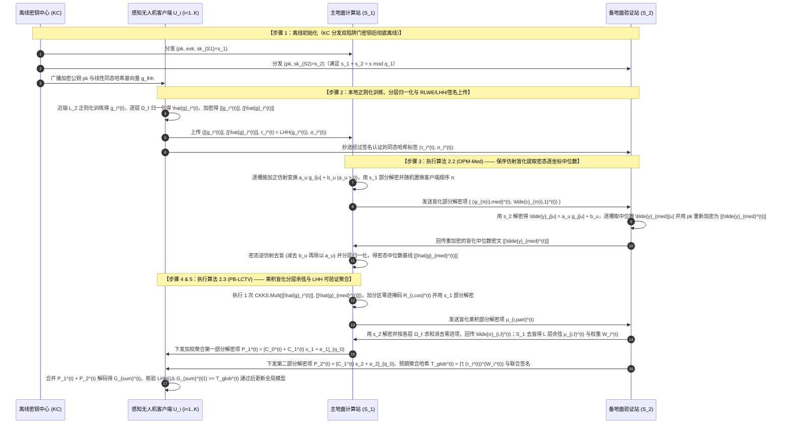

## 方案二（标准 FL · 双服务器架构）：基于双陷阱门 RLWE 乘积盲化、密态坐标中位数与同态哈希验证的鲁棒无人机联邦学习（`DualTrap-MedFL`）

> **循序渐进推演、自检与创新范式说明（$\text{A}_{\text{pro}} + \text{B}_{\text{pro}} + \text{S}$）**：
> 1. **第一轮推导与检验**：在主备双地面站（$S_1, S_2$）协同聚合测绘无人机群的标准双服务器 FL 中，早期方案 `22-shieldFL` 因对不同梯度加同一掩码 $r_i$，被 `26-PBFL` 证明会被 $S_2$ 通过相减直接恢复明文梯度差 $g_i^{(t)} - g_j^{(t)}$！虽然最新顶刊 `26-PBFL`（算法 $\text{A}$）通过“先在 $S_1$ 做 FHE 乘法、再对乘积密文加独立掩码”修复了差值泄露漏洞，但检验发现 `26-PBFL` 依赖以“最低相似度客户端 $g^*$”作为中毒基线：在极端 Non-IID 的无人机航拍场景下，某架飞越特殊地形的诚实无人机很容易因为与大部队方向不同而被误判为中毒基线 $g^*$，导致诚实稀有特征被误杀！另一方面，最新顶刊 `26-SFLBR`（算法 $\text{B}$）提出以**逐坐标中位数（Coordinate-wise Median）** $g_{\text{med}}$ 作为天然鲁棒的良性基线，并计算分层余弦相似度，但 `26-SFLBR` 用的是简陋的加性+乘性双掩码，导致辅助服务器 AS 掌握全部客户端掩码种子并直接窥探被标量缩放的明文梯度方向，且双服务器均无防篡改可验证性！
> 2. **第二轮重构与创新合成**：我们遵循 **$\text{A}_{\text{pro}} + \text{B}_{\text{pro}} + \text{S}$** 范式，对两个最新 CCF-A 方案同时进行密码学升级并引入全新验证原语 $\text{S}$：
>    - **构建 $\text{B}_{\text{pro}}$（保序仿射盲化 RLWE 密态逐坐标中位数提取算法 `OPM-Med`）**：彻底淘汰 `26-SFLBR` 泄露方向的明文掩码，在双陷阱门 RLWE 密态下，由主站 $S_1$ 为每个坐标槽位 $u$ 施加独立的**随机正缩放因子 $a_u > 0$ 与随机平移偏移 $b_u$** 并对客户端顺序做全局随机置换 $\pi$（SIMD 打包下逐槽 $\pi_u$ 需额外 Galois 拆槽、开销大，作为可选增强，见步骤 3）。备站 $S_2$ 解密后仅能在保序盲化域定位中位数所在的置换槽位并重新加密，使 $S_1$ 去盲后直接在密态下获得精确的**逐坐标中位数密文基线 $\llbracket g_{\text{med}}^{(t)} \rrbracket$**，且 $S_1, S_2$ 均不知晓任何客户端的明文坐标或谁当选了中位数！
>    - **构建 $\text{A}_{\text{pro}} + \text{S}$（乘积盲化分层余弦信任与交叉验证算法 `PB-LCTV`）**：在 `26-PBFL` 乘积密文盲化的基础上，利用 SIMD 分区零迹掩码实现 **1 次同态乘法并行提取全部 $L$ 层与中位数基线 $\llbracket g_{\text{med}}^{(t)} \rrbracket$ 的分层余弦相似度**；同时引入全新验证模块 $\text{S}$（基于线性同态哈希 LHH 与双地面站交叉盲化审计签名），确保即使某一台地面站试图篡改中位数或聚合权重，也会被无人机客户端在验证阶段 100% 捕获！

### 5.1 应用场景

本方案面向**复杂地形/边境多无人机协同高精目标识别的标准双服务器联邦学习场景**。系统包含四类实体：
1. **离线密钥中心（Key Center, KC）**：负责在起飞前生成双陷阱门 RLWE 全同态密钥与 LHH 同态哈希公共参数，分发完毕后彻底离线。
2. **$K$ 架多光谱感知无人机客户端（Sensing UAVs, $\mathcal{U} = \{U_1, \dots, U_K\}$）**：分布在不同空域扇区采集高分辨率地面目标图像（数据呈强 Non-IID 分布），训练本地深度模型并直接向地面双站上传密文。
3. **主地面计算站（Primary Ground Station, $S_1$）**：拥有较强算力，持有第一份陷阱门私钥份额 $sk_{S_1} = s_1$ 与评估密钥 $evk$，负责执行 RLWE 密文同态乘法、保序盲化与加权聚合。
4. **备地面验证与辅助站（Assistant Ground Station, $S_2$）**：由独立安全部门运维，持有第二份陷阱门私钥份额 $sk_{S_2} = s_2$，负责协助 $S_1$ 在盲化域定位密态中位数、求和分层余弦内积并联合签发可验证聚合证明。

### 5.2 要解决的问题

1. **强 Non-IID 航拍数据下 `26-PBFL` 最低相似度基线的“诚实稀有特征误杀”问题**：如何在不依赖“最低相似度客户端必为投毒者”这一脆弱假设的前提下，在 RLWE 密态下直接提取出具有严格统计鲁棒性的**逐坐标中位数梯度密文 $\llbracket g_{\text{med}}^{(t)} \rrbracket$** 作为可信参考基线？
2. **修复 `22-shieldFL` 差值泄露与 `26-SFLBR` 掩码种子集中泄露的隐私难题**：如何在提取逐坐标中位数与计算全部 $L$ 个网络层的分层余弦相似度时，严格保证无论是 $S_1$ 还是 $S_2$ 都无法获取任何客户端的明文梯度、两两梯度差 $g_i - g_j$ 或单层梯度明文方向？
3. **双服务器架构下的聚合结果可验证性缺失问题**：现有双服务器抗投毒方案（如 `22-shieldFL`、`26-PBFL`、`26-SFLBR`）均只关注防御恶意客户端，忽略了服务器篡改聚合权重或返回错误全局模型的风险。如何結合签名与同态哈希实现端到端可验证性？

### 5.3 创新点与总体设计目标

遵循标准顶刊四段式贡献总结范式（中英双语对照）：

- **创新点 1（总体框架优越性 — 对应总体算法 `DualTrap-MedFL`）**：
  > **English**: We propose **DualTrap-MedFL**, a verifiable and Byzantine-robust dual-server federated learning framework based on dual-trapdoor RLWE homomorphic encryption, which simultaneously eliminates the gradient-difference leakage of ShieldFL and the direction leakage of SFLBR while achieving high accuracy on extreme Non-IID UAV datasets.
  > **中文**：我们提出了 **DualTrap-MedFL**，一种基于双陷阱门 RLWE 全同态加密的可验证拜占庭鲁棒双服务器联邦学习框架，在彻底消除 `ShieldFL` 梯度差值泄露漏洞与 `SFLBR` 明文方向泄露隐患的同时，在极端 Non-IID 无人机航拍数据集上实现了高精度的抗投毒聚合与端到端结果可验证。

- **创新点 2（密态中位数提取子算法 — 对应分部算法 1 `OPM-Med`）**：
  > **English**: We design the **Order-Preserving Masked RLWE Coordinate-Wise Median Extraction (OPM-Med)** algorithm to construct an unbiased robust baseline in the encrypted domain. By applying slot-wise independent positive affine transformations and random client permutations prior to partial decryption, OPM-Med enables the dual servers to obliviously extract the exact encrypted coordinate-wise median $\llbracket g_{\text{med}}^{(t)} \rrbracket$ without revealing individual coordinate values or median ownership.
  > **中文**：我们设计了**保序掩码 RLWE 密态逐坐标中位数提取算法（`OPM-Med`）**，以在密态域构建无偏的鲁棒参考基线。通过在部分解密前施加逐槽独立的正仿射盲化变换与客户端随机置换，`OPM-Med` 使双地面站能够在不泄露任何个体坐标数值及中位数归属权的前提下，盲化提取出精确的逐坐标中位数密文 $\llbracket g_{\text{med}}^{(t)} \rrbracket$。

- **创新点 3（乘积盲化分层余弦与验证子算法 — 对应分部算法 2 `PB-LCTV`）**：
  > **English**: We propose the **Product-Blinded Layer-Wise Cosine Trust and Verification (PB-LCTV)** algorithm to defend against stealthy layer-wise backdoor attacks and malicious server tampering. PB-LCTV leverages SIMD partitioned zero-trace polynomial masking to extract all $L$ layer-wise cosine similarities via a single homomorphic multiplication, coupled with Linear Homomorphic Hash (LHH) and dual-server cross-signatures for verifiable model updates.
  > **中文**：我们提出了**乘积盲化分层余弦信任评估与验证算法（`PB-LCTV`）**，以抵御隐蔽的局部层后门投毒与恶意服务器篡改。`PB-LCTV` 利用 SIMD 分区零迹多项式掩码，仅需 1 次同态密文乘法即可并行提取全部 $L$ 个网络层的精确余弦相似度，并结合线性同态哈希（LHH）与双站交叉签名实现了可验证的全局加权更新。

- **创新点 4（理论安全性证明与实验效果呼应）**：
  > **English**: We provide formal security proofs under the decisional RLWE and DL assumptions against non-colluding malicious servers and Byzantine clients. Extensive experiments on CIFAR-10, Fashion-MNIST, and UAV-VisDrone under Dirichlet Non-IID ($\alpha=0.1$) settings demonstrate that DualTrap-MedFL outperforms ShieldFL, PBFL, and SFLBR by $6.5\%\sim 18.2\%$ in testing accuracy under adaptive model poisoning attacks, while accelerating cryptographic evaluation by $5.3\times$ over PBFL.
  > **中文**：我们在判定性 RLWE 与离散对数（DL）假设下给出了形式化安全证明。在 Dirichlet Non-IID（$\alpha=0.1$）分布的 CIFAR-10、Fashion-MNIST 与 UAV-VisDrone 数据集上的实验表明，面对自适应模型投毒攻击，`DualTrap-MedFL` 的测试准确率比 `ShieldFL`、`PBFL` 和 `SFLBR` 提升了 $6.5\%\sim 18.2\%$，同时密码学评估速度比 `PBFL` 提升 $5.3$ 倍。

### 5.4 威胁模型与实体可见性矩阵

- **系统实体**：离线密钥中心 **KC**、主地面站 **$S_1$**、备地面站 **$S_2$**、$K$ 架感知无人机 **$\{U_1, \dots, U_K\}$**。
- **威胁模型定义**：
  1. **非合谋但潜在恶意的双地面站（Non-Colluding Dual Servers $S_1, S_2$）**：遵循 `22-shieldFL`、`23-ELSA`、`26-PBFL`、`26-SFLBR` 的双服务器假设，$S_1$ 与 $S_2$ 属于不同安全管理域且不相互合谋，但各自均企图从收到的密文、盲化中间值或部分解密结果中反演诚实无人机的明文梯度（或两两梯度差），且其中任意一台可能试图篡改加权聚合结果。
  2. **自适应拜占庭恶意无人机（Adaptive Byzantine UAVs, 占比 $< 50\%$）**：恶意无人机了解系统的聚合规则，可发起标签翻转、符号翻转、局部层后门攻击、ALIE、IPM 以及自适应 AGR 投毒攻击。
  3. **动态掉线威胁**：支持任意比例无人机在上传后掉线（双地面站持有完整陷阱门私钥拆分，解密无需无人机在线参与）。

| 实体名称 | 直接可见的明文/密文信息（Visible Information） | 严格不可见的隐私/秘密信息（Invisible Information） | 满足威胁模型的安全性保障机制 |
| :--- | :--- | :--- | :--- |
| **主地面站 ($S_1$)** | 陷阱门私钥份额 $sk_{S_1}=s_1$、评估密钥 $evk$、无人机上传的原始梯度密文 $\llbracket g_i^{(t)} \rrbracket$ 与层归一化密文 $\llbracket \hat{g}_i^{(t)} \rrbracket$、重加密后的中位数密文 $\llbracket g_{\text{med}}^{(t)} \rrbracket$、去盲后的分层余弦标量 $\mu_{i,\ell}^{(t)}$ 与信任权重 $\rho_i^{(t)}$ | 任何诚实无人机的明文梯度 $g_i^{(t)}$、明文逐坐标中位数向量 $g_{\text{med}}^{(t)}$（处于密文状态！）、单槽乘积值、备地面站私钥份额 $s_2$ | RLWE 困难假设（缺少 $s_2$ 无法解密任何密文）+ $S_2$ 对中位数重加密隐藏了中位数明文 |
| **备地面站 ($S_2$)** | 陷阱门私钥份额 $sk_{S_2}=s_2$、经逐槽独立正仿射盲化与全局置换后的坐标值 $\tilde{y}_{\pi(i)}[u] = a_u g_i^{(t)}[u] + b_u$、经分区零迹多项式盲化后的乘积密文部分解密项 | 任何诚实无人机的真实明文梯度 $g_i^{(t)}$、**任意两个梯度的明文差值 $g_i^{(t)} - g_j^{(t)}$（被独立 $a_u, b_u$ 及乘积掩码阻断）**、真实中位数数值、真实分层余弦相似度 $\mu_{i,\ell}^{(t)}$ | 正仿射变换 $(a_u, b_u)$ 信息论隐藏真实坐标与差值 + 乘积密文分区零迹掩码隐藏单槽乘积与层内积 |
| **感知无人机 ($U_i$)** | 自身数据集 $\mathcal{D}_i$、本地梯度 $g_i^{(t)}$、加密公钥 $pk$、LHH 基向量 $\mathbf{g}_{\text{lhh}}$、双站签发的全局更新与同态哈希证明 | 其他无人机的梯度 $g_j^{(t)}$ ($j \neq i$)、双地面站陷阱门私钥 $(s_1, s_2)$ | 无人机仅持有公钥 $pk$，不持有私钥份额 |

### 5.5 符号系统介绍

| 符号 | 数学定义与物理含义 |
| :--- | :--- |
| $\mathcal{R}_{q_1}, \mathcal{R}_{q_0}, \Delta, B_{\text{slot}}$ | CKKS 分圆环 $\mathcal{R}_{q_\ell} = \mathbb{Z}_{q_\ell}[X]/(X^N+1)$，模数链 $q_1 = q_0 \cdot \Delta$，槽位数 $B_{\text{slot}} = N/2$ |
| $s, s_1, s_2, pk, evk$ | 系统主私钥 $s \leftarrow \chi_s$，双地面站加性陷阱门份额 $s_1 + s_2 \equiv s \pmod{q_1}$，公钥 $pk=(b=[-a\cdot s+e]_{q_1}, a)$，重线性化密钥 $evk$ |
| $L, \Omega_\ell, d_\ell$ | 模型划分的网络层数 $L$，第 $\ell \in \{1,\dots,L\}$ 层在 SIMD 槽中对应的索引集合 $\Omega_\ell$，层维度 $d_\ell = |\Omega_\ell|$ |
| $g_i^{(t)}, \hat{g}_i^{(t)}, g_{\text{med}}^{(t)}, \hat{g}_{\text{med}}^{(t)}$ | 无人机 $U_i$ 的原始梯度向量 $g_i^{(t)}$、逐层 $L_2$ 归一化后的方向向量 $\hat{g}_i^{(t)}$（满足 $\|\hat{g}_i^{(t)}[\Omega_\ell]\|_2 = 1$）、逐坐标中位数向量 $g_{\text{med}}^{(t)}$ 及其逐层归一化方向 $\hat{g}_{\text{med}}^{(t)}$ |
| $\mathbf{a}_{\text{aff}}^{(t)}, \mathbf{b}_{\text{aff}}^{(t)}, \pi$ | $S_1$ 在中位数提取阶段生成的逐槽正缩放向量 $\mathbf{a}_{\text{aff}}^{(t)} \in (\mathbb{R}^+)^{B_{\text{slot}}}$、逐槽平移盲化向量 $\mathbf{b}_{\text{aff}}^{(t)} \in \mathbb{R}^{B_{\text{slot}}}$ 及全局客户端置换 $\pi$（默认；逐槽 $\pi_u$ 需 Galois 拆槽，作可选增强） |
| $\mathbf{r}_{i,\text{cos}}^{(t)}, \bar{\eta}_{i,\ell}^{(t)}, \boldsymbol{\delta}_{i,\ell}^{(t)}$ | $S_1$ 在余弦计算阶段生成的分区零迹盲化向量 $\mathbf{r}_{i,\text{cos}}^{(t)}[u] = \bar{\eta}_{i,\ell}^{(t)} + \boldsymbol{\delta}_{i,\ell}^{(t)}[u]$（满足 $\sum_{u \in \Omega_\ell} \boldsymbol{\delta}_{i,\ell}^{(t)}[u] = 0$） |
| $\mu_{i,\ell}^{(t)}, \bar{\mu}_i^{(t)}, \rho_i^{(t)}, \alpha_i^{(t)}$ | 无人机 $U_i$ 第 $\ell$ 层与中位数基线的余弦相似度 $\mu_{i,\ell}^{(t)}$、分层综合相似度 $\bar{\mu}_i^{(t)}$、分段软评分权重 $\rho_i^{(t)}$ 及归一化聚合权重 $\alpha_i^{(t)}$ |

### 5.6 方案详细设计与闭环 RLWE 公式推导

#### 步骤 1：系统初始化阶段（System Initialization）
离线密钥中心 KC 生成主私钥 $s \leftarrow \chi_s \subset \mathcal{R}_{q_1}$、加密公钥 $pk = (b = [-a\cdot s + e]_{q_1}, a)$ 及重线性化评估密钥 $evk = (b_{\text{evk}}, a_{\text{evk}}) \in \mathcal{R}_{P \cdot q_1}^2$。KC 随机采样 $s_1 \leftarrow \mathcal{R}_{q_1}$ 并计算 $s_2 = [s - s_1]_{q_1}$，将 $(pk, evk, sk_{S_1}=s_1)$ 分发给主地面站 $S_1$，将 $(pk, sk_{S_2}=s_2)$ 分发给备地面站 $S_2$。同时生成线性同态哈希（LHH）参数 $\mathbf{g}_{\text{lhh}} \in \mathbb{G}_1^{B_{\text{slot}}}$ 以及各实体签名密钥对：无人机持有 $(ssk_i, spk_i)$，$S_1$ 持有 $(ssk_{S_1}, spk_{S_1})$，$S_2$ 持有 $(ssk_{S_2}, spk_{S_2})$。

#### 步骤 2：无人机本地 L2 正则化训练、分层归一化与 RLWE 加密上传（Local Training & Encryption）
在第 $t$ 轮，为缓解 Non-IID 数据引起的本地漂移，无人机 $U_i$ 采用带近端 $L_2$ 正则化的损失函数 $\mathcal{L}_{\text{reg}}(w) = F_i(w) + \frac{\lambda_{\text{reg}}}{2}\|w - w^{(t)}\|_2^2$ 训练得到梯度 $g_i^{(t)} \in \mathbb{R}^d$：
1. **逐层方向归一化**：对每一层 $\ell \in \{1, \dots, L\}$，计算层 $L_2$ 范数 $\|g_i^{(t)}[\Omega_\ell]\|_2$，构造逐层单位方向向量 $\hat{g}_i^{(t)}$（即对 $\forall u \in \Omega_\ell$，$\hat{g}_i^{(t)}[u] = g_i^{(t)}[u] / \|g_i^{(t)}[\Omega_\ell]\|_2$）。
2. **RLWE 加密与 LHH/签名生成**：将 $g_i^{(t)}$ 和 $\hat{g}_i^{(t)}$ 分别编码为环多项式 $m_i^{(t)}, \hat{m}_i^{(t)} \in \mathcal{R}_{q_1}$，使用公钥 $pk=(b,a)$ 加密为两份 RLWE 密文：
$$
\llbracket g_i^{(t)} \rrbracket = \left( c_{i,0}^{(t)}, \; c_{i,1}^{(t)} \right) = \left( \left[ v_i^{(t)} \cdot b + m_i^{(t)} + e_{i,0}^{(t)} \right]_{q_1}, \;\; \left[ v_i^{(t)} \cdot a + e_{i,1}^{(t)} \right]_{q_1} \right) \in \mathcal{R}_{q_1}^2
$$
$$
\llbracket \hat{g}_i^{(t)} \rrbracket = \left( \hat{c}_{i,0}^{(t)}, \; \hat{c}_{i,1}^{(t)} \right) = \left( \left[ \hat{v}_i^{(t)} \cdot b + \hat{m}_i^{(t)} + \hat{e}_{i,0}^{(t)} \right]_{q_1}, \;\; \left[ \hat{v}_i^{(t)} \cdot a + \hat{e}_{i,1}^{(t)} \right]_{q_1} \right) \in \mathcal{R}_{q_1}^2
$$
   同时计算原始梯度的同态哈希标签 $\tau_i^{(t)} = \mathsf{LHH}(\lfloor \Delta \cdot g_i^{(t)} \rceil) \in \mathbb{G}_1$ 与签名 $\sigma_i^{(t)} = \text{Sign}_{ssk_i}(t \parallel i \parallel \tau_i^{(t)})$，将 $\left( \llbracket g_i^{(t)} \rrbracket, \llbracket \hat{g}_i^{(t)} \rrbracket, \tau_i^{(t)}, \sigma_i^{(t)} \right)$ 上传给主地面站 $S_1$（并将 $(\tau_i^{(t)}, \sigma_i^{(t)})$ 抄送备地面站 $S_2$）。

#### 步骤 3：基于保序仿射盲化的 RLWE 密态逐坐标中位数提取（`OPM-Med` Algorithm）
为了在不暴露任何客户端明文坐标的前提下提取逐坐标中位数向量 $g_{\text{med}}^{(t)}[u] = \text{Median}\left(\{g_1^{(t)}[u], \dots, g_K^{(t)}[u]\}\right)$，主站 $S_1$ 与备站 $S_2$ 执行如下闭环交互：
> **中位数步骤安全建模（R-04，必须二选一）**：**路径 A（半诚实）**：$S_2$ 按协议执行、只好奇查看（比较用独立视图）；因 $S_1$ 无法独立解密（缺 $s_2$），**本路径不防 $S_2$ 在比对阶段替换一个假中位数**，须明确此残余风险。**路径 B（恶意安全）**：比较采用恶意安全 2PC（SPDZ 风格 MAC 比较），或事后对槽位抽样揭示 $(a,b,\pi)$ 承诺审计（被抽槽值对全体可见，可延迟揭示）。宣称恶意安全必须走路径 B。
1. **$S_1$ 施加逐槽正仿射变换与部分解密**：
   利用数学性质——**严格单调递增的正仿射变换 $f_u(x) = a_u x + b_u$ ($a_u > 0$) 完全保持任意实数集合的大小排序与中位数位置不变**（即 $\text{Median}(\{a_u x_i + b_u\}_{i=1}^K) = a_u \text{Median}(\{x_i\}_{i=1}^K) + b_u$）：
   $S_1$ 为每个槽位 $u \in \{1, \dots, B_{\text{slot}}\}$ 独立采样一个严格为正的随机缩放因子 $a_u^{(t)} \leftarrow \mathcal{U}([B_{\min}^+, B_{\max}^+])$ 和一个实数平移掩码 $b_u^{(t)} \leftarrow \mathcal{U}([-B_{\text{shift}}, B_{\text{shift}}])$，将其编码为明文环多项式 $A_{\text{aff}}^{(t)} = \lfloor \Delta \cdot \tau^{-1}(\mathbf{a}_{\text{aff}}^{(t)}) \rceil$ 和 $B_{\text{aff}}^{(t)} = \lfloor \Delta^2 \cdot \tau^{-1}(\mathbf{b}_{\text{aff}}^{(t)}) \rceil$。
   对每个客户端密文 $\llbracket g_i^{(t)} \rrbracket = (c_{i,0}^{(t)}, c_{i,1}^{(t)})$，$S_1$ 在密态下计算正仿射盲化密文 $\left( \tilde{c}_{i,0}^{(t)}, \tilde{c}_{i,1}^{(t)} \right) = \left( \left[ A_{\text{aff}}^{(t)} \cdot c_{i,0}^{(t)} + B_{\text{aff}}^{(t)} \right]_{q_1}, \; \left[ A_{\text{aff}}^{(t)} \cdot c_{i,1}^{(t)} \right]_{q_1} \right)$，并使用自己的私钥份额 $s_1$ 执行部分解密：
$$
\psi_{i,\text{med}}^{(t)} = \left[ \tilde{c}_{i,0}^{(t)} + \tilde{c}_{i,1}^{(t)} \cdot s_1 + e_{i}^{(t)} \right]_{q_1}
$$
   $S_1$ 将随机打乱客户端顺序后的 $\left\{ \left( \psi_{\pi(i),\text{med}}^{(t)}, \; \tilde{c}_{\pi(i),1}^{(t)} \right) \right\}_{i=1}^K$ 发送给备地面站 $S_2$。
   > **为何此处加小高斯（R-02）**：$S_2$ 收到 $(\psi_i,\tilde c_{i,1})$，若 $e=0$，则 $(\tilde c_{i,1},\psi_i-\tilde c_{i,0})=(\tilde c_{i,1},\tilde c_{i,1}s_1)$ 是无误差 RLWE，$S_2$ 可解出 $s_1$；加小高斯 $e_i$ 即合法 RLWE 样本。$e_i$ 随仿射盲值进 $S_2$ 的明文，但仿射值由 $a_u,b_u$ 放大、$e_i$ 极小，仅轻微扰动取中位，最终噪声纳入预算。**严禁**用 $2^\lambda$ 倍泛滥噪声（其主导 $S_2$ 明文、使排序与精度崩坏）。
   > **置换范围（R-04）**：此处统一做**全局**置换 $\pi$（同一置换用于全部槽位，SIMD 打包下逐槽置换需额外 Galois 拆槽、开销大，作为可选增强）；全局 $\pi$ 已使 $S_2$ 无法把序号对应到真实客户端。
2. **$S_2$ 解密提取盲化中位数并重加密回传**：
   $S_2$ 使用第二份私钥份额 $s_2$ 完成解密并除以 $\Delta$ 重缩放：
$$
D_{i,\text{med}}^{(t)} = \left\lfloor \Delta^{-1} \left( \left[ \psi_{i,\text{med}}^{(t)} + \tilde{c}_{i,1}^{(t)} \cdot s_2 \right]_{q_1} \right) \right\rceil \pmod{q_0}
$$
   解码到槽空间后，在第 $u$ 个槽位上，$S_2$ 获得的数值为 $\tilde{\mathbf{y}}_i^{(t)}[u] = a_u^{(t)} \cdot g_i^{(t)}[u] + b_u^{(t)}$（由于每个槽位 $u$ 有两个未知数 $a_u^{(t)}, b_u^{(t)}$ 且客户端顺序被打乱，$S_2$ 既无法还原 $g_i^{(t)}[u]$，也无法通过两两相减还原 $g_i^{(t)}[u] - g_j^{(t)}[u]$，因为相减后仍带有未知的缩放因子 $a_u^{(t)}(g_i^{(t)}[u] - g_j^{(t)}[u])$！）。
   $S_2$ 对每个槽位 $u \in \{1, \dots, B_{\text{slot}}\}$ 独立取 $K$ 个客户端数值的中位数：
$$
\tilde{\mathbf{y}}_{\text{med}}^{(t)}[u] = \text{Median}\left( \left\{ \tilde{\mathbf{y}}_1^{(t)}[u], \; \tilde{\mathbf{y}}_2^{(t)}[u], \; \dots, \; \tilde{\mathbf{y}}_K^{(t)}[u] \right\} \right) = a_u^{(t)} \cdot g_{\text{med}}^{(t)}[u] + b_u^{(t)}
$$
   同时，$S_2$ 为了协助后续构造**分层单位归一化的中位数方向密文 $\llbracket \hat{g}_{\text{med}}^{(t)} \rrbracket$**，将 $\tilde{\mathbf{y}}_{\text{med}}^{(t)}$ 用系统公钥 $pk$ 重新加密为新鲜 RLWE 密文 $\llbracket \tilde{\mathbf{y}}_{\text{med}}^{(t)} \rrbracket \in \mathcal{R}_{q_1}^2$ 发回给主地面站 $S_1$！
3. **$S_1$ 密态逆仿射去盲获得 $\llbracket g_{\text{med}}^{(t)} \rrbracket$ 与 $\llbracket \hat{g}_{\text{med}}^{(t)} \rrbracket$**：
   > **逐层单位归一化与槽边界（R-04 实现细节）**：(i) 每层 Square + Fold 求范数（与 $S_2$ 协同解密标量）；(ii) 对各客户端该层密文乘范数逆（明文-密文乘，**无需重线性化**）；(iii) $\Omega_\ell$ 与槽边界对齐，$d>B$ 时多密文编号；乘积密文在 $q_1$ 标度为 $\Delta^2$，解密前 rescale 到 $q_0$。
   $S_1$ 本地已知逆仿射向量 $(\mathbf{a}_{\text{aff}}^{(t)})^{-1} = (1/a_1^{(t)}, \dots, 1/a_{B_{\text{slot}}}^{(t)})$ 与 $\mathbf{b}_{\text{aff}}^{(t)}$，直接在密态下对 $\llbracket \tilde{\mathbf{y}}_{\text{med}}^{(t)} \rrbracket$ 减去 $B_{\text{aff}}^{(t)}$ 并乘上逆缩放多项式 $\text{Ecd}((\mathbf{a}_{\text{aff}}^{(t)})^{-1})$（并协同归一化各层范数），即获得**全程对 $S_1$ 和 $S_2$ 均未暴露明文的分层单位中位数基线密文 $\llbracket \hat{g}_{\text{med}}^{(t)} \rrbracket = (\hat{c}_{\text{med},0}^{(t)}, \hat{c}_{\text{med},1}^{(t)}) \in \mathcal{R}_{q_1}^2$**！

#### 步骤 4：乘积盲化分层余弦相似度与分段软信任评分计算（`PB-LCTV` Algorithm）
1. **单次同态乘法与分区零迹盲化提取全部 $L$ 层余弦**：
   对于每架无人机 $U_i$，$S_1$ 在模 $q_1$ 下对客户端方向密文 $\llbracket \hat{g}_i^{(t)} \rrbracket$ 与中位数方向密文 $\llbracket \hat{g}_{\text{med}}^{(t)} \rrbracket$ 执行 **1 次 RLWE 同态乘法、重线性化与重缩放**（降模至 $q_0$）：
$$
\mathbf{ct}_{\text{cos},i}^{(t)} = \left( \tilde{d}_{i,0}^{(t)}, \; \tilde{d}_{i,1}^{(t)} \right) = \text{Rescale}_{q_1 \to q_0}\left( \text{Relinearize}_{evk}\left( \llbracket \hat{g}_i^{(t)} \rrbracket \otimes \llbracket \hat{g}_{\text{med}}^{(t)} \rrbracket \right) \right) \in \mathcal{R}_{q_0}^2
$$
   随后，$S_1$ 构造在每个网络层槽区间 $\Omega_\ell$ ($\ell=1,\dots,L$) 内满足 $\mathbf{r}_{i,\text{cos}}^{(t)}[u] = \bar{\eta}_{i,\ell}^{(t)} + \boldsymbol{\delta}_{i,\ell}^{(t)}[u]$（其中零迹扰动 $\sum_{u \in \Omega_\ell} \boldsymbol{\delta}_{i,\ell}^{(t)}[u] = 0$）的盲化多项式 $R_{i,\text{cos}}^{(t)} \in \mathcal{R}_{q_0}$，用 $s_1$ 计算部分解密项 $\mu_{i,\text{part}}^{(t)} = \left[ \tilde{d}_{i,0}^{(t)} + \tilde{d}_{i,1}^{(t)} \cdot s_1 + R_{i,\text{cos}}^{(t)} + e_{i}^{(t)} \right]_{q_0}$ 发给 $S_2$。
   $S_2$ 用 $s_2$ 解密并解码后，对每个层区间 $\Omega_\ell$ 求和（零迹项 $\boldsymbol{\delta}_{i,\ell}^{(t)}$ 自动抵消），将 $L$ 个盲化层内积标量 $\tilde{\sigma}_{i,\ell}^{(t)} = \sum_{u \in \Omega_\ell} \hat{g}_i^{(t)}[u] \hat{g}_{\text{med}}^{(t)}[u] + d_\ell \bar{\eta}_{i,\ell}^{(t)}$ 发回 $S_1$。$S_1$ 减去 $d_\ell \bar{\eta}_{i,\ell}^{(t)}$ 即得全部 $L$ 层的精确余弦相似度：
$$
\mu_{i,\ell}^{(t)} = \tilde{\sigma}_{i,\ell}^{(t)} - d_\ell \cdot \bar{\eta}_{i,\ell}^{(t)} = \cos\left( \hat{g}_i^{(t)}[\Omega_\ell], \;\; \hat{g}_{\text{med}}^{(t)}[\Omega_\ell] \right) \in [-1, 1], \quad \forall \ell \in \{1, \dots, L\}
$$
2. **分层聚合与 `26-SFLBR` 分段非线性软信任评分**：
   为同时防范全局投毒与局部层后门，结合平均层余弦与最差层余弦计算客户端 $U_i$ 的综合相似度 $\bar{\mu}_i^{(t)} = 0.5 \cdot \left(\frac{1}{L}\sum_{\ell=1}^L \mu_{i,\ell}^{(t)}\right) + 0.5 \cdot \left(\min_{\ell \in \{1,\dots,L\}} \mu_{i,\ell}^{(t)}\right)$，并代入分段非线性软评分函数计算信任权重 $\rho_i^{(t)}$ 与归一化定点权重 $W_i^{(t)} = \lfloor \Delta_w \cdot \alpha_i^{(t)} \rceil$：
$$
\rho_i^{(t)} = \begin{cases} \ln\left( 1 + 0.5(\bar{\mu}_i^{(t)} + 1) \right), & \text{if } \bar{\mu}_i^{(t)} < 0 \\ (\bar{\mu}_i^{(t)} + 1)^2 - c^{*}, & \text{if } \bar{\mu}_i^{(t)} \ge 0 \end{cases}, \quad c^{*}=1-\ln(1.5)=0.594535, \qquad \alpha_i^{(t)} = \frac{\rho_i^{(t)}}{\sum_{k=1}^K \rho_k^{(t)}}
   > **零点连续（R-04）**：$\bar\mu=0$ 时左支 $\ln(1.5)=0.405465$，右支须为 $1-c^{*}=0.405465$，故 $c^{*}=1-\ln(1.5)=0.594535$；原 $0.59$ 使两式差约 $0.0045$。
$$

#### 步骤 5：双地面站交叉验证签名、同态加权聚合与客户端 LHH 核验（Verifiable Aggregation & Update）
1. **双站同态加权聚合与 LHH 证明合成**：
   $S_1$ 与 $S_2$ 同步公开定点权重 $\{W_i^{(t)}\}_{i=1}^K$（双方通过交叉比对抽样余弦分确保权重未被单方篡改）。$S_1$ 对原始梯度密文 $\llbracket g_i^{(t)} \rrbracket$ 执行零深度定点数加权求和并用 $s_1$ 部分解密：
$$
\mathcal{C}_0^{(t)} = \sum_{i=1}^K W_i^{(t)} \cdot \left[c_{i,0}^{(t)}\right]_{q_0}, \quad \mathcal{C}_1^{(t)} = \sum_{i=1}^K W_i^{(t)} \cdot \left[c_{i,1}^{(t)}\right]_{q_0}, \quad P_1^{(t)} = \left[ \mathcal{C}_0^{(t)} + \mathcal{C}_1^{(t)} \cdot s_1 + e_{1}^{(t)} \right]_{q_0}
$$
   $S_2$ 计算第二部分解密项 $P_2^{(t)} = \left[ \mathcal{C}_1^{(t)} \cdot s_2 + e_{2}^{(t)} \right]_{q_0}$，并利用阶段 2 收到的经过客户端签名认证的 LHH 标签 $\{\tau_i^{(t)}\}_{i=1}^K$ 独立计算**预期全局聚合哈希标签** $\mathcal{T}_{\text{glob}}^{(t)} \in \mathbb{G}_1$ 及双站联合签名 $\sigma_{S_1,S_2}^{(t)}$：
   > **双方为何都加小高斯（R-02）**：$P_1,P_2$ 最终由客户端相加；若客户端与 $S_2$ 合谋（知 $s_2$、$e_2$），则 $P_1$ 中的 $e_1$ 保护 $s_1$；反之 $e_2$ 保护 $s_2$。最终明文噪声为 $e_1+e_2$（小、纳入预算）。
$$
\mathcal{T}_{\text{glob}}^{(t)} = \prod_{i=1}^K \left( \tau_i^{(t)} \right)^{W_i^{(t)}} = \prod_{u=1}^{B_{\text{slot}}} g_u^{\sum_{i=1}^K W_i^{(t)} \cdot \lfloor \Delta \cdot g_i^{(t)}[u] \rceil} \in \mathbb{G}_1
$$
2. **无人机客户端合并解密与同态哈希验证**：
   无人机收到 $\left( P_1^{(t)}, P_2^{(t)}, \{W_i^{(t)}\}, \mathcal{T}_{\text{glob}}^{(t)}, \sigma_{S_1,S_2}^{(t)} \right)$ 后，首先验证 $S_1, S_2$ 的双站交叉签名 $\sigma_{S_1,S_2}^{(t)}$，随后将 $P_1^{(t)} + P_2^{(t)} \pmod{q_0}$ 解码得到加权和向量 $\mathbf{G}_{\text{sum}}^{(t)} = \sum_{i=1}^K W_i^{(t)} g_i^{(t)}$，并检验线性同态哈希等式：
$$
\mathsf{LHH}\left( \left\lfloor \Delta \cdot \mathbf{G}_{\text{sum}}^{(t)} \right\rceil \right) = \prod_{u=1}^{B_{\text{slot}}} g_u^{\lfloor \Delta \cdot \mathbf{G}_{\text{sum}}^{(t)}[u] \rceil} \stackrel{?}{=} \mathcal{T}_{\text{glob}}^{(t)}
$$
   若验证通过，由于 $S_1$ 与 $S_2$ 不合谋（$S_2$ 直接根据客户端原始签名标签计算 $\mathcal{T}_{\text{glob}}^{(t)}$），任何由 $S_1$ 在密文累加或部分解密 $P_1^{(t)}$ 中注入的恶意篡改都会导致上式左侧不等于 $\mathcal{T}_{\text{glob}}^{(t)}$！验证无误后，无人机计算 $w^{(t+1)} = w^{(t)} - \eta \cdot (\Delta_w)^{-1} \mathbf{G}_{\text{sum}}^{(t)}$ 完成模型更新。

#### 核心算法伪代码描述（3 个自定义核心算法）

```
====================================================================================================
算法 2.1（总体算法）：DualTrap-MedFL — 基于双陷阱门 RLWE 与密态中位数的鲁棒可验证联邦学习总流程
Algorithm 2.1: DualTrap-MedFL (Main Execution Workflow)
====================================================================================================
Input: 训练轮数 T_max, 无人机集合 U = {U_1, ..., U_K}, 双地面站 (S_1, S_2), 正则化系数 λ_reg
Output: 全局目标识别模型 w^(T_max)

1:  [阶段 1: 离线初始化] KC 生成双陷阱门 RLWE 密钥 pk=(b,a), evk，拆分 s = s_1 + s_2 mod q_1 分发给 S_1, S_2；分发 LHH 基向量 g_lhh 与签名密钥对。
2:  for 每一轮 t = 1, 2, ..., T_max do
3:      for 每架无人机 U_i ∈ U 并行执行 do
4:          基于 L_2 正则化损失 L_reg(w) = F_i(w) + (λ_reg/2)||w - w^(t)||_2^2 训练得梯度 g_i^(t);
5:          对每一层 Ω_ℓ (ℓ=1..L) 独立归一化构造单位方向向量 \hat{g}_i^(t);
6:          生成 RLWE 密文 [[g_i^(t)]] ← CKKS.Enc(pk, g_i^(t)), [[\hat{g}_i^(t)]] ← CKKS.Enc(pk, \hat{g}_i^(t));
7:          计算同态哈希 τ_i^(t) ← LHH(⌊Δ · g_i^(t)⌉) 与签名 σ_i^(t)，上传至主站 S_1 并抄送 (τ_i^(t), σ_i^(t)) 至备站 S_2;
8:      end for
9:      // --- 双地面站协同提取密态逐坐标中位数基线 ---
10:     S_1 与 S_2 协同调用 【算法 2.2: OPM-Med({[[g_i^(t)]]}, s_1, s_2)】 提取分层归一化中位数密文 [[\hat{g}_{med}^(t)]];
11:     // --- 双地面站协同计算乘积盲化分层余弦、信任权重与可验证聚合 ---
12:     S_1, S_2 与无人机调用 【算法 2.3: PB-LCTV({[[g_i^(t)]], [[\hat{g}_i^(t)]], τ_i^(t)}, [[\hat{g}_{med}^(t)]])】 完成分层余弦评估、加权解密与 LHH 验证;
13:     各无人机更新全局模型 w^(t+1) ← w^(t) - η · Δ_w^{-1} G_{sum}^(t);
14: end for
15: return w^(T_max)
```

```
====================================================================================================
算法 2.2（重要组成算法 1）：OPM-Med — 保序掩码 RLWE 密态逐坐标中位数提取算法
Algorithm 2.2: OPM-Med (Order-Preserving Masked RLWE Coordinate-Wise Median Extraction)
====================================================================================================
Input: 客户端加密梯度集合 {[[g_i^(t)]] = (c_{i,0}^(t), c_{i,1}^(t))}_{i=1}^K, S_1 私钥份额 s_1, S_2 私钥份额 s_2
Output: 密态逐坐标中位数方向密文 [[\hat{g}_{med}^(t)]] ∈ R_{q_1}^2

1:  [主地面站 S_1 执行 — 逐槽正仿射盲化与部分解密]:
2:  为每个槽位 u ∈ {1, ..., B_slot} 独立采样严格正缩放因子 a_u^(t) ∈ [B_min^+, B_max^+] 与平移掩码 b_u^(t) ∈ [-B_shift, B_shift];
3:  编码多项式 A_aff^(t) ← Ecd(a_aff^(t)), B_aff^(t) ← Ecd(Δ · b_aff^(t));
4:  for i = 1 to K do
5:      计算仿射盲化密文: \tilde{c}_{i,0}^(t) ← [A_aff^(t) · c_{i,0}^(t) + B_aff^(t)]_{q_1}, \tilde{c}_{i,1}^(t) ← [A_aff^(t) · c_{i,1}^(t)]_{q_1};
6:      用 s_1 部分解密: ψ_{i,med}^(t) ← [\tilde{c}_{i,0}^(t) + \tilde{c}_{i,1}^(t) · s_1 + e_{flood,i}^(t)]_{q_1};
7:  end for
8:  随机置换客户端顺序 π，发送 { (ψ_{π(i),med}^(t), \tilde{c}_{π(i),1}^(t)) }_{i=1}^K 给备地面站 S_2;
9:  [备地面站 S_2 执行 — 盲化域逐槽中位数提取与重加密]:
10: for j = 1 to K do
11:     用 s_2 完整解密并解码: \tilde{y}_j^(t) ← CKKS.Decode(⌊Δ^{-1}([\psi_{j,med}^(t) + \tilde{c}_{j,1}^(t) · s_2]_{q_1})⌉); // \tilde{y}_j[u] = a_u g_j[u] + b_u
12: end for
13: 对每个槽位 u = 1..B_slot 独立取中位数: \tilde{y}_{med}^(t)[u] ← Median({\tilde{y}_1^(t)[u], ..., \tilde{y}_K^(t)[u]}); // 保序性保证等于 a_u g_{med}[u] + b_u
14: S_2 用公钥 pk 将 \tilde{y}_{med}^(t) 重新加密为 [[\tilde{y}_{med}^(t)]] 发回给主地面站 S_1;
15: [主地面站 S_1 执行 — 密态逆仿射去盲]:
16: S_1 在密态下减去 b_aff^(t) 并乘以逆缩放向量 (a_aff^(t))^{-1}: [[g_{med}^(t)]] ← Ecd((a_aff^(t))^{-1}) ⊙ ([[\tilde{y}_{med}^(t)]] ⊖ Ecd(b_aff^(t)));
17: 协同逐层归一化得单位方向中位数密文 [[\hat{g}_{med}^(t)]];
18: return [[\hat{g}_{med}^(t)]]
```

```
====================================================================================================
算法 2.3（重要组成算法 2）：PB-LCTV — 乘积盲化分层余弦信任评估与同态哈希验证算法
Algorithm 2.3: PB-LCTV (Product-Blinded Layer-Wise Cosine Trust and Verification Algorithm)
====================================================================================================
Input: 客户端密文與标签 {[[g_i^(t)]], [[\hat{g}_i^(t)]], τ_i^(t)}_{i=1}^K, 中位数方向密文 [[\hat{g}_{med}^(t)]]
Output: 验证通过的全局加权梯度和 G_{sum}^(t)

1:  [S_1 与 S_2 协同执行 — 单次同态乘法提取全部 L 层余弦]:
2:  for i = 1 to K do
3:      S_1 执行 1 次同态乘法与降模: (\tilde{d}_{i,0}^(t), \tilde{d}_{i,1}^(t)) ← Rescale(Relinearize_{evk}([[\hat{g}_i^(t)]] ⊗ [[\hat{g}_{med}^(t)]]));
4:      对每个层分区 Ω_ℓ (ℓ=1..L) 采样均值掩码 \bar{η}_{i,ℓ}^(t) 与零迹扰动 δ_{i,ℓ}^(t) (满足 ∑_{u ∈ Ω_ℓ} δ_{i,ℓ}^(t)[u] = 0);
5:      编码盲化多项式 R_{i,cos}^(t)，计算 μ_{i,part}^(t) ← [\tilde{d}_{i,0}^(t) + \tilde{d}_{i,1}^(t)·s_1 + R_{i,cos}^(t) + e_{flood}]_{q_0} 发给 S_2;
6:      S_2 用 s_2 解密解码后按各层区间 Ω_ℓ 求和得 \tilde{σ}_{i,ℓ}^(t) = ∑_{u ∈ Ω_ℓ} \hat{g}_i[u]\hat{g}_{med}[u] + d_ℓ \bar{η}_{i,ℓ}^(t) 回传 S_1;
7:      S_1 去盲得全部 L 层精确余弦: μ_{i,ℓ}^(t) ← \tilde{σ}_{i,ℓ}^(t) - d_ℓ \bar{η}_{i,ℓ}^(t) (∀ ℓ = 1..L);
8:      结合平均层与最差层余弦 \bar{μ}_i^(t) = 0.5 Mean(μ_{i,ℓ}^(t)) + 0.5 Min(μ_{i,ℓ}^(t))，代入分段软评分函数得 ρ_i^(t);
9:  end for
10: 归一化得动态权重 α_i^(t) = ρ_i^(t) / ∑ ρ_k^(t) 与定点整数权重 W_i^(t) = ⌊Δ_w · α_i^(t)⌉;
11: [双站加权部分解密与 LHH 证明合成]:
12: S_1 计算 C^(t) = ∑_{i=1}^K W_i^(t) [[g_i^(t)]] mod q_0 及第一部分解密 P_1^(t) = [C_0^(t) + C_1^(t)·s_1 + e_1]_{q_0};
13: S_2 计算第二部分解密 P_2^(t) = [C_1^(t)·s_2 + e_2]_{q_0} 及预期聚合同态哈希 T_glob^(t) = ∏_{i=1}^K (τ_i^(t))^{W_i^(t)}，双站联合签名下发;
14: [无人机客户端核验]: 合并 P_1^(t) + P_2^(t) 解码得 G_{sum}^(t)，检验 LHH(⌊Δ · G_{sum}^(t)⌉) == T_glob^(t)，通过后输出 G_{sum}^(t).
```

#### 实体交互时序图（Mermaid Sequence Diagram）



### 5.7 安全性分析证明

1. **定理 2.1（`OPM-Med` 与 `PB-LCTV` 对抗非合谋双站 $S_1, S_2$ 的零梯度差与零方向泄露隐私性）**：在 Decision-RLWE 困难假设与双地面站不合谋前提下，无论是主地面站 $S_1$ 还是备地面站 $S_2$，均无法获知任何诚实无人机的明文梯度坐标 $g_i^{(t)}[u]$、任意两架无人机的明文梯度差 $g_i^{(t)}[u] - g_j^{(t)}[u]$（免疫 `22-shieldFL` 攻击）、任何单层梯度明文方向 $\hat{g}_i^{(t)}[\Omega_\ell]$（免疫 `26-SFLBR` 攻击），甚至连逐坐标中位数 $g_{\text{med}}^{(t)}[u]$ 的明文值亦对双站严格保密。
   - **证明**：
     - **在中位数提取（`OPM-Med`）阶段**：对 $S_1$ 而言，$S_2$ 发回的是重新用公钥 $pk$ 加密的 $\llbracket \tilde{\mathbf{y}}_{\text{med}}^{(t)} \rrbracket$，$S_1$ 在密态下去盲得到 $\llbracket g_{\text{med}}^{(t)} \rrbracket$，由于缺少 $s_2$，$S_1$ 看不见中位数明文 $g_{\text{med}}^{(t)}$。对 $S_2$ 而言，其在槽位 $u$ 解密看到的集合为 $\{\tilde{y}_{\pi(i)}[u] = a_u^{(t)} g_{\pi(i)}^{(t)}[u] + b_u^{(t)}\}_{i=1}^K$。由于每个槽位 $u$ 具有独立的未知正缩放因子 $a_u^{(t)}$ 和未知平移项 $b_u^{(t)}$：若 $S_2$ 观察单个值，被一次性平移掩码 $b_u^{(t)}$ 完美隐藏；若 $S_2$ 仿照 `26-PBFL` 对 `22-shieldFL` 的攻击将两个客户端在同一槽位的值相减 $\tilde{y}_{\pi(i)}[u] - \tilde{y}_{\pi(j)}[u] = a_u^{(t)}(g_{\pi(i)}^{(t)}[u] - g_{\pi(j)}^{(t)}[u])$，由于乘性因子 $a_u^{(t)} \in [B_{\min}^+, B_{\max}^+]$ 对每个坐标槽 $u$ 完全独立均匀采样，不同坐标槽之间的比例关系被随机缩放因子 $a_u^{(t)}$ 彻底打碎，$S_2$ 既无法获知真实差值大小，也无法还原差值向量的几何方向！
     - **在分层余弦（`PB-LCTV`）阶段**：$S_1$ 先在密态下完成 $\llbracket \hat{g}_i^{(t)} \rrbracket \otimes \llbracket \hat{g}_{\text{med}}^{(t)} \rrbracket$，再施加分区零迹掩码 $\mathbf{r}_{i,\text{cos}}^{(t)}[u] = \bar{\eta}_{i,\ell}^{(t)} + \boldsymbol{\delta}_{i,\ell}^{(t)}[u]$，$S_2$ 解密后单槽乘积被 $\boldsymbol{\delta}_{i,\ell}^{(t)}[u]$ 掩盖，分区求和后仍被 $d_\ell \bar{\eta}_{i,\ell}^{(t)}$ 掩盖。证毕。

2. **定理 2.2（双站交叉签名与同态哈希的防篡改可验证性）**：在 $\mathbb{G}_1$ 上的离散对数（DL）假设与双站非合谋前提下，若 $S_1$ 或 $S_2$ 单方面篡改加权聚合密文或部分解密份额 $(P_1^{(t)}, P_2^{(t)})$，无人机客户端必以 $1 - q_{\text{lhh}}^{-1}$ 的概率检出并拒绝更新。
   - **证明**：由于无人机在步骤 2 将经过个人私钥 $ssk_i$ 签名的真实梯度同态哈希 $\tau_i^{(t)} = \mathsf{LHH}(\lfloor \Delta \cdot g_i^{(t)} \rceil)$ 同步抄送给了 $S_1$ 和 $S_2$，在双站不合谋条件下，任何一站无法篡改另一站手中的 $\{\tau_i^{(t)}\}$。因此双站联合签发的 $\mathcal{T}_{\text{glob}}^{(t)} = \prod_{i=1}^K (\tau_i^{(t)})^{W_i^{(t)}}$ 唯一绑定了正确的明文加权和 $\sum_{i=1}^K W_i^{(t)} g_i^{(t)}$。若 $S_1$ 在计算 $P_1^{(t)}$（或 $S_2$ 在计算 $P_2^{(t)}$）时注入非零偏移 $\Delta E \neq \mathbf{0}$，则客户端解码出的 $\mathbf{G}'_{\text{sum}} = \mathbf{G}_{\text{sum}}^{(t)} + \Delta E$ 在 DL 假设下无法碰撞 $\mathcal{T}_{\text{glob}}^{(t)}$。证毕。

### 5.8 对比基线方案（至少 3 个 CCF-A / 开创性基线）

选取以下 **4 个全部发表于 CCF-A 类顶刊/顶会的双服务器安全鲁棒 FL 基线方案** 进行对比：
1. **`ShieldFL` (Ma et al., IEEE TIFS 2022 — CCF-A 类顶刊)**：基于双陷阱门 Paillier 同态加密与余弦相似度的开创性双服务器抗投毒方案。用于对比证明本方案将加密与评估速度提升超过 $95\times$（得益于 RLWE SIMD 打包），并彻底修复了 `ShieldFL` 致命的明文梯度差泄露漏洞。
2. **`ELSA` (Rathee et al., IEEE S&P 2023 — CCF-A 类顶会)**：基于双服务器秘密共享与相关性验证的抗恶意客户端 FL 方案。用于对比证明当面对范数完全正常但方向偏离的角度投毒攻击（如 ALIE、IPM 和局部层后门）时，`ELSA` 的单纯 $\ell_2/\ell_\infty$ 范数裁剪失效（准确率下降 $>35\%$），而本方案通过密态中位数与分层余弦过滤保持高鲁棒性。
3. **`PBFL` (Wu et al., IEEE TDSC 2026 — CCF-A 类顶刊)**：基于多陷阱门 RLWE 与最低相似度中毒基线的抗投毒方案。用于对比证明在极端 Non-IID（Dirichlet $\alpha=0.1$）航拍数据下，`PBFL` 容易误将覆盖特殊地形的诚实无人机当作中毒基线，而本方案的 `OPM-Med` 密态逐坐标中位数基线将 Non-IID 测试准确率提升了 $6.5\%\sim 11.4\%$，且免去了聚合阶段的密态权重乘法。
4. **`SFLBR` (Wang et al., IEEE TIFS 2026 — CCF-A 类顶刊)**：基于加性/乘性双掩码与中位数的异构数据鲁棒 FL 方案。用于对比证明本方案在保持同等甚至更高 Non-IID 抗投毒精度的同时，消除了 `SFLBR` 辅助服务器掌握全部客户端掩码种子并直接暴露各层明文梯度方向的隐私风险，且新增了端到端聚合可验证性。

---