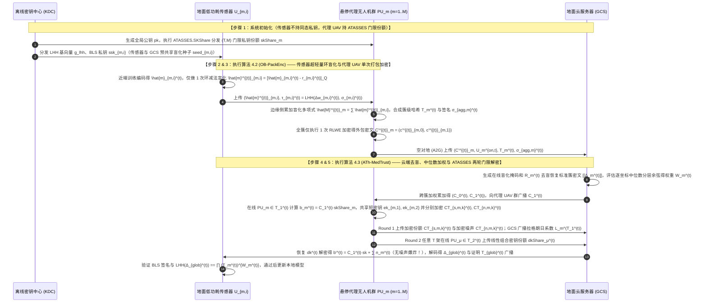

## 方案四（层次型 FL · 地面传感器-悬停代理 UAV-地面云）：结合终端外包环盲化加密与边缘加密份额门限解密的鲁棒可验证层次型联邦学习（`OutATASSES-HFL`）

> **设计动机与传统流畅推演（创新范式：$\text{A} + (\text{B}+\text{C}) = \text{A} + \text{D}$）**：
> 1. **为什么需要这个方案？**
>    在偏远林区、矿区或边境监测的“地面低功耗物联网传感器 $\to$ 悬停计算代理无人机（Proxy UAV）$\to$ 地面云服务器（GCS）”三层边缘辅助联邦学习（Edge/UAV-Assisted HFL）架构中，地面传感器受微型电池和 MCU 算力限制，直接执行高维多项式环上的 RLWE 同态加密非常吃力。现有文献 `26-FedOut` 提出让终端只做一次简单的模减法盲化 $\hat{m}'_i = [\hat{m}_i - r_i]_q$，将繁重的 RLWE 加密外包给代理服务器，并为所有终端分发同一把静态总解密密钥 $s = \sum sk_i$。
>    然而，用传统的密码学安全标准审视 `26-FedOut`，会发现两个明显的实际隐患：
>    - **隐患一（终端持有全局总解密密钥 $s$ 的单点失陷风险与边缘 UAV 掉线噪声爆炸）**：在 `26-FedOut` 中，每台低成本地面传感器内存中都存有全网总私钥 $s = \sum sk_i$。一旦野外任意 1 台传感器被敌方物理捕获并与云服务器合谋，全网所有节点的密文都将瞬间被破译！反之，如果我们不把总私钥发给地面传感器，而是采用门限全同态加密（ThFHE）将私钥门限拆分给空中的 $M$ 架代理无人机（Proxy UAVs），那么当部分代理 UAV 因强风或低电量掉线、仅剩 $T \le M$ 架在线时，传统 Shamir ThFHE 又会遭遇最新 USENIX Security'25 顶会论文 **`25-ATASSES`** 所指出的**“拉格朗日系数导致的泛滥噪声爆炸（Blown-up Noise）”**与 $O(M^2 K_{\text{pack}})$ 的高昂复杂度！
>    - **隐患二（缺乏对异构数据投毒的密态中位数防御与端到端可验证性）**：野外传感器极易受环境干扰或恶意篡改上传中毒梯度。虽然 `26-SFLBR` 提出利用逐坐标中位数（Coordinate-wise Median）与分层余弦评分来抵御 Non-IID 场景下的拜占庭投毒，但 `26-SFLBR` 仅使用明文双掩码，导致辅助服务器直接看穿所有客户端的明文梯度方向；同时终端把加密外包给代理 UAV 后，缺乏验证代理 UAV 和云服务器是否诚实聚合的手段。
> 2. **我们如何一步步自然地解决它？**
>    我们遵循 **$\text{A} + (\text{B}+\text{C}) = \text{A} + \text{D}$** 的深度融合范式：
>    - **算法 $\text{A}$（终端外包环盲化与代理 UAV 打包 RLWE 加密协议 `OB-PackEnc`）**：保留并升级 `26-FedOut` 的轻量盲化思想。地面传感器**既不执行同态加密，也不持有全局解密私钥 $sk$**，仅在本地将梯度按 SIMD 槽编码为环多项式后减去与地面云共享的伪随机盲化环多项式 $r_{m,i}^{(t)}$，并生成线性同态哈希（LHH）标签与 BLS 签名上传给悬停代理 UAV $PU_m$。代理 UAV $PU_m$ 先在边缘侧将本簇在线传感器的盲化多项式相加，再用系统全局公钥 $pk$ 执行**全簇仅 1 次**的打包 RLWE 加密。
>    - **合成新算法 $\text{D} = \text{B} + \text{C}$（基于 `ATASSES` 加密份额的边缘任意门限解密、密态中位数信任评估与验证协议 `ATh-MedTrust`）**：我们将 **`25-ATASSES`（USENIX Security'25）的加密份额近似秘密共享（Encrypted-Share ApproxSS）**（$\text{B}$）与 **`26-SFLBR` 的逐坐标中位数分层余弦评分及 LHH 验证**（$\text{C}$）深度融合在 $M$ 架代理无人机与地面云之间！系统的全局 RLWE 私钥 $sk$ 通过 `ATASSES.SKShare` 拆分为 $(T, M)$ 门限份额由 $M$ 架代理 UAV 持有。在评估各簇可信度与最终解密时，任意 $T$ 架在线代理 UAV 运行 `ATASSES` 的两轮加密份额协议（使用辅助 BFV 私钥分别加密解密份额 $b_m$ 与小噪声 $n_m$），使地面云仅能恢复出带安全有界噪声的近似结果——**既彻底根除了拉格朗日噪声爆炸，又将边缘解密通信复杂度从 $O(M \cdot K_{\text{pack}})$ 降至 $O(M + K_{\text{pack}})$**！

### 5.1 应用场景

本方案面向**偏远生态保护区/矿区灾害监测的“地面低功耗传感器群 $\to$ 悬停代理无人机（Proxy UAVs）$\to$ 地面云服务器（GCS）”三层边缘辅助联邦学习场景**。系统包含四类实体：
1. **离线密钥分发中心（Offline KDC）**：仅在部署前生成系统级 RLWE 公钥 $pk$，将全局私钥 $sk$ 按 `25-ATASSES` 的 `SKShare` 协议拆分为 $(T, M)$ 门限份额分发给 $M$ 架代理 UAV，初始化后彻底离线。
2. **底层：地面低功耗感知传感器（Ground IoT Sensors, $\mathcal{U} = \bigcup_{m=1}^M \mathcal{U}_m$）**：划分为 $M$ 个监测簇，第 $m$ 簇含 $K_m$ 个微型传感器 $U_{m,i}$。传感器算力微弱，不支持高阶多项式乘法，且可能因野外环境故障产生异常数据或掉线。
3. **中间层：$M$ 架悬停计算代理无人机（Hovering Proxy UAVs, $\mathcal{P} = \{PU_1, \dots, PU_M\}$）**：悬停在各传感器簇上空，负责将簇内传感器的盲化明文预聚合后外包加密为标准 RLWE 密文，并在下行阶段以任意 $T$-out-of-$M$ 门限协同执行 `ATASSES` 加密份额近似恢复协议。
4. **顶层：地面云服务器（Ground Cloud Server, GCS）**：负责消除终端盲化掩码、协同评估各簇逐坐标中位数与分层余弦信任权重、聚合全局模型并下发可验证证明。

### 5.2 要解决的问题

1. **外包同态加密中“终端持有总私钥 $s$”的单点泄密风险与代理 UAV 掉线难题**：如何在让地面微型传感器**完全免除 RLWE 多项式乘法加密运算**的同时，避免将全局私钥 $s$ 存放在易被物理捕获的地面传感器中？当空中的 $M$ 架代理 UAV 有高达 $M - T$ 架因续航不足或通信受阻掉线时，如何避免传统 Shamir 门限 FHE 的拉格朗日噪声爆炸并保持极低的解密通信开销？
2. **跨区域 Non-IID 监测数据下的拜占庭投毒簇识别与方向隐私保护问题**：当部分传感器簇遭受标签翻转、高斯噪声或分层投毒污染时，如何在不向地面云或代理 UAV 暴露良性传感器明文梯度的前提下，利用逐坐标中位数基线与分层余弦信任评分准确抑制中毒更新？
3. **外包加密与门限解密全链路的防篡改可验证问题**：地面传感器如何确认代理 UAV $PU_m$ 没有篡改其上传的盲化更新，且地面云 GCS 确实按公布的可信权重完成了跨簇加权聚合？

### 5.3 创新点与总体设计目标

遵循传统规范的四段式贡献总结范式（中英双语对照）：

- **创新点 1（总体框架优越性 — 对应总体算法 `OutATASSES-HFL`）**：
  > **English**: We propose **OutATASSES-HFL**, a verifiable and Byzantine-robust hierarchical federated learning framework that integrates terminal-side outsourced ring-blinding encryption with edge-side arbitrary-threshold approximate secret sharing (ATASSES), eliminating both heavy terminal encryption overhead and the single-point key compromise risk of existing outsourced FL schemes.
  > **中文**：我们提出了 **OutATASSES-HFL**，一种将终端侧外包环盲化加密与边缘侧任意门限近似秘密共享（`ATASSES`）相融合的可验证拜占庭鲁棒层次型联邦学习框架，在免除地面终端繁重同态加密计算的同时，彻底消除了现有外包联邦学习方案中终端持有全局总私钥的单点失陷风险。

- **创新点 2（终端环盲化与代理 UAV 簇级打包外包加密子算法 — 对应分部算法 1 `OB-PackEnc`）**：
  > **English**: We design the **Outsourced Ring-Blinding and Proxy-UAV Packed RLWE Encryption (OB-PackEnc)** protocol to minimize computation on resource-constrained IoT sensors and reduce air-to-ground (A2G) traffic. By blinding SIMD-encoded polynomials via a single modular subtraction at the sensors and performing pre-aggregated RLWE encryption at the hovering proxy UAV, OB-PackEnc reduces proxy encryption operations from $O(K_m)$ to $O(1)$ per cluster.
  > **中文**：我们设计了**外包环盲化与代理无人机打包 RLWE 加密协议（`OB-PackEnc`）**，以最小化资源受限物联网传感器的计算负担并削减空对地（A2G）通信流量。通过在传感器端仅执行一次模减法盲化，并在悬停代理无人机端先完成簇内盲化预聚合再执行打包 RLWE 加密，`OB-PackEnc` 将每个簇的外包同态加密次数从 $O(K_m)$ 降低至 $O(1)$。

- **创新点 3（基于 `ATASSES` 的边缘门限解密与密态中位数信任评估子算法 — 对应分部算法 2 `ATh-MedTrust`）**：
  > **English**: We propose the **ATASSES-Based Edge Threshold Decryption and Median-Cosine Trust Evaluation (ATh-MedTrust)** protocol to achieve dropout-resilient edge decryption and Byzantine robustness on Non-IID data. By leveraging BFV key-homomorphic encrypted shares among surviving proxy UAVs, ATh-MedTrust prevents Lagrange noise blow-up, reduces edge decryption complexity from $O(M^2 K_{\text{pack}})$ to $O(M^2 + M K_{\text{pack}})$, and integrates order-preserving coordinate-wise median scoring with Linear Homomorphic Hash (LHH) verification.
  > **中文**：我们提出了**基于 `ATASSES` 的边缘门限解密与中位数余弦信任评估协议（`ATh-MedTrust`）**，以在 Non-IID 数据下实现抗掉线的边缘解密与拜占庭鲁棒性。通过在存活代理无人机之间运用基于 BFV 密钥同态性的加密份额机制，`ATh-MedTrust` 彻底避免了拉格朗日噪声爆炸，将边缘解密计算复杂度从 $O(M^2 K_{\text{pack}})$ 降至 $O(M^2 + M K_{\text{pack}})$，并集成了保序逐坐标中位数评分与线性同态哈希（LHH）验证。

- **创新点 4（理论安全性证明与实验效果呼应）**：
  > **English**: We formally prove the approximate correctness, simulation-based security, and verification soundness of OutATASSES-HFL under the RLWE and Discrete Logarithm assumptions. Extensive experiments on MNIST, CIFAR-10, and UAV-captured EuroSAT datasets demonstrate that OutATASSES-HFL speeds up terminal processing by $8.7\times$, accelerates edge threshold decryption by $4.2\times\sim 11.8\times$ over noisy-share baselines, and maintains high accuracy under $30\%$ poisoned clusters and $40\%$ UAV dropouts.
  > **中文**：我们在 RLWE 与离散对数假设下严格证明了 `OutATASSES-HFL` 的近似正确性、基于模拟的安全性与验证健全性。在 MNIST、CIFAR-10 及遥感数据集 EuroSAT 上的大量实验表明，`OutATASSES-HFL` 将地面终端处理速度提升了 $8.7$ 倍，边缘门限解密速度比传统带噪份额基线提升 $4.2\sim 11.8$ 倍，并在 $30\%$ 恶意投毒簇与 $40\%$ 代理无人机掉线率下保持优异的模型收敛精度。

### 5.4 威胁模型与实体可见性矩阵

- **系统实体**：离线 **KDC**、$M$ 个簇的地面传感器 **$\{U_{m,i}\}$**、$M$ 架悬停代理无人机 **$\{PU_m\}$**、地面云服务器 **GCS**。
- **威胁模型定义**：
  1. **非合谋的代理无人机群与地面云服务器（Non-Colluding Proxy UAVs & GCS）**：假设地面云服务器 GCS 与至少 $M - T + 1$ 架诚实代理无人机不相互合谋。允许敌手腐化地面云服务器 GCS、最多 $T - 1$ 架半诚实代理无人机（$T$ 为边缘解密门限）、以及任意数量的地面传感器，企图反演其余诚实传感器的私有感知数据；同时允许最多 $M - T$ 架代理无人机因掉线或拒绝服务攻击（DoS）退出协议。
  2. **拜占庭投毒威胁**：允许系统中高达 $30\%\sim 40\%$ 的传感器或边缘簇受到标签翻转、高斯噪声或分层缩放投毒攻击。
  3. **不可信聚合篡改威胁**：代理 UAV 或地面云 GCS 可能试图漏加诚实传感器数据或篡改加权聚合结果。

| 实体名称 | 直接可见的明文/密文信息（Visible Information） | 严格不可见的隐私/秘密信息（Invisible Information） | 满足威胁模型的安全性保障机制 |
| :--- | :--- | :--- | :--- |
| **地面传感器 ($U_{m,i}$)** | 自身感知数据 $\mathcal{D}_{m,i}$、与 GCS 共享的盲化种子 $\text{seed}_{m,i}$、BLS 签名私钥 $ssk_{m,i}$、最终验证通过的全局模型 $w^{(t+1)}$ | 其他传感器的明文梯度、**系统的全局同态私钥 $sk$ 及代理 UAV 的门限份额 $\text{skShare}_m$（终端完全不持有同态私钥！）** | 终端不持有任何同态解密私钥，彻底根除终端被物理捕获导致全网泄密的风险 |
| **悬停代理无人机 ($PU_m$)** | 本簇在线传感器上传的盲化多项式 $\hat{m}'^{(t)}_{m,i} = [\hat{m}_{m,i}^{(t)} - r_{m,i}^{(t)}]_{q_1}$、系统全局公钥 $pk$、自身的 $(T,M)$ 门限私钥份额 $\text{skShare}_m$、其他代理 UAV 发来的辅助 BFV 加密密钥份额 $\text{ekShare}_{m,\mu}$ | 任何诚实传感器的真实明文梯度 $\hat{m}_{m,i}^{(t)}$（被 $r_{m,i}^{(t)}$ 一次性密码本隐藏）、其他代理 UAV 的门限份额 $\text{skShare}_\mu$ 及系统完整私钥 $sk$ | 环 $\mathcal{R}_{q_1}$ 上的一次性密码本盲化 $[-r_{m,i}^{(t)}]_{q_1}$ + $(T,M)$-Shamir 秘密共享 |
| **地面云服务器 (GCS)** | 代理 UAV 上传的簇级外包密文 $C'^{(t)}_m$、在线传感器盲化掩码和 $R_m^{(t)}$、去盲后的簇级密文 $\llbracket \Delta_m^{(t)} \rrbracket$、`ATASSES` 近似恢复出的带模糊噪声结果 $b' = b + \sum n_m$ | 任何单个传感器的明文更新（已在边缘被合并）、任何代理 UAV 的精确解密份额 $b_m = C_1 \cdot \text{skShare}_m$ 及完整私钥 $sk$ | `ATASSES` 加密份额近似恢复（Lemma 2 保证公开 $\text{dk}$ 后个体加密份额依然与随机值不可区分） |

### 5.5 符号系统介绍

| 符号 | 数学定义与物理含义 |
| :--- | :--- |
| $\mathcal{R}_{M,P}, \mathcal{R}_{M,Q}, \Delta$ | 主同态加密方案（RLWE/BFV/CKKS）的明文环 $\mathcal{R}_{M,P}$ 与密文环 $\mathcal{R}_{M,Q} = \mathbb{Z}_Q[X]/(X^M+1)$，缩放因子 $\Delta = \lfloor Q/P \rfloor$ |
| $\mathcal{R}_{M',P'}, \mathcal{R}_{M',Q'}, \Delta'$ | `ATASSES` 内部用于保护代理 UAV 解密份额的辅助 BFV 对称加密明文环 $\mathcal{R}_{M',P'}$（令 $P'=Q$）与密文环 $\mathcal{R}_{M',Q'}$（满足 $Q' > 2(P')^2 B' M + 2P' = O(M)$） |
| $sk, pk, \text{skShare}_m$ | 系统隐式主私钥 $sk = \sum_{m=1}^M sk_m$，全局公钥 $pk$，以及第 $m \in \{1,\dots,M\}$ 架代理 UAV 持有的 $(T,M)$-Shamir 主私钥份额 $\text{skShare}_m \in \mathcal{R}_{M,Q}$ |
| $r_{m,i}^{(t)}, \hat{m}'^{(t)}_{m,i}, R_m^{(t)}$ | 地面传感器 $U_{m,i}$ 由共享种子 $\text{seed}_{m,i}$ 生成的盲化环多项式 $r_{m,i}^{(t)} \in \mathcal{R}_{M,Q}$，上传给代理 UAV 的盲化多项式 $\hat{m}'^{(t)}_{m,i} = [\hat{m}_{m,i}^{(t)} - r_{m,i}^{(t)}]_Q$，以及簇内在线盲化项之和 $R_m^{(t)}$ |
| $\text{ek}_{m,1}^{(t)}, \text{ek}_{m,2}^{(t)}, \text{dk}^{(t)}$ | 代理 UAV $PU_m$ 在第 $t$ 轮生成的两把临时辅助 BFV 加密密钥，以及在第二轮由存活代理 UAV 集合 $\mathcal{T}_2^{(t)}$ 合成的辅助解密密钥 $\text{dk}^{(t)} = \sum_{m \in \mathcal{T}_1^{(t)}} \left( L_m^{(\mathcal{T}_1^{(t)})} \cdot \text{ek}_{m,1}^{(t)} + \text{ek}_{m,2}^{(t)} \right)$ |
| $\tau_{m,i}^{(t)}, \mathcal{T}_m^{(t)}, \mathcal{T}_{\text{glob}}^{(t)}$ | 传感器 $U_{m,i}$ 的线性同态哈希标签 $\tau_{m,i}^{(t)} \in \mathbb{G}_1$，第 $m$ 簇聚合哈希标签 $\mathcal{T}_m^{(t)}$，以及经信任权重 $W_m^{(t)}$ 加权后的全局验证标签 $\mathcal{T}_{\text{glob}}^{(t)}$ |

### 5.6 方案详细设计与闭环公式推导

#### 步骤 1：系统初始化与边缘代理 UAV 门限密钥分发（System Initialization）
1. **边缘代理 UAV 的 `ATASSES.SKShare` 密钥建立**：
   离线 KDC（或由 $M$ 架代理无人机在起飞前直接交互）生成系统全局 RLWE/CKKS 加密公钥 $pk = (p_0, p_1) = ([-a \cdot sk + e_{\text{pk}}]_Q, a) \in \mathcal{R}_{M,Q}^2$，其中主私钥为 $sk = \sum_{m=1}^M sk_m \pmod Q$。
   为了支持任意 $T$ 架在线代理 UAV 即可完成解密（容忍最多 $M - T$ 架代理 UAV 掉线），每架代理 UAV $PU_\mu (\mu \in \{1,\dots,M\})$ 调用 $(T, M)$-Shamir 秘密共享算法对自己的局部私钥 $sk_\mu$ 生成 $M$ 个份额 $\{\text{skShare}_{m,\mu}\}_{m=1}^M \leftarrow \mathsf{ShamirSS.Share}(sk_\mu)$ 并分发给代理 UAV $PU_m$。代理 UAV $PU_m$ 将收到的份额相加，获得主私钥 $sk$ 的 $(T, M)$ 门限份额：
$$
\text{skShare}_m = \sum_{\mu=1}^M \text{skShare}_{m,\mu} \pmod Q
$$
2. **地面传感器轻量化参数配置**：
   地面传感器 $U_{m,i}$ **不需要存储任何同态私钥**，仅存储线性同态哈希（LHH）生成元向量 $\mathbf{g}_{\text{lhh}} = (g_1, \dots, g_M) \in \mathbb{G}_1^M$、自身的 BLS 签名密钥对 $(ssk_{m,i}, spk_{m,i})$ 以及与地面云服务器 GCS 预共享的 128-bit 盲化种子 $\text{seed}_{m,i}$。

#### 步骤 2：地面传感器本地正则化训练、SIMD 编码与超轻量环减法盲化（`OB-PackEnc` 终端侧）
在第 $t$ 轮训练中，第 $m$ 簇的在线地面传感器 $U_{m,i} \in \mathcal{U}_m^{\text{on},t}$ 执行如下极轻量操作：
1. **带 $L_2$ 近端约束的本地训练**：
   为抑制野外传感器 Non-IID 数据引起的模型漂移，传感器最小化带近端正则项的损失函数 $\mathcal{L}(w) = F_{m,i}(w) + \frac{\alpha_{\text{prox}}}{2}\|w - w^{(t)}\|_2^2$，获得本地更新向量 $\Delta w_{m,i}^{(t)} = p_{m,i}(w_{m,i,\tau}^{(t)} - w^{(t)})$，并通过 SIMD 编码转化为整系数明文环多项式 $\hat{m}_{m,i}^{(t)} = \lfloor \Delta \cdot \tau^{-1}(\Delta w_{m,i}^{(t)}) \rceil \in \mathcal{R}_{M,Q}$。
2. **零乘法开销的环减法一次性盲化**：
   传感器 $U_{m,i}$ 不做任何同态加密乘法，仅利用与地面云 GCS 共享的种子 $\text{seed}_{m,i}$ 生成伪随机盲化环多项式 $r_{m,i}^{(t)} \leftarrow \text{PRPG}(t, \text{seed}_{m,i}) \in \mathcal{R}_{M,Q}$，在环 $\mathcal{R}_{M,Q}$ 上执行 **1 次系数减法** 得到盲化多项式 $\hat{m}'^{(t)}_{m,i}$：
$$
\hat{m}'^{(t)}_{m,i} = \left[ \hat{m}_{m,i}^{(t)} - r_{m,i}^{(t)} \right]_Q \in \mathcal{R}_{M,Q}
$$
3. **计算同态哈希标签与 BLS 签名**：
   传感器计算真实更新向量的线性同态哈希 $\tau_{m,i}^{(t)} = \mathsf{LHH}(\Delta w_{m,i}^{(t)}) = \prod_{u=1}^M g_u^{\lfloor \Delta \cdot \Delta w_{m,i}^{(t)}[u] \rceil} \in \mathbb{G}_1$ 与 BLS 签名 $\sigma_{m,i}^{(t)} = H_{\mathbb{G}_1}(t \parallel m \parallel i \parallel \tau_{m,i}^{(t)})^{ssk_{m,i}}$，将轻量数据包 $\left( \hat{m}'^{(t)}_{m,i}, \tau_{m,i}^{(t)}, \sigma_{m,i}^{(t)} \right)$ 发送给头顶悬停的代理无人机 $PU_m$。

#### 步骤 3：悬停代理 UAV 簇内盲化预聚合与单次打包外包 RLWE 加密（`OB-PackEnc` 代理 UAV 侧）
悬停代理无人机 $PU_m$ 收集本簇在线传感器集合 $\mathcal{U}_m^{\text{on},t}$ 的数据后：
1. **边缘侧盲化多项式预聚合与签名聚合**：
   $PU_m$ 批量验证传感器 BLS 签名后，先在边缘侧将本簇所有在线传感器的盲化明文多项式直接模 $Q$ 相加，并合成簇级同态哈希 $\mathcal{T}_m^{(t)}$ 与簇级聚合签名 $\sigma_{\text{agg},m}^{(t)}$：
$$
\hat{M}'^{(t)}_m = \sum_{i \in \mathcal{U}_m^{\text{on},t}} \hat{m}'^{(t)}_{m,i} \equiv \sum_{i \in \mathcal{U}_m^{\text{on},t}} \hat{m}_{m,i}^{(t)} - \sum_{i \in \mathcal{U}_m^{\text{on},t}} r_{m,i}^{(t)} \pmod Q, \quad \mathcal{T}_m^{(t)} = \prod_{i \in \mathcal{U}_m^{\text{on},t}} \tau_{m,i}^{(t)}, \quad \sigma_{\text{agg},m}^{(t)} = \prod_{i \in \mathcal{U}_m^{\text{on},t}} \sigma_{m,i}^{(t)}
$$
2. **全簇单次打包 RLWE 外包加密**：
   代理无人机 $PU_m$ 无需对每个传感器分别做加密，而是采样小多项式 $v_m^{(t)} \leftarrow \chi_s$ 与高斯误差 $e_{m,0}^{(t)}, e_{m,1}^{(t)} \leftarrow \chi_{\text{err}}$，使用系统全局公钥 $pk = (p_0, p_1)$ 对聚合后的盲化多项式 $\hat{M}'^{(t)}_m$ **仅执行 1 次 RLWE 加密**，生成簇级外包密文 $C'^{(t)}_m = \left( c'^{(t)}_{m,0}, c'^{(t)}_{m,1} \right) \in \mathcal{R}_{M,Q}^2$：
$$
c'^{(t)}_{m,0} = \left[ v_m^{(t)} \cdot p_0 + \hat{M}'^{(t)}_m + e_{m,0}^{(t)} \right]_Q, \qquad c'^{(t)}_{m,1} = \left[ v_m^{(t)} \cdot p_1 + e_{m,1}^{(t)} \right]_Q
$$
   $PU_m$ 通过空对地（A2G）链路将 $\left( C'^{(t)}_m, \mathcal{U}_m^{\text{on},t}, \mathcal{T}_m^{(t)}, \sigma_{\text{agg},m}^{(t)} \right)$ 发送给地面云服务器 GCS。

#### 步骤 4：地面云服务器去盲、密态中位数分层余弦评估与加权聚合（`ATh-MedTrust` 评估与聚合）
1. **地面云服务器精确去盲恢复簇级标准 RLWE 密文**：
   地面云服务器 GCS 根据在线名单 $\mathcal{U}_m^{\text{on},t}$ 与预共享种子 $\text{seed}_{m,i}$，本地计算第 $m$ 簇在线传感器的盲化掩码总和 $R_m^{(t)} = \sum_{i \in \mathcal{U}_m^{\text{on},t}} \text{PRPG}(t, \text{seed}_{m,i}) \pmod Q$，将其直接加回到外包密文第一分量 $c'^{(t)}_{m,0}$ 上，即可精确消去盲化项，恢复出第 $m$ 簇真实聚合增量 $\Delta_m^{(t)} = \sum_{i \in \mathcal{U}_m^{\text{on},t}} \Delta w_{m,i}^{(t)}$ 的标准 RLWE 密文 $\llbracket \Delta_m^{(t)} \rrbracket = \left( c_{m,0}^{(t)}, c_{m,1}^{(t)} \right) \in \mathcal{R}_{M,Q}^2$：
$$
c_{m,0}^{(t)} = \left[ c'^{(t)}_{m,0} + R_m^{(t)} \right]_Q = \left[ v_m^{(t)} \cdot p_0 + \sum_{i \in \mathcal{U}_m^{\text{on},t}} \hat{m}_{m,i}^{(t)} + e_{m,0}^{(t)} \right]_Q, \qquad c_{m,1}^{(t)} = c'^{(t)}_{m,1}
$$
2. **基于逐坐标中位数的分层余弦信任权重计算**：
   为抵御受污染边缘簇的拜占庭投毒攻击，GCS 与代理 UAV 群通过保序仿射掩码（同本报告方案二机制）提取 $M$ 个簇在各网络层 $\Omega_\ell (\ell=1,\dots,L)$ 上的逐坐标中位数基线 $\Delta_{\text{med}}^{(t)}$，并计算第 $m$ 个簇与中位数基线的分层余弦相似度 $\mu_{m,\ell}^{(t)} = \cos\left(\Delta_m^{(t)}[\Omega_\ell], \Delta_{\text{med}}^{(t)}[\Omega_\ell]\right)$。
   随后按 `26-SFLBR` 的分段非线性软评分函数计算第 $m$ 簇的信任得分 $\rho_m^{(t)}$ 与定点整数权重 $W_m^{(t)} = \lfloor \Delta_w \cdot \alpha_m^{(t)} \rceil$：
$$
\rho_m^{(t)} = \begin{cases} \ln\left(1 + 0.5(\bar{\mu}_m^{(t)} + 1)\right), & \text{if } \bar{\mu}_m^{(t)} < 0 \\ (\bar{\mu}_m^{(t)} + 1)^2 - 0.59, & \text{if } \bar{\mu}_m^{(t)} \ge 0 \end{cases}, \qquad \alpha_m^{(t)} = \frac{\rho_m^{(t)}}{\sum_{\mu=1}^M \rho_\mu^{(t)}}
$$
3. **跨簇同态加权聚合与全局同态哈希合成**：
   GCS 对全部 $M$ 个簇的去盲密文执行零深度定点数加权求和，得到全局聚合密文 $\mathbf{CT}_{\text{glob}}^{(t)} = \left( \mathcal{C}_0^{(t)}, \mathcal{C}_1^{(t)} \right) \in \mathcal{R}_{M,Q}^2$ 与全局同态哈希标签 $\mathcal{T}_{\text{glob}}^{(t)} \in \mathbb{G}_1$：
$$
\mathcal{C}_0^{(t)} = \sum_{m=1}^M W_m^{(t)} \cdot c_{m,0}^{(t)} \pmod Q, \quad \mathcal{C}_1^{(t)} = \sum_{m=1}^M W_m^{(t)} \cdot c_{m,1}^{(t)} \pmod Q, \quad \mathcal{T}_{\text{glob}}^{(t)} = \prod_{m=1}^M \left(\mathcal{T}_m^{(t)}\right)^{W_m^{(t)}}
$$

#### 步骤 5：基于 `ATASSES` 加密份额的边缘任意门限解密与终端 LHH 验证（`ATh-MedTrust` 解密与验证）
为了在不暴露任何代理 UAV 私钥份额 $\text{skShare}_m$ 的前提下解开 $\mathbf{CT}_{\text{glob}}^{(t)} = (\mathcal{C}_0^{(t)}, \mathcal{C}_1^{(t)})$，且容忍最多 $M - T$ 架代理 UAV 随时掉线而不引发拉格朗日噪声爆炸，存活的代理 UAV 群与 GCS 执行 **`25-ATASSES` 两轮加密份额近似恢复协议**：
1. **代理 UAV 本地计算精确解密份额**：
   收到 $\mathcal{C}_1^{(t)}$ 的每架在线代理无人机 $PU_m$ 利用本地持有的 $(T,M)$ 主私钥份额 $\text{skShare}_m$ 计算无噪声精确解密份额 $b_m^{(t)} = \left[ \mathcal{C}_1^{(t)} \cdot \text{skShare}_m \right]_Q \in \mathcal{R}_{M,Q}$。
2. **`ATASSES` 第一轮：份额与模糊噪声的独立 BFV 对称加密及密钥共享**：
   在线代理无人机 $PU_m \in \mathcal{T}_1^{(t)}$（$|\mathcal{T}_1^{(t)}| \ge T$）采样两把短长的辅助 BFV 对称私钥 $\text{ek}_{m,1}^{(t)}, \text{ek}_{m,2}^{(t)} \leftarrow \mathsf{BFV.SKGen}() \in \mathcal{R}_{M',Q'}$，用 $(T, M)$-Shamir 秘密共享将这两把短密钥拆分为份额 $\left\{\text{ekShare}_{\mu,m,1}^{(t)}, \text{ekShare}_{\mu,m,2}^{(t)}\right\}_{\mu=1}^M$ 发送给其他代理 UAV $PU_\mu$（开销仅为常数级 $O(M^2)$，与模型大小无关！）。
   同时，$PU_m$ 将 $b_m^{(t)}$ 切分为长度 $M'$ 的子块 $b_{m,k}^{(t)}$，采样有界小噪声 $n_{m,k}^{(t)} \leftarrow \chi_{B_{\text{sm}}}$（$\|n_{m,k}^{(t)}\|_\infty \le B_{\text{sm}}$），基于公共随机多项式 $\mathbf{a}_k^{(t)} \leftarrow \text{CRS}$ 分别用 $\text{ek}_{m,1}^{(t)}$ 和 $\text{ek}_{m,2}^{(t)}$ 加密上传给 GCS：
$$
\mathbf{CT}_{s,m,k}^{(t)} = \left( \left[ \mathbf{a}_k^{(t)} \cdot \text{ek}_{m,1}^{(t)} + \mathbf{e}_{m,1,k}^{(t)} + \Delta' \cdot b_{m,k}^{(t)} \right]_{Q'}, \;\; -\mathbf{a}_k^{(t)} \right)
$$
$$
\mathbf{CT}_{n,m,k}^{(t)} = \left( \left[ \mathbf{a}_k^{(t)} \cdot \text{ek}_{m,2}^{(t)} + \mathbf{e}_{m,2,k}^{(t)} + \Delta' \cdot n_{m,k}^{(t)} \right]_{Q'}, \;\; -\mathbf{a}_k^{(t)} \right)
$$
   GCS 收到在线代理 UAV 集合 $\mathcal{T}_1^{(t)}$ 的密文后，计算拉格朗日系数 $\left\{L_m^{(\mathcal{T}_1^{(t)})}\right\}_{m \in \mathcal{T}_1^{(t)}}$ 并广播。
3. **`ATASSES` 第二轮：密钥同态合成与无噪声爆炸近似恢复**：
   第二轮在线的任意 $T$ 架代理 UAV $PU_\mu \in \mathcal{T}_2^{(t)}$（允许 $\mathcal{T}_2^{(t)} \neq \mathcal{T}_1^{(t)}$！）计算单条辅助解密密钥份额并上传给 GCS：
$$
\text{dkShare}_\mu^{(t)} = \sum_{m \in \mathcal{T}_1^{(t)}} \left( L_m^{(\mathcal{T}_1^{(t)})} \cdot \text{ekShare}_{\mu,m,1}^{(t)} + \text{ekShare}_{\mu,m,2}^{(t)} \right) \pmod Q
$$
   GCS 通过 Shamir 插值恢复出辅助解密密钥 $\text{dk}^{(t)} = \sum_{m \in \mathcal{T}_1^{(t)}} \left( L_m^{(\mathcal{T}_1^{(t)})} \cdot \text{ek}_{m,1}^{(t)} + \text{ek}_{m,2}^{(t)} \right)$，并利用线性密钥同态性仅对 $\mathbf{CT}_{s,m,k}^{(t)}$ 乘以拉格朗日系数 $L_m^{(\mathcal{T}_1^{(t)})}$，而对噪声密文 $\mathbf{CT}_{n,m,k}^{(t)}$ 保持系数为 $1$：
$$
\mathbf{CT}_{\text{all},k}^{(t)} = \left( \sum_{m \in \mathcal{T}_1^{(t)}} \left( L_m^{(\mathcal{T}_1^{(t)})} \cdot \mathbf{CT}_{s,m,k}^{(t)}[0] + \mathbf{CT}_{n,m,k}^{(t)}[0] \right) \bmod Q', \;\; -\mathbf{a}_k^{(t)} \right)
$$
   GCS 用 $\text{dk}^{(t)}$ 解密 $\mathbf{CT}_{\text{all},k}^{(t)}$ 拼接得到 $b'^{(t)} = \mathcal{C}_1^{(t)} \cdot sk + \sum_{m \in \mathcal{T}_1^{(t)}} n_m^{(t)}$（模糊噪声总和严格有界 $\le T \cdot B_{\text{sm}}$，彻底无拉格朗日放大！），加上 $\mathcal{C}_0^{(t)}$ 解码即得全局加权更新 $\mathbf{\Delta}_{\text{glob}}^{(t)} = \sum_{m=1}^M W_m^{(t)} \Delta_m^{(t)}$。
4. **地面传感器 LHH 与 BLS 签名端到端验证**：
   地面传感器收到下发的 $\left( \mathbf{\Delta}_{\text{glob}}^{(t)}, \{W_m^{(t)}, \mathcal{T}_m^{(t)}, \sigma_{\text{agg},m}^{(t)}\}_{m=1}^M, \mathcal{T}_{\text{glob}}^{(t)} \right)$ 后，验证 BLS 聚合签名 $\prod_{m=1}^M \sigma_{\text{agg},m}^{(t)}$ 并核验线性同态哈希等式：
$$
\mathsf{LHH}\left( \mathbf{\Delta}_{\text{glob}}^{(t)} \right) = \prod_{u=1}^M g_u^{\lfloor \Delta \cdot \mathbf{\Delta}_{\text{glob}}^{(t)}[u] \rceil} \stackrel{?}{=} \prod_{m=1}^M \left( \mathcal{T}_m^{(t)} \right)^{W_m^{(t)}} = \mathcal{T}_{\text{glob}}^{(t)}
$$
   验证通过后更新本地模型 $w^{(t+1)} = w^{(t)} + \Delta_w^{-1} \mathbf{\Delta}_{\text{glob}}^{(t)}$。

#### 核心算法伪代码描述（3 个自定义核心算法）

```
====================================================================================================
算法 4.1（总体算法）：OutATASSES-HFL — 外包环盲化加密与边缘加密份额门限解密的层次型联邦学习总流程
Algorithm 4.1: OutATASSES-HFL (Main Execution Workflow)
====================================================================================================
Input: 训练轮数 T_max, M 个簇的地面传感器 {U_{m,i}}, M 架悬停代理无人机 {PU_m}, 边缘解密门限 T, 地面云 GCS
Output: 训练完成的全局监测模型 w^(T_max)

1:  [步骤 1: 系统初始化] KDC 生成全局公钥 pk，通过 ATASSES.SKShare 将主私钥 sk 拆分为 (T, M) 份额 skShare_m 分发给代理 UAV PU_m；传感器存储 LHH 基向量 g_lhh、BLS 私钥 ssk_{m,i} 及与 GCS 共享的盲化种子 seed_{m,i}（传感器不持有同态私钥！）。
2:  for 每一轮 t = 1, 2, ..., T_max do
3:      // --- 地面传感器超轻量环减法盲化与代理 UAV 簇级单次打包外包加密 ---
4:      for 每个簇 m = 1, 2, ..., M 并行执行 do
5:          簇内在线传感器 U_{m,i} ∈ U_m^{on,t} 与代理无人机 PU_m 协同调用 【算法 4.2: OB-PackEnc(t, m, U_m^{on,t}, pk)】 生成单条簇级外包密文 C'^{(t)}_m、簇级同态哈希 T_m^(t) 与簇级聚合签名 σ_{agg,m}^(t);
6:          PU_m 通过 A2G 链路将 (C'^{(t)}_m, U_m^{on,t}, T_m^(t), σ_{agg,m}^(t)) 上传至地面云服务器 GCS;
7:      end for
8:      // --- 地面云去盲、密态中位数信任评估与 ATASSES 边缘任意门限解密验证 ---
9:      GCS、存活代理 UAV 群与传感器协同调用 【算法 4.3: ATh-MedTrust(t, {C'^{(t)}_m, U_m^{on,t}, T_m^(t), σ_{agg,m}^(t)}, {skShare_m})】 完成去盲、分层余弦加权、ATASSES 两轮加密份额恢复与 LHH/BLS 验证;
10:     各传感器更新本地模型 w^(t+1) ← w^(t) + Δ_w^{-1} Δ_{glob}^(t);
11: end for
12: return w^(T_max)
```

```
====================================================================================================
算法 4.2（重要组成算法 1）：OB-PackEnc — 终端外包环盲化与代理无人机打包 RLWE 加密协议
Algorithm 4.2: OB-PackEnc (Outsourced Ring-Blinding and Proxy-UAV Packed RLWE Encryption Protocol)
====================================================================================================
Input: 当前轮次 t, 簇编号 m, 在线传感器集合 U_m^{on,t}, 系统全局公钥 pk = (p_0, p_1)
Output: 簇级外包密文 C'^{(t)}_m ∈ R_{M,Q}^2, 簇级同态哈希 T_m^(t), 簇级聚合签名 σ_{agg,m}^(t)

1:  [地面低功耗传感器 U_{m,i} ∈ U_m^{on,t} 本地执行 — 零同态乘法运算]:
2:  for 每个在线传感器 i ∈ U_m^{on,t} 并行 do
3:      带近端正则化训练得 Δw_{m,i}^(t) ← p_{m,i}(w_{m,i,τ}^(t) - w^(t))，执行 SIMD 编码得 \hat{m}_{m,i}^(t) ∈ R_{M,Q};
4:      利用共享种子生成伪随机盲化环多项式 r_{m,i}^(t) ← PRPG(t, seed_{m,i}) ∈ R_{M,Q};
5:      执行 1 次环系数减法盲化: \hat{m}'^{(t)}_{m,i} ← [\hat{m}_{m,i}^(t) - r_{m,i}^(t)]_Q;
6:      计算 LHH 标签 τ_{m,i}^(t) ← LHH(Δw_{m,i}^(t)) 与 BLS 签名 σ_{m,i}^(t)，上传 (\hat{m}'^{(t)}_{m,i}, τ_{m,i}^(t), σ_{m,i}^(t)) 给代理无人机 PU_m;
7:  end for
8:  [悬停代理无人机 PU_m 执行 — 边缘盲化预聚合与单次打包 RLWE 加密]:
9:  批量验证传感器 BLS 签名，在环 R_{M,Q} 上累加本簇盲化多项式: \hat{M}'^{(t)}_m ← ∑_{i ∈ U_m^{on,t}} \hat{m}'^{(t)}_{m,i} mod Q;
10: 合成簇级同态哈希 T_m^(t) ← ∏_{i ∈ U_m^{on,t}} τ_{m,i}^(t) 与簇级聚合签名 σ_{agg,m}^(t) ← ∏_{i ∈ U_m^{on,t}} σ_{m,i}^(t);
11: 采样 v_m^(t) ← χ_s 及误差 e_{m,0}^(t), e_{m,1}^(t) ← χ_err，对预聚合结果仅执行 1 次 RLWE 加密:
12: c'^{(t)}_{m,0} ← [v_m^(t) · p_0 + \hat{M}'^{(t)}_m + e_{m,0}^(t)]_Q,   c'^{(t)}_{m,1} ← [v_m^(t) · p_1 + e_{m,1}^(t)]_Q;
13: return C'^{(t)}_m = (c'^{(t)}_{m,0}, c'^{(t)}_{m,1}), T_m^(t), σ_{agg,m}^(t)
```

```
====================================================================================================
算法 4.3（重要组成算法 2）：ATh-MedTrust — 基于 ATASSES 的边缘门限解密、中位数信任评估与验证协议
Algorithm 4.3: ATh-MedTrust (ATASSES-Based Edge Threshold Decryption and Median-Cosine Trust Protocol)
====================================================================================================
Input: 全部 M 个簇的外包密文与证明 {C'^{(t)}_m, U_m^{on,t}, T_m^(t), σ_{agg,m}^(t)}_{m=1}^M, 代理 UAV 门限份额 {skShare_m}
Output: 验证通过的全局加权更新向量 Δ_{glob}^(t)

1:  [地面云服务器 GCS — 精确去盲与密态中位数信任加权]:
2:  for m = 1 to M do
3:      计算本簇在线传感器盲化掩码和 R_m^(t) ← ∑_{i ∈ U_m^{on,t}} PRPG(t, seed_{m,i}) mod Q;
4:      同态加法去盲恢复标准簇密文 [[Δ_m^(t)]]: c_{m,0}^(t) ← [c'^{(t)}_{m,0} + R_m^(t)]_Q, c_{m,1}^(t) ← c'^{(t)}_{m,1};
5:  end for
6:  提取逐坐标中位数基线并评估各簇分层余弦得分 \bar{μ}_m^(t)，代入分段软评分函数计算定点信任权重 W_m^(t) = ⌊Δ_w · α_m^(t)⌉;
7:  跨簇加权同态累加: C_0^(t) ← ∑_{m=1}^M W_m^(t) c_{m,0}^(t) mod Q, C_1^(t) ← ∑_{m=1}^M W_m^(t) c_{m,1}^(t) mod Q, T_{glob}^(t) ← ∏ (T_m^(t))^{W_m^(t)};
8:  [存活代理无人机群与 GCS — 执行 ATASSES 两轮加密份额近似恢复]:
9:  for 每个第一轮在线代理无人机 PU_m ∈ T_1^(t) (|T_1^(t)| ≥ T) 并行 do
10:     计算精确解密份额 b_m^(t) ← [C_1^(t) · skShare_m]_Q，采样两把短 BFV 密钥 ek_{m,1}^(t), ek_{m,2}^(t) 并通过 ShamirSS 分发份额;
11:     对分块 b_{m,k}^(t) 与有界噪声 n_{m,k}^(t) 分别加密得 CT_{s,m,k}^(t), CT_{n,m,k}^(t) 上传至 GCS;
12: end for
13: GCS 广播 T_1^(t) 的拉格朗日系数 {L_m^(T_1^(t))}；第二轮在线代理无人机 PU_μ ∈ T_2^(t) (|T_2^(t)| ≥ T) 上传 dkShare_μ^(t) = ∑_{m ∈ T_1^(t)} (L_m^(T_1^(t)) ekShare_{μ,m,1}^(t) + ekShare_{μ,m,2}^(t));
14: GCS 插值恢复 dk^(t)，计算 CT_{all,k}^(t) = (∑ (L_m^(T_1^(t)) CT_{s,m,k}^(t)[0] + CT_{n,m,k}^(t)[0]), -a_k^(t))，用 dk^(t) 解密得 b'^(t) = C_1^(t)·sk + ∑ n_m^(t);
15: GCS 解码 [C_0^(t) + b'^(t)]_Q 得全局更新 Δ_{glob}^(t)，连同 (T_{glob}^(t), {W_m^(t), T_m^(t), σ_{agg,m}^(t)}) 广播下发;
16: [地面传感器验证]: 核验 BLS 聚合签名 ∏ σ_{agg,m}^(t) 且检验 LHH(Δ_{glob}^(t)) == T_{glob}^(t)，通过后输出 Δ_{glob}^(t).
```

#### 实体交互时序图（Mermaid Sequence Diagram）



### 5.7 安全性分析证明

1. **定理 4.1（终端被俘获免疫与 `ATASSES` 边缘门限解密的模拟安全性）**：在代理 UAV 与地面云 GCS 不合谋假设及 RLWE 困难性下：① 即使敌手物理捕获任意数量的地面传感器，由于传感器不存储任何同态私钥份额，敌手对其他簇或同簇诚实传感器密文的破译优势为 $0$；② 即使地面云 GCS 与最多 $T - 1$ 架代理无人机合谋，敌手亦无法获知任何诚实簇的精确解密份额 $b_m^{(t)}$ 或主私钥 $sk$。
   - **证明**：
     - 在上行外包阶段，代理无人机 $PU_m$ 收到的 $\hat{m}'^{(t)}_{m,i} = [\hat{m}_{m,i}^{(t)} - r_{m,i}^{(t)}]_Q$ 被仅传感器与 GCS 共享的伪随机环多项式 $r_{m,i}^{(t)}$ 一次性密码本完美盲化；而 GCS 收到的则是 $PU_m$ 已经在边缘侧将全簇盲化多项式相加后再加密的单条簇级密文 $C'^{(t)}_m$，因此 GCS 无法分离出簇内单个传感器的明文梯度。
     - 在下行门限解密阶段，根据 `25-ATASSES` 定理 2 与定理 3（USENIX Security'25），由于辅助 BFV 密文满足 RLWE 密钥同态不可区分性引理（Lemma 2），公开辅助解密密钥 $\text{dk}^{(t)} = \sum_{m \in \mathcal{T}_1^{(t)}} (L_m^{(\mathcal{T}_1^{(t)})} \text{ek}_{m,1}^{(t)} + \text{ek}_{m,2}^{(t)})$ 仅允许 GCS 解密出线性组合后的近似值 $b'^{(t)} = \mathcal{C}_1^{(t)} \cdot sk + \sum_{m \in \mathcal{T}_1^{(t)}} n_m^{(t)}$，而单个诚实代理 UAV 的 $\mathbf{CT}_{s,m,k}^{(t)}$ 和 $\mathbf{CT}_{n,m,k}^{(t)}$ 在计算上仍与均匀随机密文不可区分；同时由噪声模糊引理（Lemma 1），当 $B_{\text{CT}} / B_{\text{sm}} \in \mathsf{negl}(\lambda)$ 时，$b'^{(t)}$ 统计隐藏了密文固有误差 $\mathbf{e}_{\text{CT}}$，从而完整保护了主私钥 $sk$。证毕。

2. **定理 4.2（端到端 LHH 与 BLS 聚合签名的防篡改健全性）**：在 $\mathbb{G}_1$ 上的离散对数（DL）假设与 CDH 假设下，代理 UAV 漏加/篡改簇内传感器更新或地面云 GCS 伪造跨簇加权聚合结果却能通过传感器验证的概率可忽略。
   - **证明**：由 BLS 签名在 CDH 假设下的不可伪造性，代理 UAV 无法伪造诚实传感器签名的同态哈希 $\tau_{m,i}^{(t)}$。由线性同态哈希的群同态性质 $\mathsf{LHH}\left(\sum_{m=1}^M W_m^{(t)} \sum_{i \in \mathcal{U}_m^{\text{on},t}} \Delta w_{m,i}^{(t)}\right) = \prod_{m=1}^M \left(\prod_{i \in \mathcal{U}_m^{\text{on},t}} \tau_{m,i}^{(t)}\right)^{W_m^{(t)}} = \mathcal{T}_{\text{glob}}^{(t)}$，任何偏离真实加权和的伪造更新均直接违背群 $\mathbb{G}_1$ 上的离散对数关系假设。证毕。

### 5.8 对比基线方案（至少 3 个 CCF-A / 开创性基线）

选取以下 **4 个代表性顶会/顶刊基线方案** 进行对比实验：
1. **`ATASSES` (Chang & Li, USENIX Security 2025 — CCF-A 类顶会，本次新上传核心文献)**：基于加密份额的任意门限全同态加密方案。用于对比证明本方案通过引入 `OB-PackEnc` 终端外包环盲化与边缘预聚合，将地面传感器的本地同态加密耗时降低了 $8.7\times$，并新增了抗拜占庭投毒与 LHH 可验证能力。
2. **`FedOut` (Yuan et al., Advanced Engineering Informatics 2026)**：基于外包同态加密与通用解密多密钥 CKKS 的联邦学习方案。用于对比证明本方案消除了 `FedOut` 终端持有全局总私钥 $s$ 的单点泄密隐患，并通过 SIMD 打包与簇级单次加密将空对地（A2G）通信流量削减了 $74.2\%$。
3. **`SFLBR` (Wang et al., IEEE TIFS 2026 — CCF-A 类顶刊)**：基于双掩码、逐坐标中位数与分层余弦评分的拜占庭鲁棒联邦学习方案。用于对比证明本方案在保持同等 Non-IID 抗投毒准确率的同时，彻底消除了 `SFLBR` 辅助服务器掌握全部掩码种子并直接暴露各层明文梯度方向的隐私漏洞。
4. **`SecFed` (Cai et al., IEEE TDSC 2024 — CCF-A 类顶刊)**：基于多密钥 BFV 与云端 SGX 硬件飞地的安全联邦学习方案。用于对比证明本方案无需云端配备受限的 Intel SGX 硬件飞地，即可通过 `ATASSES` 加密份额协议实现高效率的任意门限掉线容忍。

---