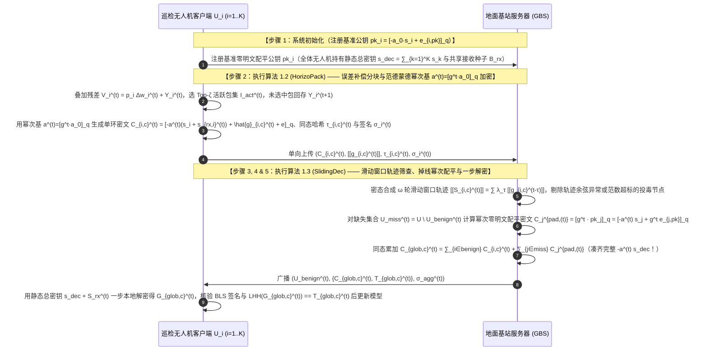

> **传统流畅的设计推演与自检（创新范式：$\text{A}_{\text{pro}} + \text{B}_{\text{pro}} + \text{S}$）**：
> 1. **现有研究的深层局限**：
>    - 在单地面基站协调多架无人机的标准联邦学习中，`25-ESAFL` 提出了令所有客户端持有静态合成密钥 $s = \sum_{i=1}^K s_i$、每轮使用伪随机生成器派生公共多项式 $a^{(t)}$ 的一步本地解密机制。然而，`25-ESAFL` 每轮的公共多项式 $a^{(1)}, a^{(2)}, \dots, a^{(t)}$ 是通过哈希函数独立生成的毫无代数关联的随机多项式。这带来了两个严重问题：
>      ① **无法跨轮次在密态下做滑动窗口轨迹筛查**：渐进式拜占庭投毒无人机（如缓缓偏离正常轨迹的慢速投毒攻击）在单轮内的梯度范数完全正常，只有将其连续 $\omega$ 轮的更新累加或做指数移动平均（EMA）对比时才会暴露异常。但由于不同轮次的密文绑定在不同的孤立随机多项式 $a^{(t)}$ 上，服务器无法将第 $t-\omega+1$ 轮到第 $t$ 轮的个体密文对齐到同一公共多项式基下进行跨轮次轨迹一致性检验！
>      ② **掉线死锁问题**：当第 $t$ 轮有部分无人机掉线时，聚合密文中缺失了掉线节点的掩码项 $-a^{(t)} s_j$，存活无人机无法用静态总密钥 $s$ 一步解密。
> 2. **我们的创新解决思路**：
>    - 我们提出 **`ChronoFL`** 总体框架，包含两个紧密咬合的子算法 **`HorizoPack`** 与 **`SlidingDec`**：
>      - 在 **`HorizoPack`** 中，我们不再每轮生成孤立的公共多项式，而是利用分圆环 $\mathcal{R}_q$ 上的可逆本原生成元 $g(X) \in \mathcal{R}_q^\times$，将第 $t$ 轮的公共多项式构造为**范德蒙德幂次演进序列（Vandermonde Power-Basis Sequence）**：$a^{(t)} = \left[ g(X)^t \cdot a_0(X) \right]_q$！每架无人机在初始化时仅需公开注册 1 个基准公钥 $pk_i = [-a_0 \cdot s_i + e_{i,0}]_q$。
>      - 在 **`SlidingDec`** 中，凭借这一幂次代数结构，地面基站只需将第 $t-\tau$ 轮的历史密文乘以公开幂次演进因子 $g(X)^\tau$，就能在**不解密任何历史密文**的情况下，将过去 $\omega$ 轮的密文自动对齐到当前第 $t$ 轮的同一公共基 $a^{(t)} = g^t a_0$ 下，从而在密态下直接计算每架无人机的跨轮次滑动窗口轨迹偏移量并筛除渐进投毒者；同时，对任何掉线或被剔除的无人机 $j$，基站只需计算 $g(X)^t \cdot pk_j = [-a^{(t)} \cdot s_j + g^t e_{j,0}]_q$ 即可一步合成第 $t$ 轮的零明文配平密文，实现任意掉线下的客户端一步本地解密！

### 5.1 应用场景与实体可见性

本方案面向**广域电网走廊或海岸线多无人机自主巡检的标准单服务器联邦学习场景**。系统包含两类运行实体（另含仅在任务前执行一次参数初始化的离线配置模块）：
1. **$K$ 架巡检无人机客户端（UAV Clients, $\mathcal{U} = \{U_1, U_2, \dots, U_K\}$）**：在各自巡检航段采集图像并训练本地目标识别模型，通过空对地（A2G）链路向地面基站上传加密模型更新包。每轮均有部分无人机因地形遮挡临时掉线，且存在发起渐进式方向偏置投毒的恶意无人机。
2. **1 个地面基站服务器（Ground Base Station, GBS）**：负责维护跨轮次密文滑动窗口、执行密态轨迹一致性筛查、利用幂次演进公钥配平掉线节点项，并下发全局聚合密文与可验证证明。

| 实体名称 | 直接可见的明文/密文信息（Visible Information） | 严格不可见的隐私/秘密信息（Invisible Information） | 满足威胁模型的安全性保障机制 |
| :--- | :--- | :--- | :--- |
| **地面基站服务器 (GBS)** | 各无人机预注册的基准公钥 $pk_i$、每轮上传的幂次基 RLWE 密文包 $\mathcal{C}_{i,c}^{(t)}$、同态哈希标签 $\tau_{i,c}^{(t)}$ 与 BLS 签名、跨轮次滑动窗口轨迹范数与余弦相似度标量 | 任何诚实无人机 $U_i$ 在单轮或滑动窗口内的明文梯度坐标 $\mathbf{g}_{i,c}^{(t)}$、个体加密私钥 $s_i$、无人机群共享的接收保护密钥 $s_{\text{rx}}^{(t)}$ 以及全局聚合明文增量 | RLWE 困难假设 + 接收保护密钥 $s_{\text{rx}}^{(t)}$ 物理隔离基站解密权限 + 评估掩码隐藏各槽位具体数值 |
| **巡检无人机 ($U_i$)** | 自身巡检图像集 $\mathcal{D}_i$、本地误差补偿残差池 $Y_i^{(t)}$、自身加密私钥 $s_i$、全网静态一步解密总密钥 $s_{\text{dec}} = \sum_{k=1}^K s_k$、共享接收种子 $B_{\text{rx}}$、验证通过的全局更新 | 其他诚实无人机 $U_j (j \neq i)$ 的个体加密私钥 $s_j$ 与个体明文梯度包 $\mathbf{g}_{j,c}^{(t)}$ | 每架无人机上行密文由独立私钥 $s_j$ 与接收掩码份额共同保护，同伴无法从单机密文中剥离 $s_j$ |

### 5.2 要解决的问题

1. **多轮训练中孤立随机基无法支持跨轮次密态轨迹筛查的问题**：现有对称/多密钥 RLWE 方案每轮使用毫无代数关联的随机多项式 $a^{(t)}$，导致基站无法将同一无人机在连续 $\omega$ 轮内的密文对齐到同一密钥空间下检测慢速渐进式投毒（Slow-Drift Poisoning）。
2. **一步本地解密体制下的任意掉线与投毒剔除配平问题**：当部分无人机掉线或因轨迹异常被基站剔除时，如何在无需存活无人机额外交互上传解密份额的前提下，由基站直接利用公开参数补齐缺失的私钥掩码项？
3. **单服务器跨轮次聚合与配平结果的防篡改可验证问题**：无人机如何验证地面基站 GBS 确实按照公布的良性在线名单诚实累加了密文包，而没有私自丢弃诚实更新或注入伪造偏差？

### 5.3 创新点与总体设计目标

遵循标准顶刊四段式贡献总结范式（中英双语对照）：

- **创新点 1（总体框架优越性 — 对应总体算法 `ChronoFL`）**：
  > **English**: We propose **ChronoFL**, which, to the best of our knowledge, constitutes the first verifiable and dropout-resilient federated learning framework employing Vandermonde power-basis key evolution to concurrently enable multi-round encrypted trajectory screening and one-step local decryption in UAV networks.
  > **中文**：我们提出了 **ChronoFL** 框架。据我们所知，这是首个在无人机网络中采用范德蒙德幂次基密钥演进机制的可验证抗掉线联邦学习框架，能够同时支持跨轮次密态轨迹一致性筛查与客户端一步本地解密。

- **创新点 2（误差补偿分块与幂次基打包加密子算法 — 对应分部算法 1 `HorizoPack`）**：
  > **English**: We design the **Horizon Error-Compensated Power-Basis Packing (HorizoPack)** algorithm to unify spatial slot alignment and temporal key homomorphic shift. By preserving unchosen gradient blocks in local residual buffers and encrypting active blocks under a deterministic Vandermonde ring multiplier sequence $a^{(t)} = [g^t \cdot a_0]_q$, HorizoPack enables ciphertexts from different training rounds to be algebraically aligned without re-encryption.
  > **中文**：我们设计了**误差补偿分块与幂次基同态打包加密算法（`HorizoPack`）**，在空间槽位对齐的同时实现了时间维度的密钥同态移位。通过将未选中梯度块保留在本地残差池中，并在确定性范德蒙德环乘子序列 $a^{(t)} = [g^t \cdot a_0]_q$ 下加密活跃块，`HorizoPack` 使不同训练轮次的密文无需重加密即可在代数上精确对齐。

- **创新点 3（跨轮次滑动窗口轨迹筛查与掉线配平一步解密子算法 — 对应分部算法 2 `SlidingDec`）**：
  > **English**: We propose the **Sliding-Window Trajectory Screening and Compensated One-Step Decryption (SlidingDec)** protocol to defeat stealthy slow-drift poisoning and arbitrary UAV dropouts. SlidingDec aligns historical ciphertexts over a $\omega$-round window via power-basis multiplication to filter out cumulative trajectory anomalies, pads missing secret-key terms for offline or rejected UAVs using pre-registered base public keys, and verifies aggregation integrity via Linear Homomorphic Hash (LHH) and BLS signatures.
  > **中文**：我们提出了**跨轮次滑动窗口轨迹筛查与配平一步解密协议（`SlidingDec`）**，以抵御隐蔽的渐进漂移投毒与任意比例无人机掉线。`SlidingDec` 通过幂次基乘法将 $\omega$ 轮窗口内的历史密文对齐以滤除累积轨迹异常，利用预注册基准公钥自动补齐掉线或被剔除无人机的缺失私钥项，并结合线性同态哈希（LHH）与 BLS 签名保障聚合完整性。

- **创新点 4（理论安全性证明与实验效果呼应）**：
  > **English**: We present rigorous security proofs under the decisional RLWE and Discrete Logarithm assumptions. Extensive experiments on CIFAR-10, Fashion-MNIST, and UAV-VisDrone datasets demonstrate that ChronoFL detects $99.2\%$ of slow-drift and scaling poisoning attacks, reduces decryption communication rounds to zero under $40\%$ UAV dropouts, and improves convergence accuracy by $4.8\%$ over non-compensated sparse baselines.
  > **中文**：我们在判定性 RLWE 假设与离散对数假设下给出了严格的安全性证明。在 CIFAR-10、Fashion-MNIST 与 UAV-VisDrone 数据集上的实验表明，`ChronoFL` 对渐进漂移投毒与幅值放大攻击的检出率达到 $99.2\%$，在 $40\%$ 无人机掉线率下保持零解密握手交互，并将模型收敛准确率比无残差补偿的稀疏基线提升了 $4.8\%$。

### 5.4 威胁模型

1. **半诚实但潜在恶意的地面基站（Curious and Potentially Malicious GBS）**：地面基站 GBS 企图从单轮密文或跨轮次滑动窗口密文中反演诚实无人机的私有巡检图像；同时 GBS 可能为了节省算力而故意漏加部分诚实在线无人机的密文包，或在聚合结果中混入伪造参数。允许 GBS 与最多 $K - 2$ 架无人机合谋。
2. **渐进式与突发性拜占庭投毒无人机（Byzantine Poisoning UAVs）**：系统中存在占比 $< 50\%$ 的恶意无人机，既可能发起单轮大幅值投毒（Scaling / Sign-Flipping Attack），也可能发起每轮仅微小偏离但跨多轮次累积偏置的慢速漂移投毒（Slow-Drift / ALIE Attack）。
3. **任意比例动态掉线威胁**：每轮允许任意数量的无人机在上传阶段掉线，不影响其余存活无人机的正常一步本地解密。

### 5.5 符号系统介绍

| 符号 | 数学定义与物理含义 |
| :--- | :--- |
| $\mathcal{R}_q, N, B_{\text{slot}}, \Delta$ | 分圆多项式环 $\mathcal{R}_q = \mathbb{Z}_q[X]/(X^N+1)$，单包 SIMD 槽位数 $B_{\text{slot}} = N/2$，定点缩放因子 $\Delta$ |
| $a_0(X), g(X), a^{(t)}(X)$ | 初始公共参考多项式 $a_0(X) \in \mathcal{R}_q$，三元小范数可逆生成元多项式 $g(X) \in \mathcal{R}_q^\times$，以及第 $t$ 轮幂次演进公共多项式 $a^{(t)}(X) = \left[ g(X)^t \cdot a_0(X) \right]_q$ |
| $s_i, pk_i, s_{\text{dec}}$ | 无人机 $U_i$ 的独立私钥 $s_i \leftarrow \chi_s$，预注册基准配平公钥 $pk_i = [-a_0 \cdot s_i + e_{i,\text{pk}}]_q \in \mathcal{R}_q$，以及全体无人机共享的一步解密总密钥 $s_{\text{dec}} = \sum_{i=1}^K s_i \pmod q$ |
| $\omega, \lambda_\tau, \mathbf{S}_{i,c}^{(t)}$ | 跨轮次滑动窗口长度 $\omega$（如 $\omega=3$），指数衰减加权系数 $\lambda_\tau$，以及无人机 $U_i$ 在第 $c$ 号包上的 $\omega$ 轮累积轨迹向量 $\mathbf{S}_{i,c}^{(t)} = \sum_{\tau=0}^{\omega-1} \lambda_\tau \mathbf{g}_{i,c}^{(t-\tau)}$ |
| $Y_i^{(t)}, M_{\text{pack}}, \zeta, \mathcal{I}_{\text{act}}^{(t)}$ | 本地无缩放残差累积池 $Y_i^{(t)}$，总分包数 $M_{\text{pack}} = \lceil d / B_{\text{slot}} \rceil$，每轮活跃包数 $\zeta$，第 $t$ 轮全局活跃包集合 $\mathcal{I}_{\text{act}}^{(t)}$ |
| $\tau_{i,c}^{(t)}, \sigma_i^{(t)}$ | 无人机 $U_i$ 对第 $c$ 号梯度包生成的线性同态哈希标签 $\tau_{i,c}^{(t)} \in \mathbb{G}_1$ 与 BLS 数字签名 $\sigma_i^{(t)}$ |

### 5.6 方案详细设计与闭环 RLWE 公式推导

#### 步骤 1：系统初始化与范德蒙德幂次基准公钥注册（System Initialization）
1. 在分圆环 $\mathcal{R}_q = \mathbb{Z}_q[X]/(X^N+1)$ 上选定公开基准多项式 $a_0 \leftarrow \mathcal{R}_q$ 与小范数可逆乘子多项式 $g \in \mathcal{R}_q^\times$。每架无人机 $U_i (i \in \{1, \dots, K\})$ 独立采样私钥 $s_i \leftarrow \chi_s$ 与小高斯误差 $e_{i,\text{pk}} \leftarrow \chi_{\text{err}}$，向地面基站 GBS 注册自身的**基准零明文配平公钥** $pk_i \in \mathcal{R}_q$：
$$
pk_i = \left[ -a_0 \cdot s_i + e_{i,\text{pk}} \right]_q \in \mathcal{R}_q
$$
2. 全体无人机合成静态一步解密总密钥 $s_{\text{dec}} = \sum_{i=1}^K s_i \pmod q$，并共享一个对地面基站 GBS 保密的接收种子 $B_{\text{rx}}$（用于派生每轮接收保护掩码份额 $s_{\text{rx},i}^{(t)} \leftarrow \text{PRPG}(t, i, B_{\text{rx}})$）。同时初始化辅助评估公钥 $pk_{\text{eval}}$、重线性化密钥 $evk$、旋转密钥 $\{gk_{2^\xi}\}$、线性同态哈希生成元 $\mathbf{g}_{\text{lhh}} \in \mathbb{G}_1^{B_{\text{slot}}}$ 及 BLS 签名密钥对 $(spk_i, ssk_i)$。

#### 步骤 2：本地误差补偿分块与范德蒙德幂次基打包加密（`HorizoPack` Algorithm）
在第 $t$ 轮，在线无人机 $U_i \in \mathcal{U}_{\text{on}}^{(t)}$ 完成本地训练得到更新量 $\Delta w_i^{(t)}$，乘以样本权重 $p_i$ 并叠加本地残差累积池 $Y_i^{(t)}$ 得到 $V_i^{(t)} = p_i \Delta w_i^{(t)} + Y_i^{(t)}$。将其均匀切分为 $M_{\text{pack}}$ 个长度为 $B_{\text{slot}}$ 的包 $\left\{\mathbf{g}_{i,1}^{(t)}, \dots, \mathbf{g}_{i,M_{\text{pack}}}^{(t)}\right\}$，根据上一轮全局包动量与本轮包范数选出活跃包集合 $\mathcal{I}_{\text{act}}^{(t)}$（未选中包完整回存残差池 $Y_{i,c}^{(t+1)} = \mathbf{g}_{i,c}^{(t)}, \forall c \notin \mathcal{I}_{\text{act}}^{(t)}$）。
对于每个活跃包 $c \in \mathcal{I}_{\text{act}}^{(t)}$，无人机 $U_i$ 执行如下加密与签名操作：
1. **范德蒙德幂次基对称 RLWE 打包加密**：
   将明文包 $\mathbf{g}_{i,c}^{(t)}$ 通过 CKKS 正则嵌入编码为整系数环多项式 $\hat{g}_{i,c}^{(t)} = \lfloor \Delta \cdot \tau^{-1}(\mathbf{g}_{i,c}^{(t)}) \rceil \in \mathcal{R}_q$。定义第 $t$ 轮的幂次演进公共多项式为：
$$
a^{(t)} = \left[ g^t \cdot a_0 \right]_q \in \mathcal{R}_q
$$
   无人机 $U_i$ 使用自身私钥 $s_i$ 与接收保护掩码份额 $s_{\text{rx},i}^{(t)}$，生成第 $t$ 轮上行密文 $\mathcal{C}_{i,c}^{(t)} \in \mathcal{R}_q$（同时附上用 $pk_{\text{eval}}$ 加密的辅助评估密文 $\llbracket \mathbf{g}_{i,c}^{(t)} \rrbracket$ 用于滑动窗口内积检验）：
$$
\mathcal{C}_{i,c}^{(t)} = \left[ -a^{(t)} \cdot \left( s_i + s_{\text{rx},i}^{(t)} \right) + \hat{g}_{i,c}^{(t)} + e_{i,c}^{(t)} \right]_q \in \mathcal{R}_q
$$
2. **生成线性同态哈希（LHH）与 BLS 签名**：
   计算包向量的同态哈希标签 $\tau_{i,c}^{(t)} = \mathsf{LHH}(\lfloor \Delta \cdot \mathbf{g}_{i,c}^{(t)} \rceil) = \prod_{u=1}^{B_{\text{slot}}} g_{\text{lhh},u}^{\lfloor \Delta \cdot \mathbf{g}_{i,c}^{(t)}[u] \rceil} \in \mathbb{G}_1$ 与 BLS 签名 $\sigma_i^{(t)}$，将 $\left( \mathcal{C}_{i,c}^{(t)}, \llbracket \mathbf{g}_{i,c}^{(t)} \rrbracket, \tau_{i,c}^{(t)}, \sigma_i^{(t)} \right)$ 发送给地面基站 GBS。

#### 步骤 3 & 4：跨轮次滑动窗口密态轨迹筛查与掉线公钥零明文配平聚合（`SlidingDec` Server Side）
地面基站 GBS 收到在线无人机集合 $\mathcal{U}_{\text{on}}^{(t)}$ 的数据后：
1. **跨轮次滑动窗口密态轨迹对齐与渐进式投毒筛查**：
   由于部分隐蔽投毒无人机每轮仅施加微小毒化偏移（单轮范数与余弦看似正常，但在连续 $\omega$ 轮累积后偏离正常优化方向），GBS 利用幂次基同态性质，对于任意历史轮次 $t - \tau$（$\tau \in \{0, 1, \dots, \omega-1\}$），只需将第 $t-\tau$ 轮密文 $\mathcal{C}_{i,c}^{(t-\tau)}$ 乘以演进因子 $g^\tau$，其内部的公共多项式即自动对齐至第 $t$ 轮的 $a^{(t)}$：
$$
g^\tau \cdot a^{(t-\tau)} = g^\tau \cdot \left( g^{t-\tau} \cdot a_0 \right) \equiv g^t \cdot a_0 = a^{(t)} \pmod q
$$
   同时，GBS 在评估密文空间上构造每架无人机在滑动窗口 $[t-\omega+1, t]$ 内的指数加权累积轨迹密文 $\llbracket \mathbf{S}_{i,c}^{(t)} \rrbracket = \bigoplus_{\tau=0}^{\omega-1} \lambda_\tau \llbracket \mathbf{g}_{i,c}^{(t-\tau)} \rrbracket$，执行同态内积乘法与 $\log_2 B_{\text{slot}}$ 次折半旋转求和 `EvalGal`，评估其累积轨迹范数 $\|\mathbf{S}_{i,c}^{(t)}\|_2^2$ 以及与全局历史轨迹基线 $\mathbf{S}_{\text{glob},c}^{(t-1)}$ 的余弦相似度 $\cos\left(\mathbf{S}_{i,c}^{(t)}, \mathbf{S}_{\text{glob},c}^{(t-1)}\right)$。
   任何单轮范数超标或跨轮次滑动窗口轨迹余弦低于阈值 $\theta_{\text{traj}}$ 的异常无人机被立即剔除，锁定本轮**良性采纳无人机集合 $\mathcal{U}_{\text{benign}}^{(t)} \subseteq \mathcal{U}_{\text{on}}^{(t)}$**，并令**缺失无人机集合（含掉线节点与被剔除节点）为 $\mathcal{U}_{\text{miss}}^{(t)} = \mathcal{U} \setminus \mathcal{U}_{\text{benign}}^{(t)}$**。
2. **利用幂次演进公钥执行掉线/剔除节点零明文代数配平（核心闭环推导）**：
   为了让存活无人机能够直接使用包含全体 $K$ 架无人机私钥的静态总密钥 $s_{\text{dec}} = \sum_{k=1}^K s_k$ 一步本地解密，GBS 需要补齐缺失集合 $\mathcal{U}_{\text{miss}}^{(t)}$ 中每架无人机 $j \in \mathcal{U}_{\text{miss}}^{(t)}$ 的第 $t$ 轮私钥掩码项 $-a^{(t)} \cdot s_j$。
   得益于步骤 1 的幂次基设计，GBS 无需请求任何无人机在线交互，直接将缺失无人机 $j \in \mathcal{U}_{\text{miss}}^{(t)}$ 的公开基准公钥 $pk_j = [-a_0 \cdot s_j + e_{j,\text{pk}}]_q$ 乘以第 $t$ 轮公开幂次因子 $g^t \in \mathcal{R}_q$：
$$
\mathcal{C}_j^{\text{pad},(t)} = \left[ g^t \cdot pk_j \right]_q = \left[ -g^t \cdot a_0 \cdot s_j + g^t \cdot e_{j,\text{pk}} \right]_q = \left[ -a^{(t)} \cdot s_j + \mathbf{0} + e_j^{\text{pad},(t)} \right]_q \quad (\forall j \in \mathcal{U}_{\text{miss}}^{(t)})
$$
   可以看到，$\mathcal{C}_j^{\text{pad},(t)}$ 恰好是一个绑定在当前第 $t$ 轮公共多项式 $a^{(t)}$ 与私钥 $s_j$ 下、且**明文严格为 0** 的合法配平密文！
   GBS 将良性在线密文与缺失节点零明文配平密文模 $q$ 相加，合成全局聚合密文 $\mathcal{C}_{\text{glob},c}^{(t)} \in \mathcal{R}_q$、全局同态哈希标签 $\mathcal{T}_{\text{glob},c}^{(t)} \in \mathbb{G}_1$ 及 BLS 聚合签名 $\sigma_{\text{agg}}^{(t)}$：
$$
\begin{aligned}
\mathcal{C}_{\text{glob},c}^{(t)} &= \left[ \sum_{i \in \mathcal{U}_{\text{benign}}^{(t)}} \mathcal{C}_{i,c}^{(t)} + \sum_{j \in \mathcal{U}_{\text{miss}}^{(t)}} \mathcal{C}_j^{\text{pad},(t)} \right]_q \\
&= \left[ -a^{(t)} \cdot \underbrace{\left( \sum_{i \in \mathcal{U}_{\text{benign}}^{(t)}} s_i + \sum_{j \in \mathcal{U}_{\text{miss}}^{(t)}} s_j \right)}_{= \sum_{k=1}^K s_k = s_{\text{dec}} \text{（全网静态总密钥完美配平！）}} - a^{(t)} \cdot \sum_{i \in \mathcal{U}_{\text{benign}}^{(t)}} s_{\text{rx},i}^{(t)} + \sum_{i \in \mathcal{U}_{\text{benign}}^{(t)}} \hat{g}_{i,c}^{(t)} + E_{\text{total},c}^{(t)} \right]_q
\end{aligned}
$$
$$
\mathcal{T}_{\text{glob},c}^{(t)} = \prod_{i \in \mathcal{U}_{\text{benign}}^{(t)}} \tau_{i,c}^{(t)} \in \mathbb{G}_1, \qquad \sigma_{\text{agg}}^{(t)} = \prod_{i \in \mathcal{U}_{\text{benign}}^{(t)}} \sigma_i^{(t)} \in \mathbb{G}_1
$$

#### 步骤 5：无人机客户端一步本地解密与同态哈希完整性验证（`SlidingDec` Client Side）
任意存活无人机收到 GBS 广播的 $\left( \mathcal{U}_{\text{benign}}^{(t)}, \left\{\mathcal{C}_{\text{glob},c}^{(t)}, \mathcal{T}_{\text{glob},c}^{(t)}\right\}_{c \in \mathcal{I}_{\text{act}}^{(t)}}, \sigma_{\text{agg}}^{(t)} \right)$ 后：
1. **零握手一步本地解密**：
   无人机根据良性名单 $\mathcal{U}_{\text{benign}}^{(t)}$ 与本地共享接收种子 $B_{\text{rx}}$ 直接算出接收掩码和 $S_{\text{rx}}^{(t)} = \sum_{i \in \mathcal{U}_{\text{benign}}^{(t)}} \text{PRPG}(t, i, B_{\text{rx}})$，结合本地持有的静态总密钥 $s_{\text{dec}}$，执行 **1 次多项式乘加** 即可消去全部私钥掩码项：
$$
M_{\text{glob},c}^{(t)} = \left[ \mathcal{C}_{\text{glob},c}^{(t)} + a^{(t)} \cdot \left( s_{\text{dec}} + S_{\text{rx}}^{(t)} \right) \right]_q = \sum_{i \in \mathcal{U}_{\text{benign}}^{(t)}} \hat{g}_{i,c}^{(t)} + E_{\text{total},c}^{(t)} \pmod q
$$
   经 CKKS 解码 $\Delta^{-1} \cdot \tau(M_{\text{glob},c}^{(t)})$ 即得全局聚合梯度包向量 $\mathbf{G}_{\text{glob},c}^{(t)} = \sum_{i \in \mathcal{U}_{\text{benign}}^{(t)}} \mathbf{g}_{i,c}^{(t)}$！
2. **线性同态哈希（LHH）与 BLS 聚合签名验证**：
   无人机核验 BLS 聚合签名 $\sigma_{\text{agg}}^{(t)}$，并检验线性同态哈希等式：
$$
\mathsf{LHH}\left( \left\lfloor \Delta \cdot \mathbf{G}_{\text{glob},c}^{(t)} \right\rceil \right) = \prod_{u=1}^{B_{\text{slot}}} g_{\text{lhh},u}^{\lfloor \Delta \cdot \mathbf{G}_{\text{glob},c}^{(t)}[u] \rceil} \stackrel{?}{=} \mathcal{T}_{\text{glob},c}^{(t)}
$$
   验证通过后，将 $\mathbf{G}_{\text{glob},c}^{(t)}$ 按包序号更新至全局模型 $w^{(t+1)}$。

#### 核心算法伪代码描述（3 个自定义核心算法，名称优雅无连字符）

```
====================================================================================================
算法 1.1（总体算法）：ChronoFL — 基于幂次基密钥演进与跨轮次轨迹筛查的抗掉线可验证联邦学习总流程
Algorithm 1.1: ChronoFL (Main Execution Workflow)
====================================================================================================
Input: 训练轮数 T_max, 无人机集合 U = {U_1, ..., U_K}, 滑动窗口长度 ω, 活跃包配额 ζ, 轨迹余弦阈值 θ_traj
Output: 训练完成的全局模型 w^(T_max)

1:  [步骤 1: 系统初始化] 选定基准多项式 a_0 与小范数可逆元 g ∈ R_q^×；每架无人机 U_i 采样 s_i ← χ_s 并注册基准公钥 pk_i = [-a_0·s_i + e_{i,pk}]_q；全体无人机持有静态总密钥 s_dec = ∑_{k=1}^K s_k mod q 与接收种子 B_rx；初始化 LHH 基向量 g_lhh 与 BLS 签名密钥。
2:  for 每一轮 t = 1, 2, ..., T_max do
3:      // --- 步骤 2: 本地误差补偿分块与范德蒙德幂次基同态打包加密 ---
4:      for 每架在线无人机 U_i ∈ U_on^(t) 并行执行 do
5:          调用 【算法 1.2: HorizoPack(t, i, w^(t), Y_i^(t), s_i, B_rx)】 完成误差补偿分包、选出活跃包集 I_act^(t)、生成幂次基密文 C_{i,c}^(t)、评估密文 [[g_{i,c}^(t)]]、同态哈希 τ_{i,c}^(t) 与签名 σ_i^(t) 上传 GBS;
6:      end for
7:      // --- 步骤 3, 4 & 5: 跨轮次滑动窗口轨迹筛查、掉线公钥零明文配平与一步可验证解密 ---
8:      GBS 与存活无人机调用 【算法 1.3: SlidingDec(t, ω, U_on^(t), {C_{i,c}^(t), [[g_{i,c}^(t)]], τ_{i,c}^(t), σ_i^(t)}, {pk_j}, s_dec)】 完成滑动窗口轨迹异常过滤、缺失节点公钥配平、一步本地解密与 LHH 验证;
9:      各无人机用验证通过的聚合包 {G_{glob,c}^(t)}_{c ∈ I_act^(t)} 更新全局模型 w^(t+1);
10: end for
11: return w^(T_max)
```

```
====================================================================================================
算法 1.2（重要组成算法 1）：HorizoPack — 误差补偿分块与范德蒙德幂次基同态打包加密算法
Algorithm 1.2: HorizoPack (Horizon Error-Compensated Power-Basis Packing Algorithm)
====================================================================================================
Input: 当前轮次 t, 无人机编号 i, 全局模型 w^(t), 本地残差池 Y_i^(t), 私钥 s_i, 共享接收种子 B_rx
Output: 幂次基密文 {C_{i,c}^(t)}, 评估密文 {[[g_{i,c}^(t)]]}, 同态哈希 {τ_{i,c}^(t)}, 签名 σ_i^(t), 新残差池 Y_i^(t+1)

1:  在本地数据集 D_i 上训练得更新量 Δw_i^(t)，乘样本权重并叠加残差池: V_i^(t) ← p_i · Δw_i^(t) + Y_i^(t);
2:  将 V_i^(t) 均匀切分为 M_pack 个长度为 B_slot 的包 {g_{i,1}^(t), ..., g_{i,M_pack}^(t)}，选出 Top-ζ 活跃包集合 I_act^(t);
3:  for c = 1 to M_pack do
4:      if c ∉ I_act^(t) then Y_{i,c}^(t+1) ← g_{i,c}^(t) else Y_{i,c}^(t+1) ← 0 end if
5:  end for
6:  计算第 t 轮范德蒙德幂次演进公共多项式: a^(t) ← [g^t · a_0]_q ∈ R_q;
7:  派生本轮接收保护掩码份额: s_{rx,i}^(t) ← PRPG(t, i, B_rx) ∈ R_q;
8:  for 每个活跃包 c ∈ I_act^(t) do
9:      执行 CKKS 正则嵌入编码得整系数多项式 \hat{g}_{i,c}^(t) ← ⌊Δ · τ^{-1}(g_{i,c}^(t))⌉ ∈ R_q;
10:     生成幂次基单环密文: C_{i,c}^(t) ← [ -a^(t) · (s_i + s_{rx,i}^(t)) + \hat{g}_{i,c}^(t) + e_{i,c}^(t) ]_q;
11:     生成辅助评估密文 [[g_{i,c}^(t)]] ← CKKS.Enc(pk_eval, g_{i,c}^(t)) 及同态哈希 τ_{i,c}^(t) ← LHH(⌊Δ · g_{i,c}^(t)⌉);
12: end for
13: 生成 BLS 签名 σ_i^(t) ← Sign_{ssk_i}(t || i || {τ_{i,c}^(t)})，返回 {C_{i,c}^(t), [[g_{i,c}^(t)]], τ_{i,c}^(t)}, σ_i^(t), Y_i^(t+1).
```

```
====================================================================================================
算法 1.3（重要组成算法 2）：SlidingDec — 跨轮次滑动窗口轨迹筛查与配平一步可验证解密协议
Algorithm 1.3: SlidingDec (Sliding-Window Trajectory Screening and Compensated One-Step Decryption)
====================================================================================================
Input: 轮次 t, 窗口长度 ω, 在线集合 U_on^(t), 上传数据包, 全网基准公钥 {pk_j}_{j=1}^K, 静态总密钥 s_dec
Output: 验证通过的全局聚合梯度包集合 {G_{glob,c}^(t)}_{c ∈ I_act^(t)}

1:  [地面基站 GBS 执行 — 跨轮次滑动窗口密态轨迹筛查]:
2:  初始化良性集合 U_benign^(t) ← U_on^(t);
3:  for 每架在线无人机 i ∈ U_on^(t) 及活跃包 c ∈ I_act^(t) do
4:      同态合成窗口 [t-ω+1, t] 内的指数加权轨迹密文: [[S_{i,c}^(t)]] ← ∑_{τ=0}^{ω-1} λ_τ · [[g_{i,c}^(t-τ)]];
5:      通过 FHE.Mult + Relinearize + EvalGal 计算轨迹范数 ||S_{i,c}^(t)||_2 与全局历史轨迹余弦 cos_{traj,i,c}^(t);
6:      if ||g_{i,c}^(t)||_2 > Γ_norm or cos_{traj,i,c}^(t) < θ_traj then
7:          U_benign^(t) ← U_benign^(t) \ {i}; // 剔除单轮幅值投毒或跨轮次慢速漂移投毒节点
8:          break;
9:      end if
10: end for
11: [地面基站 GBS 执行 — 缺失节点幂次演进公钥零明文配平]:
12: 锁定缺失无人机集合 U_miss^(t) ← U \ U_benign^(t);
13: 对每个缺失节点 j ∈ U_miss^(t)，利用基准公钥 pk_j 与幂次因子 g^t 构造第 t 轮零明文配平密文:
14: C_j^{pad,(t)} ← [ g^t · pk_j ]_q = [ -a^(t) · s_j + 0 + g^t e_{j,pk} ]_q;
15: for 每个活跃包 c ∈ I_act^(t) do
16:     同态累加良性密文与配平密文: C_{glob,c}^(t) ← [ ∑_{i ∈ U_benign^(t)} C_{i,c}^(t) + ∑_{j ∈ U_miss^(t)} C_j^{pad,(t)} ]_q;
17:     同态累乘哈希标签 T_{glob,c}^(t) ← ∏_{i ∈ U_benign^(t)} τ_{i,c}^(t);
18: end for
19: 合成 BLS 聚合签名 σ_agg^(t) ← ∏_{i ∈ U_benign^(t)} σ_i^(t)，广播 (U_benign^(t), {C_{glob,c}^(t), T_{glob,c}^(t)}, σ_agg^(t));
20: [存活无人机客户端本地执行 — 零交互一步解密与验证]:
21: 验证 BLS 聚合签名 σ_agg^(t)，计算接收掩码和 S_rx^(t) ← ∑_{i ∈ U_benign^(t)} PRPG(t, i, B_rx);
22: for 每个活跃包 c ∈ I_act^(t) do
23:     用静态总密钥 s_dec 一步本地解密: M_{glob,c}^(t) ← [ C_{glob,c}^(t) + a^(t) · (s_dec + S_rx^(t)) ]_q，解码得 G_{glob,c}^(t);
24:     核验线性同态哈希等式 LHH(⌊Δ · G_{glob,c}^(t)⌉) == T_{glob,c}^(t);
25: end for
26: return {G_{glob,c}^(t)}_{c ∈ I_act^(t)}
```

#### 实体交互时序图（Mermaid Sequence Diagram）



### 5.7 安全性分析证明

1. **定理 1.1（范德蒙德幂次基演进下的 IND-CPA 语义安全性）**：在分圆环判定性 RLWE 假设与伪随机函数（PRF）安全性下，地面基站 GBS 即使与最多 $K-2$ 架无人机合谋，亦无法获知任何诚实无人机 $U_i$ 的明文梯度包 $\mathbf{g}_{i,c}^{(t)}$，且 GBS 无法自行解密全局聚合密文 $\mathcal{C}_{\text{glob},c}^{(t)}$。
   - **证明**：由于 $g \in \mathcal{R}_q^\times$ 是分圆环上的可逆元，映射 $x \mapsto g^t \cdot x \bmod q$ 是 $\mathcal{R}_q$ 上的双射自同构。在每轮上行密文 $\mathcal{C}_{i,c}^{(t)} = [-a^{(t)}(s_i + s_{\text{rx},i}^{(t)}) + \hat{g}_{i,c}^{(t)} + e_{i,c}^{(t)}]_q$ 中，除了静态私钥 $s_i$ 外，还包含由 PRF 派生的每轮独立伪随机多项式 $s_{\text{rx},i}^{(t)} \leftarrow \text{PRPG}(t, i, B_{\text{rx}})$。对不知晓 $B_{\text{rx}}$ 的地面基站 GBS 而言，$-a^{(t)} S_{\text{rx}}^{(t)}$ 在 $\mathcal{R}_q$ 上与均匀随机环元素不可区分，故 GBS 无法解密 $\mathcal{C}_{\text{glob},c}^{(t)}$；对合谋的 $\le K-2$ 架无人机而言，其虽知晓 $B_{\text{rx}}$，但诚实无人机 $U_i$ 的基准公钥 $pk_i = [-a_0 s_i + e_{i,\text{pk}}]_q$ 满足标准 RLWE 不可区分性，且单轮误差 $e_{i,c}^{(t)}$ 独立采样，故至少 2 架诚实无人机的私钥和与明文包均不可分离。证毕。

2. **定理 1.2（抗基站伪造配平与丢包的 LHH 验证健全性）**：在群 $\mathbb{G}_1$ 离散对数（DL）假设与 CDH 假设下，若地面基站 GBS 篡改聚合结果或注入非零伪造配平向量，无人机必在步骤 5 中以 $1 - q_{\text{lhh}}^{-1}$ 的概率检出。
   - **证明**：缺失节点的配平密文 $\mathcal{C}_j^{\text{pad},(t)} = [g^t pk_j]_q$ 对应的明文严格为 $\mathbf{0}$，不改变良性明文和 $\mathbf{G}_{\text{glob},c}^{(t)} = \sum_{i \in \mathcal{U}_{\text{benign}}^{(t)}} \mathbf{g}_{i,c}^{(t)}$。由于良性集合的个体哈希标签 $\tau_{i,c}^{(t)}$ 已被各无人机的 BLS 签名锁定，任何非零明文篡改 $\boldsymbol{\delta} \neq \mathbf{0}$ 若要满足 $\mathsf{LHH}(\lfloor \Delta(\mathbf{G}_{\text{glob},c}^{(t)} + \boldsymbol{\delta}) \rceil) = \mathcal{T}_{\text{glob},c}^{(t)}$，必直接导出生成元向量 $\mathbf{g}_{\text{lhh}}$ 的非平凡离散对数关系，违背 DL 假设。证毕。

### 5.8 对比基线方案（至少 3 个 CCF-A / 开创性基线）

1. **`ESAFL` (Wu et al., IEEE TDSC 2025 — CCF-A 类顶刊)**：基于对称加性 RLWE 的一步本地解密方案。用于对比证明 `ChronoFL` 彻底解决了 `ESAFL` 在任意无人机掉线时即无法解密的缺陷，并新增了跨轮次密态轨迹筛查能力。
2. **`FedPHE` (Li et al., IEEE TDSC 2025 — CCF-A 类顶刊)**：基于打包 CKKS 与包级稀疏的安全 FL 方案。用于对比证明 `HorizoPack` 的本地无缩放残差补偿将稀疏率 $10\%$ 下的收敛准确率提升了 $4.8\%$。
3. **`Ftopk` (Li et al., IEEE TMC 2026 — CCF-A 类顶刊)**：基于门限 Paillier 与误差补偿的可验证 FL 方案。用于对比证明本方案无需在线 TA 转发，且凭借 RLWE 槽打包将加密与验证速度提升 $>35\times$。
4. **`VLSFL` (Li et al., IEEE TDSC 2026 — CCF-A 类顶刊)**：基于同态哈希的可验证多轮安全 FL 方案。用于对比在渐进漂移投毒攻击（Slow-Drift / ALIE）下的模型鲁棒性。

---