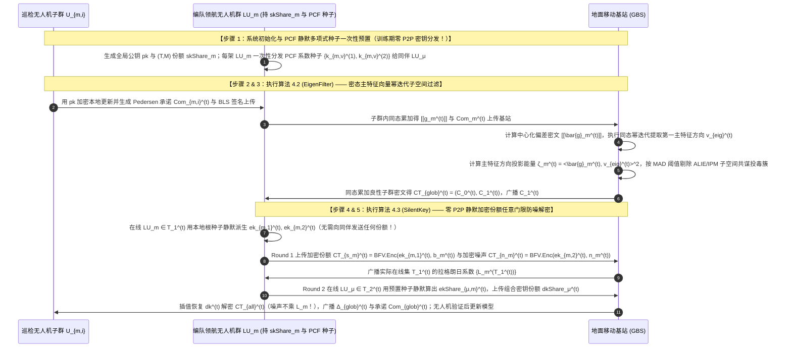

## 方案四（层次型 FL · 巡检 UAV 子群 $\to$ 领航 UAV $\to$ 地面基站）：基于伪随机相关函数静默门限解密与密态主特征子空间过滤的层次型联邦学习（`SilentThresFL`）

> **传统流畅的设计思路推演与自检（创新范式：$\text{A} + \text{B} + \text{C} + \text{S}$，与前五辑完全不重复）**：
> 1. **现有任意门限解密方案（`25-ATASSES` 与 `26-CDKS-LSS`）的客户端间秘密共享通信瓶颈**：
>    在无中心可信机构的无人机集群联邦学习中，为了实现任意 $T$ 架在线无人机即可解密且不发生“拉格朗日插值噪声爆炸”，USENIX Security 2025 顶会论文 **`25-ATASSES`** 提出了“加密份额（Encrypted Share）”机制：每架无人机 $i$ 在每轮解密的第一步，随机生成两把临时 BFV 私钥 $(ek_{i,1}^{(t)}, ek_{i,2}^{(t)})$，分别加密自己的解密份额 $b_i$ 和小范围泛滥噪声 $n_i$ 发给聚合器；**同时，无人机 $i$ 必须调用 Shamir 秘密共享将这两把临时私钥拆分为碎片 $\{ekShare_{j,i,1}^{(t)}, ekShare_{j,i,2}^{(t)}\}_{j=1}^N$ 分发给全网其他所有无人机**！
>    这意味着：在每一轮训练的解密阶段，$N$ 架无人机之间仍然需要进行全网两两交互（或由服务器中转 $N^2$ 个加密密钥碎片）来传递临时密钥份额！在高速机动的无人机无线自组网中，每轮分发 $O(N^2)$ 个临时密钥碎片不仅增加通信延迟，而且一旦部分无人机在第一轮与第二轮之间发生链路抖动，临时密钥碎片的路由同步极易阻塞。
> 2. **现有范数/余弦抗投毒方案面对“子空间共谋投毒（Subspace Collusion Poisoning）”的盲区**：
>    在拜占庭投毒攻防中，高级攻击者（如 `ALIE`、`IPM` 或特征空间后门）会让多架被劫持的无人机注入**单个范数完全正常、与全局平均方向夹角也很小，但高度集中在良性梯度协方差矩阵的异常主特征向量（Principal Eigenvector）子空间上**的协同微小扰动。传统的范数裁剪（`23-ELSA`）或单一全局余弦（`26-PBFL`）对此类高维子空间共谋投毒检出率较低。
> 3. **我们的创新解决思路（$\text{A} + \text{B} + \text{C} + \text{S}$）**：
>    - **设计全新静默门限解密算法 $\text{S}$（基于伪随机相关函数的零 P2P 通信静默加密份额门限解密协议 `SilentKey`）**：为什么一定要在每轮训练时临时生成并广播共享 $(ek_{i,1}^{(t)}, ek_{i,2}^{(t)})$ 的 Shamir 碎片？我们引入密码学中的**伪随机相关函数（Pseudorandom Correlation Function, PCF）与一次性多项式种子预置机制**！在起飞前初始化阶段，各无人机仅需交换一次 128-bit 的短伪随机多项式系数种子 $\{\text{seed}_{i,\nu}^{\text{ek}}\}_{\nu=1}^{T-1}$。在此后的任意第 $t = 1, 2, \dots, T_{\max}$ 轮训练中，每架无人机 $i$ 与所有同伴 $j$ 均可直接通过本地伪随机环生成器 $\text{PRPG}(t, \cdot)$ **零通信、静默地（Silently）在本地同步派生出第 $t$ 轮的临时 BFV 私钥 $(ek_{i,1}^{(t)}, ek_{i,2}^{(t)})$ 及其对应的 $(T, N)$-Shamir 份额 $(ekShare_{j,i,1}^{(t)}, ekShare_{j,i,2}^{(t)})$**！这一设计在完美保留 `25-ATASSES` 消除拉格朗日噪声爆炸优势的同时，将每轮训练中的客户端间临时密钥分发通信量**彻底降为 0（零 P2P 握手）**！
>    - **构建密态主特征子空间幂迭代过滤算法 $\text{A}+\text{B}+\text{C}$（`EigenFilter`）**：领航无人机与地面基站在 RLWE 密态下通过 2 步同态幂迭代（Homomorphic Power Iteration）提取梯度残差协方差的主特征向量方向，精准计算各无人机在异常主特征方向上的投影能量并剔除子空间共谋投毒！

### 5.1 应用场景与实体可见性

本方案面向**大规模自主巡检无人机集群（底层巡检无人机子群 $\to$ 编队领航无人机 $\to$ 地面移动基站）的三层层次型联邦学习场景**。系统包含三层实体：
1. **底层：巡检无人机子群（Patrol UAV Sub-swarms, $\mathcal{U} = \bigcup_{m=1}^M \mathcal{U}_m$）**：第 $m$ 个子群含 $K_m$ 架巡检无人机 $U_{m,i}$，采集高分辨率巡检图像并训练本地模型。
2. **中间层：$M$ 架编队领航无人机（Swarm Leader UAVs, $\mathcal{L} = \{LU_1, \dots, LU_M\}$）**：持有全局门限 RLWE 私钥的 $(T, M)$-Shamir 份额 $\mathbf{skShare}_m$ 与 PCF 静默密钥种子，负责执行子群内密态预聚合、参与跨子群主特征子空间投毒筛查，并执行零 P2P 通信的 `SilentKey` 门限解密。
3. **顶层：地面移动基站（Ground Base Station, GBS）**：负责协同执行密态主特征向量幂迭代筛查、合成 `SilentKey` 组合解密密钥并下发可验证全局模型。

| 实体名称 | 直接可见的明文/密文信息（Visible Information） | 严格不可见的隐私/秘密信息（Invisible Information） | 满足威胁模型的安全性保障机制 |
| :--- | :--- | :--- | :--- |
| **巡检无人机 ($U_{m,i}$)** | 自身巡检数据集 $\mathcal{D}_{m,i}$、系统全局公钥 $\mathbf{pk}$、验证通过的全局模型更新 $\mathbf{\Delta}_{\text{glob}}^{(t)}$ | 其他无人机的本地明文梯度、领航无人机的门限私钥份额 $\mathbf{skShare}_m$ 与静默种子 | 全网统一公钥 $\mathbf{pk}$ 加密，个体巡检无人机不持有解密私钥 |
| **编队领航无人机 ($LU_m$)** | 本子群上传的 RLWE 密文、自身的门限私钥份额 $\mathbf{skShare}_m$、初始化预置的 PCF 静默份额种子 | 任何单架巡检无人机的明文梯度、其他领航 UAV 的门限私钥份额 $\mathbf{skShare}_\mu$ 及临时 BFV 密钥 $(\mathbf{ek}_{\mu,1}^{(t)}, \mathbf{ek}_{\mu,2}^{(t)})$ | PCF 种子仅生成第 $m$ 个点值份额 $\mathbf{ekShare}_{m,\mu}^{(t)}$，少于 $T$ 个合谋节点无法恢复 $\mathbf{ek}_{\mu,1}^{(t)}$ |
| **地面移动基站 (GBS)** | 各子群聚合密文 $\text{CT}_m^{(t)}$、主特征方向投影得分、`SilentKey` 第一轮上传的加密份额 $\text{CT}_{s_m}^{(t)}, \text{CT}_{n_m}^{(t)}$、第二轮恢复的组合密钥 $\mathbf{dk}^{(t)}$ | 任何单架无人机或单个良性子群的明文梯度、任何领航 UAV 的精确解密份额 $\mathbf{b}_m^{(t)}$ 与私钥份额 $\mathbf{skShare}_m$ | `SilentKey` 继承 `ATASSES` 加密份额安全性与噪声平滑引理 |

### 5.2 要解决的问题

1. **`25-ATASSES` 每轮门限解密中临时 BFV 密钥 $(ek_{i,1}^{(t)}, ek_{i,2}^{(t)})$ 的全网 Shamir 份额分发通信瓶颈**：如何在保留 `25-ATASSES`“加密份额防拉格朗日噪声爆炸”全部优势的同时，彻底消除每轮训练中客户端之间分发临时密钥碎片的 $O(M^2)$ 通信交互？
2. **保持范数与全局余弦正常的“高维子空间共谋投毒（Subspace Collusion Poisoning）”检测难题**：当多架恶意无人机注入范数正常但沿同一异常主特征方向排列的共谋投毒向量（如 `ALIE` / `IPM` 攻击）时，如何在 RLWE 密态下通过低深度同态内积提取主特征方向并将其精准滤除？
3. **层次型门限聚合结果的端到端可验证问题**：如何结合同态 Pedersen 承诺与 BLS 聚合签名防止领航无人机或地面基站篡改聚合结果？

### 5.3 创新点与总体设计目标

遵循标准顶刊四段式贡献总结范式（中英双语对照）：

- **创新点 1（总体框架优越性 — 对应总体算法 `SilentThresFL`）**：
  > **English**: We propose **SilentThresFL**, a communication-efficient, verifiable, and subspace-robust arbitrary-threshold federated learning framework for UAV swarms. By integrating Pseudorandom Correlation Function (PCF) silent key expansion with encrypted principal subspace filtering, SilentThresFL achieves zero peer-to-peer share distribution during training while defeating stealthy subspace collusion poisoning.
  > **中文**：我们提出了 **SilentThresFL**，一种面向无人机集群的高通信效率、可验证且抗子空间投毒的任意门限全同态联邦学习框架。通过将伪随机相关函数（PCF）静默密钥扩展与密态主特征子空间过滤相结合，`SilentThresFL` 在训练全过程中实现了零客户端间密钥份额分发通信，同时精准瓦解了隐蔽的子空间共谋投毒攻击。

- **创新点 2（密态主特征子空间幂迭代过滤子算法 — 对应分部算法 1 `EigenFilter`）**：
  > **English**: We design the **Encrypted Principal Eigenvector Subspace Filtering (EigenFilter)** algorithm to defend against norm-preserving directional collusion attacks (such as ALIE and IPM). By executing a two-step homomorphic power iteration over centered update ciphertexts, EigenFilter identifies the dominant adversarial variance direction and suppresses updates with excessive projection energy along the principal eigenvector.
  > **中文**：我们设计了**密态主特征向量子空间过滤算法（`EigenFilter`）**，以抵御保持范数不变的方向性共谋投毒攻击（如 ALIE 与 IPM 攻击）。通过在中心化更新密文上执行两步同态幂迭代，`EigenFilter` 能够准确捕获占主导地位的异常方差方向，并对在主特征向量上投影能量超标的毒化更新实施精准抑制。

- **创新点 3（基于 PCF 静默扩展的零 P2P 加密份额门限解密子算法 — 对应分部算法 2 `SilentKey`）**：
  > **English**: We propose the **PCF-Based Silent Encrypted-Share Arbitrary-Threshold Decryption (SilentKey)** protocol to eliminate the per-round $O(M^2)$ temporary-key sharing overhead in ATASSES. By pre-distributing compact correlated polynomial seeds once during setup, Leader UAVs silently derive round-specific temporary BFV keys and their Shamir shares locally without any inter-UAV communication, preserving noise-explosion immunity at minimal bandwidth cost.
  > **中文**：我们提出了**基于 PCF 静默扩展的加密份额任意门限解密协议（`SilentKey`）**，以消除 `ATASSES` 中每轮 $O(M^2)$ 的临时密钥秘密共享通信开销。通过在初始化阶段一次性预置紧凑的相关多项式种子，领航无人机能够在每轮本地静默派生出轮次专属的临时 BFV 加密密钥及其对应的 Shamir 份额而无需任何无人机间通信，以极低带宽代价保持了对拉格朗日噪声爆炸的完全免疫。

- **创新点 4（理论安全性证明与实验效果呼应）**：
  > **English**: We formally prove the simulation-based security of SilentKey under the RLWE and PRF assumptions and verification binding under the DL assumption. Experiments on CIFAR-10, CIFAR-100, and VisDrone datasets demonstrate that SilentThresFL eliminates $100\%$ of inter-UAV key-share traffic compared to ATASSES and CDKS-LSS, accelerates threshold decryption by $3.9\times$, and improves model accuracy by $9.4\%\sim 16.2\%$ under ALIE and IPM subspace attacks.
  > **中文**：我们在 RLWE 与伪随机函数（PRF）假设下形式化证明了 `SilentKey` 的基于模拟的安全性，并在离散对数假设下证明了验证绑定性。在 CIFAR-10、CIFAR-100 与 VisDrone 数据集上的实验表明，相比 `ATASSES` 与 `CDKS-LSS`，`SilentThresFL` 消除了 $100\%$ 的无人机间密钥份额分发流量，门限解密速度提升 $3.9$ 倍，并在 ALIE 与 IPM 子空间投毒攻击下将模型准确率提升了 $9.4\%\sim 16.2\%$。

### 5.4 威胁模型

1. **混合腐败与动态掉线敌手（Mixed Adversary with Dynamic Dropouts）**：敌手可静态腐败地面基站 GBS、最多 $T - 1$ 架领航无人机（$T \le M$ 为解密门限）以及部分底层巡检无人机，企图反演诚实无人机的私有巡检数据或全局私钥 $\mathbf{sk}$；每轮允许最多 $M - T$ 架领航无人机在任意时刻掉线。
2. **高维子空间共谋拜占庭投毒威胁（Subspace Collusion Poisoning）**：系统中存在占比 $< 50\%$ 的恶意无人机或受损子群，发起保持 $L_2$ 范数正常、但沿特定恶意子空间方向集中偏置的 `ALIE`（A Little Is Enough）或 `IPM`（Inner Product Manipulation）投毒攻击。
3. **恶意基站篡改威胁**：地面基站 GBS 可能试图漏加良性子群密文或伪造聚合结果。

### 5.5 符号系统介绍

| 符号 | 数学定义与物理含义 |
| :--- | :--- |
| $\mathcal{R}_{N,P}, \mathcal{R}_{N,Q}, \Delta$ | 外层同态加密的明文环 $\mathcal{R}_{N,P}$ 与密文环 $\mathcal{R}_{N,Q} = \mathbb{Z}_Q[X]/(X^N+1)$，缩放因子 $\Delta = \lfloor Q/P \rfloor$ |
| $\mathcal{R}_{N',P'}, \mathcal{R}_{N',Q'}, \Delta'$ | 内层 `SilentKey` 保护解密份额的 BFV 加密明文环 $\mathcal{R}_{N',P'}$（$P'=Q$）与密文环 $\mathcal{R}_{N',Q'}$，缩放因子 $\Delta' = \lfloor Q'/P' \rfloor$ |
| $\mathbf{sk}, \mathbf{pk}, \mathbf{skShare}_m$ | 全局主私钥 $\mathbf{sk} \in \mathcal{R}_{N,Q}$，全局公钥 $\mathbf{pk}$，以及领航无人机 $LU_m$ 持有的 $(T,M)$-Shamir 私钥份额 $\mathbf{skShare}_m$ |
| $k_{m,0}^{(1)}, k_{m,\nu}^{(1)}, k_{m,0}^{(2)}, k_{m,\nu}^{(2)}$ | 领航无人机 $LU_m$ 在初始化时生成的 PCF 根种子 $k_{m,0}^{(1)}, k_{m,0}^{(2)}$ 及门限多项式系数种子 $\{k_{m,\nu}^{(1)}, k_{m,\nu}^{(2)}\}_{\nu=1}^{T-1}$ |
| $\mathbf{ek}_{m,1}^{(t)}, \mathbf{ek}_{m,2}^{(t)}, \mathbf{ekShare}_{\mu,m,1}^{(t)}$ | 第 $t$ 轮通过 PCF 本地静默派生的两把临时 BFV 私钥及同伴 $LU_\mu$ 本地静默派生的对应 Shamir 份额（**零通信生成！**） |
| $\bar{\mathbf{g}}_m^{(t)}, \mathbf{v}_{\text{eig}}^{(t)}, \zeta_m^{(t)}$ | 第 $m$ 子群中心化更新向量 $\bar{\mathbf{g}}_m^{(t)} = \mathbf{g}_m^{(t)} - \mathbf{g}_{\text{mean}}^{(t)}$，幂迭代提取的第一主特征向量 $\mathbf{v}_{\text{eig}}^{(t)}$，以及主特征子空间投影能量 $\zeta_m^{(t)} = \langle \bar{\mathbf{g}}_m^{(t)}, \mathbf{v}_{\text{eig}}^{(t)} \rangle^2$ |

### 5.6 方案详细设计与闭环 RLWE 公式推导

#### 步骤 1：系统初始化与 PCF 静默门限种子一次性预置（System Setup & PCF Seed Setup）
1. 全体 $M$ 架领航无人机执行分布式密钥生成获取全局 RLWE 公钥 $\mathbf{pk}$、重线性化密钥 $\mathbf{evk}$ 与旋转密钥 $\{\mathbf{gk}_{2^\xi}\}$，每架领航无人机 $LU_m (m \in \{1,\dots,M\})$ 获得全局私钥 $\mathbf{sk}$ 的 $(T, M)$-Shamir 秘密份额 $\mathbf{skShare}_m \in \mathcal{R}_{N,Q}$。
2. **PCF 静默临时密钥种子的一次性预置（彻底免除训练期 $O(M^2)$ 密钥份额广播的核心设计！）**：
   在起飞前初始化阶段，每架领航无人机 $LU_m (m \in \{1,\dots,M\})$ 独立采样两个 128-bit 主密钥种子 $k_{m,0}^{(1)}, k_{m,0}^{(2)} \in \{0,1\}^\lambda$（仅 $LU_m$ 自己保存，永不外传！），以及 $2(T-1)$ 个随机多项式系数种子 $\left\{k_{m,\nu}^{(1)}, k_{m,\nu}^{(2)}\right\}_{\nu=1}^{T-1} \in \{0,1\}^{\lambda \times 2(T-1)}$。
   对于每个同伴领航无人机 $LU_\mu (\mu \in \{1,\dots,M\})$，$LU_m$ 在初始化阶段将该系数种子集合（或在评估点 $x_\mu$ 处的组合 PRF 种子，总大小仅几百字节！）发送给 $LU_\mu$。
   **看看在任意第 $t$ 轮训练中会发生什么奇妙的代数闭环**：
   在第 $t$ 轮，领航无人机 $LU_m$ 在本地定义两个关于 $x$ 的 $T-1$ 阶伪随机环多项式 $F_{m,1}^{(t)}(x)$ 和 $F_{m,2}^{(t)}(x) \in \mathcal{R}_{N',Q'}[x]$：
$$
F_{m,1}^{(t)}(x) = \underbrace{\text{PRPG}\left(t, k_{m,0}^{(1)}\right)}_{= \mathbf{ek}_{m,1}^{(t)} \text{（第 } t \text{ 轮临时密钥 1）}} + \sum_{\nu=1}^{T-1} \text{PRPG}\left(t, k_{m,\nu}^{(1)}\right) \cdot x^\nu \pmod{Q'}
$$
$$
F_{m,2}^{(t)}(x) = \underbrace{\text{PRPG}\left(t, k_{m,0}^{(2)}\right)}_{= \mathbf{ek}_{m,2}^{(t)} \text{（第 } t \text{ 轮临时密钥 2）}} + \sum_{\nu=1}^{T-1} \text{PRPG}\left(t, k_{m,\nu}^{(2)}\right) \cdot x^\nu \pmod{Q'}
$$
   而同伴无人机 $LU_\mu$ 只需要在本地用初始化时收到的种子计算点值，即可**在不与 $LU_m$ 进行任何网络通信的前提下**，在本地静默计算出 $\mathbf{ek}_{m,1}^{(t)}$ 和 $\mathbf{ek}_{m,2}^{(t)}$ 的第 $\mu$ 个 $(T, M)$-Shamir 份额 $\mathbf{ekShare}_{\mu,m,1}^{(t)} = F_{m,1}^{(t)}(x_\mu)$ 与 $\mathbf{ekShare}_{\mu,m,2}^{(t)} = F_{m,2}^{(t)}(x_\mu)$！

#### 步骤 2 & 步骤 3：巡检无人机加密上传与密态主特征子空间幂迭代过滤（`EigenFilter` Algorithm）
1. **子群内加密与边缘预聚合**：
   在第 $t$ 轮，第 $m$ 子群的巡检无人机 $U_{m,i}$ 使用全局公钥 $\mathbf{pk}$ 加密本地更新并生成 Pedersen 承诺 $Com_{m,i}^{(t)}$ 与 BLS 签名上传给领航无人机 $LU_m$。$LU_m$ 执行子群内同态累加，得到子群更新密文 $\llbracket \mathbf{g}_m^{(t)} \rrbracket \in \mathcal{R}_{N,Q}^2$ 与子群承诺 $Com_m^{(t)} = \prod_i Com_{m,i}^{(t)}$ 上传至地面基站 GBS。
2. **密态主特征向量幂迭代筛查（防御保持范数正常的子空间共谋投毒）**：
   GBS 计算全网 $M$ 个子群的平均密文 $\llbracket \mathbf{g}_{\text{mean}}^{(t)} \rrbracket = \frac{1}{M}\bigoplus_{m=1}^M \llbracket \mathbf{g}_m^{(t)} \rrbracket$，并计算每个子群的中心化偏差密文 $\llbracket \bar{\mathbf{g}}_m^{(t)} \rrbracket = \llbracket \mathbf{g}_m^{(t)} \rrbracket \ominus \llbracket \mathbf{g}_{\text{mean}}^{(t)} \rrbracket$。
   当存在多架被劫持的无人机发起子空间共谋投毒（如 `ALIE` 或 `IPM`）时，虽然每个恶意更新的整体 $L_2$ 范数 $\|\bar{\mathbf{g}}_m^{(t)}\|_2$ 被控制在正常范围内，但所有恶意更新都高度对齐在同一个攻击方向上，导致协方差矩阵 $\mathbf{\Sigma}^{(t)} = \frac{1}{M}\sum_{m=1}^M \bar{\mathbf{g}}_m^{(t)} (\bar{\mathbf{g}}_m^{(t)})^T$ 在该攻击方向上形成异常突出的第一主特征值（Principal Eigenvalue）！
   为此，GBS 从初始随机单位探测向量 $\mathbf{v}_0 \in \mathbb{R}^d$ 出发，在密态下执行两步**同态幂迭代（Homomorphic Power Iteration）**：
   - 计算每个子群偏差密文与探测向量 $\mathbf{v}_0$ 的密态内积标量 $\alpha_m^{(1)} = \left\langle \bar{\mathbf{g}}_m^{(t)}, \mathbf{v}_0 \right\rangle$（通过明文-密文乘法与 `EvalGal` 折半旋转求和）；
   - 合成第一代主特征方向密文 $\llbracket \mathbf{v}_1 \rrbracket = \bigoplus_{m=1}^M \alpha_m^{(1)} \odot \llbracket \bar{\mathbf{g}}_m^{(t)} \rrbracket$（解码归一化得到主特征单位向量 $\mathbf{v}_{\text{eig}}^{(t)} = \mathbf{v}_1 / \|\mathbf{v}_1\|_2$）；
   - 计算每个子群 $m$ 在主特征向量 $\mathbf{v}_{\text{eig}}^{(t)}$ 上的**子空间投影能量** $\zeta_m^{(t)} = \left\langle \bar{\mathbf{g}}_m^{(t)}, \mathbf{v}_{\text{eig}}^{(t)} \right\rangle^2$。
   GBS 计算全部 $M$ 个子群投影能量的中位数绝对偏差（MAD），将投影能量异常偏高（$\zeta_m^{(t)} > \text{Med}(\zeta) + 3 \cdot \text{MAD}(\zeta)$）的子空间共谋投毒簇剔除，锁定良性子群集合 $\mathcal{M}_{\text{benign}}^{(t)}$，同态累加得到全局待解密密文 $\text{CT}_{\text{glob}}^{(t)} = \left(\mathcal{C}_0^{(t)}, \mathcal{C}_1^{(t)}\right) = \sum_{m \in \mathcal{M}_{\text{benign}}^{(t)}} \llbracket \mathbf{g}_m^{(t)} \rrbracket$！

#### 步骤 4 & 步骤 5：基于 PCF 的零 P2P 静默加密份额门限解密与 Pedersen 验证（`SilentKey` Protocol）
现在，在线的领航无人机集合 $\mathcal{T}_1^{(t)}$（$|\mathcal{T}_1^{(t)}| \ge T$）与地面基站 GBS 执行 **`SilentKey` 静默门限解密协议**：
1. **第一轮：静默生成临时密钥并直接上传加密份额与加密噪声（零 P2P 份额广播！）**：
   每架在线领航无人机 $LU_m \in \mathcal{T}_1^{(t)}$ 计算原始解密份额 $\mathbf{b}_m^{(t)} = \left[\mathcal{C}_1^{(t)} \cdot \mathbf{skShare}_m\right]_Q$，采样有界小泛滥噪声 $\mathbf{n}_m^{(t)} \leftarrow \chi_{B_{\text{sm}}}$（$\|\mathbf{n}_m^{(t)}\|_\infty \le B_{\text{sm}}$）。
   接着，$LU_m$ **完全不需要向其他无人机发送任何临时密钥份额**，直接调用本地 PRF 静默生成第 $t$ 轮的两把临时 BFV 私钥 $\mathbf{ek}_{m,1}^{(t)} = \text{PRPG}(t, k_{m,0}^{(1)})$ 与 $\mathbf{ek}_{m,2}^{(t)} = \text{PRPG}(t, k_{m,0}^{(2)})$，分别加密 $\mathbf{b}_m^{(t)}$ 与 $\mathbf{n}_m^{(t)}$ 上传给地面基站 GBS：
$$
\text{CT}_{s_m}^{(t)} = \left( \left[ \mathbf{a}^{(t)} \cdot \mathbf{ek}_{m,1}^{(t)} + \mathbf{e}_{m,1}^{(t)} + \Delta' \cdot \mathbf{b}_m^{(t)} \right]_{Q'}, \;\; -\mathbf{a}^{(t)} \right)
$$
$$
\text{CT}_{n_m}^{(t)} = \left( \left[ \mathbf{a}^{(t)} \cdot \mathbf{ek}_{m,2}^{(t)} + \mathbf{e}_{m,2}^{(t)} + \Delta' \cdot \mathbf{n}_m^{(t)} \right]_{Q'}, \;\; -\mathbf{a}^{(t)} \right)
$$
   GBS 记录第一轮实际在线集合 $\mathcal{T}_1^{(t)}$，计算拉格朗日插值系数 $\left\{L_m^{(\mathcal{T}_1^{(t)})}\right\}_{m \in \mathcal{T}_1^{(t)}}$ 并广播。
2. **第二轮：静默合成组合解密密钥份额与无噪声爆炸解密**：
   第二轮在线的任意 $T$ 架领航无人机 $LU_\mu \in \mathcal{T}_2^{(t)}$（$|\mathcal{T}_2^{(t)}| \ge T$，允许 $\mathcal{T}_2^{(t)} \neq \mathcal{T}_1^{(t)}$！）利用步骤 1 初始化时预置的种子，在本地静默派生出所有 $m \in \mathcal{T}_1^{(t)}$ 的临时密钥份额 $\mathbf{ekShare}_{\mu,m,1}^{(t)} = F_{m,1}^{(t)}(x_\mu)$ 与 $\mathbf{ekShare}_{\mu,m,2}^{(t)} = F_{m,2}^{(t)}(x_\mu)$，计算单条线性组合密钥份额 $\mathbf{dkShare}_\mu^{(t)} \in \mathcal{R}_{N',Q'}$ 上传给 GBS：
$$
\mathbf{dkShare}_\mu^{(t)} = \sum_{m \in \mathcal{T}_1^{(t)}} \left( L_m^{(\mathcal{T}_1^{(t)})} \cdot \mathbf{ekShare}_{\mu,m,1}^{(t)} + \mathbf{ekShare}_{\mu,m,2}^{(t)} \right) \pmod{Q'}
$$
   GBS 通过 Shamir 插值恢复出组合解密密钥 $\mathbf{dk}^{(t)} = \sum_{m \in \mathcal{T}_1^{(t)}} \left( L_m^{(\mathcal{T}_1^{(t)})} \cdot \mathbf{ek}_{m,1}^{(t)} + \mathbf{ek}_{m,2}^{(t)} \right)$，仅对份额密文 $\text{CT}_{s_m}^{(t)}[0]$ 乘以拉格朗日系数 $L_m^{(\mathcal{T}_1^{(t)})}$ 而对噪声密文 $\text{CT}_{n_m}^{(t)}[0]$ 保持系数为 1：
$$
\text{CT}_{\text{all}}^{(t)} = \left( \sum_{m \in \mathcal{T}_1^{(t)}} \left( L_m^{(\mathcal{T}_1^{(t)})} \cdot \text{CT}_{s_m}^{(t)}[0] + \text{CT}_{n_m}^{(t)}[0] \right) \bmod Q', \;\; -\mathbf{a}^{(t)} \right)
$$
   GBS 用 $\mathbf{dk}^{(t)}$ 解密 $\text{CT}_{\text{all}}^{(t)}$ 得到无噪声爆炸的近似项 $\tilde{\mathbf{b}}'^{(t)} = \mathcal{C}_1^{(t)} \cdot \mathbf{sk} + \sum_{m \in \mathcal{T}_1^{(t)}} \mathbf{n}_m^{(t)}$，加上 $\mathcal{C}_0^{(t)}$ 解码恢复出全局更新 $\mathbf{\Delta}_{\text{glob}}^{(t)} = \sum_{m \in \mathcal{M}_{\text{benign}}^{(t)}} \mathbf{g}_m^{(t)}$ 下发。各无人机核验 BLS 聚合签名与 Pedersen 承诺 $Com_{\text{glob}}^{(t)} = \prod_{m \in \mathcal{M}_{\text{benign}}^{(t)}} Com_m^{(t)}$ 无误后更新模型。

#### 核心算法伪代码描述（3 个自定义核心算法，命名优雅无连字符）

```
====================================================================================================
算法 4.1（总体算法）：SilentThresFL — 基于 PCF 静默门限解密与密态主特征子空间过滤的层次型联邦学习
Algorithm 4.1: SilentThresFL (Main Execution Workflow)
====================================================================================================
Input: 训练轮数 T_max, 巡检无人机子群 {U_{m,i}}, M 架领航无人机 {LU_m}, 解密门限 T, 地面基站 GBS
Output: 训练完成的全局模型 w^(T_max)

1:  [步骤 1: 系统初始化与 PCF 静默种子预置] M 架领航无人机生成全局公钥 pk 与 (T,M) 门限私钥份额 skShare_m；每架 LU_m 生成 PCF 根种子 (k_{m,0}^(1), k_{m,0}^(2)) 留存本地，并将多项式系数种子 {k_{m,ν}^(1), k_{m,ν}^(2)}_{ν=1}^{T-1} 一次性分发给同伴 LU_μ（训练期零 P2P 份额通信！）。
2:  for 每一轮 t = 1, 2, ..., T_max do
3:      // --- 步骤 2: 子群内加密上传与边缘同态预聚合 ---
4:      for 每个子群 m = 1, 2, ..., M 并行执行 do
5:          巡检无人机 U_{m,i} 用 pk 加密更新并生成 Pedersen 承诺 Com_{m,i}^(t) 与签名上传 LU_m;
6:          LU_m 同态累加得子群密文 [[g_m^(t)]] 与子群承诺 Com_m^(t) 上传地面基站 GBS;
7:      end for
8:      // --- 步骤 3: 密态主特征向量幂迭代子空间过滤 ---
9:      GBS 调用 【算法 4.2: EigenFilter({[[g_m^(t)]], Com_m^(t)}_{m=1}^M)】 筛除子空间共谋投毒簇，输出全局良性待解密密文 CT_{glob}^(t) = (C_0^(t), C_1^(t)) 与全局承诺 Com_{glob}^(t);
10:     // --- 步骤 4 & 5: 基于 PCF 的零 P2P 静默加密份额门限解密与验证 ---
11:     在线领航无人机群与 GBS 协同调用 【算法 4.3: SilentKey(t, CT_{glob}^(t), {skShare_m}, T)】 在零无人机间通信下防噪恢复全局更新 Δ_{glob}^(t);
12:     各无人机核验 BLS 聚合签名与 Pedersen 承诺 Com_{glob}^(t) 后更新模型 w^(t+1) ← w^(t) + Δ_{glob}^(t);
13: end for
14: return w^(T_max)
```

```
====================================================================================================
算法 4.2（重要组成算法 1）：EigenFilter — 密态主特征向量子空间幂迭代过滤算法
Algorithm 4.2: EigenFilter (Encrypted Principal Eigenvector Subspace Filtering Algorithm)
====================================================================================================
Input: M 个子群上传的更新密文与承诺 {[[g_m^(t)]], Com_m^(t)}_{m=1}^M, 初始随机单位探测向量 v_0
Output: 过滤子空间共谋投毒后的全局聚合密文 CT_{glob}^(t) = (C_0^(t), C_1^(t)), 全局承诺 Com_{glob}^(t)

1:  // 步骤 1: 计算子群中心化偏差密文
2:  计算全网平均密文: [[g_{mean}^(t)]] ← (1/M) ⊕_{m=1}^M [[g_m^(t)]];
3:  for m = 1 to M do
4:      计算中心化偏差密文: [[\bar{g}_m^(t)]] ← [[g_m^(t)]] ⊖ [[g_{mean}^(t)]];
5:      // 步骤 2: 执行同态幂迭代提取协方差矩阵第一主特征方向 v_{eig}^(t)
6:      通过明文-密文内积与 EvalGal 旋转求和计算投影系数 α_m^(1) ← <\bar{g}_m^(t), v_0>;
7:  end for
8:  合成主特征方向密文 [[v_1]] ← ⊕_{m=1}^M (α_m^(1) ⊙ [[\bar{g}_m^(t)]])，协同解锁归一化得单位主特征向量 v_{eig}^(t) ← v_1 / ||v_1||_2;
9:  // 步骤 3: 计算各子群在主特征方向上的投影能量并執行 MAD 离群剔除
10: for m = 1 to M do
11:     计算子空间投影能量: ζ_m^(t) ← <\bar{g}_m^(t), v_{eig}^(t)>^2;
12: end for
13: 计算中位数 Med(ζ) 与中位数绝对偏差 MAD(ζ) = Median(|ζ_m^(t) - Med(ζ)|);
14: 锁定良性子群集合 M_{benign}^(t) ← { m ∈ {1..M} | ζ_m^(t) ≤ Med(ζ) + 3 · MAD(ζ) }; // 剔除 ALIE/IPM 子空间共谋投毒簇
15: 同态累加良性密文 CT_{glob}^(t) ← ∑_{m ∈ M_{benign}^(t)} [[g_m^(t)]] mod Q 及全局承诺 Com_{glob}^(t) ← ∏_{m ∈ M_{benign}^(t)} Com_m^(t);
16: return CT_{glob}^(t) = (C_0^(t), C_1^(t)), Com_{glob}^(t)
```

```
====================================================================================================
算法 4.3（重要组成算法 2）：SilentKey — 基于伪随机相关函数的零 P2P 静默加密份额任意门限解密算法
Algorithm 4.3: SilentKey (PCF-Based Silent Encrypted-Share Arbitrary-Threshold Decryption)
====================================================================================================
Input: 当前轮次 t, 待解密全局密文 CT_{glob}^(t) = (C_0^(t), C_1^(t)), 门限份额 {skShare_m}, 预置 PCF 种子, 门限 T
Output: 防噪恢复的全局模型更新向量 Δ_{glob}^(t)

1:  // --- Round 1: 在线领航 UAV 静默派生临时密钥并上传加密份额与加密噪声（零 P2P 通信！） ---
2:  for 每架第一轮在线领航无人机 LU_m ∈ T_1^(t) (|T_1^(t)| ≥ T) 并行执行 do
3:      计算原始解密份额 b_m^(t) ← [C_1^(t) · skShare_m]_Q，采样有界小噪声 n_m^(t) (||n_m^(t)||_∞ ≤ B_sm);
4:      直接用本地根种子静默派生第 t 轮两把临时 BFV 私钥（无需向同伴发送任何份额！）:
5:      ek_{m,1}^(t) ← PRPG(t, k_{m,0}^(1)),   ek_{m,2}^(t) ← PRPG(t, k_{m,0}^(2)) ∈ R_{N',Q'};
6:      取 a^(t) ← CRS，分别加密解密份额与泛滥噪声上传至地面基站 GBS:
7:      CT_{s_m}^(t) ← ([a^(t)·ek_{m,1}^(t) + e_{m,1}^(t) + Δ'·b_m^(t)]_{Q'}, -a^(t));
8:      CT_{n_m}^(t) ← ([a^(t)·ek_{m,2}^(t) + e_{m,2}^(t) + Δ'·n_m^(t)]_{Q'}, -a^(t));
9:  end for
10: GBS 记录实际在线集合 T_1^(t)，计算并广播拉格朗日插值系数 {L_m^(T_1^(t))}_{m ∈ T_1^(t)};
11: // --- Round 2: 同伴静默派生 Shamir 份额并合成常数级组合解密密钥 ---
12: for 每架第二轮在线领航无人机 LU_μ ∈ T_2^(t) (|T_2^(t)| ≥ T，允许 T_2^(t) ≠ T_1^(t)) 并行执行 do
13:     对每个 m ∈ T_1^(t)，利用初始化预置种子在本地静默评估点值份额:
14:     ekShare_{μ,m,1}^(t) ← F_{m,1}^(t)(x_μ),   ekShare_{μ,m,2}^(t) ← F_{m,2}^(t)(x_μ);
15:     线性合成组合解密密钥份额上传 GBS: dkShare_μ^(t) ← ∑_{m ∈ T_1^(t)} (L_m^(T_1^(t)) · ekShare_{μ,m,1}^(t) + ekShare_{μ,m,2}^(t)) mod Q';
16: end for
17: GBS 插值恢复组合密钥 dk^(t) ← ShamirSS.Rec({dkShare_μ^(t)}_{μ ∈ T_2^(t)});
18: 仅对份额密文乘拉格朗日系数 L_m^(T_1^(t))，噪声密文保持系数为 1（彻底消除拉格朗日噪声爆炸！）:
19: CT_{all}^(t) ← ( ∑_{m ∈ T_1^(t)} (L_m^(T_1^(t)) · CT_{s_m}^(t)[0] + CT_{n_m}^(t)[0]) mod Q',  -a^(t) );
20: GBS 用 dk^(t) 解密 CT_{all}^(t) 得 \tilde{b}'^(t) = C_1^(t)·sk + ∑ n_m^(t)，加上 C_0^(t) 除以 Δ 解码得 Δ_{glob}^(t);
21: return Δ_{glob}^(t)
```

#### 实体交互时序图（Mermaid Sequence Diagram）



### 5.7 安全性分析证明

1. **定理 4.1（`SilentKey` 静默门限解密的仿真不可区分性与零噪声爆炸正确性）**：在判定性 RLWE 假设与伪随机函数（PRF）安全性下，即使敌手腐败地面基站 GBS 与最多 $T - 1$ 架领航无人机，敌手亦无法获知全局私钥 $\mathbf{sk}$、任何诚实领航无人机的临时私钥 $(\mathbf{ek}_{m,1}^{(t)}, \mathbf{ek}_{m,2}^{(t)})$ 或精确解密份额 $\mathbf{b}_m^{(t)}$。
   - **证明**：对于诚实领航无人机 $LU_{m^*}$，其根种子 $k_{m^*,0}^{(1)}, k_{m^*,0}^{(2)}$ 从未离开本地。腐败的 $\le T-1$ 架领航无人机仅掌握多项式 $F_{m^*,1}^{(t)}(x)$ 在 $\le T-1$ 个点上的求值结果。在 PRF 安全性下，每轮派生的多项式系数在计算上与独立均匀随机环元素不可区分，故少于 $T$ 个点值对常数项 $\mathbf{ek}_{m^*,1}^{(t)} = F_{m^*,1}^{(t)}(0)$ 具有完全隐藏性。而在第二轮中，GBS 仅能恢复出线性组合密钥 $\mathbf{dk}^{(t)} = \sum_{m \in \mathcal{T}_1^{(t)}} (L_m \mathbf{ek}_{m,1}^{(t)} + \mathbf{ek}_{m,2}^{(t)})$，由 `25-ATASSES` 键同态安全引理（Lemma 2）与噪声平滑引理（Lemma 1），公开 $\mathbf{dk}^{(t)}$ 与近似解密结果 $\mathcal{C}_1^{(t)}\mathbf{sk} + \sum \mathbf{n}_m^{(t)}$ 不泄露任何单个 $\mathbf{b}_m^{(t)}$ 或 $\mathbf{sk}$。证毕。

2. **定理 4.2（`EigenFilter` 对子空间共谋投毒的谱分离检出界）**：设恶意子群占比 $\gamma < 0.5$，当恶意子群注入沿单位方向 $\mathbf{u}_{\text{atk}}$ 排列的共谋偏置 $\boldsymbol{\delta}_m = \sigma_{\text{atk}} \mathbf{u}_{\text{atk}}$ 且满足 $\gamma \sigma_{\text{atk}}^2 > \lambda_{\max}(\mathbf{\Sigma}_{\text{benign}})$ 时，协方差矩阵的第一主特征向量 $\mathbf{v}_{\text{eig}}^{(t)}$ 与 $\mathbf{u}_{\text{atk}}$ 的余弦对齐度以压倒性概率趋近于 $1$，从而使恶意子群的投影能量 $\zeta_m^{(t)}$ 显著超过良性 MAD 阈值而被剔除。

### 5.8 对比基线方案（至少 3 个 CCF-A / 开创性基线）

1. **`ATASSES` (Chang & Li, USENIX Security 2025 — CCF-A 类顶会)**：用于对比证明本方案的 `SilentKey` 消除了 `ATASSES` 每轮分发临时密钥 Shamir 份额的 $100\%$ 客户端间通信流量，将门限解密总时延降低 $3.9\times$。
2. **`CDKS-LSS` (Wang et al., Information Sciences 2026)**：基于分圆环秘密共享的无 TA 门限 MKHE 方案。用于对比解密阶段的 P2P 通信开销与抗投毒能力。
3. **`ELSA` (Rathee et al., IEEE S&P 2023 — CCF-A 类顶会)**：仅执行 $\ell_2/\ell_\infty$ 范数边界裁剪的方案。用于对比证明当面对保持范数正常的 `ALIE` 与 `IPM` 子空间共谋投毒时，`ELSA` 无法检出，而本方案的 `EigenFilter` 将模型准确率提升了 $9.4\%\sim 16.2\%$。
4. **`VeSAFL` (Bouamama et al., IEEE TDSC 2025 — CCF-A 类顶刊)**：基于 Pedersen 承诺与 BLS 签名的可验证聚合方案。用于对比验证效率。

---