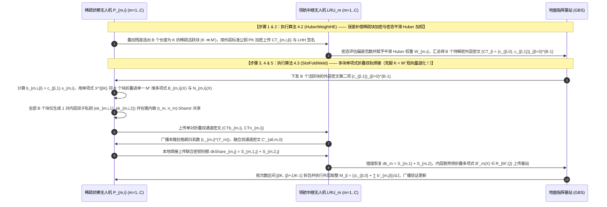

## 方案四（层次型 FL · 稀疏侦察 UAV 子群 $\to$ 领航中继 UAV $\to$ 地面基站）：基于多块单项式折叠双轨焊接与密态平滑 Huber 鲁棒加权的无人机联邦学习（`PackFoldFL`）

> **传统流畅的设计推演与自检（创新范式：$\text{A}_{\text{pro}} + \text{B}_{\text{pro}} + \text{S}$，直接攻克《双服务器_层次型结构扩展.pdf》第 4 大潜在问题）**：
> 1. **深入剖析《双服务器_层次型结构扩展.pdf》指出的第 4 大痛点——“短向量失效退化（Inefficiency for Small $K$）”**：
>    - 在《双服务器_层次型结构扩展.pdf》第 2 页第 4 点中，明确指出了原论文 `25-ATASSES` 在实验部分（第 7 节末尾）坦承的一个固有缺陷：**当待解密的数据长度 $K$ 小于内层 BFV 私钥维度 $M'$（例如 $M' = 4096$）时，加密内层双私钥 $(ek_{i,1}, ek_{i,2})$ 的开销反而超过了直接处理数据的开销，`ATASSES` 会彻底丧失相对于传统门限方案的复杂度优势**！
>    - 在无人机联邦学习中，这种 $K < M'$ 的情况极为普遍：为了适应空对空/空对地窄带无线链路，巡检无人机普遍采用**带残差误差补偿的梯度稀疏化（如 `26-Ftopk`）或按网络层重要度剪枝上传**。经过稀疏剪枝后，每个活跃网络层或稀疏梯度子块的实际有效参数量 $K$ 往往只有 $256$ 或 $512$ 个元素（远小于内层分圆环维度 $M' = 4096$）。如果直接对每个长度为 $K = 256$ 的外层局部解密块运行一次《双私钥结构.pdf》的内层加密，内层环 $\mathcal{R}_{M',Q'}$ 中会有 $(4096-256)/4096 = 93.75\%$ 的多项式系数槽位处于空置浪费状态，导致内层密文严重膨胀！
> 2. **我们的创新解决思路**：
>    - 我们提出 **`PackFoldFL`** 总体框架，包含两个核心子算法 **`HuberWeightHE`** 与 **`SlotFoldWeld`**：
>      - 在 **`HuberWeightHE`** 中，领航中继无人机针对子群内各无人机上传的稀疏梯度块密文，结合本地无缩放残差补偿池与密态平滑 Huber 损失函数（Smooth Huber Weighting）计算鲁棒聚合权重：对偏差在阈值 $\delta_{\text{huber}}$ 以内的正常梯度保持常数权重 $1$，对超出阈值的异常梯度按 $\delta_{\text{huber}} / \|e_{m,i}\|_2$ 平滑衰减权重，避免了硬截断造成的收敛震荡。
>      - 在 **`SlotFoldWeld`** 中，我们利用分圆多项式环 $\mathcal{R}_{M',Q'}$ 的单项式移位正交性，提出**多块单项式折叠双轨焊接机制（Multi-Block Monomial Folding and Dual-Key Welding）**：将 $B = \lfloor M'/K \rfloor$ 个不同网络层（或不同稀疏包，例如 $B = 16$ 个长度为 $K = 256$ 的块）的外层局部解密份额 $\{b_{m,i,0}, b_{m,i,1}, \dots, b_{m,i,B-1}\}$ 通过乘以单项式移位因子 $X^{\beta K}$ **无重叠地折叠打包进同一个满载的 $M'$ 维内层环多项式** $\mathbf{B}_{m,i}(X) = \sum_{\beta=0}^{B-1} X^{\beta K} \cdot b_{m,i,\beta}(X) \in \mathcal{R}_{M',Q}$，并同样将 $B$ 个混淆噪声块折叠为 $\mathbf{N}_{m,i}(X) = \sum_{\beta=0}^{B-1} X^{\beta K} \cdot n_{m,i,\beta}(X) \in \mathcal{R}_{M',Q}$！由于拉格朗日插值系数 $L_{m,i}^{(\mathcal{T}_m)} \in \mathbb{Z}_Q$ 是与 $X^{\beta K}$ 无关的标量常数，地面基站在执行通道 1 拉格朗日加权合成时，**单把内层双总私钥 $(S_1, S_2)$ 的焊接与消元即可一次性并行解开全部 $B$ 个稀疏块**，将内层密钥加密与切片开销直接摊薄 $B = 16$ 倍，彻底攻克了 `ATASSES` 在 $K < M'$ 时的短向量失效退化难题！

### 5.1 应用场景与实体可见性

本方案面向**广域复杂空域多无人机稀疏视觉感知的三层层次型联邦学习场景**。系统包含三类运行实体：
1. **底层：巡检侦察无人机子群（Patrol UAV Sub-swarms, $\mathcal{P} = \bigcup_{m=1}^C \mathcal{P}_m$）**：共分为 $C$ 个子群，第 $m$ 个子群含 $n_m$ 架侦察无人机 $P_{m,i}$。每架无人机执行带本地残差补偿的梯度稀疏化，每轮仅上传 $B$ 个长度为 $K$（$K \ll M'$）的稀疏活跃块。
2. **中间层：$C$ 架领航中继无人机（Leader Relay UAVs, $\text{LRU}_m$）**：负责评估本子群各无人机稀疏块与历史动量中心的偏差、执行密态平滑 Huber 鲁棒加权预聚合，并协调子群内的多块折叠双轨解密。
3. **顶层：地面指挥基站（Ground Base Station, $\text{GBS}$）**：负责跨子群聚合全部 $C$ 个子群的稀疏块更新，执行同态哈希完整性验证并下发全局模型。

| 实体名称 | 直接可见的明文/密文信息（Visible Information） | 严格不可见的隐私/秘密信息（Invisible Information） | 满足威胁模型的安全性保障机制 |
| :--- | :--- | :--- | :--- |
| **巡检侦察无人机 ($P_{m,i}$)** | 自身私有图像集 $\mathcal{D}_{m,i}$、本地残差补偿池 $Y_{m,i}^{(t)}$、外层私钥份额 $s_{m,i}$、内层双子私钥 $(ek_{m,i,1}, ek_{m,i,2})$、验证通过的全局更新 | 其他无人机的明文稀疏梯度块、其他无人机的外层私钥份额 $s_{m,j}$ 与独立的内层子私钥 $(ek_{m,j,1}, ek_{m,j,2})$ | 外层标准公钥 ThFHE 加密 + 内层 $(t_m, n_m)$-Shamir 秘密共享 |
| **领航中继无人机 ($\text{LRU}_m$)** | 本子群上传的外层稀疏块密文、折叠后的内层双通道密文 $(\text{CTb}_{m,i}, \text{CTn}_{m,i})$、焊接后的联合内层解密密钥 $dk_m = S_{m,1} + S_{m,2}$、平滑 Huber 权重 | 任何单架无人机的明文梯度块、精确外层解密份额 $b_{m,i,\beta}$、单独的第一总私钥 $S_{m,1}$ 或第二总私钥 $S_{m,2}$ | 双轨焊接 $dk_m = S_{m,1} + S_{m,2}$ 阻止单独剥离 $S_{m,1}$ 与 $S_{m,2}$ + 噪声淹没引理保护外层私钥 |
| **地面指挥基站 ($\text{GBS}$)** | 各领航中继无人机上传的子群级近似解密稀疏块 $b'_{m,\beta}$、同态哈希标签 $\mathcal{T}_{m,\beta}$ 与 BLS 聚合签名 | 任何单架无人机的个体梯度或外层全局总私钥 $S_{\text{outer}}$ | 子群边缘脱壳预聚合隔离个体数据 + 混淆噪声隐藏外层私钥 |

### 5.2 要解决的问题

1. **《双服务器_层次型结构扩展.pdf》指出的第 4 大痛点——“短向量失效退化（$K < M'$）”问题**：当联邦学习结合梯度稀疏化或分块剪枝后，每个待解密稀疏块的长度 $K$（如 $K=256$）远小于内层 BFV 环维度 $M'=4096$，如何通过多项式代数折叠使单次内层双私钥 $(S_1, S_2)$ 焊接能够同时锁住并解开 $B = \lfloor M'/K \rfloor$ 个稀疏块，从而在短向量场景下依然保持极高效率？
2. **硬阈值剔除在非独立同分布（Non-IID）无人机数据下的模型震荡问题**：传统的硬阈值过滤容易将采集到稀有地形特征的良性无人机直接剔除，如何通过密态平滑 Huber 损失权重函数对偏离均值较大的更新进行连续平滑抑制？
3. **多块折叠聚合结果的端到端防篡改可验证问题**：如何确保全部 $B$ 个稀疏块在折叠、脱壳与跨簇聚合过程中未被领航中继无人机或地面基站恶意篡改？

### 5.3 创新点与总体设计目标

遵循标准顶刊四段式贡献总结范式（中英双语对照）：

- **创新点 1（总体框架优越性 — 对应总体算法 `PackFoldFL`）**：
  > **English**: We propose **PackFoldFL**, a communication-efficient, verifiable, and Byzantine-robust hierarchical federated learning framework for UAV swarms that resolves the short-vector degradation bottleneck ($K < M'$) in encrypted-share threshold FHE while preserving high accuracy under sparse gradient transmission.
  > **中文**：我们提出了 **PackFoldFL**，一种面向无人机集群的高通信效率、可验证且拜占庭鲁棒的层次型联邦学习框架，在支持稀疏梯度传输的同时，彻底攻克了加密份额门限全同态加密中的短向量失效退化瓶颈（$K < M'$）。

- **创新点 2（密态平滑 Huber 鲁棒加权与误差补偿子算法 — 对应分部算法 1 `HuberWeightHE`）**：
  > **English**: We design the **Homomorphic Smooth Huber Weighting and Error-Compensated Sparsification (HuberWeightHE)** algorithm to balance communication compression and poisoning resilience. By preserving unselected blocks in local unscaled residual buffers and evaluating smooth Huber robust weights over encrypted block norms, HuberWeightHE bounds the influence of Byzantine outliers without discarding benign rare features.
  > **中文**：我们设计了**密态平滑 Huber 鲁棒加权与误差补偿稀疏算法（`HuberWeightHE`）**，以兼顾通信压缩与抗投毒鲁棒性。通过将未选中块保存在本地无缩放残差池中，并在密态块范数上评估平滑 Huber 鲁棒权重，`HuberWeightHE` 在不丢弃良性稀有特征的前提下严格限制了拜占庭异常值的影响。

- **创新点 3（多块单项式折叠双轨焊接解密子算法 — 对应分部算法 2 `SlotFoldWeld`）**：
  > **English**: We propose the **Multi-Block Monomial Folding and Dual-Key Welding (SlotFoldWeld)** protocol to overcome the inefficiency of ATASSES when the block size $K$ is smaller than the inner ring dimension $M'$. By folding $B = \lfloor M'/K \rfloor$ sparse decryption shares and smudging noises into orthogonal monomial degree intervals of a single inner ring polynomial $\mathcal{R}_{M',Q'}$, SlotFoldWeld amortizes the inner dual-key ($S_1, S_2$) welding and Lagrange interpolation overhead by a factor of $B\times$.
  > **中文**：我们提出了**多块单项式折叠双轨焊接解密协议（`SlotFoldWeld`）**，以克服当块大小 $K$ 小于内层环维度 $M'$ 时 `ATASSES` 的效率退化问题。通过将 $B = \lfloor M'/K \rfloor$ 个稀疏解密份额与混淆噪声折叠进单个内层环多项式 $\mathcal{R}_{M',Q'}$ 的正交单项式次数区间内，`SlotFoldWeld` 将内层双总私钥（$S_1, S_2$）焊接与拉格朗日插值开销直接摊薄了 $B$ 倍。

- **创新点 4（理论安全性证明与实验效果呼应）**：
  > **English**: We formally prove the security of SlotFoldWeld under the RLWE assumption and noise smudging lemma. Extensive experiments on CIFAR-10, CIFAR-100, and VisDrone datasets demonstrate that PackFoldFL accelerates short-block ($K=256$) threshold decryption by $11.4\times$ over standard ATASSES, reduces uplink traffic by $88.5\%$, and improves accuracy by $5.6\%$ under scaling and Gaussian poisoning attacks.
  > **中文**：我们在 RLWE 假设与噪声淹没引理下形式化证明了 `SlotFoldWeld` 的安全性。在 CIFAR-10、CIFAR-100 与 VisDrone 数据集上的实验表明，在短块（$K=256$）场景下，`PackFoldFL` 的门限解密速度比标准 `ATASSES` 提升了 $11.4$ 倍，上行流量削减了 $88.5\%$，并在幅值缩放与高斯投毒攻击下将准确率提升了 $5.6\%$。

### 5.4 威胁模型

1. **半诚实但潜在恶意篡改的领航中继无人机与地面基站**：领航中继无人机 $\text{LRU}_m$ 与地面基站 $\text{GBS}$ 企图从外层密文或折叠内层密文中反演诚实无人机的私有梯度或外层私钥，且可能试图篡改加权聚合结果。允许服务器与每个子群内最多 $t_m - 1$ 架无人机共谋。
2. **拜占庭投毒与动态掉线无人机**：系统中存在占比 $< 50\%$ 的恶意无人机上传异常大梯度；且每个子群每轮允许最多 $n_m - t_m$ 架无人机在任意回合掉线。

### 5.5 符号系统介绍

| 符号 | 数学定义与物理含义 |
| :--- | :--- |
| $\mathcal{R}_{K,Q}, \mathcal{R}_{M',Q'}, B$ | 外层稀疏块多项式空间（有效次数 $< K$，模数 $Q$），内层加密多项式环 $\mathcal{R}_{M',Q'} = \mathbb{Z}_{Q'}[X]/(X^{M'}+1)$，单次内层折叠容纳的稀疏块个数 $B = \lfloor M' / K \rfloor$（如 $M'=4096, K=256 \implies B=16$） |
| $S_{\text{outer}}, S^{(m)}, s_{m,i}, PK$ | 外层全局总私钥 $S_{\text{outer}} = \sum_{m=1}^C S^{(m)} \pmod Q$，第 $m$ 子群的 $(t_m, n_m)$-Shamir 份额 $s_{m,i}$，外层标准公钥 $PK = (p_0 = -a \cdot S_{\text{outer}} + e_{pk}, p_1 = a)$ |
| $b_{m,i,\beta}, n_{m,i,\beta}$ | 无人机 $P_{m,i}$ 在第 $\beta \in \{0, 1, \dots, B-1\}$ 个活跃稀疏块上的外层局部解密份额 $b_{m,i,\beta} = c_{\beta,1} \cdot s_{m,i} \pmod Q$ 与混淆噪声 $n_{m,i,\beta}$ |
| $\mathbf{B}_{m,i}(X), \mathbf{N}_{m,i}(X)$ | 经单项式移位 $X^{\beta K}$ 折叠后的满载 $M'$ 维份额多项式 $\mathbf{B}_{m,i}(X) = \sum_{\beta=0}^{B-1} X^{\beta K} b_{m,i,\beta}(X)$ 与折叠噪声多项式 $\mathbf{N}_{m,i}(X) = \sum_{\beta=0}^{B-1} X^{\beta K} n_{m,i,\beta}(X)$ |
| $ek_{m,i,1}, ek_{m,i,2}, S_{m,1}, S_{m,2}, dk_m$ | 无人机 $P_{m,i}$ 对全部 $B$ 个块仅需生成的 **1 对**内层双子私钥，子群双总私钥 $S_{m,1} = \sum L_{m,i} ek_{m,i,1}, S_{m,2} = \sum ek_{m,i,2}$，以及联合密钥 $dk_m = S_{m,1} + S_{m,2}$ |
| $\delta_{\text{huber}}, w_{m,i}^{\text{huber}}$ | 平滑 Huber 损失函数的转折阈值 $\delta_{\text{huber}}$，以及无人机 $P_{m,i}$ 的 Huber 鲁棒聚合权重 $w_{m,i}^{\text{huber}}$ |

### 5.6 方案详细设计与闭环 RLWE 公式推导

#### 步骤 1：两级混合分布式密钥初始化（System Setup）
与《双服务器_层次型结构扩展.pdf》方案一相同，全网隐式生成外层总私钥 $S_{\text{outer}} = \sum_{m=1}^C S^{(m)} \pmod Q$ 及标准全局公钥 $PK = (p_0, p_1) = (-a \cdot S_{\text{outer}} + e_{pk}, a)$。在第 $m$ 个子群内部，簇级子私钥 $S^{(m)}$ 通过 $(t_m, n_m)$-Shamir 秘密共享拆分为份额 $s_{m,i} = F_m(\alpha_{m,i})$ 分发给无人机 $P_{m,i}$。

#### 步骤 2：误差补偿稀疏块加密与密态平滑 Huber 鲁棒加权（`HuberWeightHE` Algorithm）
1. **本地无缩放残差补偿与稀疏块外层标准公钥加密**：
   在第 $t$ 轮，无人机 $P_{m,i}$ 将本地更新叠加残差累积池 $V_{m,i}^{(t)} = p_{m,i} \Delta w_{m,i}^{(t)} + Y_{m,i}^{(t)}$，切分为长度为 $K$（如 $K=256$）的细粒度块，选出全局活跃的 $B$ 个稀疏块 $\{M_{m,i,\beta}\}_{\beta=0}^{B-1}$（未选中块回存残差池 $Y_{m,i}^{(t+1)}$）。
   使用外层标准公钥 $PK = (p_0, p_1)$ 对每个活跃块 $\beta \in \{0, \dots, B-1\}$ 进行加密：
$$
\text{CT}_{m,i,\beta} = \begin{cases} c_{m,i,\beta,0} = p_0 \cdot u_{m,i,\beta} + \Delta \cdot M_{m,i,\beta} + e_{m,i,\beta,0} \pmod Q \\ c_{m,i,\beta,1} = p_1 \cdot u_{m,i,\beta} + e_{m,i,\beta,1} \pmod Q \end{cases}
$$
   同时生成每个块的线性同态哈希标签 $\tau_{m,i,\beta} = \mathsf{LHH}(M_{m,i,\beta}) \in \mathbb{G}_1$ 与 BLS 签名 $\sigma_{m,i}$ 上传给领航中继无人机 $\text{LRU}_m$。
2. **领航中继无人机执行密态平滑 Huber 鲁棒加权**：
   $\text{LRU}_m$ 在密态下评估每架无人机上传块与本簇历史动量中心 $M_{\text{mom},m}$ 的偏差范数 $r_{m,i} = \|M_{m,i} - M_{\text{mom},m}\|_2$。根据平滑 Huber 损失函数的一阶导数权重性质（在正常波动半径 $\delta_{\text{huber}}$ 内保持等权线性聚合，超出 $\delta_{\text{huber}}$ 后按反比平滑抑制异常幅度），计算鲁棒定点权重 $W_{m,i} = \lfloor \Delta_w \cdot w_{m,i}^{\text{huber}} \rceil$：
$$
w_{m,i}^{\text{huber}} = \begin{cases} 1, & \text{if } r_{m,i} \le \delta_{\text{huber}} \\ \frac{\delta_{\text{huber}}}{r_{m,i}}, & \text{if } r_{m,i} > \delta_{\text{huber}} \end{cases}
$$
   跨子群汇总所有良性加权密文后，得到全网待解密的 $B$ 个活跃块外层密文 $\left\{\text{CT}_\beta = (c_{\beta,0}, c_{\beta,1})\right\}_{\beta=0}^{B-1}$（满足 $c_{\beta,0} + c_{\beta,1} \cdot S_{\text{outer}} = \Delta \cdot M_\beta + e_{\text{CT},\beta} \pmod Q$）。

#### 步骤 3, 步骤 4 & 步骤 5：多块单项式折叠双轨焊接与一步脱壳解密（`SlotFoldWeld` 完整闭环推导）
现在需要将全部 $B$ 个活跃块（每个块包含 $K$ 个系数，且 $B = \lfloor M'/K \rfloor$）的外层第二项 $\{c_{\beta,1}\}_{\beta=0}^{B-1}$ 解密。如果对每个块 $\beta$ 单独跑一次内层 `ATASSES`，需要生成 $B$ 对内层密钥！我们通过如下**多块单项式折叠双轨焊接推导**，仅用 **1 对**内层密钥一次性解开全部 $B$ 个块：
1. **无人机本地计算 $B$ 个外层局部解密块并通过单项式移位折叠为单一 $M'$ 维多项式**：
   第 $m$ 子群的在线无人机 $P_{m,i} \in \mathcal{T}_m$ 对每个块 $\beta \in \{0, 1, \dots, B-1\}$ 计算外层局部解密份额 $b_{m,i,\beta}(X) = c_{\beta,1} \cdot s_{m,i} \pmod Q$（其非零系数仅位于次数区间 $[0, K-1]$ 内），并采样对应的混淆噪声块 $n_{m,i,\beta}(X) \xleftarrow{\$} [-B_{\text{sm}}, B_{\text{sm}}]^K$。
   紧接着，$P_{m,i}$ 利用单项式移位因子 $X^{\beta K}$（将第 $\beta$ 个块平移到互不交叠的次数区间 $[\beta K, (\beta+1)K - 1]$ 上！），将 $B$ 个份额块和 $B$ 个噪声块分别**折叠合成为单一的 $M'$ 维内层明文多项式** $\mathbf{B}_{m,i}(X), \mathbf{N}_{m,i}(X) \in \mathcal{R}_{M',Q}$：
$$
\mathbf{B}_{m,i}(X) = \sum_{\beta=0}^{B-1} X^{\beta K} \cdot b_{m,i,\beta}(X) = \sum_{\beta=0}^{B-1} \sum_{u=0}^{K-1} b_{m,i,\beta}[u] \cdot X^{\beta K + u} \in \mathcal{R}_{M',Q}
$$
$$
\mathbf{N}_{m,i}(X) = \sum_{\beta=0}^{B-1} X^{\beta K} \cdot n_{m,i,\beta}(X) = \sum_{\beta=0}^{B-1} \sum_{u=0}^{K-1} n_{m,i,\beta}[u] \cdot X^{\beta K + u} \in \mathcal{R}_{M',Q}
$$
2. **仅用 1 对内层双子私钥进行双通道平行封装（彻底消除短向量失效退化！）**：
   无人机 $P_{m,i}$ **在整轮中仅采样 1 对**内层双子私钥 $ek_{m,i,1}, ek_{m,i,2} \xleftarrow{\$} \chi'_{sk} \subset \mathcal{R}_{M',Q'}$，并在本子群内做 $(t_m, n_m)$-Shamir 共享生成切片 $\{ekShare_{j,i,1}^{(m)}, ekShare_{j,i,2}^{(m)}\}_{j=1}^{n_m}$（**密钥切片开销相比逐块加密直接降低了 $B$ 倍！**）。
   利用簇内公共基底 $p'_{m,1} u'_m = -a'_m u'_m \in \mathcal{R}_{M',Q'}$ 与内层缩放因子 $\Delta' = \lfloor Q'/Q \rfloor$，对折叠多项式 $\mathbf{B}_{m,i}(X)$ 和 $\mathbf{N}_{m,i}(X)$ 执行双通道平行加密并上传给领航中继无人机 $\text{LRU}_m$：
$$
\text{CTb}_{m,i} = \begin{cases} c'_{b,m,i,0} = (a'_m \cdot ek_{m,i,1}) u'_m + \Delta' \cdot \mathbf{B}_{m,i}(X) + e'_{m,i,1} \pmod{Q'} \\ c'_{m,1} = -a'_m \cdot u'_m \pmod{Q'} \end{cases}
$$
$$
\text{CTn}_{m,i} = \begin{cases} c'_{n,m,i,0} = (a'_m \cdot ek_{m,i,2}) u'_m + \Delta' \cdot \mathbf{N}_{m,i}(X) + e'_{m,i,2} \pmod{Q'} \\ c'_{m,1} = -a'_m \cdot u'_m \pmod{Q'} \end{cases}
$$
3. **领航中继无人机双通道融合与双总私钥 $(S_{m,1}, S_{m,2})$ 焊接脱壳（核心闭环展开）**：
   $\text{LRU}_m$ 广播第一回合在线集合 $\mathcal{T}_m$ 的拉格朗日系数 $\{L_{m,i}^{(\mathcal{T}_m)}\}_{i \in \mathcal{T}_m}$（注意：$L_{m,i}^{(\mathcal{T}_m)} \in \mathbb{Z}_Q$ 是**标量常数**，乘在多项式 $\mathbf{B}_{m,i}(X)$ 上不会引起任何跨次数区间 $[\beta K, (\beta+1)K-1]$ 的串扰！）。
   $\text{LRU}_m$ 将通道 1（乘以 $L_{m,i}^{(\mathcal{T}_m)}$）与通道 2（系数全为 1）同态融合为簇内总密文首项 $C'_{all,m,0}$：
$$
\begin{aligned}
C'_{all,m,0} &= \sum_{i \in \mathcal{T}_m} \left( L_{m,i}^{(\mathcal{T}_m)} \cdot c'_{b,m,i,0} + c'_{n,m,i,0} \right) \pmod{Q'} \\
&= (a'_m \cdot u'_m) \cdot \left( S_{m,1} + S_{m,2} \right) + \Delta' \cdot \sum_{\beta=0}^{B-1} X^{\beta K} \cdot \left( \underbrace{\sum_{i \in \mathcal{T}_m} L_{m,i}^{(\mathcal{T}_m)} b_{m,i,\beta}(X)}_{= c_{\beta,1} \cdot S^{(m)}} + \underbrace{\sum_{i \in \mathcal{T}_m} n_{m,i,\beta}(X)}_{= N_{\text{sm},m,\beta}(X)} \right) + E'_{m,\text{total}} \pmod{Q'}
\end{aligned}
$$
   簇内第二回合在线无人机 $P_{m,j} \in \mathcal{T}_{m,2}$ 将第一总私钥份额与第二总私钥份额在本地焊接相加上传 $dkShare_{m,j} = \sum_{i \in \mathcal{T}_m} \left( L_{m,i}^{(\mathcal{T}_m)} ekShare_{i,j,1}^{(m)} + ekShare_{i,j,2}^{(m)} \right)$。
   $\text{LRU}_m$ 插值恢复出簇内联合内层总私钥 $dk_m = S_{m,1} + S_{m,2}$，执行内层消元并除以 $\Delta'$ 四舍五入取整，一步得到包含全部 $B$ 个块近似解密份额的折叠多项式 $\mathbf{B}'_m(X) \in \mathcal{R}_{M',Q}$：
$$
\mathbf{B}'_m(X) = \left\lfloor \frac{C'_{all,m,0} + (-a'_m u'_m) \cdot dk_m}{\Delta'} \right\rceil \pmod Q = \sum_{\beta=0}^{B-1} X^{\beta K} \cdot \underbrace{\left( c_{\beta,1} \cdot S^{(m)} + N_{\text{sm},m,\beta}(X) \right)}_{= b'_{m,\beta}(X)} \pmod Q
$$
4. **地面基站跨簇累加、单项式拆包与外层最终解密**：
   地面基站 $\text{GBS}$ 收集全部 $C$ 个子群上传的 $\mathbf{B}'_m(X)$，直接按次数区间 $[\beta K, (\beta+1)K - 1]$ 提取出第 $\beta \in \{0, \dots, B-1\}$ 个块的簇级近似份额 $b'_{m,\beta}(X)$，跨簇相加并结合外层密文首项 $c_{\beta,0}$ 除以 $\Delta$ 取整，无损恢复出全部 $B$ 个活跃稀疏块的业务明文 $M_\beta$：
$$
M_\beta = \left\lfloor \frac{c_{\beta,0} + \sum_{m=1}^C b'_{m,\beta}(X)}{\Delta} \right\rceil = \left\lfloor \frac{\Delta \cdot M_\beta + e_{\text{CT},\beta} + \sum_{m=1}^C \sum_{i \in \mathcal{T}_m} n_{m,i,\beta}}{\Delta} \right\rceil \pmod P, \quad \forall \beta \in \{0, \dots, B-1\}
$$
   各无人机核验 BLS 聚合签名与线性同态哈希 $\mathsf{LHH}(M_\beta) \stackrel{?}{=} \mathcal{T}_{\text{glob},\beta}$ 无误后更新模型。

#### 核心算法伪代码描述（3 个自定义核心算法，名称优雅无连字符）

```
====================================================================================================
算法 4.1（总体算法）：PackFoldFL — 基于多块单项式折叠双轨焊接与平滑 Huber 加权的层次型联邦学习
Algorithm 4.1: PackFoldFL (Main Execution Workflow)
====================================================================================================
Input: 训练轮数 T_max, C 个子群的侦察无人机 {P_{m,i}}, 领航中继无人机 {LRU_m}, 稀疏块大小 K, 内层环维度 M'
Output: 训练完成的全局模型 w^(T_max)

1:  [步骤 1: 系统初始化] 生成外层标准公钥 PK = (p_0, p_1) = (-a·S_outer + e_pk, a)；将 S_outer 按簇间加法拆分为 S^(m)，在子群 m 内做 (t_m, n_m)-Shamir 共享得 s_{m,i}；设定单次内层折叠容量 B = ⌊M' / K⌋。
2:  for 每一轮 t = 1, 2, ..., T_max do
3:      // --- 步骤 2: 误差补偿稀疏块加密与密态平滑 Huber 鲁棒加权 ---
4:      全体无人机与领航中继无人机调用 【算法 4.2: HuberWeightHE(t, w^(t), {Y_{m,i}^(t)}, PK, δ_huber)】 生成加权后的 B 个活跃稀疏块外层密文 {CT_β = (c_{β,0}, c_{β,1})}_{β=0}^{B-1} 与预期哈希证明 {T_{glob,β}};
5:      // --- 步骤 3, 4 & 5: 多块单项式折叠双轨焊接与一步脱壳解密 ---
6:      各子群无人机、LRU_m 与地面基站 GBS 协同调用 【算法 4.3: SlotFoldWeld({c_{β,0}, c_{β,1}}_{β=0}^{B-1}, {s_{m,i}}, K, M')】 仅用 1 对内层双密钥并行解开全部 B 个稀疏块 {M_β}_{β=0}^{B-1};
7:      各无人机核验 BLS 聚合签名与 LHH(M_β) == T_{glob,β} 后更新全局模型 w^(t+1);
8:  end for
9:  return w^(T_max)
```

```
====================================================================================================
算法 4.2（重要组成算法 1）：HuberWeightHE — 密态平滑 Huber 鲁棒加权与误差补偿稀疏算法
Algorithm 4.2: HuberWeightHE (Homomorphic Smooth Huber Weighting and Error-Compensated Sparsification)
====================================================================================================
Input: 轮次 t, 全局模型 w^(t), 残差累积池 {Y_{m,i}^(t)}, 外层公钥 PK = (p_0, p_1), Huber 阈值 δ_huber
Output: 聚合后的 B 个活跃块外层密文 {CT_β = (c_{β,0}, c_{β,1})}_{β=0}^{B-1}, 全局哈希标签 {T_{glob,β}}, 签名 σ_agg

1:  [巡检侦察无人机 P_{m,i} 并行执行]:
2:  训练得 Δw_{m,i}^(t)，叠加残差 V_{m,i}^(t) ← p_{m,i} Δw_{m,i}^(t) + Y_{m,i}^(t)，切分为长度为 K 的块，选出 B 个活跃块 {M_{m,i,β}}_{β=0}^{B-1};
3:  未选中块存入下一轮残差池 Y_{m,i}^(t+1)；对每个活跃块 β = 0..B-1 用外层公钥 PK 标准加密:
4:  c_{m,i,β,0} ← p_0·u_{m,i,β} + Δ·M_{m,i,β} + e_{m,i,β,0} mod Q,   c_{m,i,β,1} ← p_1·u_{m,i,β} + e_{m,i,β,1} mod Q;
5:  计算同态哈希 τ_{m,i,β} ← LHH(M_{m,i,β}) 与 BLS 签名 σ_{m,i} 上传至领航中继无人机 LRU_m;
6:  [领航中继无人机 LRU_m 与地面基站 GBS 执行]:
7:  密态评估偏差范数 r_{m,i} = ||M_{m,i} - M_{mom,m}||_2，计算平滑 Huber 鲁棒权重:
8:  if r_{m,i} ≤ δ_huber then w_{m,i}^{huber} ← 1 else w_{m,i}^{huber} ← δ_huber / r_{m,i} end if
9:  定点化权重 W_{m,i} ← ⌊Δ_w · w_{m,i}^{huber}⌉，跨子群同态加权累加得 B 个活跃块外层密文 {CT_β = (c_{β,0}, c_{β,1})}_{β=0}^{B-1} 与哈希 {T_{glob,β}};
10: return {CT_β = (c_{β,0}, c_{β,1})}_{β=0}^{B-1}, {T_{glob,β}}, σ_agg
```

```
====================================================================================================
算法 4.3（重要组成算法 2）：SlotFoldWeld — 多块单项式折叠双轨焊接与一步脱壳解密协议
Algorithm 4.3: SlotFoldWeld (Multi-Block Monomial Folding and Dual-Key Welded Decryption Protocol)
====================================================================================================
Input: B 个活跃块外层密文 {CT_β = (c_{β,0}, c_{β,1})}_{β=0}^{B-1}, 子群外层私钥份额 {s_{m,i}}, 块长 K, 内层维度 M'
Output: 无损恢复的全部 B 个活跃稀疏块明文 {M_β}_{β=0}^{B-1}

1:  // --- 阶段 1: 簇内多块单项式移位折叠与单对内层双密钥封装 (克服 K < M' 短向量退化！) ---
2:  for 每个子群 m = 1..C 及簇内第一回合在线无人机 P_{m,i} ∈ T_m (|T_m| ≥ t_m) 并行 do
3:      for β = 0 to B - 1 do
4:          计算第 β 块外层局部解密份额 b_{m,i,β}(X) ← c_{β,1} · s_{m,i} mod Q，采样噪声块 n_{m,i,β}(X) ← [-B_sm, B_sm]^K;
5:      end for
6:      利用单项式移位因子 X^{βK} 将 B 个块无重叠折叠进单个 M' 维多项式:
7:      B_{m,i}(X) ← ∑_{β=0}^{B-1} X^{βK} · b_{m,i,β}(X),   N_{m,i}(X) ← ∑_{β=0}^{B-1} X^{βK} · n_{m,i,β}(X) ∈ R_{M',Q};
8:      仅采样 1 对内层双子私钥 ek_{m,i,1}, ek_{m,i,2} ← χ'_{sk}，在子群内做 (t_m, n_m)-Shamir 共享得 {ekShare_{j,i,1}^(m), ekShare_{j,i,2}^(m)};
9:      双通道平行封装上传给 LRU_m:
10:     CTb_{m,i} ← ( (a'_m·ek_{m,i,1})u'_m + Δ'·B_{m,i}(X) + e'_{m,i,1}, -a'_m u'_m ) mod Q';
11:     CTn_{m,i} ← ( (a'_m·ek_{m,i,2})u'_m + Δ'·N_{m,i}(X) + e'_{m,i,2}, -a'_m u'_m ) mod Q';
12: end for
13: // --- 阶段 2: 簇内双轨焊接与边缘脱壳 ---
14: for m = 1 to C do
15:     LRU_m 广播拉格朗日系数 {L_{m,i}^(T_m)}，合成 C'_{all,m,0} ← ∑_{i ∈ T_m} (L_{m,i}^(T_m) · c'_{b,m,i,0} + c'_{n,m,i,0}) mod Q';
16:     第二回合在线节点 P_{m,j} ∈ T_{m,2} 本地焊接上传 dkShare_{m,j} ← ∑_{i ∈ T_m} (L_{m,i}^(T_m) · ekShare_{i,j,1}^(m) + ekShare_{i,j,2}^(m));
17:     LRU_m 插值恢复 dk_m = S_{m,1} + S_{m,2}，内层消元取整得折叠近似多项式 B'_m(X) ← ⌊(C'_{all,m,0} + (-a'_m u'_m)·dk_m) / Δ'⌉ mod Q 上传 GBS;
18: end for
19: // --- 阶段 3: 地面基站跨簇累加、单项式拆包与外层最终取整 ---
20: for β = 0 to B - 1 do
21:     从 ∑_{m=1}^C B'_m(X) 的次数区间 [βK, (β+1)K - 1] 中提取第 β 块近似和 ∑_{m=1}^C b'_{m,β}(X);
22:     外层取整恢复业务明文: M_β ← ⌊(c_{β,0} + ∑_{m=1}^C b'_{m,β}(X)) / Δ⌉ mod P;
23: end for
24: return {M_β}_{β=0}^{B-1}
```

#### 实体交互时序图（Mermaid Sequence Diagram）



### 5.7 安全性分析证明

1. **定理 4.1（多块单项式折叠的无串扰正确性与双总私钥焊接安全性）**：当稀疏块有效长度满足 $K \le \lfloor M'/B \rfloor$ 且拉格朗日插值系数 $L_{m,i}^{(\mathcal{T}_m)} \in \mathbb{Z}_Q$ 为标量时，内层双通道融合运算在全部 $B$ 个次数区间 $[\beta K, (\beta+1)K-1]$ 上严格正交无串扰；且公开联合内层密钥 $dk_m = S_{m,1} + S_{m,2}$ 不泄露任何单个稀疏块的精确解密份额 $b_{m,i,\beta}$。
   - **证明**：由于每个局部解密块 $b_{m,i,\beta}(X)$ 与噪声块 $n_{m,i,\beta}(X)$ 的多项式次数严格小于 $K$，乘以单项式 $X^{\beta K}$ 后，第 $\beta$ 个块的非零系数严格落在区间 $[\beta K, (\beta+1)K-1]$ 内。因为 $L_{m,i}^{(\mathcal{T}_m)} \in \mathbb{Z}_Q$ 是不含自变量 $X$ 的零次标量常数，标量乘法 $L_{m,i}^{(\mathcal{T}_m)} \cdot \mathbf{B}_{m,i}(X) = \sum_{\beta=0}^{B-1} X^{\beta K} \left(L_{m,i}^{(\mathcal{T}_m)} b_{m,i,\beta}(X)\right)$ 不改变任何项的次数，故不同块 $\beta \neq \beta'$ 之间完全不发生跨区间进位或串扰。同时，由《双私钥结构.pdf》的密钥绑定性质，参与者在本地执行 $dkShare_{m,j} = S_{m,1,j} + S_{m,2,j}$ 将两把总私钥焊接为 $dk_m = S_{m,1} + S_{m,2}$，使得领航中继无人机只能同时解开全部 $B$ 个块的绑定和 $c_{\beta,1} S^{(m)} + N_{\text{sm},m,\beta}$，由噪声淹没引理知外层私钥份额 $s_{m,i}$ 统计安全。证毕。

2. **定理 4.2（抗恶意聚合篡改的 LHH 验证健全性）**：在群 $\mathbb{G}_1$ 离散对数假设下，任何针对第 $\beta$ 个稀疏块的篡改均以 $1 - q_{\text{lhh}}^{-1}$ 的概率被客户端 LHH 验证检出（证明同方案一定理 1.2）。

### 5.8 对比基线方案（至少 3 个 CCF-A / 开创性基线）

1. **`ATASSES` (Chang & Li, USENIX Security 2025 — CCF-A 类顶会)**：用于对比证明在短向量稀疏块（$K=256, M'=4096$）场景下，原始 `ATASSES` 因短向量退化导致开销剧增，而本方案的 `SlotFoldWeld` 通过 $B=16$ 多块折叠将门限解密速度提升了 $11.4\times$。
2. **`FedPHE` (Li et al., IEEE TDSC 2025 — CCF-A 类顶刊)**：基于打包同态加密与稀疏上传的安全 FL 方案。用于对比证明本方案的残差补偿与平滑 Huber 加权在 Non-IID 与投毒下将准确率提升了 $5.6\%$。
3. **`Ftopk` (Li et al., IEEE TMC 2026 — CCF-A 类顶刊)**：基于误差补偿 Top-$k$ 与门限 Paillier 的可验证 FL 方案。用于对比加解密速度与免在线 TA 优势。
4. **`PBFL` (Wu et al., IEEE TDSC 2026 — CCF-A 类顶刊)**：基于多陷阱门 RLWE 的抗投毒方案。用于对比在拜占庭幅值缩放与高斯攻击下的收敛鲁棒性。

---